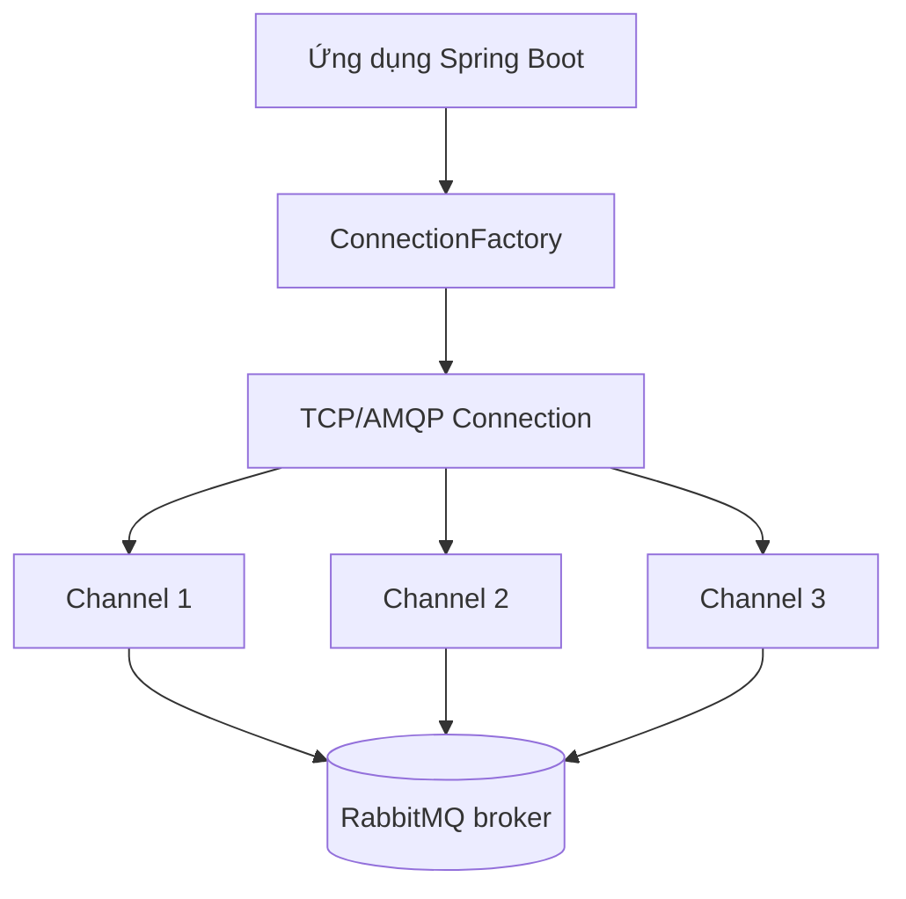
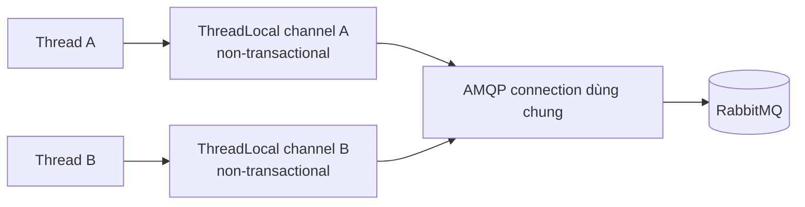

# ThreadChannelConnectionFactory và vòng đời channel gắn với luồng

## Mục tiêu bài học

Trong module **SPRING_AMQP**, `RabbitTemplate` gửi message tới RabbitMQ, còn `@RabbitListener` nhận message thông qua các listener container. Cả hai đều cần kết nối AMQP và channel để tương tác với broker. Spring AMQP có nhiều cách quản lý những tài nguyên này; **`ThreadChannelConnectionFactory`** là lựa chọn chuyên biệt khi ứng dụng muốn một **channel được gắn với luồng Java hiện tại** và có thể tái sử dụng qua nhiều thao tác trên chính luồng đó.

Bài này thuộc chương **Kết nối và channel**. Sau khi học, bạn có thể:

- Phân biệt **TCP connection**, **AMQP channel**, **Java thread** và vòng đời một lần gọi `RabbitTemplate`.
- Giải thích `ThreadChannelConnectionFactory` giữ channel bằng cơ chế gắn với thread và khác `CachingConnectionFactory` ở điểm nào.
- Sử dụng `closeThreadChannel()` đúng vị trí, nhất là khi dùng thread pool.
- Tạo một ví dụ Spring Boot gửi nhiều message liên tiếp trên một worker thread và kiểm chứng việc tái sử dụng channel.
- Nhận ra giới hạn về thứ tự message, thread safety, publisher confirms, giao dịch, recovery và quản lý tài nguyên.

> **Phạm vi:** Nội dung sử dụng API của Spring AMQP để giao tiếp với RabbitMQ qua AMQP 0-9-1. `ThreadChannelConnectionFactory` là cơ chế quản lý channel phía **ứng dụng**, không phải một loại connection hay channel mới được định nghĩa trong giao thức AMQP.

## 1. Ôn lại connection, channel và thread

Khi ứng dụng gửi message, ba tầng dưới đây có vai trò khác nhau:

| Thành phần | Đối tượng thực tế | Trách nhiệm |
|---|---|---|
| **Connection** | Một kết nối TCP/AMQP tới RabbitMQ broker | Xác thực, thiết lập session AMQP và chuyên chở các frame của nhiều channel. |
| **Channel** | Kênh logic được multiplex trên connection | Thực hiện `basic.publish`, `basic.consume`, `basic.ack`, `queue.declare`, giao dịch hoặc publisher confirms theo trạng thái của channel. |
| **Thread** | Luồng thực thi Java của ứng dụng | Chạy code gọi `RabbitTemplate` hoặc công việc của listener/executor; tự nó không phải tài nguyên AMQP. |
| **ConnectionFactory** | Bean Spring AMQP cung cấp connection/channel | Quyết định cách ứng dụng tạo, sử dụng lại và đóng tài nguyên. |

Một connection có thể có **nhiều channel**. Sử dụng channel giúp ứng dụng không cần mở một kết nối TCP riêng cho mỗi lần publish. Tuy nhiên, **channel của RabbitMQ Java client không nên được các thread sử dụng đồng thời một cách tùy tiện**: chia sẻ một channel giữa nhiều thread có thể làm các lệnh và trạng thái giao thức xen kẽ, dẫn đến lỗi khó tái hiện.



**Không đồng nhất ba khái niệm:** connection là đường vận chuyển; channel là phiên làm việc logic; thread là đơn vị chạy code. `ThreadChannelConnectionFactory` đặt thêm một quy tắc quản lý: **một thread có thể giữ lại channel của mình giữa các lần thao tác**.

## 2. Vì sao Spring AMQP có `ThreadChannelConnectionFactory`?

Spring Boot thường tự cấu hình `CachingConnectionFactory` khi có `spring-boot-starter-amqp`. Trong chế độ phổ biến, factory này **cache các channel để tái sử dụng** sau khi code trả chúng về factory; một lần gọi tiếp theo không nhất thiết lấy lại cùng channel trên cùng thread.

Đôi khi ứng dụng có chuỗi thao tác publish chạy tuần tự trên **một thread** và cần duy trì việc sử dụng **chính một channel** cho chuỗi đó. Ví dụ một worker xử lý tuần tự các sự kiện của cùng khóa nghiệp vụ rồi publish lần lượt:

```text
Worker thread: order-42
  publish(order.created)
  publish(order.paid)
  publish(order.shipped)
```

`ThreadChannelConnectionFactory` dùng các kênh **gắn với thread** để các thao tác trên cùng thread có thể lấy lại cùng channel trong suốt khoảng thời gian thread giữ nó. Cơ chế này hữu ích khi cần kiểm soát thứ tự các thao tác trên channel và muốn tránh việc các thread vô tình dùng chung channel.

Tuy nhiên, đây là công cụ **chuyên biệt**. Nếu ứng dụng đơn thuần publish/consume thông thường mà không có yêu cầu về thread affinity, `CachingConnectionFactory` là điểm khởi đầu quen thuộc và dễ quản lý hơn.

### So sánh hai cách quản lý channel

| Tiêu chí | `CachingConnectionFactory` | `ThreadChannelConnectionFactory` |
|---|---|---|
| Ý tưởng chính | Tái sử dụng các channel từ cache của factory | Giữ channel gắn với thread Java |
| Các thao tác liên tiếp trên một thread | **Có thể** lấy cùng channel, nhưng không có ràng buộc affinity như factory theo thread | Có thể tiếp tục lấy **cùng channel** trên thread đó cho tới khi channel được giải phóng/không còn dùng được |
| Sau khi `RabbitTemplate` kết thúc một lần gọi | Channel được trả về cơ chế quản lý/cache thích hợp | Channel có thể vẫn nằm trong `ThreadLocal` của thread |
| Nơi channel được giữ | Pool/cache ở cấp factory | Trạng thái gắn với từng thread |
| Quản lý tài nguyên | Tinh chỉnh cache, checkout, connection tùy chế độ và phiên bản | Chủ động kết thúc vòng đời channel trên thread bằng `closeThreadChannel()` |
| Dùng với thread pool | Thông dụng, miễn cấu hình hợp lý | **Phải chủ động dọn channel ở cuối task** để tránh giữ lâu trên worker tái sử dụng |
| Trường hợp phù hợp | Phần lớn ứng dụng Spring Boot publish và listener thông thường | Luồng publish cần giữ cùng channel cho chuỗi thao tác trên một thread |

Không nên suy diễn rằng `ThreadChannelConnectionFactory` sẽ **tăng throughput** hoặc **đảm bảo ordering toàn hệ thống** trong mọi trường hợp. Lựa chọn factory phải xuất phát từ yêu cầu sử dụng channel, khả năng quan sát và tài nguyên broker.

## 3. Cách `ThreadChannelConnectionFactory` giữ channel

Factory này quản lý **một connection dùng chung** cùng các channel được lưu theo thread. Nó có đường quản lý riêng cho **channel transactional** và **channel non-transactional**; cùng một thread có thể dùng hai loại channel khác nhau, tùy thao tác yêu cầu.

Hãy hình dung hai worker thread thực hiện các thao tác publish:



Ở chuỗi thao tác:

```text
Thread A:
    RabbitTemplate.publish(A1) ---> channel A
    RabbitTemplate.publish(A2) ---> channel A
    RabbitTemplate.publish(A3) ---> channel A
    closeThreadChannel()      ---> bỏ channel A khỏi trạng thái của thread A

Thread B:
    RabbitTemplate.publish(B1) ---> channel B
    RabbitTemplate.publish(B2) ---> channel B
    closeThreadChannel()      ---> bỏ channel B khỏi trạng thái của thread B
```

Các lần publish trong **cùng thread A** được phát trên một channel chừng nào channel còn hợp lệ và chưa được giải phóng. **Thread B** không sử dụng channel A chỉ vì cả hai dùng cùng `RabbitTemplate`. Bản thân `RabbitTemplate` thường có thể dùng chung an toàn từ nhiều thread vì nó yêu cầu factory quản lý việc cấp channel.

### Vòng đời theo thread

Vòng đời thường gặp khi dùng factory này:

1. Worker thread T gọi `RabbitTemplate.convertAndSend(...)`.
2. `RabbitTemplate` xin connection và channel qua `ConnectionFactory`.
3. Nếu thread T chưa có channel phù hợp, factory mở channel mới và lưu vào trạng thái gắn với thread T.
4. Các thao tác sau trên T có thể lấy lại channel đó.
5. Khi tác vụ trên T kết thúc, code gọi **`closeThreadChannel()` trên chính T** để giải phóng channel của T.
6. Lần thao tác kế tiếp trên T có thể yêu cầu một channel mới; factory vẫn có thể dùng lại connection vật lý.

Điểm đặc biệt nằm ở **bước 5**. Nếu ứng dụng quên gọi `closeThreadChannel()`, channel có thể tiếp tục bị giữ bởi thread, đặc biệt với các thread sống lâu trong executor pool. Đây vừa là vấn đề quản lý tài nguyên, vừa làm trạng thái channel kéo dài ngoài phạm vi một tác vụ nghiệp vụ.

> **Chính thread nào giữ channel thì thread đó phải dọn channel.** Gọi `closeThreadChannel()` từ thread chính không giải phóng channel đang gắn với các worker khác.

## 4. Khai báo `ThreadChannelConnectionFactory` trong Spring Boot

### 4.1. Dependency

Dự án cần Spring AMQP thông qua Spring Boot starter. Với Gradle Groovy DSL:

```groovy
dependencies {
    implementation 'org.springframework.boot:spring-boot-starter-amqp'
}
```

Với Maven:

```xml
<dependency>
    <groupId>org.springframework.boot</groupId>
    <artifactId>spring-boot-starter-amqp</artifactId>
</dependency>
```

Hãy để Spring Boot parent/BOM hoặc cơ chế dependency management tương ứng chọn phiên bản phù hợp. API chính được dùng trong bài là `org.springframework.amqp.rabbit.connection.ThreadChannelConnectionFactory`. Nếu dự án dùng một phiên bản Spring AMQP cũ chưa có lớp này, cần nâng các thành phần Spring Boot/Spring AMQP một cách đồng bộ, tránh ép riêng một thư viện.

### 4.2. Cấu hình factory có chủ đích

Ví dụ sau tạo factory từ **RabbitMQ Java Client ConnectionFactory**, rồi tạo `RabbitTemplate` sử dụng factory đó. Đặt lớp trong package được Spring Boot quét, chẳng hạn `com.example.threadchannels`:

```java
package com.example.threadchannels;

import org.springframework.amqp.core.Queue;
import org.springframework.amqp.core.QueueBuilder;
import org.springframework.amqp.rabbit.connection.ThreadChannelConnectionFactory;
import org.springframework.amqp.rabbit.core.RabbitTemplate;
import org.springframework.context.annotation.Bean;
import org.springframework.context.annotation.Configuration;

@Configuration
public class ThreadChannelConfiguration {

    public static final String QUEUE = "demo.thread.channel";

    @Bean
    ThreadChannelConnectionFactory threadChannelConnectionFactory() {
        com.rabbitmq.client.ConnectionFactory clientFactory =
                new com.rabbitmq.client.ConnectionFactory();
        clientFactory.setHost("localhost");
        clientFactory.setPort(5672);
        clientFactory.setUsername("guest");
        clientFactory.setPassword("guest");

        return new ThreadChannelConnectionFactory(clientFactory);
    }

    @Bean
    RabbitTemplate rabbitTemplate(
            ThreadChannelConnectionFactory connectionFactory) {
        return new RabbitTemplate(connectionFactory);
    }

    @Bean
    Queue demoThreadChannelQueue() {
        return QueueBuilder.durable(QUEUE).build();
    }
}
```

Ở đây chỉ có **một `ConnectionFactory` Spring AMQP được khai báo rõ ràng**. Spring Boot thông thường sẽ không tự tạo thêm `CachingConnectionFactory` khi đã có bean phù hợp. Bean `RabbitTemplate` cũng được đăng ký chủ động để ví dụ thể hiện rõ factory nào đang được sử dụng.

**Chú ý cấu hình:** Ví dụ gán host, port, username và password trực tiếp lên **RabbitMQ client factory**. Khi bạn tự khởi tạo factory theo cách này, **không mặc định** mọi thuộc tính `spring.rabbitmq.*` trong `application.yml` đều được áp dụng lên nó. Với dự án thật, hãy nạp cấu hình từ nguồn phù hợp và thiết lập TLS, virtual host, heartbeat, timeout, credentials theo yêu cầu của môi trường.

Tài khoản `guest/guest` chỉ nhằm thử nghiệm trên broker RabbitMQ local; chính sách mặc định thường giới hạn tài khoản này ở kết nối loopback.

### 4.3. Chạy broker để thực hành

Nếu máy chưa có RabbitMQ local và đã cài Docker, có thể chạy:

```bash
docker run -d --name rabbitmq-thread-channel-lab \
  -p 5672:5672 -p 15672:15672 \
  rabbitmq:4-management
```

Ứng dụng kết nối tới cổng **5672**; RabbitMQ Management có thể mở tại `http://localhost:15672`. Nếu cổng này đã được một RabbitMQ khác sử dụng, dùng instance hiện có hoặc thay cấu hình thí nghiệm tương ứng.

## 5. Ví dụ publish nhiều message trên một thread

Điểm quan trọng nhất khi dùng `ThreadChannelConnectionFactory` là **kết thúc công việc trên thread hiện tại bằng `closeThreadChannel()`**. Ta tạo một service publish theo batch:

```java
package com.example.threadchannels;

import java.util.List;
import org.springframework.amqp.rabbit.connection.ThreadChannelConnectionFactory;
import org.springframework.amqp.rabbit.core.RabbitTemplate;
import org.springframework.stereotype.Service;

@Service
public class ThreadBoundPublisher {

    private final RabbitTemplate rabbitTemplate;
    private final ThreadChannelConnectionFactory connectionFactory;

    public ThreadBoundPublisher(
            RabbitTemplate rabbitTemplate,
            ThreadChannelConnectionFactory connectionFactory) {
        this.rabbitTemplate = rabbitTemplate;
        this.connectionFactory = connectionFactory;
    }

    public void publishBatchOnCurrentThread(List<String> messages) {
        try {
            for (String payload : messages) {
                rabbitTemplate.convertAndSend(
                        "",
                        ThreadChannelConfiguration.QUEUE,
                        payload
                );
            }
        } finally {
            // Chạy trên đúng thread đã gọi RabbitTemplate.
            connectionFactory.closeThreadChannel();
        }
    }
}
```

Giải thích:

- `RabbitTemplate` vẫn là API phát message như thông thường.
- Vì dùng default exchange `""`, routing key là **tên queue** `demo.thread.channel`. RabbitMQ tự bind queue này với default exchange khi queue được khai báo.
- Trong vòng lặp trên **một thread**, factory có thể cấp lại cùng channel cho từng lần `convertAndSend(...)`.
- Khối `finally` luôn cố gắng dọn channel của thread, kể cả khi một lần gửi phát sinh exception.
- Nếu ứng dụng dùng `RabbitAdmin` của Spring Boot, bean `Queue` có thể được khai báo khi connection đầu tiên hình thành; cần có broker và quyền khai báo phù hợp.

Mẫu sử dụng trong một `ApplicationRunner`:

```java
package com.example.threadchannels;

import java.util.List;
import org.springframework.boot.ApplicationRunner;
import org.springframework.boot.SpringApplication;
import org.springframework.boot.autoconfigure.SpringBootApplication;
import org.springframework.context.annotation.Bean;

@SpringBootApplication
public class ThreadChannelApplication {

    public static void main(String[] args) {
        SpringApplication.run(ThreadChannelApplication.class, args);
    }

    @Bean
    ApplicationRunner sendSamples(ThreadBoundPublisher publisher) {
        return args -> publisher.publishBatchOnCurrentThread(
                List.of("event-1", "event-2", "event-3"));
    }
}
```

Khi chạy ứng dụng:

```bash
./gradlew bootRun
```

hoặc với Maven:

```bash
./mvnw spring-boot:run
```

Sau khi publish, mở RabbitMQ Management, tìm queue `demo.thread.channel`. Nếu chưa có consumer, queue có thể giữ ba message để bạn quan sát. Nếu đang có consumer khác cùng đọc queue, các message có thể được lấy đi ngay.

**Giới hạn kiểm chứng:** Thấy ba message trong queue chứng minh luồng publish đến queue, **chưa tự chứng minh** chúng dùng cùng channel. Muốn kiểm chứng affinity phải quan sát channel qua `RabbitTemplate.execute(...)` hoặc công cụ đo/ghi log phù hợp.

## 6. Kiểm chứng channel được tái sử dụng trên cùng thread

`RabbitTemplate.execute(ChannelCallback<T>)` cho phép thực hiện một callback trên AMQP channel mà template lấy từ factory. Trong ví dụ, ta in **thread name** và **channel number**:

```java
package com.example.threadchannels;

import org.springframework.amqp.rabbit.connection.ThreadChannelConnectionFactory;
import org.springframework.amqp.rabbit.core.RabbitTemplate;
import org.springframework.stereotype.Service;

@Service
public class ChannelAffinityProbe {

    private final RabbitTemplate rabbitTemplate;
    private final ThreadChannelConnectionFactory connectionFactory;

    public ChannelAffinityProbe(
            RabbitTemplate rabbitTemplate,
            ThreadChannelConnectionFactory connectionFactory) {
        this.rabbitTemplate = rabbitTemplate;
        this.connectionFactory = connectionFactory;
    }

    public void inspectOnCurrentThread() {
        try {
            printChannel("first");
            printChannel("second");
        } finally {
            connectionFactory.closeThreadChannel();
        }
    }

    private void printChannel(String label) {
        rabbitTemplate.execute(channel -> {
            System.out.printf(
                    "%s: thread=%s channelNumber=%d%n",
                    label,
                    Thread.currentThread().getName(),
                    channel.getChannelNumber()
            );
            return null;
        });
    }
}
```

Khi `inspectOnCurrentThread()` chạy hai callback liền nhau trên cùng thread và channel không bị đóng ngoài ý muốn, bạn thường quan sát được **cùng một channel number** trong hai lần in. Số channel chỉ có ý nghĩa **trong phạm vi connection tương ứng**; nếu connection/channel đóng và tạo lại, số có thể được cấp lại. Vì vậy đừng dùng riêng số này để kết luận tính liên tục của một channel qua các lần broker reconnect.

Bạn có thể tạm gọi `inspectOnCurrentThread()` trong `ApplicationRunner` hoặc một command/thao tác kiểm thử. Không cần đặt debug log mức cao liên tục trong production.

### Lưu ý về giao dịch

Trong Spring AMQP, một `RabbitTemplate` có thể dùng **channel non-transactional** hoặc **channel transactional** tùy cấu hình. `ThreadChannelConnectionFactory` quản lý hai nhánh channel này riêng theo thread; không có nghĩa cùng một thread luôn chỉ có **đúng một channel duy nhất trong mọi tình huống**.

Đặc biệt, đừng thay đổi tùy tiện chế độ transaction giữa một chuỗi thao tác rồi mặc định mọi lệnh đều nằm trong cùng một giao dịch AMQP. `channelTransacted` và giao dịch Spring quyết định những thao tác nào dùng channel transactional; quản lý channel theo thread **không tự tạo transaction** và cũng không tự bảo đảm atomicity với database.

## 7. Thread pool: phần dễ rò rỉ channel nhất

Một server thường tái sử dụng worker thread trong `ExecutorService`, `ThreadPoolTaskExecutor` hoặc container xử lý yêu cầu. Chẳng hạn:

```text
Executor pool
  Worker-1: task A -> task C -> task E -> ...
  Worker-2: task B -> task D -> task F -> ...
```

Nếu task A dùng `RabbitTemplate` nhưng **không gọi `closeThreadChannel()`**, channel của task A có thể tiếp tục gắn với Worker-1 khi task C và E được giao tới chính thread đó. Về mặt hiệu năng điều này có thể tránh mở channel mới, nhưng nó cũng kéo dài tài nguyên và trạng thái channel ngoài phạm vi mà nghiệp vụ mong muốn.

### Mẫu đúng: dọn tại cuối từng task worker

Do `ThreadBoundPublisher.publishBatchOnCurrentThread(...)` đã có `finally`, ta có thể gọi method đó trong từng worker:

```java
import java.util.List;
import java.util.concurrent.ExecutorService;
import java.util.concurrent.Executors;
import java.util.concurrent.Future;

public class BatchDispatchExample {

    private final ThreadBoundPublisher publisher;

    public BatchDispatchExample(ThreadBoundPublisher publisher) {
        this.publisher = publisher;
    }

    public void publishConcurrently() throws Exception {
        ExecutorService workers = Executors.newFixedThreadPool(2);
        try {
            Future<?> first = workers.submit(() ->
                    publisher.publishBatchOnCurrentThread(
                            List.of("order-A1", "order-A2")));

            Future<?> second = workers.submit(() ->
                    publisher.publishBatchOnCurrentThread(
                            List.of("order-B1", "order-B2")));

            first.get();
            second.get();
        } finally {
            workers.shutdown();
        }
    }
}
```

Mỗi lambda chạy trên **worker thread riêng**, và chính worker đó thực hiện `closeThreadChannel()`. Hai batch có thể chạy đồng thời. **Trong từng batch**, các lần publish được gọi tuần tự; **giữa hai batch**, thứ tự đến broker không được bảo đảm.

**Sai lầm thường gặp** là:

```java
// Không đủ: method này chạy trên thread gọi submit, có thể
// khác với thread thật sự thực hiện các lần publish.
workers.submit(() -> rabbitTemplate.convertAndSend("", "queue", "A"));
connectionFactory.closeThreadChannel();
```

Gọi `closeThreadChannel()` trên thread đang gọi `submit` **không xóa channel gắn với thread worker** bên trong executor. Nếu dùng một task chạy dài, hãy xác định điểm cuối của **đơn vị công việc trên worker** mà sau đó channel cần được giải phóng.

### Còn thread tự kết thúc thì sao?

Khi một thread kết thúc hoàn toàn, trạng thái `ThreadLocal` của thread có thể được thu hồi cùng thread. Nhưng **không nên dựa vào việc thread kết thúc** để quản lý channel trên broker, nhất là khi các worker pool được giữ sống rất lâu. Gọi `closeThreadChannel()` chủ động giúp giảm nguy cơ giữ channel mở, đảm bảo vòng đời tài nguyên rõ ràng và tránh việc một task vô tình kế thừa channel của task trước trên cùng worker.

## 8. Khi nào cùng channel giúp giữ thứ tự?

Giả sử một publisher phát ba sự kiện liên tiếp trên **cùng thread và cùng channel**:

```text
Thread order-42
    basic.publish(order.created)
    basic.publish(order.paid)
    basic.publish(order.shipped)
```

Trên **một channel**, các lệnh publish được ghi theo thứ tự ứng dụng gọi chúng. Điều này có thể giúp giữ **thứ tự phát** của một chuỗi sự kiện khi tất cả thao tác được thực hiện tuần tự và channel vẫn ổn định.

Nhưng **thứ tự phát không đồng nghĩa thứ tự xử lý nghiệp vụ**. Cần phân biệt:

| Giai đoạn | Bạn có thể kỳ vọng điều gì? | Điều gì không tự được bảo đảm? |
|---|---|---|
| Publisher gọi nhiều lệnh trên một channel | Thứ tự các lời gọi publish trên channel được giữ | Không bảo đảm publisher không phát trùng sau retry/reconnect |
| Broker định tuyến tới một queue | Queue nhận luồng message theo quy tắc broker và loại queue | Không đảm bảo mọi điều kiện thực tế vẫn FIFO đơn giản khi có priority, requeue hoặc nhiều publisher |
| Nhiều consumer cùng đọc một queue | Các message được giao cho những consumer theo chính sách broker | Không bảo đảm các consumer **hoàn thành xử lý** theo thứ tự message |
| Consumer retry/requeue | Message có thể được giao lại | Không bảo đảm thứ tự xử lý đầu-cuối không thay đổi |
| Nhiều publisher thread | Mỗi thread có channel riêng | Không có một thứ tự tổng thể tự động giữa các thread |

**Ví dụ:** Worker A dùng channel A phát `order.created`, trong khi Worker B dùng channel B phát `order.cancelled`. Dù các lời gọi trong từng worker đều tuần tự, hệ thống không có một cơ chế tự động khiến message của A chắc chắn đến trước B.

Khi cần thứ tự theo **mã đơn hàng** hoặc một khóa nghiệp vụ, bạn thường phải:

1. Chọn một chiến lược **phân vùng công việc theo khóa** để các sự kiện cùng khóa được publish tuần tự theo một đường đi.
2. Kiểm soát mức song song của publisher và consumer.
3. Thiết kế xử lý idempotent, version hoặc sequence number để phát hiện sự kiện cũ/trùng.
4. Theo dõi trường hợp message bị requeue, retry hoặc đi qua dead-letter.

`ThreadChannelConnectionFactory` có thể hỗ trợ **một phần** trong chiến lược đó, nhưng **không tự tổ chức phân vùng**, bảo đảm giao hàng đúng một lần hoặc serial hóa nhiều consumer.

## 9. Phối hợp với `RabbitTemplate`, listener và các cơ chế giao nhận

### 9.1. `RabbitTemplate` và ranh giới thao tác

`RabbitTemplate` là abstraction giúp bạn tránh trực tiếp thao tác `Channel`. Với factory theo thread, các lần gọi template trên cùng thread có thể dùng lại channel. Tuy nhiên:

- Đừng giữ tham chiếu đến một `Channel` rồi chuyển sang thread khác để sử dụng.
- Đừng giả định việc gọi template từ thread nào đó tạo ra một transaction mới.
- Dọn channel trong `finally` khi công việc trên thread kết thúc.
- Nếu có exception khiến channel/connection không còn mở, cần để lớp quản lý kết nối thực hiện cơ chế xử lý thích hợp; đừng tái dùng một channel đã hỏng.

### 9.2. Có nên dùng cùng factory cho `@RabbitListener`?

Listener container thường quản lý **connection, channel và consumer lifecycle** riêng. Với một ứng dụng Spring Boot chỉ cần xử lý message thông thường, cơ chế mặc định dựa trên `CachingConnectionFactory` thường phù hợp hơn.

Sử dụng `ThreadChannelConnectionFactory` không đồng nghĩa listener tự động “gắn message vào thread của publisher”. Publisher và consumer là hai phía độc lập, có thread và channel riêng. Khi muốn dùng nhiều connection factory cho các luồng publish/consume, hãy định tuyến bean `RabbitTemplate` và listener container tới factory phù hợp một cách tường minh.

Chỉ dùng factory theo thread cho listener khi bạn đã kiểm tra khả năng tương thích và vòng đời resource với **loại listener container cụ thể**. Không cấu hình nó cho mọi listener chỉ để mong nhận được xử lý tuần tự.

### 9.3. Publisher confirms và returns

Vòng đời channel còn liên quan đến cơ chế xác nhận publish:

- **Publisher confirms** cho publisher biết broker đã xác nhận xử lý publish theo cơ chế confirm.
- **Publisher returns** giúp phát hiện message không được định tuyến khi cấu hình phù hợp, ví dụ `mandatory`.
- **Consumer acknowledgements** xác nhận việc giao/tiếp nhận message ở phía consumer.

Ba khái niệm này không phải một. Việc giữ nguyên channel **không biến** một lời gọi `convertAndSend(...)` thành bằng chứng message đã vào queue và được consumer xử lý.

Khi cấu hình confirms hoặc returns, cần kiểm tra cơ chế callback và tính năng được hỗ trợ bởi **phiên bản Spring AMQP và loại ConnectionFactory** đang sử dụng. Đặc biệt, **giao dịch AMQP và publisher confirms không thể được bật đồng thời trên cùng một channel**. Khi cần bảo đảm phát message đáng tin cậy, thiết kế xác nhận và xử lý lỗi độc lập với việc lựa chọn factory có thread affinity.

### 9.4. Transactional và non-transactional channel

Một channel AMQP được dùng ở chế độ transactional khác với channel được sử dụng cho các publish thông thường. Factory theo thread có đường lưu trữ riêng cho hai loại này. Vì vậy:

- `closeThreadChannel()` cần được thực hiện đúng vòng đời công việc trên thread.
- Không dùng cùng một `Channel` cho các thao tác cần đồng thời những chế độ không tương thích.
- Cấu hình `channelTransacted` và transaction manager phải được xem xét ở tầng nghiệp vụ; ThreadLocal **không** cung cấp giao dịch database.

Nếu bạn vừa cập nhật database vừa publish một message, giữ channel cùng thread **không giải quyết được** bài toán tính nguyên tử giữa hai hệ thống. Các lựa chọn như transactional outbox hoặc cơ chế giao dịch được thiết kế riêng vẫn cần được đánh giá.

## 10. Quan sát vòng đời channel trên RabbitMQ

Sau khi chạy ví dụ với RabbitMQ Management, có thể quan sát:

1. **Connections:** có connection từ ứng dụng Java tới broker.
2. **Channels:** số lượng channel đang mở và trạng thái của chúng.
3. **Queues and Streams:** queue `demo.thread.channel` và lượng message `Ready` / `Unacked`.
4. **Publish/deliver/ack metrics:** tùy phiên bản công cụ quản trị, quan sát thông lượng và trạng thái giao nhận.

Thí nghiệm đề xuất:

| Bước | Hành động | Dự đoán quan sát |
|---|---|---|
| 1 | Chạy hai lần `RabbitTemplate.execute(...)` liên tiếp trên cùng thread, chưa dọn channel | Hai lần thường dùng cùng channel của thread |
| 2 | Gọi `closeThreadChannel()` trên thread đó | Channel của thread được giải phóng |
| 3 | Gọi lại `execute(...)` trên thread đó | Factory có thể tạo channel mới; **channel number có thể được tái sử dụng**, không dùng số làm ID vĩnh viễn |
| 4 | Chạy hai worker thread cùng publish, mỗi worker dọn ở `finally` | Mỗi worker quản lý channel của riêng mình |
| 5 | Cố tình bỏ dọn trong một thread pool thử nghiệm | Channel có thể tồn tại trên worker sau khi task kết thúc; quan sát số channel và vòng đời khi các worker tiếp tục được tái sử dụng |

Không nên gây rò rỉ channel trong môi trường production để “đo hiệu năng”. Thử trong một môi trường RabbitMQ riêng và dọn các tài nguyên phát sinh sau thí nghiệm.

### Kết quả quan sát nào có thể gây hiểu nhầm?

- **Không thấy channel mới sau mỗi publish:** Có thể do channel đã được giữ gắn với thread; đây là hành vi mong muốn của factory.
- **Không thấy nhiều connection khi có nhiều thread:** Bình thường; các channel có thể chia sẻ cùng một connection.
- **Thấy channel number giống nhau sau khi đóng/mở:** Broker có thể tái sử dụng số channel; điều này **không** chứng minh cùng một đối tượng channel tồn tại mãi.
- **Message có trong queue nhưng chưa được consumer xử lý:** Số channel mở không nói lên kết quả nghiệp vụ. Phải theo dõi listener, ack, retry, DLX và metrics queue.
- **Một số channel còn mở sau khi task kết thúc:** Kiểm tra worker đã gọi `closeThreadChannel()` trong chính thread đó chưa.

## 11. Các lỗi thường gặp và hướng xử lý

| Triệu chứng | Nguyên nhân có thể | Cách xử lý |
|---|---|---|
| Số channel tăng khi thread pool chạy nhiều task | Quên gọi `closeThreadChannel()`; mỗi worker giữ channel lâu | Đặt cleanup trong `finally` của **task worker**; theo dõi channel count |
| Gọi `closeThreadChannel()` nhưng channel worker vẫn tồn tại | Cleanup chạy ở thread khác với thread đã dùng channel | Chuyển cleanup vào cuối lambda/method thực sự chạy trên worker |
| Hai lần publish dùng hai channel dù dự kiến cùng thread | Task chạy trên hai thread khác nhau; channel bị đóng; có cấu hình factory/transaction khác | Log thread name, connection/channel và đường gọi template |
| Channel bị lỗi khi dùng đồng thời nhiều thread | Một `Channel` bị chia sẻ trực tiếp giữa thread thay vì đi qua factory | Không truyền một channel mutable cho nhiều worker |
| Lỗi `Connection refused` | RabbitMQ broker chưa chạy hoặc sai host/port | Kiểm tra cổng 5672, thông tin kết nối và mạng container |
| Không có queue sau khi publish | Queue chưa khai báo, `RabbitAdmin` không chạy hoặc publish sai routing key | Kiểm tra bean `Queue`, admin, default exchange và queue thực trên broker |
| Publisher báo thành công nhưng consumer chưa nhận | Message không vào queue, consumer chưa hoạt động, bị retry hoặc xử lý lỗi | Kiểm tra routing, publisher confirms/returns, queue metrics và consumer ack |
| Các sự kiện bị xử lý khác thứ tự | Nhiều producer thread/consumer; redelivery hoặc requeue | Thiết kế ordering theo khóa và kiểm soát concurrency, không chỉ đổi connection factory |
| Lỗi liên quan transaction hoặc confirm | Cấu hình kết hợp các chế độ AMQP không tương thích trên channel | Kiểm tra `channelTransacted`, confirm settings và cơ chế hỗ trợ của factory |

### Checklist rà soát trước khi dùng production

- [ ] Có yêu cầu rõ ràng về **thread affinity** của channel; đã đánh giá `CachingConnectionFactory`.
- [ ] Factory được cấu hình đúng host, virtual host, credentials, TLS và timeout.
- [ ] Các tác vụ sử dụng channel theo thread có `closeThreadChannel()` trong `finally`.
- [ ] Nếu dùng thread pool, cleanup diễn ra trên **worker thread**, không phải thread submit.
- [ ] Không chia sẻ một `Channel` trực tiếp giữa nhiều thread.
- [ ] Có số liệu quan sát số connections/channels mở và lỗi tạo channel.
- [ ] Publisher confirms/returns, consumer ack, retry, dead-letter và giao dịch được cấu hình theo yêu cầu độ tin cậy.
- [ ] Chiến lược xử lý thứ tự và message trùng lặp đã được thiết kế độc lập với connection factory.

## 12. Bài tập tự kiểm tra

### Bài 1. Cùng thread, hai lần publish

Một worker gọi:

```java
rabbitTemplate.convertAndSend("", "orders.queue", "A");
rabbitTemplate.convertAndSend("", "orders.queue", "B");
```

Giả sử template dùng `ThreadChannelConnectionFactory`, không có thao tác đóng channel giữa hai lần gọi và không có lỗi kết nối. Hỏi hai lần publish có thể dùng cùng channel không?

**Đáp án:** Có. Factory giữ channel gắn với thread hiện tại, vì vậy hai lần publish liên tiếp thường dùng cùng channel phù hợp. Điều đó chỉ hỗ trợ thứ tự lệnh publish trên channel; không bảo đảm consumer hoàn tất xử lý A trước B khi có nhiều consumer.

### Bài 2. Cleanup sai thread

Code:

```java
executor.submit(() -> rabbitTemplate.convertAndSend("", "orders.queue", "A"));
connectionFactory.closeThreadChannel();
```

Hỏi vì sao channel worker có thể không được giải phóng?

**Đáp án:** `submit(...)` chỉ giao việc cho executor; việc publish chạy trong **worker thread**. `closeThreadChannel()` phía ngoài chạy trên **thread gọi submit**, nên dọn trạng thái thread khác. Cần đặt cleanup trong `finally` bên trong task được submit.

### Bài 3. Transactional và non-transactional

Một thread gửi message thường, sau đó một thao tác khác yêu cầu transactional channel. Có chắc cả hai dùng một channel duy nhất?

**Đáp án:** Không. Factory quản lý các kênh transactional và non-transactional riêng trên thread. Cùng thread không có nghĩa tất cả chế độ thao tác đều chia sẻ một channel.

### Bài 4. Ordering giữa hai worker

Worker A phát `order.created` và Worker B phát `order.paid`, cả hai dùng `ThreadChannelConnectionFactory`. Liệu broker chắc chắn nhận `order.created` trước `order.paid`?

**Đáp án:** Không. Hai worker sử dụng các channel riêng và có thể phát song song. Đảm bảo thứ tự theo một khóa nghiệp vụ đòi hỏi cách tuần tự hóa, phân vùng hoặc đồng bộ các tác vụ publish liên quan.

### Bài 5. Chẩn đoán message mất

Một ứng dụng bật factory theo thread, `RabbitTemplate.convertAndSend(...)` không ném exception, nhưng `@RabbitListener` không xử lý được message. Có nên kết luận `closeThreadChannel()` đã xóa message?

**Đáp án:** Không. Việc đóng channel sau thao tác gửi không phải là lệnh xóa message đã đến queue. Cần kiểm tra đường định tuyến exchange/queue/binding, cơ chế publisher confirm/return, trạng thái queue, consumer acknowledgements, retry và dead-letter. Sự thành công của lời gọi publish không đồng nghĩa thành công xử lý nghiệp vụ.

## Ghi nhớ

- **Connection** là kết nối AMQP tới broker; **channel** là phiên làm việc logic; **thread** là luồng chạy code Java.
- `ThreadChannelConnectionFactory` giữ channel theo thread, với channel transactional và non-transactional được quản lý riêng. Các lần gọi `RabbitTemplate` tuần tự trên cùng thread có thể tái sử dụng cùng channel.
- **`closeThreadChannel()` là trách nhiệm quan trọng của ứng dụng** khi một đơn vị công việc trên thread kết thúc. Trong thread pool, hãy dọn trên đúng worker thread, thường ở `finally`.
- Giữ cùng channel có thể hỗ trợ thứ tự các lệnh publish **trên một thread**, nhưng không tự bảo đảm thứ tự xử lý đa consumer, exactly-once, giao dịch database hay message không bị gửi trùng.
- Với phần lớn ứng dụng Spring Boot dùng `RabbitTemplate` và `@RabbitListener`, `CachingConnectionFactory` là lựa chọn thông dụng. Dùng factory theo thread khi có yêu cầu affinity rõ ràng và quy trình quản lý tài nguyên tương ứng.
- Để xây xử lý bất đồng bộ đáng tin cậy, cần kết hợp quản lý connection/channel với **routing, publisher confirms/returns, consumer acknowledgements, retry, dead-letter, giao dịch và giám sát**.
