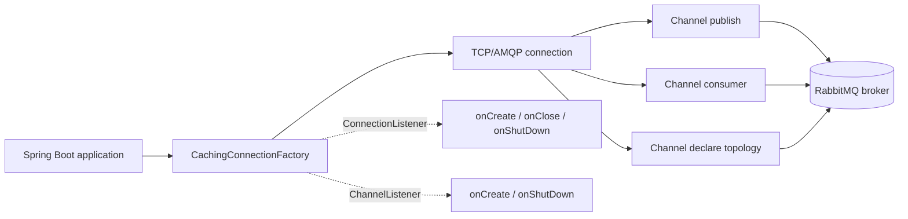

# ConnectionListener, ChannelListener và sự kiện đóng tài nguyên

Khi ứng dụng **Spring AMQP** đang gửi sự kiện bằng `RabbitTemplate` hoặc xử lý message qua `@RabbitListener`, RabbitMQ có thể chủ động đóng một channel do thao tác AMQP không hợp lệ, đóng connection vì sự cố mạng, hoặc tạm thời chặn publisher vì thiếu tài nguyên. Những tình huống này thường xuất hiện dưới dạng lỗi publish, consumer mất kết nối, số channel tăng bất thường hoặc message được giao lại.

Bài học thuộc chương **Kết nối và channel** của module **SPRING_AMQP**. Trọng tâm là hai callback của Spring Rabbit: **`ConnectionListener`** và **`ChannelListener`**, cách đăng ký chúng với `CachingConnectionFactory`, ý nghĩa của sự kiện tạo/đóng tài nguyên và cách chẩn đoán khi RabbitMQ gặp sự cố. Đây là nền tảng cho các phần định tuyến exchange–queue–binding, xác nhận giao nhận, retry, dead-letter, transaction và quan sát hệ thống bất đồng bộ đáng tin cậy.

## 1. Phân biệt connection, channel và listener

RabbitMQ sử dụng **connection** (kết nối TCP, thường là TLS nếu bật bảo mật) để truyền nhiều **channel** AMQP 0-9-1. Channel là kết nối logic nhẹ hơn, dùng cho các thao tác như publish, `basic.consume`, `basic.ack`, `queue.declare` và `exchange.declare`.



| Thành phần | Phạm vi | Ví dụ hoạt động | Sự kiện cần quan sát |
| --- | --- | --- | --- |
| `org.springframework.amqp.rabbit.connection.ConnectionFactory` | Quản lý cách mở connection tới broker | Cung cấp connection cho `RabbitTemplate`, listener container và `RabbitAdmin` | Không phải bản thân một connection vật lý |
| `org.springframework.amqp.rabbit.connection.Connection` | Wrapper Spring cho connection RabbitMQ | Chứa các channel AMQP, tạo channel theo yêu cầu | Tạo, đóng, shutdown |
| `com.rabbitmq.client.Channel` | Phiên giao tiếp logic thuộc một connection | Publish, consume, ack, khai báo queue | Tạo mới, shutdown |
| `ConnectionListener` | Callback ở cấp connection | Ghi log broker vừa kết nối / ngắt kết nối | `onCreate`, `onClose`, `onShutDown`, `onFailed` (theo phiên bản) |
| `ChannelListener` | Callback ở cấp channel | Quan sát channel mới, channel bị broker đóng | `onCreate`, `onShutDown` |

**Một connection có thể chứa nhiều channel.** Lỗi `NOT_FOUND` khi khai báo một queue sai tên thường chỉ làm RabbitMQ đóng **channel** liên quan; nó không nhất thiết đóng toàn bộ connection. Ngược lại, mất connection khiến các channel thuộc connection đó mất hiệu lực; listener container và ứng dụng phải phục hồi theo chính sách phù hợp.

Không nhầm callback lifecycle với callback nghiệp vụ:

- `ConnectionListener.onCreate` **không có nghĩa** publisher đã gửi message hay consumer đã xử lý thành công.
- `ChannelListener.onCreate` **không có nghĩa** queue, exchange hoặc binding đã được khai báo xong.
- `ChannelListener.onShutDown` **không có nghĩa** message đã được `nack` hoặc dead-letter; còn phải xem delivery chưa ack, cấu hình container và trạng thái broker.
- Publisher confirms, consumer acknowledgements và transaction là **những cơ chế khác** phải được kiểm chứng riêng.

## 2. CachingConnectionFactory và vòng đời tài nguyên

Trong ứng dụng Spring Boot có `spring-boot-starter-amqp`, Spring Boot thường auto-configure **`CachingConnectionFactory`** khi không có cấu hình thay thế. Ở chế độ cache `CHANNEL` thường dùng, factory chia sẻ một connection proxy cho ứng dụng và tạo/cất giữ channel khi có nhu cầu.

```text
RabbitTemplate.convertAndSend(...)
    -> mượn channel từ CachingConnectionFactory
    -> thực hiện publish trên channel
    -> đóng channel ở mức logic / trả về cache nếu còn dùng được
    -> một lần publish tiếp theo có thể mượn lại chính channel đó
```

Khác với tạo một channel vật lý mới sau mỗi lần gọi, tái sử dụng channel giúp giảm số lần thiết lập AMQP channel và giảm tải broker. Listener container có thể giữ channel trong suốt thời gian consumer hoạt động, nên hành vi mượn/trả không giống mọi lần gọi của `RabbitTemplate`.

### 2.1. Logical close khác physical shutdown

| Hiện tượng | Điều gì thực sự xảy ra? | `ChannelListener` có nhất thiết báo đóng không? |
| --- | --- | --- |
| `RabbitTemplate` hoàn tất một lần gửi | Framework trả channel hợp lệ về cache (logical close) | **Không**: channel vật lý vẫn có thể mở |
| Cache đã đủ channel idle | Channel dư có thể bị đóng vật lý khi trả về | Có thể có shutdown notification |
| Broker phát channel exception | Channel vật lý bị đóng | Có thể nhận `onShutDown` |
| Broker mất kết nối / network failure | Connection và các channel đang dùng trở nên không hợp lệ | Có thể có nhiều callback shutdown liên tiếp |
| Ứng dụng kết thúc có trật tự | Factory/container đóng tài nguyên | Có thể phát sinh callback đóng bình thường |

Vì thế **không dùng số lần `onCreate` trừ số lần `onShutDown` làm số channel hiện đang mở**. Việc cache, tạo channel mới theo nhu cầu, callback đến bất đồng bộ và shutdown có thể làm phép đếm thô sai lệch. Nên dùng RabbitMQ Management UI cùng cache metrics của factory để quan sát số connection/channel đang mở.

### 2.2. Channel cache size không mặc nhiên giới hạn channel đồng thời

Với `CachingConnectionFactory`, `channelCacheSize` mặc định là **kích thước cache idle**, không phải mức trần tổng số channel được phép tạo khi có tải. Nếu cấu hình `channelCheckoutTimeout > 0`, cache size mới trở thành giới hạn số channel khả dụng mỗi connection; khi hết chỗ, thread chờ tới timeout rồi có thể nhận `AmqpTimeoutException`.

Ví dụ cấu hình Spring Boot (xem tài liệu property đúng phiên bản Boot đang chạy):

```yaml
spring:
  rabbitmq:
    cache:
      channel:
        size: 25
        checkout-timeout: 0s
```

Đây là ví dụ minh họa hành vi **không giới hạn channel qua checkout timeout**. Nếu hệ thống cần giới hạn cứng số channel, thay `checkout-timeout` bằng khoảng đợi lớn hơn 0 và benchmark theo concurrency/prefetch. Đừng tăng cache size chỉ để che lấp channel leak hoặc vấn đề consumer không thoát.

Nếu ứng dụng sử dụng `CacheMode.CONNECTION`, factory có thể cache nhiều connection và số callback tạo/đóng sẽ khác. Chế độ này có các giới hạn với cơ chế auto-declare topology của `RabbitAdmin`; không nên đổi cache mode chỉ để có thêm log sự kiện. Tham khảo [Spring AMQP – Connection and Resource Management](https://docs.spring.io/spring-amqp/reference/amqp/connections.html).

## 3. ConnectionListener: nhận biết vòng đời connection

Giao diện `ConnectionListener` nằm trong `org.springframework.amqp.rabbit.connection`. Các callback cốt lõi:

```java
public interface ConnectionListener {
    void onCreate(Connection connection);

    default void onClose(Connection connection) {}

    default void onShutDown(ShutdownSignalException signal) {}

    // Có ở các dòng Spring AMQP hỗ trợ, từ 2.2.17.
    default void onFailed(Exception exception) {}
}
```

Đoạn trên **rút gọn chữ ký API để giải thích**, không phải mã cần chép vào dự án; hãy import interface thật từ Spring AMQP. `Connection` ở đây là **wrapper của Spring**, còn `ShutdownSignalException` thuộc package `com.rabbitmq.client`.

| Callback | Thời điểm / mục đích | Lưu ý |
| --- | --- | --- |
| `onCreate(connection)` | Khi factory tạo được một connection mới | Có thể được gọi khi lần đầu sử dụng RabbitMQ hoặc khi kết nối lại |
| `onClose(connection)` | Khi connection được đóng theo đường lifecycle mà factory phát sự kiện | Không nhất thiết xuất hiện cho mọi kiểu đứt kết nối |
| `onShutDown(signal)` | Khi RabbitMQ Java client báo connection bị shutdown | Phân biệt đóng chủ động, broker và mạng qua thông tin signal |
| `onFailed(exception)` | Khi nỗ lực tạo connection không thành công | Hữu ích cho lỗi DNS, timeout, authentication/vhost; không giả định mỗi lần thử đều tạo một sự kiện riêng |

**Đừng giả định** luôn có cặp `onCreate`–`onClose` hoàn chỉnh. Mất điện, kill process, lỗi mạng hoặc broker dừng bất ngờ có thể không cho ứng dụng cơ hội chạy callback theo thứ tự dự kiến. Khi connection được tái tạo, `onCreate` mới có thể xuất hiện; các channel cũ không được phép sử dụng lại sau shutdown vật lý.

### 3.1. Đọc ShutdownSignalException đúng cách

RabbitMQ Java client cung cấp `ShutdownSignalException` với các thông tin cơ bản:

- `isHardError()`: phản ánh lỗi ở phạm vi **connection** (`true`) hay **channel** (`false`) theo cách RabbitMQ Java client phân loại.
- `isInitiatedByApplication()`: cho biết shutdown có bắt nguồn từ phía ứng dụng không, giúp tránh báo động giả khi stop bình thường.
- `getReason()`: có thể chứa AMQP reply method hoặc thông tin shutdown để chẩn đoán, nhưng nên cẩn thận khi ghi log vì có thể mang dữ liệu nhạy cảm hoặc tạo log rất dài.

Tín hiệu ở connection-level và channel-level có thể liên quan cùng một sự cố; **không cộng cơ học** số lần callback thành số lần broker thực sự bị lỗi.

## 4. ChannelListener: quan sát tạo channel và shutdown

`ChannelListener` nằm trong cùng package `org.springframework.amqp.rabbit.connection`. Chữ ký chính:

```java
public interface ChannelListener {
    void onCreate(com.rabbitmq.client.Channel channel, boolean transactional);

    default void onShutDown(ShutdownSignalException signal) {}
}
```

- `onCreate(channel, transactional)`: được gọi khi factory tạo **channel vật lý mới**. Cờ `transactional` cho biết loại channel mà factory đang tạo; **không đồng nghĩa transaction nghiệp vụ đã commit** và không xác nhận database transaction.
- `onShutDown(signal)`: chạy khi underlying RabbitMQ channel bị đóng vì lý do được client quan sát; không có callback `onClose(Channel)` tương ứng với logical close để trả về cache.
- `channel.getChannelNumber()`: trả về số channel trên **connection đó**, không phải ID duy nhất cho toàn hệ thống. Channel number có thể được tái sử dụng sau khi channel cũ đóng.

### Khi nào broker chủ động đóng channel?

Một số tình huống thường gặp:

| Tình huống | Phạm vi lỗi điển hình | Hệ quả |
| --- | --- | --- |
| `queueDeclarePassive("missing.queue")` với queue không tồn tại | Channel-level, thường `404 NOT_FOUND` | Channel bị đóng; cần channel mới cho thao tác sau |
| Khai báo lại queue khác `durable`, `arguments` hoặc type | Channel-level, `406 PRECONDITION_FAILED` | Channel cũ không tiếp tục dùng được; cần sửa topology |
| Publish vào exchange không tồn tại | Channel-level, thường `404 NOT_FOUND` | Publish thất bại; channel bị đóng |
| `basicAck` sai delivery tag / ack hai lần | Channel-level, có thể `406 PRECONDITION_FAILED` | Lỗi lập trình/logic acknowledgement cần sửa |
| Broker dừng, TCP mất kết nối | Connection-level | Tất cả channel của connection trở nên không hợp lệ |

Không vì gặp `onShutDown` mà tự động thử publish lại message **không giới hạn**. Với sự cố publish, cần dùng publisher confirms/returns, correlation ID và cơ chế retry có kiểm soát; có trường hợp producer không biết chắc broker đã nhận message trước khi mất kết nối, nên retry có thể tạo bản sao.

## 5. Đăng ký listener với CachingConnectionFactory do Spring Boot tạo

Trong Spring Boot, **nên giữ `CachingConnectionFactory` auto-configured** để không phải tự sao chép cấu hình host, port, credentials, TLS, publisher confirms và listener container. Chỉ khai báo `@Bean ConnectionListener` hoặc `@Bean ChannelListener` **không nên được mặc định hiểu là đã đăng ký** lên factory. Cách rõ ràng là gọi `addConnectionListener(...)` và `addChannelListener(...)` trên factory được sử dụng thật.

Để bắt các sự kiện ngay từ lúc Spring tạo factory, ví dụ dưới sử dụng `BeanPostProcessor` trước khi bean được khởi tạo xong. Mẫu dành cho **Spring Boot trên Java 17+**, nơi `CachingConnectionFactory` là bean đang được dùng:

```java
import com.rabbitmq.client.Channel;
import com.rabbitmq.client.ShutdownSignalException;
import org.slf4j.Logger;
import org.slf4j.LoggerFactory;
import org.springframework.amqp.rabbit.connection.CachingConnectionFactory;
import org.springframework.amqp.rabbit.connection.ChannelListener;
import org.springframework.amqp.rabbit.connection.Connection;
import org.springframework.amqp.rabbit.connection.ConnectionListener;
import org.springframework.beans.BeansException;
import org.springframework.beans.factory.config.BeanPostProcessor;
import org.springframework.context.annotation.Bean;
import org.springframework.context.annotation.Configuration;

@Configuration
public class RabbitLifecycleLoggingConfiguration {
    private static final Logger log =
            LoggerFactory.getLogger(RabbitLifecycleLoggingConfiguration.class);

    @Bean
    public static BeanPostProcessor rabbitLifecycleLogging() {
        return new BeanPostProcessor() {
            @Override
            public Object postProcessBeforeInitialization(
                    Object bean, String beanName) throws BeansException {
                if (bean instanceof CachingConnectionFactory factory) {
                    factory.addConnectionListener(new ConnectionListener() {
                        @Override
                        public void onCreate(Connection connection) {
                            log.info("AMQP connection created, bean={}", beanName);
                        }

                        @Override
                        public void onClose(Connection connection) {
                            log.info("AMQP connection closed, bean={}", beanName);
                        }

                        @Override
                        public void onShutDown(ShutdownSignalException signal) {
                            log.warn(
                                    "AMQP connection shutdown, bean={}, hard={}, appInitiated={}",
                                    beanName, signal.isHardError(),
                                    signal.isInitiatedByApplication());
                        }

                        @Override
                        public void onFailed(Exception exception) {
                            log.warn("AMQP connection creation failed, bean={}, exceptionType={}",
                                    beanName, exception.getClass().getSimpleName());
                        }
                    });

                    factory.addChannelListener(new ChannelListener() {
                        @Override
                        public void onCreate(Channel channel, boolean transactional) {
                            log.debug("AMQP channel created, bean={}, channelNo={}, tx={}",
                                    beanName, channel.getChannelNumber(), transactional);
                        }

                        @Override
                        public void onShutDown(ShutdownSignalException signal) {
                            log.warn(
                                    "AMQP channel shutdown, bean={}, hard={}, appInitiated={}",
                                    beanName, signal.isHardError(),
                                    signal.isInitiatedByApplication());
                        }
                    });
                }
                return bean;
            }
        };
    }
}
```

**Giải thích lựa chọn kỹ thuật:**

1. `BeanPostProcessor` đăng ký callback **trước** khi Spring hoàn tất khởi tạo bean của factory, giảm nguy cơ bỏ lỡ sự kiện connection đầu tiên. Khai báo phương thức `@Bean static` giúp Spring đăng ký post-processor đủ sớm.
2. Điều kiện `bean instanceof CachingConnectionFactory` giới hạn phạm vi vào loại factory mẫu; không tạo factory thứ hai và không thay đổi thông tin kết nối.
3. Đăng ký qua `add...` giúp không xóa các listener đã được framework gắn, trong đó có listener phục vụ auto-declare của `RabbitAdmin`.
4. Ở mức `INFO/WARN`, chỉ ghi sự kiện kết nối và lỗi. Log tạo channel ở `DEBUG` để tránh hàng nghìn log khi throughput cao.
5. Các log chứa `beanName`, cờ shutdown và số channel; **không log password, URI có credentials, payload hay toàn bộ `exception.getMessage()`** nếu hệ thống chưa áp dụng chính sách lọc dữ liệu.

Nếu dùng **Spring AMQP quá cũ, trước khi `ConnectionListener.onFailed` có mặt**, bỏ override `onFailed` hoặc nâng dependency theo phiên bản Spring Boot hỗ trợ. Nếu có nhiều factory (ví dụ publisher connection riêng, routing connection factory, nhiều vhost), mỗi factory có thể phát sự kiện riêng; cần ghi nhận factory nào thực sự được `RabbitTemplate` và listener container sử dụng. Mẫu trên phục vụ quan sát chứ không thay thế cấu hình connection recovery.

### 5.1. Cách đăng ký trực tiếp khi tự cấu hình factory

Nếu ứng dụng đã có một `CachingConnectionFactory` do dự án tự tạo, có thể đăng ký trước khi trả về bean:

```java
// Đặt bên trong factory @Bean hiện có, sau khi cấu hình credentials/TLS:
factory.addConnectionListener(connection -> {
    // Chỉ ghi log hoặc tăng metric nhanh; không chặn luồng callback.
});
factory.addChannelListener((channel, transactional) -> {
    // Ghi nhận sự kiện tạo channel.
});
```

Đây là đoạn trích minh họa chỗ **đăng ký**, không phải một `@Bean` hoàn chỉnh; tránh tạo một factory mới chỉ để thêm listener khi Spring Boot đã cung cấp factory dùng chung.

## 6. Kết hợp sự kiện blocked/unblocked và consumer events

Sự kiện **connection shutdown** không bao quát mọi vấn đề RabbitMQ. Khi broker thiếu RAM hoặc disk, nó có thể **chặn publisher** thay vì đóng connection. Spring AMQP có thể phát:

- `ConnectionBlockedEvent`: broker chặn connection do resource alarm hoặc nguyên nhân liên quan.
- `ConnectionUnblockedEvent`: broker bỏ trạng thái blocked.
- `ListenerContainerConsumerFailedEvent`: listener container gặp lỗi consumer, có thông tin `reason`, `fatal` và throwable.

Ví dụ quan sát event Spring (không dùng callback cấp thấp):

```java
import org.slf4j.Logger;
import org.slf4j.LoggerFactory;
import org.springframework.amqp.rabbit.connection.ConnectionBlockedEvent;
import org.springframework.amqp.rabbit.connection.ConnectionUnblockedEvent;
import org.springframework.amqp.rabbit.listener.ListenerContainerConsumerFailedEvent;
import org.springframework.context.event.EventListener;
import org.springframework.stereotype.Component;

@Component
public class RabbitOperationalEvents {
    private static final Logger log =
            LoggerFactory.getLogger(RabbitOperationalEvents.class);

    @EventListener
    public void onBlocked(ConnectionBlockedEvent event) {
        log.warn("RabbitMQ connection blocked; check broker memory/disk alarms");
    }

    @EventListener
    public void onUnblocked(ConnectionUnblockedEvent event) {
        log.info("RabbitMQ connection unblocked");
    }

    @EventListener
    public void onConsumerFailed(ListenerContainerConsumerFailedEvent event) {
        log.warn("RabbitMQ consumer failure, fatal={}", event.isFatal());
    }
}
```

Với broker resource alarm, nguyên nhân và trạng thái nên được xác minh bằng RabbitMQ Management UI/log broker. Một connection blocked có thể khiến publish dừng tiến triển trong khi các connection khác và consumer có trạng thái khác. Khi hệ thống cần cô lập publisher với consumer, đánh giá cấu hình **publisher connection riêng** do Spring AMQP hỗ trợ, cùng các hạn chế khi sử dụng transaction.

Đối với lỗi consumer, event từ listener container thường có giá trị hơn một callback channel đơn lẻ vì nó cho biết **container nào bị ảnh hưởng** và có thể đang thực hiện cơ chế recovery. Tên loại event và chi tiết có thể khác giữa dòng Spring AMQP; kiểm tra API tương ứng với Spring Boot của dự án.

## 7. Thực hành tạo sự kiện và quan sát lifecycle

### 7.1. Chuẩn bị broker và một topology local

Ứng dụng Spring Boot cần dependency:

```xml
<dependency>
    <groupId>org.springframework.boot</groupId>
    <artifactId>spring-boot-starter-amqp</artifactId>
</dependency>
```

Ví dụ `application-local.yml` với broker thực hành có user/vhost được cấp quyền:

```yaml
spring:
  rabbitmq:
    host: localhost
    port: 5672
    username: app_local
    password: local-demo-only
    virtual-host: orders_local
logging:
  level:
    # Bật DEBUG cho class đăng ký event khi cần xem channel được tạo.
    # Đổi tên package đúng với dự án của bạn.
    com.example.rabbit.RabbitLifecycleLoggingConfiguration: DEBUG
```

Tên user, password và vhost ở đây chỉ là **mẫu local**, không tự được tạo bởi Spring Boot. Hãy kiểm tra connection trước bằng RabbitMQ Management UI hoặc `/actuator/health` nếu đã có Actuator. Trên hệ thống thật, dùng secret manager và TLS khi cần.

Khai báo topology để `RabbitTemplate` và `@RabbitListener` có thứ để thử:

```java
import org.springframework.amqp.core.Binding;
import org.springframework.amqp.core.BindingBuilder;
import org.springframework.amqp.core.DirectExchange;
import org.springframework.amqp.core.Queue;
import org.springframework.amqp.core.QueueBuilder;
import org.springframework.context.annotation.Bean;
import org.springframework.context.annotation.Configuration;

@Configuration
public class LifecycleProbeTopology {
    public static final String EXCHANGE = "lifecycle.probe.exchange";
    public static final String QUEUE = "lifecycle.probe.queue";

    @Bean
    DirectExchange lifecycleProbeExchange() {
        return new DirectExchange(EXCHANGE, true, false);
    }

    @Bean
    Queue lifecycleProbeQueue() {
        return QueueBuilder.durable(QUEUE).build();
    }

    @Bean
    Binding lifecycleProbeBinding(Queue lifecycleProbeQueue,
                                  DirectExchange lifecycleProbeExchange) {
        return BindingBuilder.bind(lifecycleProbeQueue)
                .to(lifecycleProbeExchange).with("probe");
    }
}
```

Chỉ đặt topology này trong môi trường test/local, hoặc đổi tên để không xung đột tài nguyên đã tồn tại trên production. Spring `RabbitAdmin` có thể tự khai báo các bean này khi kết nối được thiết lập và được cấu hình phù hợp.

### 7.2. Tạo connection/channel thật

Ví dụ `ApplicationRunner` cho profile `local`:

```java
import org.springframework.amqp.rabbit.core.RabbitTemplate;
import org.springframework.boot.ApplicationArguments;
import org.springframework.boot.ApplicationRunner;
import org.springframework.context.annotation.Profile;
import org.springframework.stereotype.Component;

@Component
@Profile("local")
public class LifecycleProbeRunner implements ApplicationRunner {
    private final RabbitTemplate template;

    public LifecycleProbeRunner(RabbitTemplate template) {
        this.template = template;
    }

    @Override
    public void run(ApplicationArguments args) {
        Integer channelNo =
                template.execute(channel -> channel.getChannelNumber());
        System.out.println("Borrowed AMQP channel no=" + channelNo);
        template.convertAndSend(
                LifecycleProbeTopology.EXCHANGE, "probe", "lifecycle-test");
    }
}
```

Để thử consumer, thêm listener độc lập:

```java
import org.springframework.amqp.rabbit.annotation.RabbitListener;
import org.springframework.context.annotation.Profile;
import org.springframework.stereotype.Component;

@Component
@Profile("local")
public class LifecycleProbeConsumer {
    @RabbitListener(queues = LifecycleProbeTopology.QUEUE)
    public void consume(String message) {
        System.out.println("Received: " + message);
    }
}
```

Kỳ vọng: nếu broker đã sẵn sàng, các callback `onCreate` cho connection/channel được ghi khi tài nguyên vật lý **thực sự** được tạo. `RabbitAdmin` hoặc listener container có thể mở connection trước khi runner chạy, nên không áp đặt thứ tự callback giống thứ tự code. Lần gọi `template.execute` tiếp theo có thể mượn **channel cũ từ cache**, do đó không nhất thiết có `ChannelListener.onCreate` mới.

### 7.3. Gây lỗi channel có kiểm soát

Trong **môi trường test**, thử passive-declare một queue chắc chắn chưa tồn tại:

```java
try {
    template.execute(channel -> {
        channel.queueDeclarePassive("missing.lifecycle.probe.queue");
        return null;
    });
} catch (org.springframework.amqp.AmqpException expected) {
    System.out.println("Expected missing queue/channel failure");
}
```

RabbitMQ thường trả `404 NOT_FOUND` và **đóng channel** vừa thực hiện phép khai báo. Khi đó `ChannelListener.onShutDown` có thể phát sự kiện; connection có thể vẫn mở và lần publish sau dùng một channel hợp lệ khác. Đừng chạy thí nghiệm trên queue nghiệp vụ production và đừng cho code test tự động chạy lúc startup ở production.

### 7.4. Gây lỗi connection có kiểm soát

Trong máy/container test, dừng RabbitMQ tạm thời rồi quan sát log lifecycle:

```bash
docker stop spring-amqp-local
```

Nếu đang dùng container mang tên khác, điều chỉnh lệnh. Có thể nhận `ConnectionListener.onShutDown`, nhiều `ChannelListener.onShutDown`, và consumer failure events. Sau đó khởi động lại:

```bash
docker start spring-amqp-local
```

Quan sát ứng dụng tái lập connection/channel và consumer theo cơ chế recovery của Spring AMQP. Thời gian callback đến và số lần callback phụ thuộc heartbeat, timeout, container và tải. Không đo thời gian phục hồi bằng giả định “chắc chắn có callback trong 1 giây”.

Trong demo, hãy so sánh:

| Phép thử | Dấu hiệu đáng quan sát | Kết luận |
| --- | --- | --- |
| Gửi message thành công | Connection/channel được tạo hoặc lấy từ cache | Có đường giao tiếp AMQP, chưa chứng minh publisher confirm |
| Gửi nhiều lần | Không nhất thiết tạo thêm channel mỗi lần | Channel cache hoạt động |
| Passive-declare queue không tồn tại | Channel shutdown, có thể lỗi 404 | Lỗi riêng channel, connection có thể vẫn sống |
| Dừng broker | Connection shutdown và consumer lỗi/đang phục hồi | Lỗi phạm vi connection |
| Khởi động lại broker | Có connection/channel mới, consumer phục hồi | Recovery ở mức kết nối, chưa chứng minh không mất message |

## 8. Những giới hạn khi dùng lifecycle callback để khôi phục

`ConnectionListener` và `ChannelListener` chủ yếu giúp **quan sát vòng đời tài nguyên**, không tự động giải quyết tính nhất quán của message. Spring AMQP có cơ chế khôi phục connection và listener container; thông thường không cần kích hoạt thêm **automatic topology recovery** của RabbitMQ Java client cùng lúc, vì các cơ chế có thể chồng chéo. `RabbitAdmin` có thể khai báo lại các bean exchange/queue/binding được quản lý khi connection mới xuất hiện.

### 8.1. Không thực hiện tác vụ blocking trong callback

Callback có thể chạy trên luồng nhạy cảm của RabbitMQ Java client, cơ chế tạo connection hoặc callback xử lý sự kiện. Tránh gọi:

- `RabbitTemplate.convertAndSend(...)` từ `onShutDown` để “báo lỗi”, nhất là khi chính connection vừa bị mất.
- Các RPC đồng bộ như tạo channel mới, gọi database/API chậm hoặc khóa toàn cục trong callback.
- `channel.close()`, `connection.close()` hoặc `factory.resetConnection()` như phản ứng tự động trước mọi event.

Các hành động trên dễ gây blocking, deadlock, mất tài nguyên hoặc vòng lặp reconnect. Callback nên **ghi metric/log nhanh, không ném exception, không sửa trạng thái nghiệp vụ**. Nếu cần xử lý tiếp, chuyển sang cơ chế điều phối riêng có backoff và idempotency, đồng thời dùng sự kiện như tín hiệu chẩn đoán.

### 8.2. Một connection được phục hồi không chứng minh message an toàn

Khi mất connection:

1. Delivery chưa được consumer ack có thể được broker giao lại sau khi connection cũ mất hiệu lực; ứng dụng phải xử lý **idempotent** theo `eventId` hoặc khóa nghiệp vụ.
2. Publisher có thể không biết message trước đó đã được broker ghi nhận hay chưa. Để thiết kế retry an toàn, cần **publisher confirms**, xử lý trường hợp kết quả không chắc chắn và khả năng chống trùng ở đích.
3. Message không route được cần cơ chế **publisher returns/mandatory** hoặc thiết kế alternate exchange phù hợp; connection callback không phản ánh vấn đề routing key/binding.
4. Một consumer ném exception có thể được retry, reject/requeue hoặc dead-letter theo listener container; **channel shutdown không phải cơ chế retry/DLQ**.
5. Transaction với RabbitMQ channel không tự bao phủ transaction database. Khi phải ghi DB và publish event nhất quán, cân nhắc **outbox**; không coi `transactional=true` trong `ChannelListener.onCreate` là cam kết exactly-once.

### 8.3. Shutdown khi redeploy là bình thường

Khi ứng dụng được stop theo kế hoạch, kết nối có thể đóng chủ động. `ShutdownSignalException.isInitiatedByApplication()` và ngữ cảnh deployment giúp phân biệt sự kiện mong đợi với sự cố. Không phát cảnh báo mức nghiêm trọng cho mọi callback `onClose`/`onShutDown` mà không xét nguồn đóng và tần suất.

## 9. Quan sát và chẩn đoán production

Nên kết hợp **application logs/metrics**, **RabbitMQ Management UI**, **Actuator/Micrometer** khi dự án có cấu hình, và broker logs:

| Tín hiệu | Giải thích thường gặp | Bước kiểm tra tiếp |
| --- | --- | --- |
| `onFailed` liên tục, không có `onCreate` | Không mở được AMQP connection | DNS, host/port, TLS, username/password, vhost, firewall |
| `onShutDown` connection kèm channel shutdown hàng loạt | Connection vật lý mất, các channel bị ảnh hưởng | Broker logs, heartbeat, TCP, resource alarms |
| Channel shutdown 404 | Queue/exchange không tồn tại khi gọi | Sai vhost, topology chưa khai báo, tên resource không đúng |
| Channel shutdown 406 | Queue/exchange khác khai báo hoặc ack sai | So sánh arguments/type/durable, kiểm tra delivery tag |
| Số channel tăng nhanh, ít channel idle | Cache chưa phù hợp, concurrency cao hoặc giữ channel quá lâu | `CachingConnectionFactory.getCacheProperties()`, broker channel count, consumer concurrency |
| Connection vẫn mở nhưng publisher đứng | Có thể broker đang blocked do RAM/disk | `ConnectionBlockedEvent`, broker alarms, phân tách publisher/consumer |
| Nhiều consumer failure events | Container phục hồi lặp lại, queue thiếu hoặc lỗi cấu hình | Logs container, recovery backoff, active consumers, queue/vhost |
| Publish thành công nhưng không có message | Routing/binding không khớp hoặc consumer đã lấy ngay | Exchange/bindings, publisher returns, queue metrics, consumer logs |

Để so sánh channel cache và broker, có thể lấy snapshot (chỉ cho phần **quan sát**, tránh in secrets) từ factory:

```java
// Khi cần quan sát số liệu cache:
java.util.Properties cacheStats = cachingConnectionFactory.getCacheProperties();
// Đọc các key như idleChannelsNotTx, idleChannelsTx, ... trong tài liệu
// và gửi số đo đã chọn tới metrics; tránh dump mọi property vào log.
```

Tên key và số liệu phụ thuộc cache mode và phiên bản Spring AMQP. **Channel được trả về cache không đồng nghĩa channel bị đóng vật lý**, vì thế đối chiếu với số active channel trong RabbitMQ UI trước khi đổi kích thước cache. Theo dõi thêm connection/channel churn rate, consumer count, queue depth, `ready`, `unacked`, publisher confirms/returns, retry và DLQ.

### Ghi log đóng channel có chủ đích

Spring AMQP có cơ chế log các shutdown không giống nhau theo lý do. Trong những phiên bản hiện hành, các close bình thường (AMQP reply 200 OK) thường không được ghi, một số lỗi passive declaration/exclusive consumer được ghi mức DEBUG, còn những lỗi khác mức ERROR. Có thể tùy biến `ConditionalExceptionLogger` của factory khi cần; hãy cân nhắc tác động đến khả năng chẩn đoán nếu thay đổi cấp độ log trên toàn ứng dụng.

## 10. Những sai lầm cần tránh

| Ngộ nhận | Cách hiểu đúng |
| --- | --- |
| “Mỗi lần gọi `RabbitTemplate` sẽ có một `ChannelListener.onCreate`.” | Channel có thể được cache và tái sử dụng; callback chỉ phản ánh tạo mới vật lý. |
| “Đóng logical channel giống đóng connection.” | Trả channel về cache thường không hủy kết nối AMQP vật lý. |
| “Channel bị 404 nghĩa là RabbitMQ broker chết.” | `404 NOT_FOUND` thường đóng channel của thao tác sai; connection khác có thể vẫn hoạt động. |
| “`onShutDown` là tín hiệu cần resend ngay message.” | Kết quả publish có thể chưa chắc chắn; cần confirms, chống trùng và retry có giới hạn. |
| “Có `onCreate` connection mới nghĩa là consumer đã xử lý xong backlog.” | Cần quan sát container, queue, ack và kết quả nghiệp vụ. |
| “`transactional=true` tức là transaction DB đã commit.” | Đây là thông tin channel transaction, không phải transaction phân tán. |
| “`ConnectionListener` thay cho health check.” | Callback là sự kiện; health/readiness và metrics phản ánh trạng thái hiện thời. |
| “Callback shutdown phải xuất hiện đúng một lần cho mỗi sự cố.” | Thực tế có thể nhiều channel và listener, mất kết nối đột ngột hoặc callback bị chồng lấp. |

## 11. Checklist áp dụng và bài tập

Khi thực hành xong, kiểm tra:

- [ ] Phân biệt được connection vật lý, channel logic, channel cache và listener container.
- [ ] Biết chính xác chữ ký `ConnectionListener` và `ChannelListener` tương ứng với phiên bản Spring AMQP đang dùng.
- [ ] Đăng ký listener bằng `addConnectionListener`/`addChannelListener` lên **factory ứng dụng sử dụng thật**, không tạo nhầm factory thứ hai.
- [ ] Thấy sự kiện `onCreate` khi lần đầu thiết lập connection/channel trong môi trường local.
- [ ] Hiểu vì sao mượn lại channel từ cache không nhất thiết sinh sự kiện `onCreate` mới.
- [ ] Thử lỗi queue không tồn tại và quan sát channel shutdown mà không quy kết luôn lỗi connection.
- [ ] Thử broker stop/start trên local và quan sát recovery, consumer events, trạng thái queue `ready`/`unacked`.
- [ ] Có logging/metrics không tiết lộ credentials hoặc payload nhạy cảm và không chặn callback thread.
- [ ] Biết rằng publisher confirms, ack, retry, DLQ, idempotency và transaction phải được kiểm chứng **độc lập**.

**Bài tập A – Channel cache:** Dùng `RabbitTemplate.execute` nhiều lần với tải thấp. Ghi lại số lần `ChannelListener.onCreate` và thống kê cache. Giải thích vì sao hai con số không bằng số lần gửi message.

**Bài tập B – Đóng channel:** Thử `queueDeclarePassive` với tên queue không tồn tại, xem `onShutDown` và reply code 404, sau đó publish lại message hợp lệ. Xác định thao tác nào cần một channel mới.

**Bài tập C – Mất broker:** Dừng broker test, quan sát `ConnectionListener`, consumer events, sau đó khởi động broker lại. Gửi message có `eventId` duy nhất, đánh giá khả năng giao lại và cách consumer ngăn xử lý trùng.

**Bài tập D – Phân loại cảnh báo:** Tạo bảng quy tắc giám sát cho một lần deploy có shutdown chủ động, một lần lỗi TCP, một lần queue missing (404) và một lần broker blocked. Chỉ rõ event, metric và mức cảnh báo thích hợp.

## 12. Nguồn tham khảo

- [Spring AMQP – Connection and Resource Management](https://docs.spring.io/spring-amqp/reference/amqp/connections.html): factory, cache, connection/channel listeners, blocked/unblocked events, log close và recovery.
- [Spring AMQP API – ConnectionListener](https://docs.spring.io/spring-amqp/docs/3.1.x/api/org/springframework/amqp/rabbit/connection/ConnectionListener.html): `onCreate`, `onClose`, `onShutDown`, `onFailed`.
- [Spring AMQP API – ChannelListener](https://docs.spring.io/spring-amqp/docs/3.2.x/api/org/springframework/amqp/rabbit/connection/ChannelListener.html): `onCreate(Channel, boolean)`, `onShutDown`.
- [Spring AMQP – Consumer Events](https://docs.spring.io/spring-amqp/reference/amqp/receiving-messages/consumer-events.html): sự kiện listener container, consumer failure/restart.

**Ghi nhớ:** `ConnectionListener` giúp theo dõi kết nối RabbitMQ được tạo, đóng hoặc thất bại; `ChannelListener` giúp theo dõi channel vật lý được tạo hoặc shutdown. Khi dùng `CachingConnectionFactory`, việc trả channel về cache không đồng nghĩa channel đã bị đóng. Hãy đăng ký callback lên đúng factory, kết hợp log/metrics với broker Management và kiểm thử recovery, đồng thời xử lý độ tin cậy của message bằng confirms, ack, retry, dead-letter, idempotency và transaction boundary riêng biệt.
