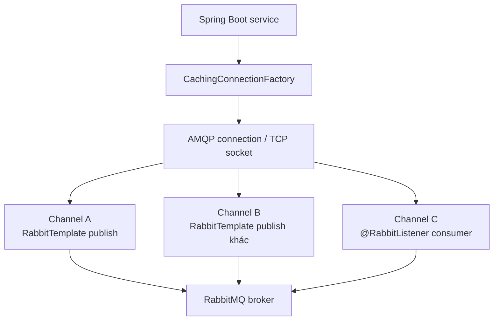
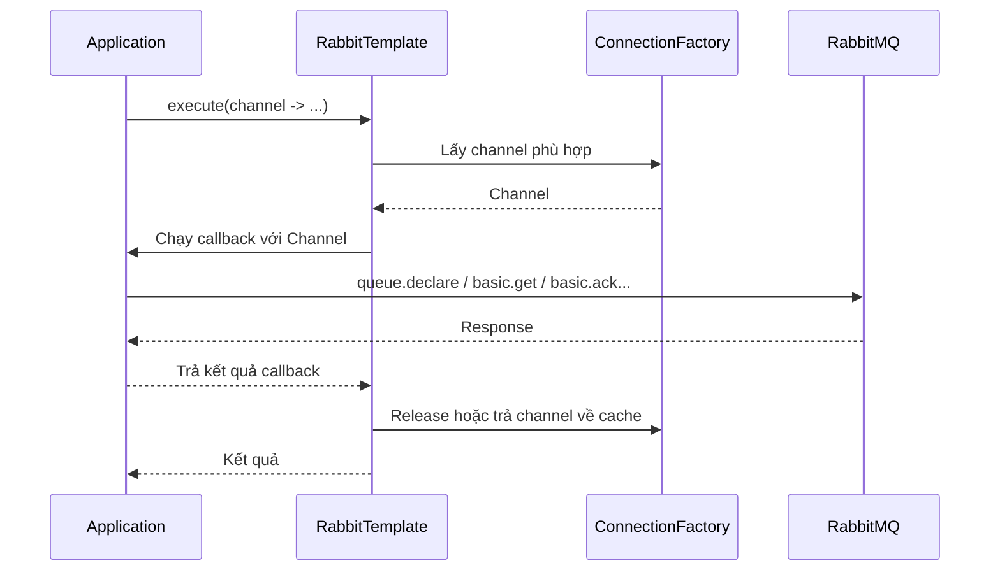
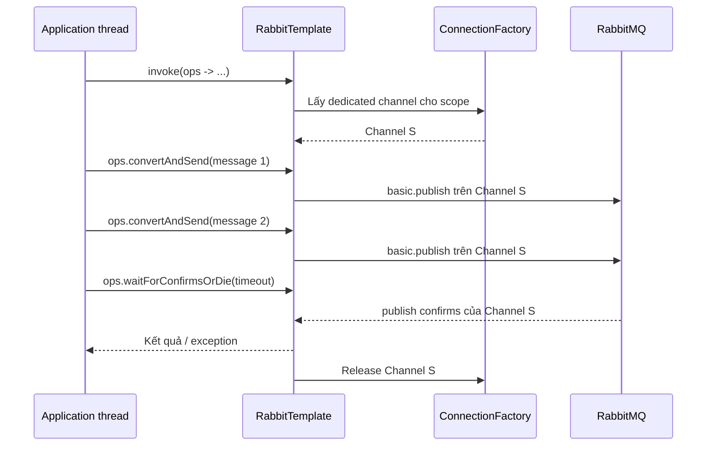
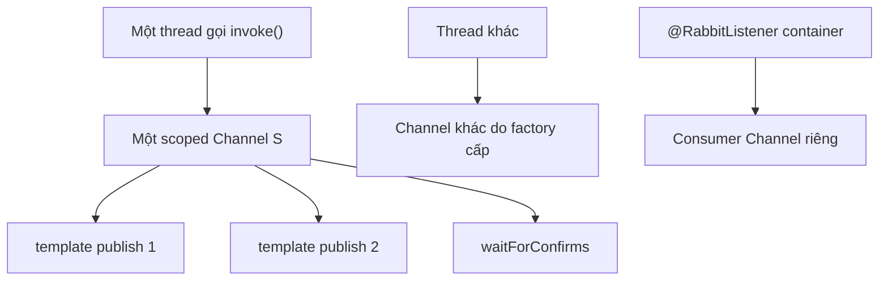

# RabbitTemplate.execute(), invoke() và phạm vi dùng chung channel

## 1. Tình huống và mục tiêu

Khi viết ứng dụng **RabbitMQ với Spring AMQP**, ta thường dùng `RabbitTemplate.convertAndSend(...)` để publish và `@RabbitListener` để consume. Trong đa số tình huống, đây là cách phù hợp: `RabbitTemplate` tự lấy channel từ `ConnectionFactory`, thực hiện thao tác rồi giải phóng tài nguyên theo cơ chế của Spring. Nhưng khi cần gửi **nhiều message liên tiếp và đợi confirm cho cả nhóm** hoặc cần thực hiện **một thao tác AMQP cấp thấp** chưa có sẵn dưới dạng method của template, bạn sẽ gặp hai API quan trọng:

- `RabbitTemplate.execute(ChannelCallback<T>)`: cho callback quyền sử dụng một đối tượng `com.rabbitmq.client.Channel` để gọi trực tiếp RabbitMQ Java client API.
- `RabbitTemplate.invoke(OperationsCallback<T>)`: tạo **phạm vi thao tác (scope)** trong đó nhiều lệnh của `RabbitOperations` được chạy trên **cùng một channel dành riêng cho scope**.

Hai API đều liên quan đến channel nhưng **mục tiêu và bảo đảm khác nhau**. Nếu hiểu nhầm, bạn có thể đợi publisher confirms sai channel, ack delivery trên channel khác, giữ channel quá lâu hoặc nghĩ rằng một chuỗi thao tác được commit nguyên tử trong khi thực tế không phải vậy.

Bài này thuộc chương **Kết nối và channel** của module **SPRING_AMQP**. Ví dụ dùng `RabbitTemplate`, `@RabbitListener`, exchange, queue và binding; đồng thời liên hệ đến định tuyến message, xác nhận giao nhận, retry, dead-letter, transaction và cách quan sát hệ thống bất đồng bộ đáng tin cậy.

Sau bài, bạn có thể:

1. Giải thích channel được dùng thế nào với các lời gọi `RabbitTemplate` độc lập.
2. Phân biệt `execute()` nhận `ChannelCallback` và `invoke()` nhận `OperationsCallback`.
3. Viết ví dụ thao tác trực tiếp với RabbitMQ Java client `Channel`.
4. Dùng `invoke()` để publish nhiều message và đợi publisher confirms trên cùng channel.
5. Xác định ranh giới **cùng channel**, **cùng thread**, **cùng connection** và **cùng transaction**.
6. Tránh dùng nhầm channel của publisher để ack delivery thuộc listener container.
7. Phân tích và xử lý lỗi timeout, mất connection, channel cache và trường hợp publish có kết quả không xác định.

## 2. Ôn lại: connection, channel và RabbitTemplate

Trong AMQP 0-9-1, một **connection** thường tương ứng với một kết nối TCP đến RabbitMQ broker. Trên connection đó, client có thể mở nhiều **channel**, là các phiên logic được đánh số để gửi lệnh AMQP như `basic.publish`, `basic.consume`, `basic.ack`, `queue.declare` hoặc `confirm.select`.



Với `CachingConnectionFactory` dùng `CacheMode.CHANNEL` (thông dụng), những lần gọi template độc lập thường mượn một channel sẵn có hoặc mở thêm channel, rồi trả về cache khi hoàn tất. **Cache giúp tái sử dụng tài nguyên nhưng không bảo đảm các lần gọi độc lập liên tiếp luôn lấy đúng cùng một channel vật lý.**

Ví dụ:

```java
rabbitTemplate.convertAndSend("orders.events", "orders.created", "o-1");
rabbitTemplate.convertAndSend("orders.events", "orders.created", "o-2");
```

Hai lời gọi này được thực thi tuần tự trong Java, nhưng không nên suy ra chắc chắn chúng thuộc cùng một channel AMQP. Với tải đồng thời, transaction, publisher connection riêng hoặc cấu hình cache khác, việc chọn channel có thể khác.

**Một channel không được dùng đồng thời tùy tiện từ nhiều thread.** RabbitMQ Java client `Channel` chứa trạng thái riêng như delivery tags, publisher confirm sequence và transaction state. Dùng chung cùng một `Channel` giữa các thread có thể gây giao thoa frame, sai thứ tự xác nhận hoặc lỗi giao thức. Các abstraction của Spring giúp quản lý vòng đời và việc sử dụng channel phù hợp hơn so với tự giữ raw `Channel` trong singleton.

## 3. API `execute(ChannelCallback<T>)`: thao tác cấp thấp trên một channel

### 3.1. Cơ chế hoạt động

`RabbitTemplate.execute(...)` nhận callback có chữ ký khái niệm:

```java
<T> T execute(ChannelCallback<T> action);
```

Callback nhận tham số kiểu `com.rabbitmq.client.Channel` và trả về giá trị tùy ý. Spring chuẩn bị channel để thực hiện callback rồi quản lý việc giải phóng/thu hồi channel sau đó; nếu có ngữ cảnh transaction đã bind thì channel có thể tham gia vào ngữ cảnh ấy.



Đây là cách thích hợp khi cần **một hoặc nhiều lệnh raw AMQP trên chính channel được callback cung cấp**. Nó không tự tạo một scope để mọi lời gọi `rabbitTemplate.convertAndSend(...)` được gọi **bên ngoài** hoặc **bên trong** callback chắc chắn dùng channel đó. Muốn nhóm nhiều thao tác ở mức `RabbitOperations`, dùng `invoke()` ở mục tiếp theo.

### 3.2. Ví dụ đọc số message đang chờ bằng `queueDeclarePassive`

```java
package example.messaging;

import org.springframework.amqp.rabbit.core.RabbitTemplate;
import org.springframework.stereotype.Service;

@Service
public class QueueInspector {
    private final RabbitTemplate rabbitTemplate;

    public QueueInspector(RabbitTemplate rabbitTemplate) {
        this.rabbitTemplate = rabbitTemplate;
    }

    public int readyCount(String queueName) {
        return rabbitTemplate.execute(channel ->
                channel.queueDeclarePassive(queueName).getMessageCount());
    }
}
```

Đây là lời gọi RPC cấp AMQP trên channel do `execute` cấp: `queueDeclarePassive` kiểm tra một queue đã tồn tại và trả thông tin, không phải thao tác “declare để tạo mới”. Nếu queue không tồn tại, broker có thể trả lỗi `NOT_FOUND` và đóng **channel thực hiện lệnh**. Vì vậy, không dùng nó làm health check chung chung mà không xử lý ngoại lệ và phân biệt tình trạng queue vắng mặt.

Kết quả `getMessageCount()` là một snapshot tại thời điểm broker trả lời; không phải số cố định vì publisher/consumer có thể tiếp tục hoạt động. Đối với theo dõi dài hạn, ưu tiên RabbitMQ Management metrics thay vì polling liên tục bằng lệnh thụ động.

### 3.3. Ví dụ nhận một delivery rồi ack trên chính channel

```java
package example.messaging;

import com.rabbitmq.client.GetResponse;
import org.springframework.amqp.rabbit.core.RabbitTemplate;
import org.springframework.stereotype.Service;

@Service
public class OneShotQueueReader {
    private final RabbitTemplate rabbitTemplate;

    public OneShotQueueReader(RabbitTemplate rabbitTemplate) {
        this.rabbitTemplate = rabbitTemplate;
    }

    public boolean readAndAck(String queueName) {
        return rabbitTemplate.execute(channel -> {
            GetResponse delivery = channel.basicGet(queueName, false);
            if (delivery == null) {
                return false;
            }

            long deliveryTag = delivery.getEnvelope().getDeliveryTag();
            try {
                processMessage(delivery.getBody());
                channel.basicAck(deliveryTag, false);
                return true;
            } catch (RuntimeException ex) {
                // Xử lý thất bại: yêu cầu broker requeue delivery.
                channel.basicNack(deliveryTag, false, true);
                throw ex;
            }
        });
    }

    private void processMessage(byte[] body) {
        // Thay bằng logic xử lý thật, có thể ném exception.
    }
}
```

Đây là ví dụ **thao tác thủ công**, không phải cách khuyến nghị để tạo consumer lâu dài. Nếu `processMessage` ném `RuntimeException`, callback yêu cầu broker requeue bằng `basicNack` rồi chuyển ngoại lệ lên caller. Nếu channel/connection mất trước khi gửi ack/nack, broker có thể phát lại delivery sau khi phát hiện kết nối đóng. Trường hợp lỗi thực tế cần chính sách requeue/dead-letter, giới hạn retry, idempotency và quan sát; với xử lý thông thường, `@RabbitListener` là lựa chọn tự nhiên hơn.

**Delivery tag chỉ có nghĩa trong phạm vi channel nhận delivery**. Không được đưa tag này sang channel mới hoặc dùng `RabbitTemplate.execute` khác để ack lại nếu bạn không bảo đảm cùng channel nhận. Ack sai channel hoặc ack trùng có thể làm channel đóng vì `PRECONDITION_FAILED`.

### 3.4. Điều nên tránh với `execute()`

- **Không tự đóng** channel mà Spring đã cung cấp, chẳng hạn `channel.close()`, vì Spring chịu trách nhiệm giải phóng và cache; chỉ làm nếu có một lý do được API/documentation cho phép và chấp nhận hệ quả.
- Không lưu `Channel` vào biến static, singleton field, cache ứng dụng hoặc trả nó ra ngoài callback để dùng sau.
- Không khởi tạo thread khác để chia sẻ trực tiếp channel này; callback và quyền sử dụng channel gắn với phạm vi thực thi hiện tại.
- Không giả định `execute()` tự đồng bộ một nhóm thao tác với cơ sở dữ liệu, hoặc tự bật publisher confirm hay transaction.
- Không dùng raw `basicPublish` thay `RabbitTemplate` cho đường gửi thông thường nếu cần message converter, retry advice, callbacks, quan sát và các quy ước đang được Spring quản lý.

## 4. API `invoke(OperationsCallback<T>)`: gom nhiều thao tác template trên cùng channel

### 4.1. Vấn đề mà `invoke()` giải quyết

Giả sử ứng dụng cần publish một nhóm sự kiện và sau đó kiểm tra broker đã xác nhận **toàn bộ những publish trong nhóm trên một channel**. Lời gọi `convertAndSend` độc lập có thể sử dụng các channel khác nhau. Publisher confirms của AMQP 0-9-1 là thông tin **cấp channel**: sequence number và tập confirms đang chờ gắn với một channel cụ thể.

`RabbitTemplate.invoke(...)` cho phép thực thi nhiều thao tác `RabbitOperations` trong một callback, trên **cùng một channel dedicated cho scope của lời gọi**. Trong scope này, gọi `waitForConfirms(...)` hoặc `waitForConfirmsOrDie(...)` trở nên có nghĩa khi publisher confirms đã được cấu hình phù hợp.

Chữ ký khái niệm:

```java
<T> T invoke(OperationsCallback<T> action);
```

Trong callback, bạn làm việc với `RabbitOperations`, tức là API template quen thuộc, **không phải raw `Channel`**.



**Sử dụng cùng channel không có nghĩa là nhóm publish nguyên tử.** Mỗi publish có thể được broker xử lý khác nhau; `waitForConfirmsOrDie` chỉ đợi/xác minh publisher confirms trong phạm vi đó theo API. Một message có thể route tới queue còn message khác không; consumer cũng có thể xử lý các message vào những thời điểm khác nhau.

### 4.2. Cấu hình Spring Boot cho scoped publisher confirms

Dependency cơ bản:

```xml
<dependency>
    <groupId>org.springframework.boot</groupId>
    <artifactId>spring-boot-starter-amqp</artifactId>
</dependency>
```

Ví dụ `application.yml`:

```yaml
spring:
  rabbitmq:
    host: ${RABBITMQ_HOST:localhost}
    port: ${RABBITMQ_PORT:5672}
    username: ${RABBITMQ_USERNAME:guest}
    password: ${RABBITMQ_PASSWORD:guest}
    virtual-host: ${RABBITMQ_VHOST:/}
    publisher-confirm-type: simple
    connection-timeout: 5s
    requested-heartbeat: 30s
    cache:
      channel:
        size: 25
```

`publisher-confirm-type: simple` là cấu hình đơn giản để dùng các phương thức **đợi confirm đồng bộ** trong scope. Nếu cần theo dõi confirm theo từng message không đồng bộ bằng `CorrelationData`/callback, Spring AMQP còn có chế độ correlated; phải chọn cách sử dụng tương ứng với nhu cầu và kiểm tra phiên bản stack.

Đừng nhầm `publisher-confirm-type: simple` với `acknowledge-mode` của listener: đây là xác nhận **broker nhận/xử lý publish**, còn listener ACK xác nhận **delivery từ broker sang consumer**. Giá trị cấu hình cụ thể có thể cần đối chiếu với phiên bản Spring Boot/Spring AMQP của dự án.

### 4.3. Ví dụ publish một batch và đợi confirm

```java
package example.messaging;

import java.util.List;
import org.springframework.amqp.rabbit.core.RabbitTemplate;
import org.springframework.stereotype.Service;

@Service
public class BatchOrderPublisher {
    private static final String EXCHANGE = "orders.events";
    private static final String KEY = "orders.created";

    private final RabbitTemplate rabbitTemplate;

    public BatchOrderPublisher(RabbitTemplate rabbitTemplate) {
        this.rabbitTemplate = rabbitTemplate;
    }

    public void publishBatch(List<String> orderIds) {
        rabbitTemplate.invoke(ops -> {
            for (String orderId : orderIds) {
                ops.convertAndSend(EXCHANGE, KEY, orderId);
            }

            // Đợi confirm của các publish trong scope này.
            ops.waitForConfirmsOrDie(10_000L);
            return null;
        });
    }
}
```

Để chạy ví dụ, exchange `orders.events` phải tồn tại; nếu muốn các message tới queue nghiệp vụ, còn phải có binding đúng routing key `orders.created`. `waitForConfirmsOrDie(10_000L)` lấy timeout theo **milliseconds**. Nếu broker NACK một hoặc nhiều publish, hoặc timeout chờ, API có thể ném ngoại lệ; caller phải xử lý kết quả không chắc chắn và quyết định retry.

Điểm quan trọng:

- Toàn bộ `ops.convertAndSend(...)` và `ops.waitForConfirmsOrDie(...)` được gọi **đồng bộ trong cùng callback và cùng thread**.
- Scope này gắn với một channel, nên phương thức đợi confirm kiểm tra các publish đã gửi qua channel đó.
- Channel được framework quản lý sau khi callback kết thúc; không giữ scope dài chỉ để chờ xử lý ngoài ứng dụng.
- Đây **không phải** transaction, không bảo đảm tất cả message đến đúng queue, cũng không đảm bảo các consumer đã xử lý xong.
- Nếu publisher cần biết message có bị trả lại vì **unroutable** hay không, còn phải cấu hình `mandatory`/returns; publisher confirm ACK không đủ phân biệt route tới queue nào.

### 4.4. Dùng `waitForConfirms(...)` để tự xử lý kết quả

Một biến thể khác trả về boolean cho caller:

```java
public boolean publishAndCheck(String orderId) {
    return rabbitTemplate.invoke(ops -> {
        ops.convertAndSend("orders.events", "orders.created", orderId);
        return ops.waitForConfirms(10_000L);
    });
}
```

Theo semantics của API, `waitForConfirms(...)` trả về kết quả confirm theo channel; một số trường hợp lỗi, timeout hoặc đóng channel vẫn có thể dẫn đến exception. Đừng chỉ kiểm tra `true` rồi ghi rằng “đã thanh toán thành công”: confirm là tín hiệu phía **publisher/broker**, không phải kết quả nghiệp vụ phía consumer.

### 4.5. Có thể dùng `invoke()` để gọi `receive()` hay `execute()` không?

`OperationsCallback` expose API của `RabbitOperations`. Các thao tác template được gọi **đồng bộ trong callback trên cùng thread** dùng scope channel của lời gọi `invoke`. Điều này là lý do `invoke()` tồn tại, đặc biệt khi cần nhiều thao tác phối hợp trên một channel.

Tuy nhiên, đây không phải giấy phép để “mượn channel rồi giữ mãi”. Hãy giữ callback ngắn và có mục đích, tránh gọi dịch vụ mạng chậm, chờ người dùng, `CompletableFuture` hoặc đưa code sang thread pool khi vẫn cần dựa vào cùng channel.

Nếu bạn chỉ cần truy cập raw `Channel` để gọi một method thấp cấp, một lời gọi `execute(ChannelCallback)` thường rõ ràng hơn. Nếu cần nhiều lời gọi `RabbitOperations` chia sẻ channel, `invoke(OperationsCallback)` diễn đạt mục đích rõ hơn.

## 5. So sánh `execute()` và `invoke()`

| Tiêu chí | `execute(ChannelCallback<T>)` | `invoke(OperationsCallback<T>)` |
| --- | --- | --- |
| Đối tượng callback nhận | `com.rabbitmq.client.Channel` | `org.springframework.amqp.rabbit.core.RabbitOperations` |
| Cấp API | Raw RabbitMQ Java client | Spring AMQP template |
| Mục tiêu | Gọi lệnh AMQP thấp cấp với channel được cấp | Thực hiện nhiều thao tác template dùng chung một channel trong scope |
| Bảo đảm về channel | Các lệnh gọi **trực tiếp trên tham số Channel** dùng cùng channel callback | Các template operations **bên trong scope trên cùng thread** dùng cùng channel dành riêng |
| Đợi confirms của nhiều `convertAndSend` | Không tự gom các lệnh template độc lập; nếu thao tác raw phải tự quản lý đúng confirm mode | Là trường hợp sử dụng chính; `waitForConfirms(…)` và `waitForConfirmsOrDie(…)` |
| Quản lý vòng đời channel | Spring quản lý callback và release channel | Spring quản lý scoped channel và release sau callback |
| Nhận hoặc ACK delivery | Có thể gọi `basicGet`/`basicAck` trực tiếp trên channel đã nhận | Không dùng để ACK delivery từ channel của `@RabbitListener` |
| Nguyên tử/transaction | Không tự tạo transaction | Không tự tạo transaction |
| Nguy cơ thường gặp | Đóng/giữ channel, ack sai tag, bypass các abstraction Spring | Nghĩ scope chia sẻ xuyên thread, callback quá dài, coi batch confirm là transaction |

### 5.1. Ba phạm vi thường bị nhầm



- **Cùng JVM** không có nghĩa cùng channel.
- **Cùng connection TCP** không có nghĩa cùng channel.
- **Cùng `RabbitTemplate` bean** không có nghĩa cùng channel cho mọi lời gọi.
- **Cùng thread trong một `invoke()` scope** giúp các thao tác template liên quan dùng chung channel theo bảo đảm của API.
- **Cùng channel** không mặc nhiên là cùng transaction hay cùng kết quả nghiệp vụ.

### 5.2. Sai lầm với tác vụ bất đồng bộ bên trong scope

Đoạn code sau là **phản ví dụ**:

```java
rabbitTemplate.invoke(ops -> {
    CompletableFuture.runAsync(() ->
            ops.convertAndSend("orders.events", "orders.created", "o-1"));
    return null; // Callback có thể kết thúc trước tác vụ gửi.
});
```

Callback đã kết thúc thì scoped channel có thể được trả về cache. Tác vụ chạy ở thread khác không được bảo đảm dùng channel của scope ban đầu; nó còn có thể bắt đầu sau khi callback trả về. Nếu cần publish bất đồng bộ nhiều sự kiện, dùng cơ chế điều phối tác vụ riêng và áp dụng confirms/retry phù hợp cho **mỗi phạm vi**.

Đừng suy luận rằng truyền cùng biến `ops` qua thread khác khiến scope channel tự “lan” theo biến Java. Channel scope gắn với **ngữ cảnh thực thi thread của lời gọi**.

## 6. `@RabbitListener` dùng channel nào? Vì sao không ack bằng template khác?

Listener container quản lý connection, channel, consumer và phương thức callback nhận message. Channel consumer có delivery tags riêng. Nếu ứng dụng ở chế độ manual acknowledge, phải ack/nack **trên channel nhận delivery**.

Ví dụ cấu hình:

```yaml
spring:
  rabbitmq:
    listener:
      simple:
        acknowledge-mode: manual
        prefetch: 20
```

Ví dụ listener:

```java
package example.messaging;

import java.io.IOException;
import com.rabbitmq.client.Channel;
import org.springframework.amqp.core.Message;
import org.springframework.amqp.rabbit.annotation.RabbitListener;
import org.springframework.stereotype.Component;

@Component
public class BillingListener {

    @RabbitListener(queues = "billing.orders")
    public void onMessage(Message message, Channel channel) throws IOException {
        long tag = message.getMessageProperties().getDeliveryTag();

        // Chỉ ack khi tác vụ nghiệp vụ đã hoàn tất thành công.
        process(message.getBody());
        channel.basicAck(tag, false);
    }

    private void process(byte[] body) {
        // Viết logic idempotent, tránh xử lý trùng khi bị redelivery.
    }
}
```

Trong trường hợp xử lý lỗi, ứng dụng phải có chính sách `basicNack`/`basicReject`, requeue hay dead-letter và xử lý exception phù hợp (tùy ack mode, error handler, retry configuration). Đoạn ví dụ chỉ minh họa **success path** nên chưa phải mã lỗi hoàn chỉnh cho production.

**Tuyệt đối không** lấy `deliveryTag` của listener rồi làm:

```java
// SAI: Không bảo đảm đây là channel đã nhận delivery.
rabbitTemplate.execute(channel -> {
    channel.basicAck(deliveryTagFromListener, false);
    return null;
});
```

Đây là lỗi phạm vi: `RabbitTemplate` có thể lấy một channel publisher hoặc một channel khác từ cache, trong khi tag thuộc consumer channel của listener. Với ack mode `AUTO` của Spring listener container, ứng dụng thường không cần gọi raw `basicAck`; container tự làm khi xử lý thành công.

## 7. Publisher confirm, returns và transaction: các bảo đảm riêng

### 7.1. Confirm của một channel nói điều gì?

Khi channel bật publisher confirm mode, broker gửi ACK/NACK cho các message đã publish trên channel đó. `invoke()` cho phép đợi kết quả của một loạt thao tác publish trên channel scope. Nhưng:

- **ACK confirm** không nghĩa là consumer đã xử lý message hay transaction database downstream thành công.
- **ACK confirm** không chứng minh routing key match queue mong muốn. Message không route được vẫn có thể được ACK theo publisher confirm; cần `mandatory` và publisher returns hoặc fallback/alternate exchange tùy thiết kế.
- **NACK hoặc timeout** có thể khiến trạng thái từng publish không chắc chắn; retry nguyên cả batch có thể tạo duplicate.
- **Multi-queue routing**: một message có thể được broker định tuyến tới nhiều queue; xử lý lại publish không thay thế idempotency ở từng consumer.

Có thể bật returns trong ứng dụng riêng cần phân biệt message không route:

```yaml
spring:
  rabbitmq:
    publisher-confirm-type: correlated
    publisher-returns: true
    template:
      mandatory: true
```

Đây là **phương án quan sát confirm theo correlation data/callback** thay thế cấu hình `simple` ở mục 4; không đặt hai giá trị `publisher-confirm-type` đồng thời. Hãy dùng callback/correlation data đúng mode và không mặc định một batch `invoke` có thể chờ rồi suy ra từng message đã vào queue dự kiến. Nếu cần trao đổi kết quả với HTTP request, cân nhắc timeout và khả năng publish được xử lý sau khi request đã kết thúc.

### 7.2. Một scope không phải một transaction

So sánh:

| Khái niệm | Phạm vi | Bảo đảm |
| --- | --- | --- |
| `invoke()` | Nhiều lời gọi template trên **một channel** | Có thể phối hợp lệnh và chờ confirms; không có rollback tự động cho nhóm publish |
| Publisher confirms | Publish trên channel bật confirm mode | Broker xác nhận theo protocol; không đồng nghĩa nghiệp vụ xong |
| AMQP channel transaction | `tx.select`, `tx.commit`/`tx.rollback` trên channel transacted | Transaction của các thao tác message trong phạm vi được broker hỗ trợ, với hạn chế riêng |
| Spring-managed transaction | Ranh giới do Spring transaction manager quản lý | Cần kiểm tra cơ chế phối hợp resource; không mặc định có distributed ACID giữa DB và RabbitMQ |
| Consumer ACK | Delivery trên channel consumer | Consumer xác nhận trách nhiệm xử lý delivery, không chứng minh DB/HTTP side effect được bảo đảm exactly once |

Spring AMQP có hỗ trợ transactional channels trong những bối cảnh phù hợp, ví dụ `RabbitTemplate` với `channelTransacted` và transaction manager. **Đừng coi `invoke()` là cách thay thế `tx.commit`**, và đừng trộn publisher confirms với AMQP transactions trên cùng channel nếu cơ chế/phiên bản client không hỗ trợ. Với bài toán DB + publish sự kiện, **transactional outbox** thường là một chiến lược thực tế để xử lý khoảng trống giữa commit database và publish tới broker.

### 7.3. Điều gì xảy ra nếu connection mất trong scope?

Giả sử trong `invoke()`:

1. Message M1 được gửi và broker xử lý.
2. Message M2 được gửi nhưng connection đứt lúc chờ xác nhận.
3. `waitForConfirmsOrDie` thất bại hoặc timeout; ứng dụng không nhận được đầy đủ confirm.
4. Connection factory có thể khôi phục connection/channel cho các thao tác tiếp theo.

**Khôi phục connection không khôi phục tự động kết quả M1/M2.** M1 có thể đã ở queue và M2 có thể đã đến hoặc chưa; ứng dụng cần theo dõi message ID, retry có giới hạn và consumer xử lý idempotent. Việc cấp channel mới không làm sequence number/confirm cũ trở thành hợp lệ trên channel mới.

## 8. Hành vi của channel cache và concurrency

`CachingConnectionFactory` thường dùng chế độ `CHANNEL`: tái sử dụng một connection chính và các channel được cache. Tham số `channelCacheSize` là số channel nhàn rỗi giữ trong cache; với `channelCheckoutTimeout = 0` (mặc định thường gặp), nó **không giới hạn cứng** số channel đồng thời mở. Nếu đặt timeout dương, kích thước cache có thể trở thành giới hạn channel được cấp và caller phải chờ channel sẵn sàng.

```yaml
spring:
  rabbitmq:
    cache:
      channel:
        size: 32
        checkout-timeout: 2s
```

Đoạn cấu hình này là **một lựa chọn quản lý tài nguyên** cần thử theo tải, không phải thiết lập bắt buộc của `invoke()`. Khi có nhiều thread mở `invoke` hoặc nhiều listener consumer hoạt động, việc giữ scope quá lâu làm các channel được cấp ở trạng thái bận; khi hạn chế số channel, caller khác có thể chờ hoặc timeout.

| Tình huống | Điều cần hiểu |
| --- | --- |
| Hai thread cùng gọi `rabbitTemplate.invoke(...)` | Mỗi scope cần channel riêng phù hợp; không được ép cả hai dùng chung raw Channel |
| Một thread dùng hai lời gọi `convertAndSend` độc lập | Cache có thể tái sử dụng nhưng không bảo đảm cùng channel |
| Trong một `invoke` có 100 publish và đợi confirms 10s | Một channel được giữ cho scope; tải lớn có thể gây áp lực cache/concurrency |
| Listener đang giữ nhiều delivery unacked | Consumer channel và prefetch do listener container quản lý; không sửa bằng cách share channel với publisher |
| `channelCacheSize` nhỏ nhưng checkout timeout bằng 0 | Có thể mở thêm channel khi tải cao; đừng hiểu cache size là giới hạn tổng đồng thời |
| Timeout chờ channel | Xem kích thước cache, thời gian giữ scope, threads, broker tài nguyên và cấu hình checkout |

Đối với một application có vài chục producer thread, nên đo **channel count, publish latency, confirm latency, channel checkout timeout** và mức sử dụng broker trước khi tăng cache vô điều kiện.

## 9. Các lỗi điển hình và cách xử lý

| Triệu chứng | Khả năng nguyên nhân | Hướng xử lý |
| --- | --- | --- |
| `waitForConfirms` báo không có scoped operation hoặc không thể chờ | Gọi ngoài `invoke`, chưa bật publisher confirms phù hợp | Đặt publish và wait trong cùng callback `invoke`; kiểm tra `publisher-confirm-type` |
| Có nhiều lệnh publish nhưng không rõ channel nào gửi | Gọi `convertAndSend` độc lập; cho rằng cache giữ nguyên channel | Dùng `invoke` nếu nghiệp vụ thật sự yêu cầu cùng channel |
| `PRECONDITION_FAILED - unknown delivery tag` | Ack sai channel, tag không tồn tại hoặc ack trùng | Ack/nack ngay trên channel nhận delivery; kiểm tra manual ack và asynchronous processing |
| Channel tự đóng sau `queueDeclarePassive` | Queue không tồn tại hoặc vhost sai; broker trả lỗi protocol | Kiểm tra tên queue, vhost, quyền và log shutdown; đừng dùng channel đã đóng |
| Timeout confirm khi broker tải cao | Broker chậm, mạng không ổn định, queue/cluster có vấn đề | Ghi correlation ID, timeout, trạng thái broker và retries có kiểm soát |
| Sau reconnect, cùng message bị xử lý hai lần | Publish/ack trước disconnect có kết quả không xác định | Event ID ổn định, consumer idempotent, outbox và quan sát redelivery |
| `invoke` kéo dài làm throughput giảm | Scope giữ channel qua I/O ngoài broker hoặc chờ quá lâu | Giảm công việc trong callback, điều chỉnh batch/timeout và kiểm tra channel checkout |
| Nhiều thread dùng cùng `Channel` do lưu global | Vi phạm thread-safety và giao thoa trạng thái channel | Bỏ cache Channel ứng dụng; dùng Spring abstraction hoặc một channel mỗi phạm vi hợp lệ |
| Publish confirm ACK nhưng queue nghiệp vụ không có message | Routing key/binding sai, alternate exchange, consumer đã xử lý nhanh | Kiểm tra exchange, binding, mandatory returns, queue rates và message ID |
| Đặt `channelTransacted=true` rồi kỳ vọng confirms như thường | Transaction và publisher confirms có semantics/tương thích khác nhau | Chọn rõ một cơ chế; xem transaction policy của template và broker |

### 9.1. Những việc cần log khi kiểm tra

Đối với đường gửi:

- Message ID / correlation ID, exchange, routing key và loại event.
- Thời gian bắt đầu scope, số publish trong batch, thời gian chờ confirm.
- ACK/NACK/timeout của confirm; returned message nếu đã bật mandatory/returns.
- Trạng thái connection/channel recovery và lỗi `ShutdownSignalException` khi cần chẩn đoán.

Đối với đường nhận:

- Queue, consumer identity, số lần redelivery, delivery tag chỉ dùng để thao tác trong channel hiện hành.
- Thời gian xử lý, ACK/NACK/requeue, retry và số message vào DLQ.
- Các chỉ số broker: connections, channels, consumers, `messages_ready`, `messages_unacknowledged`.

Không đưa mật khẩu, token hoặc toàn payload nhạy cảm vào log; ưu tiên metadata kỹ thuật và business event ID.

## 10. Bài thực hành: kiểm chứng phạm vi channel

Chạy RabbitMQ local/test cùng một ứng dụng Spring Boot có starter AMQP. Chuẩn bị `orders.events`, `billing.orders` và binding key `orders.created`. Không thử lỗi ack hoặc ngắt broker trên môi trường production.

### Lab A — `execute()` đọc trạng thái queue

1. Khởi động broker và ứng dụng; publish một vài sự kiện.
2. Gọi `QueueInspector.readyCount("billing.orders")` ở mục 3.
3. So sánh kết quả với `messages_ready` trên RabbitMQ Management UI.
4. Đổi queueName thành tên không tồn tại (trong lab) để quan sát lỗi `queueDeclarePassive` và channel shutdown; xác nhận template có thể thực hiện lệnh mới trên channel hợp lệ sau đó.
5. Giải thích vì sao callback không nên trả raw Channel cho component khác.

### Lab B — So sánh hai lệnh độc lập với một `invoke()`

1. Gửi hai message bằng hai lời gọi `convertAndSend` độc lập.
2. Viết một batch gồm hai message trong một `invoke`.
3. Bật `publisher-confirm-type: simple`, gọi `waitForConfirmsOrDie` trong scope.
4. Quan sát log và xác nhận trên broker cả hai message đã tới queue; nếu listener đang chạy, queue depth có thể giảm rất nhanh.
5. Giải thích vì sao việc “confirm batch thành công” khác với “consumer đã xử lý xong”.

### Lab C — Thử mất kết nối khi chờ confirm

1. Trong broker thử nghiệm, publish batch với confirm timeout hữu hạn.
2. Dừng broker/network có kiểm soát ở thời điểm batch đang gửi hoặc chờ.
3. Ghi log exception/timeout và trạng thái event ID.
4. Khởi động lại broker, kiểm tra message nào có mặt hoặc đã được consumer xử lý.
5. Thiết kế retry không tạo tác dụng phụ trùng, ví dụ consumer dùng unique constraint theo event ID.

### Lab D — Kiểm tra phạm vi delivery tag

1. Dùng listener `MANUAL` và nhận delivery tag từ chính `Channel` listener.
2. Ack thành công trên channel đó.
3. Giải thích trên giấy vì sao không thể đem tag sang `RabbitTemplate.execute` khác.
4. Nếu muốn quan sát lỗi ack sai trong lab, dùng queue/môi trường riêng, không ép lỗi trên message nghiệp vụ thật.

### Bảng kết quả lab

| Tình huống | Có bảo đảm một channel? | Xác nhận được gì? | Chưa được bảo đảm |
| --- | --- | --- | --- |
| `execute` với raw `queueDeclarePassive` | Trong callback raw Channel | Queue tồn tại và snapshot trạng thái | Kết quả publish/consume khác |
| Hai `convertAndSend` độc lập | Không | Hai lần gọi API đã thực thi theo kết quả local | Same-channel confirms |
| `invoke` + hai publish + `waitForConfirmsOrDie` | Có, trong scope cùng thread | Publisher confirms của các publish trên scoped channel | Consumer đã xử lý, transaction nguyên tử |
| `@RabbitListener` `MANUAL` ACK | Channel listener nhận delivery | Delivery đã được ACK nếu broker nhận được ack | Kết quả DB luôn exactly once |
| Reconnect giữa publish và confirm | Channel cũ mất hiệu lực | Connection mới có thể tiếp tục gửi | Kết quả cuối cùng của publish trước disconnect |

## 11. Chọn API phù hợp với bài toán

| Nhu cầu | API/cách tiếp cận phù hợp |
| --- | --- |
| Gửi một sự kiện bình thường | `RabbitTemplate.convertAndSend` |
| Gọi lệnh RabbitMQ Java client cấp thấp trên channel được cấp | `RabbitTemplate.execute(ChannelCallback)` |
| Nhiều lời gọi template phải cùng channel trong một đoạn đồng bộ | `RabbitTemplate.invoke(OperationsCallback)` |
| Publish một batch và chờ confirms trên scoped channel | `invoke` + `waitForConfirms`/`waitForConfirmsOrDie` với confirm mode phù hợp |
| Consume lâu dài, retry, prefetch, manual/auto ack | `@RabbitListener` và listener container |
| Phát hiện message không được route | Mandatory publish + publisher returns; xem alternate exchange khi cần fallback |
| Message xử lý lỗi, retry và dead-letter | Listener error handling, retry policies, DLX/DLQ |
| DB transaction và publish cần khả năng khôi phục đáng tin cậy | Transactional outbox và idempotent consumer hoặc cơ chế phối hợp tài nguyên được thiết kế rõ |
| Giảm số channel/connection | Cấu hình `CachingConnectionFactory` và listener concurrency theo số liệu đo được |

## 12. Câu hỏi tự đánh giá

1. Vì sao hai lần `rabbitTemplate.convertAndSend(...)` liên tiếp không bảo đảm dùng cùng channel dù chỉ có một `RabbitTemplate` bean?
2. `execute(ChannelCallback)` cấp cho callback đối tượng gì? Khi nào dùng nó thay vì một method có sẵn của template?
3. `invoke(OperationsCallback)` khác `execute` ở loại API callback nhận và bảo đảm channel như thế nào?
4. Vì sao phải gọi `waitForConfirms` **trong cùng scope `invoke`** với các publish cần xác nhận?
5. Có thể lưu `Channel` từ `execute` vào field của singleton service rồi dùng ở nhiều thread không? Tại sao?
6. Một listener manual ack nhận delivery tag 17 trên channel C. Có được gọi `basicAck(17)` trên channel D lấy qua `RabbitTemplate.execute` không?
7. Khi `waitForConfirmsOrDie` timeout do mất kết nối, những khả năng nào tồn tại đối với message đã publish? Chiến lược retry cần có gì?
8. Vì sao `invoke` không phải transaction và không cam kết consumer đã xử lý xong, dù cả batch đều nhận publisher confirm ACK?
9. `channelCacheSize` có luôn là giới hạn cứng của số channel đồng thời không? Vai trò của `channelCheckoutTimeout` là gì?
10. Điều gì xảy ra với phạm vi channel nếu trong callback `invoke` bạn dùng `CompletableFuture.runAsync(...)` để gửi message rồi trả về ngay?

**Ghi nhớ:** **`execute()`** cấp raw `Channel` cho một callback thấp cấp; **`invoke()`** cung cấp một scope để nhiều thao tác `RabbitOperations` chạy trên **cùng channel của thread gọi**. Phạm vi cùng channel giúp phối hợp publisher confirms nhưng **không tương đương transaction hay bảo đảm exactly-once**. Dùng `RabbitTemplate` và listener container đúng vai trò, ack delivery trên channel nhận, quản lý thời gian giữ scope và kết hợp confirms, returns, retry, dead-letter, idempotency cùng quan sát hệ thống để xây dựng tích hợp RabbitMQ đáng tin cậy.
