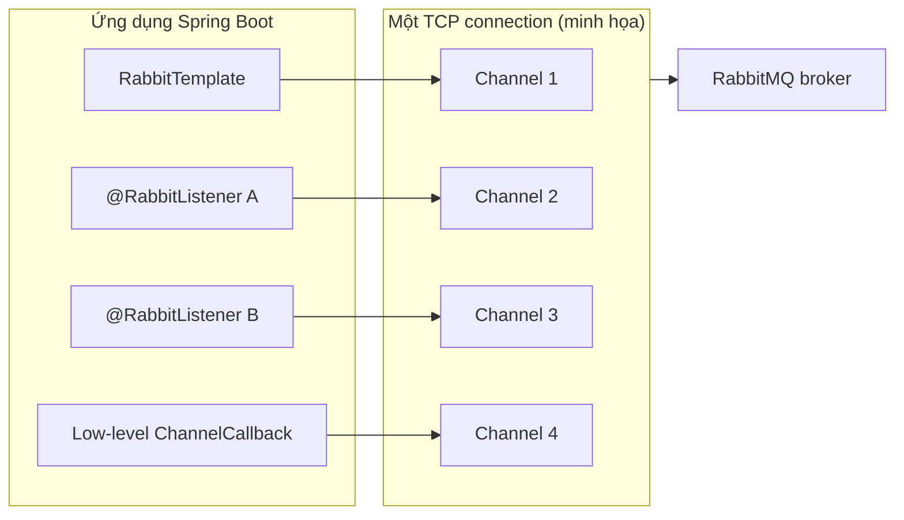
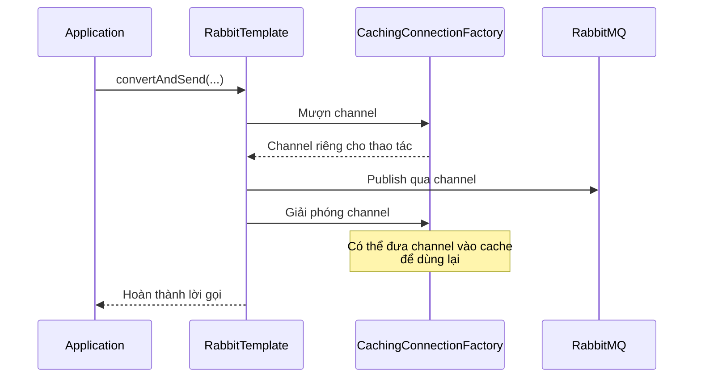
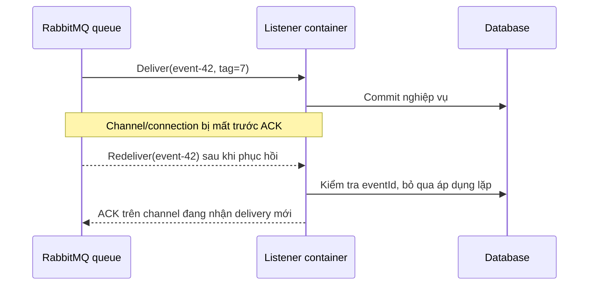

# An toàn đa luồng và trách nhiệm đóng channel được truy cập trực tiếp

Trong một ứng dụng Spring Boot, bạn có thể gọi `RabbitTemplate.convertAndSend(...)` từ nhiều request HTTP đồng thời, trong khi các phương thức `@RabbitListener` cũng đang xử lý hàng chục message. Đằng sau những API này là **AMQP connection** và **channel** của RabbitMQ. Hiểu nhầm phạm vi sử dụng của channel có thể dẫn đến publish lỗi bất thường, ACK sai delivery, rò rỉ tài nguyên hoặc đóng nhầm channel đang được framework quản lý.

Quy tắc cần ghi nhớ ngay từ đầu:

> **RabbitMQ `Channel` không nên được chia sẻ để nhiều thread thao tác đồng thời.** Dùng các abstraction có quản lý vòng đời của Spring AMQP cho luồng thông thường. Khi chủ động lấy channel, hãy xác định rõ ai sở hữu nó và phải giải phóng ở đâu.

Bài thuộc chương **Kết nối và channel** của module **SPRING_AMQP**. Bạn sẽ dùng bối cảnh ứng dụng gửi thông điệp với `RabbitTemplate`, nhận bằng `@RabbitListener` và định tuyến qua exchange/queue/binding để tìm hiểu quản lý channel an toàn. Nội dung cũng liên hệ đến publisher confirms, consumer acknowledgements, retry, dead-letter, giao dịch và quan sát hệ thống xử lý bất đồng bộ.

Sau bài học, bạn có thể:

- Phân biệt phạm vi tồn tại và chi phí của TCP connection với AMQP channel.
- Giải thích vì sao singleton `RabbitTemplate` thường được gọi đồng thời an toàn nhưng không nên chia sẻ trực tiếp một `com.rabbitmq.client.Channel` giữa các luồng.
- Hiểu `CachingConnectionFactory` làm gì với `close()` và channel cache.
- Chọn giữa `RabbitTemplate.execute(...)` và tự lấy `ConnectionFactory.createConnection().createChannel(...)`.
- Biết khi nào **phải đóng** channel đã tự lấy và khi nào **không được đóng** channel do listener container quản lý.
- Dùng consumer ACK/NACK đúng channel, delivery tag và luồng xử lý.
- Chẩn đoán hiện tượng channel leak, quá nhiều channel, lỗi double ACK và gián đoạn kết nối.

## 1. Connection và channel khác nhau thế nào?

RabbitMQ thường sử dụng **TCP connection** để kết nối client tới broker. Bên trong một connection, ứng dụng có thể mở nhiều **AMQP channel**; channel là kênh logic để gửi lệnh AMQP, nhận delivery và thực hiện các thao tác như publish, xác nhận và khai báo topology.



Sơ đồ mô tả các channel độc lập trên một connection dùng chung. Số connection/channel thực tế phụ thuộc cấu hình `ConnectionFactory`, listener container, publisher connection và tải ứng dụng.

| Thành phần | Phạm vi | Đặc điểm |
|---|---|---|
| **TCP connection** | Kết nối vật lý/logical giữa client và broker | Có handshake, authentication, heartbeat; tương đối tốn chi phí |
| **AMQP channel** | Kênh ảo được đánh số trong connection | Nhẹ hơn connection nhưng vẫn tiêu thụ tài nguyên broker/client |
| **`ConnectionFactory`** của Spring | Thành phần cung cấp connection | Quyết định caching, timeout, chiến lược tạo/đóng |
| **`RabbitTemplate`** | API Spring để publish và một số thao tác messaging | Mượn/sử dụng channel theo cơ chế template và connection factory |
| **Listener container** | Thành phần nhận delivery cho `@RabbitListener` | Sở hữu vòng đời consumer và các channel được dùng để nhận |

**Connection có thể được dùng làm nền cho nhiều channel.** Việc có nhiều thread trong ứng dụng không có nghĩa mỗi thread phải tạo một TCP connection mới. Mở connection liên tục cho từng message sẽ gây nhiều lần handshake, heartbeat và tăng chi phí vận hành.

Ngược lại, một channel **không phải luồng giao tiếp vô điều kiện an toàn để mọi thread cùng thao tác**. Thông thường mỗi thao tác logic hoặc mỗi consumer nên dùng channel riêng do thư viện điều phối.

## 2. Vì sao RabbitMQ Channel không nên dùng đồng thời từ nhiều thread?

Đối tượng `com.rabbitmq.client.Channel` của RabbitMQ Java client không được thiết kế như một API có thể cho nhiều producer thread cùng ghi tùy ý mà không phối hợp. Nếu hai thread đồng thời publish trên cùng channel, chúng có thể làm các frame của AMQP interleave theo cách sai; trạng thái của confirms, delivery tags hoặc các thao tác có thứ tự trên channel cũng dễ bị hiểu sai.

Ví dụ **không an toàn**:

```java
import com.rabbitmq.client.Channel;

// Minh họa lỗi: cùng một channel được hai thread dùng để publish.
Channel sharedChannel = /* một channel lấy từ connection */;

Runnable publishA = () -> {
    try {
        sharedChannel.basicPublish(
                "orders.events", "order.created", null, "A".getBytes());
    } catch (Exception ex) {
        throw new RuntimeException(ex);
    }
};

Runnable publishB = () -> {
    try {
        sharedChannel.basicPublish(
                "orders.events", "order.created", null, "B".getBytes());
    } catch (Exception ex) {
        throw new RuntimeException(ex);
    }
};

// Chạy đồng thời publishA và publishB trên sharedChannel: tránh thiết kế này.
```

Code trên là đoạn **minh họa phản ví dụ**, không phải chương trình hoàn chỉnh để chạy. Vấn đề không nằm ở chuỗi A hoặc B, mà ở việc hai thread cùng chiếm quyền thao tác một channel.

### 2.1. Những điều dễ nhầm

- **Dùng chung connection** và **dùng chung channel** là hai lựa chọn khác nhau. Connection được thư viện thiết kế để làm nền cho nhiều channel; channel không nên bị các producer thread thao tác đồng thời.
- **Dùng một singleton `RabbitTemplate`** không tương đương dùng trực tiếp một singleton `Channel`. Template và connection factory quản lý cách cấp và trả channel cho mỗi lời gọi.
- Bọc mọi lời gọi bằng `synchronized(channel)` có thể tránh một số thao tác đồng thời nhưng tạo bottleneck và vẫn phải hiểu confirm, callback, transaction, ownership. Đó không phải mô hình khuyến nghị cho ứng dụng Spring AMQP.
- `ThreadLocal<Channel>` tự viết cũng không đương nhiên an toàn: thread pool tái sử dụng thread lâu dài, channel có thể bị giữ/không đóng, hoặc bị dùng sau khi broker đã đóng.
- Một channel đóng hoặc gặp channel-level exception sẽ làm những thao tác về sau trên channel đó thất bại; không thể coi channel là tài nguyên không bao giờ hỏng.

### 2.2. Khi nhiều thread cần publish

Lựa chọn thông thường là **dùng chung bean `RabbitTemplate` do Spring quản lý**, để từng lời gọi mượn channel theo cách framework hỗ trợ:

```java
import org.springframework.amqp.rabbit.core.RabbitTemplate;
import org.springframework.stereotype.Service;

@Service
public class OrderEventPublisher {
    private final RabbitTemplate rabbitTemplate;

    public OrderEventPublisher(RabbitTemplate rabbitTemplate) {
        this.rabbitTemplate = rabbitTemplate;
    }

    public void publishCreated(String orderId) {
        rabbitTemplate.convertAndSend(
                "orders.events",
                "order.created",
                orderId
        );
    }
}
```

Nhiều request hoặc task có thể gọi `publishCreated(...)` trên cùng service/template. Không cần tạo `RabbitTemplate` mới cho mỗi request và không cần lưu một `Channel` trong field để “tiết kiệm chi phí”.

Sự an toàn về việc mượn/trả channel **không** tự bảo đảm toàn bộ nghiệp vụ thread-safe. Các biến mutable trong service, đối tượng payload được sửa từ nhiều thread, callback tùy biến và thứ tự sự kiện vẫn cần thiết kế đúng.

## 3. Spring AMQP quản lý channel như thế nào?

Ở cấu hình Spring Boot thông thường, `spring-boot-starter-amqp` cung cấp `CachingConnectionFactory` cho RabbitMQ. Với chế độ cache channel phổ biến, nó dùng một connection dùng chung cho các channel thông thường và giữ lại những channel đủ điều kiện tái sử dụng.

Cách hoạt động ở mức khái niệm:



**Điểm quan trọng về `close()`:** khi channel được cung cấp qua một `CachingConnectionFactory`, gọi `close()` trên proxy channel mà ứng dụng đã tự mượn thường có nghĩa là **trả channel về cơ chế quản lý/cache của Spring**. Nó không nhất thiết đóng vật lý channel ngay trên broker. Việc channel được giữ trong cache hay đóng hẳn tùy kích thước cache, loại channel, trạng thái và cấu hình factory.

Từ đó:

- Không bỏ `close()` chỉ vì “channel đã có cache”.
- Không dựa vào `close()` để khẳng định broker sẽ lập tức giảm một channel.
- Không tự đóng channel mà một API cấp cao vẫn đang sử dụng.
- Không giữ lâu channel đã mượn chỉ để tránh tốn công lấy lại từ cache.

### 3.1. Channel cache size và concurrency

`channelCacheSize` thường kiểm soát số channel nhàn rỗi được **giữ lại** để tái sử dụng. Nếu không kích hoạt cơ chế giới hạn qua checkout timeout, đây không nhất thiết là giới hạn cứng số channel đang được dùng đồng thời.

Ví dụ cấu hình mang tính minh họa:

```yaml
spring:
  rabbitmq:
    host: localhost
    port: 5672
    username: demo
    password: demo-local-only
    cache:
      channel:
        size: 20
        checkout-timeout: 2000
```

Khi checkout timeout dương và sử dụng `CachingConnectionFactory` theo cơ chế phù hợp, `channelCacheSize` cũng hoạt động như giới hạn checkout channel; các luồng cần channel có thể phải chờ và sau timeout sẽ gặp lỗi nếu không có channel sẵn. Vì vậy không nên tăng số luồng publish hoặc listener vô hạn trong khi giới hạn channel quá thấp.

Nếu nhu cầu bao gồm nhiều TCP connection, chế độ cache connection và chiến lược kết nối cần được đánh giá riêng. Các thuộc tính cụ thể phụ thuộc Spring Boot/Spring AMQP version; luôn kiểm tra cấu hình đang có và metrics thực tế.

## 4. Ai sở hữu channel và ai phải đóng?

Một nguyên tắc thiết kế tài nguyên dễ áp dụng là **bên tạo/mượn trực tiếp phải bảo đảm giải phóng theo hợp đồng của API**. Tuy nhiên với Spring AMQP, API cấp cao có thể đứng ra mượn hộ. Vì vậy cùng là kiểu `Channel` nhưng trách nhiệm đóng khác nhau tùy nguồn gốc.

| Cách có được channel | Ai quản lý vòng đời? | Người viết handler/callback có tự `close()`? |
|---|---|---|
| Gọi `RabbitTemplate.convertAndSend(...)` | `RabbitTemplate` / Spring infrastructure | **Không:** ứng dụng không nắm channel |
| `RabbitTemplate.execute(channel -> ...)` | `RabbitTemplate` mượn rồi giải phóng khi callback kết thúc | **Không:** chỉ sử dụng trong callback |
| Tham số `Channel` được inject vào `@RabbitListener` | Listener container | **Không:** không đóng channel container đang dùng |
| `ConnectionFactory.createConnection()` rồi `connection.createChannel(false)` | Mã đã chủ động lấy tài nguyên, trừ khi có hợp đồng khác | **Có:** đóng channel trong `finally` và giải phóng connection đúng API |
| Tự dùng RabbitMQ Java client `com.rabbitmq.client.ConnectionFactory` | Mã tự quản lý | **Có:** đóng channel, rồi đóng connection khi không cần |
| Consumer callback dài hạn dùng raw Java client | Thành phần tự đăng ký consumer | **Có**, nhưng chỉ sau khi dừng consumer và hoàn tất vòng đời; không đóng ngay sau đăng ký |

**Quy tắc nhận diện:** hỏi “API nào cấp channel này?” trước khi quyết định đóng. Một channel lấy trong `@RabbitListener` và một channel do mã chủ động tạo từ connection có cùng kiểu Java nhưng **không cùng quyền sở hữu**.

## 5. Cách ưu tiên: RabbitTemplate.execute(ChannelCallback)

Nếu cần một thao tác AMQP cấp thấp không có API phù hợp ở tầng `RabbitTemplate`, có thể sử dụng `execute(...)` với `ChannelCallback`. Template sẽ mượn channel, gọi callback và giải phóng channel theo vòng đời của nó khi callback kết thúc.

Ví dụ lấy số message đang ở trạng thái ready của một queue thông qua khai báo passive:

```java
import org.springframework.amqp.rabbit.core.RabbitTemplate;
import org.springframework.stereotype.Service;

@Service
public class QueueInspectionService {
    private final RabbitTemplate rabbitTemplate;

    public QueueInspectionService(RabbitTemplate rabbitTemplate) {
        this.rabbitTemplate = rabbitTemplate;
    }

    public int getReadyMessageCount(String queueName) {
        return rabbitTemplate.execute(
                channel -> channel.queueDeclarePassive(queueName)
                        .getMessageCount()
        );
    }
}
```

**Ý nghĩa từng bước:**

1. Mã ứng dụng gọi `rabbitTemplate.execute(...)`.
2. Spring AMQP chọn channel theo connection factory và ngữ cảnh giao dịch (nếu có).
3. Callback sử dụng channel để gọi `queueDeclarePassive(...)`.
4. Callback trả về kết quả; template giải phóng channel ngay cả khi phát sinh exception theo cơ chế của nó.

Bạn **không gọi `channel.close()` trong callback**. Nếu làm vậy, template vẫn phải xử lý vòng đời sau callback và có thể gặp channel bị đóng bất ngờ hoặc bị trả về cache quá sớm.

### 5.1. Những việc không nên làm trong callback

Phản ví dụ:

```java
// KHÔNG LÀM: lưu lại channel mà template chỉ cho mượn tạm.
private com.rabbitmq.client.Channel leakedChannel;

public void unsafe(RabbitTemplate template) {
    template.execute(channel -> {
        leakedChannel = channel;
        return null;
    });

    // Channel có thể đã được template trả về pool/cache.
    // Không được tiếp tục thao tác hoặc đóng leakedChannel ở đây.
}
```

Tương tự, không dùng `execute(...)` để đăng ký consumer dài hạn bằng `basicConsume(...)` rồi thoát callback trong khi vẫn muốn giữ channel cho consumer. Hợp đồng mượn channel tạm thời không phù hợp với một consumer cần sở hữu channel qua nhiều delivery.

Nếu một thao tác thực sự cần giữ một channel trong suốt nhiều lệnh liên quan, hãy dùng API Spring AMQP được thiết kế cho scope đó, ví dụ `RabbitTemplate.invoke(...)` khi phù hợp với publisher confirms và phiên bản thư viện. Không mặc định nhiều lần `convertAndSend(...)` độc lập luôn chạy trên cùng một channel.

### 5.2. Passive declare có thể làm channel bị đóng khi queue không tồn tại

`queueDeclarePassive(queueName)` kiểm tra một queue đã tồn tại và không tạo queue mới. RabbitMQ có thể trả channel-level exception và đóng channel nếu queue không tồn tại. Trong trường hợp này, Spring phải loại bỏ channel lỗi và ứng dụng cần xử lý exception; không nên cache một tham chiếu tới channel đó để dùng tiếp.

Khi chỉ cần biết số message sẵn sàng, cân nhắc `AmqpAdmin.getQueueProperties(...)` hoặc cơ chế metrics/Management API phù hợp. Passive declare là ví dụ tốt để hiểu phạm vi sử dụng channel, không phải cách duy nhất để quan sát queue.

## 6. Tự lấy channel từ Spring ConnectionFactory: phải giải phóng

Khi chủ động truy cập connection và channel, bạn có trách nhiệm kết thúc phạm vi sử dụng dù xử lý thành công hay ném exception.

Ví dụ dùng Spring AMQP `ConnectionFactory`:

```java
import com.rabbitmq.client.Channel;
import org.springframework.amqp.rabbit.connection.Connection;
import org.springframework.amqp.rabbit.connection.ConnectionFactory;
import org.springframework.stereotype.Service;

@Service
public class DirectChannelInspectionService {
    private final ConnectionFactory connectionFactory;

    public DirectChannelInspectionService(ConnectionFactory connectionFactory) {
        this.connectionFactory = connectionFactory;
    }

    public int getReadyMessageCount(String queueName) throws Exception {
        Connection connection = connectionFactory.createConnection();
        try {
            Channel channel = connection.createChannel(false);
            try {
                return channel.queueDeclarePassive(queueName)
                        .getMessageCount();
            } finally {
                channel.close();
            }
        } finally {
            connection.close();
        }
    }
}
```

Ở đây:

- `connectionFactory.createConnection()` trả về đối tượng `org.springframework.amqp.rabbit.connection.Connection`, **không phải** `com.rabbitmq.client.Connection`.
- `connection.createChannel(false)` lấy một channel không được khai báo transactional ngay tại bước này.
- `channel.close()` trong `finally` giải phóng channel **mà mã của bạn trực tiếp lấy**.
- `connection.close()` trong `finally` giải phóng connection theo hợp đồng của Spring Connection; với `CachingConnectionFactory` ở cache mode phổ biến, hành vi có thể là không đóng vật lý shared connection.

Ví dụ chủ động dùng low-level API để giảng giải ownership. Trong ứng dụng thường ngày, `RabbitTemplate.execute(...)` ở mục 5 đơn giản hơn vì tránh phải tự xử lý vòng đời và tương tác với ngữ cảnh tài nguyên của Spring.

**Lưu ý ngoại lệ khi đóng:** `Channel.close()` có thể ném checked exception. Mẫu `finally` vẫn giúp giải phóng tài nguyên, nhưng trong code production nên quyết định cách ghi nhận lỗi đóng mà không che mất lỗi gốc của thao tác chính, ví dụ cấu trúc quản lý tài nguyên và logging phù hợp.

### 6.1. Tự tạo connection bằng RabbitMQ Java client

Nếu ứng dụng không dùng Spring abstraction và tự tạo `com.rabbitmq.client.Connection` qua `com.rabbitmq.client.ConnectionFactory`, mã phải quản lý cả connection lẫn channel:

```java
import com.rabbitmq.client.Channel;
import com.rabbitmq.client.Connection;
import com.rabbitmq.client.ConnectionFactory;

ConnectionFactory factory = new ConnectionFactory();
factory.setHost("localhost");
factory.setUsername("demo");
factory.setPassword("demo-local-only");

Connection connection = factory.newConnection();
try {
    Channel channel = connection.createChannel();
    try {
        channel.queueDeclarePassive("orders.processing.q");
        // Các thao tác trên channel của riêng luồng/scope này.
    } finally {
        channel.close();
    }
} finally {
    connection.close();
}
```

Đây là đoạn minh họa dùng trong một phương thức có khả năng `throws Exception` hoặc xử lý ngoại lệ phù hợp; tài khoản chỉ dành cho môi trường học. Trong sản phẩm Spring Boot, đừng tự tạo raw connection cho mỗi request nếu đã có `ConnectionFactory` do Spring quản lý.

### 6.2. Đóng channel không phải lúc nào cũng là đóng vật lý

Với raw Java client, `channel.close()` đóng channel đó trên connection. Với Spring caching proxy, `close()` có thể trả channel về cache để được tái sử dụng. Vì vậy kiểm tra rò rỉ nên dựa vào **số channel đang mở, đang sử dụng và được cache**, không phải giả định gọi `close()` làm tổng channel tức thì về 0.

**Sai lầm thường gặp:** giữ channel trong biến static, không đóng ở code path exception hoặc tạo channel trong mỗi task background nhưng quên đóng. Sau thời gian chạy lâu, số channel/connection tăng, broker chạm giới hạn và các thao tác mới bắt đầu thất bại.

## 7. Channel do @RabbitListener nhận thuộc listener container

Với Spring AMQP, `@RabbitListener` có thể nhận tham số `com.rabbitmq.client.Channel` khi cần điều khiển ACK/NACK thủ công. Channel đó **được framework cấp cho delivery đang xử lý**; ứng dụng không sở hữu nó như một tài nguyên tự mở.

Ví dụ bình thường, để listener container quản lý ACK:

```java
import org.springframework.amqp.rabbit.annotation.RabbitListener;
import org.springframework.stereotype.Component;

@Component
public class OrderWorker {
    @RabbitListener(queues = "orders.processing.q")
    public void handle(String orderId) {
        processOrder(orderId);
    }

    private void processOrder(String orderId) {
        System.out.println("Processing " + orderId);
    }
}
```

Với chế độ `AcknowledgeMode.AUTO` của Spring thường được dùng cho listener, container gửi ACK sau khi handler thành công. Nếu handler ném exception, chính sách retry/requeue/reject của container quyết định bước tiếp theo. Đây **không phải** RabbitMQ broker auto-ack/no-ack.

Đừng gọi `channel.close()` ở handler để “dọn dẹp”. Đóng channel do container sở hữu có thể làm consumer hỏng, delivery chưa xác nhận bị gửi lại và listener container phải khôi phục kết nối/channel.

### 7.1. Manual acknowledgement: sử dụng đúng delivery tag

Khi thực sự cần điều khiển xác nhận, cấu hình listener ở chế độ `MANUAL` và lấy channel từ tham số listener:

```java
import com.rabbitmq.client.Channel;
import java.io.IOException;
import java.nio.charset.StandardCharsets;
import org.springframework.amqp.core.Message;
import org.springframework.amqp.rabbit.annotation.RabbitListener;
import org.springframework.stereotype.Component;

@Component
public class ManualAckOrderWorker {
    @RabbitListener(
            queues = "orders.processing.q",
            ackMode = "MANUAL")
    public void handle(Message message, Channel channel) throws IOException {
        long deliveryTag = message.getMessageProperties().getDeliveryTag();

        try {
            String orderId = new String(
                    message.getBody(), StandardCharsets.UTF_8);
            processOrder(orderId);
            channel.basicAck(deliveryTag, false);
        } catch (RuntimeException failure) {
            // requeue=false: dead-letter nếu queue có DLX thích hợp;
            // nếu không, message có thể bị loại bỏ.
            channel.basicNack(deliveryTag, false, false);
        }
    }

    private void processOrder(String orderId) {
        System.out.println("Processed " + orderId);
    }
}
```

Ví dụ minh họa đường đi thành công và lỗi nghiệp vụ. Trong ứng dụng thật, cần log nguyên nhân, phân loại lỗi tạm thời/vĩnh viễn và dùng chiến lược retry/DLQ phù hợp. Nếu `basicAck`/`basicNack` ném `IOException`, listener không thể tự kết luận broker đã nhận xác nhận; message có thể được giao lại sau mất channel/kết nối.

**Ba nguyên tắc bắt buộc:**

1. **Delivery tag có phạm vi theo channel**, không phải ID toàn cục của message. Lấy tag của một channel rồi ACK bằng channel khác có thể gây lỗi giao thức.
2. Với mỗi delivery, **không ACK/NACK hai lần**. Basic ack/reject sai tag hoặc lặp có thể đóng channel với lỗi `PRECONDITION_FAILED - unknown delivery tag`.
3. Dùng `multiple=false` để ACK/NACK **một delivery cụ thể**, trừ khi bạn hiểu rõ thứ tự và toàn bộ delivery chưa xác nhận trên cùng channel.

### 7.2. Không để nhiều listener cùng cạnh tranh việc đóng channel

Khi listener container có concurrency lớn hơn một, nó có thể quản lý nhiều consumer/channel. Mỗi delivery được gắn với channel cụ thể mà container đang sử dụng. Bạn không cần và không nên:

- Lưu channel từ listener A vào singleton để listener B cùng dùng.
- Đóng channel ở cuối handler.
- Tự gọi `basicConsume(...)` trên channel do listener container đang sử dụng.
- Dùng delivery tag từ listener A để ACK một delivery khác trên channel B.
- Cho background task tùy ý thao tác/đóng channel trong khi container còn chịu trách nhiệm xử lý.

Nếu một queue có nhiều consumer, chúng cạnh tranh các delivery từ cùng queue; **không** có nghĩa các consumer dùng chung một channel do ứng dụng kiểm soát.

## 8. Xử lý bất đồng bộ và ACK từ thread khác

Một yêu cầu phổ biến là handler nhận message rồi giao công việc chậm cho thread pool:

```java
// Phản ví dụ: tránh "fire and forget" không có cơ chế quản lý ACK.
@RabbitListener(queues = "orders.processing.q")
public void unsafe(String orderId) {
    executor.submit(() -> processOrder(orderId));
    // Handler đã return trước khi công việc thực sự hoàn thành.
}
```

Nếu listener đang ở `AUTO`, container có thể ACK ngay khi phương thức `unsafe(...)` trả về thành công, dù task background chưa xong. Khi task thất bại sau đó, broker không còn delivery để retry theo cách bạn kỳ vọng.

### 8.1. Có thể ACK từ thread khác không?

RabbitMQ Java client có thể cho phép xác nhận **một delivery riêng lẻ** từ thread khác trong những điều kiện được kiểm soát, nhưng rủi ro nổi bật là **batch acknowledgement**:

- `basicAck(tag, true)` xác nhận các delivery chưa ACK đến tag đó trên **cùng channel**. Nếu nhiều task hoàn tất ngoài thứ tự và nhiều thread cùng ACK theo dải, có thể ACK trùng hoặc ACK cả message chưa xử lý xong.
- Khi ACK bị gửi trên channel đã bị container đóng/thay thế, hoặc tag thuộc channel cũ, xác nhận có thể thất bại.
- Chia sẻ channel cho nhiều thao tác tùy ý vẫn là thiết kế nguy hiểm dù API xác nhận đơn lẻ có trường hợp được phép từ thread khác.

Cách an toàn hơn trong Spring AMQP là:

1. Xử lý đồng bộ trong thread listener nếu thời gian xử lý phù hợp và để container quản lý ACK.
2. Khi cần xử lý async thật sự, dùng **kiểu trả về bất đồng bộ mà phiên bản Spring AMQP hỗ trợ** (ví dụ `CompletableFuture` trong các phiên bản thích hợp) và cấu hình listener theo hợp đồng ACK của cơ chế đó.
3. Nếu buộc quản lý manual ACK liên thread, phải kiểm soát cùng channel, tag, lifecycle, kết quả task và dùng `multiple=false` cho từng delivery; kiểm thử failover, timeout và redelivery.

Không giữ một tham chiếu channel qua nhiều lần khởi động listener hoặc qua reconnect. Channel mới có không gian delivery tag riêng.

### 8.2. Consumer concurrency không đồng nghĩa tạo thread pool tự do

Tăng concurrency cho listener container là cơ chế phù hợp hơn khi mục tiêu chỉ là xử lý nhiều message độc lập song song. Ví dụ với simple listener container:

```yaml
spring:
  rabbitmq:
    listener:
      simple:
        concurrency: 2
        max-concurrency: 4
        prefetch: 10
        acknowledge-mode: auto
```

Mỗi consumer/container và channel của nó được framework quản lý. `prefetch` ảnh hưởng số message đã giao nhưng chưa ACK, vì vậy phải cân bằng với thời gian xử lý, kích thước payload và số consumer; tăng concurrency/prefetch quá cao có thể gây quá tải database.

Nếu dùng direct listener container, cần xem các thuộc tính thuộc nhóm `spring.rabbitmq.listener.direct.*` thay vì áp máy móc các thuộc tính `simple.*`.

## 9. Ví dụ thực hành Spring Boot: nhiều luồng gửi, listener tự quản lý ACK

Bài lab sau minh họa **một singleton RabbitTemplate phục vụ nhiều thread** mà không lưu hay đóng channel thủ công.

### 9.1. Chuẩn bị broker

Có thể chạy RabbitMQ Management cục bộ:

```bash
docker run -d --rm --name rabbitmq-channel-lab -p 5672:5672 -p 15672:15672 -e RABBITMQ_DEFAULT_USER=demo -e RABBITMQ_DEFAULT_PASS=demo-local-only rabbitmq:4-management
```

- AMQP: `localhost:5672`.
- Management UI: `http://localhost:15672`.
- Username/password: `demo` / `demo-local-only`.

Tài khoản demo chỉ dành cho máy cá nhân. Production cần credentials được quản lý an toàn, phân quyền phù hợp và TLS khi cần.

Thêm dependencies vào Spring Boot:

```groovy
dependencies {
    implementation 'org.springframework.boot:spring-boot-starter-amqp'
    implementation 'org.springframework.boot:spring-boot-starter-web'
}
```

Cấu hình `application.yml`:

```yaml
spring:
  rabbitmq:
    host: localhost
    port: 5672
    username: demo
    password: demo-local-only
    publisher-confirm-type: correlated
    publisher-returns: true
    template:
      mandatory: true
    listener:
      simple:
        concurrency: 2
        max-concurrency: 4
        prefetch: 10
        acknowledge-mode: auto
```

Publisher confirms/returns được cấu hình để có thể mở rộng kiểm chứng đường gửi; muốn biết kết quả cụ thể, ứng dụng còn phải xử lý callback/future theo cơ chế Spring AMQP được chọn.

### 9.2. Khai báo exchange, queue và binding

Tạo một lớp `OrdersTopology.java`:

```java
import org.springframework.amqp.core.Binding;
import org.springframework.amqp.core.BindingBuilder;
import org.springframework.amqp.core.DirectExchange;
import org.springframework.amqp.core.Queue;
import org.springframework.amqp.core.QueueBuilder;
import org.springframework.context.annotation.Bean;
import org.springframework.context.annotation.Configuration;

@Configuration
public class OrdersTopology {
    public static final String EXCHANGE = "orders.events";
    public static final String QUEUE = "orders.processing.q";
    public static final String KEY = "order.created";

    @Bean
    DirectExchange ordersExchange() {
        return new DirectExchange(EXCHANGE, true, false);
    }

    @Bean
    Queue processingQueue() {
        return QueueBuilder.durable(QUEUE).build();
    }

    @Bean
    Binding processingBinding(
            Queue processingQueue,
            DirectExchange ordersExchange) {
        return BindingBuilder.bind(processingQueue)
                .to(ordersExchange)
                .with(KEY);
    }
}
```

Spring Boot AMQP thường cấu hình `RabbitAdmin` để khai báo các bean topology lên broker khi đủ điều kiện. Nếu queue tên này đã có thuộc tính xung đột, broker có thể từ chối redeclaration; dùng tên queue riêng cho lab nếu cần.

### 9.3. Producer dùng một template

Tạo service publisher:

```java
import org.springframework.amqp.rabbit.core.RabbitTemplate;
import org.springframework.stereotype.Service;

@Service
public class OrdersPublisher {
    private final RabbitTemplate rabbitTemplate;

    public OrdersPublisher(RabbitTemplate rabbitTemplate) {
        this.rabbitTemplate = rabbitTemplate;
    }

    public void publish(String orderId) {
        rabbitTemplate.convertAndSend(
                OrdersTopology.EXCHANGE,
                OrdersTopology.KEY,
                orderId
        );
    }
}
```

Không có field `Channel` và không có `close()` vì template tự quản lý channel theo phạm vi thao tác.

Để kích hoạt nhiều publish đồng thời, tạo một endpoint demo:

```java
import java.util.ArrayList;
import java.util.List;
import java.util.concurrent.CompletableFuture;
import java.util.concurrent.ExecutorService;
import java.util.concurrent.Executors;
import org.springframework.http.ResponseEntity;
import org.springframework.web.bind.annotation.PostMapping;
import org.springframework.web.bind.annotation.RestController;

@RestController
public class ConcurrentPublishController {
    private final OrdersPublisher publisher;

    public ConcurrentPublishController(OrdersPublisher publisher) {
        this.publisher = publisher;
    }

    @PostMapping("/demo/publish-batch")
    public ResponseEntity<Void> publishBatch() {
        ExecutorService executor = Executors.newFixedThreadPool(4);
        try {
            List<CompletableFuture<Void>> tasks = new ArrayList<>();

            for (int i = 0; i < 40; i++) {
                final String orderId = "order-" + i;
                tasks.add(CompletableFuture.runAsync(
                        () -> publisher.publish(orderId),
                        executor
                ));
            }

            CompletableFuture.allOf(
                    tasks.toArray(new CompletableFuture[0])
            ).join();

            return ResponseEntity.accepted().build();
        } finally {
            executor.shutdown();
        }
    }
}
```

Đây là bài lab nhỏ để chứng minh một service/template được gọi từ nhiều thread. Trong production, **không tạo thread pool mới cho mỗi HTTP request** như ví dụ: hãy dùng executor có vòng đời được Spring quản lý, giới hạn tải, theo dõi lỗi và áp dụng backpressure.

### 9.4. Consumer để Spring quản lý channel

Tạo listener trong bean riêng:

```java
import org.springframework.amqp.rabbit.annotation.RabbitListener;
import org.springframework.stereotype.Component;

@Component
public class OrdersWorker {
    @RabbitListener(queues = OrdersTopology.QUEUE)
    public void handle(String orderId) {
        System.out.printf(
                "[%s] order=%s%n",
                Thread.currentThread().getName(),
                orderId
        );
    }
}
```

Chạy ứng dụng, sau đó gọi:

```bash
curl -X POST http://localhost:8080/demo/publish-batch
```

Kỳ vọng: listener in các `order-0` ... `order-39` qua một hoặc nhiều thread consumer. Thứ tự log có thể khác thứ tự publish do concurrency, prefetch và cách phân phối delivery.

Trong RabbitMQ Management UI, quan sát trang **Connections** và **Channels**. Số channel có thể lớn hơn một dù chỉ có một singleton `RabbitTemplate`, vì các luồng publish và listener cần những channel riêng. Khi batch kết thúc, một số channel có thể vẫn mở vì caching; đó không tự động là leak.

**Giới hạn của bài lab:** `CompletableFuture.allOf(...).join()` chỉ chờ các lời gọi `publish(...)` hoàn tất ở phía ứng dụng. Nó **không chờ consumer xử lý xong** và cũng không tự chờ publisher confirm nếu code chưa quản lý kết quả xác nhận. HTTP 202 không phải cam kết end-to-end.

## 10. Đóng channel nhầm ảnh hưởng gì đến confirm và transaction?

Channel không chỉ là phương tiện truyền payload. Nhiều trạng thái có **phạm vi channel**:

| Cơ chế | Điều phụ thuộc channel |
|---|---|
| Publisher confirms | Trạng thái confirm và thứ tự publish trên channel |
| Consumer delivery tags | Tag được đánh số trong phạm vi channel |
| Consumer acknowledgement | ACK/NACK phải tham chiếu tag thuộc channel đã deliver |
| Channel transactions | `txSelect/txCommit/txRollback` liên quan đến giao dịch trên channel |
| Consumer registration | Consumer gắn với channel đang nhận delivery |
| QoS/prefetch | Có hiệu lực trong phạm vi AMQP theo cách broker/client áp dụng |
| Channel errors | Một lỗi giao thức có thể làm broker đóng channel đó |

Vì vậy, nếu tự đóng channel trước khi nhận kết quả confirm hoặc trước khi ACK, ứng dụng có thể mất khả năng biết chính xác trạng thái thông điệp. Khi reconnect, channel mới **không kế thừa** delivery tags, transactions hoặc confirm sequence của channel cũ.

### 10.1. Publisher confirms và returns

Với producer tin cậy, thường cần:

- Publisher confirm: broker trả kết quả chấp nhận publish theo cơ chế confirms.
- Publisher return khi `mandatory` được bật: phát hiện message không có queue đích trên exchange theo điều kiện routing.
- Correlation ID/event ID: nối kết yêu cầu publish với phản hồi và phục vụ retry.
- Logic xử lý tình huống không nhận được confirm: kết quả có thể không xác định; gửi lại có thể tạo message trùng.

Nếu dùng `RabbitTemplate`, hãy dùng tính năng confirm/return của Spring AMQP thay vì mượn một channel riêng rồi tự `confirmSelect()` và chia sẻ channel đó cho tất cả thread. Không tự kết luận “không exception” là “đã bền vững và được consumer xử lý”.

### 10.2. Channel transaction không thay thế database transaction

Một channel có thể tham gia cơ chế transaction AMQP, nhưng giao dịch này **không tự khiến RabbitMQ và database của ứng dụng commit nguyên tử cùng nhau**.

Giả sử Order Service lưu đơn rồi publish `order.created`. Nếu commit database thành công nhưng publish thất bại, message có thể không tồn tại trong broker. Khi dữ liệu nghiệp vụ yêu cầu độ tin cậy cao, dùng **transactional outbox**: ghi đơn và bản ghi sự kiện trong cùng một database transaction; một tiến trình khác publish sự kiện với confirms rồi cập nhật trạng thái outbox.

Chính sách channel/channel cache không giải quyết khoảng hở giữa database và broker. Consumer vẫn phải idempotent vì event có thể được phát lại.

## 11. Retry, dead-letter và lỗi liên quan vòng đời channel

Khi listener ném exception, listener container có thể áp dụng retry, NACK/requeue hoặc reject theo cấu hình. Nếu channel bị đóng đột ngột trước ACK, các delivery chưa được xác nhận có thể được broker giao lại, kể cả khi xử lý nghiệp vụ đã chạy xong.

Điều này có hai hệ quả:

1. **Không chủ động đóng channel của listener để mô phỏng retry.** Đó là một lỗi vòng đời tài nguyên, có thể gây xáo trộn các delivery khác trên cùng channel.
2. **Consumer cần idempotency.** Đặt `eventId` ổn định cho message, lưu dấu xử lý cùng thay đổi database trong một giao dịch phù hợp và dùng unique constraint để tránh áp dụng hai lần.

Ví dụ luồng lỗi:



Khi message thực sự lỗi vĩnh viễn, cấu hình DLX/DLQ và retry có giới hạn để điều tra. Với `basicNack(tag, false, false)`, nếu queue có dead-letter configuration phù hợp, message có thể đi tới DLX; nếu không, message có thể bị loại bỏ. Không coi việc đóng channel là cơ chế thay thế dead-letter chính thức.

## 12. Cách quan sát và phát hiện rò rỉ channel

RabbitMQ Management UI hiển thị connections/channels đang mở, tình trạng consumer, queue, deliver/ACK và nhiều thông tin thống kê khác. Mỗi channel mở chiếm tài nguyên, nhưng số channel mở ổn định do cache là bình thường.

### 12.1. Những chỉ số nên theo dõi

| Tín hiệu | Điều cần suy luận |
|---|---|
| Connections count | Số kết nối TCP có tăng liên tục không, có reconnect storm không? |
| Channels count | Channel có tăng không giới hạn theo số request/task không? |
| Consumer count | Có consumer trùng hoặc consumer liên tục bị khởi động lại không? |
| Unacknowledged messages | Message đã giao có bị giữ quá lâu hoặc listener bị tắc không? |
| Channel-level exceptions | Có `unknown delivery tag`, sai queue declaration, channel closed không? |
| Publisher confirm latency/timeouts | Producer có bị nghẽn hoặc broker có vấn đề không? |
| Queue ready/deliver/ACK rate | Lỗi xuất phát từ routing, consumer hay backlog? |
| Retry/redelivery/DLQ depth | Message có bị xử lý lại hoặc lỗi nghiệp vụ tăng không? |

Với `CachingConnectionFactory`, có thể sử dụng thông tin cache và metric ở tầng ứng dụng khi phiên bản thư viện hỗ trợ. RabbitMQ metrics/Management UI cho biết channel thực tế ở broker; đối chiếu hai phía giúp phân biệt **cached idle channel** với **channel bị giữ mãi bởi task**.

### 12.2. Dấu hiệu rò rỉ thường gặp

- Mã dùng `connection.createChannel(false)` rồi quên `close()` khi exception xảy ra.
- Đăng ký consumer bằng raw channel nhưng không quản lý lifecycle.
- Lưu channel vào singleton hoặc `ThreadLocal` trong thread pool và không dọn dẹp.
- Tạo connection/channel mới cho mọi message thay vì tái sử dụng template/factory.
- Đóng channel container đang dùng, gây restart liên tục và tăng lỗi redelivery.
- Đặt `channelCheckoutTimeout` có giới hạn nhưng concurrency vượt khả năng cấp channel; nhiều task chờ hoặc timeout.

**Cách điều tra:** đọc stacktrace ứng dụng và log broker → kiểm tra Connections/Channels trong Management UI → xác định code path tạo channel → tìm nhánh giải phóng tài nguyên → kiểm tra cấu hình cache/concurrency và trạng thái publisher/consumer. Không tăng `channelCacheSize` vô hạn để che rò rỉ.

## 13. Bảng quyết định: dùng API nào cho tình huống nào?

| Tình huống | Lựa chọn phù hợp | Ai đóng channel? |
|---|---|---|
| Gửi message theo exchange/routing key | `RabbitTemplate.convertAndSend(...)` | Spring |
| Gửi đồng thời từ nhiều HTTP request | Singleton `RabbitTemplate`, giới hạn concurrency ở tầng ứng dụng | Spring |
| Nhận và xử lý message | `@RabbitListener` với listener container | Spring |
| Manual ACK trong listener | Nhận tham số `Channel` + tag của message | Listener container |
| Một thao tác AMQP cấp thấp ngắn | `RabbitTemplate.execute(channel -> ...)` | Spring/template |
| Nhiều lệnh trên một channel trong phạm vi được hỗ trợ | API scoped operation như `RabbitTemplate.invoke(...)` khi phù hợp | Spring/template |
| Mã tự `createConnection().createChannel(...)` | Scope `try/finally` rõ ràng | Mã ứng dụng |
| Dùng raw RabbitMQ Java client không qua Spring | Quản lý `Connection` và `Channel` trực tiếp | Mã ứng dụng |
| Chạy consumer dài hạn bằng client gốc | Thiết kế vòng đời consumer/channel/connection riêng | Chủ sở hữu raw consumer |

Không có quy tắc “cứ thấy `Channel` là gọi `close()`”. Câu hỏi chính luôn là **channel đó do ai cấp và đang thuộc scope nào**.

## 14. Bài tập thực hành

### Bài 1 — Phân loại trách nhiệm đóng

Cho bốn trường hợp:

1. Callback `RabbitTemplate.execute(channel -> ...)`.
2. Handler `@RabbitListener(..., ackMode = "MANUAL")` nhận `Channel`.
3. Service tự gọi `connectionFactory.createConnection().createChannel(false)`.
4. Component tự dùng `com.rabbitmq.client.ConnectionFactory.newConnection().createChannel()`.

Ai phải đóng channel? Có phải đóng connection không? Trong `CachingConnectionFactory`, `close()` có luôn tương đương physical close không?

### Bài 2 — Phản ví dụ đa luồng

Một bean singleton giữ `Channel channel` rồi gọi `channel.basicPublish(...)` từ 20 request đồng thời. Hãy giải thích những vấn đề có thể xảy ra. Viết lại theo `RabbitTemplate` và nêu điểm cần cấu hình nếu muốn biết kết quả publisher confirms.

### Bài 3 — Tìm lỗi ACK

Consumer nhận delivery tag `12` trên channel A, rồi background thread gọi `basicAck(12, true)` trên channel B. Sai ở đâu? Nếu background thread dùng channel A nhưng nhiều task hoàn tất ngoài thứ tự, rủi ro của `multiple=true` là gì?

### Bài 4 — Kiểm chứng cache

Chạy lab mục 9 và quan sát Connections/Channels trước và sau khi publish đồng thời. Hãy giải thích vì sao batch kết thúc nhưng một số channel còn mở. Thử thay đổi cấu hình cache trong môi trường lab và theo dõi peak channels, wait time hoặc timeout nếu có.

### Bài 5 — Hậu quả đóng channel của listener

Trong môi trường thử nghiệm riêng, mô tả điều gì có thể xảy ra nếu handler gọi `channel.close()` trước ACK. Vì sao message có thể được redeliver và vì sao điều này không phải phương án retry đáng tin cậy?

### Bài 6 — Giao dịch và idempotency

Producer đã commit order vào database nhưng chưa nhận publisher confirm. Consumer nhận order event, đã ghi dữ liệu nhưng mất channel trước ACK. Mỗi phía có điều gì chưa chắc chắn? Thiết kế outbox + event ID + bảng processed-events để hạn chế mất thông điệp và xử lý trùng.

### Bài 7 — Phân biệt leak và caching

Mở rộng hệ thống có 30 request/giây; broker hiển thị 15 channel ổn định sau thời gian tải cao. Đây có phải leak không? Nếu số channel tăng đều đến hàng nghìn và chỉ giảm khi restart ứng dụng, nên kiểm tra những code path nào?

## 15. Ghi nhớ cốt lõi

- **Connection** là kết nối đến RabbitMQ, có thể phục vụ nhiều **channel**; channel nhẹ hơn nhưng không miễn phí.
- **Không chia sẻ một `com.rabbitmq.client.Channel` để nhiều thread publish tùy ý.** Dùng `RabbitTemplate` được Spring quản lý cho các lời gọi đồng thời.
- **`CachingConnectionFactory` quản lý việc tái sử dụng channel.** Channel do mã ứng dụng tự mượn vẫn cần `close()` để trả về cơ chế quản lý; đóng proxy không nhất thiết là đóng vật lý trên broker.
- **`RabbitTemplate.execute(...)` sở hữu vòng đời channel trong callback; `@RabbitListener` nhận channel do listener container sở hữu.** Không đóng hoặc giữ tham chiếu channel do framework cấp.
- **Khi chủ động tạo channel**, dùng `try/finally` hoặc cơ chế quản lý tài nguyên tương đương để đóng channel và giải phóng connection theo hợp đồng của API.
- **ACK/NACK dùng delivery tag thuộc đúng channel.** Cẩn trọng với `multiple=true`, xử lý khác thread, reconnect và lỗi đóng channel.
- **An toàn channel chưa đủ cho hệ thống tin cậy.** Còn cần publisher confirms/returns, consumer ACK, retry/DLQ, idempotency, transactional outbox và metrics.

Khi ranh giới sở hữu channel được giữ rõ ràng, ứng dụng Spring AMQP có thể xử lý nhiều luồng gửi/nhận mà không gây rò rỉ tài nguyên hay làm hỏng trạng thái AMQP, đồng thời tạo nền tảng vững chắc cho các cơ chế xử lý bất đồng bộ đáng tin cậy.
