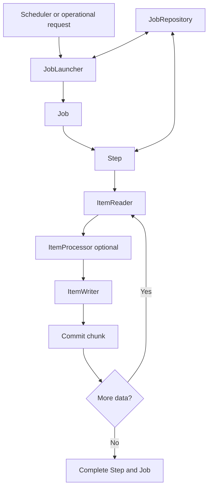

# What Data Processing Problem Does Spring Batch Solve?

Spring Batch is built to solve the **problem of batch data processing**: an application needs to read a finite, usually large, set of data, perform a series of processing steps on that data set, and then write the results to a target system. The work typically runs in the background on a schedule, on operational request, or after a new data source appears; it does not need to return a result while a user is waiting on a request.

For example, at the end of the day an e-commerce system needs to read millions of orders, validate the data, calculate total revenue per store, update a statistics table, and create a file to send to the accounting system. This is a typical batch job. Spring Batch provides the structure and the operational mechanisms to carry out that job in a controlled, traceable way, with the ability to recover when errors occur.

## 1. When Is a Problem a Batch Processing Problem?

A problem is usually a good fit for batch processing when it has the following characteristics:

- **Data is processed as a set or over a time interval.** For example, processing all of yesterday's transactions, records that were just imported from a file, or records that have not yet been aggregated.
- **The data volume is large enough to require resource management.** The job may process anywhere from thousands to millions of records. Reading all of the data into memory before processing can consume a lot of RAM, be slow, or cause the application to run out of memory.
- **There is a clear processing workflow.** Data usually has to be read, validated, transformed, enriched, calculated, and written to one or more destinations.
- **No immediate response to each user is needed.** The job can run in the background, run during off-peak hours, or be triggered when the system receives input data.
- **Progress control and error handling are needed.** When a job that runs for hours is interrupted, the operations team needs to know how far it got and be able to continue from the appropriate point instead of always starting over from the beginning.

Batch does not necessarily mean running only at night or processing only millions of rows. The core point is to process a finite set of work through a managed workflow, rather than handling a single event as soon as it arrives.

## 2. Real-World Problems Spring Batch Commonly Solves

| Problem category | Input data | Work to perform | Typical result |
|---|---|---|---|
| Data import | CSV, XML, JSON, data from an API or a database | Read, check the format, validate, normalize, and discard invalid records | Clean data stored in the database |
| ETL (Extract, Transform, Load) | Data from multiple sources | Extract, transform the structure or business rules, then load into a data store | Analytical tables or a data warehouse |
| Reconciliation | Transactions from two systems | Pair up, compare amounts/statuses, detect missing or mismatched records | Discrepancy reports and lists of items to handle |
| Periodic calculation | Orders, transactions, balances, or service usage data | Aggregate, calculate fees, interest, or payroll, or update figures per period | Summary tables, invoices, or calculation results |
| Report and exchange file generation | Business data in the system | Filter, group, aggregate, and format data | CSV, XML, reports, or files sent to partners |
| Data migration and archiving | Legacy tables, historical files, or data past its hot-storage retention period | Transform, move to a new system, archive, or delete according to policy | Data that has been migrated or archived |

These jobs usually share the same shape: an input data set, one or more processing steps, a destination for the results, and a requirement for reliable operation.

## 3. Why Not Just Write a Java Loop?

For a small task, a loop that reads a list and processes each element can be perfectly adequate. Difficulties appear when the task becomes a long-running process that handles a lot of data and must be operated repeatedly.

Suppose a job needs to process 5 million transactions. If the application loads all 5 million records into a `List`, the memory required can be very large. If the application writes each record immediately without sensible transaction boundaries, the number of commits increases and performance can drop. If the process stops after 3 million records have been processed, a simple loop does not know on its own where to continue. If a few records have data errors, stopping the whole job may leave the remaining valid records unprocessed.

In practice, a batch job usually has to address many concerns at once:

### Memory Management and Throughput

Instead of loading all the data into memory, the application can read and process it in portions. This keeps the amount of data held in memory at a controllable level, and it also lets you tune the size of each portion to balance transaction cost, memory, and processing speed.

### Transactions and Progress Checkpoints

When processing a group of records, the application needs to determine when that group is committed. If a chunk fails, the operations within the corresponding transaction can be rolled back. After a chunk succeeds, the framework can save the execution state so that the job has a basis to continue when it is launched again.

Restartability depends on the `JobRepository` being persisted durably and on the reading/writing components supporting appropriate saving and restoring of state. You should not assume that every operation outside the database is automatically undone or resumed exactly.

### Policy-Based Error Handling

Not every error needs to stop the whole job. For example, a malformed CSV row can be skipped or put into an error list, while a lost database connection may need to be retried. Spring Batch provides mechanisms such as `skip` and `retry` to describe the policy for these situations.

### Monitoring and Auditing

For a long-running job, operators need to know which job was launched, the parameters of the run, whether it succeeded or failed, which step encountered an error, and how many records were read or written. Spring Batch stores execution metadata in the `JobRepository`, which helps applications and monitoring tools retrieve operational information.

### Workflow Organization and Scaling

A job can consist of multiple steps chained one after another, have conditional branches, or have steps that process in parallel. When the data is large enough, Spring Batch has mechanisms such as partitioning and remote chunking to divide the work. Increasing the level of parallelism still needs to be designed around the limits of the database, the target systems, and the server resources.

## 4. How Does Spring Batch Organize a Job?

In Spring Batch, a batch job is usually modeled with the concepts `Job`, `Step`, and the data-processing components.

- **Job** represents the whole piece of work, for example `dailySettlementJob` or `customerImportJob`.
- **Step** is a phase within the job. A job can have one step or multiple steps that run in the configured order and under the configured conditions.
- **ItemReader** reads each item from the data source.
- **ItemProcessor** (if needed) validates, transforms, or enriches each item.
- **ItemWriter** writes the processed items to the destination.
- **JobRepository** stores the metadata of the job and steps, including execution state and the information needed for monitoring or restart.
- **JobLauncher** is the component used to launch a job with specified parameters.

The general processing flow:

The diagram describes a step that processes in chunks. A real job may have multiple steps, and each step may use a different execution approach.

### Chunk-Oriented Processing

This is the common model when processing many items of the same kind. Instead of reading all the data and then writing once, Spring Batch reads a configured number of items, processes each item, passes the group of results to the writer, and commits at the chunk boundary.

For example, with a chunk size of 500:

1. The `ItemReader` reads up to 500 orders.
2. The `ItemProcessor` validates and calculates for each order.
3. The `ItemWriter` writes the group of results.
4. The chunk's transaction is committed if the operations in the chunk succeed.
5. The step continues with the next group of items until the data is exhausted.

If the processor returns `null` for an item, that item is filtered out of the processor's output and is not passed to the writer. If an error occurs, the rollback, retry, or skip behavior depends on the type of error and the configured policy.

Chunk size is a parameter that needs careful consideration. A chunk that is too small can increase the number of commits and the processing overhead; a chunk that is too large can increase memory usage and the amount of data that must be reprocessed when a chunk fails. The appropriate value depends on record size, source/destination speed, and transaction characteristics.

### Tasklet

Not every step needs to read and process item by item. For an operation that is one-off in nature for each step, such as calling a stored procedure, creating a directory, cleaning up temporary files, or running an administrative command, you can use the `Tasklet` model. Therefore, Spring Batch supports both item-processing pipelines and steps that perform a specific task.

## 5. Example: End-of-Day Order Processing

An e-commerce system needs to generate end-of-day revenue figures from order data. The source may contain several million orders, including cancelled orders, orders with missing information, or orders that were already processed in a previous run.

The job can be divided into steps as follows:

| Step | Work | Result |
|---|---|---|
| `readOrdersStep` | Read the orders belonging to the day to be aggregated | Input orders, chunk by chunk |
| `validateOrdersStep` | Check status, store code, currency, and required data | Valid records; invalid records are recorded according to policy |
| `aggregateSalesStep` | Calculate total revenue by store and currency | Aggregated rows |
| `writeReportStep` | Write results to a report table or create an export file | Revenue report for that day |

The job can accept parameters such as the business date and the data source code. These parameters help determine the scope of data to process and distinguish runs that have different meanings.

Suppose the job has successfully committed 320 chunks and then the server goes down. When the job is launched again with the same job identity and appropriate parameters, the metadata in the `JobRepository` together with the reader/step state can help Spring Batch continue using the configured restart mechanism. The chunks that were already committed do not need to be reprocessed in the usual way for a reader with checkpoints.

However, careful design is needed if the job sends email, calls a partner API, or writes to a system that does not participate in the same transaction. A request that has already been sent out may not be rolled back when a chunk fails. Therefore, write operations should be idempotent when possible: rerunning the same data does not produce duplicate results or corrupt the state. You can use a unique business key, an outbox table, a processing status, or a reconciliation mechanism to control side effects.

## 6. Distinguishing Spring Batch from Neighboring Technologies

| Technology or approach | Main goal | When it fits |
|---|---|---|
| Synchronous processing in a REST API | Handle one request and return a response immediately | Short tasks where the caller needs an instant result |
| Message streaming, e.g. Kafka Streams | Process events continuously as they arrive | Need low-latency reaction to a non-stop event stream |
| Scheduler or cron | Determine when to trigger work | Need to run on a schedule or at regular intervals |
| Spring Batch | Model and execute batch data-processing jobs | Need a stateful pipeline with transactions, retry/skip, restart, and monitoring |
| Hand-written Java loop | Handle simple logic within a program | Small data sets with few operational and recovery requirements |

A scheduler and Spring Batch are often used together. The scheduler decides **when** a job starts; Spring Batch manages **which steps the job performs and what its execution state is**. The trigger source can be cron, Spring scheduling, Quartz, a Kubernetes CronJob, or another orchestration system.

Batch processing and streaming can also coexist in one architecture. For example, a system can use Kafka to receive order events in near real time, and then run Spring Batch every night to reconcile and generate summary reports.

## 7. Spring Batch Does Not Solve Every Data Problem on Its Own

Spring Batch provides an execution framework and operational mechanisms for batch jobs. The application still has to decide the business rules, how data is selected, the correctness of transformations, and how side effects are handled.

- **It is not a low-latency streaming platform.** If you need to process each event continuously as soon as it arrives, a streaming platform or message-driven processing may be a better fit.
- **It does not decide the run schedule by itself.** You need a scheduler or an orchestration system to trigger the job at the right time.
- **It does not guarantee exactly-once for every external system.** A database transaction does not automatically cover email, an HTTP API, files on another server, or an independent service.
- **It does not replace specialized distributed computing tools in every case.** Partitioning and remote chunking support scaling out processing, but extremely large analytical workloads may be better suited to platforms such as Spark or specialized data-processing services.
- **It does not fix incorrect business data on its own.** The development team must determine which records are retried, which are skipped, which need to be quarantined for investigation, and which conditions cause the whole job to fail.

Therefore, Spring Batch solves the organization, execution, and lifecycle management of batch work. Data design, business rules, idempotency, and operational strategy remain the responsibility of the application.

## 8. When Should You Choose Spring Batch?

Spring Batch is worth considering when the work has many of the following characteristics:

- Processing a finite data set of significant size, or a workflow with multiple steps.
- Running in the background, running periodically, or being triggered by an operational event.
- Needing to divide data into chunks to manage memory and transaction boundaries.
- Needing to track run history, parameters, status, and the number of records processed.
- Needing to retry transient errors, skip some invalid records, or restart after an interruption.
- Needing to organize multiple steps, step-transition conditions, or controlled parallel processing.

For a small, one-off task with no restart, retry, or complex monitoring requirements, a simple Java program may be easier to understand and sufficient. For continuous event processing that needs low latency, consider a streaming or message-driven architecture. The choice of technology should be based on the characteristics of the workload and the operational requirements.

## 9. Concepts to Remember When Getting Started

| Concept | Meaning |
|---|---|
| `Job` | Defines a batch job made up of one or more steps |
| `JobInstance` | A logical identity of a job, determined by the job and its identifying `JobParameters` |
| `JobExecution` | A specific execution of a `JobInstance`; an instance can have multiple executions when it is rerun after a failure |
| `Step` | An execution phase within a job |
| `StepExecution` | Execution information of a step in one job run |
| `ItemReader` | Reads items from a data source |
| `ItemProcessor` | Optional: validates, filters, or transforms items |
| `ItemWriter` | Writes a group of processed items |
| `JobRepository` | Stores execution metadata and the state needed for monitoring/restart |
| `JobParameters` | Parameters of a run, for example the business date or the input file name |
| Chunk | A group of items that are read, processed, written, and committed within one transaction boundary |
| Tasklet | A way to build a step that performs a specific task instead of a chunked item pipeline |

An important point is that `JobInstance` and `JobExecution` are not synonyms. For example, the job `dailySettlementJob` with the business-date parameter `2026-11-14` represents one instance. The first run creates one execution. If that run fails and is restarted, the next execution creates a new execution for the same instance, provided that the parameters and the job-identifying configuration are kept consistent.

## 10. How to Think When Designing a Batch Job

Before configuring Spring Batch, describe the job's inputs, outputs, and operational rules clearly:

1. **Define the data scope.** Does the job process by day, by file, by ID range, or by a business status? How do you determine which data belongs to this run?
2. **Split the workflow into steps.** Separate phases with clear purposes such as import, validation, transformation, aggregation, and data export.
3. **Choose the processing model.** Use chunks when you need to process many items in groups; use a tasklet for a single task-like operation.
4. **Set transaction boundaries.** Determine which operations must be committed together and choose the chunk size based on the data, resources, and target system.
5. **Define the error policy.** Which transient errors are retried? Which bad data is skipped or quarantined? In which cases must the job be stopped?
6. **Design for rerunnability.** Determine the identifying parameters, how checkpoints are stored, and how to avoid duplicate writes when the job is restarted or rerun.
7. **Monitor operational results.** Record the number of items read, processed, skipped, and written successfully; track run time and alert when a job fails or runs too long.
8. **Control the level of parallelism.** Increase the number of threads or partitions only when the data source, write destination, and database can handle the load.

When these requirements become important, Spring Batch helps turn a piece of data-processing code into a structured, stateful job that can be operated repeatedly.

## Conclusion

Spring Batch solves the problem of **batch data processing at significant scale and with significant operational requirements**. The framework helps an application organize work into jobs and steps, read/process/write data in chunks, manage transactions, apply retry/skip policies, store metadata, and support restart. These capabilities are especially useful for import, ETL, reconciliation, periodic calculation, report generation, and data migration. When a problem needs an immediate response to each request or continuous event processing with low latency, consider a different model or a combination of technologies.
