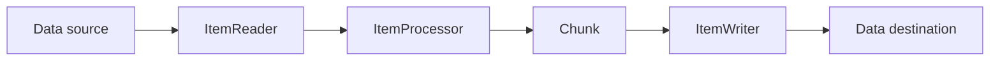
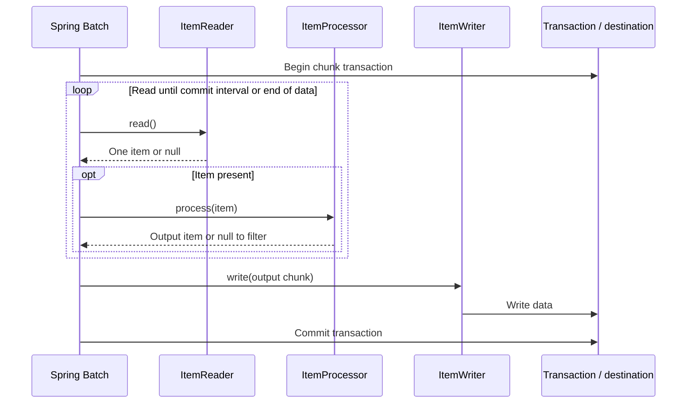

# Input, Processing, and Output Data in Spring Batch

A Spring Batch job usually takes data from a source, transforms or validates each record, and then writes the results to another destination. Spring Batch organizes this workflow with three main components: **ItemReader**, **ItemProcessor**, and **ItemWriter**. When you combine them in a chunk-style step, the framework also manages transactions, checkpoints, and restartability.

This lesson explains the role of each component, how data passes through a step, how to configure a real-world processing flow, and what to watch for when data is faulty or a job has to be rerun.

## 1. Basic Processing Flow

In a step that processes in chunks, data passes through the following flow:



- **ItemReader** reads a record from the source and converts it into a Java object.
- **ItemProcessor** optionally validates, filters, or transforms that object.
- **ItemWriter** receives a group of processed objects and writes them to the destination.

A step can skip the processor if no intermediate processing is needed. The reader and writer are the two components a chunk-oriented step needs in order to perform reading and writing.

For example, an order import job can read CSV lines, convert them into normalized order objects, discard cancelled orders, and write the valid orders to the database.

### Data Types at Each Stage

The reader and processor are not required to use the same data type. The processor can convert from an input type to a different output type:

```text
CSV row
  -> RawOrder
  -> NormalizedOrder
  -> database row
```

Separating the data types gives each component a clear boundary. The input object reflects the structure of the source; the output object reflects the structure the target system needs.

## 2. Reading Data with ItemReader

### Role and Contract

```java
public interface ItemReader<T> {
    T read() throws Exception;
}
```

Each time the framework calls `read()`, the reader returns at most one item:

- Returns an object when it has read the next record.
- Returns `null` when the source has run out of data. This is the signal that the input has ended.
- Throws an exception if it cannot read or convert the record.

Do not use `null` to represent a valid record. Spring Batch interprets this value as the end of the data.

The reader is responsible for fetching data and mapping the source data to an appropriate Java type. Business rules such as whether an order is accepted should usually go in the processor, rather than being mixed into the reading logic.

### Common Data Sources

| Source | Commonly used reader | When it fits |
|---|---|---|
| Comma- or tab-delimited file | `FlatFileItemReader` | Importing CSV, TSV, or structured text files |
| Fixed-format file | `FlatFileItemReader` combined with an appropriate tokenizer | Each field sits at a defined character position |
| Database via JDBC | `JdbcCursorItemReader` | Reading query results sequentially using a cursor |
| Database, paged | `JdbcPagingItemReader` | Reading a large data set page by page |
| JPA | `JpaPagingItemReader` | Reading entities page by page using JPA |

Choose a reader based on the characteristics of the source and how the data is paged or traversed. For paged queries, there should be a stable ordering, usually based on a unique key, to avoid missing or re-reading records when the data changes between pages.

### Mapping Input Data

When reading a file, the reader needs to know how to split a line into fields and convert each field to a Java type. For example, a CSV line may contain an order ID, a customer ID, an amount, and a status. The reader converts that line into a `RawOrder` object.

You need to specify the details of the source format clearly:

- The file's encoding, for example UTF-8.
- Whether the header line needs to be skipped.
- The delimiter, the quote character, and the escape rules.
- The format of dates, decimal numbers, and empty values.
- How to handle lines with missing fields or an incorrect format.

If the source changes structure, the mapping can fail. Handle that case deliberately, rather than silently assigning default values that distort the meaning of the data.

### Example CSV Reader

```java
public record RawOrder(
    long orderId,
    String customerId,
    BigDecimal amount,
    String status
) {}

@Bean
FlatFileItemReader<RawOrder> orderReader() {
    return new FlatFileItemReaderBuilder<RawOrder>()
        .name("orderReader")
        .resource(new ClassPathResource("input/orders.csv"))
        .encoding(StandardCharsets.UTF_8.name())
        .linesToSkip(1)
        .delimited()
        .names("orderId", "customerId", "amount", "status")
        .fieldSetMapper(fields -> new RawOrder(
            fields.readLong("orderId"),
            fields.readString("customerId"),
            fields.readBigDecimal("amount"),
            fields.readString("status")
        ))
        .build();
}
```

In the example, `linesToSkip(1)` skips the header line. `names(...)` declares the column names in the order they appear in the file. `fieldSetMapper(...)` converts the split values into a `RawOrder`.

`ClassPathResource` fits when the file is in the application's classpath. For a file uploaded by a user or a file located outside the application, you can use a resource that fits the storage location, such as `FileSystemResource`.

## 3. Processing Data with ItemProcessor

### Role and Contract

```java
public interface ItemProcessor<I, O> {
    O process(I item) throws Exception;
}
```

The processor receives an item of type `I` and returns an item of type `O`. These two types can be the same or different.

Work that suits a processor includes:

- Normalizing data, for example trimming whitespace from a customer ID.
- Converting types or formats.
- Checking business rules.
- Computing derived values.
- Filtering out records that do not need to be written to the destination.
- Combining information already present in the item to create the output object.

A processor can return `null` to **filter out an item**. That item is considered read but is not passed on to the writer. This is deliberate filtering behavior, different from the reader returning `null`, which signals that the source has run out of data.

If the processor throws an exception, the step handles the exception according to the step's error configuration. If there is no appropriate skip or retry policy, the step usually fails.

### Example Processor That Normalizes Orders

```java
public record NormalizedOrder(
    long orderId,
    String customerId,
    BigDecimal amount
) {}

@Bean
ItemProcessor<RawOrder, NormalizedOrder> orderProcessor() {
    return raw -> {
        // Cancelled orders do not need to be written to the result table.
        if ("CANCELLED".equalsIgnoreCase(raw.status())) {
            return null;
        }

        if (raw.amount() == null || raw.amount().signum() <= 0) {
            throw new IllegalArgumentException(
                "Invalid amount for order " + raw.orderId()
            );
        }

        return new NormalizedOrder(
            raw.orderId(),
            raw.customerId().trim(),
            raw.amount().setScale(2, RoundingMode.HALF_UP)
        );
    };
}
```

In the example:

1. An order with status `CANCELLED` is filtered by returning `null`.
2. An invalid amount raises an exception.
3. A valid order is normalized into a `NormalizedOrder` before being written.

In a real system, you need to clearly distinguish data that is excluded by business rules from data that is wrong. A cancelled order may be a valid case to skip; a negative amount may be a data error that needs to be recorded or routed to an error-handling flow.

### Keep the Processor Predictable

A processor is usually easier to operate when processing the same input always produces the same output and it creates no external effects on its own. Avoid sending email, calling APIs with side effects, or writing to other systems directly inside the processor. When a chunk is rolled back or retried, the processor may be called again for the same item.

If you need to look up additional data, control the timeout, transient errors, and cost of that call. For tasks that need to update an external system, design a separate write step and consider an idempotency mechanism.

## 4. Writing Data with ItemWriter

### Role and Contract

In Spring Batch 5, the writer contract looks like this:

```java
public interface ItemWriter<T> {
    void write(Chunk<? extends T> chunk) throws Exception;
}
```

The writer receives a `Chunk` containing the output items of the current processing round and writes them to the destination. Unlike the reader, which reads item by item, the writer works in groups so that it can take advantage of bulk writes.

Common writers:

| Destination | Commonly used writer | Purpose |
|---|---|---|
| Database via JDBC | `JdbcBatchItemWriter` | Executes inserts or updates in batches |
| Text file | `FlatFileItemWriter` | Writes data as lines |
| JPA | `JpaItemWriter` | Saves entities via the EntityManager |
| Multiple writers | `CompositeItemWriter` | Passes the same chunk to multiple writers |
| Conditional writer | `ClassifierCompositeItemWriter` | Chooses a writer based on the characteristics of the item |

The writer is responsible for converting the processed items into the format the destination requires. For example, a `NormalizedOrder` can be mapped to SQL parameters to be written to the `processed_order` table.

### Example JDBC Batch Writer

```java
@Bean
JdbcBatchItemWriter<NormalizedOrder> orderWriter(DataSource dataSource) {
    return new JdbcBatchItemWriterBuilder<NormalizedOrder>()
        .dataSource(dataSource)
        .sql("""
            INSERT INTO processed_order
                (order_id, customer_id, amount)
            VALUES
                (:orderId, :customerId, :amount)
            """)
        .itemSqlParameterSourceProvider(order ->
            new MapSqlParameterSource()
                .addValue("orderId", order.orderId())
                .addValue("customerId", order.customerId())
                .addValue("amount", order.amount())
        )
        .build();
}
```

The writer uses `MapSqlParameterSource` to map the properties of each `NormalizedOrder` to the named parameters in the SQL statement. The JDBC batch writer groups the chunk's write operations to reduce the cost of calls to the database.

The target table needs corresponding columns and appropriate data types. If `order_id` is a unique key, re-importing the same order can cause a duplicate-key error. Decide clearly whether the business needs to insert, update, upsert, or skip records that already exist.

### Writing to a File or Multiple Destinations

`FlatFileItemWriter` fits when the output is a file. You need to specify the encoding, the file name, how the header is written, how each line is formatted, and the behavior when the file already exists. When a job can be rerun, you need to understand clearly whether the file is appended to, written fresh, or restored according to a checkpoint.

If a chunk needs to be written to multiple destinations, you can use a composite writer. However, calling multiple writers does not automatically guarantee that all destinations commit or roll back together. A database transaction cannot implicitly undo an operation that has already been sent to an API or an external storage system.

## 5. Chunk-Oriented Processing Connects the Three Components

### What Is a Chunk?

A chunk is a group of items that are read, processed, and written as one unit of work. When you configure:

```java
.<RawOrder, NormalizedOrder>chunk(100, transactionManager)
```

the value `100` is the commit interval: the framework reads and processes up to 100 input items for a chunk before writing the results and completing that chunk's transaction. The last chunk can be smaller than 100 if the source has run out of data.

If the processor filters some items by returning `null`, the number of items the writer receives can be fewer than the number of items the reader read. For example, if the reader reads 100 orders but the processor filters out 8 cancelled orders, the writer receives only the remaining orders.

### The Sequence of a Chunk



At the conceptual level, a chunk goes through the following stages:

1. Spring Batch begins processing the chunk within the step's transaction scope.
2. The framework calls the reader multiple times to obtain the input items.
3. Each item is passed through the processor if the step has a processor configured.
4. The output items are gathered into a chunk.
5. The writer writes the output chunk.
6. When the chunk's operations succeed, the transaction is committed and the checkpoint state is updated.

If the reader reports the end of the data, the framework completes the last chunk and then ends the step. If writing or processing fails, the current transaction can be rolled back. Chunks that were committed earlier are kept.

### Why Does the Commit Interval Matter?

The commit interval affects performance, memory, and the scope of rollback:

- A small chunk creates more transactions, which usually increases commit overhead but limits the number of items that must be reprocessed on error.
- A large chunk can improve batched write performance, but holds more items in memory and makes the rollback scope larger.
- The appropriate value depends on the processing time per item, the source speed, the destination's write capability, and transaction limits.

There is no single optimal value for every job. You can start with a moderate value, measure run time and memory usage, and then adjust based on real data.

## 6. Combining Reader, Processor, and Writer in a Step

The following example connects the three beans above into a step and a job. The configuration uses the Spring Batch 5 API, with the `JobRepository` and `PlatformTransactionManager` provided by the application configuration.

```java
@Bean
Step importOrdersStep(
        JobRepository jobRepository,
        PlatformTransactionManager transactionManager,
        FlatFileItemReader<RawOrder> orderReader,
        ItemProcessor<RawOrder, NormalizedOrder> orderProcessor,
        JdbcBatchItemWriter<NormalizedOrder> orderWriter) {

    return new StepBuilder("importOrdersStep", jobRepository)
        .<RawOrder, NormalizedOrder>chunk(100, transactionManager)
        .reader(orderReader)
        .processor(orderProcessor)
        .writer(orderWriter)
        .build();
}

@Bean
Job importOrdersJob(
        JobRepository jobRepository,
        Step importOrdersStep) {

    return new JobBuilder("importOrdersJob", jobRepository)
        .start(importOrdersStep)
        .build();
}
```

The type declaration in `<RawOrder, NormalizedOrder>` tells Spring Batch the step's input and output item types. The reader produces `RawOrder`; the processor converts it to `NormalizedOrder`; the writer receives a chunk of `NormalizedOrder`.

Step and job names need to stay stable across deployments if you want Spring Batch to correctly recognize the metadata and execution state. When a job runs, the `JobRepository` stores information about the job instance, job execution, step execution, and execution context.

The example omits the imports and the infrastructure configuration such as the datasource, the transaction manager, and the Spring Batch metadata schema. These beans need to be provided in the application for the job to run.

## 7. Transactions and Error Handling

### What Happens When a Chunk Fails?

Suppose the chunk is processing orders 101 through 200. The writer writes data but hits an error before the transaction commits. If the writer participates in the same transaction managed by the step's transaction manager, the changes in the current transaction are rolled back. When continuing or restarting, the framework may need to re-read and reprocess the items belonging to the uncommitted chunk.

Chunks that were committed earlier remain intact. Therefore, a job may have successfully processed many chunks before failing on a later chunk.

The rollback mechanism applies only to resources that participate in the corresponding transaction. For example, a JDBC insert using the same transaction manager can be rolled back; an HTTP call that has already succeeded does not disappear on its own when the database transaction rolls back.

### Distinguishing Skip and Retry

These two mechanisms address two different kinds of situations:

- **Skip** is used for an item whose error has been determined to be unprocessable or not worth retrying, but the job can still continue with other items.
- **Retry** is used for transient errors that are likely to succeed if tried again, such as some transient data access errors.

Example configuration:

```java
return new StepBuilder("importOrdersStep", jobRepository)
    .<RawOrder, NormalizedOrder>chunk(100, transactionManager)
    .reader(orderReader)
    .processor(orderProcessor)
    .writer(orderWriter)
    .faultTolerant()
    .skip(FlatFileParseException.class)
    .skipLimit(20)
    .retry(TransientDataAccessException.class)
    .retryLimit(3)
    .build();
```

In this configuration, file line parsing errors of the specified type can be skipped within the allowed limit. Transient data access errors can be retried up to the configured limit. When the limit is exceeded or an error occurs that the policy does not allow, the step fails.

You should only skip exception types that are well understood and have an appropriate recording process. If you skip faulty data without storing information about the record, the cause, and the source location, later reconciliation will be difficult. You should not retry permanent data errors such as a malformed order ID or an invalid amount; retrying usually does not make that data valid.

## 8. Checkpoints and Restartability

A job that processes millions of records can take many hours. If the job stops midway, Spring Batch needs to know how far it got in order to continue.

### ItemStream and ExecutionContext

Many Spring Batch readers and writers support the `ItemStream` interface, with the lifecycle methods:

- `open(ExecutionContext)`: opens resources and restores previously saved state, if any.
- `update(ExecutionContext)`: writes the current state into the execution context at a checkpoint.
- `close()`: closes resources after the step completes or ends.

The `ExecutionContext` is where the state needed to continue the work is stored. For example, a reader that reads a file can store the line position it has processed; when the job restarts, the reader uses this position to continue from the appropriate checkpoint. Spring Batch stores the metadata and execution context through the `JobRepository`.

When you write your own reader or writer that needs to restore state, you can implement `ItemStreamReader` or `ItemStreamWriter` together with the corresponding read or write interface. The state needs to be saved consistently and should reflect only the portion of work that has been committed.

### Give Readers Stable Names

For a reader created with a builder, set a stable name, for example `.name("orderReader")`. This name helps identify the reader's state in the execution context. If you rename it arbitrarily between runs, the framework may not find the old checkpoint under the key the previous reader used.

If you need restartability, do not turn off the reader's state saving arbitrarily. A reader that does not save a checkpoint may have to re-read from the beginning, or may be unable to restore the correct position after the job fails.

### JobParameters and Reruns

Spring Batch uses the job name and the identifying JobParameters to determine a job instance. When an execution fails, you can restart the same job instance with the same identifying parameters to continue using the stored metadata. A completed job instance cannot be rerun as a new execution just by reusing the exact same set of identifying parameters; you need to create a new instance with appropriate identifying parameters.

This is especially important for jobs that import files by day or by batch. Choose identifying parameters that accurately reflect the unit of data, such as a batch code or a processing date, so that each batch has a clear lifecycle.

### Designing a Writer That Is Safe on Rerun

Checkpoints help Spring Batch know which chunks have been committed, but they cannot by themselves guarantee that no destination system contains duplicate data. Especially for destinations outside the database transaction, a send may have already succeeded even though the application did not get a chance to record the completed state.

Some ways to reduce the risk:

- Use a business key or a unique key to identify records.
- Design write operations to be idempotent, for example an upsert on an appropriate key.
- Store the processed batch code or event code to detect repeated sends.
- Separate the outbound send from the transaction and use an outbox mechanism or confirmation from the destination system when high reliability is needed.

Idempotency needs to fit the business. It is not always right to overwrite data that already exists; sometimes a duplicate record must be reported as an error for investigation.

## 9. Choosing Chunk Size and Optimizing Performance

When optimizing a job, consider the entire path of the data rather than just increasing the commit interval.

**At the reader:**

- Read as a stream or page by page to avoid loading all the data into memory.
- With JDBC, consider an appropriate fetch size and page size.
- Use queries with a stable ordering when paging.
- Select only the necessary columns if the source is a database.
- Close resources in the proper lifecycle to avoid leaking cursors or file handles.

**At the processor:**

- Avoid repeated computation or database queries for each item if you can safely batch or cache.
- Limit the wait time when calling external services.
- Keep processing safely repeatable when a chunk is retried.
- Do not keep a large data list in a variable shared across many items.

**At the writer:**

- Prefer batch writes when the destination supports them.
- Use SQL statements and indexes suited to the write operation.
- Monitor write time, the number of records per chunk, and errors from the destination system.
- Evaluate separately the commit, rollback, and re-write behavior on rerun.

If the reader is slow, increasing the chunk size does not necessarily improve things significantly. If the writer is the bottleneck, batch inserts or SQL optimization can produce a clearer effect. Measure the time at each component to find the right bottleneck.

## 10. Common Design Mistakes

### Using null for the Wrong Purpose

- A reader returning `null` means the end of data. If you use it to represent a faulty record, the job may stop reading early.
- A processor returning `null` means filtering the current item. Do not use this to hide data errors that need to be handled.

### Putting Business Logic in the Reader

A reader should focus on reading and mapping source data. If a reader reads a file, checks the order status, and decides to update the database all at once, the responsibilities are mixed and hard to test. Putting business rules in the processor or a dedicated component makes the processing flow easier to understand.

### Writing Item by Item Instead of in Batches

A writer that performs its own transaction or its own network call for each item can create a large cost. When the destination supports it, take advantage of chunk-based writers and batch APIs.

### Assuming Every Operation Can Be Rolled Back

A database rollback does not undo an email that has been sent, an HTTP request that has been processed, or a file that another system has already read. Determine the transaction boundary of each destination and design write operations that are safe to repeat.

### Using a Reader Without Appropriate Restart State

A custom reader that keeps its read position only in an in-memory variable loses that position when the process stops. If you need restartability, save and restore the state through the `ExecutionContext`.

### Increasing Chunk Size Without Measuring

A chunk that is too large can increase memory, rollback time, and the amount of work that must be reprocessed. Try it with representative data, measure throughput and resource usage, and only then choose the configuration.

## 11. How to Test the Read, Process, and Write Flow

You should test each component and the step as a whole:

- **Reader:** confirm correct column mapping, encoding, header, empty values, and the end-of-data signal.
- **Processor:** check valid data, data that needs normalization, filtered cases, and cases that throw an exception.
- **Writer:** confirm the data is written correctly, duplicate keys are handled as expected, and the transaction rolls back on failure.
- **Step:** check the number of items read, the number filtered, the number written, skip/retry, and the completion status.
- **Restart:** make the step fail after some chunks, then rerun it and confirm that the committed chunks are not written twice and the uncommitted chunk is reprocessed correctly.

Test data should include both normal cases and edge cases, such as a file that has only a header, a line with a missing column, an amount of zero, a cancelled order, and a duplicate order ID. For jobs with large inputs, also check the behavior when the reader reaches the end of the source and when the writer encounters an error in the middle of a chunk.

## 12. Things to Remember When Building a Step

An easy-to-operate Spring Batch flow usually has the following characteristics:

- The reader only reads and maps source data into items.
- The processor contains the normalization, filtering, and business validation logic.
- The writer writes an output chunk in a way that suits the destination.
- The commit interval is chosen based on measurements of performance and resources.
- Skip and retry apply only to error types that have been clearly classified.
- The reader and writer save the necessary state if the job must restart.
- Write operations with external side effects are designed to be handled safely on retry.

When you clearly separate these three responsibilities and understand the chunk's transaction boundary, you can build jobs that import, transform, and export data with better scalability, monitoring, and restartability.

