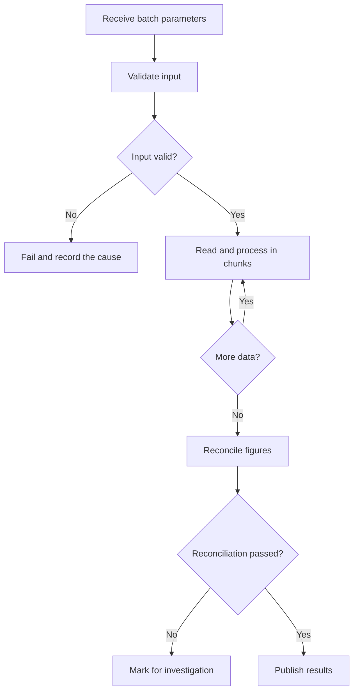

# Characteristics of a Reliable Batch Job

A reliable batch job is one that can process a defined volume of data or a scheduled stream of data, produce correct results, and keep a consistent state even when errors occur. The job needs clear behavior when it is rerun, when a record is invalid, when a dependent system is temporarily unavailable, or when the process is stopped midway.

In Spring Batch, reliability does not come from a single annotation or configuration. It is the result of how you design the `Job`, `Step`, reader, processor, writer, transactions, and restart mechanism, together with operations and monitoring. A job that runs successfully once is not necessarily reliable; a reliable job must keep producing correct results across many runs and in foreseeable failure situations.

## 1. Verifiable, Well-Defined Results

Before implementation, you need to clearly define the job's inputs, outputs, and completion conditions. For example, a transaction reconciliation job can receive the set of transactions for one day, validate each transaction, write the reconciliation results, and mark the transactions that have been processed.

The questions to answer include:

- Is the data scope of the run determined by a point in time, a batch ID, a business date, or some other criterion?
- When is a record considered successfully processed?
- Will invalid records be rejected, skipped, or cause the whole step to fail?
- When the job is rerun, is the desired outcome to continue with the remainder or to recreate the same result?
- How do you reconcile the number of records read, processed, written, skipped, and failed?

A good job does not rely on vague assumptions such as “read all the existing data”. If the data set changes while the job is running, the run may process a different scope depending on timing. For period-based business processes, you should fix the scope with a parameter such as `businessDate`, `batchId`, or a point in time determined before the job starts.

For example, a job that receives `businessDate=2026-11-14` should process only data belonging to that business date, even if the job is relaunched the next day. This parameter also needs to be stored in the `JobParameters` to distinguish the job's instances.

## 2. Safe Restartability

A batch job can be stopped by a power outage, a runtime limit, a connection error, a killed process, or an application error. Restartability is the ability to relaunch a failed job and continue processing in a controlled way.

Spring Batch stores execution metadata in the `JobRepository`, including job state, step state, execution context, and the information needed for restart. When configured correctly, the framework can restore the state of the step and the reader to continue from the appropriate position.

For restart to be meaningful:

1. Use a `JobRepository` configured with a durable metadata store in the production environment. Do not rely on metadata that exists only in memory if you need to restart after the process or server stops.
2. Provide stable `JobParameters` for the same business processing run. The parameters that identify the data should be kept unchanged on restart.
3. Use a reader that can save and restore state when you need to continue from the position already read. Check the specific restart behavior of the reader you are using.
4. Avoid changing the logic or data structure between the first run and the restart in a way that makes the saved state no longer compatible.
5. Ensure that write operations can be safely rerun, because checkpoints and external effects are not always committed in the same transaction.

Example of configuring a chunk-based step:

```java
@Bean
Step importOrders(
        JobRepository jobRepository,
        PlatformTransactionManager transactionManager,
        ItemReader<OrderInput> reader,
        ItemProcessor<OrderInput, Order> processor,
        ItemWriter<Order> writer) {

    return new StepBuilder("importOrders", jobRepository)
            .<OrderInput, Order>chunk(100, transactionManager)
            .reader(reader)
            .processor(processor)
            .writer(writer)
            .build();
}
```

With this step, Spring Batch processes items in groups of 100 items per chunk transaction. When a chunk commits, the framework updates the corresponding execution state. If a chunk has not committed and the transaction is rolled back, the work in that chunk may be performed again. This does not automatically undo effects that have already happened in systems outside the current transaction.

`JobParameters` also affect the identity of the job instance. With the same job name and the same set of identifying parameters, Spring Batch treats it as the same `JobInstance`; a new run usually creates a different `JobExecution` for that instance. If you add a parameter that changes on every run, such as a random timestamp, you may inadvertently create a new instance and destroy the meaning of restart. Only mark a parameter as identifying when it truly distinguishes one business processing run.

## 3. Idempotent and Able to Handle Repeated Runs

Idempotency is the property that makes performing the same request multiple times produce a result equivalent to performing it once. This is an important characteristic because batch jobs often have to retry, restart, or be rerun by operators.

For example, the operation “add 100 to the balance” is not idempotent: running it twice adds 200. Meanwhile, the operation “set the account's balance to the value calculated for batch X” can be idempotent if it is designed with an appropriate key and update condition.

Some ways to build idempotency:

- Use a business key or a unique key to identify records that have been processed, for example `(batch_id, source_record_id)`.
- Use an upsert or a conditional write statement so that a record from the same batch is not created in duplicate.
- Store the processing state and results keyed by a stable source code, rather than relying only on read order.
- For accumulating operations, store a ledger or a unique transaction code to prevent the same effect from being applied multiple times.
- When calling an external API, send an idempotency key if the service supports it and store the results needed for reconciliation.

An SQL example illustrating how to guarantee that each source record is written only once per batch:

```sql
CREATE TABLE imported_order (
    batch_id          VARCHAR(64) NOT NULL,
    source_order_id   VARCHAR(64) NOT NULL,
    customer_id       VARCHAR(64) NOT NULL,
    amount            DECIMAL(18, 2) NOT NULL,
    PRIMARY KEY (batch_id, source_order_id)
);
```

The primary key prevents two records with the same `batch_id` and `source_order_id` from existing together. The application still needs to determine how to handle a conflict: skip the record that was already imported, update it according to a business rule, or report a data error. A database constraint is the last line of defense and does not replace designing the rerun process.

## 4. Transactions and Checkpoints with Clear Boundaries

In chunk-oriented processing, Spring Batch reads items, passes them through the processor, and writes a group of items within the chunk's transaction boundary. When the writer completes and the transaction commits, the chunk is confirmed. If an error causes the transaction to roll back, the changes belonging to that transaction are undone.

Chunk size is an important design decision:

| Chunk size | Advantages | Trade-offs |
|---|---|---|
| Small | Short transactions, less data rolled back, frequent checkpoints | More commits and higher overhead |
| Large | Fewer commits, possibly higher throughput | Long transactions, more memory use, larger rollback scope |

There is no single optimal number for every job. Choose based on record size, processing time, the database's transaction limits, load capacity, and restart requirements. Measure performance using data close to reality instead of choosing the chunk size by gut feeling.

A transaction boundary in the database does not automatically cover every system the job calls. For example, a writer writes a row to the database and then sends an email or calls an HTTP API. If the email has been sent but the database transaction rolls back, a rerun may send the email again. Similarly, if the API has received the request but the client times out before receiving the response, the application cannot conclude with certainty that the server has not performed the operation.

For external effects, consider one of the following approaches:

- Write an outbox record in the same transaction as the business change, and then use a separate process to send messages from the outbox.
- Use an idempotency key at the receiving service so that a repeated request does not produce a repeated effect.
- Store the send status and the response result, and design intermediate states so that you can reconcile after an incident.
- Separate the non-rollbackable operation into its own step and specify clearly how to recover when that step fails.

When designing transactions, check whether the writer actually participates in the same `PlatformTransactionManager`. If you use multiple resources or multiple transaction managers, you must clearly define the consistency boundary and the recovery strategy.

## 5. Distinguishing Transient Errors from Data Errors

Not every error should be handled the same way. A reliable job classifies errors by cause and has an appropriate policy.

**Transient errors** can disappear if retried, for example a short timeout, a deadlock, rate limiting from an API, or a dependent service being temporarily unavailable. A bounded retry can help the job complete without manual intervention.

**Data errors or business errors** usually do not disappear on rerun, for example a customer ID that does not exist, a wrong date format, or a negative amount in a business context that does not allow it. These errors usually need to be rejected, placed in a store for faulty data, or cause the step to fail, depending on business requirements.

Spring Batch supports configuring retry and skip on a step. The following example illustrates a bounded retry policy and skipping a predefined kind of data error:

```java
return new StepBuilder("processPayments", jobRepository)
        .<PaymentInput, Payment>chunk(100, transactionManager)
        .reader(reader)
        .processor(processor)
        .writer(writer)
        .faultTolerant()
        .retry(TransientDataAccessException.class)
        .retryLimit(3)
        .skip(InvalidPaymentException.class)
        .skipLimit(20)
        .build();
```

In the example, the step can retry transient data access errors up to the configured limit and allows skipping a number of items with `InvalidPaymentException` within the limit. You need to verify the actual exception type thrown from the reader, processor, or writer. A skip configuration that is too broad, such as skipping every `Exception`, can hide programming errors or infrastructure errors and cause the job to report completion even though data is lost.

An error policy should specify:

- Which error types are retried, the maximum number of attempts, and the pause between attempts.
- Which error types are skipped and the allowed skip limit.
- Where skipped items are recorded, along with their source code and cause.
- When the limit is exceeded, how the job or step fails and who is responsible for handling it.
- Which side effects a retry can repeat, and whether those side effects are already idempotent.

For transient errors, backoff can avoid bursts of retries that overload a dependent system. For unrecoverable errors, fail-fast usually helps detect problems early and avoids producing incomplete results that nobody notices.

## 6. Able to Validate Data and Protect Integrity

A reliable job must validate data at the right layer. The reader is responsible for reading the correct scope and interpreting the source data. The processor applies transformation and business rules. The writer is responsible for writing results according to consistent rules.

Common checks include:

- Checking required fields, data types, formats, and value domains.
- Checking referential relationships, for example that a customer or product must exist.
- Checking for duplicates by business key.
- Checking total amounts, counts, or checksums when the source provides reconciliation information.
- Checking that the numbers of input and output records fall within a reasonable threshold.
- Checking consistency among related pieces of data before publishing the results.

Do not silently fix source data if the business rules do not permit it. If you normalize data, make clear the original value, the normalized value, and the rule applied so that it can be traced.

For input files, you can perform a structure and metadata check before processing the whole file: file name, business date, encoding, header, number of columns, checksum, or format. If the file does not belong to the expected batch, stop early to avoid importing the wrong data.

## 7. Logs, Metrics, and Traceability

A job can run for many hours and process millions of records. When an incident occurs, the information “job failed” is not enough. Operators need to know which job, which run, which step, which data scope, and which item ran into a problem.

You should record at minimum:

- The job name, the step name, `JobInstance`/`JobExecution`, and the necessary business parameters.
- The start time, end time, duration, and execution status.
- The number of items read, processed, written, filtered, skipped, and retried.
- The number or rate of errors by cause group.
- The batch code, business date, source file name, or the data key range that was processed.
- Error information sufficient for investigation, but without exposing passwords, tokens, personal data, or sensitive information.

Spring Batch provides metadata about job and step executions in the `JobRepository`. You can use listeners such as `JobExecutionListener`, `StepExecutionListener`, or item-processing listeners to add logs and metrics as needed. You should use a stable correlation ID to link the job's logs with logs from services or other systems.

Example of a listener that records execution time:

```java
@Component
public class BatchJobListener implements JobExecutionListener {

    private static final Logger log =
            LoggerFactory.getLogger(BatchJobListener.class);

    @Override
    public void beforeJob(JobExecution jobExecution) {
        log.info("Job {} started; executionId={}",
                jobExecution.getJobInstance().getJobName(),
                jobExecution.getId());
    }

    @Override
    public void afterJob(JobExecution jobExecution) {
        log.info("Job {} finished; executionId={}, status={}, exitStatus={}",
                jobExecution.getJobInstance().getJobName(),
                jobExecution.getId(),
                jobExecution.getStatus(),
                jobExecution.getExitStatus().getExitCode());
    }
}
```

This is an example of logging state at the job level. In a real application, you need to register the listener with the job and add metrics per step or per data type. Avoid writing the entire content of an item to the log if the item has sensitive data or a large volume.

Useful metrics can include throughput (items/second), the average time per chunk, the duration of each step, the skip rate, the number of retries, and the latency from when data was created to when it finished processing. Alerts should be based on operationally meaningful conditions, such as a job exceeding its expected time, the error count exceeding a threshold, or no new batch arriving within the required period.

## 8. Safe to Operate and Orchestrate

A reliable batch job needs clear rules when running on a schedule, running manually, running concurrently, or being asked to stop.

**Prevent unintended duplicate runs.** Spring Batch manages job instance identity based on the job name and identifying parameters, but the application still needs an appropriate orchestration policy. For example, two launches of the same batch can contend over data or call an external service twice. You can use a unique constraint, a business lock, a scheduler mechanism, or a distributed lock depending on the architecture. A distributed lock needs an expiry and a mechanism for handling a dead worker to avoid the lock being held indefinitely.

**Limit resources.** Set reasonable limits for chunk size, number of threads, database connections, wait times, and number of retries. Increasing concurrency can improve throughput but also increases pressure on the database and dependent services. You need to determine how to partition the data so that workers do not overwrite or duplicate-process the same range.

**Controlled stopping.** A long job should have a way to react to stop requests, timeouts, and application shutdown. When stopping, you need to know whether the current chunk is committed or rolled back, how the job state is saved, and where the next run will continue from.

**Have a runbook.** Operational documentation should show how to find a failed execution, how to determine the cause, the conditions under which restart is allowed, how to handle faulty data, and how to reconcile results before rerunning. Do not ask operators to fix metadata or delete data themselves in order to “make the job continue” without a controlled process.

## 9. Testable for Success and Failure Scenarios

Testing a batch job is not just confirming that a small input set produces the expected output. You need to test the scenarios that can happen in real runs as well.

Useful categories of tests:

1. **Business tests:** valid data, boundary data, data with missing fields, duplicate data, and malformed data.
2. **Transaction tests:** the writer fails midway through a chunk; confirm that the changes in the transaction are rolled back correctly.
3. **Restart tests:** make the job fail after some chunks, then restart with the same identifying parameters and confirm the final result has nothing missing or duplicated.
4. **Retry/skip tests:** simulate transient errors, data errors, and cases that exceed the retry/skip limit.
5. **Idempotency tests:** rerun the same batch and confirm the business effects are not doubled.
6. **Integration tests:** confirm that the reader, writer, transaction manager, `JobRepository`, and external systems work together correctly.
7. **Load tests:** use volume and data distribution close to reality to measure time, memory, connections, and throughput.

Spring Batch provides testing utilities such as `JobLauncherTestUtils` and `JobRepositoryTestUtils` in the corresponding test module. They help launch jobs in tests and manage test metadata. You should use a test database whose transaction behavior is close to the real environment when testing restart or concurrency; a simple mock usually cannot prove these properties.

A conceptual-level example of testing a job's result:

```java
@SpringBatchTest
@SpringJUnitConfig(BatchTestConfiguration.class)
class ImportOrdersJobTest {

    @Autowired
    private JobLauncherTestUtils jobLauncherTestUtils;

    @Test
    void importsOrdersForBusinessDate() throws Exception {
        JobParameters parameters = new JobParametersBuilder()
                .addString("businessDate", "2026-11-14")
                .toJobParameters();

        JobExecution execution =
                jobLauncherTestUtils.launchJob(parameters);

        assertEquals(BatchStatus.COMPLETED, execution.getStatus());
        // Add assertions on the written data and the business item counts.
    }
}
```

The snippet illustrates how to launch a job with business parameters. The test configuration needs to provide the appropriate job to `JobLauncherTestUtils`, along with the dependencies and test data. The `COMPLETED` status assertion is necessary but not sufficient: the test should confirm the output data, the item counts, uniqueness, and important side effects.

## 10. Choosing a Step Structure That Fits the Requirements

Spring Batch supports several kinds of steps. A chunk-oriented step suits processing item by item or group by group through a reader, processor, and writer. A tasklet suits a finite task such as preparing a directory, verifying a file, calling a stored procedure, or cleaning up data under clear rules.

A job can combine steps to form a multi-phase workflow:



Splitting steps should reflect business and recovery boundaries. If the input validation step fails, you should not start importing data. If the reconciliation step fails after the data has already been written, you need to specify clearly whether the written results are considered provisional or must be compensated. A clear step diagram helps developers and operators understand which phase the job is in after an incident.

## 11. Design Checklist Before Putting a Job into Operation

Before releasing a batch job, the development team should have concrete answers to the following points:

| Aspect | Question to answer |
|---|---|
| Data scope | Exactly which batch, business date, or data range does the job process? |
| Results | What are the completion conditions and the reconciliation figures? |
| Restart | Is the metadata durable, and how does the job restart with the same parameters? |
| Idempotency | Does a rerun create duplicate records, payments, messages, or side effects? |
| Transaction | Which resources does the chunk commit/rollback cover? |
| Retry and skip | Which errors are retried, which are skipped, and what are the limits? |
| Faulty data | How are faulty items stored, traced, and reprocessed? |
| Observability | Are there enough logs, metrics, alerts, and correlation IDs to investigate? |
| Orchestration | How do you prevent duplicate runs and control concurrent runs? |
| Testing | Have restart, rollback, retry, skip, and repeated runs been tested? |
| Operations | Is there a runbook for restart, reconciliation, and incident handling? |

Not every job needs every mechanism at the same level of complexity. A job that produces a temporary report has a different risk from a job that records payments or updates balances. The level of protection needs to be proportionate to the business impact, recoverability, and audit requirements.

## Conclusion

A reliable batch job has clearly defined inputs and results, can be restarted, tolerates repeated runs, controls transactions, classifies errors sensibly, and provides enough information to operate. Spring Batch provides the foundation for metadata, chunk processing, transactions, retry, skip, and listeners; the application still has to design idempotency, the boundaries of external effects, data validation, and recovery procedures for the specific business.

Evaluate a job through real-world scenarios: the process stops midway through a chunk, the database temporarily loses its connection, an item has bad data, the writer times out after an external system has already received the request, or the same batch is launched twice. If each scenario has an expected behavior, can be traced, and has a safe way to recover, the job has a solid foundation to run in a production environment.
