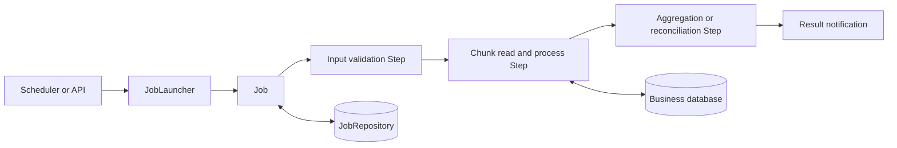
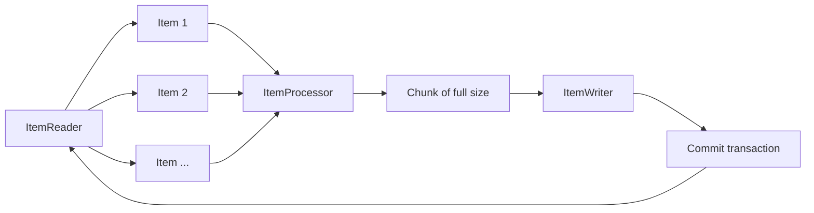

# Roadmap from a Simple Job to a Production Pipeline

Spring Batch helps you build batch data-processing tasks: reading thousands or millions of records, transforming data, writing results, tracking progress, and continuing to run after hitting errors. A job can start as a few lines of `Tasklet`, then grow into a read–process–write pipeline chunk by chunk, and then gain restartability, error handling, duplicate-data control, operational observability, and load scaling.

The roadmap in this lesson follows exactly that order. Each stage solves a real-world problem and lays the foundation for the next stage. The examples use APIs in the Spring Batch 5.x and Spring Boot 3.x style; if your project uses a different version, cross-check the corresponding API and configuration for the version you are running.

## 1. The Big Picture of a Spring Batch Pipeline

A production pipeline usually looks like this:



The main components:

| Component | Role |
|---|---|
| `Job` | Represents a complete batch process, made up of one or more steps |
| `Step` | A phase of work that can run independently, in sequence or in branches |
| `JobLauncher` | Launches a job with a set of parameters |
| `JobRepository` | Stores metadata about jobs, steps, run state, and the execution context |
| `ItemReader` | Reads items one at a time from a file, database, queue, or other source |
| `ItemProcessor` | Validates, filters, or transforms items |
| `ItemWriter` | Writes a group of items to the destination |
| `JobParameters` | Determine the input data and the identity of a logical run |
| `ExecutionContext` | Stores the state needed to continue a job or step |

A job can consist of multiple steps. Within each step, we usually choose one of two kinds:

- **Tasklet**: performs a finite piece of work such as checking a file, calling a stored procedure, or cleaning up old data.
- **Chunk-oriented processing**: reads, processes, and writes data in groups of a configurable size.

You do not need to force every piece of work into a chunk. A Tasklet suits an operation that is one-off in nature for each step; a chunk suits a data flow with many items that needs batch commits.

## 2. Stage 1 — Create the Smallest Job with a Tasklet

Start with a job that has one step and one simple action. The goal is to understand the `Job` → `Step` structure, how Spring Batch stores run state, and how a step ends.

The example below creates a job that records an initialization action:

```java
@Configuration
public class FirstJobConfig {

    @Bean
    Job firstJob(JobRepository jobRepository, Step firstStep) {
        return new JobBuilder("firstJob", jobRepository)
                .start(firstStep)
                .build();
    }

    @Bean
    Step firstStep(
            JobRepository jobRepository,
            PlatformTransactionManager transactionManager) {

        return new StepBuilder("firstStep", jobRepository)
                .tasklet((contribution, chunkContext) -> {
                    System.out.println("Batch job started");
                    return RepeatStatus.FINISHED;
                }, transactionManager)
                .build();
    }
}
```

`JobBuilder` takes the job name and the `JobRepository`. `StepBuilder` takes the step name and the same repository. The Tasklet returns:

- `RepeatStatus.FINISHED` when the work is complete.
- `RepeatStatus.CONTINUABLE` when the step needs to be called again to continue processing.

The Tasklet runs in a transaction managed by the step's transaction manager. For an operation that runs only once, `FINISHED` is the usual result.

At this stage, confirm the following points:

1. The application can initialize the job and the step.
2. The job has a stable name that does not change with each deployment.
3. A run creates an execution record in the metadata repository.
4. An error in the Tasklet causes the execution to reflect a failed status.

A Tasklet does not by itself create the ability to resume midway through a long task. If the work involves many records, you need to save progress explicitly or move to chunk processing.

## 3. Stage 2 — Move to Chunk Processing

When you need to process many records, Spring Batch provides the model:



Suppose the chunk size is `500`: the step reads up to 500 items, transforms them, calls the writer, and commits the transaction. Then the step continues with the next chunk. The last chunk may be smaller than 500.

General step declaration:

```java
@Bean
Step processStep(
        JobRepository jobRepository,
        PlatformTransactionManager transactionManager,
        ItemReader<InputRecord> reader,
        ItemProcessor<InputRecord, OutputRecord> processor,
        ItemWriter<OutputRecord> writer) {

    return new StepBuilder("processStep", jobRepository)
            .<InputRecord, OutputRecord>chunk(500, transactionManager)
            .reader(reader)
            .processor(processor)
            .writer(writer)
            .build();
}
```

The two data types can differ:

- `InputRecord`: the data type the reader returns.
- `OutputRecord`: the data type the processor produces and the writer receives.

The reader returns `null` when the data is exhausted. The processor can return `null` to filter out an item. The writer receives all items that have passed through the processor in the current chunk.

### Transactions and Chunk Size

Chunk size is a decision about performance and transaction size:

- A small chunk reduces the amount of work to roll back on error, but increases the number of commits and overhead.
- A large chunk reduces the number of commits, but makes transactions longer, holds resources longer, and may need more memory.
- A chunk commits successfully only when the write part and the corresponding transaction complete.

There is no optimal number for every system. Start with a moderate value, measure read, process, write, and commit times, and then adjust using real data. For database writes, also consider the JDBC batch size and the connection pool limits.

## 4. Stage 3 — Build a Realistic File Import Pipeline

A problem of importing invoices from a CSV is a good example for assembling the components:

1. Receive the file path and the business date via job parameters.
2. The reader reads each CSV line into an `Invoice`.
3. The processor validates the data and converts it into a `ProcessedInvoice`.
4. The writer writes the results to the database.

### 4.1. Declaring the Model

```java
import java.math.BigDecimal;

public record Invoice(
        String invoiceId,
        String customerId,
        BigDecimal amount) {
}

public record ProcessedInvoice(
        String invoiceId,
        String customerId,
        BigDecimal amount) {
}
```

In the example, the two records have the same structure in order to focus on the processing flow. In a real application, the processor usually normalizes codes, checks business rules, looks up reference data, or creates a different target model.

### 4.2. Reading the CSV

```java
@Bean
@StepScope
FlatFileItemReader<Invoice> invoiceReader(
        @Value("#{jobParameters['inputFile']}") String inputFile) {

    return new FlatFileItemReaderBuilder<Invoice>()
            .name("invoiceReader")
            .resource(new FileSystemResource(inputFile))
            .linesToSkip(1)
            .delimited()
            .names("invoiceId", "customerId", "amount")
            .fieldSetMapper(fields -> new Invoice(
                    fields.readString("invoiceId"),
                    fields.readString("customerId"),
                    fields.readBigDecimal("amount")))
            .saveState(true)
            .build();
}
```

`@StepScope` lets the reader be created when the step starts, at which point the job parameters have values. The `@Value` expression gets `inputFile` from the parameters. `saveState(true)` lets the reader save its read position into the execution context to support restart.

The reader name must be stable across runs and restarts. If you rename the reader or change the input format while an execution is unfinished, the saved state may no longer be appropriate.

A real CSV format needs to be specified clearly: encoding, header, delimiter, quote rules, decimal number format, time zone, and how empty values are represented. If the file may contain commas in quoted fields, use a tokenizer that supports CSV instead of splitting lines yourself with `String.split(",")`.

### 4.3. Processing Business Logic

```java
@Bean
ItemProcessor<Invoice, ProcessedInvoice> invoiceProcessor() {
    return invoice -> {
        if (invoice.invoiceId() == null || invoice.invoiceId().isBlank()) {
            throw new IllegalArgumentException("Missing invoice id");
        }

        if (invoice.amount() == null || invoice.amount().signum() <= 0) {
            throw new IllegalArgumentException("Invalid invoice amount");
        }

        return new ProcessedInvoice(
                invoice.invoiceId().trim(),
                invoice.customerId().trim(),
                invoice.amount());
    };
}
```

The processor should focus on the transformation rules for a single item. Avoid putting operations with side effects here, such as sending email, calling a payment API, or updating multiple external systems. The processor can be called again when a chunk is retried, so a side effect inside the processor is easily performed multiple times.

If `customerId` can be null, you need to check it before calling `trim()`. The example above assumes that field has been validated or is required by the input contract.

### 4.4. Writing to the Database

An example using `JdbcBatchItemWriter` and named parameters:

```java
@Bean
JdbcBatchItemWriter<ProcessedInvoice> invoiceWriter(DataSource dataSource) {
    return new JdbcBatchItemWriterBuilder<ProcessedInvoice>()
            .dataSource(dataSource)
            .sql("""
                    INSERT INTO processed_invoice
                        (invoice_id, customer_id, amount)
                    VALUES
                        (:invoiceId, :customerId, :amount)
                    """)
            .itemSqlParameterSourceProvider(item ->
                    new MapSqlParameterSource()
                            .addValue("invoiceId", item.invoiceId())
                            .addValue("customerId", item.customerId())
                            .addValue("amount", item.amount()))
            .build();
}
```

The target table needs an appropriate schema and constraints, for example `invoice_id` as a unique key. The SQL `INSERT` illustrates how to map an item; when implementing restart or data reruns, you need to choose a duplicate-write policy suited to the database: upsert, insert-if-absent, a staging table followed by a merge, or detecting records that have already been processed. Upsert syntax differs among PostgreSQL, MySQL, SQL Server, and Oracle.

### 4.5. Assembling the Reader, Processor, and Writer into a Step and Job

```java
@Bean
Step importInvoicesStep(
        JobRepository jobRepository,
        PlatformTransactionManager transactionManager,
        FlatFileItemReader<Invoice> invoiceReader,
        ItemProcessor<Invoice, ProcessedInvoice> invoiceProcessor,
        JdbcBatchItemWriter<ProcessedInvoice> invoiceWriter) {

    return new StepBuilder("importInvoicesStep", jobRepository)
            .<Invoice, ProcessedInvoice>chunk(500, transactionManager)
            .reader(invoiceReader)
            .processor(invoiceProcessor)
            .writer(invoiceWriter)
            .build();
}

@Bean
Job invoiceImportJob(
        JobRepository jobRepository,
        Step importInvoicesStep) {

    return new JobBuilder("invoiceImportJob", jobRepository)
            .start(importInvoicesStep)
            .build();
}
```

This is a minimal chunk job. When extending it, you can add a file validation step at the start, a count reconciliation step at the end, and listeners to record results. Each step should have a clear responsibility so that it can be observed, tested, and restarted independently.

## 5. Stage 4 — Use JobParameters Correctly

Job parameters pass the data needed for a run. They also determine the identity of the `JobInstance` if they are marked as identifying.

Launch example:

```java
JobParameters parameters = new JobParametersBuilder()
        .addString("inputFile", inputFilePath, true)
        .addString("businessDate", businessDate.toString(), true)
        .addString("requestId", requestId, false)
        .toJobParameters();

jobLauncher.run(invoiceImportJob, parameters);
```

The `true` argument marks a parameter as identifying; `false` is non-identifying. In this example, the file and the business date make up the logical identity of the import. `requestId` only adds tracing information.

Distinguishing three concepts:

| Concept | Meaning |
|---|---|
| `JobInstance` | A logical run, determined by the job name and the identifying parameters |
| `JobExecution` | One specific execution of a JobInstance |
| `StepExecution` | One specific execution of a step |

A `JobInstance` can have multiple `JobExecution`s, for example the first one fails and the next one is restarted. If the job has completed with the same identifying parameters, Spring Batch usually refuses to rerun the same instance because it has already completed. To process a new business batch, provide a new identifying parameter that has meaning, for example a new business date or batch code.

Do not add a random timestamp to the identifying parameters just to dodge the “already complete” error if the goal is a restart. Doing so creates a new `JobInstance` and makes Spring Batch treat it as a different logical run.

If the application needs to control the launch time itself instead of letting Spring Boot automatically run the job beans at startup, you can configure:

```properties
spring.batch.job.enabled=false
```

Check the auto-run behavior of the Spring Boot version you are using and choose a consistent launch mechanism: a scheduler, an orchestration API, the command line, or a service dedicated to launching batch jobs.

## 6. Stage 5 — Design for Restart and Idempotency

Restart is one of the important reasons to use Spring Batch. When a job fails midway, the system can continue from the saved state instead of always re-reading all of the data. However, safe restart depends on the application's reader, writer, and side effects.

### 6.1. What Does Spring Batch Store?

The `JobRepository` stores metadata about job and step executions. The `ExecutionContext` stores the state needed to continue, for example the position the reader has read up to, or a control value that the application puts into the context.

With chunk processing, state is updated at the step's commit boundary. On restart, Spring Batch uses the metadata and the execution context to restore progress. The reader must support saving state and have a stable name; the data source also needs to remain unchanged or be accurately reproducible.

For example, if the reader is reading a file:

- Keep the input file immutable throughout the job lifecycle.
- Store the file in a stable location with the same access permissions across runs.
- Do not overwrite the file at the same path with new content.
- Record a checksum or batch code to confirm that the file on restart is still the original file.

If the data source is a database query, you need a defined read order. Use `ORDER BY` on a stable key; if the data can change while the job runs, determine an appropriate snapshot or watermark.

### 6.2. Restart Does Not Guarantee Exactly-Once for Every Side Effect

A database transaction can roll back the write portion in the current transaction. But that transaction cannot roll back an email that has been sent, an HTTP request that another system has accepted, or a file that has been uploaded elsewhere.

Therefore, you need to design the writer and side effects to be idempotent: processing the same item again does not produce a wrong or duplicated business result.

Commonly used approaches:

- Place a unique constraint on the business key of processed records.
- Use an upsert or a conditional write statement keyed on an idempotency key.
- Store the `batch_id` and the source key to reconcile which items have been written.
- Write to a staging table first, verify the data is complete, and then merge into the target table.
- Use a transactional outbox to store the request to emit an event in the same business transaction; a separate worker sends the event and the receiving side still checks the idempotency key.

A useful data model is to store `source_record_id`, `batch_id`, `processed_at`, and the processing status. When an error occurs, the operations team can determine which items were committed, which were rejected, and which need to be reprocessed.

### 6.3. Distinguishing Restart from Rerunning from Scratch

- **Restart**: continuing the same `JobInstance` after an unfinished execution, reusing the identifying parameters.
- **New run**: creating a different `JobInstance` with new identifying parameters.
- **Reprocess**: deliberately reprocessing data that has completed before; this needs a clear business rule and an idempotency or versioning mechanism.

Do not delete the job execution metadata to “make the job rerun” in a production environment. Doing so can destroy operational traces and restartability. Design the reprocess operation as a controlled procedure.

## 7. Stage 6 — Classified Error Handling

A production pipeline needs to distinguish data errors, transient errors, and system errors. The handling policy must be based on the cause of the error.

| Error type | Example | Commonly used handling |
|---|---|---|
| Invalid data | Negative amount, missing invoice ID | Bounded skip, store the faulty record for investigation |
| Transient error | Database deadlock, auxiliary service timeout | Bounded retry with appropriate backoff |
| Configuration error | Wrong table name, missing credential | Fail early, fix the configuration, and then restart |
| Prolonged infrastructure error | Database loses its connection | Stop or fail the job, raise an operational alert |
| Logic error | Unexpected null, mapping error | Fail so you can fix the code; do not skip wholesale |

Example of adding skip and retry to a step:

```java
return new StepBuilder("importInvoicesStep", jobRepository)
        .<Invoice, ProcessedInvoice>chunk(500, transactionManager)
        .reader(invoiceReader)
        .processor(invoiceProcessor)
        .writer(invoiceWriter)
        .faultTolerant()
        .skip(FlatFileParseException.class)
        .skipLimit(100)
        .retry(TransientDataAccessException.class)
        .retryLimit(3)
        .build();
```

This is an illustrative example; you need to choose specific exceptions according to the reader, the database driver, and the real business. Do not skip `Exception.class` or retry every error. Configuration errors and programming errors will not go away after a few attempts.

Some principles:

- Set a `skipLimit` so that a file that is broken en masse does not silently produce incomplete results.
- Only retry errors that can recover on their own, such as transient errors at the data access layer.
- Limit the number of retries; consider backoff to avoid piling load onto an overloaded service.
- Use a `SkipListener` to record the faulty item, the cause, and the batch's identifying information.
- Monitor the read, process, write, filter, and skip counts; unusual differences need to be explained.
- Specify clearly whether the job is allowed to complete with some records skipped or must fail if there is any faulty data.

Skip and retry affect transactions. When an item errors in a chunk, the framework may roll back the chunk and then retry or skip the item according to the configuration. Therefore, the processor and writer need to be safe when called again, and external side effects need to be separated out or protected with idempotency.

## 8. Stage 7 — Organize Multiple Steps into a Workflow

When a job has multiple business steps, represent the work flow clearly:

```java
@Bean
Job dailyImportJob(
        JobRepository jobRepository,
        Step validateFileStep,
        Step importDataStep,
        Step reconcileStep) {

    return new JobBuilder("dailyImportJob", jobRepository)
            .start(validateFileStep)
            .next(importDataStep)
            .next(reconcileStep)
            .build();
}
```

A data import workflow can usually be divided as follows:

1. **Validate input**: check that the file exists, has the right format, has the right business date, and has not yet been processed.
2. **Load staging**: read the file and write the raw data to a staging table.
3. **Validate business rules**: check referential relationships, total amounts, customer codes, and business rules.
4. **Publish data**: merge valid data into the business table or emit events.
5. **Reconcile**: compare the number of source rows, valid rows, rejected rows, and written rows.
6. **Notify**: emit the operational result after the data has been committed.

If a later step depends on an earlier step, use `.next(...)`. When you need to branch based on results, you can use flow transitions with `on(...)`, `to(...)`, `from(...)`, `end()`, or `fail()`. Determine clearly which exit status represents business success, a warning, or failure.

Do not gather the whole workflow into one large Tasklet. Splitting steps lets you see progress, time, and errors per phase, and also allows restart from the appropriate step.

## 9. Stage 8 — Scale Performance and Parallel Processing

Before increasing concurrency, measure where the time goes: reading the file, querying the database, CPU processing, writing to the database, or calling external services. Optimize the bottleneck before adding threads.

### 9.1. Partitioning

Partitioning divides the data into independent portions and runs each portion in a worker step. For example, you can divide by `customer_id` range, date, data region, or hash partition. Each partition has its own execution context.

Partitioning fits when:

- The data can be divided into non-overlapping sets.
- Each partition can be processed independently.
- You can limit the number of workers to protect the database and auxiliary systems.
- You need to track state and retry per partition.

The important point is that the partition boundaries must be stable and must not miss or double-process records. When dividing by key range, clearly determine the start/end conditions, the data type, and how to handle records that newly appear while the job is running.

### 9.2. Multi-Threaded Step

A multi-threaded step can increase throughput when the processing part can run concurrently. However, the reader, processor, and writer must be concurrency-safe the way they are used. A reader that keeps an internal pointer or a writer that uses mutable state may not be thread-safe.

In some configurations, processing on a worker thread has a different transaction context from the orchestrating thread. Do not assume that every operation in a multi-threaded step shares one transaction. Check the documentation of the Spring Batch version and the transaction manager you are using.

### 9.3. Remote Chunking

Remote chunking fits when you need to separate where data is read from where chunks are processed onto different processes or machines. The manager reads and sends chunks through middleware; workers process and write the results. This model needs consideration of message delivery, retry, ordering, back pressure, and idempotency on the worker side.

### 9.4. Choosing a Scaling Approach

| Approach | Fits when | What to control |
|---|---|---|
| Increase chunk size | Large commit overhead, each item is light | Memory, transaction time, rollback |
| Partitioning | There is a key or data domain that divides independently | Non-overlap, load distribution, per-partition restart |
| Multi-threaded step | Components are thread-safe and processing can be parallel | Shared state, transactions, ordering |
| Remote chunking | You need to scale workers across multiple processes or machines | Messaging, delivery semantics, idempotency |

Do not increase the number of threads beyond the capacity of the connection pool or the database. For example, 32 workers writing to the same table with a hot index can be slower than 4 workers because of lock contention and I/O.

## 10. Stage 9 — Put the Job into a Production Environment

A job that runs on a development machine is only the starting point. Production needs configuration, security, orchestration, observability, and recovery procedures.

### 10.1. Metadata Repository and Database Schema

The `JobRepository` stores Spring Batch metadata, usually in tables with the `BATCH_` prefix, for example:

- `BATCH_JOB_INSTANCE`
- `BATCH_JOB_EXECUTION`
- `BATCH_STEP_EXECUTION`
- `BATCH_JOB_EXECUTION_PARAMS`
- `BATCH_JOB_EXECUTION_CONTEXT`
- `BATCH_STEP_EXECUTION_CONTEXT`

This metadata is different from the business data the job is processing. You can share a database or separate them depending on load and operational requirements, but you must ensure that transactions and connections are configured correctly.

In a local environment, Spring Boot can automatically initialize the schema for a suitable database. For example:

```properties
spring.batch.jdbc.initialize-schema=always
```

In production, you should manage the schema with controlled migrations and set the automatic-initialization configuration according to the deployment policy. Do not depend on the application automatically creating or altering the metadata tables every time it starts.

### 10.2. Environment Configuration

Move values that vary by environment out into configuration or a secret store:

- JDBC URL, username, and password.
- Input/output paths or bucket/object storage.
- Chunk size, retry limit, and skip limit.
- Timeouts, number of workers, and concurrency limits.
- Business date, timezone, and run schedule.

Do not commit passwords, tokens, or credentials to source control. Use a secret manager or the secret management mechanism of the deployment platform.

### 10.3. Orchestration and Preventing Duplicate Runs

The scheduler can be cron, a Kubernetes CronJob, a data orchestration platform, or an internal scheduler. The scheduler is responsible for determining when to run; Spring Batch is responsible for managing the job's executions and progress.

Production needs to specify:

- Whether a business date is allowed to run multiple instances concurrently.
- If the scheduler sends the same request twice, how the system responds.
- Who has permission to restart, stop, or reprocess a batch.
- How the job handles a file that arrives late, a missing file, or a file with the wrong date.
- What happens if the application is stopped while a chunk is running.

You can use identifying parameters and business unique constraints to prevent duplicate runs. If you need an orchestration lock at the system level, use a lock mechanism with an expiry that can handle the situation where a worker dies without releasing the lock.

### 10.4. Observability and Alerting

Logs should have fields that help correlate events:

- `jobName`, `jobExecutionId`, `stepName`.
- `businessDate`, `batchId`, `partitionId` if present.
- The number of items read, written, filtered, and skipped.
- Start time, end time, and duration.
- Exit status, exception type, and business error code.

Monitor metrics such as the number of running jobs, success rate, run time, item processing rate, the number of skipped items, and the number of retries. Create alerts for jobs that exceed their expected time, jobs that fail, input that does not arrive on time, or a faulty-data rate that exceeds a threshold.

Logs should not record all the sensitive data of each item. Use identifiers to look up records in a system with controlled access.

### 10.5. Stop, Restart, and Operations

The operations team needs a short runbook that can answer:

1. How do you find the `JobExecution` of a batch?
2. How do you distinguish a job that is running, completed, failed, or stopped?
3. When can you restart with the same parameters?
4. When must you create a new batch or reprocess?
5. How do you find skipped records and their causes?
6. How do you confirm the final result through reconciliation?

When you need to stop a job, prefer Spring Batch's stop mechanism and allow the current chunk to finish according to the designed policy. Abruptly killing the process can cause the execution to be recorded as still running until recovery handling is applied, depending on the infrastructure and version.

The metadata needs a retention and cleanup policy. Do not delete active executions or metadata still needed for restart, audit, and incident investigation.

## 11. Testing the Pipeline Layer by Layer

Testing should confirm business behavior and the important boundaries:

| Test layer | Content |
|---|---|
| Processor unit test | Valid data, invalid data, transformation rules, and filtered cases |
| Reader test | Header, encoding, quotes, faulty lines, empty file, and read order |
| Writer test | Column mapping, constraints, upsert, or the duplicate-write policy |
| Step integration test | Read/write/skip item counts, transactions, and step status |
| Job integration test | Step order, job parameters, flow, and exit status |
| Restart test | The job fails after some chunks and then restarts with the same parameters |
| Operational test | Two duplicate launch requests, stop, timeout, and concurrency limits |

Spring Batch provides testing utilities such as `@SpringBatchTest` and `JobLauncherTestUtils` in appropriate configurations. Use a test database that has the metadata schema and the corresponding business schema to check real transactions and restart.

A valuable restart test should simulate an error after one or more chunks have committed, then rerun with the same job parameters and confirm:

- Items that were committed are not duplicated.
- Items that were not committed are processed further.
- The final total number of records matches expectations.
- The metadata reflects the first execution as failed and the next execution as completed.

## 12. Implementation Roadmap by Milestone

You can use the following milestones to develop a job from a trial version into a production pipeline:

| Milestone | Required result | Condition to move on |
|---|---|---|
| 1. Minimal job | One job, one Tasklet, metadata stored | Understand the job and step lifecycle |
| 2. Chunk processing | Reader, processor, writer, and chunk transaction | Can process a sample data set |
| 3. Real input | Job parameters, a file- or database-based reader | The input has a contract and can be validated |
| 4. Restart | Execution context, a reader that saves state | Can continue after a simulated error |
| 5. Error policy | Skip, retry, listeners, and an error report | Data errors are classified and bounded |
| 6. Workflow | Multiple steps and reconciliation | Can trace the results of each phase |
| 7. Idempotency | Unique key, upsert, or staging/merge | Restart and reprocess do not create wrong data |
| 8. Scale | Measure load, partition or apply appropriate concurrency | Meets the time target without overloading dependencies |
| 9. Production | Config, secrets, scheduler, alerts, and runbook | Can be deployed and operated in a controlled way |

You do not necessarily have to implement partitioning or remote chunking for every job. A job that runs for a few minutes each night may only need sequential chunk processing, safe restart, and clear alerting. Choose the level of complexity based on data volume, SLA, operating cost, and recoverability.

## 13. Common Design Mistakes

**Using a random identifying parameter for every launch.** This continually creates new JobInstances and destroys the meaning of restart. Only use identifying parameters that represent the business batch.

**Using one gigantic Tasklet to process millions of rows.** Progress is hard to observe and hard to resume accurately. Move to chunks when the work is processing many items.

**Assuming a database rollback will undo an API call or an email.** Side effects outside the transaction need idempotency, an outbox, or a separate publishing step.

**Ignoring every exception so the job is always green.** The job can complete but with seriously missing data. Classify errors, limit skips, and reconcile results.

**Increasing chunk size or threads without measuring.** Long transactions, an exhausted connection pool, or database contention can make performance worse. Measure throughput and resources before adjusting.

**Changing the input file during a restart.** The reader may continue from the old position on different content. Keep the input immutable and identify the file by checksum or batch id.

**Not reconciling the results.** The `COMPLETED` status tells you the technical flow has finished; it does not by itself prove that every business record is correct. Compare counts and control totals among the source, staging, valid data, rejected data, and the target table.

## 14. Practical Conclusion

A reliable Spring Batch pipeline is built layer by layer: start with a simple job/step, use chunks for large data sets, pass input with job parameters, store metadata for restart, classify errors, protect side effects with idempotency, and only then scale concurrency and polish operations.

When designing a new job, answer four questions first: how the input data is identified, where the commit boundary lies, what prevents data from being duplicated if it is rerun, and how operators will determine that the result is correct. If these four answers are clear, the choices about reader, writer, chunk size, steps, and scheduler become much easier to decide.
