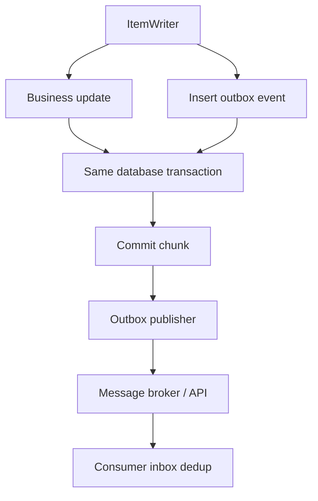

# Writer Idempotency on Retry

In Spring Batch, an `ItemWriter` can be called again when a chunk hits an error, a transaction rolls back, or the job is restarted. This is especially important when the writer writes business data or calls an external system. If the same item is written multiple times and each time creates a new effect, a retry can create duplicate records, add money multiple times, send repeated messages, or perform an external transaction multiple times.

Idempotency is the property that allows an operation to be performed repeatedly while the business result remains equivalent to performing it once. For a writer, an idempotent design lets Spring Batch retry or restart without doubling effects that have already been confirmed.

An idempotent writer does not necessarily have to skip every duplicate write. It can update the same record to the same state, write a ledger entry with a unique key, or ask an external service to return the already-processed result for the same idempotency key. What matters is that the key identifying the operation is stable and the receiving system handles repetition atomically.

## 1. Why Can a Writer Be Called Again?

In chunk-oriented processing, Spring Batch reads items, calls the processor if there is one, and then passes a group of items to the writer. The writer writes that group within the chunk's transaction. If the chunk commits successfully, the checkpoint is saved. If an error causes the transaction to roll back, the chunk is not confirmed and may have to be run again.

Common scenarios:

- The writer throws an exception while writing a chunk.
- A database deadlock or a transient connection error causes the transaction to roll back.
- A retry policy requires retrying the failed operation.
- The process is stopped before the chunk commits and the job is restarted.
- A client calls the same job or the same business request again after a timeout.
- Two workers or two job instances unintentionally process the same range of data.

For example, a chunk contains 100 payments. The writer sends each payment to a partner API. After successfully sending 60 payments, the 61st request times out. If the writer throws an exception and the chunk rolls back, Spring Batch may retry the chunk. The first 60 payments may be sent again even though the partner has already processed them.

General diagram:

```mermaid
flowchart TD
    A[Spring Batch calls write(chunk)] --> B[Writer performs the effects]
    B --> C{All effects succeeded?}
    C -- Yes --> D[Save checkpoint and commit]
    C -- No --> E[Exception / rollback]
    E --> F{Retried?}
    F -- Yes --> G[Call the writer again or reprocess the chunk]
    G --> B
    F -- No --> H[Step fails or skip handling]
```

Therefore, do not assume `write()` is called exactly once per item. The writer's contract needs to withstand a chunk or part of its effects being retried according to the execution configuration.

## 2. What Does Idempotency Mean in a Writer?

An operation is idempotent when repeating the same request does not create additional business effects beyond the desired result. It can be expressed simply as:

```text
apply(request, apply(request, state)) == apply(request, state)
```

Examples:

| Operation | Behavior when run repeatedly |
|---|---|
| `INSERT` a new record without a deduplication key | Not idempotent; may create multiple records |
| `UPDATE order SET status = 'PROCESSED' WHERE order_id = ?` | Usually idempotent if the target state is the same and there are no additional side effects |
| `UPDATE account SET balance = balance + 100 WHERE id = ?` | Not idempotent; running it twice adds 200 |
| Upsert by business key with the same input data | Can be idempotent if the update rule is deterministic |
| Calling a payment API with a stable idempotency key | Idempotent if the receiving side stores and handles the key correctly |
| Publishing a new event with a random ID on each retry | Not idempotent; each time may create a different event |

Idempotency does not mean "do nothing if the record already exists." A status update operation can be repeated and still produce the same result. Conversely, an `INSERT` operation can be designed to be idempotent if there is a unique key and an appropriate conflict-handling rule.

## 3. Separating Retry, Rollback, and Idempotency

These three concepts are related but do not replace each other:

- **Retry** is a policy of retrying an operation or part of the work when an error considered recoverable occurs.
- **Rollback** is the mechanism that undoes changes within a transaction that has not yet committed.
- **Idempotency** is a property of an operation when the same request is performed multiple times.

If the writer only writes to the same database and all write statements participate in the step's transaction manager, a rollback can undo the changes of the previous attempt. In that case, calling the writer again does not necessarily create duplicate data in the database. However, if the writer writes through a resource outside the transaction or calls an external service, a database rollback cannot undo that side effect.

Even when using a database transaction, a unique key and an upsert still provide protection against duplicate runs, client-level retries, jobs launched concurrently, or data already imported by another process. A transaction helps maintain atomicity within the scope of managed resources; idempotency protects the operation when the request is sent repeatedly.

## 4. Using Business Keys and Unique Constraints

A common way to make a writer idempotent is to identify a key that represents a business effect. For example, an order line from a source file can be identified by the pair `(batch_id, source_order_id)`.

```sql
CREATE TABLE imported_order (
    id                BIGINT GENERATED ALWAYS AS IDENTITY PRIMARY KEY,
    batch_id          VARCHAR(80) NOT NULL,
    source_order_id   VARCHAR(80) NOT NULL,
    customer_id       VARCHAR(80) NOT NULL,
    amount            DECIMAL(18, 2) NOT NULL,
    payload_hash      VARCHAR(128) NOT NULL,
    CONSTRAINT uq_imported_order_source
        UNIQUE (batch_id, source_order_id)
);
```

A unique constraint is enforced by the database, so it protects even the case where two threads or two jobs both check and then both write the same key. Merely checking with a `SELECT` before an `INSERT` is not enough: two transactions can both see no record and both insert. A unique constraint or an atomic upsert operation is the last line of defense.

With PostgreSQL, you can use `ON CONFLICT` to handle already-existing records. The following example illustrates an immutable data import policy: the same source key may be created only once.

```sql
INSERT INTO imported_order (
    batch_id,
    source_order_id,
    customer_id,
    amount,
    payload_hash
)
VALUES (?, ?, ?, ?, ?)
ON CONFLICT (batch_id, source_order_id) DO NOTHING;
```

When the same item is sent again, the database does not create an additional row. However, `DO NOTHING` does not by itself prove the new payload is the same as the stored payload. If the key is the same but the `amount`, `customer_id`, or source content differs from before, the application needs to detect a data conflict instead of silently treating it as a valid retry. You can store a payload hash, read back the current record and compare, or use an appropriate statement/trigger to reject the same key with different content.

If the business allows updating a record to a target value, you can use an upsert:

```sql
INSERT INTO order_status (
    order_id,
    status,
    source_version
)
VALUES (?, ?, ?)
ON CONFLICT (order_id) DO UPDATE
SET status = EXCLUDED.status,
    source_version = EXCLUDED.source_version
WHERE order_status.source_version <= EXCLUDED.source_version;
```

This example illustrates updating to a target value instead of accumulating. The version condition prevents an old event from overwriting the state from a newer event. The `ON CONFLICT` syntax here is PostgreSQL's; other databases may use `MERGE`, `UPSERT`, or an equivalent mechanism.

Not every table should use `DO NOTHING` or an upsert. The conflict rule must reflect the business: a duplicate record may be a valid retry, a changed source data, or an error that needs investigation.

## 5. Writing an Idempotent ItemWriter with JdbcTemplate

The following example uses Spring Batch 5, where `ItemWriter` receives a `Chunk` and writes data with a PostgreSQL statement that has a unique key:

```java
@Bean
ItemWriter<ImportedOrder> importedOrderWriter(JdbcTemplate jdbcTemplate) {
    return chunk -> jdbcTemplate.batchUpdate(
            """
            INSERT INTO imported_order (
                batch_id, source_order_id, customer_id, amount, payload_hash
            ) VALUES (?, ?, ?, ?, ?)
            ON CONFLICT (batch_id, source_order_id) DO NOTHING
            """,
            chunk.getItems(),
            chunk.size(),
            (ps, order) -> {
                ps.setString(1, order.batchId());
                ps.setString(2, order.sourceOrderId());
                ps.setString(3, order.customerId());
                ps.setBigDecimal(4, order.amount());
                ps.setString(5, order.payloadHash());
            });
}
```

When the writer receives the same item again, the unique constraint prevents creating an additional row. To detect the same key with a different payload, you can add a hash reconciliation step per batch using a query over the set of keys; if the hash does not match, throw a business exception to stop and investigate.

The writer needs to use the step's same transaction manager if you want the JDBC statements to participate in the chunk transaction. `JdbcTemplate` must obtain its connection from the current transaction (usually through a `DataSource` configured with the corresponding transaction manager). If the writer uses a different datasource or transaction manager, the step's rollback may not undo those write statements.

For other database management systems, replace the PostgreSQL syntax with the corresponding upsert mechanism and verify the behavior on conflict. Do not rely ambiguously on the return codes of a batch update to infer which records were inserted; design a clear way to reconcile the results.

## 6. Avoiding Non-Idempotent Accumulating Updates

A common mistake is to use addition or increment a counter directly in the writer:

```sql
UPDATE account
SET balance = balance + ?
WHERE account_id = ?;
```

If the writer reruns the same item, the balance gets added to again. There are several alternatives:

**Write a ledger by unique transaction ID.** Each movement is written as a row with a unique `transaction_id`. A unique constraint prevents the same transaction from being written twice. The balance can be computed from the ledger or a projection can be updated while ensuring a ledger entry is applied only once.

**Set the target value instead of applying a delta.** If the source provides a version or a full snapshot, you can set the state to the desired value, with a version condition so newer data is not overwritten.

**Record the application of events.** Use a processed-event table with a unique key such as `(consumer_name, event_id)` to confirm an event is applied only once within the consumer's scope.

Example ledger table:

```sql
CREATE TABLE account_transaction (
    transaction_id   VARCHAR(100) PRIMARY KEY,
    account_id       VARCHAR(80) NOT NULL,
    amount_delta     DECIMAL(18, 2) NOT NULL,
    created_at       TIMESTAMP NOT NULL
);
```

The writer writes a stable `transaction_id` for the source item. If the item is retried, inserting the same ID hits the unique constraint instead of creating an additional movement. The application needs to specify clearly what to do on a duplicate: confirm the content matches and treat it as already applied, or report a conflict if the payload differs.

## 7. Idempotency Keys When Calling External APIs

A database transaction cannot automatically roll back an HTTP request that another system has already processed. This is the case where an idempotency key is especially important.

Suppose the writer calls a partner API to create a payment. The API processes the request successfully but the response is lost in transit. The application only sees a timeout and does not know for sure whether the partner has performed it. If it retries with a new request without a stable key, the partner may create a second payment.

Instead, create the idempotency key from a stable business identifier:

```java
String idempotencyKey =
        payment.batchId() + ":" + payment.sourcePaymentId();

paymentGateway.createPayment(payment, idempotencyKey);
```

The key must be the same across retries, restarts, and redeliveries of the same request. Do not use a new UUID for each call, because then each retry would be seen by the receiving side as a new operation.

For this mechanism to be effective, the receiving service needs to:

1. Accept the idempotency key together with the request.
2. Store the key and the processing result in an operation that is atomic with the business side effect.
3. If the key already exists with the same payload, return the previous result instead of performing the side effect again.
4. If the key already exists but the payload differs, reject the request or report a conflict.
5. Keep the key long enough to cover the retry, restart, and redelivery windows that may occur.

Merely sending a header named `Idempotency-Key` does not create idempotency if the receiving service does not implement the mechanism to store and look up keys. You need to check the partner's API contract.

## 8. Using a Transactional Outbox for Messages or Side Effects

If the writer needs to update business data and publish an event, sending a message directly within the chunk transaction can create an inconsistent state:

- The message is sent successfully but the database transaction rolls back: the receiving system sees an event for a change that was never committed.
- The database transaction commits but sending the message fails: the data changed but the event is not published.

A transactional outbox solves this coordination by writing the business data and an outbox record in the same transaction. A separate publisher reads the outbox and sends the message afterward.



Example outbox table:

```sql
CREATE TABLE outbox_event (
    event_id       VARCHAR(120) PRIMARY KEY,
    aggregate_id   VARCHAR(100) NOT NULL,
    event_type     VARCHAR(100) NOT NULL,
    payload        TEXT NOT NULL,
    created_at     TIMESTAMP NOT NULL,
    published_at   TIMESTAMP
);
```

The writer can insert an event with an `event_id` generated stably from the batch code and the source item code. If the chunk rolls back, both the business change and the outbox record roll back together. If the chunk commits, the publisher will see the event that needs to be sent.

The publisher can still send a message successfully and then hit an error before marking `published_at`. On restart, the publisher may resend that event. Therefore the consumer also needs to deduplicate using an inbox table with a unique key, for example `(consumer_name, event_id)`. Outbox/inbox helps create a retryable delivery flow; it does not remove the need for idempotency at the consumer.

## 9. The Retry Policy Must Fit the Error Type

Idempotency allows safer retries, but it does not mean every exception should be retried. You need to distinguish transient errors from errors that will not go away on their own:

- **Can be retried:** deadlock, transient connection errors, dependent service timeouts, HTTP 429, or some 5xx errors depending on the service contract.
- **Usually not retried:** malformed data, business rule violations, missing required fields, a nonexistent account, or programming errors.

Example of configuring bounded retry in a step:

```java
@Bean
Step writeOrdersStep(
        JobRepository jobRepository,
        PlatformTransactionManager transactionManager,
        ItemReader<Order> reader,
        ItemWriter<Order> writer) {

    return new StepBuilder("writeOrdersStep", jobRepository)
            .<Order, Order>chunk(100, transactionManager)
            .reader(reader)
            .writer(writer)
            .faultTolerant()
            .retry(TransientDataAccessException.class)
            .retryLimit(3)
            .skip(InvalidOrderException.class)
            .skipLimit(20)
            .build();
}
```

This example allows retrying transient data access errors within a limit and skipping a specific type of business error within its own limit. In production, you can configure backoff to avoid bursts of retries. You need to check the actual exceptions the writer throws and the retry behavior of the Spring Batch version in use.

When the writer is retried, assume the same chunk or the same effect may be sent again. Do not rely on an in-memory variable like `alreadySent = true` to prevent duplicates, because that variable can be lost on restart or not shared among workers. Use a durable key in the database or an idempotency key supported by the receiving side.

## 10. Idempotency at Multiple Levels

A batch system may need protection at multiple layers:

| Level | Mechanism | Effect |
|---|---|---|
| Job request | `requestId` or stable identifying `JobParameters` | Limits creating multiple job instances for the same request |
| Source item | Business key such as `(batch_id, source_id)` | Identifies the same item across retry/restart |
| Database write | Unique constraint, upsert, or ledger | Prevents creating duplicate database records/effects |
| External API | Idempotency key durably stored by the receiving service | Prevents the external side effect from being performed twice |
| Event/message | Outbox, event ID, and consumer inbox | Prevents repeated publishing/application of messages |
| Reconciliation | Reports of counts, totals, and status by key | Detects leftover discrepancies after an incident |

`JobRepository` manages job instance identity by job name and identifying parameters. That does not by itself protect business tables if the same data is launched through another job, different parameters, or another system. The business key must be enforced where the authoritative data is stored.

## 11. Common Design Mistakes

**Only checking existence before inserting.** Two concurrent transactions can both see no row and both insert. Use a unique constraint and an atomic insert/upsert statement.

**Using a random key for each retry.** Each send becomes a new operation. Create the key from a stable business identifier and keep it unchanged across retry/restart.

**Using accumulating addition in the writer without a ledger.** Running the same item twice makes a balance or counter increase twice. Write transactions by unique ID or set a target value with a version.

**Believing a database rollback will undo an API or message.** An ordinary transaction only manages the resources participating in that transaction. Use idempotency keys, outbox/inbox, and reconciliation for external side effects.

**Using `DO NOTHING` and ignoring a mismatched payload.** The same key with different data can be a source error or a business conflict. Compare hash/content and report an error on mismatch.

**Retrying every exception.** Retrying unfixable data errors only increases run time and system load. Only retry transient errors, limit the number of attempts, and use backoff.

**Using an in-memory variable to remember processed items.** The variable can be lost on a JVM restart, is not shared between instances, and is not atomic with the transaction. Use durable state.

**Treating `JobExecution` as the only evidence of the business result.** A job can fail after some chunks have committed. Check the business data and the side effect status by item key.

## 12. Testing Writer Idempotency

Testing a writer needs to verify that sending the same request multiple times does not change the business result beyond what is intended.

Important scenarios:

1. **Write once:** verify the item creates the expected record or side effect.
2. **Write the same chunk twice:** verify no duplicate records are created and the final state is the same as the first time.
3. **Rollback then retry:** make the writer fail after some operations, roll back the transaction, then rerun the chunk; verify the final data is correct.
4. **Timeout with unknown result:** simulate an API that processed the request but the client did not receive the response; resend the same idempotency key and verify the service returns the old result.
5. **Same key, different payload:** verify the system reports a conflict instead of silently overwriting or ignoring.
6. **Two concurrent workers:** have two transactions write the same key to test the unique constraint and conflict handling.
7. **Restart the job:** relaunch with the same identifying `JobParameters` and verify chunks that have already committed do not create additional effects.
8. **Outbox redelivery:** the publisher sends an event and then fails before marking it as sent; the consumer receives the event again and applies it only once.
9. **Reconciliation:** compare the number of source items, the number accepted, the number rejected, and the total business value.

Use a test database with real transactions and unique constraints when testing the writer. A mock repository can verify method calls but does not prove the atomicity of a unique key or a rollback. For external APIs, use a fake server capable of simulating a timeout after it has recorded the request.

In addition to assertions on the `JobExecution` status, check the row counts, business keys, payload hashes, ledger entries, outbox events, and results from the receiving service. A job that reports `COMPLETED` but creates duplicate transactions is still a business error.

## 13. Checklist for Designing a Safely Retryable Writer

Before putting a writer into production, determine:

| Item | Question to answer |
|---|---|
| Item key | Which stable business key identifies the same item across runs? |
| Payload | How is the same key with a different payload handled? |
| Database | Is there a unique constraint or an atomic upsert? |
| Transaction | Which transaction manager does the writer use; which resources does rollback cover? |
| Side effect | Does it call an API, send an email, or publish a message? |
| Idempotency key | Is the key stable across retry, restart, and redelivery? |
| Retry policy | Which exception types are retried, and what are the limit and backoff? |
| Skip policy | How is a skipped item recorded and reprocessed? |
| Concurrency | Is it safe for two jobs or workers to write the same item? |
| Reconciliation | Can discrepancies be detected and handled after a timeout? |
| Testing | Have repeated runs, rollback, timeout with unknown result, and concurrent runs been tried? |

There is no single idempotent writer pattern that works for every business case. A writer that imports reference data, a writer that updates balances, a writer that publishes messages, and a writer that calls a payment API each have different rules. Choose keys and conflict behavior based on the business meaning of the operation.

## Conclusion

Writer idempotency is an important condition for safe retry and restart in Spring Batch. A chunk can be executed again when a transaction rolls back or a job continues from an earlier checkpoint. The writer needs to identify the same effect using a stable business key and ensure that repetition does not create additional records, changes, or unintended side effects.

For databases, use unique constraints, upserts with rules, a ledger, or updates to a target value. For external APIs, use an idempotency key that the receiving service stores and handles atomically. For messages, consider a transactional outbox and a consumer inbox. Combining those mechanisms with bounded retry, a correctly scoped transaction, and repeated-run testing helps a batch job recover from errors while keeping business results consistent.
