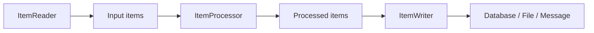

# Writer Must Not Modify Input After Receiving It

In Spring Batch, `ItemWriter` receives a group of items that have been read by `ItemReader` and processed by `ItemProcessor`. The writer's job is to write that group of items to a destination, such as a database, a file, or a message broker. When receiving items, the writer should treat the input data as **read-only**: do not change the values of the object, nested objects inside it, or the chunk structure.

This rule helps the pipeline maintain consistency when Spring Batch retries, rolls back, skips, or re-executes part of a chunk. A transaction can roll back data in the database, but it does not automatically restore the state of Java objects in memory. If the writer modifies an object and then throws an exception, the next attempt may receive data that has already been altered.

This lesson explains the writer's responsibility boundaries, the harm of mutating items, easily overlooked cases such as nested objects and JPA entities, and safe writer design approaches.

## 1. What Does the Writer Receive and What Must It Do?

In Spring Batch 5, the `ItemWriter<T>` interface has the method:

```java
@FunctionalInterface
public interface ItemWriter<T> {
    void write(Chunk<? extends T> chunk) throws Exception;
}
```

`Chunk` contains the items that have been read and processed in the step. In older Spring Batch versions, the writer API may receive `List<? extends T>`; the meaning of the responsibility remains the same.

Chunk processing flow:



The writer is responsible for writing the items it receives. It can:

- Convert items into SQL statements or file records.
- Send a group of messages according to the configured mechanism.
- Write data into a repository or staging table.
- Throw an exception when it cannot write so the transaction or step handles the error according to the configuration.

The writer should not silently alter items to represent write status, add business data, or mark items as exported. Such transformations belong to the processor or a separate business step.

### Do not modify either the chunk or the item

There are two layers of data to preserve:

1. **Chunk structure**: the order, count, and elements in the group.
2. **Item content**: field values and all mutable objects referenced from the item.

Do not call `chunk.clear()`, `chunk.remove(...)`, add other items, or reorder the chunk in the writer. Also do not call setters on the item or modify child lists, child maps, address objects, detail lines, etc., that the item references.

The API does not automatically make the entire object graph immutable. The fact that `Chunk` may expose collection operations does not mean the writer has the right to use them to alter processing data.

## 2. Why Should the Writer Not Modify Input?

### 2.1. Rollback does not undo changes in Java memory

Suppose the writer receives three orders, changes the status of each order, and then writes to the database. The third order causes an error:

```java
public class UnsafeOrderWriter implements ItemWriter<Order> {

    private final OrderRepository repository;

    public UnsafeOrderWriter(OrderRepository repository) {
        this.repository = repository;
    }

    @Override
    public void write(Chunk<? extends Order> chunk) {
        for (Order order : chunk) {
            order.setStatus("EXPORTED");
            repository.save(order);
        }
    }
}
```

If the transaction rolls back, the database changes in that transaction can be undone. But `order.setStatus("EXPORTED")` has already modified the Java object. The transaction manager does not keep a copy of the object to restore fields to their old values.

Therefore, after a rollback:

- The database may still hold the pre-transaction state.
- The object sitting in the chunk may still carry the `EXPORTED` status.
- A listener, retry callback, or subsequent code may observe the modified state.
- The next write may produce a different result from the first.

These are two different kinds of state: a transaction manages transactional resources; it is not a snapshot/restore mechanism for the JVM heap.

### 2.2. Retry may run again on an already-modified object

When retry is enabled for transient errors, the writer may be called again according to the step's retry mechanism. Depending on the error type and configuration, Spring Batch may re-execute the write operation or reprocess the chunk/item. If the writer modified the input before the error occurred, the next call risks seeing the modified values.

Example:

1. The item initially has `status = NEW`.
2. The writer changes it to `EXPORTED`.
3. The database times out before the transaction commits.
4. The transaction rolls back, but the Java object still has `status = EXPORTED`.
5. Retry calls the writer again and the code relies on the current status to choose the SQL statement or processing branch.

The result may differ from the first attempt, even though the chunk's business input did not change at all.

Not every retry strategy keeps the exact same object reference in every case. However, the writer should not depend on the assumption that the framework will always create new objects or re-run the processor to restore the input. The right design is for the writer not to mutate the data it is given.

### 2.3. Skip and item-by-item processing can observe the mutation

In a fault-tolerant step, the framework can analyze a failed chunk to identify which item caused the error, and then apply the skip policy. The writer may be called with subgroups of items or single items retried via an internal mechanism.

If the writer modified an item before throwing an exception, the data used in subsequent attempts may no longer match the data the processor produced. This makes investigating skips harder and can make results depend on trial order.

### 2.4. Listeners and logging see skewed data

Listeners, audit loggers, or metric collectors may read items before or after the writer. If the writer modifies an object, the same item may be logged with two different values at two points in time. The logs then no longer clearly reflect the data the processor created and the data actually sent to the writer.

Keeping the input unchanged makes tracing an item from reader through processor to writer easier to understand.

## 3. Bad Example: Updating the Object Received by the Writer

Suppose we have a mutable model:

```java
public class Invoice {

    private final String invoiceId;
    private BigDecimal amount;
    private String status;

    public Invoice(
            String invoiceId,
            BigDecimal amount,
            String status) {
        this.invoiceId = invoiceId;
        this.amount = amount;
        this.status = status;
    }

    public String getInvoiceId() {
        return invoiceId;
    }

    public BigDecimal getAmount() {
        return amount;
    }

    public String getStatus() {
        return status;
    }

    public void setAmount(BigDecimal amount) {
        this.amount = amount;
    }

    public void setStatus(String status) {
        this.status = status;
    }
}
```

The following writer modifies the input's status:

```java
public class UnsafeInvoiceWriter implements ItemWriter<Invoice> {

    private final InvoiceRepository repository;

    public UnsafeInvoiceWriter(InvoiceRepository repository) {
        this.repository = repository;
    }

    @Override
    public void write(Chunk<? extends Invoice> chunk) {
        for (Invoice invoice : chunk) {
            invoice.setStatus("IMPORTED");
            repository.save(invoice);
        }
    }
}
```

The issue is not the `save` call itself. The issue is that the writer both receives an object belonging to the processing flow and modifies that object to prepare for writing. If you need to persist a target state, create a separate write model/entity or perform the transformation before the writer.

## 4. Separation of Responsibilities: Processor Transforms, Writer Writes Data

An easy-to-control way to organize this is:

- The reader creates the input model.
- The processor validates and creates the output model.
- The writer only turns the output model into write operations.

Example using immutable records:

```java
public record InvoiceInput(
        String invoiceId,
        BigDecimal amount) {
}

public record InvoiceToPersist(
        String invoiceId,
        BigDecimal normalizedAmount,
        String targetStatus) {
}
```

The processor creates a new output object:

```java
@Bean
ItemProcessor<InvoiceInput, InvoiceToPersist> invoiceProcessor() {
    return input -> {
        if (input.amount() == null || input.amount().signum() <= 0) {
            throw new IllegalArgumentException("Invalid invoice amount");
        }

        return new InvoiceToPersist(
                input.invoiceId().trim(),
                input.amount().setScale(2, RoundingMode.HALF_UP),
                "READY");
    };
}
```

The writer reads the accessors and writes the data:

```java
@Bean
JdbcBatchItemWriter<InvoiceToPersist> invoiceWriter(DataSource dataSource) {
    return new JdbcBatchItemWriterBuilder<InvoiceToPersist>()
            .dataSource(dataSource)
            .sql("""
                    INSERT INTO invoice_import
                        (invoice_id, amount, status)
                    VALUES
                        (:invoiceId, :amount, :targetStatus)
                    """)
            .itemSqlParameterSourceProvider(item ->
                    new MapSqlParameterSource()
                            .addValue("invoiceId", item.invoiceId())
                            .addValue("amount", item.normalizedAmount())
                            .addValue("targetStatus", item.targetStatus()))
            .build();
}
```

The writer does not need to modify `InvoiceToPersist`; it only maps values to SQL parameters. Amount normalization and status determination have already been done in the processor.

## 5. Creating a Copy If a Separate Representation Is Needed for Writing

Sometimes the writer needs to convert the input into an entity or command suitable for the destination system. Create a new object instead of modifying the input:

```java
public record CustomerInput(
        String customerId,
        String fullName,
        String email) {
}

public class CustomerEntity {

    private String customerId;
    private String fullName;
    private String email;
    private String importStatus;

    public static CustomerEntity from(CustomerInput input) {
        CustomerEntity entity = new CustomerEntity();
        entity.customerId = input.customerId();
        entity.fullName = input.fullName();
        entity.email = input.email();
        entity.importStatus = "RECEIVED";
        return entity;
    }
}
```

Writer:

```java
public class CustomerWriter implements ItemWriter<CustomerInput> {

    private final CustomerRepository repository;

    public CustomerWriter(CustomerRepository repository) {
        this.repository = repository;
    }

    @Override
    public void write(Chunk<? extends CustomerInput> chunk) {
        List<CustomerEntity> entities = chunk.getItems().stream()
                .map(CustomerEntity::from)
                .toList();

        repository.saveAll(entities);
    }
}
```

Each entity is created separately for persistence. The `CustomerInput` items received from the processor keep their original values.

If creating `CustomerEntity` contains complex business rules, consider moving that mapping into the processor or a separate mapper. The writer should focus on persistence and avoid turning into a place that holds all transformation logic.

### Shallow copy and deep copy

A new copy of the outermost object is not necessarily completely isolated. Example:

```java
public class OrderInput {
    private String orderId;
    private List<OrderLine> lines;
}
```

If you only do:

```java
OrderWriteModel copy = new OrderWriteModel(
        input.getOrderId(),
        input.getLines());
```

then both objects still reference the same `lines` list and the same `OrderLine` instances. If the writer calls `copy.getLines().get(0).setQuantity(...)`, the original input is also modified.

When an object has a nested structure, you need to:

- Use immutable collections and immutable elements.
- Create a deep copy for mutable objects that need isolation.
- Or map into a new representation containing only the scalar/value objects that need to be written.

You do not always need to copy the entire graph. You just need to ensure the writer has no path to modify the state of the input or mutable objects shared by the input.

## 6. Prefer Immutable Input and Output Models

Java `record` fits data-carrying DTOs well:

```java
public record PaymentLine(
        String paymentId,
        BigDecimal amount,
        Instant createdAt) {
}
```

A record does not allow reassigning components after creation, so the writer cannot call a setter to change `amount` or `createdAt`. This makes the read-only contract clearer.

However, a record is only shallowly immutable. If a component is a `List`, `Map`, or mutable object, the caller can still modify the inner content. You can protect collections with a defensive copy:

```java
public record OrderSnapshot(
        String orderId,
        List<OrderLineSnapshot> lines) {

    public OrderSnapshot {
        lines = List.copyOf(lines);
    }
}

public record OrderLineSnapshot(
        String productCode,
        int quantity) {
}
```

`List.copyOf` creates a list that cannot be modified through the returned reference and rejects null elements. Because `OrderLineSnapshot` is also a record containing only immutable values, this structure is safer for sharing across components.

If a list contains mutable elements, `List.copyOf` does not copy each element automatically. In that case, you need a deep copy or to convert the elements into immutable value objects.

## 7. Types of Mutation Easy to Overlook

Setters are not the only thing that alters input. Watch out for the following operations:

| Operation | Example | Impact |
|---|---|---|
| Field assignment | `item.setStatus(...)` | Modifies the original object |
| Collection modification | `item.getLines().clear()` | Modifies a shared data structure |
| Modifying a child element | `item.getAddress().setCity(...)` | Modifies a nested object |
| In-place sorting | `chunk.getItems().sort(...)` | Changes the order of items in the chunk |
| Removing or adding items | `chunk.remove(...)`, `chunk.add(...)` | Changes the set of items the framework is processing |
| Modifying a map | `item.getAttributes().put(...)` | Changes metadata in the input |
| In-place string normalization | Writing the result back to a mutable field | Alters source data |
| Changing entity state | `entity.setProcessed(true)` | Can trigger persistence dirty checking |

Some libraries have APIs that look like getters but return mutable collections. Do not assume by default that data retrieved via a getter is read-only.

## 8. Be Especially Careful with JPA Entities

When an item is a JPA entity currently managed by a persistence context, changing a field can be detected by JPA via dirty checking and written to the database when the transaction flushes. This can happen even if the writer does not call `repository.save()` for that entity.

Example:

```java
public class UnsafeJpaWriter implements ItemWriter<InvoiceEntity> {

    @Override
    public void write(Chunk<? extends InvoiceEntity> chunk) {
        for (InvoiceEntity invoice : chunk) {
            invoice.setExported(true);
        }
    }
}
```

If the entities remain managed in the persistence context of the current transaction, the change to `exported` may be flushed to the database. The writer has unintentionally performed a business update outside the intent of "writing output".

Not every reader returns managed entities. For example, a reader may open/close a persistence context or return detached objects. But you should not rely on managed/detached state to justify mutation.

Safer approaches:

- Read into an immutable DTO/projection if you only need data for export.
- Create a new target entity from the input.
- Use a parameterized update statement without modifying the input object.
- If you need to update source status, perform it in a separate business step or service, with clearly designed transactions and idempotency.

### Note on EntityManager.merge()

`EntityManager.merge(entity)` returns a managed instance; the object passed in does not necessarily become that managed instance. If the writer needs to work with the entity after merging, use the return value. Do not rely on JPA updating the input object with a generated ID or version in the same way across providers.

For the goal of writing data, you should create a persistence entity from the input model and let the writer manage the lifecycle of the target entity. Avoid modifying the input object just to read back the ID/version after writing.

## 9. The Writer Should Not Use the Input Object to Store Processing State

An anti-pattern is adding flags to items so the writer or listener knows how far writing has progressed:

```java
// Anti-pattern
for (Order order : chunk) {
    if (!order.isWritten()) {
        targetRepository.save(order);
        order.setWritten(true);
    }
}
```

The `written` flag belongs to orchestration state or persistence outcome, not input content. It can be lost on process restart, is not synchronized with the transaction, and creates unpredictable behavior on retry.

If you need to store processed state, use an appropriate mechanism:

- Spring Batch metadata and execution context for state serving restart.
- A batch control or staging table with a batch ID and record ID.
- A unique constraint or idempotency key to prevent duplicate writes.
- A separate result table to store business status.

Do not use a mutable flag inside the item as a substitute for transactions or a metadata repository.

## 10. Side Effects in the Writer and Transaction Boundaries

The writer is usually where data-writing side effects happen, but side effects must be designed around transaction boundaries.

With a JDBC writer using the same transaction manager, database write statements can roll back together with the chunk. However, changes to objects in memory do not roll back; sending emails, making HTTP calls, or uploading files are not automatically rolled back by the database either.

If the writer needs to publish an event after saving data:

- Prefer writing an outbox record within the same transaction as the business data.
- A separate component sends the outbox message and marks the send status.
- Use an idempotency key on the receiving side to handle redelivered messages.

If the writer must call an external API directly, use a stable request ID and an idempotency mechanism supported by the target service. Do not modify the input object to record that the API has been called.

## 11. Example of a Writer That Only Reads Items and Writes in Batch

A JDBC writer can read values from each item to build a parameter source:

```java
@Bean
JdbcBatchItemWriter<PaymentLine> paymentWriter(DataSource dataSource) {
    return new JdbcBatchItemWriterBuilder<PaymentLine>()
            .dataSource(dataSource)
            .sql("""
                    INSERT INTO payment_export
                        (payment_id, amount, created_at)
                    VALUES
                        (:paymentId, :amount, :createdAt)
                    """)
            .itemSqlParameterSourceProvider(item ->
                    new MapSqlParameterSource()
                            .addValue("paymentId", item.paymentId())
                            .addValue("amount", item.amount())
                            .addValue("createdAt", Timestamp.from(item.createdAt())))
            .assertUpdates(true)
            .build();
}
```

The writer uses accessors to read data. It does not modify `PaymentLine`, reassign fields, or alter the chunk.

If you want to add an `exportedAt` field, determine whether it is business data or audit data:

- If the processor has enough information to create the value, it can create a new output record containing `exportedAt`.
- If it is the database write timestamp, you can use a default/generated column or a SQL expression in the database.
- If it is process state, store it in an appropriate control/outbox table.

Do not add a field to the input just so the writer can modify it in place.

## 12. What If the Writer Needs to Normalize or Enrich Data?

If the writer needs to change content before writing, first identify which layer that change belongs to.

| Need | Appropriate place |
|---|---|
| Trim, normalize codes, compute business values | `ItemProcessor` |
| Validate data and reject items | `ItemProcessor` or a validation step |
| Convert input model to persistence model | Mapper/processor or a pure mapping function |
| Generate a fixed business timestamp for the whole batch | JobParameters or job configuration data |
| Add a write timestamp managed by the database | Database default/generated value |
| Record processed batch status | Job metadata or a batch control table |
| Write logs/metrics | Listener or instrumentation |
| Convert into SQL statements | Writer, reading items only |

The processor can return a new object:

```java
@Bean
ItemProcessor<PaymentLine, PaymentExportRow> exportProcessor() {
    return payment -> new PaymentExportRow(
            payment.paymentId(),
            payment.amount(),
            payment.createdAt(),
            "READY");
}
```

Then the writer writes `PaymentExportRow`. The `PaymentLine` input stays intact, and the output model clearly expresses the data prepared for the destination.

## 13. Testing That the Writer Does Not Mutate Input

A unit test can capture the initial state of the input, invoke the writer, and then verify the input remains unchanged.

Example with an immutable record:

```java
@Test
void writerDoesNotChangeInputItems() throws Exception {
    PaymentLine first = new PaymentLine(
            "P-100",
            new BigDecimal("25.00"),
            Instant.parse("2026-11-15T01:00:00Z"));

    PaymentLine second = new PaymentLine(
            "P-101",
            new BigDecimal("40.00"),
            Instant.parse("2026-11-15T01:01:00Z"));

    List<PaymentLine> original = List.of(first, second);
    Chunk<PaymentLine> chunk = new Chunk<>(original);

    writer.write(chunk);

    assertEquals(original, chunk.getItems());
    assertEquals("P-100", first.paymentId());
    assertEquals(new BigDecimal("25.00"), first.amount());
}
```

If the input is a mutable class, save a snapshot of the fields as well as nested collections/objects before calling the writer, then compare after the call.

### Also testing the failure path

Mutation often surfaces only when the writer throws an exception midway. Therefore, add a test with a writer that can fail after processing some items:

1. Create a chunk with multiple mutable items.
2. Save a snapshot of the initial state.
3. Configure a mock repository/database so the writer fails on a middle item.
4. Call the writer and verify the exception is propagated.
5. Check that all input objects still match the initial snapshot.

Integration tests for the step can simulate retry/rollback and verify that both the database and the objects used in the test have the expected state. Such testing helps detect in-memory side effects that checking only the database transaction would miss.

## 14. Notes When Using a Multi-Threaded or Partitioned Writer

When a step processes in parallel, multiple threads may work with items or shared objects depending on the architecture of the reader, processor, and partitioner. If the writer modifies mutable objects, the risk of race conditions increases:

- Thread A reads state while thread B modifies a field.
- A listener observes an object in an intermediate state.
- Two chunks reference the same shared object due to a cache or custom reader.
- A retry on one worker sees data that another worker has already changed.

Not mutating input is one way to reduce shared-state coupling. If internal mutable data is needed to optimize writing, create a separate copy per writer call and do not share that copy externally.

Furthermore, the writer and its dependencies must still meet thread-safety requirements if called concurrently. Keeping items immutable does not automatically make connections, buffers, or clients inside the writer thread-safe.

## 15. Common Mistakes

**Changing item status after saving.** Database rollback does not restore Java fields. Create a separate persistence model or store status through a control table.

**Sorting the chunk inside the writer.** This changes the structure of the group the framework is processing and can make retry/skip order confusing. If order is needed, sort in the processor or design the query/reader with a stable order.

**Copying the outer object while sharing child collections.** This is only a shallow copy. Use immutable value objects or deep-copy mutable parts.

**Relying on JPA dirty checking.** Modifying a managed entity in the writer can unintentionally change source data. Create a target entity or use a DTO.

**Marking written items with a mutable boolean.** A flag inside the object cannot substitute for metadata, transactions, or idempotency.

**Calling an external API and modifying the input to avoid resending.** If the process dies before committing or acknowledging, that flag does not guarantee state. Use an idempotency key and an outbox.

**Assuming rollback will restore all state.** Database rollback does not undo the heap, files, emails, or external systems.

## 16. Checklist for Designing a Read-Only Writer

Before finalizing a writer, verify:

- The writer only reads values from items and does not call setters.
- The writer does not modify lists, maps, or nested objects referenced by the item.
- The writer does not add, remove, or reorder items in the chunk.
- All data transformations are performed in the processor or mapper using a separate output object.
- Persistence entities are created separately if a lifecycle or mutable state is needed.
- JPA managed entities are not modified unintentionally.
- Retry and rollback do not depend on the framework recreating objects.
- External side effects have appropriate idempotency or an outbox.
- The writer can be called again without changing the meaning of the input.
- Unit/integration tests verify the input stays unchanged both when writing succeeds and when it fails.

## 17. Practical Conclusion

The writer should treat the items and chunk it is handed as read-only data. It is responsible for writing what the processor prepared, not modifying objects to mark status, normalize fields, or record results. Changes in the Java heap are not undone by a database transaction; therefore, mutation can cause retry, skip, listeners, and logs to observe different data.

Use immutable input/output models whenever possible. If a separate representation is needed for the database or destination system, create a new object or map to a persistence model. Put transformation rules in the processor, operational state in metadata/control tables, and external side effects in idempotent/outbox mechanisms. When the writer only reads items, each write attempt has the same input and the pipeline is easier to recover.
