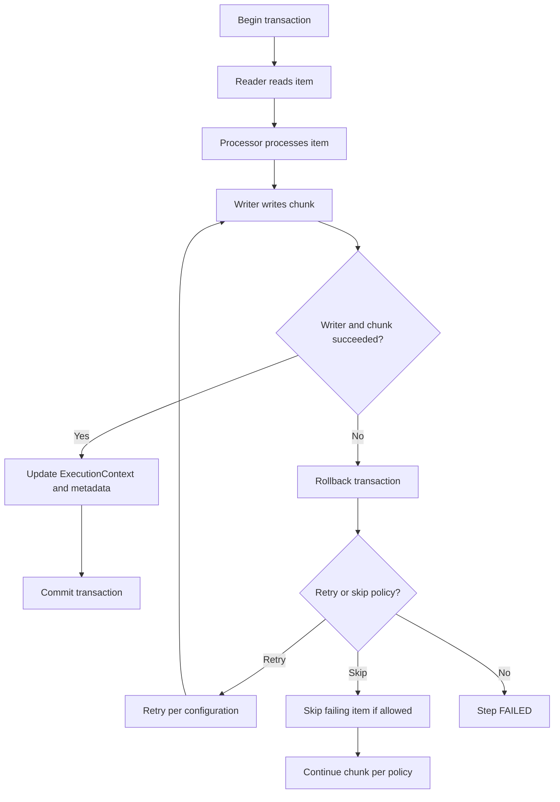

# Writer Errors and Rollback

In Spring Batch, `ItemWriter` receives the items that have been read and processed in a chunk and writes them to the target system. When the writer hits an error, the framework needs to decide whether the current chunk can be committed or must roll back, whether to retry the write operation, whether the failing item can be skipped, or whether to end the step. How this is handled directly affects data correctness, restartability, and batch job performance.

In standard chunk-oriented processing, reading, processing, writing, and checkpoint updates sit inside a transaction boundary managed by `PlatformTransactionManager`. If the writer throws an exception that causes the chunk to fail, Spring Batch usually rolls back the chunk's transaction. Previously committed chunks are kept; the current chunk can be retried, handled by a skip policy, or cause the step to fail.

What must be understood clearly is that rollback only undoes operations belonging to participating transactions. If the writer has sent an HTTP request, sent an email, or written to a system that does not participate in the transaction, a database rollback does not automatically retract that side effect.

## 1. ItemWriter Writes by Chunk

In a chunk-oriented step, the reader reads items, the processor optionally transforms or filters items, and then the writer receives the group of results to write.

For example, an order import step may process 500 items per chunk:

1. `ItemReader` reads the orders.
2. `ItemProcessor` validates and transforms each order.
3. `ItemWriter` writes the group of valid orders to the database.
4. The transaction commits if the whole chunk completes successfully.
5. The step continues with the next chunk.

In Spring Batch 5, the writer interface has the form:

```java
public interface ItemWriter<T> {
    void write(Chunk<? extends T> chunk) throws Exception;
}
```

One call to `write()` can write multiple items. Older Spring Batch versions have a signature receiving `List<? extends T>`, so use the API corresponding to the project's version.

The writer should throw an exception when it cannot write data properly. If the writer catches an exception, only logs it, and returns normally, Spring Batch may consider the chunk successful and commit the remaining operations. That can leave data missing while the job still reports `COMPLETED`.

## 2. The Chunk's Transaction Boundary

In the standard chunk model, Spring Batch uses a transaction manager to manage one processing unit. General flow:



The transaction usually wraps reading and writing the chunk, along with necessary state updates. With a writer using JDBC and the same `DataSource`/transaction manager, the write statements belonging to that transaction can be rolled back when one statement fails.

For example, the writer writes 100 orders. If the 70th write causes an error and the database transaction is rolled back, the earlier write statements in the same transaction are also undone. As a result, the current chunk leaves no partially committed data in that database. Previously committed chunks are not rolled back just because a later chunk failed.

The critical condition is that the writer actually uses the same transaction resource. If the writer opens an independent connection, uses a different transaction manager, or writes to an external service, the step's transaction may not control that operation.

## 3. What Does Spring Batch Do When the Writer Fails?

When `ItemWriter.write()` throws an exception, the framework treats the current chunk as failed. With the default chunk-processing configuration, the transaction is usually rolled back and the exception is routed through the step's error-handling mechanism.

Main possibilities:

- **Retry:** retry the operation when the error is classified as transient and retry attempts remain.
- **Skip:** skip the item causing the error if the exception is allowed to be skipped and the skip limit has not been exceeded.
- **Fail:** end the step with a failed status when the error is not handled, is not skippable, or has exceeded the limit.

Examples of errors a writer can encounter:

| Error type | Example | Usually considered handling |
|---|---|---|
| Transient database error | Deadlock, lock timeout | Bounded retry with backoff |
| Data violating constraints | Duplicate key, invalid value | Determine whether this is data to skip, upsert, or a business error that must fail |
| Connection error | Lost database connection or timeout | Bounded retry; if persistent, fail and alert |
| Schema/configuration error | Missing column, wrong data type, write permission revoked | Usually fail to fix configuration or deployment |
| External system error | Target API returns error or does not respond | Retry if it can be confirmed safe; need idempotency for the request |

Do not treat every write error as skippable. For example, losing a database connection is not a single bad record; skipping it can lose data without solving the infrastructure cause.

## 4. Rollback and Partially Written Data

A writer can perform multiple operations in one call. If the third operation fails after the first two have run, the result depends on the transaction the writer uses.

### When all operations participate in the same transaction

If the writer writes multiple records through the same JDBC transaction and one operation raises an error, a rollback can undo all changes of the chunk. This is the situation where Spring Batch coordinates well with the transaction manager.

### When the writer writes outside the transaction

If the writer writes a file, calls a REST API, or sends a message to an independent system, the operations before the error may already have taken effect. A database rollback cannot delete an email already sent or retract a request a partner has already processed.

Example:

1. The writer sends a request to create an invoice to a partner.
2. The partner creates the invoice successfully.
3. The connection times out before the writer receives the response.
4. The writer throws an exception; the database transaction rolls back.
5. The chunk is retried and the invoice-creation request is sent again.

The partner may create two invoices if the API does not support idempotency. Therefore, a writer integrating with an external system must have a strategy to protect side effects and cannot rely solely on Spring Batch's rollback.

## 5. Retry When the Writer Hits a Transient Error

Retry is appropriate when the same operation has a chance of succeeding if tried again, such as a deadlock or a transient lock error. Spring Batch can roll back the chunk and then re-execute according to the configured retry policy.

Example of configuring retry for transient data access errors:

```java
return new StepBuilder("writeOrdersStep", jobRepository)
        .<Order, OrderRecord>chunk(500, transactionManager)
        .reader(orderReader)
        .processor(orderProcessor)
        .writer(orderWriter)
        .faultTolerant()
        .retry(TransientDataAccessException.class)
        .retryLimit(3)
        .build();
```

This example allows retrying exceptions belonging to `TransientDataAccessException` up to the configured retry limit. You need to verify whether the actual exception emitted by the driver/database falls into the selected group. Do not broadly retry every exception, because data or configuration errors usually do not disappear after a few tries.

### Retry can call the writer multiple times

When a chunk is retried, the writer may be called again with the same item or the same group of items. Therefore:

- A JDBC-based writer should participate in the transaction so the previous write is rolled back before retrying.
- A writer calling an external API should send an idempotency key or use a unique business code.
- Do not place operations that cannot be safely repeated in the writer if retry can call that operation again.
- Limit the number of attempts and configure backoff to avoid putting continuous load on a system experiencing an incident.

The retry count reflects the number of retries according to the policy; it does not mean the number of skipped items. If a retry succeeds, the item is not skipped just because it once hit an exception.

## 6. Skip When the Writer Cannot Write an Item

Skip is used when an item has an error that has been identified as ignorable and the job can still continue accurately for the business. For example, a record with a duplicate key that the import rules specify must be recorded in a reject list, or an item violating a business condition defined as not needing processing.

Configuration example:

```java
return new StepBuilder("writeOrdersStep", jobRepository)
        .<Order, OrderRecord>chunk(500, transactionManager)
        .reader(orderReader)
        .processor(orderProcessor)
        .writer(orderWriter)
        .faultTolerant()
        .skip(DuplicateKeyException.class)
        .skipLimit(50)
        .build();
```

This example allows skipping `DuplicateKeyException` up to the configured limit. Before applying it, determine whether a duplicate key is truly a business case that can be skipped. If the data must be updated, an upsert may be needed; if a duplicate is a sign of a dangerous duplicate run, skipping can hide a design flaw.

### Why do write errors need special handling?

The writer usually receives the whole chunk. When a group write fails, the framework does not always immediately know which item caused the error. With a fault-tolerant step and appropriate skip configuration, Spring Batch can roll back the chunk and then perform a process to isolate the failing item by retrying smaller portions, potentially down to one item at a time.

This process can cause the writer to be called multiple times. Items written successfully in the initial attempt must be rolled back if they belong to the same transaction before the framework retries to find the failing item. If the writer has side effects outside the transaction, calling it again can create duplicate records or requests.

Therefore, the writer needs to be safely repeatable or only perform operations protected by the transaction. Do not implement a writer that sends emails directly for each item and then rely on write skip to handle errors.

## 7. Skip Limit and Exception Policy

The skip policy needs to classify exceptions based on data meaning and the job's ability to continue. The skip limit defines the total number of items allowed to be skipped in the step; skips during reading, processing, and writing all contribute to that limit.

When the skip count exceeds the limit, the step fails. An error not classified as skippable can also make the step fail even when the skip count is still low.

A policy should answer:

- Which exceptions represent invalid data and can be skipped?
- Which exceptions are transient errors needing retry?
- Which exceptions are infrastructure or configuration errors that must stop the job?
- Do skipped items need to be written to an error table or a reject file?
- When skipped items exceed a threshold, who receives the alert and how is it handled?

Do not set the skip limit too high just so the job always ends `COMPLETED`. A job that completes while skipping thousands of items can produce wrong reports or business figures.

## 8. noRollback and When to Be Cautious

Spring Batch allows declaring certain exceptions that do not require rollback in a fault-tolerant step via the `noRollback` configuration. This mechanism is meant for exception types that the application determines do not corrupt the chunk's write state.

General example:

```java
.faultTolerant()
.noRollback(NonCriticalValidationNoticeException.class)
```

Do not use `noRollback` as a way to dodge writer errors. If the writer has already written part of the data and then throws an exception, not rolling back can cause the chunk to be committed in an inconsistent state. Only configure a non-rollback exception when you clearly understand when the exception arises, which operations have completed, and why keeping the transaction is safe.

For data write errors, rollback is usually the more appropriate default choice. If a case is not a write error but only a business notice, consider handling it in the processor or modeling it with an explicit business result.

## 9. Writers Must Comply with Transactions and Idempotency

A safe writer needs to answer two questions:

1. If the chunk fails, are the changes already performed rolled back?
2. If the same item is written again, is the result duplicated or skewed?

For a JDBC writer, use the step's same `DataSource` and transaction manager so the write statements participate in the chunk transaction. Avoid opening an independent connection or committing yourself inside the writer, because that breaks the transaction boundary managed by Spring Batch.

For systems outside the database, you can use these techniques:

- **Idempotency key:** each write request has a unique key; the target system returns the old result if it receives the same key again.
- **Unique business key:** use a unique constraint to prevent creating duplicate records.
- **Upsert:** update or insert by business key with deterministic rules.
- **Transactional outbox:** write the business data and the message to be sent in the same database transaction, and then a separate process sends the message.
- **Reconciliation:** reconcile state when a timeout leaves the application unsure whether the target system executed the request.

Idempotency does not replace transactions; it adds safe rerunnability when a transaction cannot cover every resource.

## 10. Listeners to Observe Writer Errors and Skipped Items

Spring Batch provides listeners to observe the writing process and error handling.

| Listener | Useful callbacks | Purpose |
|---|---|---|
| `ItemWriteListener` | `beforeWrite`, `afterWrite`, `onWriteError` | Observe writer calls and write errors |
| `SkipListener` | `onSkipInWrite` | Record items actually skipped in the write stage |
| `StepExecutionListener` | `beforeStep`, `afterStep` | Monitor status and aggregate metrics of the step |

Example:

```java
public class OrderWriteListener implements ItemWriteListener<OrderRecord> {

    @Override
    public void beforeWrite(Chunk<? extends OrderRecord> items) {
        log.debug("About to write {} orders", items.size());
    }

    @Override
    public void afterWrite(Chunk<? extends OrderRecord> items) {
        log.debug("Wrote {} orders", items.size());
    }

    @Override
    public void onWriteError(Exception exception,
                             Chunk<? extends OrderRecord> items) {
        log.warn("Writer failed for a chunk of {} orders", items.size(), exception);
    }
}
```

`onWriteError` can be called multiple times when a chunk is retried or the writer is called again to identify the failing item. Therefore, this callback is suitable for observation and logging, and should not be used to send non-idempotent notifications or perform business side effects.

Example of recording skipped items:

```java
public class OrderSkipListener implements SkipListener<Order, OrderRecord> {

    @Override
    public void onSkipInRead(Throwable throwable) {
        log.warn("Could not read an order", throwable);
    }

    @Override
    public void onSkipInProcess(Order item, Throwable throwable) {
        log.warn("Could not process order id={}", item.getId(), throwable);
    }

    @Override
    public void onSkipInWrite(OrderRecord item, Throwable throwable) {
        log.warn("Could not write order id={}", item.getId(), throwable);
    }
}
```

Listeners help store information for investigation, but avoid logging personal data or sensitive payloads. If you must write failing items into an audit table, define the transaction and how to handle it when the audit operation itself fails.

## 11. StepExecution and Counters After a Write Error

`StepExecution` stores metrics for a step run. When investigating a writer error, look at these together:

- `writeCount`: the number of items successfully written according to step metadata.
- `writeSkipCount`: the number of items skipped due to errors in the write stage.
- `skipCount`: total skips across read, process, and write.
- `commitCount`: the number of recorded commits.
- `rollbackCount`: the number of recorded rollbacks.
- `BatchStatus` and `ExitStatus`: the execution outcome of the step.

For example, a step with `readCount=10.000`, `writeCount=9.970`, and `writeSkipCount=30` may indicate that 30 items could not be written and were skipped, if the other counters have no filters or skips in other stages. You need to look at `filterCount`, `readSkipCount`, and `processSkipCount` as well before concluding why item counts differ.

Logs may show the writer being called multiple times due to retry or skip scanning. Do not sum quantities from each log invocation to infer the number of committed items. Use the final metadata of `StepExecution`, and cross-check transactions and the actual data in the target system.

## 12. Distinguishing Rollback from Restart

Rollback and restart address two different moments:

- **Rollback** happens within a single execution when a chunk's transaction fails. It undoes the operations belonging to that transaction.
- **Restart** is relaunching a failed or stopped job/step execution, using saved metadata and checkpoints to continue the work.

A chunk rollback does not necessarily fail the whole job. If retry or skip handles the error, the step can continue. If the step fails, an operator can restart the job after fixing the cause, if the job and reader support restart.

Previously committed chunks usually do not need to be reprocessed when the reader restores the checkpoint properly. The uncommitted chunk may be read and written again. Therefore, the writer must be safe when a chunk is executed again.

## 13. Practical Example: Writing Orders to a Database

A job imports 100,000 orders. The writer uses JDBC batch insert with a chunk size of 500. In chunk 20, an order has an `order_id` that already exists and the database returns `DuplicateKeyException`.

The development team needs to decide what a duplicate means:

### Duplicate is invalid data

If the business contract states that an existing order must be rejected, you can configure the corresponding exception as skippable, set a reasonable skip limit, and use `SkipListener` to write the order ID into an error list. When the writer skips, the framework can roll back and isolate the failing item using the fault-tolerant mechanism.

### Duplicate is a valid re-import request

If re-importing the same order must update existing data, the writer should use an upsert statement or update logic by business key. Catching the duplicate and skipping it will lose needed changes.

### Duplicate indicates the job was run twice

If duplicates reflect two jobs processing the same dataset, review identifying `JobParameters`, concurrent launch mechanisms, and business keys. Raising the skip limit does not solve the cause of a duplicate run.

After the writer errors, the current chunk transaction is rolled back if the database writer participates in the transaction. Previously committed chunks remain. If the error is skipped and the step continues, the job can complete with the corresponding skip counts; otherwise, the step ends `FAILED` and can be restarted after fixing the cause.

## 14. Common Writer Design Mistakes

| Design mistake | Consequence | Handling approach |
|---|---|---|
| Catching exceptions and only logging | Framework thinks writer succeeded and commits chunk | Rethrow exception or convert to an appropriate exception |
| Committing inside the writer | Chunk transaction cannot roll back fully | Let the step's transaction manager manage commits |
| Opening an independent connection | Write statements may not participate in the chunk transaction | Use an appropriate transaction-bound resource |
| Sending external API without idempotency | Retry can create duplicate side effects | Use an idempotency key, outbox, or reconciliation |
| Skipping every exception | Hides infrastructure errors and leaves missing data | Only skip exceptions with clear business meaning |
| Infinite retry | Job drags on and puts more load on failing system | Limit retries, use backoff, and alert |
| Sending emails in `onWriteError` | Repeated callbacks can send multiple emails | Use listeners for observation; send notifications via an idempotent mechanism |
| Writer cannot withstand being called again | Duplicate data during retry or skip scan | Design an idempotent or transaction-aware writer |

## 15. Investigation Process When a Writer Rolls Back

When a step fails due to a writer, you can determine step by step:

1. **Identify the execution:** get the job name, identifying parameters, execution ID, and step name.
2. **Read the root exception:** distinguish data errors, lock errors, timeouts, connections, schema, or access permissions.
3. **Check the transaction manager:** verify the writer uses the step's datasource and transaction.
4. **Inspect the affected chunk:** identify the item count, business keys, and write statements in the chunk.
5. **Cross-check destination data:** verify which operations committed, which rolled back, and whether there were side effects outside the transaction.
6. **Check the retry/skip policy:** see whether the exception is retried or skipped, whether limits were reached, and what listeners recorded.
7. **Assess rerunnability:** verify the writer is idempotent and the reader has the right checkpoint before restarting.
8. **Fix the cause:** repair data, restore the database, or adjust configuration before restarting with the same identifying parameters.

Do not manually edit execution status or raise the skip limit before determining how far actual data has been written. Metadata, logs, and destination data need to be cross-checked together.

## 16. Principles to Remember

- The writer receives a chunk; a single call can write multiple items.
- The writer should throw an exception when it cannot write properly, so Spring Batch applies transactions and error policies.
- With a writer participating in the step's transaction, a write error usually rolls back the entire current chunk.
- Previously committed chunks are kept; uncommitted chunks may be retried or reprocessed.
- Retry fits transient errors; skip is only for exceptions that can be ignored according to business rules.
- When skipping write errors, the framework may call the writer multiple times to identify the failing item; the writer must be safe when called again.
- `noRollback` fits only exceptions proven not to corrupt chunk state; do not use it to mask writer errors.
- Rollback affects only resources participating in the transaction; APIs, emails, and external systems need idempotency or separate coordination mechanisms.
- Use `ItemWriteListener` to observe writes and `SkipListener` to record items actually skipped.
- Read `writeCount`, `writeSkipCount`, commit/rollback counts, step status, and destination data together when investigating.

Understanding writer errors and rollback helps design batch jobs that can recover while keeping data consistent. When the writer participates in the right transaction, the retry/skip policy reflects the business accurately, and external side effects are protected with idempotency, Spring Batch can continue processing after errors without unintentionally losing or duplicating data.
