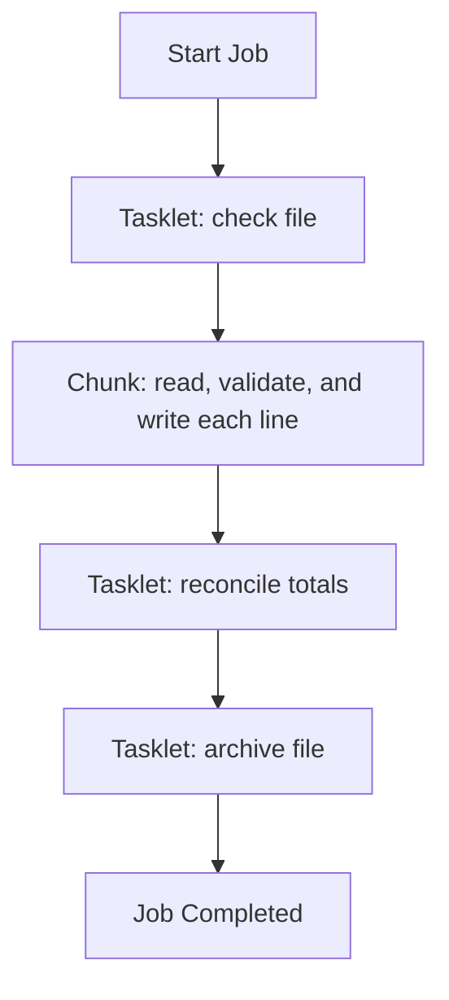

# When a tasklet is simpler than a chunk

In Spring Batch, a step can be built using chunk-oriented processing or a tasklet. Chunk is suitable when you need to read, process, and write a set of items in groups. A tasklet is suitable when the step performs a clear, finite task and does not need an item-by-item processing pipeline.

For example, checking an input file, creating a working directory, calling a stored procedure, cleaning up old data, or moving a processed file to an archive directory can usually be represented by a tasklet. These tasks have one main action and an easily defined completion condition; creating a reader, processor, and writer would make the configuration longer without bringing significant benefit.

A tasklet is not a replacement for chunk for every kind of work. If the step must process thousands or millions of records, needs per-item checkpoints, per-record retry/skip, or item read/write counts, chunk-oriented processing is usually more suitable. The key criterion is the nature of the work, not just the number of lines of code.

## 1. Tasklet and chunk solve two different kinds of work

Chunk-oriented processing splits input into groups of items. In each chunk, Spring Batch calls the reader to read items, the processor to transform or filter items, and then the writer to write the results. The chunk is managed inside a transaction and the checkpoint is updated after the chunk completes.

A tasklet is a unit of work executed inside a `TaskletStep`. Spring Batch calls the tasklet's `execute()` method. The tasklet returns `RepeatStatus.FINISHED` when the work is complete or `RepeatStatus.CONTINUABLE` if it needs to be called again.

General comparison:

| Criterion | Tasklet | Chunk-oriented |
|---|---|---|
| Model | A single task or a task loop controlled by the application | Reader -> Processor -> Writer |
| Processing unit | One `execute()` call; can repeat with `CONTINUABLE` | A group of items per commit interval |
| Suitable for | Finite tasks, overall operations, or database-level batch commands | Record-by-record processing requiring per-item transformation and writing |
| Checkpoint | Application saves state itself if it needs to continue between passes | Spring Batch coordinates checkpoints with `ItemStream` and the execution context |
| Item counters | No item-pipeline read/write counters like chunk | Has read, write, filter, skip, and commit counters at the step level |
| Retry/skip | No chunk-style per-item retry/skip model | Has per-item/chunk fault tolerance configuration |
| Transaction | Usually one transaction per `execute()` call | One transaction per chunk |

A tasklet is usually simpler when the work has one main action and does not need to model each item. Chunk is simpler operationally when the work is truly item-by-item processing, because the framework already provides the reader, processor, writer, checkpoints, and error policy.

## 2. When is a tasklet the natural choice?

A tasklet usually fits the following cases.

### 2.1. Checking input preconditions

Before importing data, a job may need to check that a file exists, is readable, has the right format, or belongs to the right business date. This step only verifies several conditions and then completes or throws an error. There is no need to read the entire file through a reader if the goal is only to check metadata or a header.

### 2.2. Calling a stored procedure or a set-based SQL statement

If the database can perform an aggregation, delete expired data, or update status in a single set-based statement, a tasklet can call a stored procedure or `JdbcTemplate` once. The database processes the data set internally, while the step only needs to manage the transaction and the outcome of the operation.

### 2.3. Creating, preparing, or cleaning up resources

For example, creating directories, preparing staging tables, deleting old temporary files, checking disk space, or creating a marker for a batch. These are usually process-level operations, not transformations of individual items.

### 2.4. Moving or archiving files

After a file import step completes, another step can move the file to an archive directory or rename it to mark it as processed. This is an overall file task, so a tasklet is usually more natural than a chunk.

### 2.5. Calling a service for an overall task

A step can call a service to request report generation, synchronize configuration, or close a business batch. If the operation only needs a single request and has a clear completion condition, a tasklet can be suitable. You need to design timeout, retry, idempotency, and how to handle the case where the external system executed the request but the response was lost.

## 3. Example of a tasklet checking an input file

The following example uses a tasklet to check a file before the data import step runs. The file-check step does not need to read each line; it only confirms that the file exists and is readable.

```java
@Bean
@StepScope
Tasklet validateInputFile(
        @Value("#{jobParameters['inputFile']}") String inputFile) {

    return (contribution, chunkContext) -> {
        Path path = Path.of(inputFile);

        if (!Files.isRegularFile(path) || !Files.isReadable(path)) {
            throw new IllegalStateException(
                    "Input file is missing or unreadable: " + inputFile);
        }

        return RepeatStatus.FINISHED;
    };
}

@Bean
Step validateInputStep(
        JobRepository jobRepository,
        PlatformTransactionManager transactionManager,
        Tasklet validateInputFile) {

    return new StepBuilder("validateInputStep", jobRepository)
            .tasklet(validateInputFile, transactionManager)
            .build();
}
```

The tasklet performs one check and then returns `FINISHED`. If the file is invalid, the exception makes the step fail and the job should not proceed to the data import step under the default flow.

This is a Spring Batch 5+ example. Imports such as `Path`, `Files`, `Tasklet`, `RepeatStatus`, `JobRepository`, `PlatformTransactionManager`, and Spring annotations must be declared in the application. Checking the filesystem does not participate in the database transaction; the transaction manager cannot roll back a filesystem operation.

## 4. Example of a tasklet calling a stored procedure or SQL

Suppose the database has a stored procedure that aggregates data for a business date. The tasklet only needs to call the procedure and finish:

```java
@Bean
@StepScope
Tasklet refreshDailySummary(
        JdbcTemplate jdbcTemplate,
        @Value("#{jobParameters['businessDate']}") String businessDate) {

    return (contribution, chunkContext) -> {
        jdbcTemplate.update(
                "call refresh_daily_summary(?)",
                Date.valueOf(businessDate));

        return RepeatStatus.FINISHED;
    };
}

@Bean
Step refreshDailySummaryStep(
        JobRepository jobRepository,
        PlatformTransactionManager transactionManager,
        Tasklet refreshDailySummary) {

    return new StepBuilder("refreshDailySummaryStep", jobRepository)
            .tasklet(refreshDailySummary, transactionManager)
            .build();
}
```

The syntax for calling a stored procedure depends on the database management system. The example above illustrates the structure; you need to adjust the SQL and date type for the database in use.

If the procedure performs a set-based operation over millions of rows, a tasklet can be a concise choice because Spring Batch does not need to stream each row through the JVM. However, you need to consider execution time, transaction timeout, locks, progress logging, and the recoverability of the procedure itself. A long procedure inside one large transaction can hold locks for a long time and be hard to resume partway through.

## 5. Tasklet versus chunk when processing many records

Suppose you need to import 500,000 transactions from a CSV file into the database.

With chunk, you can read each transaction, validate its format, normalize it, write in groups of 500 items, and save a checkpoint after each chunk. If an error occurs at chunk 200, the job can restart from the nearest checkpoint; a skip policy can handle faulty lines individually.

If you use a tasklet to write your own loop reading the entire file, batching data yourself, committing yourself, saving positions yourself, and managing retry/skip yourself, the application must rebuild many mechanisms that chunk already provides. At that point, a tasklet is no longer simple.

| Requirement | Usually suitable choice |
|---|---|
| Check whether a file exists and has a valid header | Tasklet |
| Delete staging data for a batch with one SQL statement | Tasklet |
| Call a stored procedure to aggregate data | Tasklet |
| Read a file and validate each line | Chunk |
| Transform each item to another model | Chunk |
| Write each record and need periodic checkpoints | Chunk |
| Retry or skip by per-item error type | Chunk |
| Move a completed file to archive | Tasklet |

There is no fixed record-count threshold for deciding. A stored procedure can process millions of rows in a tasklet if the database handles it well and the recovery requirements match. Conversely, a file with only a few hundred lines should still use chunk if each line needs individual validation, skip, retry, and tracking.

## 6. A tasklet can run multiple times

A tasklet is not required to be called only once. The `execute()` method returns `RepeatStatus` to indicate whether to keep repeating:

- `RepeatStatus.FINISHED`: the tasklet has completed; the step can end.
- `RepeatStatus.CONTINUABLE`: the tasklet needs to be called again.

For example, a tasklet processing data page by page:

```java
@Bean
Step processPagesStep(
        JobRepository jobRepository,
        PlatformTransactionManager transactionManager,
        PageService pageService) {

    Tasklet tasklet = (contribution, chunkContext) -> {
        ExecutionContext context =
                contribution.getStepExecution().getExecutionContext();

        int nextPage = context.getInt("nextPage", 0);
        if (nextPage >= pageService.pageCount()) {
            return RepeatStatus.FINISHED;
        }

        pageService.processPage(nextPage);
        context.putInt("nextPage", nextPage + 1);

        return nextPage + 1 >= pageService.pageCount()
                ? RepeatStatus.FINISHED
                : RepeatStatus.CONTINUABLE;
    };

    return new StepBuilder("processPagesStep", jobRepository)
            .tasklet(tasklet, transactionManager)
            .build();
}
```

In `TaskletStep`, each `execute()` call runs in its own transaction. When the tasklet returns `CONTINUABLE`, the framework can call it again on the next pass. The Step ExecutionContext is updated and saved according to the step's execution mechanism, allowing the tasklet to restore state on restart.

The example above is only suitable when the page count and data order remain stable throughout the run. `pageService.processPage()` must also be idempotent or participate in the same managed transaction. If it creates side effects outside the transaction, a business key lock or anti-duplication mechanism is needed. For page-by-page item processing with substantial logic, a chunk-oriented step or partitioning may be more suitable.

## 7. Tasklet transactions

`TaskletStep` uses the `PlatformTransactionManager` passed into `.tasklet(tasklet, transactionManager)`. Under normal execution, each `execute()` call runs in its own transaction:

- If the tasklet completes and the transaction commits, changes in resources participating in the transaction are confirmed.
- If the tasklet throws an exception, the current transaction rolls back according to the transaction manager's capability and the step usually transitions to a failed state.
- If the tasklet returns `CONTINUABLE`, the current execution pass finishes per the transaction and the framework can invoke the next pass.

This differs from a chunk step in the transaction unit. A chunk step commits per group of items; a tasklet step commits per `execute()` call. If a tasklet runs only once and performs one database operation, that entire operation can sit in one transaction. If a tasklet repeats multiple times, each pass has its own transaction boundary.

Not every side effect belongs to the transaction. Writing files, calling HTTP APIs, sending emails, or publishing messages usually do not roll back automatically with the database transaction. For example, a tasklet moves a file and then encounters a database error: the file may have already been moved even though the database transaction rolled back. You need to design operations to be repeatable, use temporary files and atomic renames when appropriate, or store intermediate state for recovery.

## 8. Restart and idempotency of a tasklet

If a tasklet fails, when the job restarts, the failed step is usually executed again. If the tasklet already performed part of the work outside the transaction before throwing an exception, the re-run may repeat those effects.

For example, a tasklet sends a report generation request to an external service. The service created the report, but the response timed out. The tasklet fails; on restart, it resends the request. Without an idempotency key, the service may create two reports.

Some design approaches:

- Use stable `JobParameters` such as `businessDate` or `batchId` to identify the same work.
- Use an idempotency key on the external service if the API supports it.
- Check the current state before performing a repeatable operation, while protecting the check/write with a unique key or appropriate lock.
- Save a custom checkpoint into the Step ExecutionContext if the tasklet has multiple processing passes.
- For files, use a deterministic target name, check file state, and design move/archive operations that can recover.
- For messages, consider a transactional outbox instead of sending directly inside the database transaction.

`ExecutionContext` does not make a tasklet idempotent by itself. It only holds state that the application puts into the context and Spring Batch saves per the step lifecycle. Correctness when re-running still depends on transactions, business keys, and how side effects are handled.

## 9. When is a tasklet no longer simple?

A tasklet is usually not a good choice if the following traits start appearing inside it:

- A loop processing each item with many transformation rules.
- Needing to record the counts of items read, written, filtered, and skipped.
- Needing to retry or skip certain items while continuing with other items.
- Needing periodic per-item checkpoints to avoid redoing too much data.
- Needing Spring Batch's standard readers/writers such as a file reader, JDBC cursor reader, or paging reader.
- Needing to partition data or process items/partitions in parallel.
- Needing to track failed items individually and feed them into a reprocessing workflow.

If a tasklet implements its own complex loop with read, process, write, checkpoint, retry, and skip logic, consider switching to chunk-oriented processing. Chunk provides the item-processing model and the necessary hooks out of the box.

Conversely, if a step only needs to call one SQL statement, verify a file, or perform a finite operation, creating a reader/processor/writer just to use chunk can make the configuration unnecessarily complex.

## 10. Combining tasklets and chunks in the same job

A real-world job often combines both step types. For example, a file import workflow:



In this workflow:

- The first tasklet checks the file and input metadata.
- The chunk step reads each line, transforms, and writes data in groups, leveraging checkpoints and per-item error policies.
- The reconciliation tasklet checks counts and total values after import.
- The final tasklet moves the file to an archive directory or writes a completion marker.

This combination expresses clear business boundaries. If the chunk step fails, the downstream tasklets have not run yet under the default sequential flow. On restart, Spring Batch relies on each step's metadata to resume according to restart rules; data already committed in previous chunks still exists.

Example job configuration:

```java
@Bean
Job importFileJob(
        JobRepository jobRepository,
        Step validateFileStep,
        Step importRowsStep,
        Step reconcileStep,
        Step archiveFileStep) {

    return new JobBuilder("importFileJob", jobRepository)
            .start(validateFileStep)
            .next(importRowsStep)
            .next(reconcileStep)
            .next(archiveFileStep)
            .build();
}
```

## 11. Common design mistakes

**Using a tasklet to manually read millions of rows.** If a tasklet manages its own loop and writes each record, it has to handle checkpoints, retry, skip, and statistics itself. Use chunk when the business work is per-item processing.

**Using chunk for a single overall operation.** If a step only calls a stored procedure or checks a file, a reader/processor/writer can make the configuration longer without bringing benefits. A tasklet is usually more suitable.

**Assuming `FINISHED` equals business success.** `FINISHED` only tells the tasklet not to repeat further. If the business operation failed, the tasklet must throw an exception or set the result/exit status according to the designed rules.

**Using `CONTINUABLE` without a stop condition.** A tasklet can loop infinitely if state does not advance or the completion condition is wrong. Define limits, progress, and an exit path.

**Treating the whole job as a single transaction.** A tasklet transaction usually covers one `execute()` call; a chunk transaction covers one chunk. Multiple steps do not automatically sit in a single transaction.

**Assuming a database rollback undoes files or APIs.** Side effects outside the transaction need idempotency, intermediate state, or separate recovery mechanisms.

**Not designing restart for the tasklet.** A failed tasklet can run again from the beginning. If the operation cannot be safely repeated, save state or split the process into recoverable steps.

## 12. Testing a tasklet

Tests should verify the tasklet's behavior and transaction boundaries:

1. **Success case:** the tasklet performs the right task and returns `RepeatStatus.FINISHED`.
2. **Invalid input:** the tasklet throws the appropriate exception and the step fails as expected.
3. **Transaction rollback:** cause an error after database changes and confirm changes within the transaction are rolled back.
4. **Restart:** make the tasklet fail and then re-run with the same identifying `JobParameters`; confirm no duplicate side effects are created.
5. **Repeating tasklet:** check that `CONTINUABLE` leads to the expected number of passes and eventually returns `FINISHED`.
6. **Custom checkpoint:** confirm state in the Step ExecutionContext is saved and restored across passes/restarts.
7. **Resources outside transaction:** simulate errors while moving files or calling APIs to verify the recovery process.
8. **Job integration:** confirm the next step only runs after the tasklet completes per the flow.

You can use `JobLauncherTestUtils` in Spring Batch's test module to launch the job and inspect `JobExecution`/`StepExecution`. Beyond framework status, verify the actual outcomes: whether the file is in the right location, what data the stored procedure produced, whether staging records are right, and whether external effects were duplicated.

## 13. How to make the decision

Before choosing the step type, describe the work in one sentence:

- If the description is "read each record, validate/transform, and write each record", chunk is usually the natural choice.
- If the description is "perform one clearly scoped task and then finish", a tasklet is usually simpler.
- If the description is "perform multiple passes with custom checkpoints", a tasklet can do it but you must manage state yourself; compare with chunk or partitioning before deciding.

| Design question | If the answer is yes... |
|---|---|
| Need a reader, processor, and writer per item? | Prefer chunk |
| Need per-item retry/skip? | Prefer chunk |
| Need periodic per-item checkpoints? | Prefer chunk |
| Only need a single SQL operation or stored procedure? | Consider tasklet |
| Only need to check, prepare, or archive a file? | Consider tasklet |
| Need to repeat a finite number of passes and save custom state? | A tasklet can fit if the logic remains simple |
| Is a tasklet containing a complex self-written item pipeline? | Extract to chunk |

Do not choose a tasklet just because the first example has fewer lines of code. Factor in the cost of building your own checkpoints, retry, skip, progress logging, and recovery as the work grows.

## Conclusion

A tasklet is simpler than a chunk when a step performs a finite task with a clear goal and completion condition, without needing a per-item reader/processor/writer pipeline. Checking a file, preparing resources, calling a stored procedure, cleaning up data, or archiving a file are typical examples.

Chunk is more suitable when processing item by item, needing periodic checkpoints, per-record retry/skip, and read/write process statistics. A job can combine tasklets and chunks to accurately reflect business phases. When using a tasklet, understand transactions per `execute()` call, design `FINISHED`/`CONTINUABLE` properly, and ensure operations can restart or are idempotent when failures occur.
