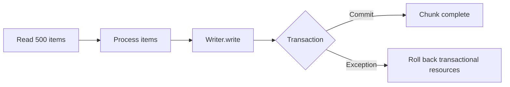
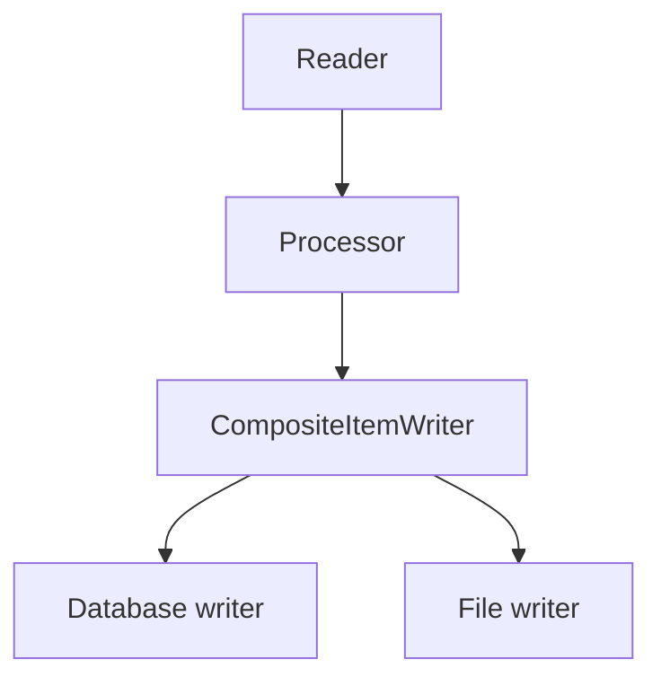
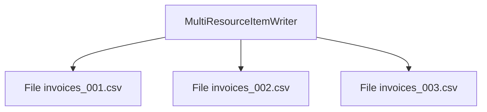
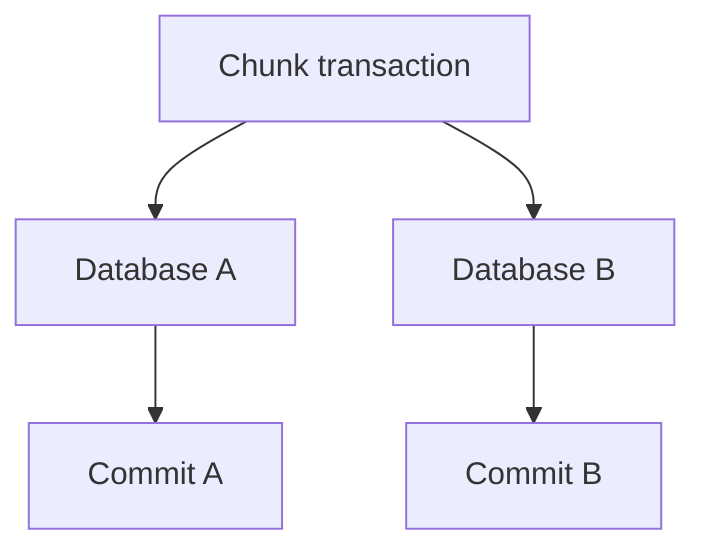
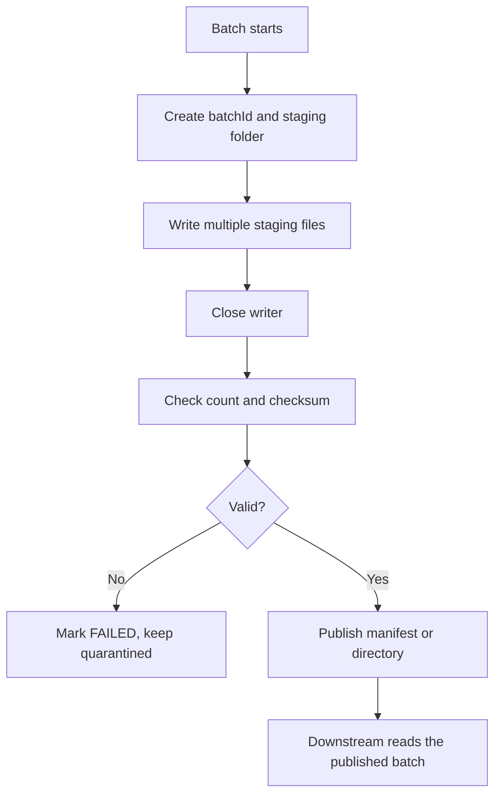
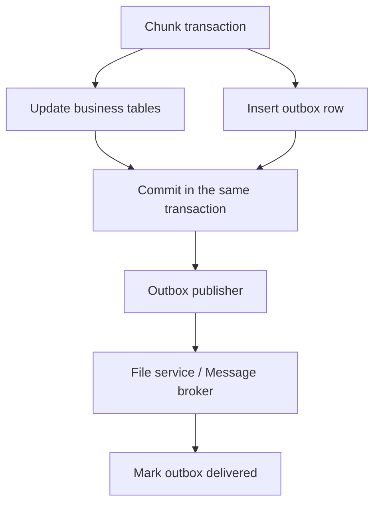

# Multi-resource writers and the limits of atomicity

A batch job often has to write its results to several places: the business database, one or more CSV files, object storage, a message broker, or another system's API. Spring Batch supports combining multiple writers and writing to multiple files, but that does not mean all write targets will commit or roll back together as a single transaction.

**Atomicity is only guaranteed within the scope of resources that actually participate in the same transaction manager and the same transaction.** If a chunk both updates a database and writes a file or calls an external API, an error in the middle can leave a partial result. A database transaction rollback does not automatically delete a file that was created, recall a message that was sent, or undo a request that another service has already processed.

This article presents how Spring Batch writes to multiple resources, the roles of `MultiResourceItemWriter` and `CompositeItemWriter`, the limits of per-chunk transactions, partial failure scenarios, and design patterns for safely publishing results in production.

## 1. Understanding atomicity in a chunk step

A chunk-oriented step reads, processes, and writes items in groups. With a chunk size of 500, Spring Batch typically performs one transaction per chunk:



In simple terms:

1. The reader reads items.
2. The processor transforms or filters items.
3. The writer performs the write operations.
4. If the chunk is processed successfully, the transaction manager commits.
5. If an error occurs before the commit, the transaction is rolled back to the extent the participating resources are capable of.

When all write operations use only one database and the same transaction manager, the SQL statements in the chunk can commit or roll back together. For example, the two tables `invoice` and `invoice_audit` in the same database can be updated atomically in one transaction.

But if the chunk writes to multiple types of resources, the scope of atomicity depends on how the resources are managed:

| Resource | Can it roll back with the local DB transaction? |
|---|---|
| Multiple tables in the same database/transaction | Yes |
| Multiple repositories using the same transaction manager and the same transactional resource | Yes, if they all participate in the transaction |
| A second database with a different datasource/transaction manager | Not automatically |
| A file on the filesystem | Not a transactional resource of JDBC |
| HTTP API | No |
| Email or an external service | No |
| Message broker | Only with appropriate transaction integration; not automatically synchronized with the DB |

A transaction manager only controls the resources it manages. Calling two writers consecutively in the same write() method does not turn the two systems into one atomic transaction.

## 2. Multiple writers in the same step

Spring Batch has `CompositeItemWriter` to send the same chunk to multiple delegate writers. For example, each item is both written to the database and written to a file:



An example configuration:

```java
@Bean
CompositeItemWriter<InvoiceLine> invoiceCompositeWriter(
        ItemWriter<InvoiceLine> databaseWriter,
        ItemWriter<InvoiceLine> fileWriter) {

    return new CompositeItemWriterBuilder<InvoiceLine>()
            .delegates(List.of(databaseWriter, fileWriter))
            .build();
}
```

The composite writer calls the delegates in the declared order. In the example, the database writer is called first and the file writer after. `CompositeItemWriter` helps organize the calls; it does not provide a distributed transaction that makes all delegates commit together.

### What if the second delegate fails?

Suppose the database writer has executed its SQL statement successfully, and then the file writer throws an exception:

1. `CompositeItemWriter` has already called the database writer.
2. The file writer starts writing and hits an error.
3. The exception propagates out of the writer.
4. Spring Batch rolls back the chunk transaction.
5. The database change may be rolled back if the database writer participates in that very transaction.
6. Any file side effect that was actually written to the filesystem may still remain.

The result can be that the database has no data for that chunk but the file already contains part or all of the data. If you reverse the delegate order, the risk can reverse too: the file is written first and the database fails afterward.

No writer call order solves the atomicity problem between two kinds of resources that are not in the same transaction. Changing the order only changes the kind of partial result that may remain when an error occurs.

## 3. MultiResourceItemWriter: splitting output into multiple files

`MultiResourceItemWriter` is a writer that delegates specifically to write data to multiple resources. It is commonly used together with `FlatFileItemWriter` to create files according to a limit on the number of items per file.

For example, an export with 250,000 lines and a limit of 100,000 items/file will create multiple files:



Each file can contain part of the data. The writer switches to the next resource when the configured item limit is reached.

### Example configuration

The `FlatFileItemWriter` delegate defines how each item is written:

```java
@Bean
FlatFileItemWriter<InvoiceLine> invoiceFileDelegate() {
    return new FlatFileItemWriterBuilder<InvoiceLine>()
            .name("invoiceFileDelegate")
            .headerCallback(writer ->
                    writer.write("invoiceId,customerId,amount"))
            .delimited()
            .names("invoiceId", "customerId", "amount")
            .build();
}
```

`MultiResourceItemWriter` manages the current resource and the number of items written:

```java
@Bean
MultiResourceItemWriter<InvoiceLine> invoiceMultiFileWriter(
        FlatFileItemWriter<InvoiceLine> invoiceFileDelegate) {

    return new MultiResourceItemWriterBuilder<InvoiceLine>()
            .name("invoiceMultiFileWriter")
            .resource(new FileSystemResource("output/invoices"))
            .delegate(invoiceFileDelegate)
            .itemCountLimitPerResource(100_000)
            .resourceSuffixCreator(index ->
                    String.format("_%03d.csv", index))
            .build();
}
```

With the base resource `output/invoices` and the suffix creator above, files are named in the form `invoices_001.csv`, `invoices_002.csv`... Check the index convention of the version in use when integrating with downstream consumers.

Some points to note:

- The delegate must support the resource-aware writer contract in order to receive the new resource.
- The writer name must be stable so the execution context is restored correctly.
- The suffix creator must produce stable file names across restarts.
- The input and read order need to be stable if you want a restart to continue at the correct file and position.
- The output directory and write permissions must exist/be appropriate for the runtime environment.
- The items-per-file limit is a limit on the number of items, not a limit on size in bytes.

### MultiResourceItemWriter is not a multi-file transaction

`MultiResourceItemWriter` helps split and manage multiple files, but it does not create an atomic transaction spanning all the files. A job can finish writing the first file, write part of the second file, and then hit an error.

Even when the `FlatFileItemWriter` delegate has transactional buffering under its default configuration, that mechanism still does not turn the filesystem into an XA resource that commits together with the database. I/O errors, process crashes, or errors when publishing multiple files still need to be handled with a separate recovery strategy.

Do not assume that a “chunk rollback” will delete files that were created or return all files to their state before the chunk.

## 4. What does the transactional buffering of a file writer mean?

Some Spring Batch writers, such as `FlatFileItemWriter`, can coordinate buffered writes with transaction synchronization. When a transaction is active, data is buffered to be flushed at the transaction boundary. The `transactional` property of the flat file writer controls this buffering behavior; keep the configuration appropriate to the version and the deployment goal.

This is useful for reducing cases where the file is written first and then the database rolls back in an ordinary chunk error. However, you need to understand the limits:

- The filesystem does not participate in the JDBC transaction the way a database table does.
- Flushing to the file can hit I/O errors, or the process may be stopped midway.
- A single flush can create physical data before another resource completes.
- A group of multiple files has no atomic commit operation by default.
- A file that has already been read or copied by a downstream consumer cannot be rolled back by the step's transaction manager.

Therefore, transactional buffering is a useful coordination mechanism for the writer, not an ACID promise across resources. If the business requirement needs the DB and the file to be published in sync, use a staging/publish protocol or a coordinating architecture capable of recovery.

## 5. Multiple databases also have atomicity limits

If a chunk writes to two different databases:



With two independent local transaction managers, there is no guarantee that both commit or both roll back as a unit. The following can happen:

- Database A commits successfully.
- Database B hits an error before committing.
- The job reports an error, but the data in A still exists.

To get a true distributed atomic commit, the system needs a protocol such as XA/two-phase commit, and the resources must support appropriate enlistment. This brings in a coordinator, datasource/driver configuration, timeouts, recovery logs, and complex operations. An ordinary filesystem and HTTP API do not become XA participants just because they are called from the same step.

Before choosing a distributed transaction, consider whether the business can accept eventual consistency, an outbox, staging, and reconciliation. These patterns are often easier to operate when the resources do not support a common transaction manager.

## 6. Failure scenario: writing the database and a file in the same chunk

Suppose a chunk contains 1,000 invoices, and `CompositeItemWriter` calls the database writer first and then the file writer:

| Point in time | Database | File |
|---|---|---|
| Chunk starts | Not yet written | Not yet written |
| Database writer completes | 1,000 changes in the transaction | Not yet written |
| File writer has written 600 lines | 1,000 uncommitted changes | There may be 600 physical lines or data in the buffer |
| Disk full | Writer throws an exception | File write incomplete |
| Chunk rollback | Database rolls back if in the same transaction | Filesystem does not roll back like a DB |

After the incident, the file may be missing, contain partial data, or have a state that depends on the buffering mechanism and the time of the error. If retried, the writer may create additional data or continue appending to the old file if the append/restart configuration allows.

Questions to answer in the design:

- Is the file considered official output before the whole batch completes?
- Can a downstream consumer see the file while it is being written?
- Does a retry overwrite the old file, append, or create a new file?
- How do you detect a file that was only partially written?
- How do you reconcile the file's line count with the number of database records?
- Who cleans up or quarantines the staging file when the job fails?

If there are no clear answers, do not let downstream consumers read directly the file that the writer is creating.

## 7. A safe pattern: write to staging and then publish

A practical approach is to split the process into two phases: **create the output in a staging area**, then **publish the completed output**.



The process:

1. Create a stable `batchId`, for example `invoice-20261115-001`.
2. Write files to a dedicated directory such as `staging/invoice-20261115-001/`.
3. Do not let consumers scan or read the staging directory.
4. Close the writer to flush and finalize the files.
5. Check the number of files, the number of lines, checksums, schema, and business control totals.
6. Write a manifest describing the batch and the list of files.
7. Publish the batch by creating a commit marker or moving the directory to the published area.
8. Consumers only process batches with a valid manifest/marker.

The manifest can contain:

```json
{
  "batchId": "invoice-20261115-001",
  "businessDate": "2026-11-15",
  "status": "PUBLISHED",
  "files": [
    {
      "name": "invoices_001.csv",
      "records": 100000,
      "sha256": "..."
    },
    {
      "name": "invoices_002.csv",
      "records": 25000,
      "sha256": "..."
    }
  ],
  "totalRecords": 125000
}
```

This is an example structure; the checksum values must be computed from the actual files. The manifest should be written to a temporary file and then renamed to its official name when complete. If you use rename to publish, you need to check that the filesystem supports atomic rename within the same filesystem and that the target path does not already exist. Renaming individual files separately does not make the whole group of files a transaction.

### Why is a manifest useful?

The consumer gets a clear signal to know the batch has completed. If the job dies while writing files, there is no manifest, so the consumer ignores that directory. If the manifest exists and the checksums are valid, the consumer can begin processing.

The manifest is an application-level commit marker; it does not by itself synchronize transactions with the database. If the database also stores the `PUBLISHED` state, you need to design how to recover when one side updates successfully and the other fails.

## 8. Combining staging with a database transaction

If you need to write both a database and files, define the source of truth and the publication order. For example, a workflow could:

1. Write the business data and a batch control record in the same DB transaction.
2. Write the output file to staging using that batch ID.
3. Verify the counts and checksums.
4. Write the output state `READY_TO_PUBLISH` to the database.
5. Publish the file/manifest.
6. Update the state to `PUBLISHED`.
7. If publishing fails, a recovery job finds `READY_TO_PUBLISH` batches to retry.

Because the DB update and the filesystem publish are not atomic, the coordination state needs to allow identifying and recovering the gaps between steps. For example:

| State | Meaning | Recovery action |
|---|---|---|
| `STARTED` | The batch has been created | Check the execution and staging |
| `WRITING` | Files are being created | Restart or quarantine the incomplete files |
| `VALIDATING` | Reconciliation in progress | Re-run the checks |
| `READY_TO_PUBLISH` | Output is valid, not yet published | Retry publishing |
| `PUBLISHED` | Consumers can read it | Do not publish again; handle via idempotency |
| `FAILED` | An error needs investigation | Keep the artifacts and the cause |

Do not delete staging immediately when a job fails. Keep enough information to investigate, or clean up according to a retention policy after the batch state has been determined.

## 9. Transactional outbox for events and publish tasks

If a database transaction needs to create data and also requires emitting an event or creating a file, a transactional outbox is a useful option:



Within one local database transaction, the job writes the business data and an outbox record. If the transaction rolls back, both changes roll back. If it commits, a separate publisher can read the outbox and perform the side effect afterward.

The publisher can still send duplicates if the process dies after the target system has received the message but before the outbox is marked delivered. Therefore:

- Each outbox record needs a stable ID.
- The target system should support an idempotency key or consumer deduplication.
- The delivery state must have retry/backoff and error information.
- Do not mark as delivered before receiving an appropriate acknowledgment from the target system.

The outbox makes recording the publish request consistent with the database; it does not make the target service part of the original transaction.

## 10. Idempotency on restart or republish

When there are multiple resources, the job must assume that a step may be performed again. Define idempotency keys at the batch level and the item level:

- `batchId`: identifies the output batch.
- `sourceRecordId`: identifies the source record.
- `fileName`: a stable file name within a batch.
- `contentChecksum`: confirms the file content.
- `publicationId`: identifies the publish request.

Example rules:

- Rewrite staging files into the same batch directory only if they can be safely overwritten or the old files are cleaned up before starting over.
- Do not append to an old file if you do not know exactly which offset was committed.
- Only create the manifest after all files are closed and checked.
- The consumer stores the processed `batchId` to avoid importing the same batch multiple times.
- The database uses a unique constraint on `batchId` and `sourceRecordId` when appropriate.

Idempotency in the writer helps reprocess an operation without creating duplicate results. Spring Batch's restart metadata helps know how far the execution and step have gone. The two mechanisms need to work together.

## 11. Restart with MultiResourceItemWriter

`MultiResourceItemWriter` is an `ItemStreamWriter` and can store the necessary state in the `ExecutionContext`. With a correct restart configuration, it can restore the current resource and the number of items written in order to continue.

For reliable restartability:

- Keep the writer name stable.
- Keep the base resource and suffix naming stable.
- Ensure the input file does not change and the read order is reproducible.
- Do not delete or rename files that are needed for restart.
- Keep the metadata schema and execution context compatible with the application version.
- Determine clearly which append/restart behavior of the delegate is used when files are reopened.

Do not treat the writer saving state as a guarantee that the whole set of files has been published atomically. The metadata can tell which resource/index the writer has reached; it does not by itself confirm that a consumer has not read an incomplete file or that an external system has not received the data.

If a job creates output for a batch that has failed, it can be safer to write to a staging directory tied to the execution/batch ID and only publish after validation completes. On restart, use a clear policy to continue or recreate the staging artifacts.

## 12. Handling incomplete files and recovery

A recovery process should be able to determine:

1. Which file belongs to which batch?
2. Has the file been closed completely?
3. Do the actual line count and checksum match the expected manifest?
4. Has the file been published?
5. Has a consumer processed the file or batch?
6. Can you restart, recreate the file, or does it need to be reprocessed?

Some useful artifact states:

| Artifact state | Meaning |
|---|---|
| `WRITING` | The writer is creating the file |
| `CLOSED` | The writer has closed the file |
| `VALIDATED` | Count/checksum/schema checks passed |
| `PUBLISHED` | Consumers are permitted to read it |
| `CONSUMED` | Downstream confirmed processing |
| `QUARANTINED` | The faulty file is isolated for investigation |

Do not infer a file is complete just because the file exists. The process may die after creating the file but before finishing the write. Also do not infer that a file has not been processed by a consumer just because the job execution reported an error; downstream may have read it before the error was recorded.

## 13. Controlling delegate order in CompositeItemWriter

The delegate order determines the call order, but it does not determine atomicity:

```java
CompositeItemWriter<InvoiceLine> writer =
        new CompositeItemWriterBuilder<InvoiceLine>()
                .delegates(List.of(
                        databaseWriter,
                        fileWriter))
                .build();
```

If the database is the source of truth and the file is merely an export, you can choose to write the database first and then create the staging file. If the file is an input that needs to be confirmed before import, you can validate and close the file first, and only then run the database import step. Choose the order in the direction that reduces risk and makes recovery clear.

Another option is to split the two responsibilities into two steps:

```java
@Bean
Job invoiceExportJob(
        JobRepository jobRepository,
        Step writeDatabaseStep,
        Step exportFilesStep,
        Step publishFilesStep) {

    return new JobBuilder("invoiceExportJob", jobRepository)
            .start(writeDatabaseStep)
            .next(exportFilesStep)
            .next(publishFilesStep)
            .build();
}
```

Splitting steps makes it easier to observe state and restart by phase. But the steps are still separate transactions; if the third step fails, the results of the two earlier steps may have already committed. You need idempotency and recovery at the workflow level.

## 14. Architecture choices by need

| Need | Suitable approach |
|---|---|
| Write multiple tables in the same database | One transaction manager and the same chunk transaction |
| Split output into multiple files by line count | `MultiResourceItemWriter` |
| Send the same item to several writers | `CompositeItemWriter`, with a plan for handling partial success |
| Database and files must be visible to consumers only after completion | Staging + validation + manifest/publish marker |
| Database and message need to be consistent at the time the request is created | Transactional outbox |
| Two databases need a strict atomic commit | Evaluate XA/two-phase commit and its operational cost |
| An external system does not support a common transaction | Eventual consistency, idempotency, retry, and reconciliation |

Do not choose a distributed transaction just because a job has two writers. Start from the real requirements: whether consumers can accept seeing data slightly late, whether partial success can be detected and handled, and what the business consequences of a partial state are.

## 15. Observability, reconciliation, and alerting

When writing to multiple resources, the job's logs need to be able to link every artifact:

- Job name, job execution ID, and step name.
- Batch ID and business date.
- Base resource, the list of files, and the suffix/index.
- Number of items read and written.
- Line count of each file.
- Checksum or object version.
- Publish state and publish time.
- Exception, retry count, and recovery state.

Count reconciliation:

```text
sourceCount        = 125000
processedCount     = 125000
databaseCount      = 125000
fileRecordCount    = 125000
rejectedCount      = 0
publishedFileCount = 2
reconciliation     = PASSED
```

These are illustrative figures. In practice, you need to define clearly whether the header counts as a line, which total filtered/skipped records are counted toward, and whether the file has a trailer/control total.

You should alert when:

- The database commits successfully but the file publish fails.
- There is a staging directory that is past due and has not been published.
- The manifest is missing a file or a checksum does not match.
- A consumer receives the same batch multiple times.
- The database and file counts do not match.
- The job fails after one or more resources have already had side effects.

## 16. Testing failures between resources

An ordinary successful test is not enough to confirm atomicity. Test the failure points that can create partial output:

| Scenario | What to confirm |
|---|---|
| Database writer fails | DB rolls back per the transaction |
| File writer fails after the DB writer | DB rolls back if in the same transaction; the file artifact is handled per the staging policy |
| Failure in the middle of the second file | The incomplete file is not published |
| Process stops after writing files, before the manifest | The consumer skips a batch that has no commit marker |
| Publish succeeds but the DB status update fails | Recovery identifies this and completes the state without publishing a duplicate |
| Consumer receives a message twice | The idempotency key prevents duplicate processing |
| Restart of the same JobInstance | The writer restores state and does not create duplicate output |
| Two jobs publish the same batch | A lock or unique key prevents a conflicting publication |

Tests should run with an appropriate test database/filesystem or broker to exercise the right type of resource. Mocking each writer only confirms the call order; it does not prove a transaction or filesystem rollback.

## 17. Common design mistakes

**Assuming CompositeItemWriter makes the delegates atomic.** The composite only coordinates the calls. Each delegate must participate in the transaction or have its own recovery mechanism.

**Assuming a chunk rollback deletes written files.** A JDBC rollback does not automatically undo the filesystem. Use staging, temporary files, and a publish marker.

**Letting a consumer read a file while the writer is writing.** The consumer may read incomplete output. Only publish after close and validate.

**Writing directly to the official file name.** A retry or process crash can leave an incomplete file under a name that downstream considers complete. Write to a separate staging area.

**Re-appending to a file without knowing the offset.** This can create duplicate or missing lines. Determine the restart state, truncate/recreate, or use file segments with stable IDs.

**Marking a batch as published before the files are complete.** The consumer may read incomplete data. The publish marker must be created after checking all artifacts.

**Using two local transaction managers and expecting a simultaneous commit.** Two independent transactions have no shared atomicity without a distributed transaction protocol.

**Not reconciling after publishing.** A completed job does not by itself prove that the file and the database have the same count or the same content.

## 18. Procedure for designing a multi-resource writer

Before implementing, answer the questions in order:

1. Which resources are written, and which resource is the source of truth?
2. Which resources participate in the same transaction manager?
3. If the second writer fails after the first writer succeeds, what state remains?
4. Can a consumer see the data before the batch completes?
5. Is there a staging directory, temporary object, or outbox to hold output that has not been published?
6. By what stable ID are the batch/files identified?
7. Will restart and reprocess overwrite, append, or create a new version of the artifact?
8. How do you confirm that all output is complete and consistent?
9. Who or which job will recover partial success states?

If the requirement is “all resources commit together or no resource changes”, you need to prove that the resources really participate in one distributed transaction with recovery. If not, design toward staging, publish, idempotency, and reconciliation.

## 19. Practical conclusion

Spring Batch can send a chunk to multiple writers and split output into multiple files, but the ability to write to multiple resources does not equal an atomic commit across resources. `CompositeItemWriter` coordinates the delegates; `MultiResourceItemWriter` manages switching files. Both need a clear strategy for partial failure and restart.

With multiple tables in the same database, the chunk transaction can provide ordinary atomicity. With a database combined with files, messages, or APIs, treat each resource as having its own commit boundary. Use staging, count/checksum checks, a manifest, or an outbox to publish results after completion; add idempotency and reconciliation to recover when a step fails.

A reliable production pipeline does not assume all resources will succeed together. It determines beforehand the state that may remain after each failure, knows how to recognize incomplete output, and can continue or compensate without creating duplicate data.
