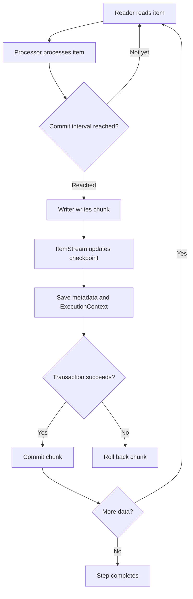

# Testing commits and rollbacks

In Spring Batch, transactions determine when data is confirmed and the scope of changes that can be undone when processing hits an error. For a chunk-oriented step, each chunk typically runs in one transaction: the reader reads items, the processor processes them, the writer writes the data, Spring Batch updates the checkpoint, and then the transaction commits. If an error causes the transaction to roll back before committing, changes belonging to that transaction must be undone.

Testing commits and rollbacks must prove this behavior with real data. A job finishing with `COMPLETED` is not enough to prove transactions are right; similarly, a `FAILED` job does not mean all previously written data was rolled back. You must check chunk boundaries, database contents, step metadata, and how the job restarts after a failure.

## 1. What needs to be tested?

A transaction test suite for a batch job typically needs to answer these questions:

- When a chunk finishes, is data written by the writer committed and visible to other transactions?
- If the reader, processor, or writer throws an exception before committing, do that chunk's changes roll back?
- Do previously committed chunks remain intact when a later chunk fails?
- Does `StepExecution` record the appropriate status and rollback count?
- On restart, does the reader restore the latest committed checkpoint and reprocess the uncommitted part?
- Does the writer avoid creating duplicate data or repeated side effects when a chunk is re-executed?
- Are resources outside the database transaction, such as files, HTTP APIs, or message brokers, recovered according to design?

These questions help distinguish three commonly confused concepts:

| Concept | Meaning |
|---|---|
| Commit | Confirms changes in the transaction; other transactions can see the data according to the isolation level |
| Rollback | Undoes uncommitted changes in the current transaction |
| Restart | Creates a new execution for the same failed/stopped job instance and continues per metadata, checkpoints, and restart policy |

A restart is not a rollback of the entire job. Chunks committed before the job failed are typically preserved.

## 2. Transaction boundaries in a chunk-oriented step

A chunk-oriented step usually follows this cycle:



For example, a step with `chunk(100, transactionManager)` collects up to 100 items for one chunk before writing and committing. When the writer succeeds and the transaction commits, the chunk's data and related checkpoint are confirmed according to the transaction/repository configuration.

If the writer throws an exception before committing, Spring Batch rolls back the current transaction. Database changes made in the same transaction are undone. The reader may have read through items in memory, yet the durable checkpoint remains the latest committed checkpoint. On restart, a stateful reader can re-read the data of the uncommitted chunk.

With a tasklet step, a transaction is typically created for each call to `Tasklet.execute()`. If the tasklet returns `CONTINUABLE`, the framework may invoke it again in a different transaction. Therefore, when testing a tasklet, treat each invocation precisely as one transaction unit.

## 3. Using a real database in transaction tests

Mocking `ItemWriter`, `JdbcTemplate`, or a repository can verify that methods were called, but does not prove the database actually rolled back. To test commits/rollbacks, use a test database with a transaction manager and constraint behavior matching the deployment environment.

Common options:

- Use the same database type as production in an isolated test environment.
- Use Testcontainers to launch an isolated database at the version under test.
- Use an in-memory database when the SQL syntax and transaction behavior under test are compatible with it.

If production uses PostgreSQL with `ON CONFLICT`, specific isolation levels, or custom data types, another in-memory database may not faithfully reproduce the behavior. In that case, use PostgreSQL in integration tests.

Simple test table example:

```sql
CREATE TABLE imported_row (
    row_id       BIGINT PRIMARY KEY,
    row_value    VARCHAR(100) NOT NULL
);
```

Tests should prepare input data, clear test data before running, and verify results via independent queries after the job completes. Do not just check the writer call count; read the table to prove the transaction committed or rolled back properly.

## 4. Testing commits when a job succeeds

The most basic case is launching a successful job and verifying that data written by the writer persists after the execution ends.

Example step:

```java
@Bean
Step importRowsStep(
        JobRepository jobRepository,
        PlatformTransactionManager transactionManager,
        ItemReader<ImportRow> reader,
        ItemWriter<ImportRow> writer) {

    return new StepBuilder("importRowsStep", jobRepository)
            .<ImportRow, ImportRow>chunk(2, transactionManager)
            .reader(reader)
            .writer(writer)
            .build();
}
```

With a chunk size of 2 and 5 input items, the step normally creates chunks of 2, 2, and 1 items. After the job finishes, you can assert:

```java
assertEquals(BatchStatus.COMPLETED, execution.getStatus());
assertEquals(5, jdbcTemplate.queryForObject(
        "select count(*) from imported_row", Integer.class));
```

Beyond row counts, inspect specific keys and values to verify the writer wrote the right content. If the table already holds data from other tests, filter by `batch_id` or clean test data before counting.

You can read `StepExecution` to inspect operational metrics:

```java
StepExecution stepExecution = execution.getStepExecutions()
        .stream()
        .filter(step -> step.getStepName().equals("importRowsStep"))
        .findFirst()
        .orElseThrow();

assertEquals(5, stepExecution.getReadCount());
assertEquals(5, stepExecution.getWriteCount());
assertTrue(stepExecution.getCommitCount() > 0);
```

Counters help explain the processing flow, but data in the database proves the write outcome. If the processor filters items or the step skips items, `readCount` and `writeCount` may differ by design.

## 5. Testing rollbacks when the writer fails

A direct way to test rollback is creating a writer that writes several rows in a chunk and then throws an exception. If the write statements participate in the step's transaction, all changes of that chunk must roll back.

Example writer using `JdbcTemplate`:

```java
@Bean
ItemWriter<ImportRow> failingWriter(
        JdbcTemplate jdbcTemplate,
        FailureSwitch failureSwitch) {

    return chunk -> {
        for (ImportRow row : chunk.getItems()) {
            jdbcTemplate.update(
                    "insert into imported_row(row_id, row_value) values (?, ?)",
                    row.id(), row.value());
        }

        if (failureSwitch.shouldFail(chunk.getItems())) {
            throw new IllegalStateException("Simulated writer failure");
        }
    };
}
```

`FailureSwitch` is a test component that toggles failures on and off. In the test, configure it to fail the writer on a chunk containing a specific ID. The writer already ran the insert statements before throwing; the chunk's transaction must roll back all of those inserts.

Assertions to include:

- The job or step has status `FAILED` if the exception is not retried/skipped.
- Rows belonging to the failed chunk do not exist in the database.
- If an earlier chunk committed, the earlier chunk's rows still exist.
- The step's `rollbackCount` reflects that a rollback occurred (check an appropriate condition rather than hardcoding an exact count if retry is enabled).

Do not use a mock writer that only throws an exception without executing write statements. That tests the error flow but does not prove database changes were rolled back.

## 6. Example: testing a prior committed chunk and a rolled-back chunk

Suppose the input has 5 items with IDs 1 through 5, and the commit interval is 2. The writer is configured to write items and then fail on the chunk containing IDs 3 and 4.

Expected first run:

| Chunk | Items | Result |
|---|---|---|
| 1 | 1, 2 | Committed successfully |
| 2 | 3, 4 | Writer writes then throws exception; rolls back |
| 3 | 5 | Not executed because the step failed |

After the first run, the database should contain only IDs 1 and 2. This proves the first chunk committed and the second chunk rolled back.

Example test structure with `JobLauncherTestUtils`:

```java
@SpringBatchTest
@SpringJUnitConfig(BatchTestConfiguration.class)
class ChunkTransactionTest {

    @Autowired
    private JobLauncherTestUtils jobLauncherTestUtils;

    @Autowired
    private JdbcTemplate jdbcTemplate;

    @Autowired
    private FailureSwitch failureSwitch;

    @Test
    void commitsPreviousChunkAndRollsBackFailingChunk() throws Exception {
        failureSwitch.failChunkContaining(3L);

        JobParameters parameters = new JobParametersBuilder()
                .addString("batchId", "TX-TEST-001")
                .toJobParameters();

        JobExecution execution =
                jobLauncherTestUtils.launchJob(parameters);

        assertEquals(BatchStatus.FAILED, execution.getStatus());

        List<Long> ids = jdbcTemplate.queryForList(
                "select row_id from imported_row order by row_id",
                Long.class);

        assertEquals(List.of(1L, 2L), ids);
    }
}
```

This is a test skeleton; `BatchTestConfiguration` needs to provide the job, a restartable reader, the writer, and `FailureSwitch`. The reader should be stateful, such as `FlatFileItemReader` or an appropriately configured JDBC paging reader. An in-memory index-only reader like `ListItemReader` is insufficient to prove restarting from a checkpoint across a new execution.

The test must not be wrapped in an outer test transaction if the goal is to observe the job's commits. If the test method has `@Transactional`, the test transaction can alter data visibility or cause changes to roll back only when the test ends. Use an isolated test database, clean data explicitly, and let the step's transactions perform actual commits/rollbacks.

## 7. Testing restart after rollback

After verifying that the failing chunk rolled back, you can test restarting the same `JobInstance`:

1. The first run fails on the second chunk; the first chunk committed.
2. Disable `FailureSwitch` so the writer no longer deliberately throws errors.
3. Call the same job again with the exact identifying `JobParameters`.
4. Spring Batch creates a new `JobExecution` for the same `JobInstance` and restarts the step from saved metadata.
5. The reader restores the checkpoint after the first chunk; items of the uncommitted chunk are re-read.
6. After the job finishes, the database contains all 5 items with no duplicate records.

The continuation of the test can be written as:

```java
failureSwitch.disable();

JobExecution restarted =
        jobLauncherTestUtils.launchJob(parameters);

assertEquals(BatchStatus.COMPLETED, restarted.getStatus());

Integer count = jdbcTemplate.queryForObject(
        "select count(*) from imported_row", Integer.class);
assertEquals(5, count);
```

For this test to be meaningful, ensure:

- The same job name and the same identifying parameters are used for the restart.
- `JobRepository` persists metadata durably between the two `launchJob()` calls.
- The reader supports `ItemStream` and restores its position from the execution context.
- The data source and read order do not change between the two runs.
- The writer uses the appropriate transaction manager and does not produce unprotected non-transactional side effects.

If the first run fails after the first chunk commits, the first chunk's data should not be written again unintentionally. A unique key or idempotent writer is still needed if the architecture can receive the same item from multiple sources or multiple launches.

## 8. Testing transactions in a tasklet

For a tasklet performing a database operation, you can test both commit and rollback cases within a single `execute()` call.

Example tasklet:

```java
@Bean
Tasklet updateBatchStatus(JdbcTemplate jdbcTemplate) {
    return (contribution, chunkContext) -> {
        jdbcTemplate.update(
                "update batch_control set status = ? where batch_id = ?",
                "PROCESSING", "BATCH-001");

        if (shouldFail()) {
            throw new IllegalStateException("Simulated tasklet failure");
        }

        return RepeatStatus.FINISHED;
    };
}
```

If `shouldFail()` returns true and the update statement participates in the tasklet's transaction, the status change must roll back. When the tasklet succeeds, the change commits once `execute()` completes.

If the tasklet returns `CONTINUABLE`, each invocation has its own transaction under `TaskletStep`'s standard execution behavior. Thus, if the first pass commits and the second pass fails, changes committed in the first pass remain. Tests must assert the exact per-pass boundary rather than assuming the entire tasklet loop is one single transaction.

## 9. Testing the transaction manager and propagation

A common reason rollback tests fail is that the writer does not participate in the transaction managed by the step.

Check:

- Whether `JdbcTemplate` and the step's `PlatformTransactionManager` use the same appropriate `DataSource`.
- Whether a JPA writer uses the `EntityManager`/transaction manager configured for the step.
- Whether the writer calls a service annotated with `@Transactional(propagation = REQUIRES_NEW)`.
- Whether there is a second datasource or a different transaction manager.
- Whether there are manual commits, independent connections, or async execution inside the writer.

If a service called from the writer opens a `REQUIRES_NEW` transaction, that transaction can commit independently. Rolling back the outer chunk transaction cannot undo changes already committed in the new transaction. This may be intentional behavior, but it needs to be tested and documented.

Similarly, if the writer sends HTTP requests, publishes messages directly, or writes files, those effects sit outside an ordinary JDBC transaction. Database rollback tests cannot prove those side effects were undone.

## 10. Testing with multiple resources and non-database side effects

A batch writer sometimes both writes to a database and calls an API or sends a message. Do not test it merely by inspecting database tables.

For example, a writer sends a request to a payment service and then updates database status. If the API already processed the payment while the database transaction rolls back, a retry might send the payment again.

Mechanisms needing separate tests:

- **Idempotency key:** send the same key across retries and verify the external service returns the previous result.
- **Transactional outbox:** business changes and outbox records commit or roll back together.
- **Consumer inbox/deduplication:** the same event is redelivered yet applied only once.
- **Compensation:** if business logic uses compensating actions, verify compensation triggers properly when a subsequent step fails.
- **Reconciliation:** after an indeterminate timeout, the system can query external transaction state and reconcile.

Tests can use a fake HTTP server or mock broker capable of simulating scenarios such as: the server processed the request while the client timed out, a message was published before the publisher marked completion, or a consumer receives the same event twice.

## 11. How retry and skip affect rollback testing

When a step is configured with retry, the writer may be invoked again after an error. When a step is configured with skip, Spring Batch may roll back the chunk and then reprocess the necessary items to isolate and skip the faulty item per policy.

Therefore, rollback tests must clearly separate goals:

- **Pure rollback test:** configure no retry/skip for the simulated exception; verify the chunk fails and the chunk's changes roll back.
- **Retry test:** configure a transient error that happens a few times before succeeding; verify the writer is called again and final results contain no duplicates.
- **Skip test:** configure a skippable data exception; verify that item is not written, remaining items are written, and skip counters match.
- **Limit-exceeded test:** errors exceed the retry/skip limit; verify the step fails and data reflects the latest checkpoint.

Do not use a single test to assert every behavior at once. A simple rollback test should avoid retry/skip so outcomes are easy to interpret; fault-tolerance policies should have dedicated tests.

## 12. Reading metadata to support testing

`JobExecution` and `StepExecution` provide useful metadata for explaining transaction outcomes:

| Field | Meaning in testing |
|---|---|
| `BatchStatus` | Execution status such as `COMPLETED` or `FAILED` |
| `ExitStatus` | Exit code of the job/step, which can carry custom values |
| `readCount` | Number of items read by the reader per step metadata |
| `writeCount` | Number of items written by the writer per step metadata |
| `commitCount` | Number of commits recorded for the step |
| `rollbackCount` | Number of rollbacks recorded for the step |
| `filterCount` | Number of items filtered by the processor |
| `readSkipCount`, `processSkipCount`, `writeSkipCount` | Number of items skipped by stage |

These fields help confirm the framework took the expected execution branch. However, they do not replace assertions against the database or external systems. For example, `writeCount` does not prove an HTTP API succeeded, nor does it prove a business record was not written twice.

## 13. Common mistakes in commit/rollback tests

**Only mocking the writer and checking exceptions.** The test proves an exception propagates, not that the database transaction rolled back. Use a real database in integration tests.

**Putting `@Transactional` on the test method without understanding the impact.** An outer transaction can alter data visibility and rollback timing. To test actual batch commits, usually let the step manage transactions and clean test data separately.

**Using a stateless reader in restart tests.** The reader may read from the beginning again, defeating the restart test's purpose. Use an `ItemStream` reader with checkpoints.

**Checking only job status.** `FAILED` does not prove the failed chunk rolled back; `COMPLETED` does not prove data is right. Inspect database contents.

**Not checking previously committed chunks.** Rollback applies only to the current transaction. Tests should verify earlier chunks' data remains present.

**Using a different transaction manager for the writer.** The writer may commit independently and fail to roll back with the chunk. Check datasource, transaction manager, and propagation.

**Assuming HTTP/API/files roll back with the database.** Non-transactional side effects require their own tests and recovery mechanisms.

**Enabling retry in a basic rollback test.** Retries change writer invocation and rollback counts, making assertions harder to interpret. Separate rollback, retry, and skip tests.

## 14. Organizing an integration test suite

A test suite can be organized in layers:

1. **Writer test:** verify write statements, unique constraints, upserts, and behavior on invalid data.
2. **Transaction test:** invoke the writer in a test transaction or step test and verify commit/rollback with database queries.
3. **Step test:** launch a real step to verify reader, processor, writer, checkpoint, and transaction manager coordination.
4. **Job restart test:** fail a step after some chunks have committed, then restart with the same `JobParameters`.
5. **External integration test:** simulate timeouts or redelivery for APIs/messages and verify idempotency/outbox.

With Spring Batch, `@SpringBatchTest` provides utilities such as `JobLauncherTestUtils` and `JobRepositoryTestUtils` in the corresponding test module. Test configuration must specify the job under test, `JobRepository`, transaction manager, datasource, and fixture data. If multiple jobs exist in the context, explicitly configure the target job on `JobLauncherTestUtils`.

Integration tests should run against separately created metadata and business schemas. You can use the application's migration/schema scripts to create tables, then clean or roll back fixture data in a way that preserves metadata needed for restart tests. For restart tests, do not wipe `JobRepository` metadata between the two runs.

## Conclusion

Testing commits and rollbacks in Spring Batch requires verifying transactions at the exact processing boundaries. For a chunk-oriented step, committed chunks must retain their data; chunks failing before commit must roll back changes in the same transaction. On restart, the reader restores the latest checkpoint and uncommitted parts can be reprocessed. For tasklets, test transactions per `execute()` invocation.

Use a real test database, fault injection in the writer/tasklet, inspect data after each run, and read `StepExecution` metadata to explain results. In particular, confirm the writer uses the right transaction manager and isolate side effects outside the database. By testing commit, rollback, retry, skip, and restart as distinct scenarios, the team can gain greater confidence that batch jobs recover from failures while keeping data consistent.
