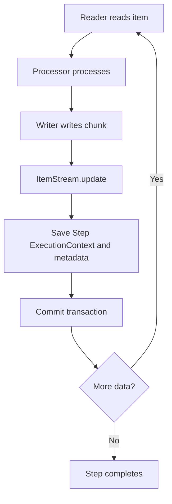
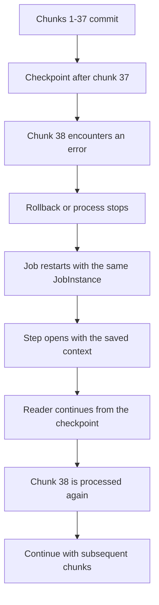

# ExecutionContext Stores Restart State

In Spring Batch, `ExecutionContext` is a key-value storage area used to hold the state needed to resume a job or step after an interruption. A reader can store the position it has read up to, a tasklet can store the next segment to process, and one step can store a few small values for another step to use.

When a job needs to restart, Spring Batch restores the execution context that was saved in the `JobRepository`. This lets the processing components know the state at the most recent checkpoint and continue from the appropriate position. `ExecutionContext` is part of the restart mechanism; it does not by itself make every operation idempotent, and it is not a business data store.

Spring Batch has two execution contexts with different scopes:

- **Step ExecutionContext:** belongs to a `StepExecution` and typically stores the step's checkpoint and internal state.
- **Job ExecutionContext:** belongs to a `JobExecution` and is used for small pieces of data that need to be shared between steps within the same job execution.

Understanding the scope, the timing of persistence, and the way these two contexts are restored helps you design readers, tasklets, and flows that can restart safely.

## 1. What Is ExecutionContext?

`ExecutionContext` is a key-value structure managed by Spring Batch. A processing component can write values into the context and read them back in a later execution.

Example:

```java
ExecutionContext context = stepExecution.getExecutionContext();

context.putLong("orders.lastProcessedId", 8450L);
context.putString("input.fileName", "orders-2026-11-14.csv");

long lastProcessedId = context.getLong("orders.lastProcessedId", 0L);
String fileName = context.getString("input.fileName");
```

In the example, the context stores the last processed key and the input file name. When the step is restarted, the processing component can read the saved values to restore its state.

Important characteristics:

- The context is bound to a specific execution; it is not an application-wide global map.
- Spring Batch persists the context through the `JobRepository` so it can be restored after the process stops.
- Values are saved at checkpoints or at metadata update points that correspond to the scope of the context.
- Values must be compatible with the serialization mechanism configured for the repository.
- The context should be compact and contain only the information needed to restore or coordinate processing.

`put()` and `remove()` change the context that is currently being managed. Calling `put()` does not mean the data has been written to the database immediately; Spring Batch persists the context during the job/step lifecycle and at the corresponding transaction boundaries.

## 2. Two Scopes: Step ExecutionContext and Job ExecutionContext

Spring Batch maintains two separate contexts:

| Criterion | Step ExecutionContext | Job ExecutionContext |
|---|---|---|
| Obtained from | `stepExecution.getExecutionContext()` | `jobExecution.getExecutionContext()` |
| Scope | One `StepExecution` | One `JobExecution` |
| Main purpose | Checkpoint and internal state of the step | Share a few values between steps within the same job execution |
| Examples | File offset, next page, last key confirmed by the reader | Artifact path created by a previous step, reference code of an aggregated result |
| When persisted | Usually at the step's commit/checkpoint points | Usually updated when a step completes or through the job context management mechanism |

The Step ExecutionContext is suitable for state that only the current step needs to know. For example, `importOrdersStep` stores the file position or the last processed key so the reader continues from the correct position.

The Job ExecutionContext is suitable for a value that needs to be passed from one step to another. For example, `validateInputStep` determines the path of the verified file, and `importOrdersStep` needs to use that path. The value can be promoted from the Step ExecutionContext to the Job ExecutionContext when the first step completes.

Do not use the Job ExecutionContext as a place to hold all the state of every step. If a value only serves the reader's checkpoint, keep it in the Step ExecutionContext so steps do not overwrite each other or depend on state that is not their responsibility.

## 3. Where Is ExecutionContext Stored?

With a JDBC `JobRepository`, Spring Batch stores metadata in the repository tables. Two commonly seen tables are:

| Table | Content |
|---|---|
| `BATCH_STEP_EXECUTION_CONTEXT` | The ExecutionContext of each step execution |
| `BATCH_JOB_EXECUTION_CONTEXT` | The ExecutionContext of each job execution |

These tables belong to the metadata schema managed by Spring Batch. Table names and schema may change depending on the prefix configuration or version. Applications should use the `ExecutionContext`, `JobRepository`, `JobExplorer` APIs and other Spring Batch components instead of writing to or modifying the data in the `BATCH_*` tables directly.

The `JobRepository` also stores `JobInstance`, `JobExecution`, `StepExecution`, parameters, and counters. The execution context is stored together with the metadata system so Spring Batch can link restart state to the correct execution.

If the application uses an in-memory-only repository, the context may be lost when the JVM stops. For jobs that need to restart after the application is restarted, you need a durable repository, typically a JDBC repository with a correctly configured metadata schema.

## 4. When Is ExecutionContext Saved?

The timing of persistence depends on the scope of the context and the type of step.

### 4.1. Step ExecutionContext in a Chunk Step

In chunk-oriented processing, Spring Batch typically updates the Step ExecutionContext at chunk checkpoint boundaries. A reader and writer that implement `ItemStream` can write their internal state into the context through `update(ExecutionContext)`.

General cycle:



When a chunk commits successfully, the corresponding checkpoint becomes durable state. If the chunk rolls back before committing, the new checkpoint is not confirmed in that transaction; the next restart will rely on the most recently committed checkpoint.

Not every reader saves its state automatically. The reader must support `ItemStream` and be registered with the step; some readers also have a `saveState` option. If state saving is turned off, or if you use a reader that cannot restore its state, saving custom context elsewhere does not automatically make the reader resume from the correct position.

### 4.2. Job ExecutionContext

The Job ExecutionContext is typically updated when a step completes, or when the application uses the appropriate APIs to manage the job context. A step can promote selected keys from the Step ExecutionContext to the Job ExecutionContext. The next step then reads the shared values.

This means the Job ExecutionContext is not a replacement for per-chunk checkpoints. If you need to save the reader's position after each chunk, use the Step ExecutionContext so the state is saved at the pace of the step's execution.

## 5. How Does ExecutionContext Support Restart?

Suppose a file-import job has a step that reads 10,000 lines, with a commit interval of 100. After 37 chunks have committed, the process stops while processing the next chunk.

The state can be described as follows:

| Stage | State |
|---|---|
| Chunks 1 to 37 | Committed; business data and checkpoint are saved |
| Chunk 38 | Not committed; may have been partially read/processed, but the transaction was not confirmed |
| After the process stops | The repository holds the most recent checkpoint after chunk 37 |
| On restart | The reader reopens with the saved context and continues from the appropriate position |

Diagram:



Chunks that were committed earlier are not automatically rolled back when the job fails. ExecutionContext helps restore the step's progress, while the committed business data still exists according to its own transaction.

For restart to work correctly, the following conditions are required:

- The `JobRepository` stores metadata durably.
- The reader/writer or tasklet is able to save and restore the necessary state.
- The same `JobInstance` is restarted with the exact identifying `JobParameters`.
- The source data and read order remain compatible with the saved checkpoint.
- The writer is safe when work that was not yet committed is performed again.

## 6. How Do JobParameters Differ from ExecutionContext?

Both `JobParameters` and `ExecutionContext` can hold values that are stored in metadata, but their roles are different.

| Component | Role | Example |
|---|---|---|
| `JobParameters` | Input that defines the scope or identity of a business processing run | `businessDate`, `inputFile`, `batchId` |
| Step ExecutionContext | Internal state of a step that needs to be restored | `reader.currentLine`, `orders.lastId` |
| Job ExecutionContext | Small values that need to be shared between steps within one execution | `validatedFilePath`, `summaryReference` |

`JobParameters` should be viewed as the input of the job. For example, `businessDate=2026-11-14` identifies the business date to process. When restarting that same processing run, the identifying parameters must be kept unchanged so Spring Batch recognizes the same `JobInstance`.

ExecutionContext stores progress generated during execution. For example, a job starts with `businessDate=2026-11-14`, and then the Step ExecutionContext records that the reader has confirmed up to key `8450`. The business date is input; the last key is progress state.

Do not add a random timestamp to the identifying `JobParameters` on each restart. A new set of identifying parameters can create a new `JobInstance`, causing the application to launch a different batch instead of continuing the unfinished one.

## 7. Example of a Standard Reader Saving Restart State

Spring Batch's standard readers typically implement `ItemStream` and manage checkpoints themselves. For example, `FlatFileItemReader`:

```java
@Bean
@StepScope
FlatFileItemReader<OrderInput> orderReader(
        @Value("#{jobParameters['inputFile']}") Resource inputFile) {

    return new FlatFileItemReaderBuilder<OrderInput>()
            .name("orderReader")
            .resource(inputFile)
            .delimited()
            .names("orderId", "customerId", "amount")
            .targetType(OrderInput.class)
            .saveState(true)
            .build();
}
```

The reader has a stable name and saves its state. Spring Batch calls the `open()`, `update()`, and `close()` lifecycle methods so the reader can restore its read position on restart. With a standard reader, you typically do not need to write the line number into the context yourself.

The file source must remain stable for as long as the job can be restarted. If the file is replaced or its content changes between two runs, the saved line position may point to different data. You can store a checksum, size, or file identifier to verify that the source still belongs to the correct batch.

## 8. Example of a Custom Reader Using Step ExecutionContext

If you need a custom reader, you can implement `ItemStreamReader` and save the state that needs to be restored. The example below illustrates how to save the last key:

```java
public class OrderCursorReader implements ItemStreamReader<OrderInput> {

    private static final String LAST_ID_KEY = "orderCursorReader.lastId";

    private final OrderDao orderDao;
    private long lastId;

    public OrderCursorReader(OrderDao orderDao) {
        this.orderDao = orderDao;
    }

    @Override
    public void open(ExecutionContext context) {
        lastId = context.getLong(LAST_ID_KEY, 0L);
    }

    @Override
    public OrderInput read() {
        return orderDao.findNextAfter(lastId);
    }

    @Override
    public void update(ExecutionContext context) {
        context.putLong(LAST_ID_KEY, lastId);
    }

    @Override
    public void close() {
        // Release the cursor or resources if the reader holds open resources.
    }
}
```

This is an outline illustrating the lifecycle. In a complete implementation, the reader must update `lastId` when it returns an item, and also handle rollback/retry so that the value written in `update()` accurately reflects the progress confirmed at the checkpoint. The DAO query needs a stable ordering, for example `WHERE id > :lastId ORDER BY id`, and the source scope should be clearly defined.

If a chunk rolls back, the reader may have already advanced its in-memory cursor past uncommitted items. You need to ensure the reader can replay that chunk's items on retry or restart. For this reason, prefer a standard reader that already implements checkpointing if it fits the data source.

## 9. Example of a Tasklet Saving Progress State

A tasklet can use the Step ExecutionContext to save progress when it performs a job in multiple passes. For example, processing partitions in order:

```java
@Bean
Step processPartitionsStep(
        JobRepository jobRepository,
        PlatformTransactionManager transactionManager,
        PartitionService partitionService) {

    Tasklet tasklet = (contribution, chunkContext) -> {
        ExecutionContext context =
                contribution.getStepExecution().getExecutionContext();

        int nextPartition = context.getInt("nextPartition", 0);
        if (nextPartition >= partitionService.partitionCount()) {
            return RepeatStatus.FINISHED;
        }

        partitionService.process(nextPartition);
        context.putInt("nextPartition", nextPartition + 1);

        return nextPartition + 1 >= partitionService.partitionCount()
                ? RepeatStatus.FINISHED
                : RepeatStatus.CONTINUABLE;
    };

    return new StepBuilder("processPartitionsStep", jobRepository)
            .tasklet(tasklet, transactionManager)
            .build();
}
```

Each call to `execute()` processes one partition and then updates the `nextPartition` key. When the tasklet returns `CONTINUABLE`, the framework can call the next pass. If the process stops after a committed pass, the restart can read the checkpoint and continue from the next partition.

The example is only suitable when the number and order of partitions are stable throughout the run. `partitionService.process()` needs to participate in an appropriate transaction or be idempotent. If it calls an API or creates an external side effect, the context cannot undo that side effect on its own.

## 10. Sharing Data Between Steps Using Job ExecutionContext

Suppose `validateInputStep` verifies a file and writes the normalized path into the Step ExecutionContext. The `importOrdersStep` step needs to read that path. You can use `ExecutionContextPromotionListener` to promote the key from the step context to the job context when the first step completes.

Declare the listener:

```java
@Bean
ExecutionContextPromotionListener promoteValidatedFile() {
    ExecutionContextPromotionListener listener =
            new ExecutionContextPromotionListener();
    listener.setKeys(new String[] {"validatedInputFile"});
    return listener;
}
```

Write the value in the first step and register the listener:

```java
@Bean
Step validateInputStep(
        JobRepository jobRepository,
        PlatformTransactionManager transactionManager,
        ExecutionContextPromotionListener promoteValidatedFile) {

    return new StepBuilder("validateInputStep", jobRepository)
            .tasklet((contribution, chunkContext) -> {
                String path = validateAndResolveInputFile();

                contribution.getStepExecution()
                        .getExecutionContext()
                        .putString("validatedInputFile", path);

                return RepeatStatus.FINISHED;
            }, transactionManager)
            .listener(promoteValidatedFile)
            .build();
}
```

The next step can access the Job ExecutionContext via `@StepScope`:

```java
@Bean
@StepScope
FlatFileItemReader<OrderInput> orderReader(
        @Value("#{jobExecutionContext['validatedInputFile']}") String filePath) {

    return new FlatFileItemReaderBuilder<OrderInput>()
            .name("orderReader")
            .resource(new FileSystemResource(filePath))
            .delimited()
            .names("orderId", "customerId", "amount")
            .targetType(OrderInput.class)
            .build();
}
```

`@StepScope` causes the bean to be created within the step scope, when the job/step runtime values are ready. If the data is an initial input parameter, you can read it directly from `jobParameters`; there is no need to promote a value that is already a job input.

## 11. Conditions for the Context to Be Restorable

Saving a value to the context is not enough to guarantee restart. The following conditions are needed:

### Durable Repository

The `JobRepository` must store metadata and context in a place that can survive a JVM stop. With a JDBC repository, you need to initialize the appropriate metadata schema and protect the repository data like important infrastructure data.

### Serializable Values

Values in the context must be compatible with the configured serializer. Simple types such as strings, numbers, booleans, and types supported by the serializer are generally suitable. If you store custom objects, make sure the object can be serialized and remains compatible when the application is upgraded.

### Stable Key Names

Use namespaced key names such as `orders.lastProcessedId` or `file.currentLine`. Avoid overly generic keys such as `index`, which easily conflict with other streams. When renaming a key, consider old executions that may still need to restart.

### Stable Data Source

If the context stores a line number or offset, the source file must not change in a way that shifts the position. If it stores the last key, the query needs a stable ordering and an appropriate range condition. For continuously changing data, you need to define a snapshot, watermark, or business scope before running.

### Same JobParameters on Restart

A restart must continue the same `JobInstance`. The job name and identifying parameters must match the original run. Changing identifying parameters may create a new instance that does not use the old checkpoint.

### Processing Components That Support Restart

The reader or tasklet must actually read and use the context. A stateless reader does not know where to start just because a key was saved in the context. You need to implement `ItemStream` or an appropriate restore mechanism.

## 12. What Not to Store in ExecutionContext

ExecutionContext is serialized and stored in the metadata repository, so it should not be used as a cache or a large data store.

Avoid storing:

- The entire list of thousands/millions of items.
- Large objects or full file payloads.
- `Connection`, `EntityManager`, `InputStream`, `ResultSet`, threads, or running Spring beans.
- Passwords, access tokens, secrets, or credentials.
- Business data that needs to be queried, audited, and retained long term, such as invoices or payment history.
- Objects that depend heavily on the version of internal classes, if the job can restart after a new version is deployed.

Instead, store a reference code, batch key, offset, or artifact path. The actual business data should reside in a database, object storage, or a system that is responsible for appropriate storage.

For example, instead of putting the entire list of orders into the context, write the orders to a staging table keyed by `batchId` and then store the `batchId` in the Job ExecutionContext. A later step queries the staging table by that key.

## 13. ExecutionContext Does Not Guarantee Exactly-Once on Its Own

ExecutionContext stores checkpoints, but it does not by itself prevent side effects from being repeated. Consider a writer that calls a payment API:

1. The partner API processes the payment successfully.
2. The application times out before receiving the response.
3. The chunk rolls back, so the checkpoint does not advance.
4. The job restarts and the same item is processed again.
5. Without an idempotency key, the partner may create a second transaction.

Protection mechanisms:

- Use a stable idempotency key generated from the batch code and the source transaction code.
- Use a unique constraint or ledger to prevent duplicate writes in the database.
- Use a transactional outbox to record the intent to publish a message within the same business transaction.
- Use inbox/deduplication at the consumer to handle message redelivery safely.
- Reconcile with external systems when the result of a request is unclear.

A checkpoint only tells you the state that Spring Batch has saved. It cannot prove whether an HTTP request or message has been processed by another system.

## 14. Restart and Application Version Changes

ExecutionContext can survive multiple deployments. Therefore, the stored data structure must be compatible with the application version used to restart.

Some changes that may have an impact:

- Renaming a reader or a context key.
- Changing the data type of a saved value.
- Changing the serializer or the way custom objects are serialized.
- Changing the read order, the pagination approach, or the way checkpoints are determined.
- Changing business logic so that old state no longer carries the same meaning.

If an old job is still in a state that requires restart, deploying a new version must come with a handling plan. You can keep old keys and data types compatible, support reading both the old and new formats during a transition period, or decide explicitly that old executions must be completed with the old version or handled through a separate recovery process.

Do not delete metadata or directly modify the context tables to force a job to continue. If the context is corrupted or incompatible, handle it through a controlled operational procedure and preserve the business data.

## 15. Context in Multi-Threaded Steps and Partitioning

In a multi-threaded step or partitioning, do not assume there is only one shared context for all workers.

With partitioning, each partition typically has its own `StepExecution` and its own Step ExecutionContext. Each worker can save a checkpoint for that partition's data range. You need to ensure the partitioning is stable, that partitions do not overlap unintentionally, and that a worker can restore its own range correctly.

With a multi-threaded step, multiple threads may access the same reader/processor/writer component depending on the configuration. If a reader uses a single mutable position variable, the checkpoint may not accurately represent the progress of the threads. You need to use thread-safe components or design appropriate synchronization/partitioning, and test restart while multiple workers are active.

Do not use ExecutionContext as a distributed locking mechanism or thread-synchronization memory. It is execution state stored at the job/step scope, not a concurrency coordination API.

## 16. Testing ExecutionContext and Restart

Restart tests should demonstrate that the saved context is used to restore progress and that the final business result is neither missing nor duplicated.

Scenarios to check:

1. **First run:** the context has no keys yet; the reader/tasklet starts from its default state.
2. **After a checkpoint:** the context contains the confirmed position or state.
3. **Failure before the next checkpoint:** the durable context still reflects the most recently committed checkpoint.
4. **Restart with the same JobParameters:** the job creates a new execution for the same instance, and the step restores the old context.
5. **Reader continues:** data before the checkpoint is not reprocessed beyond what is expected; uncommitted data is reprocessed.
6. **Source changes:** the job detects that the file or data set no longer matches the checkpoint.
7. **Promotion:** the value needed in a later step appears in the Job ExecutionContext.
8. **Version compatibility:** the old context is read correctly or rejected in a way that can be investigated.
9. **Repeated side effects:** the writer/API/message remains safe when an item is performed again.

Spring Batch provides `JobLauncherTestUtils` and `JobRepositoryTestUtils` in the corresponding test module to help launch jobs and manage test metadata. For restart tests, you need a repository that is durable between the two runs; do not delete the job metadata between the failed run and the restart.

Check both metadata and business data. A `COMPLETED` status is not enough to prove the reader restored the correct position. Check line counts, source keys, writer results, duplicate data, and important side effects.

## 17. Common Mistakes

**Using the Job ExecutionContext for reader checkpoints.** The job context is not updated per chunk like the Step ExecutionContext. Store the reader state in the step's context.

**Confusing JobParameters with ExecutionContext.** Parameters are the input that identifies a run; the context is state that arises during execution. Keep the identifying parameters the same on restart.

**Assuming `put()` writes to the database immediately.** `put()` only updates the context that is being managed. Spring Batch persists the context at the corresponding lifecycle/transaction points.

**Storing large objects or runtime resources.** The context must be serialized and stored as metadata; store only the small values needed for restoration.

**Using a reader that does not support state.** A key in the context does not by itself make a reader resume from the correct position. Use `ItemStreamReader` or an appropriate checkpoint mechanism.

**Changing the source file after a checkpoint.** An old offset may point to different data. Keep the input immutable or verify its identifier/checksum before restart.

**Changing context keys without considering old executions.** The reader may not be able to read the saved checkpoint. Keep compatibility or have a plan for handling unfinished executions.

**Assuming the context prevents repeated side effects.** An external API or message may have already been processed before the chunk rolled back. Use idempotency keys, outbox/inbox, and reconciliation.

## Conclusion

`ExecutionContext` stores the key-value state that Spring Batch needs to restore a job or step after an interruption. The Step ExecutionContext typically holds the step's own checkpoint, while the Job ExecutionContext shares a few small values between steps within the same `JobExecution`. In a chunk step, the reader state is updated at the checkpoint and saved with the metadata through the `JobRepository`.

For reliable restart, use a durable repository, a reader/tasklet that can save and restore state, keep the identifying `JobParameters` unchanged, ensure the data source is stable, and store only small serializable values. ExecutionContext supports resuming from a checkpoint; the writer's idempotency and the handling of external side effects still need to be designed separately so that business results are not duplicated or incorrect.
