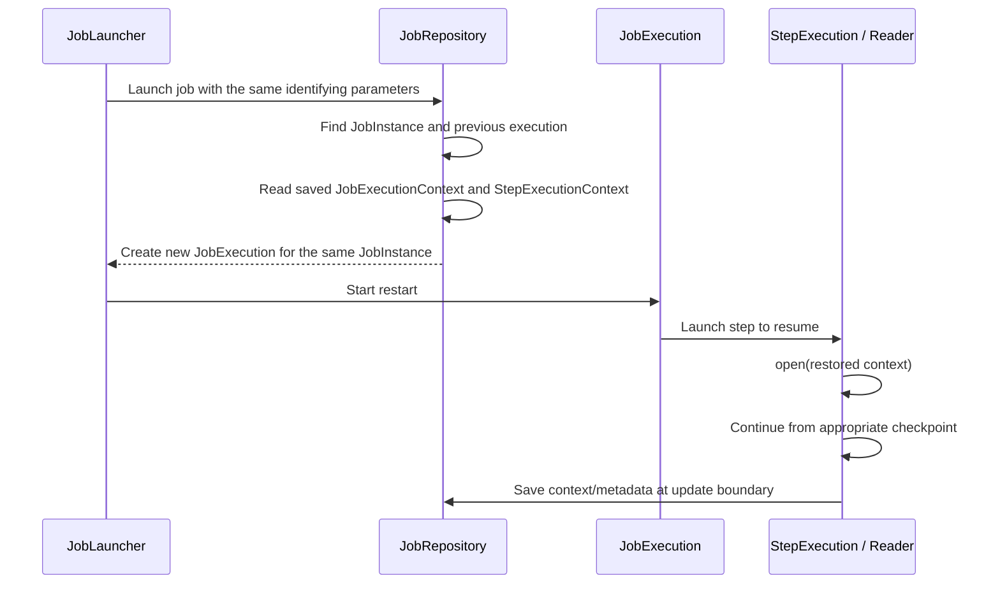

# Context When a Job Restarts

In Spring Batch, a job can run for a long time and be interrupted by application errors, database connection losses, server restarts, or manual operator stops. When relaunching a failed or stopped job, the framework needs to know how far the work progressed so it can resume from the appropriate position. `ExecutionContext` is the key state storage mechanism for that purpose.

`ExecutionContext` is a key/value data area bound to a `JobExecution` or `StepExecution`. The application and Spring Batch components can store information needed to restore progress, such as the current read position, the last data page, the batch ID being processed, or intermediate results that need to be passed between steps.

On restart, Spring Batch creates a new `JobExecution` for the same `JobInstance` and uses metadata saved from the previous execution to restore the appropriate context. Therefore, restart does not continue by preserving Java objects in memory; it relies on data durably saved in `JobRepository`.

## 1. What Is ExecutionContext?

`ExecutionContext` is a state storage structure with key names and values. It can be thought of as a map that Spring Batch manages and persists alongside execution metadata.

For example, a reader reading a CSV file can store the number of items read:

```java
ExecutionContext context = stepExecution.getExecutionContext();
context.putInt("ordersReader.currentItemCount", 1500);
```

When the step restarts, the reader retrieves this value to determine the position to continue from.

ExecutionContext is typically used for two purposes:

- **Checkpointing:** storing internal state of a step to resume after an interruption, such as the number of items read or the last key of a data page.
- **Sharing data between steps:** storing results or coordination information at the job scope so a subsequent step can use it, such as the file name of a report generated in a previous step.

Do not use the context as a place to store all business data. The context is suitable for small state needed for recovery or coordination. Large data belongs in a database, file, or dedicated storage; the context holds only IDs, paths, or checkpoints to locate that data again.

## 2. Two Scopes: JobExecutionContext and StepExecutionContext

Spring Batch has two separate `ExecutionContext`s:

- **Job ExecutionContext** is bound to a `JobExecution`, used for job-wide state and data that needs to be shared between steps.
- **Step ExecutionContext** is bound to a `StepExecution`, used for step-private state, especially checkpoints of a reader or writer.

| Scope | Obtained from | Used for | Example |
|---|---|---|---|
| Job context | `jobExecution.getExecutionContext()` | State needed across steps of a job execution | Output file path, ID of a created batch |
| Step context | `stepExecution.getExecutionContext()` | Private state of a single step | Reader position, pages processed, last key |

Each step execution has its own context. This prevents two steps from overwriting each other's checkpoints. The job context is a more appropriate place if one step needs to publish a value for the next step to use.

Do not confuse `JobParameters` with `ExecutionContext`:

| Criterion | JobParameters | ExecutionContext |
|---|---|---|
| Data source | Passed in when launching the job | Updated during execution |
| Purpose | Describes input and identifies the work | Stores state/checkpoints generated during execution |
| Mutable during job | Do not modify the execution's parameter set | Can be updated via context API |
| Example | `businessDate`, `inputFile`, `tenantId` | `lastProcessedId`, `currentItemCount`, `outputFile` |
| Effect on JobInstance | Identifying parameters identify the instance | Does not participate in identifying the instance |

If a value is an input provided by the scheduler, use `JobParameters`. If a value is generated or changes while the job runs and needs to be restored, consider `ExecutionContext`.

## 3. JobInstance and JobExecution on Restart

To understand how the context is restored, distinguish three concepts:

- `Job` is the process definition.
- `JobInstance` is a specific business work unit, identified by job name and identifying `JobParameters`.
- `JobExecution` is a specific execution attempt of that instance.

When the first run fails, Spring Batch retains metadata and execution contexts of that run. When restarting the same job with the same identifying parameters, the framework creates a new `JobExecution` belonging to the same `JobInstance`, then restores state from the previous execution per restart rules.

Example:

```text
Job: dailyOrderImportJob
Identifying parameter: businessDate=2026-11-15

JobInstance: dailyOrderImportJob / 2026-11-15
  JobExecution 101
    Step importOrdersStep
      Committed 30 chunks
      Step ExecutionContext: currentItemCount=15000
    JobExecution status: FAILED

  JobExecution 108 (restart same JobInstance)
    Restore saved context
    Reader continues from appropriate checkpoint
    JobExecution status: COMPLETED
```

The ID of the new `JobExecution` differs from the old execution. The context is restored from saved metadata, not because the framework kept the old context object in the heap.

To restart the correct instance, pass the same identifying parameters again. If you change `businessDate`, add an identifying timestamp, or alter another identifying parameter, the application may create a new `JobInstance` instead of restarting the previous job.

A `COMPLETED` instance generally cannot be run again as a restart with the same identifying parameters. If already completed business work needs to be processed again, design a reprocess run with explicit identification.

## 4. Where Is Context Stored?

In a database-backed repository configuration, Spring Batch stores job and step metadata in repository tables. Execution contexts are stored separately for job executions and step executions, usually via the tables:

- `BATCH_JOB_EXECUTION_CONTEXT` — context bound to `JobExecution`.
- `BATCH_STEP_EXECUTION_CONTEXT` — context bound to `StepExecution`.

These tables belong to the Spring Batch metadata schema. `JobRepository` and related DAOs read/write contexts during the execution lifecycle. Applications should not manually modify context rows with raw SQL, as doing so can make metadata inconsistent with step and job statuses.

Contexts are durably persisted using the serializer configured for `JobRepository`. Values put into the context must be serializable/deserializable by that mechanism. With a Java-serialization-based serializer, values must meet `Serializable` requirements; with other serializers, values must follow the types and rules supported by the serializer.

Prefer simple and stable data types such as `String`, integers, booleans, dates/timestamps per clear conventions, and small structures supported by the serializer. Avoid storing objects tied to internal classes that easily change across deployment versions.

## 5. When Does Spring Batch Update ExecutionContext?

An in-memory context does not automatically become a durable checkpoint after each `put` call. The framework saves contexts at metadata update points in the job/step lifecycle.

With a chunk-oriented step:

1. The step begins the chunk transaction.
2. The reader reads items and updates internal state in memory.
3. The processor processes items.
4. The writer writes data.
5. `ItemStream` components update state into `ExecutionContext` via `update()`.
6. Spring Batch updates `StepExecution` metadata.
7. The transaction commits.

Thus, checkpoints are typically tied to chunk commit boundaries. If the process stops before a chunk commits, the durable context usually remains at the previous chunk's checkpoint. On restart, the uncommitted chunk can be re-read and reprocessed.

With a tasklet step, context and metadata are updated during the transaction/tasklet execution lifecycle as managed by `TaskletStep`. Do not assume every context change in a Java variable has been saved immediately merely because `put` was called.

## 6. Readers Use ItemStream to Save Checkpoints

Readers that need to support restart typically implement `ItemStream` or an extended interface such as `ItemStreamReader<T>`. The main lifecycle consists of:

| Method | Role |
|---|---|
| `open(ExecutionContext)` | Opens resources and restores saved state |
| `read()` | Reads the next item |
| `update(ExecutionContext)` | Writes current state into context before the framework saves the checkpoint |
| `close()` | Releases resources |

Example of a custom reader saving the next position to read:

```java
public class OrderReader implements ItemStreamReader<Order> {

    private static final String INDEX_KEY = "orderReader.currentIndex";

    private final List<Order> orders;
    private int currentIndex;

    public OrderReader(List<Order> orders) {
        this.orders = List.copyOf(orders);
    }

    @Override
    public void open(ExecutionContext context) {
        currentIndex = context.containsKey(INDEX_KEY)
                ? context.getInt(INDEX_KEY)
                : 0;
    }

    @Override
    public Order read() {
        if (currentIndex >= orders.size()) {
            return null;
        }
        return orders.get(currentIndex++);
    }

    @Override
    public void update(ExecutionContext context) {
        context.putInt(INDEX_KEY, currentIndex);
    }

    @Override
    public void close() {
        // Close resources if the reader holds file handles or connections.
    }
}
```

In the example, `currentIndex` is the next position to read. If the reader has returned 1,000 items and the saved checkpoint is 1,000, reopening starts from index 1,000 (the 1,001st item if the list is 1-indexed).

This is a minimal example. A production custom reader needs to handle changing data sources, rollbacks, retries, stable read ordering, and resources that must be closed. If a built-in Spring Batch reader can be used, prefer an implementation that already manages checkpoints.

## 7. Restart Example with FlatFileItemReader

`FlatFileItemReader` is a built-in reader commonly used to read CSV or text files. When configured to save state, it can persist read position information to continue after restart.

Example configuration:

```java
@Bean
@StepScope
public FlatFileItemReader<OrderInput> orderReader(
        @Value("#{jobParameters['inputFile']}") String inputFile) {

    FlatFileItemReader<OrderInput> reader = new FlatFileItemReader<>();
    reader.setName("orderFileReader");
    reader.setResource(new FileSystemResource(inputFile));
    reader.setLinesToSkip(1);
    reader.setSaveState(true);
    reader.setLineMapper(orderLineMapper());
    return reader;
}
```

`saveState=true` enables the reader to save state for restart. The reader name must be stable and unique within the step so checkpoint keys do not collide. `@StepScope` creates the reader per step execution and resolves job parameters at runtime.

Suppose the file has 20,000 data lines and chunk size is 500. After 12 chunks commit, the reader may have read 6,000 items. If the job fails, the step's context stores the corresponding checkpoint. When restarting the exact instance, the reader reopens the same file and continues from the appropriate position.

An important condition: the input file must keep the same content and order between the initial run and restart. If the file is replaced, lines are prepended, or it is re-sorted, the saved offset may point to a different record. You can also store a file checksum or version in the context to confirm the exact source, or copy the file to an immutable input area for each job instance.

## 8. Step Context and Job Context Across Multiple Steps

A job can consist of multiple sequential steps. The first step produces a value that a later step needs to use. There are two options:

- Store directly in the job execution context if it is job-scoped data.
- Store in the step execution context and promote selected keys to the job context when the step completes.

`ExecutionContextPromotionListener` helps move specified keys from step context to job context. For example, a report-generation step writes `reportFile` to step context; after the step finishes successfully, the listener moves that key up to job context for the email-sending step to use.

```java
@Bean
public ExecutionContextPromotionListener promoteReportFile() {
    ExecutionContextPromotionListener listener =
            new ExecutionContextPromotionListener();
    listener.setKeys(new String[] {"reportFile"});
    listener.setStatuses(new String[] {"COMPLETED"});
    return listener;
}
```

Register the listener with the report-generation step:

```java
@Bean
public Step createReportStep(
        JobRepository jobRepository,
        PlatformTransactionManager transactionManager,
        Tasklet createReportTasklet,
        ExecutionContextPromotionListener promoteReportFile) {

    return new StepBuilder("createReportStep", jobRepository)
            .tasklet(createReportTasklet, transactionManager)
            .listener(promoteReportFile)
            .build();
}
```

The next step can read the value in the job context via late binding:

```java
@Bean
@StepScope
public Tasklet sendReportTasklet(
        @Value("#{jobExecutionContext['reportFile']}") String reportFile) {
    return (contribution, chunkContext) -> {
        // Send or process the reportFile.
        return RepeatStatus.FINISHED;
    };
}
```

The promotion listener only transfers configured keys when the status condition matches. Do not promote every value in the step context; promote only data needed by other steps into the job context.

## 9. Reading and Writing Context in a Tasklet

A tasklet can access `StepExecution` via `ChunkContext` and save state into step context:

```java
public class PrepareReportTasklet implements Tasklet {

    @Override
    public RepeatStatus execute(
            StepContribution contribution,
            ChunkContext chunkContext) {

        StepExecution stepExecution = chunkContext
                .getStepContext()
                .getStepExecution();

        ExecutionContext context = stepExecution.getExecutionContext();
        context.putString("reportFile", "reports/daily-report.csv");
        context.putLong("exportedRows", 12500L);

        return RepeatStatus.FINISHED;
    }
}
```

When the tasklet runs in a `TaskletStep`, the framework manages metadata/context updates per the step lifecycle. In a unit test calling `execute()` directly, the context is merely an in-memory object of the test; assert the set values directly or run an integration test to verify persistence via the repository.

To read job context from a tasklet:

```java
ExecutionContext jobContext = chunkContext
        .getStepContext()
        .getStepExecution()
        .getJobExecution()
        .getExecutionContext();

String reportFile = jobContext.getString("reportFile");
```

If the key does not exist yet, the getter may return a default value or throw an error depending on the overload used. For required data, check the key before using it and report a clear business error.

## 10. How Is Context Restored on Restart?

When a job execution fails or stops, `JobRepository` retains metadata of the execution, step executions, and saved execution contexts. When restarting the same `JobInstance`, Spring Batch creates a new execution and restores context from the previous execution per the repository mechanism.

General flow:



Steps already completed in the previous execution are typically not executed again when restarting the job; Spring Batch continues according to the flow and saved step statuses. Failed steps or steps being resumed need to restore the appropriate context. Details also depend on the flow, step statuses, and how restart is configured.

Do not create a new `JobExecution` with different identifying parameters and expect the framework to automatically pick up the previous execution's checkpoint. When instance identity changes, it is a new job unit and the old context is not a checkpoint of the new instance.

## 11. Checkpoints and Chunk Rollback

In a chunk-oriented step, checkpoints are usually saved along with the chunk transaction. This keeps reader state and writer data consistent when both participate in the same appropriate transaction manager/resource.

For example, a step reads 10,000 orders with chunk size 500:

| Event | State |
|---|---|
| First 10 chunks commit | 5,000 items written and checkpoint updated |
| Chunk 11 processing | Reader has read part of the next items |
| Writer fails before commit | Chunk 11 transaction rolls back |
| JVM stops | Durable checkpoint remains at the previous commit boundary |
| Restart | Reader restores from checkpoint after 5,000 items |

Uncommitted chunks can be re-read and reprocessed. This is expected behavior to avoid missing data when a transaction did not complete.

If the metadata repository and business data use the same transaction manager and appropriate transaction resource, data updates and checkpoints can commit/roll back together. If they use independent datasources or transaction managers, do not assume atomicity between the two sides. Situations can occur where business data commits while the checkpoint is not saved, leading to items being reprocessed; or the checkpoint is saved while target data did not commit if transaction design is flawed.

In cases without distributed transactions, writers should be idempotent so reprocessing does not create duplicate data. Unique business keys, upserts, outbox, or reconciliation processes can be used.

## 12. What If the Reader Does Not Save State?

Not every reader automatically supports restart. If a reader does not implement `ItemStream`, or a built-in reader has `saveState` turned off, Spring Batch has no reader checkpoint to restore position.

On restart, the reader may start over from the beginning. This can be acceptable if:

- The dataset is small and re-reading is inexpensive.
- The reader can filter out already processed data based on durable state at the source.
- The writer is idempotent and does not create duplicate side effects.
- The business accepts reprocessing data.

If resuming from the exact saved position is required, the reader must implement `ItemStream` or use a built-in reader that supports state. For custom readers, manage `open`, `update`, `close`, and save checkpoints with clear meaning.

When using wrapper or delegate readers, ensure the inner stream is registered with the step so the framework invokes its lifecycle. If the outer reader does not forward `open`, `update`, and `close` to the delegate, the delegate's checkpoint may not be saved.

## 13. Values That Should and Should Not Be Stored in Context

| Should store | Why |
|---|---|
| `lastProcessedId` or `currentItemCount` | Identifies where to resume |
| `lastPageKey` | Restores keyset pagination |
| `reportFile` | Subsequent step needs the output path |
| `batchReferenceId` | Looks up created data or resources |
| `sourceVersion` or small checksum | Confirms input source has not changed |
| Small status flags | Coordinates flow or restores business state |

Should not store:

- Entire lists of millions of items.
- Large file contents or full API payloads.
- Connections, streams, file handles, threads, or non-serializable runtime objects.
- Spring beans, services, or objects dependent on application lifecycle.
- Passwords, access tokens, or secrets unnecessary for checkpoints.
- Large domain objects whose structure changes frequently across deployments.

Instead of storing large objects, store keys or references to retrieve again from a durable system. Do not store credentials in the context; metadata can be accessed by operational tools or people with repository read access.

## 14. Naming Keys and Managing Context Schema

Keys in the context survive across restarts. Therefore, key names should be stable, namespaced, and clearly describe their meaning.

Good examples:

```java
private static final String LAST_ORDER_ID = "orderReader.lastOrderId";
private static final String SOURCE_VERSION = "orderReader.sourceVersion";
private static final String REPORT_FILE = "dailyReport.outputFile";
```

Avoid overly generic keys like `index`, `count`, `value`, because a step with multiple readers or listeners could accidentally overwrite them.

When changing the data type or meaning of a key in a new application version, consider old executions that might still be restarted. For example, a previous version stored `lastProcessedId` as a `Long`, and the new version changed it to `String`. If converters or context-reading code are no longer compatible, restart may fail.

A version key or migration logic can be used to convert old contexts:

```java
int contextVersion = context.containsKey("orderReader.contextVersion")
        ? context.getInt("orderReader.contextVersion")
        : 1;

if (contextVersion == 1) {
    // Read and convert old checkpoint structure if needed.
}

context.putInt("orderReader.contextVersion", 2);
```

The example only illustrates the versioning idea. Updating the version must happen at a safe time and only after context data has been successfully converted.

## 15. JobExecutionContext Is Not a Replacement for JobParameters

Some applications put all input values into the context, but this blurs the boundary between launch parameters and state generated during the job.

Examples:

- `businessDate` chosen by the scheduler before the job runs: should be a `JobParameter`, usually identifying if it defines the business period.
- `inputFile` supplied by the launcher: usually a `JobParameter`.
- `outputFile` created by a step while running: fits job context or step context depending on usage scope.
- `lastProcessedId` changing with reader progress: fits step context.
- `requestedBy` supplied by the operator: usually a non-identifying job parameter or audit info depending on design.

Identifying parameters identify the `JobInstance`; the context does not alter that identity. To restart the exact instance, keep identifying parameters identical even though the context can be restored from the previous run.

## 16. Safe Restart Requires Stable Data Sources and Idempotent Writers

A checkpoint is only meaningful when the saved position continues pointing to the same data. If the source changes between the first run and restart, an offset may point to a different item.

For example, a reader saves `currentItemCount=5000` for a CSV file. If another process inserts 100 lines at the top of the file before restart, position 5,001 no longer corresponds to the next item the job had not processed.

To reduce risk:

- Use immutable files per `JobInstance`, or create an input copy/snapshot.
- For database paging, use a stable and unique sort key.
- Define data scope at the time the job starts.
- Store source version/checksum if confirming the exact input on restart is needed.
- Design idempotent writers so reprocessing uncommitted chunks does not create duplicate data.
- For side effects outside the database, use idempotency keys, outbox, or reconciliation.

Restart is continuing a process based on metadata; it does not by itself guarantee exactly-once across all systems outside a transaction.

## 17. Inspecting Context with JobExplorer

In operations, `JobExplorer` can be used to read `JobInstance`, `JobExecution`, `StepExecution`, and saved contexts. This is useful when investigating a failed job or verifying a checkpoint before restart.

Example reading job context from a retrieved execution:

```java
ExecutionContext jobContext = jobExecution.getExecutionContext();
String outputFile = jobContext.getString("dailyReport.outputFile", null);
```

Example reading step context:

```java
ExecutionContext stepContext = stepExecution.getExecutionContext();
int currentItemCount = stepContext.getInt("orderReader.currentItemCount", 0);
```

The snippets above assume `jobExecution` and `stepExecution` were retrieved from the repository/explorer. When displaying context in dashboards or logs, select only necessary keys instead of dumping the entire context, because the context may contain internal info or data that should not be exposed.

`JobExplorer` is a read mechanism. Do not fetch a context, mutate the object, and expect that change to save automatically. Writing to context should occur within the execution lifecycle managed by `JobRepository` and appropriate transactions.

## 18. Common Errors When Restarting with ExecutionContext

| Situation | Possible cause | Resolution |
|---|---|---|
| Reader re-reads from the beginning | Reader does not save state or `saveState=false` | Enable state or use a reader supporting `ItemStream` |
| Reader skips or duplicates items | Source changed, unstable sort key, or wrong checkpoint | Use snapshot, unique sort key, and verify `update/open` logic |
| Restart cannot read old context | Data type or serializer changed | Maintain serialization compatibility or perform controlled context migration |
| Next step does not see key from previous step | Value stayed in step context and was not promoted | Use `ExecutionContextPromotionListener` or store in job context with right scope |
| Key gets overwritten | Generic key name or multiple readers using the same key | Use stable namespaces and reader names |
| Context holds invalid stale data | Source or schema changed after previous run | Store source version/checksum and verify before restart |
| Target data written twice | Uncommitted chunk re-run or non-transactional side effect | Design idempotent writer, unique key, or outbox |
| Job creates a new instance instead of restarting | Identifying parameters changed | Use exact job name and identifying parameters of the old instance |
| Metadata does not match business data | Repository and business datasource do not share a transaction | Design appropriate transaction coordination and idempotency |

Do not manually edit context keys in production metadata tables to force a reader to jump to a new position without reconciling committed data first. An incorrect checkpoint can lose data or create duplicate records.

## 19. Investigation Procedure Before Restarting

When a job fails, follow these steps:

1. **Identify the exact JobInstance:** verify job name and identifying parameters.
2. **Identify the last execution:** check the latest `JobExecution`, `FAILED` or `STOPPED` status, failure time, and exception.
3. **Inspect step executions:** identify the failed step, completed steps, and item counters.
4. **Read checkpoints:** check necessary keys in job context and step context.
5. **Verify the data source:** ensure files, queries, sort keys, or snapshots have not changed.
6. **Reconcile target data:** determine whether the last chunk committed or rolled back and what external side effects may have occurred.
7. **Verify recoverability:** check whether the reader has state, whether the writer is idempotent, and whether the serializer remains compatible.
8. **Fix the root cause then restart:** use exact identifying parameters and monitor the new execution.

Do not restart merely because you see an old execution in `FAILED` status. Confirm the root cause is fixed and actual data state aligns with the checkpoint.

## 20. Key Principles to Remember

- `ExecutionContext` is a key/value area storing state during execution and supporting restart.
- `JobExecutionContext` is for job-scoped state; `StepExecutionContext` is for step-private state and checkpoints.
- `JobParameters` describes input and identifying parameters identify the `JobInstance`; context stores state arising during execution.
- A new `JobExecution` is created when restarting the same instance; Spring Batch restores context from saved metadata, not by keeping objects in memory.
- For chunk steps, checkpoints are typically updated at commit boundaries via the `ItemStream.update()` lifecycle.
- Uncommitted chunks can be re-read and reprocessed after restart; previously committed chunks remain intact.
- Readers must support saving state, have a stable source, and use consistent read ordering to resume from the exact position.
- Use `ExecutionContextPromotionListener` when selected keys need to be moved from step context to job context for a later step.
- Store only small, serializable data needed for recovery; avoid storing large payloads, runtime resources, or secrets.
- Keep key names, data types, and serializers compatible across deployments if old executions might still restart.
- Context metadata and business data need appropriate transactions; if they cannot be atomic, writers must be idempotent with reconciliation mechanisms.
- Use `JobExplorer` to read context during investigation; avoid editing metadata directly in the production database.

`ExecutionContext` helps Spring Batch remember necessary state across executions. When the right data is placed in the right context scope, readers save stable checkpoints, input sources do not change, and writers can safely run again, jobs can restart after failures and continue work in a controlled manner.
