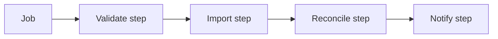
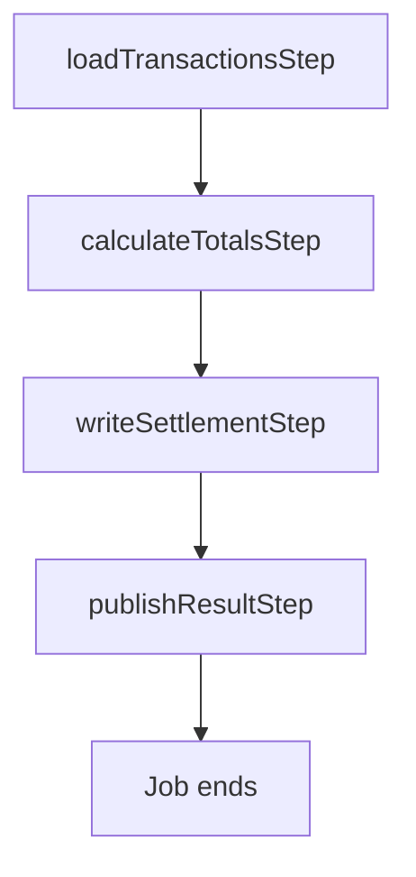
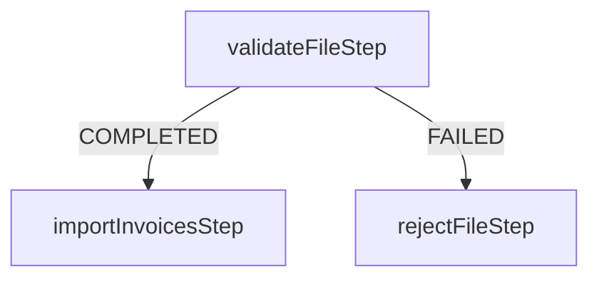
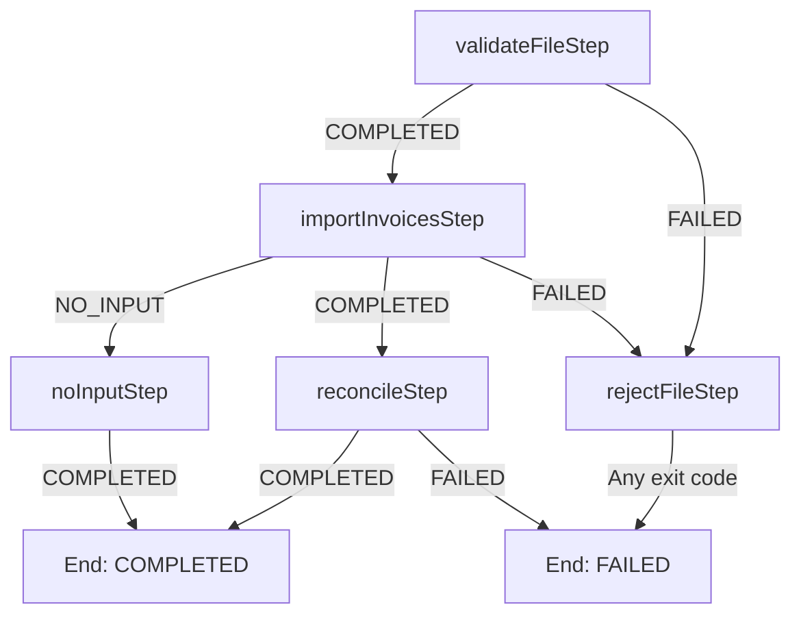

# Start, next, and end

In Spring Batch, a job typically consists of multiple steps running in a defined workflow. The builder API provides methods such as **start(...)**, **next(...)**, and **end()** to describe the starting point, the next step, and the ending point of a flow.

These three methods appear in two common declaration styles:

- **Linear job**: use `start(step)` and then chain steps with `next(step)`.
- **Conditional flow**: use `start(step)`, transitions `on(...).to(...)`, `from(...)`, and then `end()` to finish the flow/job definition.

Understanding the exact role of each method helps avoid confusion between step execution order, branching conditions, and the job's final status. In particular, `end()` at the end of the builder and the transition `.on("...").end()` have different meanings even though they share the same method name.

## 1. Job and Step in a flow

A Job is a high-level batch process. A Step is an execution phase inside a job. For example, an invoice import job might consist of:

1. Validating the input file.
2. Reading and importing invoices.
3. Reconciling record counts and total amounts.
4. Recording the result or sending a notification.

A flow determines which step runs first, which step runs next, and what the job will do when a step returns different outcomes.



In a simple job, steps run sequentially. When outcome-based handling is needed, the flow can branch—for example, importing when the file is valid and routing to an error branch when the file is invalid.

## 2. start(): choosing the starting point

`start(...)` declares the first state of a job or flow. In the basic example, the argument passed in is a Step bean:

```java
@Bean
Job invoiceImportJob(
        JobRepository jobRepository,
        Step validateFileStep,
        Step importInvoicesStep,
        Step reconcileStep) {

    return new JobBuilder("invoiceImportJob", jobRepository)
            .start(validateFileStep)
            .next(importInvoicesStep)
            .next(reconcileStep)
            .build();
}
```

Here:

- `invoiceImportJob` is the job name.
- `validateFileStep` is the first step.
- `importInvoicesStep` runs after validation.
- `reconcileStep` runs after import.
- `build()` finishes the builder and creates the Job.

A job has one starting point. If the workflow needs multiple entry branches, start with a check step or a flow/decider and then route to the corresponding branch.

### Starting with a Flow

In addition to a Step, the builder API also supports starting from a defined Flow. This is useful when you want to reuse a group of steps as a single logical block:

```java
@Bean
Flow validationFlow(
        Step checkFileStep,
        Step checkBusinessDateStep) {

    return new FlowBuilder<SimpleFlow>("validationFlow")
            .start(checkFileStep)
            .next(checkBusinessDateStep)
            .build();
}

@Bean
Job invoiceImportJob(
        JobRepository jobRepository,
        Flow validationFlow,
        Step importInvoicesStep) {

    return new JobBuilder("invoiceImportJob", jobRepository)
            .start(validationFlow)
            .next(importInvoicesStep)
            .build();
}
```

In this example, the job starts with the validation flow containing two steps, and only then runs the import step. Extracting a flow helps group a meaningful set of steps and reuse it across multiple jobs if needed.

## 3. next(): chaining the next step

In a linear job, `next(step)` declares the step that will run after the current step:

```java
return new JobBuilder("dailySettlementJob", jobRepository)
        .start(loadTransactionsStep)
        .next(calculateTotalsStep)
        .next(writeSettlementStep)
        .next(publishResultStep)
        .build();
```

The execution order is:



`next(...)` in a linear declaration means chaining the next step in the workflow. It is not a statement that invokes the step at configuration time; Spring Batch stores the flow definition and executes it when the job is launched.

### If a step fails, does next run?

In a standard linear job, if a step finishes in a failed state, the job stops with that status and subsequent steps do not run automatically. `next(...)` does not mean "run the next step regardless of whether the previous step succeeded or failed".

If you need an error-handling branch, define a conditional transition with `on(...).to(...)`. For example, an import failure can route to a step that logs the error or quarantines the batch.

### next() does not replace branching conditions

If the workflow needs to make decisions based on `ExitStatus`, record counts, or validation results, use flow transitions or a `JobExecutionDecider`. Do not try to encode every scenario into a long `next(...)` chain and hide business conditions inside a writer.

## 4. build() and end(): finishing the builder

In a simple linear job, you can call `build()` right after the `start(...).next(...)` chain:

```java
Job job = new JobBuilder("simpleJob", jobRepository)
        .start(step1)
        .next(step2)
        .build();
```

When declaring a conditional flow, you typically need to call `end()` to finish the flow configuration before `build()` creates the job:

```java
Job job = new JobBuilder("conditionalJob", jobRepository)
        .start(validateStep)
            .on("COMPLETED").to(importStep)
        .from(validateStep)
            .on("FAILED").to(rejectStep)
        .end()
        .build();
```

Here, `end()` at the end of the builder chain closes the flow definition and returns the job-level builder so `build()` can be called. It is neither a new business step nor an implicit error-handling branch.

There is no need to mechanically add `end()` to every linear job. Use the builder form required by the API of the Spring Batch version you are using; with `SimpleJobBuilder`, `build()` is typically the direct finishing call.

## 5. Flow transition: on() and to()

When a step can finish with multiple outcomes, the flow can select the next step based on `ExitStatus`.

Basic pattern:

```java
return new JobBuilder("invoiceImportJob", jobRepository)
        .start(validateFileStep)
            .on("COMPLETED").to(importInvoicesStep)
        .from(validateFileStep)
            .on("FAILED").to(rejectFileStep)
        .end()
        .build();
```

The components are:

- `start(validateFileStep)`: selects the first step.
- `on("COMPLETED")`: selects the transition when the step's exit code matches the `COMPLETED` pattern.
- `to(importInvoicesStep)`: transitions to the target step.
- `from(validateFileStep)`: declares an additional transition originating from an existing step.
- `on("FAILED").to(rejectFileStep)`: if validation fails, routes to the reject branch.
- `end().build()`: finishes the flow and builds the job.

Diagram:



Flow transitions are an explicit way to describe outcome-based behavior. Branches should be designed completely so that no ending state is left unhandled.

## 6. on() matches ExitStatus, not directly BatchStatus

This is an important point when writing flows.

Spring Batch has two concepts:

- `BatchStatus`: the technical lifecycle status such as `STARTED`, `COMPLETED`, `FAILED`, or `STOPPED`.
- `ExitStatus`: the exit code of a step/job, used in flow transitions and customizable.

In the transition `.on("...")`, the pattern is matched against the exit code of `ExitStatus`. In many cases, the default exit code has the same name as `BatchStatus`, making it easy to think `on()` checks `BatchStatus`. However, once an application sets custom exit codes, the difference becomes clear.

Example of a listener setting an exit status:

```java
public class InputCheckListener implements StepExecutionListener {

    @Override
    public ExitStatus afterStep(StepExecution stepExecution) {
        if (stepExecution.getReadCount() == 0) {
            return new ExitStatus("NO_INPUT");
        }
        return null;
    }
}
```

The flow can route based on that code:

```java
return new JobBuilder("invoiceImportJob", jobRepository)
        .start(importStep)
            .on("NO_INPUT").to(noInputStep)
        .from(importStep)
            .on("COMPLETED").to(reconcileStep)
        .from(importStep)
            .on("FAILED").fail()
        .end()
        .build();
```

If the reader has no items, the listener can set the exit code `NO_INPUT`, and the flow transitions to `noInputStep`. If the import step completes with code `COMPLETED`, the flow moves to reconciliation. If the step fails, the flow ends via the fail branch.

The example above assumes `readCount` is the right business criterion. If the processor filters out all items, `readCount` is still greater than 0; in that case `NO_INPUT` is not emitted. Choose the condition that matches the distinction you actually need.

## 7. Wildcards in on()

Flow transitions support pattern matching against exit codes, commonly using:

| Pattern | Meaning |
|---|---|
| COMPLETED | Matches the exact exit code `COMPLETED` |
| FAILED | Matches the exact exit code `FAILED` |
| NO_INPUT | Matches the custom exit code `NO_INPUT` |
| * | Matches any exit code |
| COMPLETED* | Matches exit codes starting with `COMPLETED`, such as `COMPLETED_WITH_WARNINGS` |

Example:

```java
return new JobBuilder("dailyImportJob", jobRepository)
        .start(importStep)
            .on("COMPLETED_WITH_WARNINGS").to(warningReportStep)
        .from(importStep)
            .on("COMPLETED").to(reconcileStep)
        .from(importStep)
            .on("FAILED").to(failureReportStep)
        .end()
        .build();
```

If the application has multiple custom exit codes, declare specific patterns first and add the `*` wildcard as a fallback branch when appropriate. Do not use an overly broad wildcard if it could route a serious failure onto a success branch.

A flow should have a transition for every outcome a step can produce. If an exit code has no matching transition, the flow may fail to find a next state and the job may terminate with a flow configuration error.

## 8. What does end() mean inside a transition?

Beyond `end()` used to close the builder, the flow DSL also provides a terminal transition:

```java
return new JobBuilder("reportJob", jobRepository)
        .start(generateReportStep)
            .on("COMPLETED").end()
        .from(generateReportStep)
            .on("FAILED").fail()
        .end()
        .build();
```

There are two places named `end()` in this snippet:

1. `.on("COMPLETED").end()` is a terminal transition: when the step returns exit code `COMPLETED`, the flow finishes along the completion branch.
2. `.end().build()` at the bottom closes the flow/job builder definition.

The terminal transition `end()` indicates that the flow terminates successfully as a job flow. It is not the same as calling `build()`, nor does it execute an additional step.

### Why distinguish them?

Suppose a step has `BatchStatus.COMPLETED` but a custom `ExitStatus` of `NO_INPUT`. If the flow defines `.on("NO_INPUT").end()`, the job can finish with a completed status even without data. This is a valid choice when business rules accept zero input.

Conversely, if zero input is an error, do not route that branch to terminal `end()`. Use `.fail()` or transition to an appropriate error-handling step.

## 9. Distinguishing end(), fail(), and stopAndRestart()

The flow DSL provides terminal transitions with different semantics:

| Transition | Flow meaning | Job status typically received |
|---|---|---|
| end() | Ends the flow as a completed outcome | COMPLETED |
| fail() | Ends the flow with a failed outcome | FAILED |
| stopAndRestart(step) | Stops the job and specifies a restart point | STOPPED |

Example:

```java
return new JobBuilder("conditionalJob", jobRepository)
        .start(validateStep)
            .on("COMPLETED").to(importStep)
        .from(validateStep)
            .on("INVALID_INPUT").fail()
        .from(importStep)
            .on("COMPLETED").end()
        .from(importStep)
            .on("WAITING_FOR_APPROVAL").stopAndRestart(approvalStep)
        .from(importStep)
            .on("FAILED").fail()
        .end()
        .build();
```

In this example:

- If validation succeeds, proceed to import.
- If input is invalid, the job fails.
- When import completes, the job ends successfully.
- If approval is needed, the job stops and can restart at the specified step.
- Import failures end via the fail branch.

`stopAndRestart` is not a way to keep a thread sleeping or automatically wait for a condition. It ends the execution in a stopped state; an external actor must decide when to restart the job.

## 10. Complete example: validate, import, and error handling

A file import job can define its flow as follows:

```java
@Bean
Job invoiceImportJob(
        JobRepository jobRepository,
        Step validateFileStep,
        Step importInvoicesStep,
        Step reconcileStep,
        Step rejectFileStep,
        Step noInputStep) {

    return new JobBuilder("invoiceImportJob", jobRepository)
            .start(validateFileStep)
                .on("COMPLETED").to(importInvoicesStep)
            .from(validateFileStep)
                .on("FAILED").to(rejectFileStep)
            .from(importInvoicesStep)
                .on("NO_INPUT").to(noInputStep)
            .from(importInvoicesStep)
                .on("COMPLETED").to(reconcileStep)
            .from(importInvoicesStep)
                .on("FAILED").to(rejectFileStep)
            .from(reconcileStep)
                .on("COMPLETED").end()
            .from(reconcileStep)
                .on("FAILED").fail()
            .from(rejectFileStep)
                .on("*").fail()
            .from(noInputStep)
                .on("COMPLETED").end()
            .end()
            .build();
}
```

Flow:



The example demonstrates three different types of outcomes:

- Valid input with data: import, reconcile, finish.
- Valid input with no data: go through `noInputStep`, then finish successfully per policy.
- Invalid input or import/reconcile failure: go through the error-handling branch and end as failed.

For the flow to work properly, steps and listeners must emit the right exit codes. The pattern names in `on(...)` must match the actual `ExitStatus`.

## 11. Flow with JobExecutionDecider

Not every condition fits cleanly into a step's exit status. If a decision depends on runtime data, a `JobExecutionDecider` can produce a `FlowExecutionStatus` to pick a branch.

For example, after the import step, decide whether reconciliation needs to run:

```java
public class ImportResultDecider implements JobExecutionDecider {

    @Override
    public FlowExecutionStatus decide(
            JobExecution jobExecution,
            StepExecution stepExecution) {

        if (stepExecution == null) {
            return new FlowExecutionStatus("UNKNOWN");
        }

        return stepExecution.getWriteCount() == 0
                ? new FlowExecutionStatus("NO_WRITES")
                : new FlowExecutionStatus("HAS_WRITES");
    }
}
```

The flow can use the decider:

```java
return new JobBuilder("invoiceImportJob", jobRepository)
        .start(importStep)
        .next(importResultDecider)
            .on("HAS_WRITES").to(reconcileStep)
        .from(importResultDecider)
            .on("NO_WRITES").to(noOutputStep)
        .from(importResultDecider)
            .on("UNKNOWN").fail()
        .end()
        .build();
```

The decider returns a `FlowExecutionStatus`, and the patterns after the decider match that status. Do not confuse it with a step's `ExitStatus`. Choose decision data that matches the business semantics: a write count of 0 could be caused by empty input, everything being filtered out, or everything being skipped, so if you need to distinguish those cases you must inspect additional counters.

## 12. Custom ExitStatus and routing rules

A step can finish technically yet require a distinct business outcome code:

```java
public class ReconciliationListener implements StepExecutionListener {

    @Override
    public ExitStatus afterStep(StepExecution stepExecution) {
        long read = stepExecution.getReadCount();
        long written = stepExecution.getWriteCount();

        if (read != written) {
            return new ExitStatus("COMPLETED_WITH_DIFFERENCE");
        }
        return ExitStatus.COMPLETED;
    }
}
```

The flow can define:

```java
return new JobBuilder("settlementJob", jobRepository)
        .start(reconcileStep)
            .on("COMPLETED").to(publishStep)
        .from(reconcileStep)
            .on("COMPLETED_WITH_DIFFERENCE").to(manualReviewStep)
        .from(reconcileStep)
            .on("FAILED").fail()
        .end()
        .build();
```

Ensure custom exit codes have consistent meaning, are logged, and are understood by dashboards. Do not use a single exit code for multiple distinct situations if those situations require different operational actions.

## 13. Transition order and precedence

A flow can have multiple transitions from the same step. Specific patterns should be declared explicitly, and wildcards are typically used as fallback branches.

Example:

```java
return new JobBuilder("job", jobRepository)
        .start(step1)
            .on("COMPLETED_WITH_WARNINGS").to(warningStep)
        .from(step1)
            .on("COMPLETED").to(successStep)
        .from(step1)
            .on("*").to(errorStep)
        .end()
        .build();
```

Read the flow like a decision table: for each exit code that might be emitted, which transition will be chosen? Avoid confusing overlapping patterns and avoid success wildcards that might swallow errors.

If you add a new custom exit code to a listener, review existing transitions. A small change in an exit code can send the flow down a different branch.

## 14. Restart and the meaning of endpoints

A flow not only determines the execution order on the first run; it also affects how Spring Batch recovers a job after a failed or stopped execution.

- A step that already completed in an execution typically does not re-run when restarting the same `JobInstance` under standard flow restart.
- A failed or not-yet-run step can be executed on restart, depending on configuration and state.
- A flow ending with `end()` marks the job completed; the same identifying parameters usually cannot be re-launched as a new completed job instance.
- A flow ending with `fail()` marks the job failed; the instance may be eligible for restart if other conditions allow.
- `stopAndRestart(...)` ends the execution in a stopped state and records the restart point per the flow definition.

If a job finishes `COMPLETED` but later needs to reprocess data, define a reprocess with new identifying parameters/version and an idempotent writer. Do not tamper with metadata or add random timestamps just to bypass the completed state.

## 15. Common mistakes with start, next, and end

**Using next() when branching is needed.** `next()` creates a linear chain. Use `on(...).to(...)` when a step's outcome determines the path.

**Thinking next() runs even after a step fails.** Linear jobs normally stop when a step fails. To handle errors, declare the corresponding transition.

**Confusing on() with BatchStatus.** Transitions match the exit code of `ExitStatus`; custom exit codes need matching patterns.

**Failing to declare a branch for a custom exit code.** When a listener returns `NO_INPUT` but the flow only has `COMPLETED` and `FAILED`, the flow may lack a matching transition. Add an explicit branch.

**Using a wildcard to route all errors to success.** `on("*").end()` can cause unexpected outcomes to be treated as a completed flow. Use this only when business policy genuinely permits it.

**Confusing terminal end() with builder end().** `.on("COMPLETED").end()` is a transition that terminates the flow; `.end().build()` at the bottom closes the flow definition and builds the job.

**Using fail() when only a warning should be recorded.** `fail()` terminates the flow with a failed status. If the outcome is completion with warnings, use a custom exit code and an appropriate branch.

**Forgetting the restart point on stop.** If using `stopAndRestart`, choose a clear restart step and design conditions so an external actor restarts at the right time.

## 16. How to read a flow when debugging

When a job takes the wrong branch, trace these steps:

1. Identify the relevant `JobExecution` and `StepExecution`.
2. Inspect `BatchStatus` and `ExitStatus` of the step right before the branch point.
3. Identify which listener or decider produced the exit code/status.
4. Compare the actual value with the patterns in `on(...)`.
5. Check whether the `from(...)` transition points to the right step or decider.
6. Check whether the terminal transition is `end()`, `fail()`, or `stopAndRestart(...)`.
7. Inspect the final job status and which steps did or did not run.

For example, if `importStep` has `BatchStatus.COMPLETED` but `ExitStatus=NO_INPUT`, the transition `on("COMPLETED")` will not match `NO_INPUT`. This is often why a flow does not enter the branch the author expected.

## 17. Testing flows

Job tests should verify both the final status and which steps actually ran:

| Scenario | Expected result |
|---|---|
| Validate returns COMPLETED | Import step is executed |
| Validate returns FAILED | Reject/fail branch is executed per flow |
| Import returns NO_INPUT | No-input branch is selected |
| Import returns COMPLETED | Reconcile step is executed |
| Reconcile returns FAILED | Job finishes as failed |
| Step returns custom exit code without transition | Test detects missing branch in flow |
| Flow calls terminal end() | Job finishes as completed |
| Flow calls terminal fail() | Job finishes as failed |
| Flow calls stopAndRestart(step) | Job stops and has the configured restart point |

You can use `JobLauncherTestUtils` along with Spring Batch test support to launch the job and inspect the execution/step executions. When testing conditional flows, configure listeners/deciders to produce each exit code and verify that downstream steps run or are skipped as designed.

## 18. Process for designing a flow before writing the builder

Before writing `start`, `next`, and `end`, build a table of steps and outcomes:

| Step | Exit code | Next step or terminal |
|---|---|---|
| validateFileStep | COMPLETED | importInvoicesStep |
| validateFileStep | FAILED | rejectFileStep |
| importInvoicesStep | NO_INPUT | noInputStep |
| importInvoicesStep | COMPLETED | reconcileStep |
| importInvoicesStep | FAILED | rejectFileStep |
| reconcileStep | COMPLETED | end |
| reconcileStep | FAILED | fail |

Only then translate this table into the DSL. Doing so helps reveal missing exit codes, branches without endpoints, and steps that might run unintentionally.

For workflows with a single path, use `start(...).next(...).next(...)`. When there are conditions, use `on(...).to(...)` and `from(...)`. Use a decider only when the condition cannot be expressed cleanly via a step's exit status.

## 19. Practical conclusion

`start()` selects the entry point of the job/flow. `next()` chains the next step in a linear workflow. For conditional flows, `on(...).to(...)` and `from(...)` describe paths based on exit codes; `end()`, `fail()`, and `stopAndRestart(...)` define how a branch ends.

Distinguish terminal transition `end()` from the `end()` used to finish the flow builder before `build()`. Also remember that transitions match `ExitStatus`, rather than simply checking `BatchStatus`. When steps emit custom exit codes, the flow must provide corresponding branches.

A good flow makes every possible outcome explicit: which step runs next, where errors are handled, when the job is considered complete, when it fails, and where to restart if stopped. Once these rules are clearly defined, the builder code becomes a direct expression of the business workflow.
