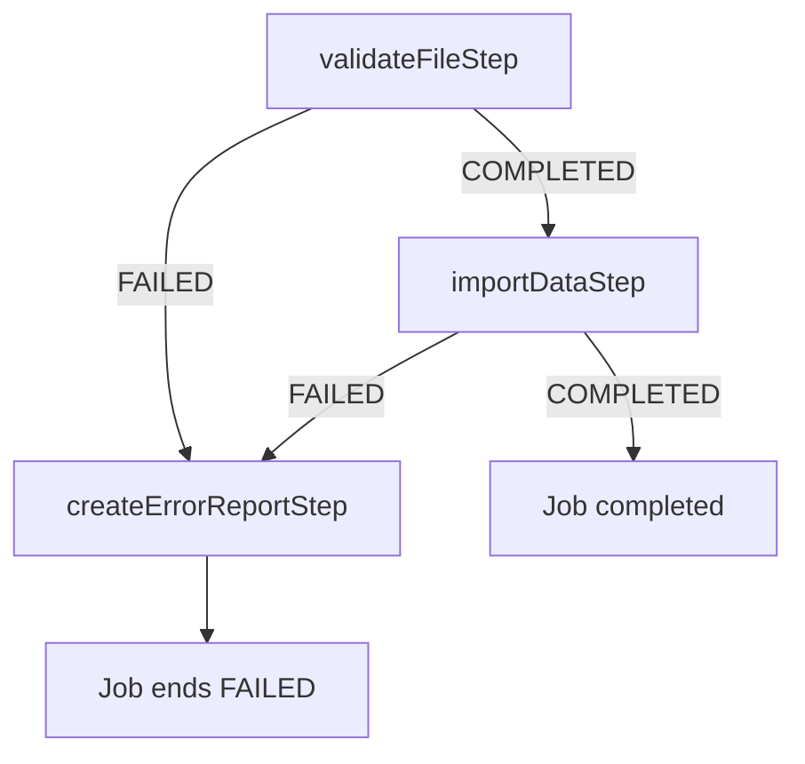

# Failure-conditional flows

In Spring Batch, a job usually consists of multiple steps, and the outcome of a preceding step can determine which step needs to run next. For example, after validating an input file, the job may continue importing data if valid, transition to a step that generates an error report if the data is invalid, or stop the job if a critical error occurs.

To model those branches, Spring Batch provides **conditional flows**. A flow relies on a step's execution outcome or a business decision to select the next transition. When handling failure branches, you must distinguish `BatchStatus`, `ExitStatus`, and the job's final status. A step can fail while the flow still runs an error-handling step; the job itself may ultimately be marked `FAILED`, `COMPLETED`, or `STOPPED` depending on the configured transition.

## 1. What is a conditional flow?

A flow describes the order of steps and how control moves from one step to another. In a linear flow, the next step normally runs after the previous step completes. In a conditional flow, transitions depend on step outcomes.

Example data import job:

1. `validateFileStep` checks the input file.
2. If the step returns a success outcome, the job runs `importDataStep`.
3. If the step fails, the job runs `createErrorReportStep` to record the cause.
4. After the error-handling step, the job finishes with a failed status so the scheduler or monitoring system knows the business task did not succeed.

Overview diagram:



Conditional flows express business branches clearly in job configuration instead of invoking the next step manually from inside a step's code.

## 2. BatchStatus and ExitStatus are different

These are the two most important concepts when configuring transitions.

- **`BatchStatus`** describes the lifecycle status of a `JobExecution` or `StepExecution`, such as `STARTED`, `COMPLETED`, `FAILED`, `STOPPED`.
- **`ExitStatus`** describes the outcome code of a step or job, consisting of an exit code and a description. The flow uses the exit code to choose transitions.

| Concept | Question answered | Examples |
|---|---|---|
| `BatchStatus` | What state is the execution in? | `COMPLETED`, `FAILED`, `STOPPED` |
| `ExitStatus` | With what outcome code did the step/job finish? | `COMPLETED`, `FAILED`, `NO_DATA`, `COMPLETED_WITH_WARNINGS` |
| `FlowExecutionStatus` | Along which status does the flow or decider want to route? | `COMPLETED`, `FAILED`, `VALID`, `INVALID` |

Normally, the default exit code reflects the execution result—for example, a successful step has `ExitStatus.COMPLETED`, and a failed step has `ExitStatus.FAILED`. However, an application can supply custom exit codes to express more detailed business outcomes.

Point to remember: `.on("FAILED")` matches the step's exit code, not a direct comparison statement against `BatchStatus` in Java. By default, the two values often correspond, but they should not be treated as the same data type.

## 3. Declaring transitions with on(), to(), and from()

With Java configuration, `JobBuilder` supports building flows using these methods:

- `start(step)`: specifies the starting step.
- `on(pattern)`: selects a transition based on an exit code pattern.
- `to(step)`: moves to the next step.
- `from(step)`: declares another transition originating from an existing step.
- `end()`: ends the job with a completed status along the transition.
- `fail()`: ends the job with a failed status.
- `stopAndRestart(step)`: stops the job and specifies the step to use on restart.

Example of a step with two branches:

```java
@Bean
public Job importJob(
        JobRepository jobRepository,
        Step validateFileStep,
        Step importDataStep,
        Step createErrorReportStep) {

    return new JobBuilder("importJob", jobRepository)
            .start(validateFileStep)
                .on("FAILED").to(createErrorReportStep)
            .from(validateFileStep)
                .on("*").to(importDataStep)
            .from(importDataStep)
                .on("FAILED").to(createErrorReportStep)
            .from(importDataStep)
                .on("*").end()
            .from(createErrorReportStep)
                .on("*").fail()
            .end()
            .build();
}
```

The flow above means:

- If validation fails, run `createErrorReportStep`.
- If validation has an exit code other than `FAILED`, continue importing data.
- If import fails, run the error-report step.
- If import succeeds, end the job.
- After generating the error report, end the job with a failed status.

In this example, `on("*")` acts as a fallback branch for all remaining exit codes. When defining real flows, use clear patterns and avoid overlapping transitions that make it hard to tell which branch will be chosen.

## 4. on("FAILED") does not mean catching an exception directly

The transition `.on("FAILED")` does not accept an exception object and does not match an exception class name. It checks the step's exit code after the step finishes.

For example, if a writer throws `DataAccessException` and the exception is not successfully retried or skipped, the step usually finishes with `BatchStatus.FAILED` and the default exit code `FAILED`. The flow can route from that step to `createErrorReportStep`.

If the exception is successfully retried or skipped according to allowed policy, the step can finish successfully. In that case, the `FAILED` transition is not selected merely because an exception occurred during processing.

Therefore, distinguish:

- **Exception thrown:** an operation encountered an error during execution.
- **Step failed:** the error was not handled successfully and the step ended in a failed state.
- **Failure transition:** the flow receives the corresponding exit code, usually `FAILED`, and routes to the configured branch.

## 5. Why handle failure branches?

A production job often needs to do several things after a step fails:

- Write an error report or list of invalid records.
- Record input source details and the location where the error occurred.
- Send notifications to monitoring systems or operators.
- Clean up temporary resources or close open batch states.
- Run a compensation step if business rules require it.
- End the job with the right status so the scheduler decides whether to retry or alert.

If you simply let the job stop immediately when a step fails, these post-processing steps may not execute. Conditional flows let you design an explicit error-handling branch.

However, not everything belongs in an error step. Cleanup tasks that must run regardless of success or failure can be modeled via appropriate flow transitions or listeners. Large business tasks with their own retries or audit needs should be separate steps so they have independent status and metadata.

## 6. Distinguishing end(), fail(), and stopAndRestart()

These three terminal transitions have different meanings and affect the job's final status.

| Transition | Meaning | Typical job status |
|---|---|---|
| `.end()` | Ends the flow as a completed job | `COMPLETED` |
| `.fail()` | Ends the flow with a failed outcome | `FAILED` |
| `.stopAndRestart(step)` | Stops the job and identifies the step to use on restart | `STOPPED` |

### end()

`.end()` finishes the job with a completed status. It is normally used after a success branch or a business branch that the application intentionally considers normal completion.

Point for caution: if an earlier step failed yet the flow is configured to route to an error step and the final transition calls `.end()`, the job can be marked `COMPLETED`. That can mislead schedulers or dashboards if the underlying business process actually failed.

### fail()

`.fail()` finishes the job with a failed status. It fits when the flow has performed post-processing steps yet the business outcome remains unsuccessful.

For example, validation fails, the job successfully generates an error report, and the transition from the error-report step calls `.fail()`. The error report is generated, while the job still finishes `FAILED`, letting the orchestration system know intervention is required.

### stopAndRestart(step)

`.stopAndRestart(step)` ends the job in a stopped state and records the specified step as the flow restart point. This mechanism fits workflows that must wait for an external condition or require operator confirmation before continuing.

`STOPPED` differs from `FAILED`: the job was stopped intentionally and can be restarted per configuration; `FAILED` means the job ended due to an error. Do not use stop as a substitute for modeling business failures.

## 7. A step can fail yet the job can keep running

Conditional flows allow a job to continue after a step fails, provided there is a transition from that exit code to another state.

Example:

```java
return new JobBuilder("settlementJob", jobRepository)
        .start(calculateStep)
            .on("FAILED").to(reconcileFailureStep)
        .from(calculateStep)
            .on("*").to(publishStep)
        .from(reconcileFailureStep)
            .on("*").fail()
        .from(publishStep)
            .on("*").end()
        .end()
        .build();
```

If `calculateStep` fails, `reconcileFailureStep` can still run to record discrepancies or clean up data. Afterward the job finishes `FAILED`. The calculate step's status still reflects failure; continuing the flow does not turn that step into a success.

If the error step also fails, the `.on("*").fail()` branch still terminates the job in a failed state. In real-world applications, you may want a separate branch for errors inside the error step itself, while ensuring the final outcome still reflects the true business status.

## 8. Creating custom ExitStatus codes for fine-grained branching

Sometimes `COMPLETED` and `FAILED` are not enough to represent an outcome. For example, a file validation step may finish technically while finding some rejected rows. The application wants to route to a warning-report step rather than proceeding straight to data import.

You can return a custom exit code from `StepExecutionListener.afterStep`:

```java
public class ValidationExitStatusListener implements StepExecutionListener {

    @Override
    public ExitStatus afterStep(StepExecution stepExecution) {
        if (stepExecution.getStatus() == BatchStatus.COMPLETED
                && stepExecution.getSkipCount() > 0) {
            return new ExitStatus("COMPLETED_WITH_WARNINGS");
        }
        return null;
    }
}
```

Then the flow can use this exit code:

```java
return new JobBuilder("validationJob", jobRepository)
        .start(validateStep)
            .on("COMPLETED_WITH_WARNINGS").to(warningReportStep)
        .from(validateStep)
            .on("COMPLETED").to(importStep)
        .from(validateStep)
            .on("FAILED").to(errorReportStep)
        .end()
        .build();
```

This snippet illustrates creating and using a custom outcome code. Check how `ExitStatus` is combined in your project's framework version and ensure the listener does not inadvertently mask a real error state. If the step is already `FAILED`, do not return a success code just to keep the flow moving.

Custom `ExitStatus` codes fit business outcomes such as `NO_DATA`, `COMPLETED_WITH_WARNINGS`, `INVALID_INPUT`, or `PARTIAL_SUCCESS`. Name them consistently and avoid arbitrary strings that are hard to trace.

## 9. Using JobExecutionDecider for complex conditions

When a decision depends not only on a step's exit code but also on runtime data, you can use `JobExecutionDecider`.

For example, after an aggregation step, the job needs to inspect the error record count, discrepancy threshold, or a flag stored in execution context to decide whether to continue or run a warning branch.

Decider interface:

```java
public interface JobExecutionDecider {
    FlowExecutionStatus decide(
            JobExecution jobExecution,
            StepExecution stepExecution);
}
```

Example implementation:

```java
@Component
public class ImportResultDecider implements JobExecutionDecider {

    @Override
    public FlowExecutionStatus decide(
            JobExecution jobExecution,
            StepExecution stepExecution) {

        if (stepExecution != null && stepExecution.getSkipCount() > 0) {
            return new FlowExecutionStatus("WITH_ERRORS");
        }

        return new FlowExecutionStatus("CLEAN");
    }
}
```

Registering the decider in the flow:

```java
return new JobBuilder("importJob", jobRepository)
        .start(importStep)
        .next(importResultDecider)
            .on("WITH_ERRORS").to(errorReportStep)
        .from(importResultDecider)
            .on("CLEAN").to(summaryStep)
        .from(errorReportStep)
            .on("*").fail()
        .from(summaryStep)
            .on("*").end()
        .end()
        .build();
```

A decider returns `FlowExecutionStatus`, not `BatchStatus` or `ExitStatus`. The string returned by the decider is matched against patterns in `.on(...)`.

If a decider follows a failing step, configure a transition from the failing step to the decider. Otherwise, the flow may end on a default branch or fail to find a matching transition before the decider is ever called.

## 10. Distinguishing technical failures from business outcomes

A step can fail because of a technical error or because of a business condition. Handling should differ accordingly.

| Situation | Example | Common modeling approach |
|---|---|---|
| Unrecoverable technical error | Lost database connection, configuration error | Step ends `FAILED`; flow can run cleanup/notification then `.fail()` |
| Input data error | Malformed file or missing required fields | Retry/skip if permitted; otherwise route to error-report step |
| Completed with warnings | Some records skipped while the rest processed | Custom `ExitStatus` or decider to run warning report |
| No data | Reader has no items | Exit code such as `NO_DATA` or decider choosing the matching branch |
| Needs external action | Waiting for approval or supplemental file | Can end `STOPPED` and restart at a defined step |

Do not turn every failure into `COMPLETED_WITH_WARNINGS`. If data was not written or a mandatory step failed to complete, the job must retain a failed status so operations are not misled.

## 11. Wildcards and transition ordering

The `.on(...)` method accepts a pattern used to match exit codes. Common patterns:

- `COMPLETED`: matches only exit code `COMPLETED`.
- `FAILED`: matches only exit code `FAILED`.
- `NO_DATA`: matches that custom outcome code.
- `*`: fallback branch for any exit code.

Example:

```java
.start(validateStep)
    .on("FAILED").to(errorStep)
.from(validateStep)
    .on("*").to(importStep)
```

Here, `FAILED` is the explicit error-handling branch; `*` is the fallback for remaining outcomes.

When defining multiple patterns, avoid creating confusing overlapping branches. Use exact exit codes for critical cases and wildcards as fallback branches. If you have complex patterns or multiple transitions from the same state, verify the matching rules of the Spring Batch version in use and write integration tests for each exit code.

If a state lacks a transition matching the actual exit code, the flow may fail to determine the next step and the job will fail during orchestration. Therefore, cover all outcomes that can occur, including custom codes emitted by listeners or deciders.

## 12. Exceptions, retry, and skip before the flow chooses a branch

Conditional flows act after a step has produced an outcome. While the step runs, fault-tolerant configuration can retry or skip certain exceptions.

Example:

```java
return new StepBuilder("importStep", jobRepository)
        .<Order, OrderRecord>chunk(500, transactionManager)
        .reader(reader)
        .processor(processor)
        .writer(writer)
        .faultTolerant()
        .retry(TransientDataAccessException.class)
        .retryLimit(3)
        .skip(InvalidOrderException.class)
        .skipLimit(100)
        .build();
```

If a database error is retried successfully, the step can proceed and end `COMPLETED`; the `FAILED` branch is not chosen just because an error occurred earlier. If some `InvalidOrderException` instances are skipped and the step still completes, `skipCount` can be used to produce a warning exit code. If retries hit their limit or an exception is non-skippable, the step normally ends `FAILED` and the flow switches to the error branch.

Thus, the flow should reflect the step's final outcome, while retry/skip policies handle exceptions during step execution.

## 13. Cleanup after failure

An error branch often needs to clean up resources or write a report. Cleanup can be modeled as a separate step:

```java
return new JobBuilder("fileImportJob", jobRepository)
        .start(importStep)
            .on("FAILED").to(cleanupStep)
        .from(importStep)
            .on("*").to(publishStep)
        .from(cleanupStep)
            .on("*").fail()
        .from(publishStep)
            .on("*").end()
        .end()
        .build();
```

This example guarantees that when import fails, cleanup runs and then the job ends `FAILED`. If import succeeds, publish runs and then the job ends `COMPLETED`.

The cleanup step should be designed to run safely if part of the work completed before the failure. For example, deleting a temp file should check whether the file exists; closing resources should tolerate already-closed resources; writing an error report should avoid creating duplicate records when the flow is restarted.

If cleanup fails, the job should still end `FAILED`; record both the original error and the cleanup error so operators understand the full incident. Do not let a cleanup error obscure the root cause.

## 14. Conditional flows and restart

Restarting a job after failure requires keeping the same identifying parameters to resume the same `JobInstance`. Spring Batch uses step statuses and persisted metadata to decide which steps need to execute again.

Example:

1. `importStep` fails.
2. The flow runs `cleanupStep` and then ends the job `FAILED`.
3. After fixing the data source issue, an operator restarts the same `JobInstance`.
4. Spring Batch checks prior execution state and restarts according to the configured flow.

The fact that the cleanup step already completed can affect how the flow resumes; already completed steps normally do not re-run automatically in a standard restart. If cleanup must re-run on every restart, design it conditionally or via an appropriate flow/step rather than assuming all steps in the old branch will re-run.

Do not change identifying parameters merely to force the flow into a different branch. Changing identifiers creates a new instance and loses the prior run's checkpoint.

## 15. Monitoring step and job status after a conditional flow

When a flow has an error branch, dashboards or logs should show both individual step statuses and the final job status.

For example, a job may have this outcome:

| Step | BatchStatus | ExitStatus | Meaning |
|---|---|---|---|
| `validateStep` | `FAILED` | `FAILED` | Input file is invalid |
| `errorReportStep` | `COMPLETED` | `COMPLETED` | Error report was generated |
| Job | `FAILED` | `FAILED` | Data import business task did not succeed |

This is a sensible outcome: the error-reporting step succeeded, while the job still failed because the primary objective was not achieved.

If the flow ends with `.end()` after the error step, the job can be marked `COMPLETED`. That is appropriate only when business rules define error handling as an acceptable completion outcome. If a scheduler uses job status to decide retries or alerts, choose the terminal transition carefully.

## 16. Testing failure-conditional flows

Each branch should be tested using Spring Batch Test or `JobLauncherTestUtils`. Tests should verify:

- Which steps executed in each case.
- Which steps did not execute.
- `BatchStatus` and `ExitStatus` of each step.
- Final `BatchStatus` and `ExitStatus` of the job.
- Whether cleanup/error report runs when a step fails.
- Whether restart resumes the right instance and the right step.

Example test skeleton:

```java
@SpringBatchTest
@SpringJUnitConfig(BatchTestConfiguration.class)
class ImportJobFlowTest {

    @Autowired
    private JobLauncherTestUtils jobLauncherTestUtils;

    @Test
    void runsErrorReportAndFailsJobWhenImportStepFails() throws Exception {
        JobParameters parameters = new JobParametersBuilder()
                .addString("inputFile", "invalid-orders.csv", true)
                .toJobParameters();

        JobExecution execution = jobLauncherTestUtils.launchJob(parameters);

        assertEquals(BatchStatus.FAILED, execution.getStatus());

        Map<String, StepExecution> steps = execution.getStepExecutions()
                .stream()
                .collect(Collectors.toMap(
                        StepExecution::getStepName,
                        Function.identity()));

        assertEquals(BatchStatus.FAILED,
                steps.get("importStep").getStatus());
        assertEquals(BatchStatus.COMPLETED,
                steps.get("errorReportStep").getStatus());
    }
}
```

This is an illustrative skeleton; `BatchTestConfiguration` must provide the job, steps, and required test components. If `validateStep` can also fail, write a separate test for that branch. If the flow has multiple custom exit codes, test each code.

You can use `JobRepositoryTestUtils` to clean up metadata between tests or use distinct identifying parameters. Metadata cleanup is strictly for test environments—never apply it arbitrarily to a production repository.

## 17. Common configuration mistakes

| Situation | Cause | Fix |
|---|---|---|
| Step fails yet error step does not run | No transition matches `FAILED` or step has a custom exit code | Check actual exit code and add transition |
| Job reports `COMPLETED` even though business step failed | Error branch ends with `.end()` | Use `.fail()` if the job must reflect failure |
| Warning branch is not chosen | Listener/decider returns a code different from pattern in `.on(...)` | Standardize exit codes and test exact values |
| Job cannot find a transition | Missing fallback for a possible exit code | Add appropriate transition, typically a final wildcard |
| Confusing exceptions with exit codes | Using an exception class name in `.on(...)` | Handle exceptions in the step; flow matches `ExitStatus` |
| Cleanup does not run when step fails | Flow terminates immediately or lacks transition from error branch | Define error/cleanup step in the `FAILED` branch |
| Step re-runs unexpectedly on restart | Misunderstanding completed step status or changing identifying parameters | Check `JobInstance`, `JobExecution`, and restart semantics |
| Decider is not invoked | Transition from prior step does not route to decider | Declare appropriate branch from step to decider |
| Multiple overlapping wildcard branches | Patterns too broad or indistinguishable | Use exact exit codes, wildcard as fallback, and test |

## 18. Designing an easy-to-operate failure flow

When designing a flow, explicitly answer these questions:

1. Which step is the main business step and what condition counts as success?
2. Which exceptions are retried or skipped inside the step itself?
3. Which exit codes represent success, warning, no data, and failure?
4. On failure, what report, cleanup, compensation, or alert must be produced?
5. After error handling, must the job finish `FAILED`, `COMPLETED`, or `STOPPED`?
6. Which steps are restartable and which completed steps will be skipped on restart?
7. Are side effects in the error flow safe to run repeatedly?
8. Which statuses do dashboards and schedulers need to read to decide the next action?

Keep the flow as clear as possible. For a handful of branches, `.on(...).to(...)` suffices. When conditions rely on extensive runtime data or complex status analysis, use `JobExecutionDecider`. Avoid embedding large business logic into confusing pattern chains.

## 19. Principles to remember

- Conditional flows select transitions based on a step's exit code or the status returned by a decider.
- `BatchStatus` describes the execution lifecycle; `ExitStatus` supplies the outcome code used in `.on(...)`.
- `.on("FAILED")` matches the `FAILED` exit code, not an exception class directly.
- Retry or skip can allow a step to complete even if exceptions occurred; the flow sees the step's final outcome.
- `.end()` ends the job as completed; `.fail()` ends the job as failed; `.stopAndRestart(step)` stops and specifies a restart point.
- A failed step can still be followed by an error/cleanup step if the flow defines a matching transition.
- If the business task still failed after generating an error report, use `.fail()` so the job status reflects the true outcome.
- Use custom `ExitStatus` or `JobExecutionDecider` when you need to distinguish warnings, no-data, or other business outcomes.
- `FlowExecutionStatus` returned by a decider is distinct from `BatchStatus` and `ExitStatus`.
- Cover all possible exit codes, avoiding missing transitions or overlapping wildcards.
- Test each branch, step execution, job status, exit status, and restart behavior.
- Error and cleanup steps should be idempotent because they may execute again in relevant operational scenarios.

Failure-conditional flows help jobs handle errors in an organized way: a failing step can transition to reporting or cleanup and then terminate with a status that accurately reflects the business result. By properly distinguishing `BatchStatus`, `ExitStatus`, and `FlowExecutionStatus` while testing every transition branch, Spring Batch jobs become easier to monitor, restart, and operate.
