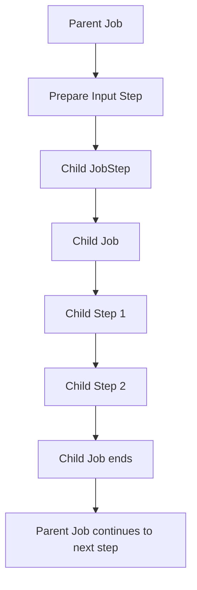

# Passing JobParameters into a Child Job

In Spring Batch, a job can be invoked as a step inside another job via `JobStep`. This structure lets a parent job orchestrate sub-workflows, reuse an existing job, and split a large workflow into parts with separate responsibilities.

When `JobStep` launches a child job, it needs a set of `JobParameters` for the child job run. `JobParametersExtractor` is responsible for creating that parameter set from the parent step's execution context. The extractor can retrieve data from the parent job's initial `JobParameters`, `JobExecutionContext`, or `StepExecutionContext`, and map it into the parameter names and types required by the child job.

An important point is that the child job has its own `JobInstance` and `JobExecution`. The child job's identity is determined by the child job name together with the identifying `JobParameters` returned by the extractor. Therefore, choose stable parameters so that restarting the same unit of work does not accidentally create a new job instance.

## 1. JobStep and the Relationship Between Parent Job and Child Job

`JobStep` is a step responsible for launching another `Job`. The parent job treats the sub-workflow as a step in its flow:



For example, a parent job processing a sales batch might consist of:

1. Validating the file and determining `batchId`.
2. Calling a child job to import orders.
3. Calling a child job to aggregate revenue.
4. Calling a child job to export a report.

Each child job can be developed, tested, and reused independently. `JobStep` serves to orchestrate and track the child job's outcome as a step of the parent job.

The parent job and child job have separate execution metadata in `JobRepository`. The `StepExecution` of `JobStep` belongs to the parent job; the `JobExecution` of the sub-workflow belongs to the child job. The two executions are related through the child job invocation, but they are not the same execution.

## 2. Parent JobParameters Are Not Child JobParameters

`JobParameters` are the immutable inputs of a job run. When the parent job launches, it receives a set of parameters, for example:

```text
Parent JobParameters
  businessDate = 2026-11-14
  batchId      = SALES-2026-11-14
  requestedBy  = scheduler
```

The child job may require different parameter names or only a subset of the data:

```text
Child JobParameters
  businessDate = 2026-11-14
  importBatch  = SALES-2026-11-14
  inputFile    = /data/in/sales-2026-11-14.csv
```

`JobParametersExtractor` builds the parameter set for the child job. This allows:

- Passing only the values the child job genuinely needs.
- Renaming parameters to match the child job's contract.
- Retrieving values produced while the parent job runs, such as a verified file path.
- Setting identifying or non-identifying flags for each parameter of the child job.
- Combining input parameters with values stored in the execution context.

Do not assume that all parameters of the parent job are automatically copied to the child job in the desired way. Define the child job's parameter contract clearly and configure the extractor accordingly.

## 3. Where Does JobParametersExtractor Get Its Data?

`JobParametersExtractor` receives the child `Job` and the `StepExecution` of `JobStep` in the parent job. From `StepExecution`, the extractor can access:

- `stepExecution.getJobExecution().getJobParameters()`: input parameters of the parent job.
- `stepExecution.getJobExecution().getExecutionContext()`: the parent job's Job ExecutionContext, which usually holds data shared across steps.
- `stepExecution.getExecutionContext()`: the Step ExecutionContext of `JobStep` itself in the parent job.

If a preceding step produces a value that needs to be passed to the child job, the common approach is to write the value into that step's Step ExecutionContext and use `ExecutionContextPromotionListener` to promote the required key to Job ExecutionContext. When `JobStep` runs, the extractor reads the promoted value from Job ExecutionContext.

The Step ExecutionContext of a preceding step does not automatically become the Step ExecutionContext of `JobStep`. If you need to pass data between steps, use Job ExecutionContext, save the data to a business store and pass a reference key, or use a clearly designed data-passing mechanism.

## 4. Declaring a Custom JobParametersExtractor

When you need to map from multiple sources or control identifying flags, you can implement `JobParametersExtractor` directly.

Example: the parent job receives `businessDate` and `batchId`. A file preparation step verifies the path and stores the `validatedInputFile` key in Job ExecutionContext. The child job needs `businessDate`, `importBatch`, and `inputFile`.

```java
public class ImportChildParametersExtractor implements JobParametersExtractor {

    @Override
    public JobParameters getJobParameters(
            Job childJob,
            StepExecution parentStepExecution) {

        JobParameters parentParameters = parentStepExecution
                .getJobExecution()
                .getJobParameters();

        ExecutionContext parentContext = parentStepExecution
                .getJobExecution()
                .getExecutionContext();

        String businessDate = parentParameters.getString("businessDate");
        String batchId = parentParameters.getString("batchId");

        if (businessDate == null || batchId == null) {
            throw new IllegalArgumentException(
                    "Parent job must provide businessDate and batchId");
        }

        if (!parentContext.containsKey("validatedInputFile")) {
            throw new IllegalStateException(
                    "validatedInputFile is missing from parent JobExecutionContext");
        }

        String inputFile = parentContext.getString("validatedInputFile");

        JobParametersBuilder builder = new JobParametersBuilder()
                .addString("businessDate", businessDate, true)
                .addString("importBatch", batchId, true)
                .addString("inputFile", inputFile, true);

        String requestedBy = parentParameters.getString("requestedBy");
        if (requestedBy != null) {
            builder.addString("requestedBy", requestedBy, false);
        }

        return builder.toJobParameters();
    }
}
```

In this example:

- `businessDate` and `batchId` come from the parent job's `JobParameters`.
- `inputFile` comes from the parent job's Job ExecutionContext because it is a value determined at runtime.
- `importBatch` is the parameter name the child job uses for the same batch ID value.
- Identifying parameters are marked `true`; `requestedBy` is supplemental information that does not participate in identifying the child job's `JobInstance`.

The extractor checks required values before building the parameter set. If data is missing, it throws an exception so `JobStep` fails clearly instead of launching the child job with incomplete or incorrect parameters.

## 5. Attaching the Extractor to JobStep

Once you have the child job and extractor, configure `JobStep` in the parent job. Example using the Spring Batch 5+ API:

```java
@Bean
Step importChildJobStep(
        JobRepository jobRepository,
        JobLauncher jobLauncher,
        Job importOrdersJob,
        ImportChildParametersExtractor parametersExtractor) {

    return new StepBuilder("importChildJobStep", jobRepository)
            .job(importOrdersJob)
            .launcher(jobLauncher)
            .parametersExtractor(parametersExtractor)
            .build();
}
```

`JobStep` performs these main tasks:

1. Receives the `StepExecution` of the step in the parent job.
2. Calls `JobParametersExtractor` to build parameters for the child job.
3. Calls `JobLauncher` to launch the child job with the newly built parameters.
4. Tracks the child job execution result and reflects that outcome onto the `JobStep` execution according to Spring Batch's mechanism.

The parent job can proceed to the next step when `JobStep` completes according to the configured flow. If the child job fails, `JobStep` normally fails and the parent flow handles that outcome via transitions.

The child job remains an ordinary `Job`. It can be run independently using `JobLauncher` with its own parameter set, or invoked from multiple different parent jobs if the parameter contract and identity are designed appropriately.

## 6. How Does the Child Job Receive JobParameters?

From the child job's perspective, the parameters returned by the extractor are normal input `JobParameters`. The child job's steps can read them using `@Value` and `@StepScope`.

Example of a reader in the child job:

```java
@Bean
@StepScope
FlatFileItemReader<OrderInput> childOrderReader(
        @Value("#{jobParameters['inputFile']}") Resource inputFile) {

    return new FlatFileItemReaderBuilder<OrderInput>()
            .name("childOrderReader")
            .resource(inputFile)
            .delimited()
            .names("orderId", "customerId", "amount")
            .targetType(OrderInput.class)
            .saveState(true)
            .build();
}
```

Another step in the child job can read `businessDate` or `importBatch` in the same way:

```java
@Bean
@StepScope
Tasklet createImportSummary(
        @Value("#{jobParameters['businessDate']}") String businessDate,
        @Value("#{jobParameters['importBatch']}") String batchId) {

    return (contribution, chunkContext) -> {
        summaryService.create(batchId, LocalDate.parse(businessDate));
        return RepeatStatus.FINISHED;
    };
}
```

`@StepScope` defers bean creation until the child step starts, when the child job's `JobParameters` are ready. Do not use the parent job's `jobParameters` inside the child job; the child job only sees the parameter set passed to itself.

## 7. Using DefaultJobParametersExtractor for Simple Mapping

Spring Batch provides `DefaultJobParametersExtractor` to extract configured keys from the parent step/job execution context according to the standard extractor's mechanism. It fits when data has already been placed into the context with stable key names and no complex conversion logic is needed.

Example of configuring the standard extractor with keys prepared in the execution context:

```java
@Bean
JobParametersExtractor childParametersExtractor() {
    DefaultJobParametersExtractor extractor =
            new DefaultJobParametersExtractor();

    extractor.setKeys(new String[] {
            "businessDate",
            "batchId",
            "validatedInputFile"
    });

    return extractor;
}
```

When using the standard extractor, verify that the keys reside in the exact context read by the Spring Batch version in use and follow the extractor's data type conventions. If you must rename keys, combine multiple sources, set different identifying flags, or validate required parameters, a custom `JobParametersExtractor` is usually easier to read and control.

Do not copy a `DefaultJobParametersExtractor` configuration without checking the data source of the keys. Read the API of your project's Spring Batch version to determine precisely whether the extractor pulls values from Step ExecutionContext, Job ExecutionContext, or both.

## 8. Identifying and Non-Identifying Parameters of the Child Job

The child job has its own `JobInstance`. Its identity is formed from the child job name and parameters marked as identifying. This is a critical factor when the parent job restarts.

Example:

```java
JobParameters childParameters = new JobParametersBuilder()
        .addString("batchId", "SALES-2026-11-14", true)
        .addString("businessDate", "2026-11-14", true)
        .addString("requestedBy", "scheduler", false)
        .toJobParameters();
```

Here, `batchId` and `businessDate` identify the business processing run of the child job. `requestedBy` is merely supplemental metadata and does not create a new `JobInstance` when changed.

When choosing identifying parameters:

- Use batch ID, business date, file ID, or a stable source identifier.
- Keep identifying values unchanged when restarting the same work.
- Do not add the current timestamp or a new UUID on every parent restart if the goal is to resume the old child job.
- Do not use the parent's `JobExecution` ID as an identifying key if a parent restart creates a new execution ID and the child needs to resume the same batch.
- If two different parent jobs can invoke the same child job for two different batches, ensure the batch key distinguishes the two units of work.

If the identifying parameter set changes, Spring Batch may create a new `JobInstance` for the child job. In that case, the child job may reprocess the same business data from the start. This is often the cause of duplicate data when passed parameters are unstable.

## 9. Restarting the Parent Job and Child Job

The parent job and child job have separate execution histories, but their restarts are related to each other.

A common scenario:

1. The parent job runs `prepareInputStep` and stores the verified file path in Job ExecutionContext.
2. `JobStep` creates child `JobParameters` and launches the child job.
3. The child job processes several chunks and then fails.
4. The parent `JobStep` fails according to the child job's outcome.
5. The parent job is restarted with the same identifying `JobParameters`.
6. The parent flow reaches the incomplete `JobStep`; the extractor regenerates the stable child `JobParameters`.
7. The child job is re-launched with the same `JobInstance` and can resume from the saved checkpoint.

This requires the child job to use the same identifying parameters, `JobRepository` to store metadata durably, and the child job's reader/writer to support safe restart.

If the child job has already completed, but the parent step was interrupted before `JobStep`'s completion status was recorded, restarting the parent may try to re-launch the child job with the same parameters. When the child `JobInstance` has already completed, Spring Batch may reject a new run with `JobInstanceAlreadyCompleteException`. This scenario must be accounted for in orchestration design and recovery procedures; do not solve it by adding a random timestamp to create a new child instance because that could re-run the entire business process.

Define the policy clearly:

- If the child job has already completed, can the parent verify the completed child execution result and continue the flow?
- If the child job failed, can the same child `JobInstance` be restarted or is a separate recovery workflow needed?
- If the child job is run again for a new business batch, which identifying key distinguishes the new batch?
- If the child job has side effects outside transactions, is the writer already idempotent?

## 10. Do Not Pass Large Data via JobParameters

`JobParameters` are suitable for identifiers or small control parameters such as business date, batch ID, file path, partition key, or run mode. Do not pass lists of thousands of items, file contents, or large objects inside the parameter set.

Instead:

- Store the data in a staging database or object storage.
- Pass `batchId`, `fileReference`, or a controlled URI to the child job.
- Have the child job read the data from the storage using that reference.
- Store separate checkpoints in the child job's Step ExecutionContext.

Do not put passwords, access tokens, or secrets into `JobParameters`. Parameters can be stored in the metadata repository and exposed through operational APIs. If the child job needs to authenticate with external systems, use secret management or a credential mechanism appropriate for the runtime environment.

## 11. Passing Parameters and Passing State Are Two Different Things

`JobParameters` are the inputs to the child job; `ExecutionContext` is state generated during execution. Do not use the two mechanisms interchangeably.

| Need | Suitable Approach |
|---|---|
| Passing business date from parent to child | `JobParametersExtractor` reads parent `JobParameters` |
| Passing a batch code determined up front | `JobParameters` |
| Passing a file path verified in a prior step | Promote to parent Job ExecutionContext then extractor retrieves it |
| Passing child reader checkpoints | Child job's Step ExecutionContext |
| Sharing a value across steps inside the child job | Child Job ExecutionContext |
| Passing large datasets | Database/object storage and a reference key |

Do not store the child job's checkpoint in `JobParameters`. If a checkpoint changes after every chunk and is treated as an identifying parameter, each checkpoint could create a different `JobInstance`. Checkpoints belong in the child step's `ExecutionContext`.

## 12. Configuring a Parent Flow with JobStep

Example of a parent job with a data preparation step, a `JobStep` calling a child job, and a summary step:

```java
@Bean
Job parentSalesJob(
        JobRepository jobRepository,
        Step prepareInputStep,
        Step importChildJobStep,
        Step summarizeStep) {

    return new JobBuilder("parentSalesJob", jobRepository)
            .start(prepareInputStep)
            .next(importChildJobStep)
            .next(summarizeStep)
            .build();
}
```

The parent job orchestrates the stages. The child job is configured as a separate `Job` bean:

```java
@Bean
Job importOrdersJob(
        JobRepository jobRepository,
        Step readAndWriteOrdersStep,
        Step reconcileImportedOrdersStep) {

    return new JobBuilder("importOrdersJob", jobRepository)
            .start(readAndWriteOrdersStep)
            .next(reconcileImportedOrdersStep)
            .build();
}
```

The child job name must be distinct from the parent job name and from other jobs in the same repository. Each job has its own flow and metadata.

## 13. JobStep and JobLauncher

`JobStep` uses `JobLauncher` to launch the child job. For a parent flow that must wait for the child job to finish before deciding the next transition, a synchronous launcher is usually the predictable choice: `JobStep` receives the child job's final execution result in the same orchestration thread.

If an asynchronous launcher is used, understand clearly how `JobStep` receives status when `run()` returns before the child job finishes. The parent flow should not continue as if the child job had completed if it is still running. Using async requires a dedicated orchestration design with mechanisms to monitor the child execution and synchronize the outcome.

In a Spring Boot application, check the actual `JobLauncher` bean injected into `JobStep`. Do not assume the launcher is synchronous or asynchronous based solely on how the builder is called; behavior depends on the configured `TaskExecutor`.

## 14. Handling Errors When Creating or Passing JobParameters

The extractor is the boundary between the parent job's context and the child job's parameter contract. Handle errors explicitly:

- Missing required parent parameter: stop before launching the child job.
- Missing key in Job ExecutionContext: verify that the data preparation step completed and the promotion listener ran.
- Wrong data type or format: validate before building `JobParameters`.
- Unstable identifying parameters: fix the identity rules so restarts of the same batch use the same parameter set.
- Matching parameters while child `JobInstance` is already running: do not launch a duplicate execution; handle according to existing child status.
- Child `JobInstance` already completed: verify the outcome and handle `JobInstanceAlreadyCompleteException` according to orchestration policy.

Do not catch every exception from the extractor or launcher and return `COMPLETED` for the parent step. If valid parameters cannot be built or the child job cannot run, the parent needs to surface the failure or follow an intentional recovery branch.

## 15. Testing JobParameters Passed to a Child Job

Tests should verify not only that the child job ran, but also that it received the right parameter set and resolved the right `JobInstance`.

Cases to test:

1. **Basic mapping:** parent parameters are converted into the child job's expected parameter names and types.
2. **Context values:** keys promoted from a preceding step are read by the extractor and passed to the child job.
3. **Missing required parameter:** the extractor reports a clear error and the child job is not launched with missing data.
4. **Identifying flags:** the same batch creates the same child `JobInstance`; a new batch creates a different instance.
5. **Non-identifying parameters:** changing non-identifying info does not create a new child `JobInstance`.
6. **Parent restart:** the extractor recreates the same identifying child parameters so the child job can restart the right instance.
7. **Child job failure:** the parent `JobStep` reflects the failure outcome and the parent flow takes the appropriate branch.
8. **Child job already completed:** restarting the parent does not accidentally create a new child instance for the same batch.
9. **Repeated side effects:** the child writer is safe when chunks are restarted or the child job is re-invoked.

Example of checking child execution after running the parent job:

```java
JobExecution parentExecution =
        jobLauncherTestUtils.launchJob(parentParameters);

assertEquals(BatchStatus.COMPLETED, parentExecution.getStatus());

JobInstance childInstance = jobExplorer.getJobInstances(
        "importOrdersJob", 0, 10)
        .stream()
        .filter(instance -> instance.getJobName().equals("importOrdersJob"))
        .findFirst()
        .orElseThrow();

List<JobExecution> childExecutions =
        jobExplorer.getJobExecutions(childInstance);
```

This is an illustrative skeleton showing how to look up a child execution; in real tests, identify the child instance by specific identifying parameters or retrieve the child execution ID recorded by the orchestration mechanism. Do not pick the first instance in the repository if the test runs multiple different batches.

You can check the child execution's parameter set:

```java
JobParameters childParameters = childExecution.getJobParameters();

assertEquals("SALES-2026-11-14",
        childParameters.getString("importBatch"));
assertEquals("2026-11-14",
        childParameters.getString("businessDate"));
```

Also check the `JobInstance` ID to confirm that two parent restarts using the same identifying parameters referenced the same child instance. For restart tests, use a persistent `JobRepository` across runs and do not clear child job metadata before inspecting.

## 16. Common Mistakes

**Assuming the child job automatically receives all parent parameters.** Use `JobParametersExtractor` to explicitly define which values are passed and their corresponding parameter names.

**Reading values from the wrong ExecutionContext.** The `StepExecutionContext` of a prior step does not automatically appear in `JobStep`'s context. Promote required keys to Job ExecutionContext or store an external reference.

**Using JobParameters as checkpoints.** Input parameters identify the work; checkpoints that change during execution belong in the child step's `ExecutionContext`.

**Creating a new identifying parameter on every restart.** A new timestamp or UUID can create a new child `JobInstance` and cause the batch to be reprocessed. Use stable business keys.

**Marking every parameter as identifying.** A changing value like `requestedBy` should not create a new instance if it does not change the business scope.

**Passing large data or secrets.** `JobParameters` are stored in metadata; pass only small, meaningful, non-sensitive parameters.

**Not handling an already-running or already-completed child job.** When the parent restarts, the child job may be running, failed, or completed. Handle status under the same identifying parameter set.

**Using an asynchronous launcher without synchronizing the parent flow.** The parent may not have the child job's final result at the moment it needs to decide the transition. Choose an appropriate launcher and orchestration mechanism.

## Conclusion

`JobStep` uses `JobParametersExtractor` to build the parameter set for a child job from the parent step's execution context. The extractor can combine input `JobParameters` with Job ExecutionContext or Step ExecutionContext, map key names, and decide which parameters participate in identifying the child `JobInstance`.

Pass stable business values such as `batchId`, `businessDate`, and file references; promote data from earlier steps to Job ExecutionContext when needed; keep identifying parameters identical across restarts; and keep child job checkpoints inside the child step's own `ExecutionContext`. When the parameter contract, restart state, and child execution handling are clearly designed, the parent job can orchestrate the child job predictably and safely.
