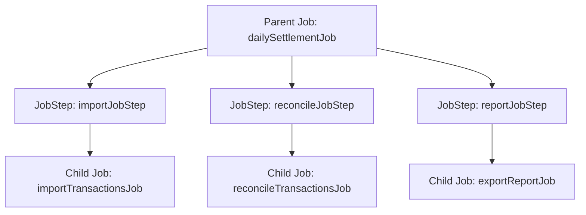
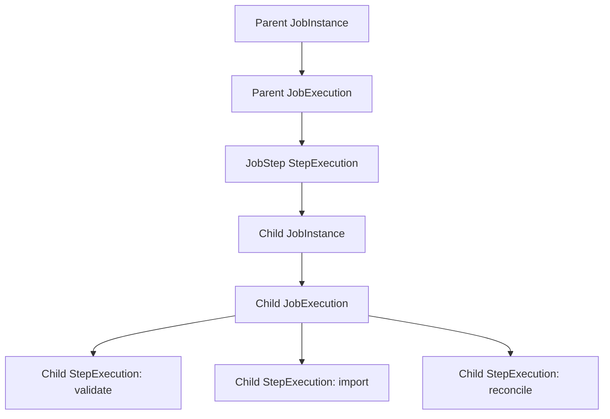
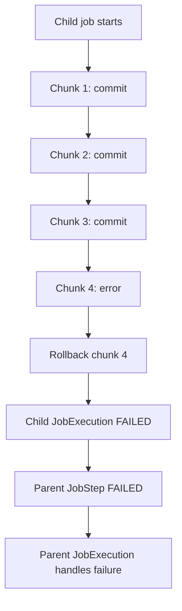

# Transaction Boundaries of JobStep

In Spring Batch, `JobStep` allows a parent job to launch a child job as a step in its workflow. This structure helps split a large process into jobs with separate responsibilities, reuse child jobs, and manage execution order at the parent job level.

The key point to understand is that **JobStep does not turn the entire child job into a single transaction of the parent job**. `JobStep` has its own `StepExecution` in the parent job; when executed, it calls `JobLauncher` to launch another job with its own `JobExecution`. Transactions processing business data are created per step of the child job: a chunk step normally has per-chunk transactions, while a tasklet step has transaction boundaries according to the configured tasklet/iteration execution.

Therefore, if a child job has committed three chunks and then fails on the fourth chunk, the parent job marking `JobStep` as failed does not automatically roll back the three already-committed chunks. To restart safely, you must understand both parent and child job metadata, keep the child job's identifying parameters stable, and design writers that can reprocess safely.

## 1. What is JobStep?

`JobStep` is a type of `Step` used to run another `Job`. Instead of placing all processing into one large job, you can create a child job for part of the workflow and invoke it from the parent job.

For example, an end-of-day reconciliation workflow can be split into:

- A parent job orchestrating the entire workflow.
- A child job importing transactions.
- A child job totaling and reconciling.
- A child job exporting reports.



Each child job has its own job name, parameters, `JobInstance`, and `JobExecution`. The parent job has its own `JobExecution` and one `StepExecution` per `JobStep`. This relationship allows observing orchestration progress at the parent level and processing details at the child level.

### Distinguishing JobStep from Regular Steps

| Component | Role |
|---|---|
| Chunk-oriented Step | Reads, processes, and writes items in chunks |
| Tasklet Step | Executes a task or tasklet loop |
| JobStep | Launches another Job as a step of the parent job |
| Flow | Groups and routes steps within the same job |

`JobStep` is not a regular Java method call. It creates a child job execution through `JobLauncher`, so the child job has its own lifecycle and metadata.

## 2. Two Execution Levels and Two Metadata Levels

When `JobStep` runs, Spring Batch manages two layers of execution:

1. **Parent level**: the parent `JobExecution` contains the `StepExecution` of `JobStep`.
2. **Child level**: the child `JobInstance` and child `JobExecution`, containing the child job's `StepExecution`s.



These two levels have different IDs and separate statuses. `JobStep` is a step in the parent job; the child job does not become another step execution of the parent job. When querying metadata, use the child `JobExecution` to inspect details of the steps inside the child job.

Normally, parent and child are configured to use the same `JobRepository` so metadata is centralized and easy to query. Even when sharing a repository, the parent execution and child execution remain separate records.

## 3. Configuring JobStep

Spring Batch provides a builder to configure the child job, launcher, and how parameters are created for the child job.

Example with Spring Batch 5:

```java
@Bean
Step importTransactionsJobStep(
        JobRepository jobRepository,
        JobLauncher jobLauncher,
        Job importTransactionsJob,
        JobParametersExtractor childParametersExtractor) {

    return new StepBuilder("importTransactionsJobStep", jobRepository)
            .job(importTransactionsJob)
            .launcher(jobLauncher)
            .parametersExtractor(childParametersExtractor)
            .build();
}
```

Components:

- `StepBuilder`: creates the step belonging to the parent job.
- `job(importTransactionsJob)`: selects the job to be launched.
- `launcher(jobLauncher)`: provides the `JobLauncher` to run the child job.
- `parametersExtractor(...)`: determines the `JobParameters` passed to the child job.
- `build()`: creates the `JobStep`.

The parent job can call `JobStep` like a normal step:

```java
@Bean
Job dailySettlementJob(
        JobRepository jobRepository,
        Step importTransactionsJobStep,
        Step reconcileJobStep,
        Step exportReportJobStep) {

    return new JobBuilder("dailySettlementJob", jobRepository)
            .start(importTransactionsJobStep)
            .next(reconcileJobStep)
            .next(exportReportJobStep)
            .build();
}
```

Here, each `JobStep` launches a child job. The child jobs can still be run independently by a scheduler or another job if the design permits.

## 4. The Child Job Has Its Own Transaction Boundaries

The most important point about `JobStep` is that business data transaction boundaries reside on the steps inside the child job.

Suppose the child job has a chunk step with chunk size 100:

```java
@Bean
Step importInvoiceStep(
        JobRepository jobRepository,
        PlatformTransactionManager businessTransactionManager,
        ItemReader<Invoice> invoiceReader,
        ItemProcessor<Invoice, ImportedInvoice> invoiceProcessor,
        ItemWriter<ImportedInvoice> invoiceWriter) {

    return new StepBuilder("importInvoiceStep", jobRepository)
            .<Invoice, ImportedInvoice>chunk(
                    100,
                    businessTransactionManager)
            .reader(invoiceReader)
            .processor(invoiceProcessor)
            .writer(invoiceWriter)
            .build();
}
```

In this example, each chunk contains up to 100 items and is processed in a transaction managed by `businessTransactionManager`. If the fourth chunk fails before commit:

- The transaction of the fourth chunk is rolled back across participating resources.
- The three previous already-committed chunks remain in the database.
- The child job may end in `FAILED` status.
- `JobStep` in the parent receives the unsuccessful outcome and the parent workflow normally stops or enters a configured error branch.



Parent `JobStep` does not have an outer transaction to undo commits of chunks 1, 2, and 3. This is expected behavior in batch processing: committed progress is preserved so the child job can restart.

## 5. JobStep Does Not Create a Transaction Wrapping the Entire Child Job

A common misconception is that because the child job is invoked from a step, the entire child job runs inside the parent step's transaction. That is not how Spring Batch organizes transactions.

Distinguish clearly:

- Parent `JobExecution` manages the parent job's lifecycle.
- Parent `StepExecution` records metadata for `JobStep`.
- `JobLauncher` launches the child `JobExecution`.
- Child steps use their own transaction managers and transaction boundaries.

A child job can have multiple steps, and each step can have multiple chunks. There is no single transaction enclosing that entire chain.

Even if parent and child use the same database or the same transaction manager bean, do not assume all child steps will commit or roll back together as one transaction. Chunk transactions are opened and committed per each child step's configuration. Parent `JobStep` does not turn them into a single atomic unit.

### Metadata Transactions and Business Transactions

Spring Batch saves metadata via `JobRepository`. Business data is normally written via the child step's transaction manager. Both groups of operations may use the same database or datasource, but their goals and boundaries differ.

Metadata records whether a job/step started, completed, failed, and where its checkpoint is. Business transactions protect data modifications of a chunk or tasklet. Do not rely on a parent status record to infer that all business changes of the child were rolled back.

## 6. JobStep and Tasklet Step Have Different Boundaries

A Tasklet Step executes a tasklet within its own step infrastructure. For a standard tasklet, the transaction manager configured for the step manages the transaction of the tasklet execution; if the tasklet repeats via `RepeatStatus.CONTINUABLE`, iterations are handled according to `TaskletStep`'s transaction boundaries.

`JobStep`, on the other hand, calls a `JobLauncher` to run a child job. It does not bundle the transactions of all child steps into the parent step's transaction.

| Question | Tasklet Step | JobStep |
|---|---|---|
| Unit executed | Tasklet | Child Job |
| Has child `JobExecution`? | No | Yes |
| Has child `StepExecution`s? | No | Yes, inside the child job |
| Primary business transaction | Per `TaskletStep` configuration | Per each child step's transaction manager |
| Is there one transaction wrapping the whole workflow? | Not by default | No |

If you only need to invoke a Java service to perform a short operation, a Tasklet Step may be more suitable. If the processing segment needs its own job lifecycle, parameters, restart, and metadata, `JobStep` is the right choice.

## 7. How Are Child JobParameters Created?

The child job has its own identity. The child job's `JobInstance` is determined by the child job name and the identifying parameters passed into the child job.

Therefore, `JobParametersExtractor` is a crucial component. It converts information from the parent `JobStep`'s `StepExecution` into `JobParameters` for the child job.

Do not assume every parent parameter will be transferred to the child in the exact way the application expects. Configure the extractor to explicitly define:

- Which parameters the child needs to select data.
- Which parameters must be identifying.
- Which parameters are only for audit/correlation.
- Which values are retrieved from parent job parameters or execution context.

Example of an explicit extractor:

```java
@Bean
JobParametersExtractor childParametersExtractor() {
    return (childJob, parentStepExecution) -> {
        JobParameters parentParameters =
                parentStepExecution.getJobParameters();

        String businessDate = Objects.requireNonNull(
                parentParameters.getString("businessDate"));
        String batchId = Objects.requireNonNull(
                parentParameters.getString("batchId"));

        return new JobParametersBuilder()
                .addString("businessDate", businessDate, true)
                .addString("batchId", batchId, true)
                .addString(
                        "parentExecutionId",
                        String.valueOf(
                                parentStepExecution.getJobExecutionId()),
                        false)
                .toJobParameters();
    };
}
```

In this example:

- `businessDate` and `batchId` identify the child job's business batch.
- `parentExecutionId` is only for traceability and does not participate in the child instance identity.
- When the parent job restarts, the extractor regenerates the same identifying values if parent parameters have not changed.

If `parentExecutionId` changes when the parent gets a new execution, it still does not create a new child instance because it is marked non-identifying. However, include this parameter only if the child genuinely needs correlation. You can use a more stable `parentBatchId` if you want to link executions of the same logical request.

### Using DefaultJobParametersExtractor

Spring Batch also provides `DefaultJobParametersExtractor` to extract values from the execution context according to key configuration and parameter names. This is useful when a preceding step has placed required data into the context.

Example configuration specifying keys to extract:

```java
@Bean
JobParametersExtractor childParametersExtractor() {
    DefaultJobParametersExtractor extractor =
            new DefaultJobParametersExtractor();

    extractor.setKeys(new String[] {
            "businessDate",
            "batchId"
    });

    return extractor;
}
```

Specific mapping behavior and properties of the extractor should be verified against the Spring Batch version in use. If you need explicit control over identifying flags, data types, or parameter sources, a custom `JobParametersExtractor` as in the previous example is usually easier to read and control.

## 8. Why Must Identifying Parameters Be Stable on Restart?

Suppose child job `importTransactionsJob` runs for `businessDate=2026-11-15` and `batchId=daily-20261115`.

First run:

- Parent `JobStep` launches the child job with those two identifying parameters.
- The child job creates `JobInstance` A.
- The child job commits several chunks and then fails.

When the parent restarts, the extractor must regenerate those exact two identifying values so the child job recognizes the same `JobInstance` A and restarts the appropriate execution.

If the extractor adds `Instant.now()` as an identifying parameter every time, the child job will create instance B instead of resuming instance A. Data already committed in A may be reprocessed from the beginning in B.

| Invocation | `businessDate` | `batchId` | `runAt` identifying | Child instance |
|---|---|---|---|---|
| First run | 2026-11-15 | daily-20261115 | 01:00 | A |
| Parent restart | 2026-11-15 | daily-20261115 | 01:05 | B |
| Proper parent restart | 2026-11-15 | daily-20261115 | None | A |

Use stable business keys such as business date, file ID, window start/end, or batch ID. Retry timestamps, parent execution IDs, or correlation IDs should normally not be identifying if they do not change the dataset the child needs to process.

## 9. What Happens to Parent JobStep When the Child Job Fails?

When `JobStep` invokes a child job, the child execution outcome is reflected in `JobStep`'s result. If the child job ends unsuccessfully, `JobStep` normally ends unsuccessfully and the parent job stops or routes according to the parent's flow.

Example of a parent job handling failure:

```java
@Bean
Job parentImportJob(
        JobRepository jobRepository,
        Step childImportJobStep,
        Step recordFailureStep,
        Step finalAuditStep) {

    return new JobBuilder("parentImportJob", jobRepository)
            .start(childImportJobStep)
                .on("COMPLETED").to(finalAuditStep)
            .from(childImportJobStep)
                .on("FAILED").to(recordFailureStep)
            .from(recordFailureStep)
                .on("*").fail()
            .end()
            .build();
}
```

The parent's flow routes based on `JobStep`'s exit status. If the child job fails, the parent can record the error or run a dedicated handling step.

This does not delete chunks already committed by the child. The error-handling step in the parent is simply part of the workflow; it is not a compensating rollback for completed commits.

## 10. Example Transaction Timeline When Child Job Fails

Suppose a parent job calls a child job to import transactions. The child job has two steps:

- `loadTransactionsStep`: reads a file and writes to a staging table by chunk.
- `postTransactionsStep`: moves staging records to the main table by chunk.

Timeline:

| Time | Execution Level | Event | Data Outcome |
|---|---|---|---|
| T1 | Parent | Parent `JobExecution` starts | Parent metadata created |
| T2 | Parent | `JobStep` starts | Parent `StepExecution` created/updated |
| T3 | Child | Child `JobExecution` starts | Child metadata created |
| T4 | Child step 1 | Chunk 1 commits | Staging has chunk 1 |
| T5 | Child step 1 | Chunk 2 commits | Staging has chunks 1 and 2 |
| T6 | Child step 1 | Step completes | Staging retains committed data |
| T7 | Child step 2 | Chunk 1 commits | Main table has chunk 1 |
| T8 | Child step 2 | Chunk 2 errors | Chunk 2 rolls back |
| T9 | Child | Child `JobExecution` `FAILED` | Chunk 1 in main table still persists |
| T10 | Parent | `JobStep` `FAILED` | Parent does not roll back child commits |

If the child job is designed to be restartable, the next run can resume step 2 from the appropriate checkpoint. The writer must ensure chunks already committed are not written redundantly on restart.

## 11. Restarting Parent Job and Child Job

Restarting a `JobStep` requires examining two layers of state:

- Is the parent job restartable and what state is parent `JobStep` in?
- Does the child job have any executions, in what state, and do the identifying parameters match?

Several scenarios:

### Child Job Failed

If parent `JobStep` failed because the child job failed, the parent job can be restarted per policy. `JobStep` executes again and the launcher starts the child job with corresponding parameters. If the previous child instance failed and qualifies for restart, Spring Batch can create a new child `JobExecution` for the same child `JobInstance`.

### Child Job Already Completed

If the child job has already completed and parent `JobStep` was also recorded as completed, restarting the parent job normally skips the completed step per default restart behavior. The parent continues from the next incomplete step.

### Child Completed but Parent Has Not Recorded JobStep Completion

There is a rare but important failure window: the child job completed, but the process stopped before parent `JobStep` recorded the completed outcome. When the parent restarts, `JobStep` may attempt to launch the child again with the same identifying parameters. The child repository may reject it because the instance is already complete.

In this situation, reconcile the child `JobExecution` and parent `StepExecution` before intervening. You may need a recovery procedure that detects the already-completed child and synchronizes the parent state in an application-supported manner. Do not edit metadata statuses directly to force continuation.

### Parent Job Restarted Multiple Times

Do not create a new batch ID or new identifying timestamp simply because the parent was restarted. If the child needs to reprocess an already-completed business batch, create a reprocess request with a new ID/version and ensure the writer has an idempotency mechanism.

## 12. Can Parent and Child Share the Same JobRepository?

Typically, parent and child jobs are configured to share the same `JobRepository` in order to:

- Query both parent and child executions in one place.
- Share metadata schema and transaction infrastructure.
- Track the relationship between parent `StepExecution` and child `JobExecution` via IDs/correlation parameters.
- Support unified restart and operations.

Sharing a repository does not mean the two executions merge into one execution. Each job still has its own `JobInstance`, `JobExecution`, and `StepExecution`s.

If the child job uses a different repository, you must explicitly manage the child's metadata database, transaction manager, launcher, and how the parent queries results. Separating repositories may make sense in multi-system architectures, but it makes tracing and recovery more complex.

## 13. Synchronous and Asynchronous JobLauncher

`JobStep` invokes the child job via `JobLauncher`. With a synchronous launcher, the call normally returns after the child job finishes, so `JobStep` can rely on the child execution's final outcome to determine the parent step outcome.

If a launcher with an asynchronous task executor is used, the call may return while the child job is still running. In that case, parent `JobStep` should not be assumed to automatically wait for the child to finish or always have the final status the moment `run()` returns.

For a `JobStep` that needs to observe the child result before the parent proceeds, prefer a synchronous launcher or design separate asynchronous orchestration:

- Parent records the child execution ID.
- An orchestration component monitors the child execution.
- Parent proceeds only upon receiving an appropriate final status.
- Include timeouts, retries, idempotency, and handling for stuck child jobs.

Do not use an async launcher inside `JobStep` without checking the exact behavior of your deployed version and configuration. A parent job finishing early while the child is still running can violate workflow semantics and cause difficulties on restart.

## 14. Transactions Between Child Job and External Systems

If the child job both writes to a database and calls an HTTP API, sends messages, or creates files, external side effects do not automatically roll back when a child chunk fails.

Example:

1. Child writer sends a transaction to a partner API.
2. Partner receives and processes the request.
3. The chunk's database transaction rolls back due to a metadata write error or another operation.
4. On restart, the child job may send the same transaction again.

To prevent duplicate side effects:

- Use a stable idempotency key based on batch ID and source record ID.
- Save message emission requests in a transactional outbox within the same DB transaction as business data.
- Use staging and publish protocols for files.
- Have reconciliation to verify child-committed data against target systems.
- Store correlation IDs to investigate parent-child executions.

Parent `JobStep` only orchestrates the child job; it does not provide a distributed transaction across every service the child calls.

## 15. JobStep and FlowStep: Choosing the Right Abstraction

Two structural approaches can look similar, yet carry different semantics:

| Criterion | JobStep | FlowStep |
|---|---|---|
| Unit invoked | A separate `Job` | A `Flow` |
| Separate child `JobInstance`/`JobExecution` | Yes | Does not create a separate job instance merely because a flow is nested |
| Dedicated parameters for child job | Yes, via `JobParametersExtractor` | No separate child job parameters |
| Restart metadata | Has both parent and child metadata | Follows steps within the same job execution |
| Reusing an independent job | Suitable | Not the primary goal |
| Splitting an internal workflow within the same job | Possible, but creates a child job | Suitable |

If the processing unit needs an independent lifecycle, parameters, restart, and metadata, use `JobStep`. If you only want to group a set of steps or reuse a flow within the same job, consider `Flow`/`FlowStep`.

## 16. Designing the Child Job for Safe Restart

A child job invoked from `JobStep` should satisfy these conditions:

- Have a stable job name and identifying parameters representing the exact business batch.
- Use a reader supporting checkpoints or a clear resume mechanism.
- Have frozen input or a version/checksum so restarts do not read different content.
- Have an idempotent writer or unique keys to prevent duplicate writes.
- Use the transaction manager matching business resources in each child step.
- Allow already-committed chunks to persist when a later chunk fails.
- Guard external side effects with an outbox or idempotency key.
- Have logs and metrics on child execution linked to parent execution.

The parent job should pass required parameters and keep them stable. Do not let the child call `Instant.now()` to generate a new identifying parameter every time it is launched by the parent.

## 17. Testing JobStep Transaction Boundaries

Tests should verify behavior at both execution levels:

| Scenario | What to Verify |
|---|---|
| Child job completes | Parent `JobStep` completes and parent proceeds |
| Child job fails on first chunk | Chunk rolls back; child and parent step reflect failure |
| Child fails after several committed chunks | Earlier chunks remain in DB; failed chunk rolls back |
| Parent restarts with same child parameters | Child instance is recognized accurately |
| Extractor accidentally generates a new identifying parameter | Test detects that child instance changed |
| Child already completed, parent restarts | Parent does not redundantly reprocess child work |
| Child completed but parent metadata not yet updated | Recovery path handles the situation |
| Async launcher | Parent-child status is coordinated explicitly |
| Child calls external API | Retries do not create duplicate side effects |

A useful integration test creates a child job reading 250 items with chunk size 100 and intentionally fails the third chunk. After the first run, verify that the 200 items of the first two chunks committed and the third chunk did not commit. Then restart with the same child parameters and verify the job completes without creating duplicate records.

## 18. Common Mistakes

**Assuming JobStep wraps a transaction around the child job.** `JobStep` launches a separate child job; business transactions belong to the child steps.

**Assuming parent failure rolls back the child.** Already-committed child chunks remain. Handle via restart or compensation per design.

**Passing a fresh timestamp as a child identifying parameter.** Each parent restart can create a new child `JobInstance` and reprocess data from scratch.

**Not understanding the two metadata levels.** Parent `StepExecution` and child `JobExecution` are different records. Query the right level when investigating.

**Using an async JobLauncher and assuming the parent waits.** The parent may not observe the child's final status at the expected time. Use synchronous launch or async orchestration with status tracking.

**Treating child job completion as guaranteeing atomic external side effects.** HTTP, files, and messages have separate boundaries. Use outbox, staging, and idempotency.

**Not handling the child-complete/parent-update window.** You can encounter cases where the child completed but parent `JobStep` was not yet marked complete. Establish metadata reconciliation and recovery procedures.

**Using JobStep when you only need to group steps.** If you do not need separate `JobInstance`/`JobExecution`, a `Flow` may be simpler.

## 19. JobStep Design Checklist

Before creating a `JobStep`, answer:

1. Does the child job genuinely need an independent lifecycle and metadata?
2. Which `JobRepository` and `JobLauncher` does the child job use?
3. Which parameters are passed from parent to child?
4. Are identifying parameters stable across restarts?
5. Which transaction manager is used by each child step?
6. If the child fails after several chunks, what data has already committed?
7. Will the parent stop, branch, or continue when the child returns each exit status?
8. Does restarting the parent re-launch the child on the right instance?
9. If the child completes but the parent has not recorded it yet, how will recovery handle it?
10. Are the writer and external side effects idempotent?

Answering these questions before writing the builder helps avoid confusing workflow orchestration with data transactions.

## 20. Practical Conclusion

`JobStep` is the bridge for a parent job to launch a child job. It creates a `StepExecution` at the parent level and a separate `JobExecution` at the child level. Transactions processing business data are managed inside the child job's steps: chunk steps commit per chunk, and tasklet steps per tasklet configuration. There is no default transaction wrapping the entire child job and all parent operations.

When the child fails, already-committed chunks persist; parent `JobStep` reflects the child's result and the parent workflow decides the next step. For safe restarts, keep child identifying parameters stable, use checkpointing readers, idempotent writers, and track both parent and child metadata. If the child calls external systems, add outbox, staging, or reconciliation because `JobStep`'s transaction cannot roll back those side effects.

Understanding `JobStep` transaction boundaries accurately enables splitting jobs into reusable modules while maintaining control over committed data, failure states, and recovery.
