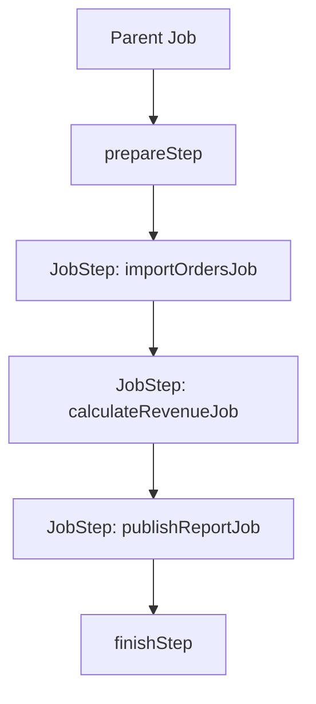
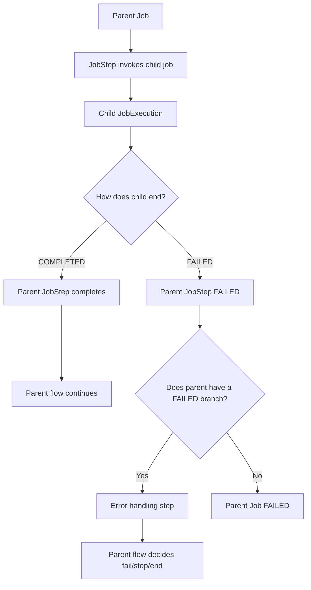
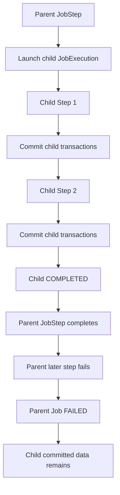

# How Child Job Failures Affect the Parent

Spring Batch allows a job to invoke another job as a step via **`JobStep`**. This organization is useful when a large workflow needs to reuse a child job, split a process into independent parts, or group multiple smaller workflows under an orchestrating job.

When a child job runs inside `JobStep`, Spring Batch creates separate execution metadata for the child job. The parent job has its own `JobExecution` and `StepExecution`; the child job has its own `JobInstance` and `JobExecution`. Consequently, child job failures are reflected onto the parent job's step, and then affect the parent job's status and flow according to how transitions are configured.

The key point is that **parent job and child job have separate execution lifecycles, yet the child job's outcome can determine the parent step's outcome**. If the child job fails, `JobStep` normally finishes as failed and the parent job can run an error-handling branch or end in `FAILED`. Transactions already committed inside the child job are not automatically rolled back simply because the parent job fails afterward.

## 1. What is JobStep?

`JobStep` is a type of step used to launch another job. Instead of putting all logic into a single job, the parent job can orchestrate child jobs as part of a larger workflow.

For example, an end-of-day order processing workflow might consist of:

1. Parent job validates business date and prepares data.
2. `importOrdersJob` imports orders.
3. `calculateRevenueJob` calculates revenue.
4. `publishReportJob` exports and publishes reports.
5. Parent job summarizes the results.

Each child job can be developed, tested, and operated as an independent job, and then invoked from the parent through a `JobStep`.



`JobStep` remains a step in the parent job's flow. The child job is launched via `JobLauncher` with a `JobParameters` set dedicated to the child job.

## 2. Parent and Child Have Separate Metadata

When a child job is launched from `JobStep`, there are two layers of metadata to distinguish:

| Component | Belongs To | Role |
|---|---|---|
| Parent `JobExecution` | Parent job | Tracks a single run of the orchestrating workflow |
| Parent `StepExecution` | `JobStep` in parent job | Records the status of the step launching the child job |
| Child `JobInstance` | Child job | Identifies the child's business unit of work via identifying parameters |
| Child `JobExecution` | Child job | Tracks a specific execution run of the child |
| Child `StepExecution` | Steps inside child | Tracks each data-processing step of the child |

Example:

```text
Parent Job: endOfDayJob
  Parent JobExecution: 501
    StepExecution: importOrdersSubJobStep
      Child Job: importOrdersJob
        Child JobInstance: importOrdersJob / businessDate=2026-11-15
        Child JobExecution: 880
          StepExecution: readOrdersStep
          StepExecution: writeOrdersStep
```

The child job is not a regular step merged into the parent's `JobExecution`. It has its own execution in `JobRepository`. Parent `JobStep` is the link between those two lifecycles.

Because metadata is separated, when investigating errors you must look up both the parent execution and the child execution. The parent `JobStep` status shows the orchestration outcome; the child steps' statuses show which stage inside the child job actually encountered the error.

## 3. How Does JobStep Launch the Child Job?

`JobStep` uses a `JobLauncher` to invoke the child job. It also needs to know which `JobParameters` will be passed to the child job. Parameter passing is typically handled by `JobParametersExtractor`.

Key components:

- **Child `Job`:** the job invoked from the parent.
- **`JobLauncher`:** launches the child job.
- **`JobParametersExtractor`:** builds the parameter set for the child from the parent step execution, parent job parameters, or execution context according to application configuration.
- **`JobRepository`:** stores parent and child metadata; in a typical Batch application, both share a common repository.

Configuration example using the Spring Batch 5 Java API:

```java
@Bean
public Step importOrdersSubJobStep(
        JobRepository jobRepository,
        JobLauncher jobLauncher,
        Job importOrdersJob,
        JobParametersExtractor childParametersExtractor) {

    return new JobStepBuilder(
            new StepBuilder("importOrdersSubJobStep", jobRepository))
            .job(importOrdersJob)
            .launcher(jobLauncher)
            .parametersExtractor(childParametersExtractor)
            .build();
}
```

Different Spring Batch versions may have different builder APIs or repository/transaction manager configuration styles. Use constructors and builders matching your project's library version.

## 4. Passing JobParameters from Parent to Child

The child job needs a parameter set defining the exact scope of data to process. For instance, if the parent runs for business date `2026-11-15`, the order-import child also needs to receive that date.

Do not rely on the assumption that all parent parameters are always automatically forwarded as desired. Configure `JobParametersExtractor` explicitly and define which parameters are identifying on the child.

Example of a custom extractor copying several business parameters:

```java
@Bean
public JobParametersExtractor childParametersExtractor() {
    return (job, parentStepExecution) -> {
        JobParameters parentParameters = parentStepExecution
                .getJobExecution()
                .getJobParameters();

        return new JobParametersBuilder()
                .addString(
                        "businessDate",
                        parentParameters.getString("businessDate"),
                        true)
                .addLong(
                        "tenantId",
                        parentParameters.getLong("tenantId"),
                        true)
                .addString("launchedBy", "endOfDayJob", false)
                .toJobParameters();
    };
}
```

The code snippet illustrates passing business date and tenant ID to the child job. In a real application, validate required parameters before building child parameters to avoid passing `null` values or invalid data.

If a parameter is produced in an earlier step, such as a prepared file path, the extractor can read that value from `StepExecution` context or `JobExecution` context depending on where it was stored. Parameters identifying the same child unit of work must have stable names, types, and values across restarts.

### Child Identifying Parameters

The child job has its own `JobInstance`. Child identity is determined by the child job name and the identifying `JobParameters` passed to it.

For example:

- `businessDate` and `tenantId` are identifying: the same date and tenant point to the same child instance.
- `launchedBy` is non-identifying: changing the request source does not create a new business instance.
- If the extractor adds an identifying timestamp or `run.id` on every parent re-run, the child may create a new instance and re-run the entire job.

Choose parameters based on business semantics. Do not add an identifying timestamp merely to avoid `JobInstanceAlreadyCompleteException`, as doing so can cause the child job to process duplicate data.

## 5. How Does Child Job Success Affect the Parent?

When the child job finishes successfully, `JobStep` completes its child-launch step and the parent flow can proceed to the next step.

Example:

```text
Parent JobExecution: STARTED
  Parent JobStep: importOrdersSubJobStep
    Child JobExecution: STARTED
    Child JobExecution: COMPLETED
  Parent JobStep: COMPLETED
Parent JobExecution proceeds to the next step
```

The child job can return a custom `ExitStatus` such as `COMPLETED_WITH_WARNINGS`. The child's exit status outcome can be reflected onto `JobStep`'s result, depending on how the child finishes and the framework version. This lets the parent flow branch on the child's outcome rather than only knowing whether the child finished.

For example, the data-import child completes yet has some skipped records. The parent can transition to a warning-report step before publishing data.

Do not look solely at the parent `StepExecution` to see how many records the child read/wrote. Item counters and detailed statuses belong to the `StepExecution`s inside the child job. Parent `JobStep` primarily represents the outcome of invoking the child job.

## 6. How Does Child Job Failure Affect the Parent?

When the child job ends in a failed state, `JobStep` normally treats the step execution as failed. `JobStep`'s parent `StepExecution` is marked `FAILED`, and the parent flow can follow the `FAILED` transition.

High-level flow:



For example, child `importOrdersJob` fails in `writeOrdersStep` because the database is unreachable:

1. Child `JobExecution` ends as `FAILED`.
2. `JobStep` in the parent receives the unsuccessful child outcome.
3. Parent `StepExecution` of `importOrdersSubJobStep` ends as `FAILED`.
4. If the parent flow has a `.on("FAILED").to(handleImportFailureStep)` transition, the error-handling step runs.
5. If there is no matching handling branch, the parent job normally ends as `FAILED`.

The child job keeps its own `FAILED` metadata. The parent does not delete or turn the child execution into a success simply because it ran an error step.

## 7. The Parent Can Handle Child Failures Using Conditional Flows

The parent job can define success and failure branches from `JobStep` just like other steps.

```java
@Bean
public Job endOfDayJob(
        JobRepository jobRepository,
        Step prepareStep,
        Step importOrdersSubJobStep,
        Step handleImportFailureStep,
        Step calculateRevenueSubJobStep,
        Step finishStep) {

    return new JobBuilder("endOfDayJob", jobRepository)
            .start(prepareStep)
            .next(importOrdersSubJobStep)
                .on("FAILED").to(handleImportFailureStep)
            .from(importOrdersSubJobStep)
                .on("*").to(calculateRevenueSubJobStep)
            .from(handleImportFailureStep)
                .on("*").fail()
            .from(calculateRevenueSubJobStep)
                .on("*").to(finishStep)
            .from(finishStep)
                .on("*").end()
            .end()
            .build();
}
```

In this example:

- If the import child fails, the parent runs `handleImportFailureStep` and then ends the parent job as `FAILED`.
- If the import child succeeds, the parent invokes the revenue-calculation child job.
- After calculating revenue, the parent runs the finish step.

`on("FAILED")` matches the parent `JobStep`'s exit code. When a child fails normally, the parent `JobStep` typically has exit code `FAILED`. If the application uses custom exit codes, verify the actual value and configure matching transitions.

## 8. Distinguishing Child Failures from Parent JobStep Failures

Not every failure occurring around `JobStep` is a business error inside the child.

| Error Type | Examples | Where to Investigate |
|---|---|---|
| Error inside child step | Reader parse error, writer database error | Child `JobExecution` and child `StepExecution`s |
| Child job not restartable | Child instance non-restartable or disallowed state | Child `JobInstance`, prior execution, and restart config |
| Invalid child parameters | Missing `businessDate`, wrong `tenantId` type | `JobParametersExtractor` and child validator |
| Child instance already complete | Same child parameters already have a `COMPLETED` execution | Child identifying parameters and execution history |
| Child launch error | `JobLauncher` or `JobRepository` error | Launcher, repository, and transaction configuration |
| Parent orchestration error | No transition matching `JobStep`'s exit code | Parent flow and step exit status |

When parent `JobStep` fails, look up the corresponding child `JobExecution` before concluding the child encountered a data-processing error. An error can occur before the child job even starts, such as the extractor generating invalid parameters or the launcher failing to create an execution.

## 9. JobStep and Transaction Boundaries

`JobStep` creates an orchestration boundary between parent and child. However, the parent step's transaction does not turn the entire child job into a single transaction.

Steps inside the child job have their own transactions. With a chunk-oriented step, each chunk can commit independently. If the child job processes 100 chunks and the first 80 commit, then chunk 81 fails, data from the 80 already-committed chunks is not automatically rolled back just because the parent `JobStep` failed.

Similarly, if the child job completed and the parent job fails in a subsequent step, the child's committed data remains. Parent failure is not a reverse rollback command for the entire child job.



Therefore, design each child job as a workflow that can stand independently with respect to data. If the parent needs compensation when a later child job fails, build explicit compensation steps rather than expecting a transaction rollback across multiple jobs.

## 10. Child Job Completed but Parent Was Interrupted

An operational scenario to watch closely is when the child job finishes, yet the parent fails to record `JobStep` completion because the process was stopped or an error happened at the transition point.

When the parent is restarted, `JobStep` may try to launch the child with the same child identifying parameters. If the child `JobInstance` is already `COMPLETED`, Spring Batch normally refuses to re-launch that instance with `JobInstanceAlreadyCompleteException`.

This does not mean the child needs to be run again from scratch. The child may have finished its work and the parent simply needs to recover orchestration state. Reconcile:

- Whether the latest child `JobExecution` is `COMPLETED`.
- What status `JobStep`'s parent `StepExecution` is in.
- Whether the child parameters produced by the extractor match the previous run.
- Whether the parent was interrupted before or after the child committed its outcome.

To reduce risk:

- Use stable child parameters representing the exact business unit of work.
- Design the child job to be idempotent so controlled re-invocations do not create duplicate data.
- Monitor and reconcile parent/child executions when failures occur at transition points.
- If a step confirming an already-completed child result is needed, model that metadata check as an explicit orchestration step.
- Do not arbitrarily add a new identifying `run.id` or timestamp to dodge already-completed instance errors.

## 11. Restarting When the Child Job Fails

If the child job fails, restarting the parent can result in a new child invocation. When the extractor builds the same child identifying parameters, the launcher targets the same child `JobInstance`.

If the child job allows restart and the previous execution is in a suitable state such as `FAILED` or `STOPPED`, Spring Batch can create a new child `JobExecution` to resume the child instance. Reader state and checkpoints inside the child are restored according to child metadata.

If the child job is non-restartable, or the child instance is in a state that disallows restart, the invocation from the parent may fail. In that case, parent `JobStep` also fails and the parent flow must handle it per configuration.

Parent restart and child restart are two separate layers:

- Parent restart uses the parent's identifying parameters to resume the same parent `JobInstance`.
- Child restart uses identifying parameters created by the extractor to resume the same child `JobInstance`.
- Restarting the parent does not automatically guarantee the child receives the right parameters if the extractor generates new parameters or changes identifying flags.

## 12. Child Job Returns a Custom Exit Code

A child job can finish with `BatchStatus.COMPLETED` while carrying a custom `ExitStatus`, such as `COMPLETED_WITH_WARNINGS` or `NO_DATA`. The parent can use that outcome to route the flow.

For example, the import child completes but has some skipped records. The parent needs to run a warning report:

```java
return new JobBuilder("parentImportJob", jobRepository)
        .start(importChildJobStep)
            .on("COMPLETED_WITH_WARNINGS").to(warningReportStep)
        .from(importChildJobStep)
            .on("COMPLETED").to(publishStep)
        .from(importChildJobStep)
            .on("FAILED").to(failureReportStep)
        .from(warningReportStep)
            .on("*").to(publishStep)
        .from(failureReportStep)
            .on("*").fail()
        .from(publishStep)
            .on("*").end()
        .end()
        .build();
```

This is an illustrative flow pattern. Verify the actual exit code `JobStep` receives from the child job in your project's Spring Batch version. If the child finishes as failed, the `FAILED` branch must be handled properly; never replace a failure code with a success code just to keep running.

## 13. JobLauncher Should Be Synchronous When Using JobStep

`JobStep` needs to know the child job's outcome to determine whether the parent step succeeded or failed. Therefore, typical launching should wait for the child job to finish before the parent continues.

If the launcher is configured to run asynchronously, `run()` can return while the child is still in `STARTING` or `STARTED` state. In that case, parent `JobStep` may not have the child's final outcome to reflect accurately onto the parent flow.

For `JobStep` used as nested job orchestration, use a synchronous launcher or ensure the orchestration mechanism is designed to wait for and collect the child result before the parent proceeds. If you want the parent to launch the child and immediately continue independently while the child still runs, that is an asynchronous orchestration model and usually requires a separate tracking/orchestration mechanism rather than treating the child as a synchronous step.

## 14. Sharing JobRepository Between Parent and Child

In a Spring Batch application, parent and child should normally share the same `JobRepository` so metadata is managed consistently and can be queried in the same system.

Benefits:

- Child executions can be found from related job and step history.
- Duplicate-launch prevention based on child identifying parameters works on the same repository.
- Child restart state is stored durably.
- Dashboards and operational tools can display both parent and child.

If parent and child use two independent repositories, the parent does not share the same metadata view as the child. Investigation, restarts, and preventing duplicate launches become more complex; the same child could be run in two repositories without awareness of each other.

## 15. Parent JobStep Does Not Replace Child Step Metrics

When a child job processes 1 million records, the `readCount`, `writeCount`, `filterCount`, and `skipCount` metrics live in the `StepExecution`s inside the child job.

Parent `StepExecution` represents launching the child job. Do not expect parent `JobStep`'s `readCount` or `writeCount` to automatically equal the total items processed by the child.

To build an aggregate report:

1. Retrieve the parent `JobExecution` and corresponding `StepExecution`.
2. Locate the child `JobExecution` by child job name and identifying parameters, or by an execution reference stored by the application.
3. Read child `StepExecution`s to aggregate item counts and statuses.
4. Attach parent/child execution IDs or correlation IDs to logs for traceability.

Do not rely only on step names or close timestamps to pair parent with child when multiple parents can run concurrently. Use stable business identifiers and queryable metadata.

## 16. How Does JobStep Differ from Flow and Partitioning?

Not every sub-workflow needs a separate job.

| Mechanism | Goal | When Suitable |
|---|---|---|
| Flow/subflow within the same job | Organize steps into logical groups and reuse flows | Steps still belong to the same job execution |
| `JobStep` | Invoke an independent job as a parent step | Need to reuse a workflow with separate metadata/job parameters |
| Partitioning | Split data into parts for parallel processing | One large workload can be divided into independent data ranges |
| Multi-threaded step | Process items/chunks in parallel within one step per config | Need higher concurrency in one step with thread-safe components |
| Job launched independently by scheduler/API | Orchestrate decoupled jobs | Job has independent schedule, retries, and lifecycle from parent |

`JobStep` fits when the child job is an independent workflow unit yet still requires the parent to wait for its outcome to coordinate next steps. If you only need to group steps in the same process, a flow is usually simpler. If you need to partition data for higher throughput, partitioning is usually the better choice.

## 17. Designing Child Jobs for Reusability

A child job called from multiple parents should have a clear input and output contract.

Define:

- Required `JobParameters` and their data types.
- Identifying parameters representing the business task.
- Possible exit codes, such as `COMPLETED`, `COMPLETED_WITH_WARNINGS`, `NO_DATA`.
- Which states are considered failed and whether restart is supported.
- Whether side effects are idempotent.
- What data is written to the child execution context and whether references must be returned to the parent.
- Whether the child job is allowed to run independently outside a parent or only via `JobStep`.

Avoid making the child depend on a specific parent name or read the parent's internal state directly. If the child needs data from the parent, pass it via `JobParameters` or a clearly defined durable data contract.

## 18. Handling Errors and Compensation Across Multiple Jobs

Suppose a parent calls three child jobs:

1. `reserveInventoryJob` reserves stock.
2. `chargePaymentJob` collects payment.
3. `createShipmentJob` creates a shipment.

If the third child fails after the first two children completed, the parent cannot roll back the transactions of the previous two jobs. This is a multi-step workflow with independent side effects.

You may need to design compensation:

- Cancel the reservation if the shipment was not created.
- Refund or create a refund transaction if payment was collected.
- Record workflow state so it can resume or compensate after a failure.
- Use an idempotency key for each child operation to avoid duplicate execution on restart.

This model is close to saga/orchestration. Spring Batch provides flows and metadata to orchestrate steps, but compensation logic and business correctness still must be designed by the application.

## 19. Testing Parent-Child Jobs

Test both child outcomes and their effect on the parent.

Important cases:

- Child succeeds: parent `JobStep` completes and parent runs the next step.
- Child fails: parent `JobStep` fails and parent takes the right `FAILED` branch.
- Child returns a custom exit code: parent flow chooses the right warning or no-data branch.
- Child receives missing or wrong parameters: error is caught at the extractor/validator and parent handles it properly.
- Child instance already completed: parent does not accidentally create an unintended new child instance.
- Child restartable after `FAILED`: parent restart with the same child parameters can resume the child instance.
- Child completes yet parent is interrupted: states on both sides are reconciled and parent has a way to handle an already-complete child.
- Child has multiple chunks: verify already-committed data is neither lost nor duplicated when parent/child restarts.

Skeleton test example with `JobLauncherTestUtils`:

```java
@SpringBatchTest
@SpringJUnitConfig(ParentJobTestConfiguration.class)
class ParentChildJobTest {

    @Autowired
    private JobLauncherTestUtils jobLauncherTestUtils;

    @Test
    void parentFailsWhenChildJobFails() throws Exception {
        JobParameters parameters = new JobParametersBuilder()
                .addString("businessDate", "2026-11-15", true)
                .addString("inputFile", "missing-orders.csv", false)
                .toJobParameters();

        JobExecution parentExecution =
                jobLauncherTestUtils.launchJob(parameters);

        assertEquals(BatchStatus.FAILED, parentExecution.getStatus());

        StepExecution parentJobStep = parentExecution.getStepExecutions()
                .stream()
                .filter(step -> "importOrdersSubJobStep".equals(step.getStepName()))
                .findFirst()
                .orElseThrow();

        assertEquals(BatchStatus.FAILED, parentJobStep.getStatus());
    }
}
```

This is an illustrative skeleton; the test configuration must supply parent job, child job, launcher, extractor, repository, and test data sources. To inspect the child execution, query `JobExplorer` or `JobRepository` in the test by child job name and child parameters.

When testing multiple times, manage identifying parameters and metadata. Use `JobRepositoryTestUtils` to clean the test repository or create distinct parameter sets per case. Never clean production metadata to make tests pass.

## 20. Common Mistakes When Child Failures Affect the Parent

| Situation | Possible Cause | How to Handle |
|---|---|---|
| Parent `JobStep` is `FAILED` even though child step processed most data | Child had a step fail after some chunks committed | Check child `JobExecution`, steps, and checkpoints; restart after fixing |
| Parent does not take `FAILED` branch | `JobStep` exit code differs from expected pattern or flow lacks transition | Read actual `ExitStatus` of parent step and configure matching pattern |
| Child runs as a new instance on parent restart | Extractor creates a new identifying parameter | Keep child identifying parameters stable |
| Parent restart hits `JobInstanceAlreadyCompleteException` | Child already completed yet `JobStep` was invoked again | Reconcile child execution and parent step; handle interruption window safely |
| Child cannot restart | Child is non-restartable or execution is in an unsuitable state | Check child config and metadata before restarting |
| Parent reports success despite child warnings | Custom exit code not propagated/routed as expected | Verify child and `JobStep` exit status on your Spring Batch version |
| Parent metrics lack child item counts | Reading counters of parent `JobStep` | Read `StepExecution`s inside the child job |
| Child runs async causing parent to proceed early | Launcher does not wait for child completion | Use synchronous launcher or design dedicated async orchestration |
| Parent fails yet child data still exists | Child transactions committed independently | Use compensation or business recovery procedures |
| Two parents concurrently launch the same child instance | Same child parameters and concurrent launches | Share repository, define duplicate-launch behavior, and control concurrency |

## 21. Investigation Procedure When Parent Fails Due to Child

When parent `JobStep` fails, inspect in sequence:

1. **Identify parent execution:** job name, parent execution ID, and identifying parameters.
2. **Identify parent step:** locate `JobStep`'s `StepExecution` and read `BatchStatus`, `ExitStatus`, and exceptions.
3. **Identify child parameters:** check whether the extractor produced the right job name, identifying parameters, and business values.
4. **Locate child execution:** look up the child job by parameters and corresponding launch timestamp.
5. **Read child step executions:** determine which step failed, committed chunk counts, skip count, and checkpoint.
6. **Reconcile target data:** identify child-committed data and external out-of-transaction side effects.
7. **Choose action:** fix root cause then restart child/parent, handle already-complete child, or run compensation if business requires.
8. **Monitor new execution:** confirm child and parent end with expected status, exit code, and data.

Do not just look at `FAILED` parent status and re-launch with new parameters. Doing so can create a new child instance and reprocess data redundantly.

## 22. Principles to Remember

- `JobStep` invokes a child job via `JobLauncher` and acts as a step in the parent flow.
- Parent and child have separate `JobExecution`, `JobInstance`, and `StepExecution`s.
- Child parameters are built via `JobParametersExtractor`; keep identifying parameters stable across restarts.
- Child `FAILED` normally causes parent `JobStep` to be `FAILED`; parent conditional flows can run error/cleanup steps or end in `FAILED`.
- Custom child exit codes can be used to branch the parent; verify actual behavior on your framework version.
- Child step metrics live in child `StepExecution`s; parent `JobStep` does not represent total items processed by the child.
- Parent transactions do not roll back already-committed child chunks; each child step manages its own transactions.
- If the child completes yet the parent is interrupted before recording step completion, parent restart may encounter an already-complete child instance; reconcile both executions.
- Use a synchronous launcher when the parent needs to wait for child outcomes to orchestrate the flow.
- Parent and child should normally share `JobRepository` so metadata, restarts, and duplicate-launch protection remain consistent.
- Design idempotent children and use compensation when multi-job workflows have side effects that cannot roll back together.
- Test parent status, child status, exit codes, parameters, restarts, and committed data.

When a child job is called via `JobStep`, child failures become the parent step's outcome and can drive the parent's conditional flow. Understanding separate metadata, identifying parameters, transaction boundaries, and two-level restarts enables designing multi-job workflows that can be monitored and recovered without confusing orchestration state with committed business data.
