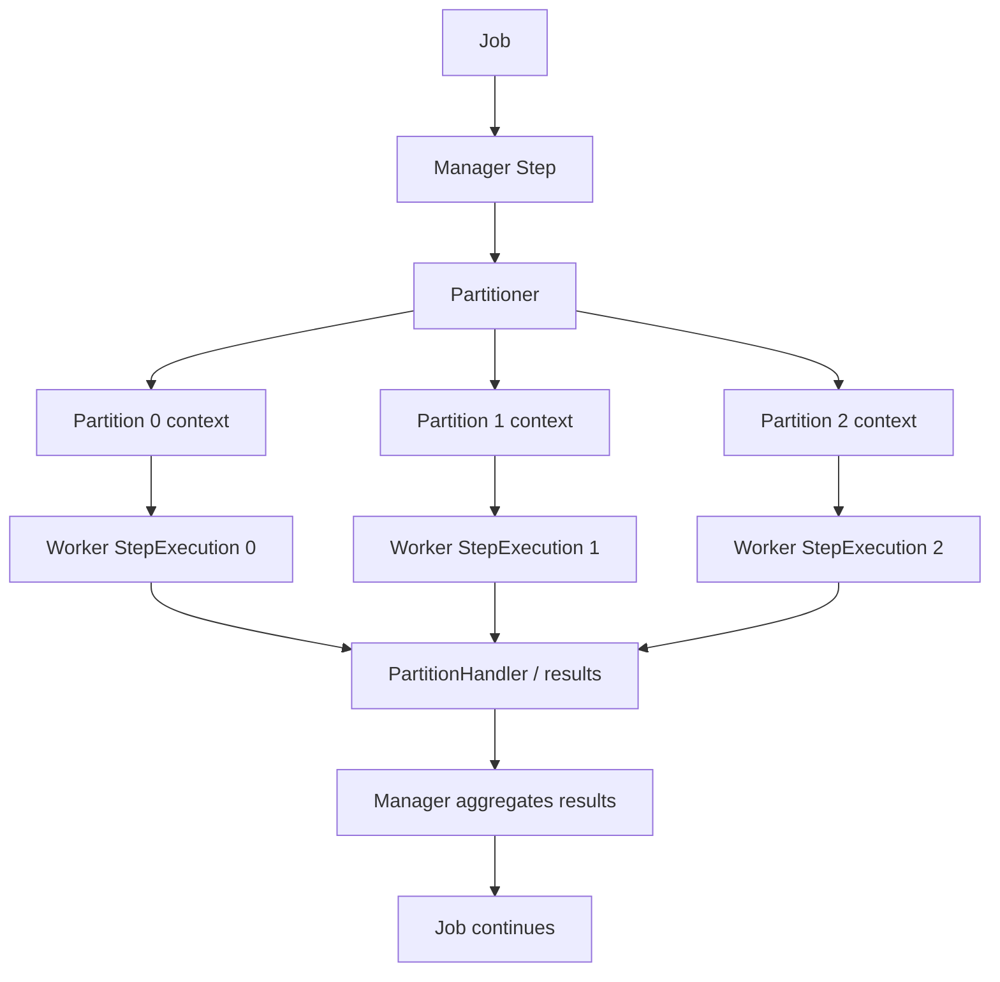

# Worker step processing a partition

In Spring Batch, partitioning splits a step's data range into multiple independent subsets so multiple worker steps can process them concurrently. Each partition has its own `StepExecution` and `ExecutionContext`. The worker step is the step that performs the actual work on its assigned data range—such as reading orders within an ID interval, processing them in chunks, and writing the results.

A coordinating step (manager step) creates the partitions and hands them to the execution mechanism. The worker step describes how to process one partition. The same worker step definition can run multiple times with different `StepExecution`s; each run receives its own context to know which data that partition must process.

Partitioning fits when data can be divided into independent ranges, such as by key interval, business date, geographic region, or customer group. It increases throughput while preserving Spring Batch's chunk-oriented item processing model. For efficiency and correctness, partitions must have clear boundaries, avoid unintended overlap, and be recoverable when one worker fails.

## 1. Manager step and worker step

A partitioned job typically has two roles:

- **Manager step:** coordinates partitioning. It calls `Partitioner` to build the partition list, uses `PartitionHandler` to execute them, and monitors results.
- **Worker step:** executes work on a single partition. A worker is usually a chunk-oriented step with a reader, processor, and writer, though it can also be a tasklet step.

High-level diagram:



The manager step does not read and write individual items on behalf of workers. It splits the work and coordinates worker executions. The worker step is where the reader, processor, writer, or tasklet runs against the data belonging to its partition.

## 2. Worker step runs multiple times with separate contexts

The worker step is typically declared as a single `Step` bean. When the manager creates three partitions, Spring Batch creates separate `StepExecution`s for the three worker runs. These executions share the step definition but have separate partition names/identifiers and contexts.

Example:

| Worker execution | Step ExecutionContext |
|---|---|
| `importOrders:partition0` | `minId=1`, `maxIdExclusive=1001` |
| `importOrders:partition1` | `minId=1001`, `maxIdExclusive=2001` |
| `importOrders:partition2` | `minId=2001`, `maxIdExclusive=3001` |

The actual step name is constructed by Spring Batch from the worker step name and partition name according to the partition handler/splitter mechanism. The key point is that each partition has its own `StepExecution`; it is not a single worker reusing one `StepExecution` while continually mutating its context.

The worker step reads partition-specific data via `stepExecutionContext`. Example:

```java
@Bean
@StepScope
JpaPagingItemReader<Order> partitionOrderReader(
        EntityManagerFactory entityManagerFactory,
        @Value("#{stepExecutionContext['minId']}") Long minId,
        @Value("#{stepExecutionContext['maxIdExclusive']}") Long maxIdExclusive) {

    Map<String, Object> parameters = new HashMap<>();
    parameters.put("minId", minId);
    parameters.put("maxIdExclusive", maxIdExclusive);

    return new JpaPagingItemReaderBuilder<Order>()
            .name("partitionOrderReader")
            .entityManagerFactory(entityManagerFactory)
            .queryString("""
                    select o from Order o
                    where o.id >= :minId
                      and o.id < :maxIdExclusive
                    order by o.id
                    """)
            .parameterValues(parameters)
            .pageSize(500)
            .saveState(true)
            .build();
}
```

`@StepScope` is critical here. It causes the reader to be created within the scope of each `StepExecution`, when partition values are already available. Each worker receives its own `minId` and `maxIdExclusive`, so the query fetches only data belonging to the corresponding partition.

Do not read partition values from a mutable field on a singleton bean. If multiple workers share one reader instance and overwrite `minId`/`maxId`, they can read the wrong range or contend over state.

## 3. Partitioner creates data for workers

`Partitioner` is the component that defines how data is divided. Its `partition(int gridSize)` method returns a map:

- Key is the partition name, such as `partition0`, `partition1`.
- Value is the `ExecutionContext` containing information the worker needs to process that partition.

Example partitioning by ID range using an inclusive lower bound and exclusive upper bound:

```java
public class OrderRangePartitioner implements Partitioner {

    private final long lowerInclusive;
    private final long upperExclusive;

    public OrderRangePartitioner(long lowerInclusive, long upperExclusive) {
        if (upperExclusive < lowerInclusive) {
            throw new IllegalArgumentException("Invalid ID range");
        }
        this.lowerInclusive = lowerInclusive;
        this.upperExclusive = upperExclusive;
    }

    @Override
    public Map<String, ExecutionContext> partition(int gridSize) {
        if (gridSize < 1) {
            throw new IllegalArgumentException("gridSize must be positive");
        }

        long total = upperExclusive - lowerInclusive;
        int partitionCount = total == 0
                ? 1
                : (int) Math.min((long) gridSize, total);

        long baseSize = total / partitionCount;
        long remainder = total % partitionCount;
        long start = lowerInclusive;

        Map<String, ExecutionContext> partitions = new LinkedHashMap<>();

        for (int i = 0; i < partitionCount; i++) {
            long size = baseSize + (i < remainder ? 1 : 0);
            long end = start + size;

            ExecutionContext context = new ExecutionContext();
            context.putLong("minId", start);
            context.putLong("maxIdExclusive", end);

            partitions.put("partition" + i, context);
            start = end;
        }

        return partitions;
    }
}
```

This example splits a contiguous ID interval into roughly equal ranges. When there are no IDs in the range, it creates one empty partition with `minId` equal to `maxIdExclusive`; the worker query will return no items. An application can alternatively choose to check for no data at the manager and skip the worker step via a separate flow.

In real applications, the input range should be determined per specific batch and kept stable throughout the run. If `upperExclusive - lowerInclusive` could exceed integer limits or the ID range could shift, check for overflow and use a partitioning approach tailored to the data domain.

## 4. Configuring the worker step

The worker step typically uses chunk-oriented processing like a normal step. It does not need to know the total number of partitions; it simply reads the specific values supplied in its `ExecutionContext`.

```java
@Bean
Step importOrdersWorkerStep(
        JobRepository jobRepository,
        PlatformTransactionManager transactionManager,
        JpaPagingItemReader<Order> partitionOrderReader,
        ItemProcessor<Order, ImportedOrder> orderProcessor,
        ItemWriter<ImportedOrder> orderWriter) {

    return new StepBuilder("importOrdersWorkerStep", jobRepository)
            .<Order, ImportedOrder>chunk(500, transactionManager)
            .reader(partitionOrderReader)
            .processor(orderProcessor)
            .writer(orderWriter)
            .build();
}
```

When a worker runs for each partition:

1. Spring Batch creates a `StepExecution` for the partition.
2. The worker step opens its registered streams.
3. The reader receives `minId` and `maxIdExclusive` from the partition's Step ExecutionContext.
4. The reader fetches items within that range, the processor processes them, and the writer writes them in chunks.
5. The reader's checkpoint is updated in that partition's own context.
6. The worker finishes and reports its status back to the manager.

Each partition has its own chunk transactions. If worker partition 1 commits a chunk, that transaction is independent of the chunk running in partition 2. This enables parallel processing, but it also means an error in one partition does not automatically roll back committed chunks in another partition.

## 5. Configuring the manager step with TaskExecutor

For local partitioning, the manager step can use a `TaskExecutor` to run the worker step on multiple threads in the same JVM.

Example executor limited to four threads:

```java
@Bean
ThreadPoolTaskExecutor partitionTaskExecutor() {
    ThreadPoolTaskExecutor executor = new ThreadPoolTaskExecutor();
    executor.setCorePoolSize(4);
    executor.setMaxPoolSize(4);
    executor.setQueueCapacity(8);
    executor.setThreadNamePrefix("orders-partition-");
    executor.setWaitForTasksToCompleteOnShutdown(true);
    executor.setAwaitTerminationSeconds(60);
    return executor;
}
```

Declaring the manager step:

```java
@Bean
Step importOrdersManagerStep(
        JobRepository jobRepository,
        Step importOrdersWorkerStep,
        Partitioner orderPartitioner,
        ThreadPoolTaskExecutor partitionTaskExecutor) {

    return new StepBuilder("importOrdersManagerStep", jobRepository)
            .partitioner(
                    importOrdersWorkerStep.getName(),
                    orderPartitioner)
            .step(importOrdersWorkerStep)
            .gridSize(4)
            .taskExecutor(partitionTaskExecutor)
            .build();
}
```

`gridSize(4)` requests creating approximately four partitions when data and `Partitioner` permit. `TaskExecutor` determines how many workers can run concurrently. If there are more partitions than threads, some partitions wait until a thread is free. Grid size does not automatically guarantee that the number of concurrently running threads equals grid size.

In real configurations, balance thread count against the database connection pool, CPU, memory, external system limits, and other running jobs. If each worker needs a database connection, the pool must have enough connections for workers as well as other requests/steps to avoid connection exhaustion.

## 6. Partitioner can compute ranges from JobParameters

Often, the data range to partition depends on `batchId`, business date, or job input parameters. You can make `Partitioner` step-scoped to read runtime parameters:

```java
@Bean
@StepScope
Partitioner orderPartitioner(
        OrderRangeService rangeService,
        @Value("#{jobParameters['batchId']}") String batchId) {

    IdRange range = rangeService.rangeForBatch(batchId);
    return new OrderRangePartitioner(
            range.lowerInclusive(),
            range.upperExclusive());
}
```

`OrderRangeService` is an application service returning the ID range for the batch. `IdRange` can be a record:

```java
public record IdRange(long lowerInclusive, long upperExclusive) {}
```

Because `Partitioner` is invoked when the manager step executes, a step-scoped bean can receive the job's `JobParameters`. Each partition context then contains specific data bounds for workers to use.

If data is identified via a snapshot or staging table, query the range using the same `batchId`. Do not query min/max across the entire table if the job is only supposed to process a subset batch.

## 7. Worker step and StepScope

Worker steps commonly use `@StepScope` beans to receive values from the partition's `ExecutionContext`. Example:

```java
@Bean
@StepScope
ItemProcessor<Order, ImportedOrder> partitionOrderProcessor(
        @Value("#{stepExecutionContext['regionCode']}") String regionCode,
        OrderMapper mapper) {

    return order -> mapper.toImportedOrder(order, regionCode);
}
```

In this example, each `StepExecution` can receive a different `regionCode`. The step-scoped bean is initialized within the worker execution scope and reads the corresponding context value.

Common expressions:

| Expression | Source |
|---|---|
| `#{stepExecutionContext['minId']}` | Step ExecutionContext of the current partition worker |
| `#{jobExecutionContext['batchReference']}` | Job ExecutionContext shared within the job execution |
| `#{jobParameters['batchId']}` | JobParameters of the running job |

The worker step usually uses Step ExecutionContext for partition-specific values like ranges, regions, or file segments. JobParameters and Job ExecutionContext are suitable for data shared across all partitions.

## 8. Distinguishing worker step from manager step

| Characteristic | Manager step | Worker step |
|---|---|---|
| Role | Splits and coordinates work | Performs work on a single partition |
| Main components | `Partitioner`, `PartitionHandler`, worker `Step` | Reader, processor, writer, or tasklet |
| Execution | One coordinating `StepExecution` | Multiple `StepExecution`s, typically one per partition |
| Context | Manager coordination state | Separate context holding partition data and worker checkpoint |
| Transaction | Manages coordination actions via step mechanism | Each worker has its own transactions per chunk or tasklet invocation |
| Outcome | Aggregates worker statuses | Processing status of the corresponding partition |

The manager step should not contain per-order processing logic. The worker step should not create partitions itself or coordinate other workers unless a clearly designed hierarchical architecture is intended.

## 9. Local partitioning and remote partitioning

Partitioning can execute within the same JVM or distribute workers to other processes/machines.

### Local partitioning

With local partitioning, the manager and workers run in the same application. `TaskExecutor` typically dispatches worker steps onto a thread pool.

Advantages:

- Relatively simple configuration.
- No message broker needed to send worker requests.
- Easy to share datasource, services, and application configuration.
- Suitable when utilizing multiple cores on a single instance.

Limitations:

- Workers compete for CPU, heap, and connection pool with web/API traffic and other jobs.
- A JVM failure affects the manager and all local workers simultaneously.
- Cannot scale workers independently across multiple machines using `ThreadPoolTaskExecutor` alone.

### Remote partitioning

With remote partitioning, the manager sends partition execution requests to workers in other processes or nodes over a communication mechanism, typically messaging. Workers receive requests and run the same worker step definition with the partition's context.

Advantages:

- Can scale workers by number of nodes or processing capacity.
- Separates manager and worker resources.
- Suitable for large datasets or requirements to distribute processing across machines.

In return, you must operate a message broker or communication channel, manage send/receive errors, ensure workers use matching job/step configurations, and share an appropriate metadata repository. You also need to handle message redelivery and disconnected worker states.

Remote partitioning differs from remote chunking. In remote partitioning, each worker executes the entire worker step for its assigned partition. In remote chunking, the manager usually reads items and sends chunks to workers to process/write. The two models have different responsibility boundaries and data flows.

## 10. Per-worker checkpoints and restarts

Each partition has its own `StepExecution` and Step ExecutionContext. As the worker processes chunks, readers/writers can update checkpoints in that context. With a JDBC `JobRepository`, step execution metadata and contexts are stored in repository tables managed by Spring Batch.

Example:

| Partition | Range | Worker checkpoint |
|---|---|---|
| partition0 | ID 1–1000 | Reader committed up to ID 650 |
| partition1 | ID 1001–2000 | Reader committed up to ID 1800 |
| partition2 | ID 2001–3000 | Reader committed up to ID 2400 |

If partition2 fails, checkpoints for partition0 and partition1 still reflect their committed progress. When the job is restarted, Spring Batch uses worker execution metadata to determine completed partitions and partitions to resume according to restart rules.

For stable restarts:

- Keep worker step name and partition names stable across runs.
- Generate the same partition ranges when restarting the same JobInstance.
- Use a reader that supports `ItemStream` and saves state.
- Keep source data stable or use an explicit snapshot/watermark.
- Ensure writers are idempotent since uncommitted chunks may be reprocessed.
- Do not delete execution metadata still needed for restarts.

Do not create partitions based on random order or uncontrolled changing data. If a restart produces different partition names or ranges, old metadata may no longer match the new work.

## 11. Non-overlapping data splitting and load balancing

Worker steps are only safe when data ranges are intentionally partitioned.

### Non-overlapping ranges

For ID-based partitioning, use a consistent convention such as `[minId, maxIdExclusive)`. Example:

```text
partition0: [1, 1001)
partition1: [1001, 2001)
partition2: [2001, 3001)
```

With an inclusive lower bound and exclusive upper bound, ID 1001 belongs only to partition1 and is not processed twice. Avoid using inclusive bounds on both ends without careful arithmetic, as it can create overlapping elements.

### Load balancing

Splitting into equal numbers of IDs does not guarantee equal processing times. If some IDs have more associated data or are costlier to process, their corresponding partition will run longer.

Other splitting approaches:

- By business day or month.
- By region/tenant if load is relatively even.
- By hash bucket of a business key.
- By a pre-stored list of partitions in a coordination table.
- By key intervals measured from actual data distribution.

Measure each worker's duration, read/write counts, and error counts. One oversized partition can become a bottleneck even when all other workers have finished.

### Data changing during execution

If partition ranges are determined via min/max at job start while new records continue arriving, define whether new records belong to the current batch or the next batch. A batch ID, cutoff timestamp, snapshot isolation, or staging table can keep the scope stable.

## 12. Transactions and errors across workers

Each worker step processes chunks in its own transaction. Because workers can run concurrently:

- One worker may commit a chunk while another worker is rolling back.
- An error in one partition does not automatically roll back committed chunks in other partitions.
- The manager step aggregates worker results and typically fails if any worker fails under the default policy.
- On restart, completed partitions can be skipped, while incomplete partitions are reprocessed according to metadata and restart policy.

Therefore, the entire partitioned job is not a single transaction. If business rules require results to be published only when all partitions succeed, write data to staging by `batchId`, then use a final step to reconcile and publish results after the manager confirms all workers succeeded.

Writers also need to be idempotent. If a worker is interrupted after an external system accepted a request but before the checkpoint was committed, the same item may be sent again on restart. Use a unique business key, idempotency key, or outbox/inbox for non-transactional side effects.

## 13. Thread safety and shared resources

In local partitioning, multiple worker steps can run concurrently in the same JVM. Watch out for:

- Stateful readers should be `@StepScope` beans or created per `StepExecution`.
- Do not share a single cursor, file handle, or mutable reader state across workers.
- Processors should be stateless or ensure thread safety if they hold shared state.
- Shared repositories/services must handle concurrent transactions.
- The database connection pool must be sufficient for workers and other traffic.
- Shared caches must be thread-safe with appropriate consistency policies.
- File resources need separate names or directories per partition to avoid overwrites.

If workers write to the same table, ensure keys and write scopes do not conflict. If workers produce separate output files, name them by partition or batch ID and use an aggregation step to merge files after all workers complete.

## 14. Observing worker step status

In partitioning, checking only the manager step status is not enough to investigate failures. Inspect each worker `StepExecution`:

- Partition name and StepExecution ID.
- `BatchStatus` and `ExitStatus`.
- `readCount`, `writeCount`, `filterCount`, skip count.
- `commitCount`, `rollbackCount`.
- Start/end timestamps and duration.
- Step ExecutionContext containing the partition range and required checkpoints.
- Worker exception if failed.

`JobExplorer` can query `StepExecution`s of a `JobExecution` to display status per partition. When logging, include `jobExecutionId`, `stepExecutionId`, worker step name, partition name, and `batchId` in MDC/correlation fields to link manager and worker logs.

Do not expose the entire `ExecutionContext` to user-facing APIs. Only expose selected progress fields, as the context may contain internal paths or technical details.

## 15. Common mistakes

**Confusing manager step with worker step.** The manager splits and coordinates; the worker processes data. Place partition readers/writers in the worker step.

**Using a singleton reader with mutable state.** Multiple workers can overwrite each other's positions or ranges. Use `@StepScope` and separate contexts.

**Not passing ranges through ExecutionContext.** Workers do not know which range to process or accidentally read all data. Put partition keys into the context created by `Partitioner`.

**Overlapping or missing ranges.** Inconsistent inclusive/exclusive conventions can cause items to be processed twice or never. Use clear boundary rules and test boundaries.

**Generating unstable partitions on restart.** Changing partition names or ranges can cause old metadata to no longer match. Use a deterministic partitioner based on the batch and a stable data source.

**Increasing grid size without increasing system capacity.** Too many workers can exhaust the connection pool, CPU, or service quotas. Measure load and bound concurrency.

**Assuming all workers share one transaction.** Each worker has its own chunk transactions. One worker failing does not roll back committed chunks of other workers.

**Not checking individual worker executions.** The manager step may report only an overall failure. Use `JobExplorer` and per-partition logs to find the failing worker.

**Using a local TaskExecutor when multi-machine distribution is needed.** An in-JVM thread pool does not create remote workers. Use remote partitioning with an appropriate communication channel when scaling across processes/nodes.

## 16. Testing worker steps and partitioning

Tests must prove both worker logic and how the manager distributes ranges:

1. **Partitioner tests:** verify partition count, partition names, and created contexts.
2. **Boundary checks:** verify ranges do not overlap and do not miss start/end IDs.
3. **Worker step tests:** run the worker with a specific `ExecutionContext` and verify only data in that partition is read/written.
4. **Multi-partition integration tests:** run the manager step with multiple partitions and verify total output equals expected input.
5. **Concurrency tests:** verify workers do not improperly share mutable state and the database withstands concurrent transactions.
6. **Restart tests:** make one worker fail after some chunks, restart with the same JobParameters, and verify completed partitions do not rerun unexpectedly while the failed partition resumes from its checkpoint.
7. **Failure tests:** verify the manager reflects worker failure and the job does not publish incomplete results.
8. **Idempotency tests:** verify reprocessing a worker chunk does not create duplicate data or side effects.
9. **Load tests:** measure per-partition duration, throughput, CPU, heap, and connection pool usage.

Example checking contexts created by the partitioner:

```java
@Test
void createsDisjointRanges() {
    OrderRangePartitioner partitioner =
            new OrderRangePartitioner(1L, 1001L);

    Map<String, ExecutionContext> partitions =
            partitioner.partition(4);

    assertEquals(4, partitions.size());
    assertEquals(1L,
            partitions.get("partition0").getLong("minId"));
    assertEquals(251L,
            partitions.get("partition0").getLong("maxIdExclusive"));
    assertEquals(251L,
            partitions.get("partition1").getLong("minId"));
    assertEquals(1001L,
            partitions.get("partition3").getLong("maxIdExclusive"));
}
```

The example assumes the interval `[1, 1001)` has 1,000 IDs and splits into four equal partitions. Beyond checking a few boundaries, thorough tests should verify the union of intervals equals the exact input range and the intersection of every pair of intervals is empty.

For integration tests, use `JobLauncherTestUtils` or launch the actual manager step/job. Verify business data by batch ID rather than checking only `BatchStatus.COMPLETED`. If testing restarts, `JobRepository` must retain metadata between the initial run and the restart.

## Conclusion

The worker step is the step that performs work for a specific partition. The manager step uses `Partitioner` to create partition names and corresponding `ExecutionContext`s, then uses `PartitionHandler` to distribute worker step executions. Each partition has its own `StepExecution` and Step ExecutionContext, allowing the worker to receive its exact data range, save checkpoints independently, and be monitored separately.

Design the worker step as a step capable of running independently on its assigned range: use `@StepScope` to read partition context, a checkpoint-capable reader, an idempotent writer, and chunk-level transactions. Keep the partitioner deterministic, ranges non-overlapping, concurrency within system capacity, and test restarts and failures. When scaling across multiple machines is required, use remote partitioning with appropriate communication channels and recovery mechanisms; a local thread pool runs workers only within the same JVM.
