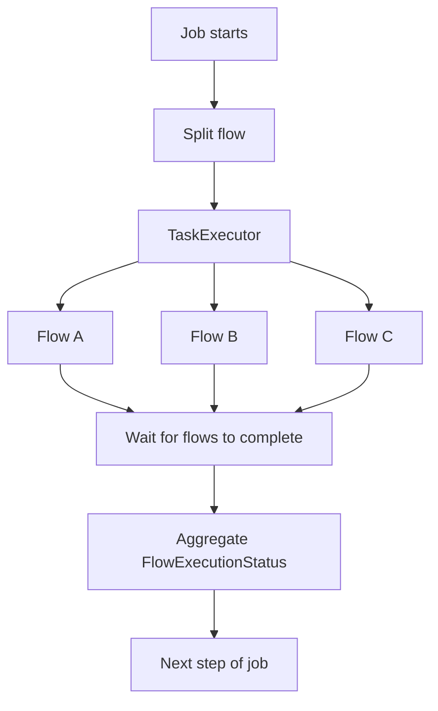

# Running Multiple Flows in Parallel in a Job

Spring Batch allows a job to orchestrate multiple flows running concurrently. This approach is suitable when a process has multiple independent work branches—for example, importing customer data and importing product data can happen at the same time, and only afterward does the job aggregate the overall results.

To run flows in parallel, Spring Batch provides the **split flow** mechanism. A `TaskExecutor` is passed into `split(...)` to execute the flows on different threads. Each flow can contain one or more steps running sequentially. When the branches finish, the split flow aggregates the results and the job continues along the configured flow.

An important point is that parallel flows still belong to the same job execution. Each step has its own `StepExecution` and transaction, while the branches may concurrently access shared resources, job parameters, and the job execution context. Therefore, data, resources, and state must be designed so that branches do not contend with or overwrite each other.

## 1. What is a parallel flow?

A linear job executes steps in order:

```text
prepareStep -> importCustomerStep -> importProductStep -> summaryStep
```

If importing customers and importing products do not depend on each other, running them sequentially can increase total job duration. You can organize them into two flows running concurrently:

```text
                   +-> customerFlow: readCustomers -> writeCustomers --+
prepareStep ------|                                                    |----> summaryStep
                   +-> productFlow: readProducts -> writeProducts ----+
```

`customerFlow` and `productFlow` run in parallel. Within each flow, steps still run sequentially in the declared order. `summaryStep` only starts after the split flow has completed both branches.

A flow is a sequence or orchestration structure of steps. A split flow is a special flow used to execute multiple sub-flows at the same time.

## 2. When should you run multiple flows in parallel?

Parallel flows are suitable when branches can proceed independently and their results can be aggregated afterward.

Examples:

- Importing customer and product data from two different sources.
- Computing independent metric groups before generating a summary report.
- Generating multiple independent output files per region.
- Synchronizing catalog and reference data when the two processes do not overwrite the same resources.
- Validating multiple independent datasets before a shared publish step.

Do not run flows in parallel if flow B needs the result of flow A, if both branches update the same data without a synchronization mechanism, or if the target system cannot handle concurrent load. When dependencies exist, keep a sequential order or split the flows at the exact independence boundary.

## 3. Structure of a split flow

A split flow has three main components:

- **Sub-flows:** each flow describes a branch of work.
- **TaskExecutor:** determines how the flows are executed on threads.
- **Split state:** orchestrates launching the branches, waiting for them to finish, and aggregating the results.

Overview diagram:



Sub-flows are submitted to the executor. When the branches finish, the split flow waits for the results and aggregates the status. If a branch fails, the status of the split flow usually reflects failure according to the default aggregator; the job may enter an error-handling branch or end in failure depending on the transitions.

There is no guaranteed completion order between branches. Flow A may finish before Flow B in one run and finish after Flow B in another run.

## 4. Declaring each sub-flow

Each sub-flow can contain one or more steps. For example, the customer flow reads and normalizes data; the product flow reads data and validates the catalog.

```java
@Bean
public Flow customerFlow(Step readCustomersStep,
                         Step writeCustomersStep) {
    return new FlowBuilder<SimpleFlow>("customerFlow")
            .start(readCustomersStep)
            .next(writeCustomersStep)
            .build();
}

@Bean
public Flow productFlow(Step readProductsStep,
                        Step validateProductsStep) {
    return new FlowBuilder<SimpleFlow>("productFlow")
            .start(readProductsStep)
            .next(validateProductsStep)
            .build();
}
```

In the example:

- `customerFlow` consists of two steps running sequentially.
- `productFlow` also consists of two steps running sequentially.
- The two flows are independent and can be split to run concurrently.

If a flow has its own conditional transitions, you can declare branches inside that flow. Split flow does not require every sub-flow to contain only a single step.

## 5. Configuring a TaskExecutor for parallel flow

`TaskExecutor` determines which thread executes the work. If you use a synchronous executor like `SyncTaskExecutor`, the flows run on the calling thread and there is no real concurrency. To run in parallel, you must use an asynchronous executor, such as `ThreadPoolTaskExecutor`.

Example of configuring a bounded thread pool:

```java
@Bean
public TaskExecutor batchFlowTaskExecutor() {
    ThreadPoolTaskExecutor executor = new ThreadPoolTaskExecutor();
    executor.setCorePoolSize(2);
    executor.setMaxPoolSize(2);
    executor.setQueueCapacity(2);
    executor.setThreadNamePrefix("batch-flow-");
    return executor;
}
```

Spring manages the lifecycle of the `ThreadPoolTaskExecutor` bean, including initialization and shutdown. The thread name prefix makes it easier to distinguish batch threads in logs.

With two flows that need to run concurrently, a pool with two workers is a reasonable starting point for testing. If there are more flows than workers, some flows may have to wait in the queue. Thread counts should not grow unboundedly; they must be bounded according to the capacity of the database, connection pool, CPU, memory, and external services.

### Properties to pay attention to

| Property | Meaning |
|---|---|
| `corePoolSize` | Base number of threads in the pool |
| `maxPoolSize` | Maximum number of threads allowed to be created |
| `queueCapacity` | Number of tasks that can wait in the queue |
| `threadNamePrefix` | Prefix for thread names for log observability |
| Rejection policy | How tasks are handled when both the pool and queue are full |

Choose queue capacity and rejection policy deliberately. An unbounded queue can hold more tasks than expected; a queue that is too small can reject tasks when the system is under load. Do not use an unbounded thread pool in production jobs without accounting for resource limits.

## 6. Building a split flow

After defining the sub-flows and the executor, use `FlowBuilder.split(...)` to combine them:

```java
@Bean
public Flow parallelImportFlow(
        TaskExecutor batchFlowTaskExecutor,
        Flow customerFlow,
        Flow productFlow) {

    return new FlowBuilder<SimpleFlow>("parallelImportFlow")
            .split(batchFlowTaskExecutor)
            .add(customerFlow, productFlow)
            .build();
}
```

`split(batchFlowTaskExecutor)` configures the executor for the sub-flows. `.add(...)` provides the list of flows to run in parallel.

This is flow-level parallelism configuration. Each sub-flow can still contain multiple steps, and the steps within a flow are executed according to its flow definition.

## 7. Placing an aggregation step after the flows complete

A job can start with a split flow and then run an aggregation step:

```java
@Bean
public Job catalogImportJob(
        JobRepository jobRepository,
        Flow parallelImportFlow,
        Step summaryStep) {

    return new JobBuilder("catalogImportJob", jobRepository)
            .start(parallelImportFlow)
            .next(summaryStep)
            .end()
            .build();
}
```

`summaryStep` is only orchestrated after the split flow returns a result, meaning the sub-flows have finished according to the split's join mechanism. This is the right place to read persisted results, verify aggregated metrics, or publish data.

Do not let `summaryStep` read an in-memory variable that sub-flows are updating concurrently. Use committed data in the database, separate output files, or a context updated through a safe mechanism after the branches complete.

## 8. Complete example: importing customers and products in parallel

Suppose a job needs to import customer and product data from two separate files. The two sources are independent and write to two different tables. After both finish, the job generates a summary report.

```java
@Configuration
public class ParallelImportConfiguration {

    @Bean
    public TaskExecutor batchFlowTaskExecutor() {
        ThreadPoolTaskExecutor executor = new ThreadPoolTaskExecutor();
        executor.setCorePoolSize(2);
        executor.setMaxPoolSize(2);
        executor.setQueueCapacity(2);
        executor.setThreadNamePrefix("batch-flow-");
        return executor;
    }

    @Bean
    public Flow customerFlow(Step readCustomersStep,
                             Step writeCustomersStep) {
        return new FlowBuilder<SimpleFlow>("customerFlow")
                .start(readCustomersStep)
                .next(writeCustomersStep)
                .build();
    }

    @Bean
    public Flow productFlow(Step readProductsStep,
                            Step writeProductsStep) {
        return new FlowBuilder<SimpleFlow>("productFlow")
                .start(readProductsStep)
                .next(writeProductsStep)
                .build();
    }

    @Bean
    public Flow parallelImportFlow(
            TaskExecutor batchFlowTaskExecutor,
            Flow customerFlow,
            Flow productFlow) {
        return new FlowBuilder<SimpleFlow>("parallelImportFlow")
                .split(batchFlowTaskExecutor)
                .add(customerFlow, productFlow)
                .build();
    }

    @Bean
    public Job catalogImportJob(
            JobRepository jobRepository,
            Flow parallelImportFlow,
            Step summaryStep) {
        return new JobBuilder("catalogImportJob", jobRepository)
                .start(parallelImportFlow)
                .next(summaryStep)
                .end()
                .build();
    }
}
```

In this example, the two flows can run concurrently on two threads. Only when both flows complete does the job run `summaryStep`.

If customer and product data have foreign-key relationships, verify whether concurrent writes violate dependency order. For example, if products must reference a catalog record that is only created in the customer flow, the two flows are not independent and you need to redesign the order or add a data preparation step.

## 9. No global ordering across flows

When running in parallel, ordering between flows is not guaranteed. Given two flows A and B:

```text
Flow A: A1 -> A2 -> A3
Flow B: B1 -> B2
```

The guaranteed relationships are:

- A1 completes according to the flow before A2 is run.
- A2 completes according to the flow before A3 is run.
- B1 completes according to the flow before B2 is run.
- The split flow waits for the sub-flows to complete before the job continues.

The non-guaranteed relationships are:

- A1 must run before B1.
- A3 must finish before B2.
- A and B must complete in a fixed order across runs.

If one branch needs data from another branch, put them in the same sequential flow or add a dependent step after the source branch completes. Do not use `Thread.sleep`, mutable flags, or speed assumptions to control ordering between flows.

## 10. Transactions in parallel flows

Each step inside a flow has its own transaction according to the step's configuration. For chunk-oriented steps, each chunk has its own transaction. Two flows running concurrently can open independent transactions at the same time.

That means:

- Once Flow A successfully commits a chunk, that chunk's data may already be persisted.
- Flow B may still be processing or may fail.
- If Flow B fails, Spring Batch does not automatically roll back Flow A's already-committed transactions.
- The overall job may end in `FAILED` even though one branch completed successfully.

Parallel flows do not create a distributed transaction spanning all branches. If business requirements dictate all-or-nothing publication, consider writing to a staging area, checking results after the join, and publishing in a final step. If compensation is required, build explicit compensation logic.

### Data contention and deadlocks

Two flows may update the same table or lock the same data. If they lock rows in different orders, deadlocks can occur. You should:

- Partition data so branches write to non-overlapping ranges.
- Use a consistent lock acquisition order.
- Keep transactions at an appropriate size.
- Configure bounded retries for transient errors like deadlocks.
- Monitor lock waits and the connection pool as you increase the number of flows.

Do not increase thread counts based solely on CPU cores. For database-writing jobs, bottlenecks usually lie in the connection pool, I/O, locks, or transaction logs.

## 11. ExecutionContext and shared data

Each `StepExecution` has its own `ExecutionContext`. This is the right place for a reader or step to store its own checkpoints.

`JobExecution` has a job execution context shared across steps in the same execution. When multiple flows run concurrently, branches can access the job context at the same time. If multiple branches update the same key or mutate a shared mutable structure, race conditions or overwritten values can occur.

Principles to apply:

- Each flow writes checkpoints to that step's own step execution context.
- Avoid having branches write to the same key in the job execution context.
- If results must be shared, write to separate storage per flow or step, then aggregate after the split completes.
- Store keys/IDs in the context instead of large collections.
- Do not assume a deterministic update order for the job context across threads.

For example, the customer flow writes `customerImportCount` into its step context; the product flow writes `productImportCount` into its step context. `summaryStep` after the join can read the metadata of the step executions to aggregate. This avoids two flows concurrently writing to a single mutable summary object in the job context.

`JobParameters` are shared inputs of the job and should not be modified inside flows. If each flow needs a different data range, you can combine shared parameters with per-step configuration or pre-prepared data.

## 12. Thread safety of readers, processors, and writers

Parallel flows allow steps in different branches to run at the same time. Singleton beans injected into multiple steps may be used concurrently.

Points to check:

- **Stateful readers:** a reader holding a cursor, file handle, or current index should not be shared across independent step executions unless designed for concurrency.
- **Processors:** a processor with mutable fields or a non-thread-safe cache can suffer concurrent access issues.
- **Writers:** a writer using shared buffers, output files, or counters needs synchronization or separation per branch.
- **Singleton services:** shared services must be thread-safe, especially when holding state in fields.
- **External resources:** connections, API clients, and file handles must have proper lifecycle management.

For stateful readers/writers, declare beans with step execution scope using `@StepScope` when late binding and isolated state are needed. Step scope creates a separate instance per step execution, though it does not automatically make every internal collaborator thread-safe.

Do not share the same `FlatFileItemReader` or the same writer writing to a single file between two flows if both branches can read/write concurrently. Use separate resources per branch or a clearly designed synchronization/centralized-writing mechanism.

## 13. Resource limits and thread pool sizing

The number of flows running in parallel should be chosen based on the capacity of the entire system.

Suppose each flow can open one database connection and the job has four flows. If the thread pool allows all four flows to run concurrently, the connection pool must have enough connections for the batch job while still reserving capacity for other applications. If the connection pool only has two connections, the remaining two flows may wait or cause contention.

When choosing concurrency, consider:

- The actual number of flows and steps that can be active concurrently.
- The number of connections required per step.
- Connection pool and database limits.
- JVM CPU and heap.
- Rate limits, concurrent request limits, and timeouts of external APIs.
- File or object storage read/write bandwidth.
- Other jobs running concurrently on the same infrastructure.

A larger thread pool does not guarantee higher throughput. Once the database or external service is saturated, adding threads only increases queuing, lock waits, and timeouts.

Start with a thread count close to the number of flows needed to run concurrently, measure load, and scale up incrementally if resource headroom remains. Use a bounded executor to avoid creating an uncontrolled number of threads.

## 14. Error handling in a parallel branch

If a sub-flow fails, the split flow status is usually aggregated as failed according to the default aggregator. The job can define a transition from the split flow to an error-handling step.

Conceptual example:

```java
@Bean
public Job parallelImportJob(
        JobRepository jobRepository,
        Flow parallelImportFlow,
        Step failureSummaryStep,
        Step publishStep) {

    return new JobBuilder("parallelImportJob", jobRepository)
            .start(parallelImportFlow)
                .on("FAILED").to(failureSummaryStep)
            .from(parallelImportFlow)
                .on("*").to(publishStep)
            .from(failureSummaryStep)
                .on("*").fail()
            .from(publishStep)
                .on("*").end()
            .end()
            .build();
}
```

This configuration illustrates routing based on the exit code of the split flow. If a branch fails, `failureSummaryStep` can aggregate branch statuses, write a report, and then the job ends in `FAILED`.

Do not assume one failing branch will immediately cancel all other branches. Flows already submitted may still continue or finish before the split returns its result. Therefore, the other branches may have already committed data when the overall job fails.

If you want to stop early when one branch fails, you need a custom cancellation/orchestration mechanism and must understand the limitations of the task executor and the state of running steps. Even when a thread is cancelled, external operations or already-committed transactions are not automatically undone.

## 15. Aggregating flow statuses

The split flow receives the result from each sub-flow and aggregates them into a single `FlowExecutionStatus`. With the default aggregator, a failure status from one branch can cause the split flow status to become `FAILED`, even when other branches completed successfully.

Example:

| Flow | Result | Meaning |
|---|---|---|
| `customerFlow` | `COMPLETED` | Customer import succeeded |
| `productFlow` | `FAILED` | Product validation failed |
| Split flow | Usually `FAILED` | A branch did not complete successfully |
| Job | Depends on transition | Can handle error and then end in `FAILED` |

If different aggregation rules are needed, Spring Batch provides `FlowExecutionAggregator` so applications can customize status aggregation. Only use a custom aggregator when there is a clear business rule. Do not turn a `FAILED` result into `COMPLETED` just to let the job continue if required data from a branch is not ready.

If branches produce custom exit codes such as `COMPLETED_WITH_WARNINGS`, clearly define how the split flow aggregates those codes and write tests for all possible combinations.

## 16. Restarting after a parallel flow failure

When a job has a split flow and one branch fails, completed steps in other branches may have already persisted `COMPLETED` metadata. When restarting the same `JobInstance` with the same identifying parameters, Spring Batch uses the metadata of each step to decide which parts need to run again.

Example:

```text
customerFlow:
  readCustomersStep  -> COMPLETED
  writeCustomersStep -> COMPLETED

productFlow:
  readProductsStep   -> COMPLETED
  writeProductsStep  -> FAILED

Job -> FAILED
```

On restart, already-completed steps typically do not run again in a normal restart; the failed step resumes according to its restartability and checkpoint. This avoids repeating an entire completed branch.

For safe restarts:

- Use the same job name and identifying parameters to continue the same `JobInstance`.
- Ensure the failed step's reader saves state if it needs to resume from a checkpoint.
- Do not modify the input data source between the initial run and the restart if checkpoints rely on position.
- Design idempotent writers because uncommitted chunks may be reprocessed.
- Check whether already-completed steps have side effects that need confirmation before running subsequent branches.

If `allowStartIfComplete(true)` is configured for a step, that step may be re-executed on restart according to configuration rules. Enable it only when the operation can be re-run safely and there is a clear business reason.

## 17. Sharing outputs across flows

Two parallel flows often need to produce separate outputs, which a final step then combines.

Example:

- `customerFlow` creates `customers-part.csv`.
- `productFlow` creates `products-part.csv`.
- `summaryStep` reads both files and generates a combined report.

Each flow should write to its own path. Do not let two writers write to the same file without synchronization, as contents can become interleaved or corrupted.

If output paths are generated dynamically, you can store them in the step execution context of the respective branch, then read them after the split completes via step execution metadata. If you want to promote a key to the job context, do so after the branches have joined or use an aggregation step; avoid having multiple threads update the job context concurrently.

For database outputs, you can write to separate staging tables or use a partition key to isolate data. The final step only publishes after verifying that all required branches have completed.

## 18. How parallel flow differs from multi-threaded steps and partitioning

Spring Batch offers multiple ways to run work in parallel. Choosing the right mechanism keeps configuration simple and avoids using the wrong concurrency scope.

| Mechanism | Unit of parallel execution | Suitable example |
|---|---|---|
| Split/parallel flow | Different flows within the same job | Importing customers and products independently |
| Multi-threaded step | Item/chunk executions within the same step | One step processing multiple items concurrently when reader/processor/writer are suitable |
| Partitioning | Multiple partitions of the same step, each with its own execution context | Splitting a table by ID range or tenant for parallel processing |
| Remote chunking | Sending chunks to workers in another process/machine | Decoupling coordinator and workers when distributed processing is needed |
| Multiple independent JobExecutions | Jobs launched separately by a launcher/scheduler | Independent business periods or workflows |

Split flow is suitable when branches execute different processes. If the goal is to split a large dataset into multiple parts executing the same step logic, partitioning is usually more appropriate.

Multi-threaded steps also differ from split flows: concurrency happens inside the same step, so the reader and processing components must meet the thread-safety requirements of that model. With split flows, each branch typically has separate step executions.

## 19. Testing parallel flows

Testing needs to verify both business outcomes and that the branches can genuinely run concurrently.

### Verifying flow completion

Use `JobLauncherTestUtils` to launch the job and check:

- The job finishes `COMPLETED` when all branches succeed.
- Steps of all sub-flows have corresponding `StepExecution` records.
- The post-split step only runs after the branches finish.
- Each branch's output contains the expected data.

Skeleton example:

```java
@SpringBatchTest
@SpringJUnitConfig(ParallelJobTestConfiguration.class)
class ParallelFlowIntegrationTest {

    @Autowired
    private JobLauncherTestUtils jobLauncherTestUtils;

    @Test
    void completesBothFlowsBeforeSummaryStep() throws Exception {
        JobExecution execution = jobLauncherTestUtils.launchJob(
                new JobParametersBuilder()
                        .addString("runKey", "parallel-test-01", true)
                        .toJobParameters());

        assertEquals(BatchStatus.COMPLETED, execution.getStatus());

        Set<String> completedSteps = execution.getStepExecutions().stream()
                .filter(step -> step.getStatus() == BatchStatus.COMPLETED)
                .map(StepExecution::getStepName)
                .collect(Collectors.toSet());

        assertTrue(completedSteps.contains("readCustomersStep"));
        assertTrue(completedSteps.contains("readProductsStep"));
        assertTrue(completedSteps.contains("summaryStep"));
    }
}
```

This is an illustrative skeleton; the test configuration must provide the job and test steps. You can use isolated test data and clean up metadata with `JobRepositoryTestUtils` between tests.

### Verifying actual concurrency

Do not inspect log ordering to conclude that two flows ran in parallel. The thread scheduler can change execution order between runs.

You can use a `CountDownLatch` in test tasklets:

1. Each branch decrements a latch when it starts.
2. Each branch waits on the latch signaling that the other branch has also started.
3. If both branches start within the time limit, the test confirms the executor allows overlap.
4. Use a timeout so the test does not hang if the configuration accidentally runs synchronously.

Only use the latch mechanism in tests; do not put artificial synchronization into production tasklets. Tests should also have an overall timeout to avoid holding threads indefinitely on failure.

### Testing failure and restart

Add cases for:

- One flow fails while the other completes; the split flow and job have the expected statuses.
- The post-split step does not run if the split flow fails and the flow has no recovery branch.
- The recovery branch runs if a `FAILED` transition is configured.
- Restarting with the same identifying parameters does not re-run already-completed steps under normal configuration.
- The failed step restores its checkpoint properly and does not create duplicate data.
- A failure in one branch does not unexpectedly lose data committed by another branch.

## 20. Monitoring and operating parallel flows

When multiple flows run at the same time, logs must help identify which branch an event belongs to.

You should log:

- Job name and JobExecution ID.
- Step name and StepExecution ID.
- Flow name or partition/business key if the application has one.
- Thread name.
- Start/end timestamps and execution duration.
- BatchStatus, ExitStatus, and exception if any.
- Read/write/filter/skip and commit/rollback counts for each step.

When investigating a slow job, inspect the duration of each flow. Total job time is usually dominated by the slowest branch plus orchestration overhead, not the sum of all branches' durations. If one flow takes 10 minutes and the other takes 2 minutes, the split duration will be closer to 10 minutes if both flows genuinely run concurrently without significant resource contention.

Also monitor connection pools, database lock waits, CPU, heap/GC, API latency, and executor queues. If a flow is slow waiting for connections, increasing the thread pool can make the problem worse.

## 21. Common design mistakes

| Situation | Cause | Solution |
|---|---|---|
| Flows still run sequentially | Using a synchronous executor or a pool with only one worker | Configure an asynchronous executor with appropriate concurrency |
| Job gets slower after adding parallel flows | Database/API is saturated or flows contend on locks | Measure the bottleneck, bound concurrency, and separate data ranges |
| Aggregation step reads incomplete data | Aggregation step runs before split finishes or reads uncommitted sources | Place after split flow and read only committed data |
| Output data is interleaved | Multiple writers write to the same file or buffer | Use separate outputs per branch or a clearly designed synchronized writer |
| Context gets overwritten | Multiple flows update the same key in the job context | Use separate step contexts and aggregate after the join |
| Reader fails under concurrent runs | Stateful reader is shared across multiple step executions | Use step-scoped instances or a thread-safe reader |
| One branch fails but another still writes data | Flows ran independently and transactions already committed | Design staging, compensation, or idempotency |
| Restart processes duplicates | Writer is not idempotent or identifying parameters changed | Use the same JobInstance and guard write operations on re-run |
| Thread pool rejects tasks | Pool/queue is too small or rejection policy is unsuitable | Tune limits in a controlled manner and monitor the queue |
| Job fails to reflect a branch's warning | Custom exit status is not aggregated or routed properly | Define the aggregator and test each status combination |

## 22. Design process for a job with parallel flows

1. **Identify independent branches:** list inputs, outputs, and dependencies for each branch.
2. **Organize steps within each flow:** keep sequential order inside each branch.
3. **Create a bounded executor:** choose thread count according to the number of flows and system resources.
4. **Declare the split flow:** use `.split(taskExecutor).add(flowA, flowB, ...)`.
5. **Place the join/aggregation step:** run only after all branches complete.
6. **Define the failure policy:** specify what happens when a branch fails or returns a warning exit code.
7. **Design isolated state and outputs:** avoid concurrent writes to shared mutable context or the same unsynchronized file.
8. **Verify transactions and idempotency:** protect data when one branch commits while another fails.
9. **Test concurrency and restart:** verify overlap, statuses, checkpoints, and data after failure.
10. **Measure production-like performance:** monitor bottlenecks and then tune thread pool and transaction sizes.

## 23. Key principles to remember

- A split flow uses `TaskExecutor` to run multiple sub-flows within the same job execution.
- Steps within a flow still run in order; ordering across flows is not guaranteed.
- A split flow waits for its branches to finish before allowing the job to continue to the next step.
- Synchronous executors do not create concurrency; use a bounded asynchronous thread pool.
- A failed branch usually causes the split flow to fail under the default aggregator; configure explicit error-handling transitions.
- Data committed by one branch is not automatically rolled back when another branch fails.
- Each step has its own transaction and step execution; there is no atomic transaction spanning all flows.
- Step execution context is suitable for storing isolated state; avoid multiple flows writing concurrently to the job execution context.
- Readers, processors, writers, and singleton services must be thread-safe or created per step execution.
- The thread pool must match the connection pool, database, CPU, heap, and external service limits.
- Use separate outputs per branch and aggregate after the split; do not rely on completion order.
- Split flow differs from multi-threaded step and partitioning; choose the mechanism based on the unit of work to parallelize.
- Test results, actual concurrency, branch failure, and restart; do not rely on log order.

Running multiple flows in parallel shortens job duration when branches are genuinely independent and infrastructure has remaining concurrent capacity. Properly designing split flows, bounded executors, isolated state, and post-join aggregation steps increases throughput while keeping transactions, errors, and restarts under control.
