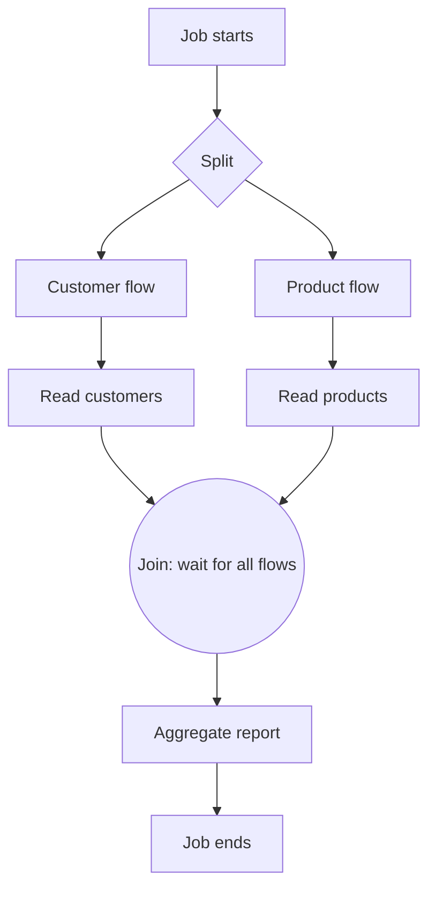
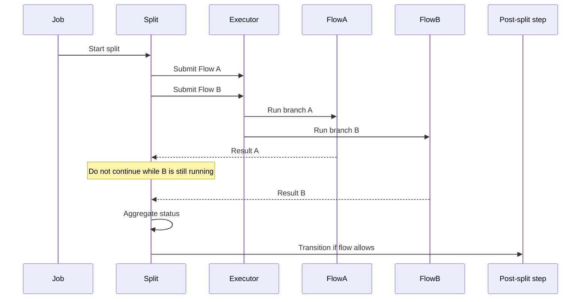
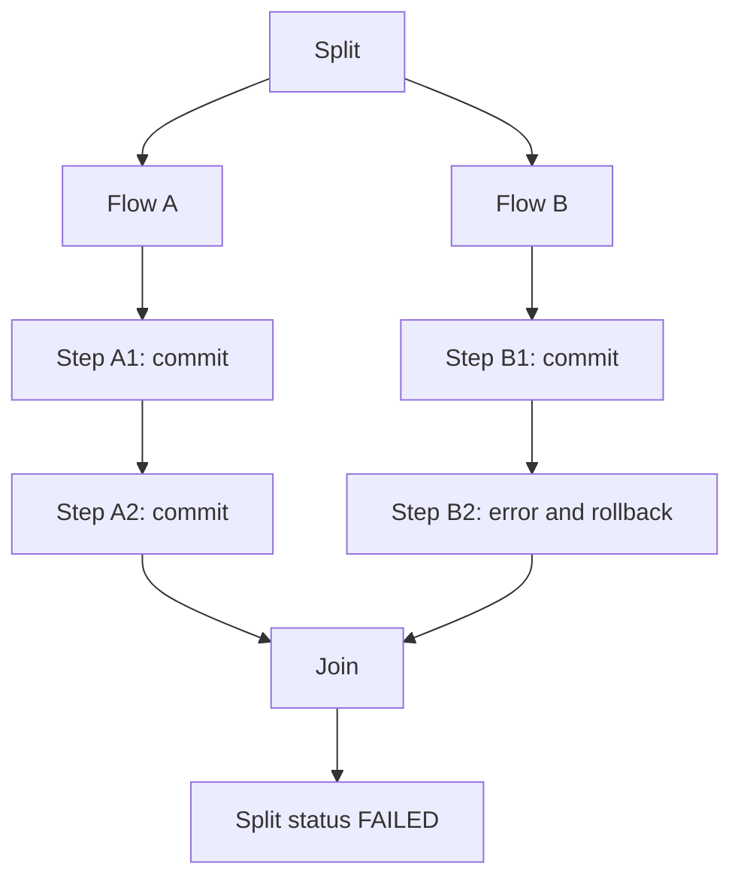
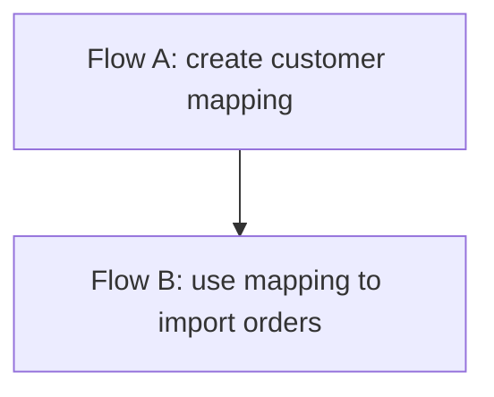
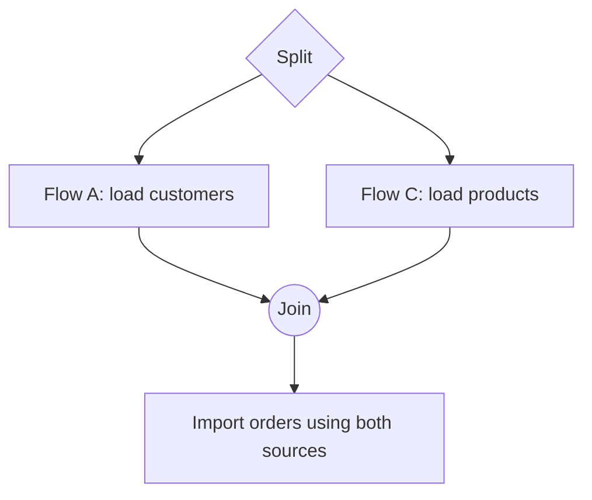
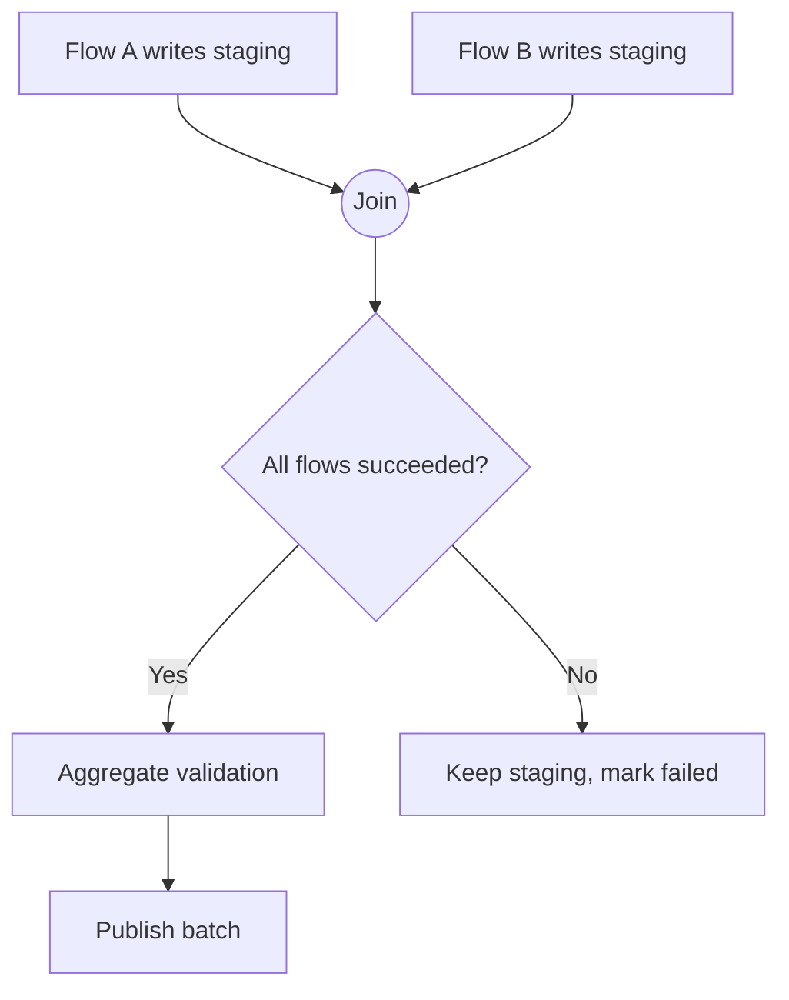

# Synchronizing When Flows Complete

In Spring Batch, a job can run multiple independent flows in parallel via the split mechanism. Each flow executes its own group of steps, typically on different threads. When an aggregation step needs to run after those branches, the job must know that all flows have completed.

Spring Batch solves this with the **synchronization point (join barrier) of split**: the flows inside a split execute concurrently according to the TaskExecutor, the framework collects their results, and it only continues the downstream flow once the branches have returned their results. A step placed after the split can therefore use the outputs produced by those branches.

This synchronization point only coordinates when execution continues. It **does not create a single shared transaction for all flows**. Each step still manages its own transaction; one branch may have already committed data before another branch fails. Designing parallel flows requires accounting for the join, failure states, shared data, and recoverability.

## 1. Parallel flows and the synchronization point

A flow is a sequence of steps or transitions describing part of a workflow. When work segments are independent, you can put them into separate flows and use split to run them in parallel.

For example, a report preparation job needs to load customer data and product data. These two tasks are independent, yet the aggregation step needs both sources:



The join point is the logical boundary between parallel processing and processing that needs results from all branches. When one flow finishes earlier, it does not trigger the aggregation step immediately; the job still must collect results from the remaining flows in the same split.

### Synchronization does not mean sequential execution

Split can use an asynchronous TaskExecutor to run flows on multiple threads. Even so, the flow after the split only continues after the split has collected the results from the branches.

We can distinguish:

- **Parallel execution**: flows can run concurrently.
- **Join synchronization**: the workflow after the split waits for results from all flows.
- **Transactions**: each step/chunk manages commits or rollbacks via its own transaction manager.

Join is a workflow coordination mechanism. It does not merge transactions and does not undo data from committed branches.

## 2. Configuring split with TaskExecutor

Spring Batch provides FlowBuilder to describe splits. One flow is passed to start and the remaining flows are added via split(...).add(...).

Example:

```java
@Bean
Flow customerFlow(Step loadCustomersStep) {
    return new FlowBuilder<SimpleFlow>("customerFlow")
            .start(loadCustomersStep)
            .build();
}

@Bean
Flow productFlow(Step loadProductsStep) {
    return new FlowBuilder<SimpleFlow>("productFlow")
            .start(loadProductsStep)
            .build();
}

@Bean
Flow parallelPreparationFlow(
        TaskExecutor parallelFlowTaskExecutor,
        Flow customerFlow,
        Flow productFlow) {

    return new FlowBuilder<SimpleFlow>("parallelPreparationFlow")
            .start(customerFlow)
            .split(parallelFlowTaskExecutor)
            .add(productFlow)
            .build();
}
```

In this configuration, customerFlow and productFlow are two branches of the same split. TaskExecutor determines how they execute. After the combined flow is created, the parent job can place a step that depends on the results of both flows:

```java
@Bean
Job customerProductReportJob(
        JobRepository jobRepository,
        Flow parallelPreparationFlow,
        Step buildReportStep) {

    return new JobBuilder("customerProductReportJob", jobRepository)
            .start(parallelPreparationFlow)
            .next(buildReportStep)
            .end()
            .build();
}
```

buildReportStep executes only after the split flow ends and branch results have been aggregated. This is the appropriate place for operations needing data from both customerFlow and productFlow.

### TaskExecutor must be genuinely asynchronous

Split accepts a TaskExecutor. If SyncTaskExecutor is used, flows run on the calling thread and no real concurrency occurs. To run in parallel, configure an appropriate asynchronous executor.

Example using a bounded thread pool:

```java
@Bean
ThreadPoolTaskExecutor parallelFlowTaskExecutor() {
    ThreadPoolTaskExecutor executor = new ThreadPoolTaskExecutor();
    executor.setCorePoolSize(2);
    executor.setMaxPoolSize(2);
    executor.setQueueCapacity(10);
    executor.setThreadNamePrefix("batch-flow-");
    return executor;
}
```

Spring manages the lifecycle of the executor bean. In production, choose the thread count based on concurrent flows, database connection limits, CPU, and target system capacity. Do not default to creating an unbounded thread per launch.

## 3. How does the join barrier work?

At a logical level, split performs these steps:

1. Receives the list of flows to run.
2. Submits each flow to TaskExecutor.
3. Each flow executes its own steps and transitions.
4. Split collects execution results from the flows.
5. FlowExecutionAggregator aggregates the statuses.
6. The workflow continues based on the split result after the branches have returned their results.



If Flow A completes after 5 seconds while Flow B takes 30 seconds, the part after the split must wait for Flow B to return its result. The wait duration of the split depends at minimum on the slowest branch, plus orchestration overhead.

This is why the post-split step can assume the flows have finished executing. However, the subsequent step still needs to validate business outcomes: a flow might complete without producing any records, or complete with warnings per application rules.

## 4. FlowExecutionAggregator and split results

Each flow returns a FlowExecutionStatus. Split must aggregate those statuses into a single combined status so the parent flow can decide the next transition.

Spring Batch uses FlowExecutionAggregator; the default aggregation selects the highest-precedence status according to FlowExecutionStatus comparison order. Therefore, a branch returning FAILED cannot be treated as a normally completed split just because another branch returned COMPLETED.

Common statuses:

| FlowExecutionStatus | Meaning |
|---|---|
| COMPLETED | Flow completed |
| FAILED | Flow failed |
| STOPPED | Flow stopped |
| UNKNOWN | Unknown status |

Examples:

| Flow A | Flow B | Resulting action |
|---|---|---|
| COMPLETED | COMPLETED | Split completed; can proceed |
| COMPLETED | FAILED | Split reflects failure; do not run normal success branch |
| FAILED | FAILED | Split failed |
| STOPPED | COMPLETED | Handle stopped status according to flow policy |

If the application configures a custom aggregator, the combination rules may differ. Do not write a custom aggregator that discards failure information from a branch or turns an unsuccessful status into COMPLETED without an explicit business policy.

### Routing after split based on outcome

Transitions can be defined based on the outcome of the split flow:

```java
@Bean
Job parallelJob(
        JobRepository jobRepository,
        Flow parallelPreparationFlow,
        Step buildReportStep,
        Step recordFailureStep) {

    return new JobBuilder("parallelJob", jobRepository)
            .start(parallelPreparationFlow)
                .on("COMPLETED").to(buildReportStep)
            .from(parallelPreparationFlow)
                .on("FAILED").to(recordFailureStep)
            .from(recordFailureStep)
                .on("*").fail()
            .end()
            .build();
}
```

Here, the report aggregation branch only runs when the split returns COMPLETED. If a flow fails and the split returns FAILED, the job follows the failure recording branch. Transitions must match the statuses actually emitted by the flow.

## 5. When one flow runs longer than others

The join barrier makes fast flows wait for the slowest flow before the workflow moves on. This is the right behavior if the downstream step depends on all branches.

Example:

| Flow | Assumed duration | Result |
|---|---:|---|
| Customers | 8 seconds | COMPLETED |
| Products | 45 seconds | COMPLETED |
| Pricing and promotions | 20 seconds | COMPLETED |
| Join | Waits until all three return results | COMPLETED |
| Aggregation | Starts after join | Runs when all flows finish |

If a flow can hang indefinitely due to an HTTP call, database lock, or waiting file read, the job can also wait for a very long time at the split. Therefore, each branch needs appropriate I/O timeouts, bounded retries, and handling for deadline overruns.

Do not implement timeouts by arbitrarily ignoring an unfinished flow and still running a dependent step. If the business allows missing a source, turn that into an explicit status like PARTIAL or DEGRADED and design the downstream step to handle missing data deliberately.

### Do not confuse timeout with join

Join waits for flows to finish. Timeouts on HTTP clients, database queries, or monitoring mechanisms are how you bound time spent inside a flow. TaskExecutor does not automatically give every step a business timeout.

If you need to cancel a running branch when another branch fails, design a controlled cancellation mechanism. Do not assume a failing flow will always automatically stop remaining flows immediately; a step calling an external system may continue until that operation completes or times out.

## 6. Transactions of flows remain independent

Split synchronizes execution results, not transactions. Each step in the flows still creates transactions according to its own step configuration.

Example:



In this situation, transactions already committed in Flow A and Step B1 remain. The failing chunk or step can roll back via its transaction manager. The job does not have an outer transaction to undo all branches.

Consequently:

- One branch may have already written data even if the split ultimately fails.
- The post-split step normally does not run along the success branch if the aggregated result is FAILED.
- Restart must know which branches finished, which failed, and what data was committed.
- Writers need to be idempotent or use business keys to avoid duplicate writes when a flow re-runs.

Join is a control-flow barrier, not a commit barrier across multiple resources.

## 7. Shared data across flows

Flows in the same job can access the same JobParameters and the same JobExecution context. That does not mean multiple branches can freely write to the same key without contention.

Avoid letting two flows update a mutable value or write to the same key in JobExecutionContext. Concurrent updates can cause race conditions, lost updates, or timing-dependent outcomes.

### Use StepExecutionContext for isolated checkpoints

Each step has its own StepExecution and Step ExecutionContext. Flow A's reader should store checkpoints in step A's context; Flow B's reader stores checkpoints in step B's context.

Do not use JobExecutionContext as a thread-safe shared area. If flows need to exchange results, use a data mechanism with a clear contract:

- Each flow writes to its own staging table with a batch ID.
- Each flow writes to a deterministically named file/object.
- Use a results table with a unique key by batch and data type.
- Use a thread-safe service or proper synchronization if sharing only small in-memory state.

After the join, the aggregation step reads results from the written and committed sources. This makes inter-branch data observable, verifiable, and recoverable.

### Do not pass large mutable objects through context

Do not store large collections or mutable entities in the job context for another flow to read. Store IDs, versions, checksums, or small state. The actual data resides in staging/database/object storage and is read back after the join.

## 8. Designing the post-split step

The post-split step is typically where you:

- Reconcile output counts from each flow.
- Combine staging data.
- Verify checksums or source versions.
- Generate summary reports.
- Publish the final results.

Example aggregation tasklet:

```java
@Bean
Step buildReportStep(
        JobRepository jobRepository,
        PlatformTransactionManager transactionManager,
        ReportAssembler reportAssembler) {

    return new StepBuilder("buildReportStep", jobRepository)
            .tasklet((contribution, chunkContext) -> {
                String batchId = chunkContext.getStepContext()
                        .getJobParameters()
                        .get("batchId")
                        .toString();

                reportAssembler.buildFor(batchId);
                return RepeatStatus.FINISHED;
            }, transactionManager)
            .build();
}
```

The example assumes two flows wrote data to staging under the same batchId. The aggregation step only runs after the split completes and reads staging to build the report. In production, verify that each source produced valid artifacts, expected counts, and flow statuses before publishing.

Do not let the aggregation step rely on a static Java variable or singleton updated by the flows. Using durable data keyed by batch ID makes restarts and observability much clearer.

## 9. Determining whether flows are truly independent

Only put flows into a split when they can proceed independently. If Flow B needs results produced by Flow A, the two flows should not run in parallel that way.

Unsuitable example:



If B needs A's data, chain them sequentially in the same flow or place step B after the split:



Another approach is to place dependent steps sequentially within the same branch, and only split branches that are independent of one another.

### Hidden dependencies

Two flows may appear independent yet both:

- Update a control table or a summary record.
- Read and write the same file.
- Call an API with a shared rate limit or shared state.
- Acquire locks on the same business key.
- Update a mutable singleton bean or cache.

Identify data and resource dependencies before enabling parallel execution. If two branches contend for the same resource, running in parallel can be slower or cause deadlocks.

## 10. Configuring concurrency and resource limits

A dedicated TaskExecutor for the split controls how many flows run simultaneously. Example of a thread pool with two workers for two flows:

```java
@Bean
ThreadPoolTaskExecutor parallelFlowTaskExecutor() {
    ThreadPoolTaskExecutor executor = new ThreadPoolTaskExecutor();
    executor.setCorePoolSize(2);
    executor.setMaxPoolSize(2);
    executor.setQueueCapacity(0);
    executor.setThreadNamePrefix("split-flow-");
    return executor;
}
```

If there are 5 flows but the pool only has 2 threads, some flows must wait for a free worker. Join still waits for all flows to complete. More threads do not always make the job faster if the database pool, API quota, or CPU is the bottleneck.

Calculate concurrency across the whole system, not just inside one job. If a scheduler runs 10 jobs simultaneously and each job spawns 4 flows, the system may need to handle up to 40 flows concurrently.

Limits to review:

- Maximum threads for the split.
- Connection pool sizes of the metadata and business databases.
- HTTP connection limits and partner API rate limits.
- CPU, heap, and filesystem read/write throughput.
- Number of jobs that can run concurrently.
- Queue capacity and task rejection policy under overload.

## 11. JobRepository and thread safety

Parallel flows create multiple StepExecutions operating concurrently. JobRepository must support concurrent metadata operations according to the database and transaction manager configuration. Using a standard JDBC repository with proper configuration lets Spring Batch manage metadata, though the application still must avoid business-data contention.

Do not share a reader/writer with mutable state across flows unless the implementation is designed to be thread-safe. Typically, each step should have its own reader/writer instance or use an appropriate scope so state does not mix.

Singleton beans should only hold immutable or thread-safe dependencies. Do not store the current item, current batch cursor, or flow-specific data in mutable fields of a shared singleton.

## 12. Handling failures and partial success states

A split can end unsuccessfully even though one or more flows completed. Record each branch's individual result instead of looking only at the parent job status.

Example:

| Flow | Status | Committed data | Action |
|---|---|---|---|
| Customer flow | COMPLETED | Yes | Keep staging and mark complete |
| Product flow | FAILED | Possibly partial | Restart or isolate by batch |
| Pricing flow | COMPLETED | Yes | Keep results for reconciliation |
| Split | FAILED | No overall successful result | Do not publish report |

If the job restarts, completed steps are usually handled by Spring Batch according to the job's restart semantics; failed steps can be re-executed. However, confirm each flow and step is restartable, readers checkpoint properly, and writers are idempotent.

Do not delete staging data from a successful flow just because another flow failed. You may need to retain it for restart, reconciliation, or retention-based cleanup after the batch finishes.

### Should remaining flows be cancelled when one flow fails?

It depends on business requirements. If other flows still hold value for investigation or restart, letting them finish and record their results may be appropriate. If continuing causes unwanted side effects, you need an explicit, controllable cancellation mechanism.

Do not assume the framework will automatically stop all threads the moment one flow reports an error. A running step may be in the middle of I/O or a transaction. Use timeouts, application-level cancellation tokens, and idempotency for operations that might be retried.

## 13. Synchronizing results does not mean atomic commit

Three concepts must be kept distinct:

| Concept | Question answered |
|---|---|
| Parallel execution | Can the flows run at the same time? |
| Join synchronization | When is the downstream flow allowed to continue? |
| Transaction atomicity | Which data changes commit or roll back together? |

For example, the customer flow writes 10,000 rows to the database and commits. The product flow writes 5,000 rows and fails. Split waits for the branches to return results and concludes failure. Customer data still persists because its transaction committed.

If the business requirement is "only publish data when all branches succeed", write to staging keyed by batch ID. After the join, the aggregation step checks all branches and only then transitions the batch status to PUBLISHED. On error, staging remains unpublished for restart or cleanup.



This is an application-level publish barrier. It provides clear rules for consumers, though it does not replace distributed transactions if multiple systems require true atomic commit.

## 14. Restarts and data produced by parallel flows

When restarting a job with a split, determine:

- Which flows completed?
- Which flows failed or stopped?
- Which steps in each flow committed?
- Where is each reader's checkpoint?
- Which staging artifacts are complete?
- Has any output already been published downstream?

Already-completed steps usually do not re-run when restarting the same JobInstance under default behavior, while failed/incomplete steps can re-run. If a flow created a file or sent a message before failing, use batch IDs, manifests, and idempotency to avoid duplicate side effects.

Identifying JobParameters of the parent job must stay identical to restart the same JobInstance. If a new timestamp is used as an identifying parameter, the run can become a new job instance and flows may run again from the start.

For time-varying inputs, pin a version, watermark, or snapshot ID per batch. Join only guarantees the flows have completed; it does not guarantee they read the same snapshot if the data source changed mid-run.

## 15. Observing wait times and split performance

To verify whether split actually improves throughput, record:

- Start/end time of each flow.
- Execution duration of each step.
- Elapsed time from when the fastest flow completes until the last flow completes.
- Wait time at the join.
- Retry, skip, and failure counts per branch.
- Utilization of the thread pool, connection pool, and target systems.

Example:

| Flow | Duration | Result |
|---|---:|---|
| Customer | 12 seconds | COMPLETED |
| Product | 28 seconds | COMPLETED |
| Pricing | 18 seconds | COMPLETED |
| Split total | Around 28 seconds plus overhead | COMPLETED |

If the total split duration is close to the sum of the flows' durations rather than the slowest flow's duration, check whether TaskExecutor is running synchronously, the pool is constrained, or flows are contending on resources.

Do not rely solely on total job duration to conclude parallel flows are working effectively. Tracking each branch helps reveal bottlenecks and join wait times.

## 16. Testing waiting for all flows

An integration test should prove the post-split step does not run while a flow is still incomplete.

You can design test tasklets:

- Flow A writes marker A and finishes.
- Flow B waits for a test signal, then writes marker B and finishes.
- The post-split step checks that both marker A and marker B exist.

In tests, use a latch or synchronization mechanism with a timeout to control Flow B. Verify the post-split step is only invoked after B finishes. Always set timeouts in tests to prevent infinite hangs.

Scenarios to verify:

| Scenario | Outcome to verify |
|---|---|
| Both flows complete successfully | Post-split step runs |
| Flow A is fast, Flow B is slow | Post-split step waits for Flow B |
| One flow fails | Split returns an unsuccessful result per aggregator |
| One flow returns STOPPED | Flow/job handles according to terminal policy |
| TaskExecutor is SyncTaskExecutor | Flows do not truly run in parallel, but join still behaves properly |
| Executor runs out of threads or queue fills | Execution error is observed and job does not publish incomplete results |
| One flow writes staging then another fails | Staging is not published |
| Restart after partial success | Committed data is not duplicated |

To test real concurrency, record thread names and timestamps in each flow. Do not use long sleeps as the sole synchronization mechanism; latches and timeouts make tests more reliable.

## 17. Common mistakes

**Assuming the post-split step runs as soon as the first flow finishes.** Split waits for results from the flows in the group before continuing.

**Using SyncTaskExecutor while expecting parallel execution.** A synchronous executor runs on the calling thread. Use a bounded asynchronous executor when concurrency is needed.

**Confusing join with transaction commit.** Join waits for flows to return results; it does not roll back commits from other branches.

**Running data-dependent flows concurrently.** If B needs A's output, place B after the join or in the same flow sequence as A.

**Writing to the same key in JobExecutionContext from multiple branches.** Easily causes race conditions or lost updates. Use isolated step contexts or keyed staging.

**Sharing mutable readers/writers across flows.** State can mix and cause hard-to-reproduce bugs. Each step needs its own instance/state or a thread-safe implementation.

**Leaving concurrency unbounded.** Excessive threads and connections can overload the database or APIs. Size pools and capacities for system-wide load.

**Assuming one failing flow immediately cancels remaining flows.** Design explicit timeouts/cancellation and do not rely on automatic side-effect rollbacks.

**Publishing data before join succeeds.** Consumers may see results missing a branch. Use staging and publish only after aggregation/validation.

## 18. Process for designing a parallel flow with join

Before configuring a split, answer:

1. Which branches are genuinely independent?
2. Which step needs results from all branches?
3. Is TaskExecutor genuinely asynchronous and reasonably resource-bounded?
4. Where does each flow produce results and under which batch ID?
5. Do branches write to shared state or shared resources?
6. If one branch fails after another commits, what data remains?
7. What status will FlowExecutionAggregator produce and how does the parent flow handle it?
8. At which layer are timeouts and cancellation implemented?
9. Does restart resume at the right checkpoint and avoid duplicate side effects?
10. How does the post-join step verify complete data before publishing?

After answering, draw the flow and join before writing the builder. This helps uncover hidden dependencies and pinpoint where data is allowed to be aggregated or published.

## 19. Practical conclusion

Parallel flows in Spring Batch allow independent branches to run concurrently through split and TaskExecutor. Split creates a synchronization point: the downstream flow continues only after branches have returned results and statuses have been aggregated. Therefore, an aggregation step can wait for complete data from all flows.

Join only synchronizes control flow. Each step still has its own transaction; data committed in one branch does not automatically roll back if another branch fails. Use staging or result tables keyed by batch ID, verify each branch's status after the join, and only then publish. Keep state isolated per StepExecution, avoid sharing mutable objects, bound threads/connections, and design restart/idempotency for partial success.

When flows are independent, the join point is clear, and recovery procedures are defined upfront, parallel flows shorten runtimes while maintaining observability and control over results.
