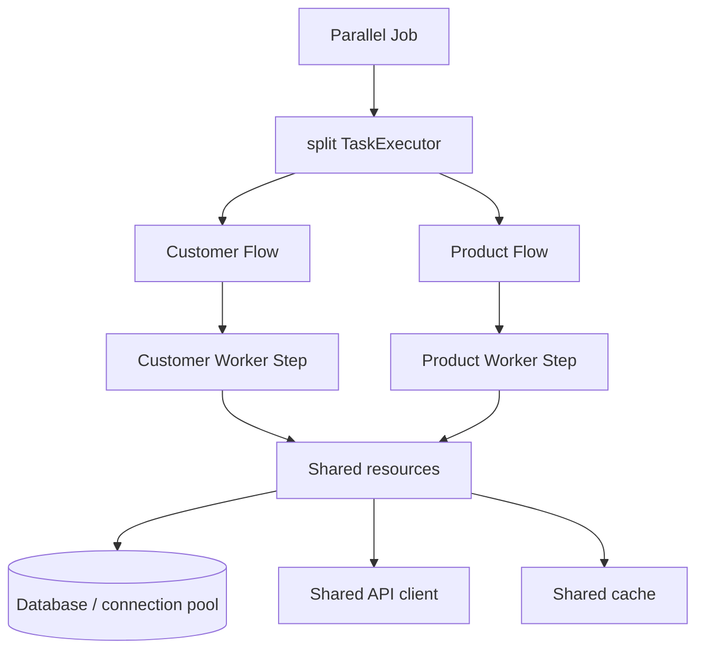

# Shared Resources Across Flows

In Spring Batch, a job can run multiple flows in parallel using `split(TaskExecutor)`. The flows may share Spring beans, databases, caches, the filesystem, HTTP clients, or external services. Sharing resources avoids creating redundant connections and duplicate configurations, but it also introduces requirements for thread safety, transaction boundaries, and contention control.

When two flows run concurrently, each flow can execute steps on different threads. Consequently, a singleton bean injected into both flows may be called simultaneously. If the bean holds mutable state without synchronization, one flow's data can overwrite another flow's data. Similarly, two steps might update the same database row, write to the same file, or call a shared API past its rate limit.

The design principle is to distinguish safely shareable resources from state belonging to a single execution. Stateless services, repositories, and connection pools can generally be shared; stateful readers, cursors, file handles, and per-step temporary data need isolated scopes or instances. Flow transactions are independent; there is no single transaction spanning all parallel flows.

## 1. Parallel flows and shared resources

`split()` allows multiple flows within the same job to execute concurrently through a `TaskExecutor`. For example, a job has two flows: one importing customer data and the other importing product data.

```java
@Bean
Job parallelImportJob(
        JobRepository jobRepository,
        TaskExecutor flowTaskExecutor,
        Flow customerFlow,
        Flow productFlow) {

    return new JobBuilder("parallelImportJob", jobRepository)
            .start(customerFlow)
            .split(flowTaskExecutor)
            .add(productFlow)
            .end()
            .build();
}
```

The two flows can run on different threads. If both inject `CustomerLookupService`, `DataSource`, `MeterRegistry`, or an HTTP client, those objects become shared resources during parallel execution.



Sharing the same object does not mean every operation on that object is automatically safe. You must understand whether the object holds state, whether its API supports concurrent calls, and whether the flows act on the same data.

## 2. Distinguishing shared resources from execution state

Not everything injected into multiple flows should be shared in the same way.

| Resource type | Usage across flows |
|---|---|
| Stateless service holding only dependencies and logic | Usually safe to share if its dependencies are also thread-safe under concurrent calls |
| Spring Data repository / `JdbcTemplate` | Usually safe to share; transactions and connections are managed per thread |
| `DataSource` and connection pool | Designed to dispense connections to multiple threads, though the pool must be sized appropriately |
| Thread-safe HTTP client | Safe to share; must control connection pool, timeouts, and rate limits |
| Concurrent cache | Safe to share if update and eviction semantics match |
| Mutable singleton bean | Share only when state is synchronized and semantics are clear; usually best to eliminate mutable state |
| Reader with cursor or read position | Create separate instances per step/flow, typically using `@StepScope` |
| Writer holding file handles or private buffers | Create separate instances or assign separate files/paths per flow |
| Step `ExecutionContext` | Belongs to an individual `StepExecution`; not shared across steps |
| Job `ExecutionContext` | Job-wide scope; avoid letting multiple flows update the same keys concurrently |

A useful design question is: "If two flows call this method at the exact same instant, could mid-flight state reads, state overwrites, or duplicate side effects occur?" If the answer is yes, separate the instances, synchronize, lock the data, or change the design.

## 3. Sharing stateless services

Services that hold no per-item or per-invocation state can typically be declared as singletons and shared across flows. For example, a service that simply calls a repository to look up customer info:

```java
@Service
public class CustomerLookupService {

    private final CustomerRepository customerRepository;

    public CustomerLookupService(CustomerRepository customerRepository) {
        this.customerRepository = customerRepository;
    }

    public Customer findRequired(String customerId) {
        return customerRepository.findById(customerId)
                .orElseThrow(() ->
                        new CustomerNotFoundException(customerId));
    }
}
```

This service does not store the current `customerId` in a field. Each call uses local arguments and the repository. Two flows can invoke it concurrently without overwriting each other's data, provided the repository and persistence layer are configured properly.

Conversely, do not write a singleton service like this:

```java
@Service
public class UnsafeImportState {

    private String currentBatchId;

    public void setCurrentBatchId(String batchId) {
        this.currentBatchId = batchId;
    }

    public void process(Order order) {
        // May read a batchId just overwritten by another flow.
        save(order, currentBatchId);
    }
}
```

If two flows call `setCurrentBatchId()` and `process()` interleaved, an item can be tagged with the wrong batch. Pass `batchId` as a method parameter, or store state in the proper scope/execution rather than in a singleton field.

## 4. Bean scopes: Singleton, JobScope, and StepScope

Scope determines a bean's lifecycle and sharing boundary. With parallel flows, choosing the wrong scope can cause steps to share state unexpectedly.

| Scope | Lifecycle | Notes for parallel flows |
|---|---|---|
| Singleton (default) | One instance in the application context | Can be invoked concurrently by multiple flows; should be stateless or thread-safe |
| `@JobScope` | One instance within one `JobExecution` | Steps in the same job can share the instance; do not treat as isolated per-flow state |
| `@StepScope` | One instance within a `StepExecution` | Suitable for readers/writers/processors with per-step configuration or state |

### 4.1. Using StepScope for per-step isolated state

For example, two flows use the same reader definition but receive different files from the ExecutionContext:

```java
@Bean
@StepScope
FlatFileItemReader<InputRow> inputReader(
        @Value("#{stepExecutionContext['inputFile']}") Resource inputFile) {

    return new FlatFileItemReaderBuilder<InputRow>()
            .name("inputReader")
            .resource(inputFile)
            .delimited()
            .names("id", "value")
            .targetType(InputRow.class)
            .saveState(true)
            .build();
}
```

`@StepScope` causes the reader to be created per `StepExecution`. Each flow gets its own reader instance and execution context, so read positions and file resources are not shared across step executions.

If the reader were a singleton keeping a cursor or read position in a field, two flows could mutate that state simultaneously. When using `@StepScope`, also ensure the step registers the reader as an `ItemStream` so Spring Batch invokes `open()`, `update()`, and `close()` properly in its lifecycle.

### 4.2. Being careful with JobScope

`@JobScope` creates beans scoped to one `JobExecution`, not one instance per flow. If multiple flows access the same job-scoped bean, they may invoke it concurrently. Job-scoped beans suit immutable shared configuration or shared data; if the bean holds mutable state, you must ensure thread safety or push state down to StepScope.

Do not use `@JobScope` just because you want "one bean per job" while forgetting that the job's flows run in parallel. Scope does not automatically add locks or synchronization to a bean's methods.

## 5. Isolated StepExecutionContext and shared JobExecutionContext

Each `StepExecution` has its own Step ExecutionContext. This is the right place to store checkpoints, reader offsets, partition ranges, or state belonging strictly to that step.

Conversely, steps within the same job execution can access the same Job ExecutionContext. This is useful when one step produces a value and a later step uses it sequentially. In parallel flows, however, two flows can update the Job ExecutionContext near the same time.

Risky example:

```java
// Flow A
jobExecution.getExecutionContext().putString("result", "CUSTOMERS_DONE");

// Flow B
jobExecution.getExecutionContext().putString("result", "PRODUCTS_DONE");
```

Both flows write the `result` key; the final value depends on update order. Even with separate keys like `customers.result` and `products.result`, do not treat Job ExecutionContext as a synchronization or message-passing mechanism between flows. Persisting the context and updating metadata are also affected by step lifecycles and repository transactions.

Safer options:

- Each flow writes results to its own table keyed by `jobExecutionId` or `batchId`.
- Use namespaced context keys if only small metadata is needed and merge after the flows finish.
- Let a step after `split()` read results from the data store once both flows have finished.
- If coordination is needed while flows are running, use a synchronization mechanism or coordination store with clear semantics.

For example, the customer flow writes to `customer_import_result` and the product flow writes to `product_import_result`. The aggregation step runs after `split()` and reads both tables. That way, flows never need to write to a shared key in the Job ExecutionContext.

## 6. Database, DataSource, and connection pool

Multiple flows typically share a single `DataSource` and connection pool. This is normal usage: each transaction borrows a suitable connection from the pool and returns it when the transaction ends. Do not grab a `Connection` and store it in a singleton bean for multiple flows to share.

Example of two flows sharing `JdbcTemplate`:

```java
@Bean
JdbcTemplate jdbcTemplate(DataSource dataSource) {
    return new JdbcTemplate(dataSource);
}
```

`JdbcTemplate` is designed to be shared across threads; it obtains connections via `DataSource` and participates in the transaction bound to the current thread when configured properly. Never directly share a JDBC `Connection`, `Statement`, or `ResultSet` across flows.

### 6.1. Sizing connection pool capacity

If `split()` runs four flows concurrently and each flow has a worker step requiring a connection during chunk transactions, the pool must have enough connections for those workers alongside other components such as web requests, `JobRepository`, and schedulers.

Do not set pool size equal merely to the number of flows. One flow may have multiple steps or multiple internal workers/transactions, while the application may also serve non-batch traffic. Measure active connections, connection acquisition wait times, and database lock waits.

Symptoms of an undersized pool:

- Workers wait for connections even when CPU is low.
- Steps take abnormally long when running in parallel.
- Connection acquisition timeouts.
- API requests are degraded because batch work monopolizes the shared pool.

Making the pool too large can also overload the database, increase context switching, or exceed server connection limits. Bound concurrency and connection pool size according to database capacity.

### 6.2. Data contention

Two flows may use separate connections yet update the same row. In that case, the database can experience lock waits, deadlocks, or lost updates if update logic is unsuitable.

For example, flow A updates order status while flow B recalculates totals for the same order. Define clear data ownership, update ordering, isolation levels, and suitable optimistic/pessimistic locking. If two tasks cannot run concurrently safely, separate their data scopes or schedule them sequentially.

## 7. Transactions are not shared across flows

Spring manages transactions per thread (with common transaction managers like JDBC/JPA). When each flow runs on its own thread, a step's transaction in flow A does not automatically enclose operations in flow B.

This means:

- A chunk in flow A can commit while flow B is still processing.
- A rollback in flow B does not undo chunks committed by flow A.
- An exception in flow A does not automatically roll back committed transactions in flow B.
- A `split()` job does not create an atomic transaction spanning all flows.

Do not share a `TransactionStatus`, JDBC `Connection`, or transaction-bound `EntityManager` across threads. Let each step use its configured transaction manager and let Spring open/commit/roll back transactions on the thread executing that step.

If business rules require publishing only when all flows succeed, write each flow's results to staging under the same `batchId`, then use a logical aggregation/commit step after `split()`. This step verifies the required results and updates the business batch status. This organization does not turn prior transactions into a distributed transaction, but it creates a clear publication boundary.

## 8. Sharing files and filesystem resources

File handles, writer buffers, and output filenames are typically stateful. If two flows write to the same file without a coordination protocol, contents can interleave, overwrite each other, or corrupt formatting.

You should:

- Have each flow write its own file, e.g., `customers-{batchId}.csv` and `products-{batchId}.csv`.
- If a flow has multiple workers, include the partition ID in the filename.
- Use a dedicated temporary directory per run.
- Merge or rename files only after the flows have finished.
- Use atomic rename within the same filesystem when publishing a complete file.
- Never share a single stateful `FlatFileItemWriter` instance across multiple parallel steps.

Example of configuring a writer per step:

```java
@Bean
@StepScope
FlatFileItemWriter<ImportedRow> outputWriter(
        @Value("#{stepExecutionContext['outputFile']}") String outputFile) {

    return new FlatFileItemWriterBuilder<ImportedRow>()
            .name("outputWriter")
            .resource(new FileSystemResource(outputFile))
            .delimited()
            .names("id", "value")
            .build();
}
```

Each `StepExecution` receives its own output path from context. If a combined file is needed, use a subsequent step after the parallel flows finish to merge files in a deterministic order.

## 9. HTTP clients, message brokers, and external service limits

A thread-safe HTTP client can be shared across flows to reuse its connection pool. However, you must control:

- Maximum connections and connection lease wait time.
- Connect timeout, response timeout, and retry timeout.
- Partner API rate limits.
- Circuit breakers or bulkheads if a slow service impacts multiple flows.
- Idempotency keys when the same item may be resent.
- Backoff policies so multiple flows do not retry simultaneously and cause a traffic spike.

Do not create a new HTTP client for every item if the client needs to manage a connection pool. Also do not assume a client is thread-safe merely because it is declared as a Spring bean; check the contract of the specific implementation.

For message brokers, flows can share a connection factory or template designed for concurrent use. However, message ordering across flows is not guaranteed just because they share a template. If ordering per aggregate or batch matters, use appropriate partition keys, ordering semantics, and consumer idempotency.

If a writer sends messages inside a database transaction, consider a transactional outbox. A database transaction does not automatically roll back a message already acknowledged by a broker unless the broker participates in a coordinated transaction.

## 10. Caches and shared reference data

A cache can help multiple flows avoid repeatedly querying the same reference data. An appropriate concurrent cache can be shared, but you must decide clearly:

- Is data immutable throughout a job or can it change?
- On cache miss, will multiple flows loading the same key cause duplicate requests?
- Does the cache have size limits and an eviction policy?
- Is invalidation needed when another flow updates data?
- Do cached entries depend on tenant, batch, or access permissions?

Do not use a mutable singleton `HashMap` as a cache when multiple flows update it concurrently. Use a concurrency-safe cache implementation or rely on a repository/database as the authoritative source.

If reference data must be consistent at a point in time, establish a snapshot or version. If flow A updates reference data while flow B reads the cache, outcomes can depend on timing. A thread-safe cache only protects the data structure; it does not solve business consistency by itself.

## 11. JobRepository and shared metadata

Flows in the same job share `JobRepository` to store `JobExecution`, `StepExecution`, and execution contexts. The repository is designed to manage execution metadata, though applications must still avoid writing directly to `BATCH_*` tables.

Each step has its own `StepExecution`. When flows run concurrently, step metadata is updated for each corresponding execution. `JobExecution` and Job ExecutionContext have job-wide scope, so do not treat them as an arbitrary synchronization area across threads.

In particular, avoid having two flows promote the same key from Step ExecutionContext to Job ExecutionContext. If separate results must be stored, use separate namespaced keys and preferably let a post-`split()` step aggregate the results. For critical data or runtime coordination, use a coordination table or storage with clear transaction/locking semantics.

## 12. Synchronizing when shared state updates are truly required

The best design usually avoids shared mutable state. Still, flows occasionally need to update a shared state such as completed partition counts or business error counts.

Several options:

**In-memory atomic counter:** suitable for temporary metrics within one JVM, not durable data. If the process restarts, the value is lost; across multiple nodes, each node has its own counter.

**Database counter with atomic update:** use an increment or upsert statement in the database with appropriate batch keys and transactions. Avoid turning the counter into a bottleneck under high update frequency.

**Per-flow result table:** each flow writes a result record with a unique key like `(batch_id, flow_name)`. A subsequent step reads the records and aggregates once all flows have finished.

**Distributed lock or coordination service:** use when ensuring only one worker performs an action on a shared resource. Requires leases, timeouts, and handling a worker dying while holding the lock.

Do not use `synchronized` on a singleton bean as a default cure-all. It only synchronizes within one JVM, can negate parallel speedups, and provides no protection when jobs run across multiple processes/nodes.

## 13. Designing the executor and bounding concurrency

`TaskExecutor` controls how flows are executed. Use a bounded executor to control how many flows run concurrently:

```java
@Bean
ThreadPoolTaskExecutor flowTaskExecutor() {
    ThreadPoolTaskExecutor executor = new ThreadPoolTaskExecutor();
    executor.setCorePoolSize(2);
    executor.setMaxPoolSize(2);
    executor.setQueueCapacity(4);
    executor.setThreadNamePrefix("parallel-flow-");
    executor.setWaitForTasksToCompleteOnShutdown(true);
    executor.setAwaitTerminationSeconds(60);
    return executor;
}
```

If a job has two independent flows, a two-thread pool can run both concurrently. If there are more flows than threads, some flows must wait. In practice, concurrency is also bounded by the database, external APIs, CPU, memory, and other application tasks.

Do not use an unbounded executor for long-running batch jobs. When increasing parallel flows, measure:

- Throughput and per-flow duration.
- Active threads and queue depth.
- Connection pool usage and connection wait time.
- Database lock waits/deadlocks.
- API latency, error rates, and rate-limit responses.
- Heap, garbage collection, and CPU.

Increasing concurrency only helps if downstream resources have remaining capacity. If the database is the bottleneck, adding threads can lengthen overall runtime due to contention.

## 14. Sharing data between flows: coordinate after the split

If flow B needs results produced by flow A, the two flows should not rely on flow A running first unless they are chained sequentially. In parallel flows, completion order is non-deterministic.

Unsafe example:

```text
Flow A: builds customer mapping in memory
Flow B: reads customer mapping immediately on start
```

Flow B may run before flow A finishes building the mapping. Instead, you can:

1. Run a data preparation step before `split()` to build an immutable shared mapping.
2. Store the mapping in the database or a cache with a clear lifecycle.
3. Let both flows read the prepared data.
4. After `split()` completes, run an aggregation/reconciliation step to consume results from both flows.

Example job structure:

```java
@Bean
Job prepareRunAndFinalizeJob(
        JobRepository jobRepository,
        Step prepareReferenceDataStep,
        Flow customerFlow,
        Flow productFlow,
        TaskExecutor flowTaskExecutor,
        Step finalizeBatchStep) {

    return new JobBuilder("prepareRunAndFinalizeJob", jobRepository)
            .start(prepareReferenceDataStep)
            .next(customerFlow)
            .split(flowTaskExecutor)
            .add(productFlow)
            .next(finalizeBatchStep)
            .end()
            .build();
}
```

This example illustrates the organizational idea: prepare data first, run independent flows, then aggregate after the split flows finish. When configuring real flows, inspect the graph built by the builder and verify the final step only runs after all split branches complete.

## 15. Testing shared resources

Tests must reproduce two flows genuinely running concurrently and confirm shared resources do not corrupt results.

Key scenarios:

1. **Concurrent invocation:** have two flows call the same stateless service; confirm input/output data does not mix.
2. **Mutable state:** if any bean holds state, run concurrently with different data to detect overwrites or race conditions.
3. **StepScope:** confirm each step execution receives its own file, range, or parameters.
4. **JobScope:** confirm job-scoped beans accessed concurrently by multiple flows behave safely when shared.
5. **Database pool:** run with expected flow counts and verify connections are not exhausted and unwanted lock contention does not occur.
6. **Transaction isolation:** force one flow to roll back while the other commits; confirm the other flow's committed data remains.
7. **File output:** confirm each flow writes to its own file and the aggregation step only runs after outputs finish.
8. **Job ExecutionContext:** check that flows do not write colliding keys or overwrite each other's results.
9. **External services:** simulate concurrent rate limits, timeouts, and retries; confirm idempotency keys and backoff work.
10. **Shutdown/restart:** stop the application while flows are running and verify step states and resources recover as designed.

You can use latches/barriers in tests to force two flows to enter a code section nearly simultaneously, reproducibly testing race conditions. Avoid long `Thread.sleep()` calls to guess thread timing; synchronize tests with `CountDownLatch`, `CyclicBarrier`, or suitable test utilities.

Beyond `JobExecution` status, inspect database records, file contents, outbound request counts, and each `StepExecution`'s metadata. A job with `COMPLETED` status where one flow wrote wrong data due to shared mutable state is still a bug.

## 16. Common mistakes

**Assuming singleton beans are always safe to share.** Spring singleton only refers to instance count, not thread safety. Keep services stateless or use proper synchronization.

**Sharing stateful readers/writers across flows.** Cursors, offsets, buffers, and file handles can be mutated concurrently. Use `@StepScope` or separate instances per step execution.

**Treating JobScope like StepScope.** Job-scoped beans are shared across one job execution; multiple flows can invoke them simultaneously. Use only for safe shared state.

**Treating Job ExecutionContext as a concurrent exchange zone.** Flows can update the same key or write competing state. Use isolated Step ExecutionContexts and well-designed result/coordination storage.

**Sharing JDBC Connections or EntityManagers directly.** Transaction-bound objects should not be used concurrently across threads. Use `JdbcTemplate`, repositories, and transaction managers to acquire resources per thread.

**Assuming split creates a single shared transaction.** Each step/chunk has its own transaction. One flow rolling back does not undo committed chunks of another flow.

**Two flows writing to the same file.** Data can interleave or overwrite. Produce separate outputs and aggregate after the split.

**Increasing threads without accounting for connection pools and API quotas.** Downstream systems can overload even when CPU is idle. Bound concurrency and monitor resources.

**Assuming flows execute in declaration order.** Parallel flows can start and finish in different orders. Share data only after synchronization or after the split.

## Conclusion

Parallel flows can safely share stateless services, repositories, `JdbcTemplate`, connection pools, HTTP clients, or caches if those components support concurrent use and downstream resources can handle the load. Components holding per-step state—such as readers, writers with cursors/buffers, or file outputs—need isolated instances and scopes, typically `@StepScope`.

There is no single transaction spanning the flows of `split()`. Each step/chunk manages its own transaction; Job ExecutionContext is shared job-wide and should not be used to synchronize mutable state across flows. Partition data by clear keys, write separate outputs, bound concurrency, and aggregate after the split. When runtime coordination is necessary, use database coordination, locks, or synchronization primitives with well-defined semantics. Designing this way lets parallel flows leverage shared resources while avoiding race conditions, lost updates, deadlocks, and duplicate side effects.
