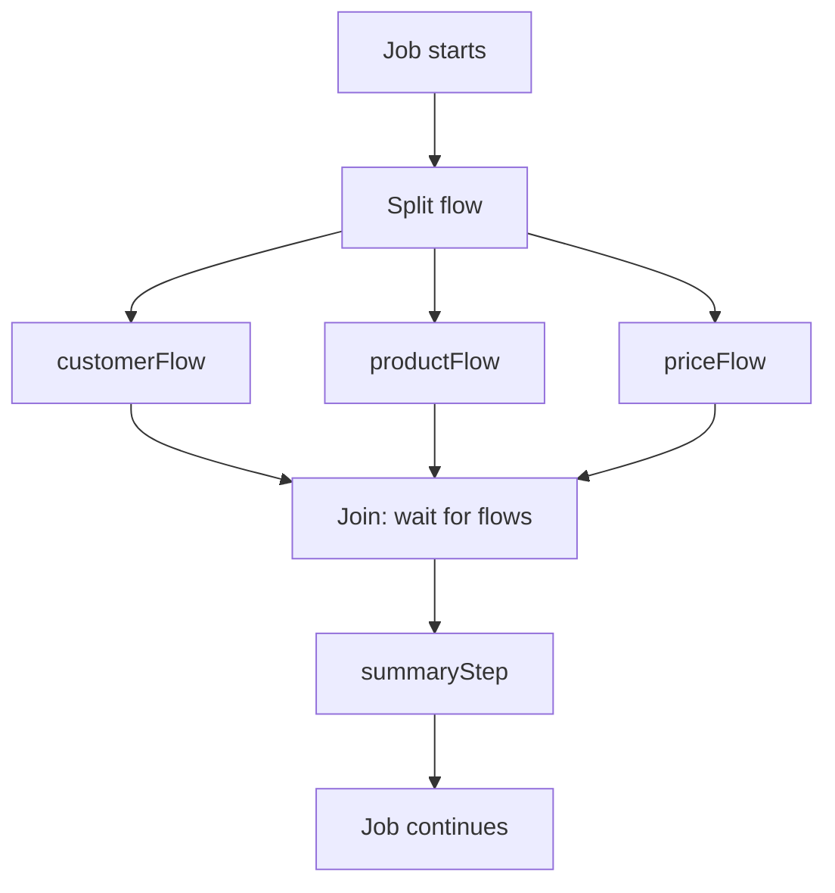

# Result Ordering in Parallel Flows

In Spring Batch, `split` allows multiple flows to run concurrently within the same job. This shortens runtime when branches are independent, yet it also has an important consequence: **the order in which flows start or finish is not guaranteed**. A flow declared first is not guaranteed to start first or finish first. Completion order can vary depending on CPU load, database, network, thread scheduling, and each branch's processing time.

If flows produce output data, the application should not rely on the order in which threads finish to determine record order. To guarantee stable results, define a meaningful business sort key, store each branch's output in an appropriate location, wait for the split to complete, and then merge or sort in a subsequent step.

## 1. What does parallel flow guarantee about ordering?

Suppose a job has two flows:

```text
customerFlow: readCustomers -> normalizeCustomers -> writeCustomers
productFlow:  readProducts  -> validateProducts  -> writeProducts
```

When using `split(taskExecutor)`, the two flows can run concurrently. Within each flow, step order still follows the flow definition. However, there is no global order across steps of the two flows.

For example, one run might proceed as:

```text
Time  --->

customerFlow: C1 -------- C2 ---------------- C3
productFlow:  P1 ---------------- P2 ---- P3
```

Another run might produce:

```text
Time  --->

customerFlow: C1 ---------------- C2 ---- C3
productFlow:  P1 ------ P2 ---------------- P3
```

Guaranteed relationships:

- Subsequent steps within the same flow only run in the order defined by that flow.
- The split flow waits for its orchestrated branches to finish before the job proceeds past the join point.
- Each step has its own execution and status for tracking.

Non-guaranteed relationships:

- The flow passed first to `.add(...)` will start first.
- The flow passed first will finish first.
- Logs from flow A always appear before logs from flow B.
- Records written by flow A always precede records from flow B in a shared output.

Configuration order is a way of structuring the flow, not a contract for concurrent execution ordering.

## 2. Flow completion order is not output data order

Three types of ordering are often confused:

1. **Execution order:** which flow or step is scheduled first.
2. **Completion order:** which flow or step finishes first.
3. **Data order:** which records appear first in the final file, table, or message stream.

Parallel flows do not guarantee a global order for these three. For example, `productFlow` may finish before `customerFlow`, yet the final report file can still order customers before products according to an explicit business rule.

If writers of two flows write into the same table, the commit order of their transactions also does not create a deterministic read order. Databases do not promise row return order when a query has no `ORDER BY`. Even if rows happened to come back in insertion order during a test run, a later run may return a different order.

Therefore, treat data ordering as a separate requirement that must be explicitly modeled and enforced.

## 3. Split flow has a join point before the next step

When a job invokes a split flow and declares `.next(summaryStep)`, the aggregation step is orchestrated only after the split flow returns a result. This is the join/barrier point of the branches.



The join point ensures sub-flows have ended according to the orchestration mechanism before `summaryStep` runs. It does not automatically sort data, concatenate files, or merge in-memory collections.

A simple configuration:

```java
@Bean
public Flow parallelImportFlow(
        TaskExecutor flowExecutor,
        Flow customerFlow,
        Flow productFlow) {

    return new FlowBuilder<SimpleFlow>("parallelImportFlow")
            .split(flowExecutor)
            .add(customerFlow, productFlow)
            .build();
}

@Bean
public Job importJob(
        JobRepository jobRepository,
        Flow parallelImportFlow,
        Step summaryStep) {

    return new JobBuilder("importJob", jobRepository)
            .start(parallelImportFlow)
            .next(summaryStep)
            .end()
            .build();
}
```

`summaryStep` is the right place to read data durably persisted by the branches, verify results, and produce the final output. If a branch fails, the aggregated flow status may fail and the job must handle the error branch as configured.

## 4. FlowExecutionStatus only describes flow status

When a split flow finishes, Spring Batch needs to aggregate the execution results of its sub-flows. This mechanism operates on `FlowExecution` and `FlowExecutionStatus`.

`FlowExecutionStatus` represents statuses like `COMPLETED`, `FAILED`, `STOPPED`, or a custom code. `FlowExecutionAggregator` aggregates statuses from sub-flows into the split flow's status.

Important distinctions:

- The split flow aggregator aggregates orchestration statuses.
- It does not collect business objects produced by the flows.
- It does not sort records in databases or files.
- It does not establish a fixed completion order among flows.

For example, `customerFlow` finishes with `COMPLETED` and `productFlow` ends in `FAILED`. The split status typically reflects the failed branch under the default aggregator, causing the job to enter the `FAILED` transition. One flow succeeding does not automatically make another flow succeed.

If the application needs to aggregate record counts, file paths, or business outcomes, persist those results separately and read them in a step after the join.

## 5. Why should you not rely on completion order?

The runtime of a flow depends on many unstable factors:

- One flow reads fewer records than another.
- A query may hit lock waits or cache misses.
- An API may respond slowly or apply rate limiting.
- The JVM may pause for garbage collection.
- The thread executor may allocate CPU time unevenly.
- The database may pick a different query plan as data changes.
- Retries or backoff may lengthen one branch.

Consequently, a flow that finished first in the current run may finish last in the next run. Restarts can also alter each branch's duration because some steps are already completed while others must resume from checkpoints.

Do not write logic such as "whichever flow finishes first writes first" if business requirements demand deterministic ordering. That makes results dependent on system load and hard to reproduce during incident investigation.

## 6. Preserving record order with business keys

If ordered output is required, define sorting criteria based on business attributes. Examples:

- Transaction date followed by transaction ID.
- Source line sequence number.
- Ascending customer code.
- Record type priority, followed by timestamp and business key.

A comparator should produce a deterministic total order. If the primary sort field can have ties, add a unique tie-breaker.

Example output model:

```java
public record ExportRow(
        long sourceSequence,
        int sourceRank,
        String businessKey,
        String payload) {
}
```

Comparator:

```java
Comparator<ExportRow> exportOrder =
        Comparator.comparingLong(ExportRow::sourceSequence)
                .thenComparingInt(ExportRow::sourceRank)
                .thenComparing(ExportRow::businessKey);
```

In this example, `sourceSequence` defines the primary order; `sourceRank` resolves ordering across sources when sequence matches; `businessKey` provides the final tie-breaker. If `businessKey` can also collide, add another stable identifier to achieve a total order.

Do not use thread completion timestamp as a sort key when business ordering is required. Timestamps generated concurrently can collide and remain dependent on system timing.

## 7. Assigning sequences before splitting work

If you need to preserve the original order of a dataset before splitting it across multiple processing branches, assign the sequence before the branches run in parallel.

For example, the input source has records in order:

```text
sequence 1 -> Customer A
sequence 2 -> Product X
sequence 3 -> Customer B
sequence 4 -> Product Y
```

The job can assign `sourceSequence` during reading or preparation, then distribute records to appropriate branches. Each branch processes independently and retains the original sequence in its output. After the join, `summaryStep` sorts by `sourceSequence` to restore the original order.

Do not let each flow increment an unsynchronized global counter and treat that number as the source order. Whichever thread acquires the lock first gets the earlier sequence; the result remains timing-dependent. If the sequence must reflect input order, it must come from an ordered source or a sequential preparation step.

If input comes from a database, use a query with `ORDER BY` on a stable key when assigning sequences. If the source has no natural order, define a business order instead of relying on physical row order.

## 8. Writing separate output per flow and merging afterward

A straightforward way to avoid contention is having each flow write to its own output area. After the split completes, the next step reads those outputs and merges them according to deterministic rules.

Example:

```text
staging/
  customer-flow/
    customers-part.csv
  product-flow/
    products-part.csv

published/
  catalog-export.csv
```

`customerFlow` writes only `customers-part.csv`; `productFlow` writes only `products-part.csv`. `mergeStep` reads both files after the join, adds source or sequence info, sorts according to rules, and produces `catalog-export.csv`.

Advantages:

- Writers do not write concurrently to the same file.
- Each flow can retry or restart with its own output.
- You can trace which branch produced a bad record.
- The merge step provides a single place to enforce final ordering.

Manage temporary files by `JobInstance` or business key so another run does not overwrite them. Only publish the final file after confirming required branches have completed. For large files, use external merge sort or database staging instead of loading everything into heap.

## 9. Sorting and merging data in the database

If flows write into the same staging table, store source info and sort keys alongside each record.

Example schema:

```sql
create table batch_output_stage (
    job_key         varchar(100) not null,
    source_name     varchar(40) not null,
    source_sequence bigint not null,
    business_key    varchar(100) not null,
    payload         text not null,
    primary key (job_key, source_name, business_key)
);
```

Aggregation step query:

```sql
select source_name, source_sequence, business_key, payload
from batch_output_stage
where job_key = :jobKey
order by source_sequence, source_name, business_key;
```

`ORDER BY` defines output record ordering. `job_key` isolates data per business run; the unique key prevents duplicate writes under the chosen rules. Adjust schema and data types for your actual database.

Note that `INSERT` order is not read order. A database is free to return rows according to its execution plan if the query does not request sorting. Even if an existing index happens to return rows in the desired order, the application must not rely on that behavior.

For paging readers, `ORDER BY` must be deterministic and include a unique tie-breaker. If sort keys are non-unique, pages can return inconsistent rows across page boundaries, especially when the source changes while the job runs.

## 10. Using a post-split aggregation step to build the final result

The aggregation step can perform the following tasks:

1. Inspect the statuses of steps in each flow.
2. Verify mandatory branches have completed.
3. Retrieve the file paths or staging keys produced by each branch.
4. Read the output data.
5. Sort, deduplicate, or merge according to business rules.
6. Write the final output and mark the publish status.

Do not let `summaryStep` run while a branch is still writing data. Place it after the split flow to take advantage of the framework's join barrier.

Example reading completed step metadata from `JobExecution`:

```java
public class SummaryTasklet implements Tasklet {

    @Override
    public RepeatStatus execute(
            StepContribution contribution,
            ChunkContext chunkContext) {

        JobExecution jobExecution = chunkContext
                .getStepContext()
                .getStepExecution()
                .getJobExecution();

        for (StepExecution stepExecution : jobExecution.getStepExecutions()) {
            log.info("Step {} ended with {}",
                    stepExecution.getStepName(),
                    stepExecution.getExitStatus().getExitCode());
        }

        // Read staging data, merge, and write final results.
        return RepeatStatus.FINISHED;
    }
}
```

This snippet illustrates inspecting step executions belonging to the job. Actual merge logic should read persisted data using an appropriate reader/repository/service. Do not treat the iteration order of `getStepExecutions()` as the business order of outputs; sort by step name or metadata if ordered display is needed.

## 11. ExecutionContext does not sort results automatically

Each `StepExecution` has its own `ExecutionContext`, suitable for storing checkpoints and small step-level results. `JobExecution` has a job-wide context. When flows run concurrently, avoid having multiple branches update the same key or a mutable object in the job context.

Safer design example:

- `customerFlow` stores `customerOutputPath` in the step context of the customer file creation step.
- `productFlow` stores `productOutputPath` in the step context of the product file creation step.
- After the split join, `summaryStep` reads metadata of both steps and retrieves the two paths.

Avoid doing the following:

```java
// Avoid: multiple flows modifying a shared collection concurrently.
jobExecution.getExecutionContext()
        .put("allResults", sharedMutableList);
```

`ExecutionContext` is not a synchronized collection for multiple threads to write results simultaneously. Serializing the context during metadata updates also does not provide a safe merge for concurrent mutations.

If you need to pass a value from one step to another, store it in the step context and promote it to the job context when the step completes, or save it to a durable store. With parallel flows, the simplest approach is usually having each branch write its own key and only reading/aggregating after the join; even so, concurrent updates to the job context still need clear coordination.

## 12. Database results: ordering must be in the query

When flows write data to the database, transactions may commit in a different order than they were launched. Commit order also does not determine query return order.

Example of two flows inserting concurrently:

```text
customerFlow: INSERT C1, C2, C3
productFlow:  INSERT P1, P2, P3
```

The database might commit in a sequence like P1, C1, P2, P3, C2, C3. A query without `ORDER BY` may return rows in yet another order.

If output requires customers before products, express that requirement with a `record_type_rank` column or another sort key:

```sql
select record_type, business_key, payload
from batch_output_stage
where job_key = :jobKey
order by record_type_rank, source_sequence, business_key;
```

Do not use an identity/autogenerated ID as business order if IDs are assigned concurrently and do not represent source order. An ID can be useful as a technical tie-breaker, but you should not infer input order from it.

## 13. File results: never write to one file from multiple flows without dedicated design

If multiple flows open the same file in append mode, data can interleave based on write timing. Some file-writing APIs are not thread-safe; even when line writes are atomic in a specific environment, line order is still not guaranteed.

Use one of these approaches:

- Each flow creates its own file, and a later step merges them.
- Each flow writes to a staging table, and a later step exports the file using `ORDER BY`.
- Push records to an intermediary system with clear partition keys and ordering semantics.
- Use a centralized writer with a queue and a single writer thread if throughput and complexity allow.

For very large files, merging can use external sort: each flow produces a file sorted by the same comparator; the merge step reads the head line of each file and picks the next smallest element. This avoids loading all data into memory.

Before publishing the final file, verify record counts, checksums, or business invariants. Writing to a staging file and moving/renaming to the final name after completion ensures external readers do not see partially written output.

## 14. Message results: ordering is usually scoped to partition/key

If flows publish messages to a broker, do not assume the broker maintains global ordering across multiple producers or multiple partitions.

Many message brokers only guarantee ordering within a single partition or a specific key/queue. If ordering is needed for the same aggregate, use the same partition key (e.g., `customerId` or `orderId`) and a business sequence so consumers can detect out-of-order messages.

If global ordering across multiple event types is required, a centralized publish stream after the join may be necessary. In return, a centralized publish point can become a bottleneck. Define the required ordering scope: system-wide, per tenant, per aggregate, or only within an export file.

With a transactional outbox, a relay can publish events by `created_at` or sequence, but multiple relay workers can reorder events if processing the same aggregate. If ordering matters, partition/lock by aggregate or allow only one worker to process a given key at a time.

## 15. Result ordering on restart

When a parallel flow fails, one branch may have completed while another failed. When restarting the same `JobInstance`, Spring Batch uses per-step metadata to determine which parts need to re-execute. Completed steps typically do not re-run under normal restart semantics; incomplete steps can resume from checkpoints if restart is supported.

Completion order of branches during restart may differ from the initial run. For example, `customerFlow` completed before the failure and stays completed, while `productFlow` is restarted. The final output must still be sorted by business keys, independent of which branch re-ran.

To make restarts yield deterministic results:

- Use the same identifying job parameters to continue the same `JobInstance`.
- Keep data sources and sorting rules stable.
- Write staging outputs keyed by job key and flow/step key.
- Design idempotent writers so uncommitted chunks can re-run.
- Clean up or replace staging artifacts via a safe workflow without deleting data from completed branches if still needed.
- Produce the final output only after confirming all mandatory branches have completed.

Do not use completion timestamps or log order from the previous run to reconstruct output order on restart.

## 16. If one flow must run before another

If the requirement is that flow B must start after flow A completes, the two flows are not truly independent in the way split requires. Model them sequentially:

```java
return new JobBuilder("orderedJob", jobRepository)
        .start(flowA)
        .next(flowB)
        .next(summaryStep)
        .end()
        .build();
```

If A and B can run in parallel but step C needs results from both, use split and place C after the split:

```java
return new JobBuilder("parallelThenMergeJob", jobRepository)
        .start(parallelFlow)
        .next(mergeStep)
        .end()
        .build();
```

If only a subset of steps can run concurrently, split the flow at the exact boundary: sequential shared preparation, split independent branches, join, then execute the dependent step.

Do not use `Thread.sleep`, polling mutable variables, or checking thread names to enforce ordering between flows. Those approaches do not express dependencies in the job flow and fail easily when load or thread scheduling changes.

## 17. FlowExecutionAggregator is not an output sorter

`FlowExecutionAggregator` receives execution results from sub-flows and produces an aggregated status for the split flow. It is useful when adjusting status aggregation rules, such as handling warning codes under a custom policy.

The aggregator is not the right place to:

- Sort millions of business records.
- Concatenate file contents from branches.
- Synchronize active writers.
- Pick whichever flow finishes first as the preferred data source.
- Replace a post-join merge step.

If a custom aggregator is needed, restrict it to deciding flow status. Data sorting and merging logic should live in a dedicated step/service where durable data can be read, comparators tested, and memory controlled.

## 18. Testing result ordering

Parallel flow tests should verify two separate concerns: branches can genuinely run concurrently, and the final data has deterministic ordering as required.

### Testing concurrency

You can use a `CountDownLatch` in tests to confirm two branches both start before either is allowed to continue. Use a timeout so the test does not hang if the executor accidentally runs synchronously.

Do not assert that flow A must finish before flow B or vice versa. That is not part of the parallel flow contract.

### Testing data ordering

After the job finishes, read the final output and compare against the expected order defined by the business comparator:

```java
List<ExportRow> rows = exportRepository.findByJobKeyOrderBySequence(jobKey);

assertEquals(
        List.of("C-001", "P-010", "C-002", "P-011"),
        rows.stream().map(ExportRow::businessKey).toList());
```

This test verifies output order regardless of which flow finished first. You can run the test repeatedly with varying simulated delays in each flow to ensure results remain stable.

### Cases to verify

- Flow A faster than B, and B faster than A.
- One flow experiences retries/backoff yet final output order remains correct.
- One flow fails: the merge step does not run when a mandatory flow is incomplete.
- Restart after one branch completed: final output has no missing or duplicate items.
- Records sharing the primary sort key: tie-breaker establishes deterministic order.
- Database queries do not rely on insert order and use explicit `ORDER BY`.
- Output files are published only after merging completes.

## 19. Monitoring order in logs and metadata

Logs of parallel flows naturally interleave. That is normal concurrency behavior, not evidence that flows ran out of order.

For investigation, record:

- Job name and `JobExecution` ID.
- Flow/step name and `StepExecution` ID.
- Thread name.
- Business key or source sequence of items.
- Step start/end timestamps.
- `BatchStatus`, `ExitStatus`, read/write/skip counts.
- Correlation ID of output data.

When displaying results in a dashboard, sort by business fields if an ordered list is needed. Do not use log record order or metadata collection order as data order.

## 20. Common design mistakes

| Situation | Cause | Solution |
|---|---|---|
| Output changes order across runs | Relying on flow completion timing | Use stable sequences or business keys |
| Flow declared first does not run first | Confusing `.add(...)` order with execution order | Do not depend on start order; use sequential flow if needed |
| Database rows do not return in insert order | Query lacks `ORDER BY` | Sort by business columns and tie-breaker |
| File output is interleaved | Multiple flows writing to a shared file | Write separate files and merge after join |
| Summary reads incomplete data | Summary not placed after split/join | Use `.next(summaryStep)` after split flow |
| Aggregator does not return result list | Confusing status aggregator with data merger | Persist outputs durably and use a merge step |
| Job context gets overwritten | Multiple flows updating same key/object | Use separate step contexts and aggregate after join |
| Restart produces different order | Run timings and restarted branches vary | Sort by stable keys, not timing |
| Messages arrive out of order | Multiple producers/partitions without global ordering | Use partition key/sequence or centralized publishing |
| Flaky tests | Asserting flow A always finishes before B | Assert outputs and statuses, not timing |

## 21. Process for designing ordered results

1. **Define ordering scope:** entire output, per record type, per tenant, or per aggregate.
2. **Choose business keys:** source sequence, business timestamp, priority, and business key.
3. **Generate keys before concurrency if preserving source order:** never increment a shared mutable counter from multiple threads.
4. **Isolate outputs per flow:** use separate files or staging tables to avoid writer contention.
5. **Place the merge step after the split:** read data only after mandatory flows complete.
6. **Sort using a comparator or SQL `ORDER BY`:** include a tie-breaker for deterministic order.
7. **Manage restarts:** use identifiable job keys, checkpoints, and staging outputs.
8. **Test with varying timings:** vary delays in each flow and confirm output stays unchanged.
9. **Track status:** distinguish flow status from persisted business results.

## 22. Key principles to remember

- Parallel flows do not guarantee start or completion order across branches.
- Steps within the same flow still follow the flow definition order.
- A split flow has a join point; the next step only runs after orchestrated sub-flows finish.
- `FlowExecutionAggregator` aggregates flow status, not business data sorting or merging.
- Insert or commit order does not guarantee query order; databases need explicit `ORDER BY`.
- To preserve source order, assign stable sequences before splitting work.
- Each flow should write separate outputs or into staging with distinguishing keys; merge after join.
- Use comparators with tie-breakers or SQL `ORDER BY` to establish a total order.
- Do not let multiple flows update a shared mutable object or context key without coordination.
- For messages, define ordering scope and use appropriate partition keys/sequences.
- Restarts can change completion order; output must stay stable via business keys.
- Test concurrency via overlap, but test ordering via final data; never assert which flow finishes first.

Parallel flows optimize runtime by letting independent branches run concurrently. Ordered results must be produced through explicit data rules after the join point: preserve business sequences, store separate outputs, then merge or query with sorting. Separating execution order from data order lets a job capture concurrency gains while producing stable outputs across runs and restarts.
