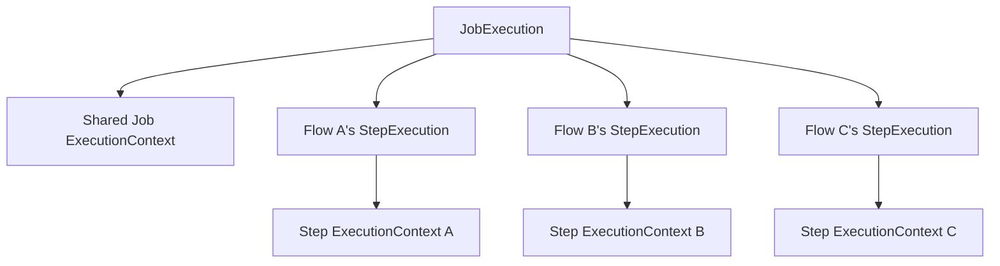
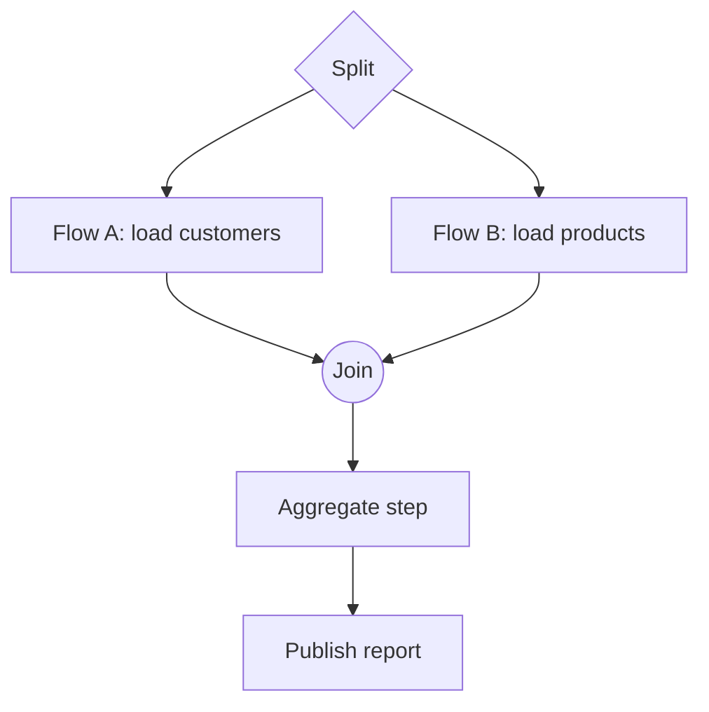
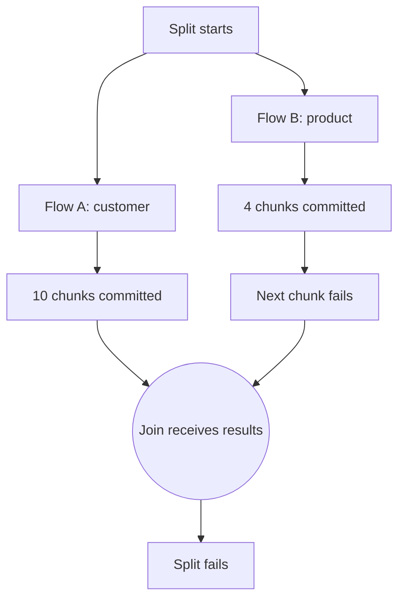

# ExecutionContext in Parallel Flows

In Spring Batch, a job can use split to run multiple independent flows on different threads. Those flows still belong to the same JobExecution, while each step in each flow has its own StepExecution. Therefore, when persisting checkpoints or exchanging results between branches, you must choose the right ExecutionContext scope.

The key rule is: **Step ExecutionContext is for each step's own state; Job ExecutionContext is for state shared across the entire job.** Parallel flows can all see the JobExecutionContext. If multiple branches update the same key or perform read-modify-write operations concurrently, outcomes can depend on execution order and cause lost updates. JobExecutionContext is not a synchronization mechanism between flows.

Store each reader's private checkpoint in StepExecutionContext. If results from multiple branches need aggregation, prefer writing results to durable storage keyed by batch ID, then reading after the join point. Only promote a few small values to JobExecutionContext when there is a clear sequential aggregation step.

## 1. The two ExecutionContext scopes

Spring Batch provides ExecutionContext to store key/value state for restarts and orchestration. A job has two main scopes:

| Scope | Attached to | Purpose |
|---|---|---|
| Step ExecutionContext | A single StepExecution | Reader/writer checkpoints, offsets, last read key, step-specific state |
| Job ExecutionContext | A single JobExecution | Small information needing sharing between steps in the same job execution |

Each StepExecution has its own context. When a job has multiple parallel flows, steps in different branches still have distinct contexts.

Conversely, StepExecutions within the same JobExecution reference the same job-level execution context. Thus, two flows can both read and write JobExecutionContext. This is an important point to watch when migrating from sequential flows to parallel flows.



Job context is shared state for a job run. Step context is state for a specific step run. Do not use job context in place of step context simply because multiple steps can access it.

## 2. Parallel flows still share a single JobExecution

When using split, Spring Batch runs multiple Flows within the same JobExecution. Each branch has its own StepExecution, but it does not automatically create a new JobExecution per branch.

Example:

```java
@Bean
Flow customerFlow(Step loadCustomersStep) {
    return new FlowBuilder<SimpleFlow>("customerFlow")
            .start(loadCustomersStep)
            .build();
}

@Bean
Flow productFlow(Step loadProductsStep) {
    return new FlowBuilder<SimpleFlow>("productFlow")
            .start(loadProductsStep)
            .build();
}

@Bean
Flow preparationFlow(
        TaskExecutor parallelFlowTaskExecutor,
        Flow customerFlow,
        Flow productFlow) {

    return new FlowBuilder<SimpleFlow>("preparationFlow")
            .start(customerFlow)
            .split(parallelFlowTaskExecutor)
            .add(productFlow)
            .build();
}
```

Both flows run inside the same job execution. If each flow runs one step, we have two separate StepExecutions:

- StepExecution for loadCustomersStep.
- StepExecution for loadProductsStep.

Each step has its own ExecutionContext to store checkpoints. Both StepExecutions link to the same JobExecution and therefore can access JobExecutionContext.

This does not mean the two branches should write jointly to the job context. Sharing access to an object does not create a data coordination protocol or guarantee update ordering.

## 3. Using Step ExecutionContext for private checkpoints

A reader's checkpoint belongs to the step running that reader. When two flows have two independent readers, each reader should store its position in its own step's StepExecutionContext.

Example customer flow reader:

```java
public class CustomerReader implements ItemStreamReader<Customer> {

    private static final String LAST_ID_KEY = "customer.lastId";

    private final CustomerRepository repository;
    private long lastId;

    public CustomerReader(CustomerRepository repository) {
        this.repository = repository;
    }

    @Override
    public void open(ExecutionContext context) {
        lastId = context.getLong(LAST_ID_KEY, 0L);
    }

    @Override
    public Customer read() {
        Customer customer = repository.findNextAfter(lastId);
        if (customer == null) {
            return null;
        }

        lastId = customer.id();
        return customer;
    }

    @Override
    public void update(ExecutionContext context) {
        context.putLong(LAST_ID_KEY, lastId);
    }

    @Override
    public void close() {
        // Close resources if the reader owns them.
    }
}
```

The product flow's reader has its own key and state:

```java
public class ProductReader implements ItemStreamReader<Product> {

    private static final String LAST_ID_KEY = "product.lastId";

    private final ProductRepository repository;
    private long lastId;

    public ProductReader(ProductRepository repository) {
        this.repository = repository;
    }

    @Override
    public void open(ExecutionContext context) {
        lastId = context.getLong(LAST_ID_KEY, 0L);
    }

    @Override
    public Product read() {
        Product product = repository.findNextAfter(lastId);
        if (product == null) {
            return null;
        }

        lastId = product.id();
        return product;
    }

    @Override
    public void update(ExecutionContext context) {
        context.putLong(LAST_ID_KEY, lastId);
    }

    @Override
    public void close() {
        // Close resources if the reader owns them.
    }
}
```

Even if both readers used the same LAST_ID_KEY name in their own code, no conflict occurs because each reader receives a different StepExecutionContext. Using domain-namespaced key names is still helpful so readers of metadata can understand them easily.

For Spring Batch-provided readers like FlatFileItemReader or JdbcPagingItemReader, enable saveState appropriately and set a stable reader name. The framework manages checkpoints in the step context. Do not manually copy reader checkpoints to JobExecutionContext unless there is a specific orchestration need.

## 4. Why should branches not write checkpoints to JobExecutionContext?

Suppose two flows update a shared key:

```java
// Avoid: both flows writing the same lastProcessedId key.
jobExecution.getExecutionContext()
        .putLong("lastProcessedId", currentId);
```

Flow A reads customers, Flow B reads products. If both write lastProcessedId, the final value depends on whichever branch updated last. A single value cannot simultaneously represent the progress of two independent readers.

Even when using separate keys:

```java
// Still be cautious when multiple flows update job context concurrently.
jobContext.putLong("customer.lastId", customerId);
jobContext.putLong("product.lastId", productId);
```

Writing two distinct keys reduces the risk of overwriting the same key, but it does not turn metadata updates and persistence into a synchronized protocol. Read-modify-write operations, interdependent values, or concurrent persists still require explicit design.

In particular, an operation like the following is not an atomic increment merely because it uses ExecutionContext:

```java
long count = jobContext.getLong("processedCount", 0L);
jobContext.putLong("processedCount", count + 1L);
```

Two flows can read the same value and both write back a value incremented by one. One increment can be lost. If an aggregated counter is needed, use an appropriate in-memory atomic counter with a managed lifecycle, or better yet, compute it from durable data after the join.

## 5. ExecutionContext is not a join barrier

JobExecutionContext stores state; it does not make one flow wait for another. If Flow A writes a result to the context and Flow B reads immediately while A is still running, B may read a stale value or find nothing yet.

To use results from multiple branches, place the data-consuming step after the split:



Join guarantees flows in the split have returned results before the downstream flow continues. The aggregation step is the right place to read branch results and create shared state.

Do not use a key in JobExecutionContext as a completion flag between flows, such as Flow A writing customerDone=true for Flow B to poll. The join mechanism already handles waiting for flows; rolling your own polling via context increases race conditions and can cause unbounded wait loops.

## 6. Storing per-branch results in Step ExecutionContext

A step can store small results into its StepExecutionContext before finishing. For example, a listener records written item counts and an artifact code:

```java
public class BranchResultListener implements StepExecutionListener {

    @Override
    public ExitStatus afterStep(StepExecution stepExecution) {
        ExecutionContext context = stepExecution.getExecutionContext();
        context.putLong("result.writeCount", stepExecution.getWriteCount());
        context.putLong("result.filterCount", stepExecution.getFilterCount());
        return null;
    }
}
```

Each step writes to its own context. An aggregation step after the join can read metadata from completed StepExecutions to gather results, provided the values are small and only serve the same JobExecution.

Illustrative example of finding a StepExecution by name:

```java
public long readBranchCount(
        JobExecution jobExecution,
        String stepName) {

    return jobExecution.getStepExecutions().stream()
            .filter(step -> step.getStepName().equals(stepName))
            .findFirst()
            .orElseThrow()
            .getExecutionContext()
            .getLong("result.writeCount");
}
```

In real systems, ensure step names are unique within the job scope or select the right execution if the flow can repeat steps. If lookups are needed via the repository or across process boundaries, use JobExplorer to load metadata by execution ID.

Step context suits checkpoints and small results. If results are lists of thousands of IDs, large payloads, or business data needed long-term downstream, store them in a staging table or object storage and keep only a reference in the context.

## 7. Promoting keys from Step context to Job context

Spring Batch provides ExecutionContextPromotionListener to promote selected keys from StepExecutionContext to JobExecutionContext after a step finishes.

Example:

```java
@Bean
ExecutionContextPromotionListener customerResultPromotionListener() {
    ExecutionContextPromotionListener listener =
            new ExecutionContextPromotionListener();

    listener.setKeys(new String[] {
            "customer.resultCount",
            "customer.snapshotId"
    });
    listener.setStatuses(new String[] { "COMPLETED" });

    return listener;
}
```

Attach the listener to the step:

```java
@Bean
Step loadCustomersStep(
        JobRepository jobRepository,
        PlatformTransactionManager transactionManager,
        ItemReader<Customer> customerReader,
        ItemWriter<Customer> customerWriter,
        ExecutionContextPromotionListener customerResultPromotionListener) {

    return new StepBuilder("loadCustomersStep", jobRepository)
            .<Customer, Customer>chunk(500, transactionManager)
            .reader(customerReader)
            .writer(customerWriter)
            .listener(customerResultPromotionListener)
            .build();
}
```

The listener only promotes configured keys and only when the exit status matches allowed statuses. Confirm the key names written in StepExecutionContext match the names in the listener exactly.

### Be careful with promotion in parallel flows

If two steps in two flows both use a promotion listener and promote the same customer.resultCount key, the value can be overwritten. Even when each branch uses a different key, multiple branches updating JobExecutionContext concurrently remains a shared operation that warrants attention to concurrency and persistence.

If promoting individual branch results is unavoidable:

- Use distinct namespaced keys per step.
- Promote only small, immutable values after the step finishes.
- Never perform read-modify-write on the job context from branches.
- Never let multiple branches own the same key.
- Test metadata and restarts with integration tests on your exact Spring Batch version.

For critical workflows, a clearer approach is usually having each branch write results to its own staging area and having a post-join step read/reconcile and sequentially update JobExecutionContext if truly needed.

## 8. Recommended pattern: each branch writes staging by batch ID

When a branch's output is business data, store it in a staging table or object storage rather than stuffing payloads into the context.

Example:

```java
public record BranchResult(
        String batchId,
        String branchName,
        long recordCount,
        String snapshotId) {
}
```

Each flow writes its own results:

```java
public class CustomerResultWriter implements ItemWriter<Customer> {

    private final CustomerStagingRepository stagingRepository;
    private final String batchId;

    public CustomerResultWriter(
            CustomerStagingRepository stagingRepository,
            String batchId) {
        this.stagingRepository = stagingRepository;
        this.batchId = batchId;
    }

    @Override
    public void write(Chunk<? extends Customer> chunk) {
        stagingRepository.saveCustomers(batchId, chunk.getItems());
    }
}
```

The product flow has its own writer and data area, sharing the same batch ID. After the join, the aggregate step queries both datasets by batch ID:

```java
public void aggregate(String batchId) {
    long customerCount =
            stagingRepository.countCustomers(batchId);
    long productCount =
            stagingRepository.countProducts(batchId);

    if (customerCount == 0 || productCount == 0) {
        throw new IllegalStateException(
                "Required branch output is missing");
    }

    reportRepository.createReport(
            batchId,
            customerCount,
            productCount);
}
```

This is a simplified example illustrating the principle. In production, staging tables should have unique keys by batch ID and source record ID, cleanup rules, per-branch completion states, and idempotency for restarts.

Benefits:

- Each flow owns its own output data.
- Multiple threads do not need to mutate a shared context map.
- The aggregation step can reconcile counts and contents.
- Data can be retained for recovery when one branch fails.
- Data can be cleaned up after the batch completes and retention expires.

## 9. What state belongs in JobExecutionContext?

JobExecutionContext suits small, stable information that needs sharing after branches finish.

Examples:

- Confirmed Batch ID.
- Snapshot/version of the source dataset.
- Aggregated result code.
- Total counts computed by the aggregate step.
- Reference to the published manifest.

Example of an aggregation step writing results sequentially:

```java
public class AggregateResultTasklet implements Tasklet {

    @Override
    public RepeatStatus execute(
            StepContribution contribution,
            ChunkContext chunkContext) {

        StepExecution stepExecution =
                chunkContext.getStepContext().getStepExecution();

        JobExecution jobExecution = stepExecution.getJobExecution();
        ExecutionContext jobContext = jobExecution.getExecutionContext();

        long total = calculateTotalFromStaging();
        jobContext.putLong("report.totalRecords", total);

        return RepeatStatus.FINISHED;
    }
}
```

Here only the aggregate step writes the shared result after the join. Parallel branches do not concurrently write the report.totalRecords key. The value is computed from staging, so it can be verified and reproduced if the step needs to restart.

Do not store entire item lists, mutable entities, file contents, credentials, or response bodies in the job context. Store references to data persisted in an appropriate store.

## 10. Naming keys to avoid collisions

When there are multiple flows, keys should clearly convey owner and meaning:

| Step/flow | Suggested key in Step context |
|---|---|
| customerFlow | customer.lastId |
| productFlow | product.lastId |
| pricingFlow | pricing.lastId |
| customerFlow | customer.resultCount |
| productFlow | product.resultCount |
| aggregateStep | aggregate.totalRecords |

Do not use generic keys like lastId, count, or status when multiple steps can store different meanings. Namespacing helps operators understand which branch owns a checkpoint and reduces copy-paste configuration mistakes.

For JobExecutionContext, use a job or domain prefix, such as report.batchId, report.totalRecords, source.snapshotId. However, namespacing alone does not solve race conditions if multiple flows write to the same key.

## 11. StepScope and per-branch isolated state

In parallel flows, beans with mutable state should be created with an appropriate scope. StepScope creates a bean instance bound to the current StepExecution, ensuring readers/writers of two parallel steps do not share an object with a mutable cursor or buffer.

Example step-scoped reader:

```java
@Bean
@StepScope
JdbcPagingItemReader<Customer> customerReader(
        DataSource dataSource,
        @Value("#{jobParameters['batchId']}") String batchId) {

    return new JdbcPagingItemReaderBuilder<Customer>()
            .name("customerReader")
            .dataSource(dataSource)
            .selectClause("select id, name")
            .fromClause("from customer")
            .whereClause("where batch_id = :batchId")
            .parameterValues(Map.of("batchId", batchId))
            .sortKeys(Map.of("id", Order.ASCENDING))
            .rowMapper((rs, rowNum) ->
                    new Customer(
                            rs.getLong("id"),
                            rs.getString("name")))
            .pageSize(500)
            .saveState(true)
            .build();
}
```

StepScope does not automatically make every dependency thread-safe. If a reader uses a mutable singleton cache or a non-thread-safe service, race conditions can still occur. Inspect the entire object graph shared across flows.

JobParameters are normally used as immutable shared inputs for branches. Do not mutate parameters at runtime; write execution outcomes to appropriately scoped contexts or staging.

## 12. Transactions and when ExecutionContext is persisted

ExecutionContext is not just an in-memory map. Spring Batch persists context contents to JobRepository so state can be restored on restart.

For steps using ItemStream, the basic lifecycle includes:

1. The step opens the reader/writer and passes StepExecutionContext into open.
2. The reader/writer updates state during processing.
3. At checkpoints, update writes necessary state into the context.
4. Spring Batch saves execution context along with metadata per the step's transaction/lifecycle.
5. On restart, open receives the saved context again to restore state.

Chunk-oriented steps typically update checkpoints at chunk commit boundaries. If a process stops mid-chunk, the most recently saved checkpoint is used on restart; the reader must be able to resume from that checkpoint without skipping items or duplicating reads beyond policy.

JobExecutionContext is persisted at the job execution level. Updating the job context from steps must align with appropriate lifecycles; do not assume every put from one flow is immediately persisted or immediately visible to another flow.

### Do not use context as a direct signaling channel

If Flow A puts a value and Flow B immediately gets it, in-memory reads might see the change depending on timing, yet that does not mean the checkpoint was persisted or Flow A finished. Use join to synchronize workflows; use staging/repositories to pass durable data.

## 13. Restarting when one branch fails

Suppose Flow A reads customers and commits 10 chunks. Flow B reads products and fails after 4 chunks:



When the job restarts with the same JobInstance:

- Flow A's already-completed step can be skipped under restart semantics.
- Flow B's step is relaunched using its saved status and checkpoint.
- Flow B's reader restores product.lastId from its StepExecutionContext.
- Data committed in Flow A remains intact.
- The aggregate step only runs when the split finishes with a configured passing flow status.

This is why checkpoints must be stored per step. If both readers used a single lastId in JobExecutionContext, restart could erroneously restore one branch's position using the other branch's position.

### Inputs must remain stable across restarts

Checkpoints are meaningful only if the reader restarts over the same dataset or a compatible snapshot. Store batch ID, source version, or watermark to identify the input. If source data changes between the initial run and restart, the reader may miss or reprocess records even if the checkpoint is accurate.

## 14. Promotion and restarts

When using ExecutionContextPromotionListener, values are promoted to JobExecutionContext after the step finishes with a configured exit status. This is useful in sequential flows when a later step needs a small result from an earlier step.

In a split, multiple steps can finish close together. If multiple listeners promote into the job context, avoid:

- Two steps promoting the same key.
- One step writing a default value that overwrites another step's result.
- One branch reading a value before the owning branch has finished.
- One branch using a result that only becomes valid when all branches finish.

If promotion is needed, use separate keys per branch and read only in the flow after the join. For critical or reconciled data, store results in staging and let the aggregate step verify them before writing shared state.

## 15. Avoiding shared mutable state outside ExecutionContext

Race conditions do not happen only inside the job context. Flows can accidentally share:

- A singleton bean containing a counter or current item.
- A reader/writer with a mutable cursor.
- A shared List or Map.
- Output files sharing a single writer.
- A non-concurrent cache.
- A mutable entity modified concurrently by multiple branches.

Unsafe example:

```java
@Component
public class BatchProgress {

    private long processedCount;

    public void increment() {
        processedCount++;
    }
}
```

If two flows call increment concurrently, incrementing a long is not atomic. You can use AtomicLong if you only need an in-memory counter within a single process without durable checkpointing; when reliable counts are needed across restarts, compute them from the database or record them per branch.

For writers, use staging tables with batch ID and branch name, or separate files per flow. Avoid having two flows write to the same file without an explicit coordination protocol.

## 16. Sensitive data and large payloads

Parallel flows do not change ExecutionContext data-protection rules:

- Never store passwords, access tokens, private keys, or signed URLs.
- Never store entire entities or large payloads.
- Never store personal data just for convenient access by another step.
- Use a secret manager for credentials.
- Use controlled database/object storage for payloads.
- Store only IDs, versions, checksums, or small checkpoints in the context.

JobExecutionContext has a broader scope than step context, so values placed there can be read by multiple components in the same job. Limit stored data to what is necessary and control access to the metadata repository.

## 17. Observing and debugging each flow's context

When investigating a parallel job, inspect separately:

- JobExecution ID and job parameters.
- Flow/step names and StepExecution IDs.
- Batch ID or snapshot ID for each branch.
- Step ExecutionContext of each step.
- Job ExecutionContext after steps finish.
- ExitStatus and BatchStatus of each step.
- Last saved checkpoint.
- Start/end timestamps and thread names.

Do not inspect only JobExecutionContext and assume both branches saved checkpoints properly. Reader checkpoints usually reside in StepExecutionContext.

Logs should include step name, execution ID, batch ID, non-sensitive checkpoint keys, and processed counts. Do not dump the entire context into logs, as it may contain data unsuitable for display.

Example:

```text
jobExecutionId=4201
stepExecutionId=4204
step=loadCustomersStep
batchId=daily-20261115
checkpointKey=customer.lastId
checkpointValue=845200
writeCount=12000
exitStatus=COMPLETED
```

This is an illustrative log. Never log access tokens, customer payloads, or authentication credentials.

## 18. Testing ExecutionContext in parallel flows

A unit test for a single reader is not enough to verify that two branches use context properly. Run integration tests with split and a real JobRepository in the test environment.

Scenarios to verify:

| Scenario | Verification goal |
|---|---|
| Two readers running in parallel | Each reader has its own StepExecutionContext |
| Two readers using the same lastId key | No collision because contexts belong to two different steps |
| Two flows writing the same job key | Test catches overwrites or non-deterministic results |
| Flow A is fast, Flow B is slow | Post-join step runs only after both finish |
| One flow fails after several chunks | Checkpoints and committed data of each branch are preserved properly |
| Job restart | Each reader restores the checkpoint of its own step |
| Promotion listener | Only configured keys and exit statuses are promoted |
| Two flows promote the same key | Test detects conflict and enforces defined policy |
| Aggregate step | Reads complete results from branches after join |
| Source data changes between restarts | Job detects version/checksum mismatch |

A useful test is running two flows with distinct ID domains, such as customer IDs and product IDs. Intentionally fail Flow B after a few chunks, then restart the same JobInstance. Verify Flow A is not unexpectedly re-run and Flow B resumes from its own checkpoint.

When testing race conditions, use latches/barriers in tests to control when two flows update data. Do not rely on arbitrary sleeps, as tests may flake depending on machine speed.

## 19. Common mistakes

**Using one lastId key in JobExecutionContext for multiple parallel readers.** Each reader has its own checkpoint; store it in StepExecutionContext so progress does not mix.

**Treating JobExecutionContext as a thread-safe coordination channel.** Context does not replace join, locks, or atomic updates. Never use it for status polling across flows.

**Two flows writing the same result key.** Final values depend on update order. Use keys with a single owner or per-branch staging.

**Using job context as a counter incremented from multiple threads.** Read-modify-write can lose updates. Recompute after join or use a counter mechanism with clear concurrency and persistence.

**Putting large payloads in context for another branch to read.** Context bloats and restarts become fragile. Store payloads in staging/object storage and pass references.

**Promoting the same key from multiple steps.** Promotion can overwrite another branch's value. Use distinct keys and aggregate after join.

**Reading results before the join.** Consuming branches may read incomplete state. Place consumers after the split.

**Using stateful singleton readers/writers.** State can be shared across flows. Use per-step instances and appropriate scopes.

**Assuming an accurate checkpoint means unchanged input.** Save source versions or checksums to ensure restarts read the same dataset.

**Dumping the entire context to logs.** Can leak payloads or secrets. Log selected operational keys/values only.

## 20. Process for choosing where to store state

For each value that needs to be stored or exchanged between flows, decide in order:

1. Is the value a checkpoint for a specific reader/writer? Store it in that step's StepExecutionContext.
2. Does the value need sharing after a sequential step finishes? Consider JobExecutionContext or a promotion listener.
3. Do multiple flows produce values? Have each flow write separate results; let an aggregate step read after the join.
4. Is the value a large payload or business data? Store it in database staging/object storage.
5. Does the value require concurrent updates? Use appropriate atomic/transactional mechanisms rather than relying on the context map as a lock.
6. Is the value sensitive? Use references and a secret manager; never store secrets directly.
7. Does the value need to survive restarts? Ensure it is persisted, versioned, and has a cleanup policy.

Clearly define the owner of each key. Every key should have one responsible writer, a defined write time, and clear read rules.

## 21. Practical conclusion

In parallel flows, branches belong to the same JobExecution, yet each step has its own StepExecutionContext. Use step context to store each reader/writer's checkpoints so Flow A never overwrites Flow B's read position. JobExecutionContext is the job's shared state area, so avoid having multiple flows update the same key or using it as a synchronization signaling channel.

If results from multiple branches are needed, wait for the join point and then aggregate. Each flow can write data to staging keyed by batch ID or store small results in StepExecutionContext. A post-split aggregate step reads results, reconciles them, and updates shared state sequentially. ExecutionContextPromotionListener can move selected keys from step context to job context, but requires separate keys per branch and careful consideration of concurrent listener runs.

Good design clearly defines the scope, owner, and lifecycle of each value. When checkpoints sit on the right step, cross-branch data is durably persisted, and join synchronizes the workflow, parallel flows can restart without mixing state or producing timing-dependent outcomes.
