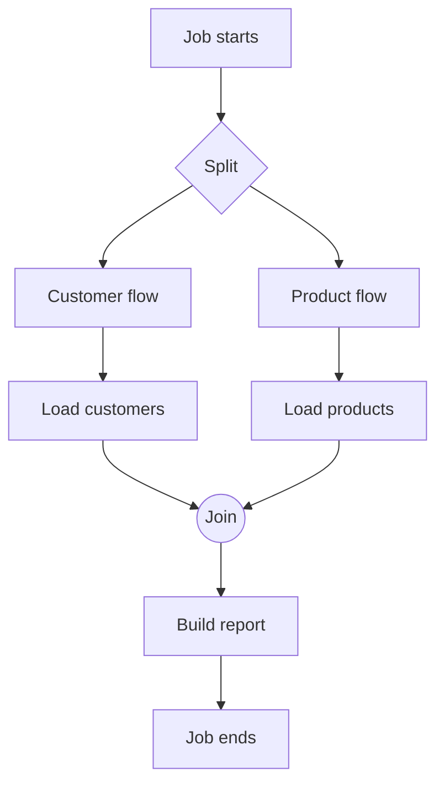

# Testing Parallel Flows

Parallel flows allow Spring Batch to run independent branches concurrently using split and a TaskExecutor. Once the branches finish, the split aggregates their results before letting the downstream flow proceed. Testing this type of workflow must verify multiple things at once: that branches genuinely run concurrently, that the post-join step waits for all branches, that failure statuses propagate properly, that committed data is preserved as designed, and that restarts do not produce duplicate results.

A test that merely launches a job and checks BatchStatus is not enough. A job can complete even when the executor is configured to run sequentially; an aggregation step might run at the wrong time; or one branch might write partial data undetected by the test. This guide shows how to build integration tests with deterministic synchronization to test joins, failures, transactions, restarts, isolated per-flow state, and how to avoid flaky tests.

## 1. Identify behaviors to test

Before writing tests, define the contract of the parallel flow:

- Which flows are allowed to run concurrently?
- Which resources or data areas does each flow write to?
- Which step must run only after all flows finish?
- If one flow fails, should the aggregation flow run?
- Is committed data in a successful branch kept or compensated?
- On restart, which branches re-run and which checkpoints are restored?
- Are external side effects protected by idempotency?

For example, a report preparation job has two independent branches: loading customer data and loading product data. The aggregation step must run only when both branches end successfully.



Key assertions:

1. Customer flow and product flow have overlapping execution windows.
2. Build report does not run while either flow is still active.
3. Build report can read results from both branches.
4. If one branch fails, the job does not publish a successful report.
5. Restart preserves committed data and creates no duplicate records.

## 2. Distinguish parallel flows from multi-threaded steps

Spring Batch supports several parallel execution models. Tests must target the exact concurrency model in use:

| Mechanism | Unit of concurrency | What to test |
|---|---|---|
| Split parallel flow | Multiple Flows in the same job | Flows execute on the executor and join waits for all |
| Multi-threaded step | Multiple chunks/items in one step | Thread safety of reader, processor, writer, and transactions |
| Partitioning | Multiple StepExecutions processing separate partitions | Data slicing, worker execution, and result aggregation |
| Remote chunking/partitioning | Work across separate processes or workers | Messaging, delivery, idempotency, and worker recovery |

This guide focuses on split parallel flows. A test verifying that items are processed on multiple threads within a single step does not prove that splits across flows work properly.

## 3. Configuring a test job with split

The example below has two independent flows and one aggregation step:

```java
@Bean
ThreadPoolTaskExecutor parallelFlowTaskExecutor() {
    ThreadPoolTaskExecutor executor = new ThreadPoolTaskExecutor();
    executor.setCorePoolSize(2);
    executor.setMaxPoolSize(2);
    executor.setQueueCapacity(2);
    executor.setThreadNamePrefix("parallel-test-");
    return executor;
}

@Bean
Flow customerFlow(Step loadCustomersStep) {
    return new FlowBuilder<SimpleFlow>("customerFlow")
            .start(loadCustomersStep)
            .build();
}

@Bean
Flow productFlow(Step loadProductsStep) {
    return new FlowBuilder<SimpleFlow>("productFlow")
            .start(loadProductsStep)
            .build();
}

@Bean
Flow preparationFlow(
        TaskExecutor parallelFlowTaskExecutor,
        Flow customerFlow,
        Flow productFlow) {
    return new FlowBuilder<SimpleFlow>("preparationFlow")
            .start(customerFlow)
            .split(parallelFlowTaskExecutor)
            .add(productFlow)
            .build();
}

@Bean
Job preparationJob(
        JobRepository jobRepository,
        Flow preparationFlow,
        Step buildReportStep) {
    return new JobBuilder("preparationJob", jobRepository)
            .start(preparationFlow)
            .next(buildReportStep)
            .end()
            .build();
}
```

The executor has two workers so both flows can run concurrently. In tests, the executor should have its lifecycle managed by Spring and be shut down when the ApplicationContext closes. Do not create a new thread pool inside every tasklet call or every test method.

When testing concurrency, a large thread count is unnecessary. A two-worker pool is usually sufficient for two flows and keeps tests easier to control.

## 4. Using Spring Batch test support

Spring Batch provides test utilities to launch jobs and inspect execution results. With Spring test configuration, you can use `@SpringBatchTest` and `JobLauncherTestUtils`.

Example:

```java
@SpringBatchTest
@SpringJUnitConfig(PreparationJobTestConfig.class)
class PreparationJobIntegrationTest {

    @Autowired
    private JobLauncherTestUtils jobLauncherTestUtils;

    @Test
    void jobCompletesAfterBothFlows() throws Exception {
        JobParameters parameters = new JobParametersBuilder()
                .addString("batchId", "test-batch-001")
                .toJobParameters();

        JobExecution execution =
                jobLauncherTestUtils.launchJob(parameters);

        assertEquals(BatchStatus.COMPLETED, execution.getStatus());
    }
}
```

This example assumes the test context configures the target job to launch. If the application context contains multiple Job beans, specify the target job for JobLauncherTestUtils in a manner appropriate for your Spring Batch version and test setup.

JobLauncherTestUtils launches jobs through real Spring Batch infrastructure. For parallel flows, use a real test JobRepository and transaction manager—usually backed by a test database—to verify both metadata and transaction behavior.

Do not simply invoke each tasklet method directly and conclude the job flow works. Launch the job containing the split so the framework executes the executor, join, and transitions.

## 5. Verifying two flows genuinely run concurrently

An easy-to-write but weak test measures total duration using sleep: each flow sleeps for one second and expects the job to finish in one second. Such tests depend on the scheduler, CPU, and machine load, making them flaky.

Use a CountDownLatch or deterministic synchronization primitive instead. Each flow signals that it has started, then waits until both reach the barrier. If the executor only has one thread, the first flow times out before the second flow can run; the test catches a non-parallel configuration.

Example test-only probe:

```java
final class ParallelProbe {

    private final CountDownLatch bothFlowsEntered = new CountDownLatch(2);
    private final AtomicInteger activeFlows = new AtomicInteger();
    private final AtomicInteger maxConcurrentFlows = new AtomicInteger();

    void enterFlow() throws InterruptedException {
        int active = activeFlows.incrementAndGet();
        maxConcurrentFlows.accumulateAndGet(active, Math::max);
        bothFlowsEntered.countDown();

        try {
            boolean bothStarted =
                    bothFlowsEntered.await(5, TimeUnit.SECONDS);
            if (!bothStarted) {
                throw new IllegalStateException(
                        "Both flows did not start concurrently");
            }
        } finally {
            activeFlows.decrementAndGet();
        }
    }

    int maxConcurrentFlows() {
        return maxConcurrentFlows.get();
    }
}
```

Both tasklets call the same probe:

```java
@Bean
Step loadCustomersStep(
        JobRepository jobRepository,
        PlatformTransactionManager transactionManager,
        ParallelProbe probe) {
    return new StepBuilder("loadCustomersStep", jobRepository)
            .tasklet((contribution, chunkContext) -> {
                probe.enterFlow();
                return RepeatStatus.FINISHED;
            }, transactionManager)
            .build();
}

@Bean
Step loadProductsStep(
        JobRepository jobRepository,
        PlatformTransactionManager transactionManager,
        ParallelProbe probe) {
    return new StepBuilder("loadProductsStep", jobRepository)
            .tasklet((contribution, chunkContext) -> {
                probe.enterFlow();
                return RepeatStatus.FINISHED;
            }, transactionManager)
            .build();
}
```

After launching the job:

```java
assertEquals(BatchStatus.COMPLETED, execution.getStatus());
assertEquals(2, parallelProbe.maxConcurrentFlows());
```

The barrier uses a finite timeout so the test does not hang indefinitely if the executor is misconfigured. In real tests, choose a timeout generous enough for slow CI yet short enough to detect deadlocks promptly.

This probe is strictly a test concurrency-observation tool. Do not put test latches or counters into production flows.

## 6. Verifying the post-split step waits for all flows

A critical assertion is that the aggregate step runs only after both flows finish. You can use two markers in tests:

```java
final class BranchCompletionState {

    private final AtomicBoolean customersDone = new AtomicBoolean();
    private final AtomicBoolean productsDone = new AtomicBoolean();

    void customersCompleted() {
        customersDone.set(true);
    }

    void productsCompleted() {
        productsDone.set(true);
    }

    boolean bothCompleted() {
        return customersDone.get() && productsDone.get();
    }
}
```

Each branch's tasklet marks completion after its branch work finishes:

```java
@Bean
Step loadCustomersStep(
        JobRepository jobRepository,
        PlatformTransactionManager transactionManager,
        BranchCompletionState state) {
    return new StepBuilder("loadCustomersStep", jobRepository)
            .tasklet((contribution, chunkContext) -> {
                // Execute the customer flow's work.
                state.customersCompleted();
                return RepeatStatus.FINISHED;
            }, transactionManager)
            .build();
}
```

The aggregate step checks both markers:

```java
@Bean
Step buildReportStep(
        JobRepository jobRepository,
        PlatformTransactionManager transactionManager,
        BranchCompletionState state) {
    return new StepBuilder("buildReportStep", jobRepository)
            .tasklet((contribution, chunkContext) -> {
                if (!state.bothCompleted()) {
                    throw new IllegalStateException(
                            "Aggregate started before both flows completed");
                }
                return RepeatStatus.FINISHED;
            }, transactionManager)
            .build();
}
```

This test verifies the join at the workflow level. In real applications, the aggregate step should inspect each branch's durable data such as staging records, manifests, or branch statuses in the database; AtomicBoolean variables are suitable only as test probes.

Do not use static fields or mutable singletons as a production mechanism for passing results between flows. That can cause different job runs to interfere with one another.

## 7. Verifying fast flows wait for slow flows

To explicitly test join behavior, hold one branch from finishing using a latch:

1. Flow A records completion.
2. Flow B signals it has started, then waits on a release signal.
3. The aggregate step checks that Flow B has completed.
4. The test asserts aggregate has not been invoked before releasing Flow B.
5. The test sends the release signal.
6. Flow B finishes and the aggregate step is allowed to run.

Example test state:

```java
final class JoinProbe {

    final CountDownLatch slowFlowStarted = new CountDownLatch(1);
    final CountDownLatch releaseSlowFlow = new CountDownLatch(1);
    final AtomicBoolean slowFlowCompleted = new AtomicBoolean();
    final AtomicBoolean aggregateStarted = new AtomicBoolean();
}
```

Slow branch tasklet:

```java
slowFlowStarted.countDown();
boolean released = releaseSlowFlow.await(5, TimeUnit.SECONDS);
if (!released) {
    throw new IllegalStateException("Test did not release slow flow");
}
slowFlowCompleted.set(true);
return RepeatStatus.FINISHED;
```

Aggregate step:

```java
if (!slowFlowCompleted.get()) {
    throw new IllegalStateException("Join did not wait for slow flow");
}
joinProbe.aggregateStarted.set(true);
return RepeatStatus.FINISHED;
```

The test can launch the job on a separate thread using a test executor, wait for slowFlowStarted, verify aggregate has not started, release the slow branch, and wait for JobExecution to finish. Every wait operation must have a timeout; never let a test hold threads indefinitely when an assertion fails.

If you need to drive JobLauncher on a separate thread, use a dedicated test executor and always shut it down in a finally block or lifecycle hook. Do not reuse the split's thread pool to launch the job in tests, as that can exhaust workers and create artificial deadlocks.

## 8. Checking the final status of each flow and step

After the job finishes, inspect StepExecutions and verify:

- Every branch's steps ran.
- BatchStatus and ExitStatus match expectations.
- The aggregation step ran only after the split.
- Steps belonging to unchosen branches did not run.
- Read/write/skip counts match the fixture.

Example assertion:

```java
Map<String, StepExecution> stepsByName =
        execution.getStepExecutions().stream()
                .collect(Collectors.toMap(
                        StepExecution::getStepName,
                        Function.identity()));

assertEquals(
        BatchStatus.COMPLETED,
        stepsByName.get("loadCustomersStep").getStatus());
assertEquals(
        BatchStatus.COMPLETED,
        stepsByName.get("loadProductsStep").getStatus());
assertEquals(
        BatchStatus.COMPLETED,
        stepsByName.get("buildReportStep").getStatus());
```

If the same step name can execute multiple times in a job, do not collect into a map keyed solely by step name. Select the right execution by ID, flow, or run attempt.

Besides BatchStatus, check ExitStatus if the flow uses custom exit codes. A job might have BatchStatus COMPLETED while a step has a business exit code such as COMPLETED_WITH_WARNINGS.

## 9. Testing flow failures

A test must prove that when one branch fails, the successful aggregation step does not run.

Example of a product-branch tasklet intentionally throwing an error:

```java
@Bean
Step loadProductsStep(
        JobRepository jobRepository,
        PlatformTransactionManager transactionManager) {
    return new StepBuilder("loadProductsStep", jobRepository)
            .tasklet((contribution, chunkContext) -> {
                throw new IllegalStateException("Simulated product failure");
            }, transactionManager)
            .build();
}
```

The test should confirm:

- The product step has FAILED status.
- The split does not enter the normal success branch.
- The aggregate/publish step is not invoked.
- The job ends with the status dictated by the defined flow policy.
- Any error-handling step runs along the right branch.

Do not assert only that the job FAILED. If the flow has an error-handling branch that finishes COMPLETED, the job's final status may not directly reveal that an initial branch failed. In that case, assert individual step statuses and the error-handling branch.

## 10. Testing partial success and transactions

Join does not create a shared transaction across flows. One branch can commit data before another branch fails. Tests must verify the application's partial-success policy.

Example:

| Flow | Action | Outcome when the other flow fails |
|---|---|---|
| Customer | Writes customer staging and commits | Committed data remains |
| Product | Writes one chunk then fails on the next chunk | Failing chunk rolls back; earlier chunk may remain |
| Aggregate | Reads results of both branches | Does not run on the success branch when split fails |

An integration test should use a real test database and real transaction manager:

1. Customer flow writes several records to the customer staging table.
2. Product flow writes the first chunk and intentionally fails on a later chunk.
3. Launch the job containing the split.
4. Verify committed customer records still exist.
5. Verify the failing product chunk rolled back.
6. Verify aggregate/publish did not run.

Do not wrap the entire test method in a test transaction expecting that transaction to govern the flows' transactions. JobLauncher may run on another thread; the test thread's transaction does not automatically propagate into split threads. Verify committed data using an independent transaction or connection after the job completes.

## 11. Testing restarts after a branch fails

Restart tests are essential because parallel flows may have already produced data in some branches before the job failed.

Scenario:

1. Launch the job with fixed identifying parameters, such as batchId = test-batch-42.
2. Customer flow completes and commits its results.
3. Product flow commits several chunks and then intentionally fails.
4. Verify the first JobExecution is FAILED and committed data remains.
5. Disable the failure condition in the product flow.
6. Relaunch the same job with the exact same identifying parameters.
7. Verify the same JobInstance restarts with a new JobExecution.
8. Verify customer flow creates no duplicate records and product flow resumes from its checkpoint.
9. Verify the aggregate step runs after both flows finish.

Example creating parameters:

```java
JobParameters parameters = new JobParametersBuilder()
        .addString("batchId", "test-batch-42", true)
        .toJobParameters();
```

Do not add a new identifying timestamp on restart. If parameters differ, Spring Batch creates a new JobInstance and reprocesses data as a separate batch.

### Making the failure happen only on the first run

In tests, you can use a test-controlled failure switch, such as an AtomicBoolean or a fake repository that throws an error once. This state is strictly for testing; never use it in place of checkpoints or idempotency in production.

Ensure switches are reset between test methods. When sharing a Spring context, leftover state from a prior test can make outcomes depend on execution order.

## 12. Testing each flow's isolated StepExecutionContext

Each branch typically has its own reader checkpoint. Tests should confirm:

- Customer reader stores customer.lastId in the customer step's StepExecutionContext.
- Product reader stores product.lastId in the product step's StepExecutionContext.
- Restart restores the right checkpoint for each reader.
- No shared key in JobExecutionContext mixes read positions.

After job execution, inspect each StepExecution's context:

```java
StepExecution customerExecution =
        execution.getStepExecutions().stream()
                .filter(step -> step.getStepName().equals("loadCustomersStep"))
                .findFirst()
                .orElseThrow();

long customerLastId = customerExecution.getExecutionContext()
        .getLong("customer.lastId");

assertEquals(5000L, customerLastId);
```

Expected values depend on reader fixtures and checkpoint strategy. Do not assert a hard-coded number if a paging reader stores page/offset differently. For framework-provided readers, verify restart behavior via output data and execution context per the reader's contract.

If testing a promotion listener, verify only configured keys are promoted to JobExecutionContext and only post-join steps read them. If multiple flows promote the same key, tests must clarify key-ownership rules to avoid non-deterministic results.

## 13. Testing side-effect idempotency

Parallel flows may call multiple external systems. When a branch fails or a job restarts, already-sent requests may be sent again.

Example fake partner client in tests:

```java
final class IdempotentPartnerFake {

    private final Set<String> acceptedKeys =
            ConcurrentHashMap.newKeySet();

    boolean publish(String idempotencyKey) {
        return acceptedKeys.add(idempotencyKey);
    }

    int acceptedCount() {
        return acceptedKeys.size();
    }
}
```

The test sends the same idempotency key twice and confirms the target system produces only one logical outcome. In production, idempotency must be enforced at the target system or a durable store with unique constraints; an in-memory set is only a fake to verify the contract.

For messages or a database outbox, also test:

- Publisher sends successfully and then the process stops before marking delivered.
- Publisher runs again and sends the same message.
- Consumer receives a duplicate yet does not process business logic a second time.
- One branch succeeds while another fails; the overall batch is not published.

## 14. Testing custom FlowExecutionAggregators

If the application uses the default aggregator, test key status combinations to confirm the split is not treated as successful when one branch fails.

If using a custom FlowExecutionAggregator, test its combination rules directly:

| Flow A | Flow B | Aggregated result per policy |
|---|---|---|
| COMPLETED | COMPLETED | COMPLETED |
| COMPLETED | FAILED | FAILED |
| FAILED | FAILED | FAILED |
| COMPLETED | STOPPED | Per defined policy |
| UNKNOWN | COMPLETED | Per defined policy |

Do not test only the case where both branches succeed. Bugs frequently appear when one branch returns a custom status, STOPPED, or UNKNOWN.

A custom aggregator should never swallow failures by always returning COMPLETED. If the business accepts missing data from one branch, use an explicit status like PARTIAL and configure downstream flows cleanly; never erase the fact that a branch failed.

## 15. Testing timeouts and hung branches

A flow can wait indefinitely due to:

- An HTTP call without a timeout.
- A database query or lock waiting too long.
- A reader waiting for a file or resource that never appears.
- A latch/test synchronization that is never released.
- An external system outage.

Tests should verify timeouts at the I/O layer or orchestration layer as appropriate. Do not assume TaskExecutor automatically imposes a timeout on the whole flow.

For tests using latches:

```java
boolean released = releaseLatch.await(5, TimeUnit.SECONDS);
if (!released) {
    throw new IllegalStateException("Timed out waiting for test signal");
}
```

If a timeout occurs, the test must fail clearly and release latches during cleanup so worker threads are not leaked. Avoid tests with long Thread.sleep calls because they slow down the suite and do not prove join behavior.

## 16. Avoiding flaky tests

Parallel tests easily become flaky if they depend on thread ordering, wall-clock timing, or shared state. Several principles:

- Use CountDownLatch, CyclicBarrier, or Semaphore with timeouts instead of sleep.
- Never assert that flow A always runs before flow B; that order is not guaranteed.
- Assert overlap/concurrency only when the executor and test barrier are designed to prove it.
- Use AtomicBoolean/AtomicInteger or concurrent collections for test probes.
- Never share mutable readers/writers between two flows.
- Generate a unique batch ID per test to avoid JobInstance collisions.
- Reset fakes, latches, counters, and test data between runs.
- Never run two tests concurrently sharing the same JobRepository and the same identifying parameters.
- Put timeouts on Future.get, latch.await, and job completion.
- Always shut down executors and release all latches in finally/cleanup.

Do not assert an exact log order between two flows. Logs can interleave differently across runs. Assert statuses, markers, and durable outputs instead.

## 17. Database and transaction isolation tests

If the goal is testing commit/rollback, use a test database compatible with the deployed transaction manager. Watch out for:

- JobLauncher may run flows on a thread different from the test thread.
- JUnit's test transaction does not automatically wrap flow transactions.
- Connection pools must have enough connections for branches and metadata operations.
- Test databases must support the lock/constraint semantics production relies on if testing that behavior.
- Inspect data using an independent transaction after the job finishes.

If using H2 for fast tests while production runs PostgreSQL/Oracle/MySQL with different locking behavior, deadlock and isolation tests may not reflect production. Tests verifying critical transaction semantics should also run against a production-compatible database.

## 18. Test isolation and JobRepository metadata

JobRepository stores history for JobInstance, JobExecution, and StepExecution. If tests reuse the same job name and identifying parameters, subsequent runs can hit JobInstanceAlreadyCompleteException or inadvertently restart an old execution.

Two common approaches:

1. Use a unique identifying parameter per test method.
2. Clean up test metadata after each test using Spring Batch test utilities, if appropriate for the repository setup.

Example generating a per-test batch ID:

```java
JobParameters parameters = new JobParametersBuilder()
        .addString("batchId", UUID.randomUUID().toString(), true)
        .toJobParameters();
```

For restart tests, keep the exact same parameters between the failed run and the restart run. Never generate a new UUID on restart.

If tests delete metadata, ensure they do not delete executions from concurrently running tests. Isolating databases/schemas or running repository-dependent tests sequentially may be safer.

## 19. Testing executor and resource lifecycles

Tests should confirm the executor is configured with sensible limits:

- The pool has enough workers for the flows expected to run concurrently.
- Queue capacity does not create an unbounded backlog.
- Thread name prefixes help observe logs.
- Closing ApplicationContext shuts down the executor.
- Test timeouts do not leave worker threads dangling.

Do not shut down the executor immediately after launching a job if the job is still running. Wait for job completion or controlled test cleanup.

If a test creates an executor outside the Spring context, use try/finally to shut it down and await termination. Avoid leaving non-daemon workers alive and preventing the test suite from exiting.

## 20. Comprehensive integration test example

An integration test can combine key assertions:

```java
@Test
void parallelFlowsCompleteBeforeAggregate() throws Exception {
    JobParameters parameters = new JobParametersBuilder()
            .addString("batchId", "parallel-test-100", true)
            .toJobParameters();

    JobExecution execution =
            jobLauncherTestUtils.launchJob(parameters);

    assertEquals(BatchStatus.COMPLETED, execution.getStatus());
    assertEquals(2, parallelProbe.maxConcurrentFlows());
    assertTrue(branchCompletionState.bothCompleted());
    assertTrue(joinProbe.aggregateStarted.get());

    assertEquals(
            expectedCustomerCount,
            customerStagingRepository.countByBatchId("parallel-test-100"));
    assertEquals(
            expectedProductCount,
            productStagingRepository.countByBatchId("parallel-test-100"));

    assertEquals(
            1,
            reportRepository.countByBatchId("parallel-test-100"));
}
```

This is an illustrative skeleton; probes and repositories are test dependencies configured in the context. In real tests, set up fixture data, clean up by batch ID, and avoid reusing identifying parameters outside restart tests.

Another test should force one flow to fail and verify aggregate/publish does not run. A separate test should cover restart after partial success instead of cramming every scenario into one giant test that is hard to diagnose.

## 21. Checklist of test scenarios

| Category | Scenario | Key assertion |
|---|---|---|
| Concurrency | Both flows reach barrier | At least two flows active simultaneously |
| Join | One flow is slower | Aggregate waits for slow flow |
| Success | All flows succeed | Job and aggregate step complete |
| Failure | One flow fails | Success branch does not run |
| Status | Custom status/aggregator | Split outcome matches policy |
| Transaction | One branch commits, another rolls back | Committed branch handled per policy |
| Context | Each reader has its own checkpoint | Restart does not mix read positions |
| Restart | One branch fails after several chunks | Same JobInstance resumes properly |
| Idempotency | External request is resent | No duplicate side effects created |
| Isolation | Repeated test runs | No metadata or state collisions |
| Resource | Job finishes or test times out | Executor and workers are released |

## 22. Common mistakes when testing parallel flows

**Asserting only JobExecution COMPLETED.** That does not prove flows ran concurrently or that join waited properly. Verify overlap and individual step statuses.

**Using Thread.sleep to fake concurrency.** Tests depend on machine speed and become flaky. Use latches/barriers with timeouts.

**Calling tasklets directly.** That bypasses split, TaskExecutor, join, and FlowExecutionAggregator. Launch the job containing the parallel flow.

**Wrapping the test in a transaction expecting all flows to share it.** Flows can run on different threads. Check commits/rollbacks via the database after the job completes.

**Asserting a fixed execution order.** The executor does not guarantee flow A always precedes flow B. Assert only concurrency conditions and defined dependencies.

**Sharing mutable state across flows.** Probes must be thread-safe; production readers/writers need isolated state or thread-safe implementations.

**Not resetting latches and counters.** Leftover test state from prior runs produces unstable results.

**Using new parameters on restart.** The test creates a new JobInstance instead of restarting the failed instance. Keep identifying parameters identical.

**Not inspecting committed data.** Job status does not prove partial-success data was handled properly. Query staging/business tables after execution.

**Not verifying resource cleanup.** Stranded threads can interfere with other tests or prevent the JVM from exiting.

## 23. Process for building parallel flow tests

Build tests in layers:

1. Create a test job with two independent flows and one aggregate step.
2. Confirm the split uses an asynchronous executor with enough workers.
3. Use a latch to prove both flows have overlapping execution times.
4. Hold one flow from finishing and verify aggregate has not run yet.
5. Release the remaining flow and confirm join and aggregate complete.
6. Force one flow to fail and verify aggregated status and error branch.
7. Verify each branch's transactions against real database data.
8. Restart the same JobInstance after partial success and confirm no duplicate writes.
9. Verify each step's isolated context/checkpoint.
10. Confirm executors, latches, and test data are cleaned up.

Separate success, failure, restart, and idempotency tests into distinct test cases. When a test fails, the test name should indicate which contract broke rather than merely reporting the job did not complete.

## 24. Practical conclusion

Testing parallel flows must prove both concurrency and synchronization. Use a real split job with a TaskExecutor, latches with timeouts to confirm branches genuinely run concurrently, and a slow flow to prove the post-split step waits for all results. Inspect the status of each StepExecution, the aggregated status, and the data written by each branch.

One failing branch does not automatically roll back commits from another branch. Therefore, integration tests must verify partial success, restarts with identical identifying parameters, isolated checkpoints, and side-effect idempotency. Use an appropriate test database and transaction manager, avoiding reliance on the test thread's transaction, Thread.sleep, or log order. Finally, reset state and release executors so the suite runs reliably across repeated runs and in CI.
