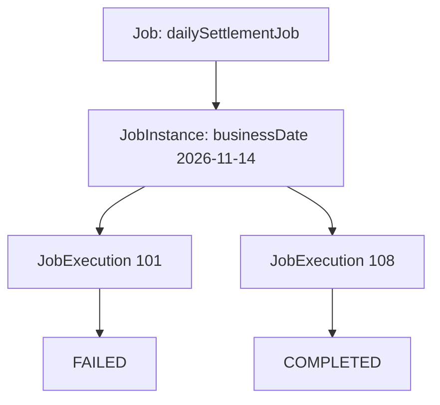
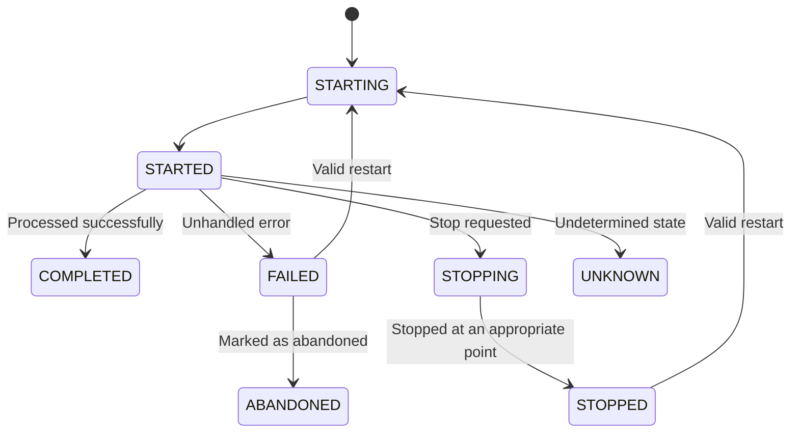

# A Job that has not run, is running, has completed, and has failed

In Spring Batch, a job does not have just two simple outcomes of running successfully or failing. The framework tracks the **lifecycle of each job execution**, from the moment it is launched, through processing, until it completes, is stopped on request, or hits an error. This state lets the application know where the work stands, whether it can resume after an interruption, or whether an operator needs to intervene.

To understand that lifecycle, you need to distinguish `JobInstance`, `JobExecution`, and `BatchStatus`. A job is the definition of the work; a `JobInstance` identifies one business run by its identifying parameters; and a `JobExecution` records one specific execution of that instance. The status is attached to the `JobExecution`.

## 1. Distinguishing Job, JobInstance, and JobExecution

Suppose the system has a job `dailySettlementJob`, used to reconcile transactions by business date.

- **Job** is the definition of the `dailySettlementJob` process, consisting of steps that read transactions, reconcile them, and write the results.
- **JobInstance** represents the reconciliation work for one specific business date. Normally, it is identified by the job name together with the `JobParameters` marked as identifying.
- **JobExecution** represents one specific run of the `JobInstance`. If the first run fails and is restarted, the next run creates a new `JobExecution` but still belongs to the same `JobInstance`.

Example:

| Component | Example | Meaning |
|---|---|---|
| Job | `dailySettlementJob` | The definition of the daily reconciliation process |
| JobParameters | `businessDate=2026-11-14` | The business date to process |
| JobInstance | `dailySettlementJob` for the date `2026-11-14` | One specific piece of business work |
| JobExecution #1 | Execution ID `101` | The first run, ended with `FAILED` |
| JobExecution #2 | Execution ID `108` | The restart, ended with `COMPLETED` |

The two executions in the example belong to the same instance because they use the same job identity and the same set of identifying parameters. They each have their own ID, start time, end time, and status.



Key point: a `JobInstance` describes the business work to be done; a `JobExecution` describes one attempt to execute that work. Therefore, the run status is not a fixed property of the `Job` definition.

## 2. A job that has not run: there is no JobExecution yet

A job being configured in the application does not mean it has been executed. Before the first launch for a set of identifying parameters, there is no corresponding `JobExecution` stored in the `JobRepository`.

Spring Batch **has no `BatchStatus.NOT_STARTED` value** to represent a job that has never run. The "not run" state is usually understood from the fact that no execution exists for the `JobInstance` and the parameter set under consideration.

For example, the application defines `dailySettlementJob` but the scheduler is only configured to run at 01:00. Before the scheduler triggers the job, the process has not been executed and there is no execution for that business date. When the `JobLauncher` receives a launch request, Spring Batch creates the execution metadata and begins moving through the lifecycle states.

Distinguish three situations:

1. **The job is defined:** the application has the job configuration, but there has been no run.
2. **The job is scheduled:** the scheduler knows when to call the job, but the job may still not have been launched.
3. **The job has been launched:** Spring Batch creates a `JobExecution`; from here the execution status is tracked in the repository.

You should not conclude that a job has not run just because no logs were found recently. You need to look at the correct job name, identifying parameters, time range, and the metadata in the `JobRepository`.

## 3. A running job: STARTING and STARTED

When the `JobLauncher` launches a job, Spring Batch creates a `JobExecution` and stores the initial information. The lifecycle usually passes through two initial states:

### STARTING

`STARTING` indicates that the execution has been created and is in its starting phase. The framework is preparing to execute the job; the processing steps may not have started yet.

In a system with asynchronously running jobs, operators may see this state for a period of time before the execution moves to `STARTED`.

### STARTED

`STARTED` indicates that the job has begun executing. The steps are orchestrated according to the configured flow. With a chunk-oriented step, the reader reads items, the processor processes them, and the writer writes the data chunk by chunk.

While the job is running, the `JobExecution` stores information such as the start time, the status, the execution context, and related execution information. The step metadata also helps track each phase inside the job.

A job can run for a few seconds or many hours. Therefore, the `STARTED` status by itself does not tell you whether the job is progressing well or is hung. To track progress, you also need to look at the number of items read/written, the step status, the run time, logs, and the metrics of the source/target systems.

## 4. The states in the JobExecution lifecycle

Spring Batch uses the `BatchStatus` enum to represent the execution status. Common states include:

| BatchStatus | Meaning | How to interpret it operationally |
|---|---|---|
| `STARTING` | The execution is in its starting phase | The execution has been created but the job has not entered normal processing yet |
| `STARTED` | The job is executing | Monitor the steps, progress, and run time |
| `STOPPING` | A stop request has been made and the framework is handling it | The job has not fully stopped; you may need to wait until an appropriate stopping point |
| `STOPPED` | The job stopped on request | Can be restarted if the job and step state allow it |
| `COMPLETED` | The job ended successfully according to the execution flow | The instance has completed; it cannot be run again as a new instance with the same identifying parameters |
| `FAILED` | The job ended because of an error that was not handled successfully | Can be restarted if the job is configured as restartable and the related conditions are met |
| `ABANDONED` | The execution has been marked as abandoned | The framework does not treat this execution as a restartable run in the normal way |
| `UNKNOWN` | The execution status cannot be determined with certainty | Investigate the metadata and the business impact before deciding how to proceed |

The common flow can be pictured as follows:



This is a general diagram; not every state transition is invoked directly by the application. Spring Batch and the operational actions manage the valid transitions according to the execution lifecycle.

### COMPLETED — completed successfully

`COMPLETED` indicates that the job ended successfully according to the flow that was executed. The required steps have finished and the job is no longer in a running state.

When a `JobInstance` is already `COMPLETED`, launching the same job again with the same identifying parameters is normally rejected with a `JobInstanceAlreadyCompleteException`. This is protective behavior to avoid accidentally processing the same business work twice.

If you need to run for a different business date, pass a different identifying parameter, for example `businessDate=2026-11-15`. In that case Spring Batch creates a new `JobInstance`. If you truly need to rerun a date that has already completed, you need to determine clearly whether it is new business work or a controlled corrective action; you can use an identifying parameter such as `runId` or `reprocessVersion` according to the application's design.

### FAILED — failed

`FAILED` indicates that the job ended because of an error that prevented the flow from completing successfully. For example:

- The database cannot be connected to and the error exceeds the retry policy.
- A record violates a mandatory rule and the skip policy does not allow skipping it.
- The writer encounters an error while writing data and the chunk transaction is rolled back.
- A step fails and the flow has no appropriate branch to continue.

A failed job does not necessarily mean that none of the data has been processed. Chunks committed earlier may have been written successfully. Therefore, on a restart, the framework needs the metadata and checkpoints to determine which part of the work can continue. Side effects outside the database transaction also need to be considered separately.

### STOPPING and STOPPED — stopping on request

`STOPPING` appears when there is a request to stop a running execution. This is the phase in which the framework is handling the request; it is not yet the fully stopped state.

When a job stops in a controlled way, the final state is `STOPPED`. Spring Batch usually coordinates stopping at an appropriate execution boundary, for example after the current processing reaches a point where it can check for the stop signal. Therefore, a stop request does not mean every running statement will be interrupted instantly.

`STOPPED` differs from `FAILED`: the job stopped because of an operational request, while `FAILED` reflects an execution that ended because of an error. A stopped job can be restarted if the job configuration, the metadata, and the step state allow it.

### ABANDONED and UNKNOWN

`ABANDONED` is typically used when an operator decides not to continue a failed execution or step. The framework treats this state as abandoned and does not restart it on its own through the normal process. You should only mark something as abandoned after clearly understanding the impact on the data that has already been processed.

`UNKNOWN` represents a state that cannot be determined safely. This situation can appear when the metadata does not clearly reflect the execution result, for example a serious incident that occurs between state update operations. You should not automatically restart based solely on the assumption that the job has not done anything; check the repository, the logs, and the target system first.

## 5. How does BatchStatus differ from ExitStatus?

These two concepts are related but not synonymous:

- **`BatchStatus`** describes the lifecycle state of the execution, for example `STARTED`, `COMPLETED`, `FAILED`, or `STOPPED`.
- **`ExitStatus`** describes the result code that a step or job returns when it ends. This code is used in the flow and can contain custom codes according to the business.

For example, a job may complete technically but detect that some records were skipped. The application can keep `BatchStatus.COMPLETED` and use a custom `ExitStatus` such as `COMPLETED_WITH_SKIPS` to report the business result to the orchestration step or the monitoring system.

A flow can use the exit code to decide the next step. For example, after a data validation step:

- `COMPLETED` can transition to the main data writing step.
- `COMPLETED_WITH_WARNINGS` can transition to a step that generates a warning report.
- `FAILED` can end the job or move to an error-handling branch if the flow is designed that way.

Therefore, when looking at a job's status, you should not just look at a `COMPLETED` or `FAILED` string in a log and ignore which type of status is being displayed. You need to distinguish `JobExecution.getStatus()` from `JobExecution.getExitStatus()`.

## 6. Does a failed Step always make the Job fail?

Not in every configuration. A `StepExecution` has its own status. If a step fails, the flow can be configured to end the job with `FAILED`, or to move to a different handling branch.

For example, a data import job can consist of:

1. `importStep`: reads and validates the input data.
2. `errorReportStep`: generates a report if there is erroneous data.
3. `archiveStep`: archives the input file and the report.

If the flow is designed to handle `ExitStatus.FAILED` from `importStep` by running `errorReportStep` and then completing the reporting process, the job's final status can reflect that the flow ended successfully along the defined branch. That does not mean the data import step succeeded; the step status and the business result still need to be checked.

Conversely, if a step fails and there is no appropriate transition to handle it, the job usually ends with the `FAILED` status.

## 7. Restart after FAILED or STOPPED

An important advantage of Spring Batch is the ability to restart a job after an execution fails or is stopped. When restarted properly, Spring Batch creates a new `JobExecution` for the same `JobInstance` and uses the saved metadata to continue according to the job's configuration.

Example:

```text
JobInstance: dailySettlementJob, businessDate=2026-11-14

JobExecution 101
  STARTING -> STARTED -> FAILED
  320 chunks committed

JobExecution 108 (restart)
  STARTING -> STARTED -> COMPLETED
  Continue from the appropriate checkpoint
```

A restart depends on several conditions:

- The job must allow restart. A job configured as non-restartable cannot continue through the normal restart mechanism.
- The launch must identify the correct `JobInstance`, usually with the same job name and the same identifying parameters.
- The `JobRepository` must be able to store the necessary metadata. The execution context and the reader/step must support restoring state in the way they were designed.
- The step and the writer need to behave safely when rerun. Operations that write to external systems need to be designed to avoid creating duplicate data.
- The execution must not be in a state that causes the framework to reject a restart, such as an instance that is already `COMPLETED` or an execution that has been marked `ABANDONED`.

Not every reader automatically remembers the position it has read. A reader capable of saving state can write a checkpoint into the execution context; a reader that does not save state may start reading again from the beginning on restart. The design of the data source, the sort order, and the checkpoint needs to be consistent so that data is not missed or processed twice.

### Why is idempotency needed?

Suppose a chunk writes data into the database and then calls a partner API. The database rolls back when the API fails, but the partner API may have already received and processed the request. When the chunk is rerun, the API risks receiving the same request a second time.

To reduce the risk, you can:

- Use a unique business key to prevent creating duplicate records.
- Send an idempotency key when calling the API if the target system supports it.
- Use a transactional outbox to separate the commit of business data from the process of sending messages.
- Store the processing state and build a reconciliation process when atomicity across systems cannot be guaranteed.

A restart is the ability to continue the process based on metadata; it does not automatically guarantee that every external side effect happens exactly once.

## 8. Proactively stopping a job

In operations, you may need to stop a job because the input data is wrong, the target system is under maintenance, or the work is running too long. Spring Batch supports requesting an execution stop through a control mechanism such as `JobOperator.stop`.

General process:

1. The operator identifies the correct running execution ID.
2. The system sends a stop request.
3. The execution moves to `STOPPING` while the request is being handled.
4. The framework stops at an appropriate point and updates the status to `STOPPED`.
5. After addressing the cause, the operator can restart if the job allows it.

A stop request is a controlled stop request. If a processor is calling an API that takes several minutes to return, the job may not stop immediately. You need to design timeouts for I/O, check the stop signal at appropriate points, and limit the processing time of each unit of work.

If the JVM process is killed abruptly or the server loses power, the framework may not have time to write the final state. The repository may still hold an execution with the `STARTED` or `STARTING` status. In that case, you need to verify that the process has really stopped, check the committed effects, and handle the metadata according to the operational procedure. You should not manually change the status before determining the actual data.

## 9. Tracking job status in the application

The `JobRepository` stores the execution metadata. The application can use `JobExplorer` to read job/instance/execution information and use `JobOperator` for supported operational actions such as launching, restarting, or stopping.

When inspecting a `JobExecution`, you should look at least at:

- The job name and identifying parameters, to confirm the correct business work.
- The execution ID and the current `BatchStatus`.
- The `ExitStatus`, to understand the final result code.
- The start time, end time, and run duration.
- The status of each step.
- The number of items read, written, filtered, skipped, and the error information.
- The execution context or checkpoint related to restartability.

An example illustrating how to read the status from a retrieved `JobExecution` object:

```java
BatchStatus batchStatus = jobExecution.getStatus();
ExitStatus exitStatus = jobExecution.getExitStatus();

System.out.println("Execution ID: " + jobExecution.getId());
System.out.println("Batch status: " + batchStatus);
System.out.println("Exit code: " + exitStatus.getExitCode());
System.out.println("Start time: " + jobExecution.getStartTime());
System.out.println("End time: " + jobExecution.getEndTime());
```

The snippet only illustrates reading the execution status. To obtain the `JobExecution` object, the application usually queries `JobExplorer` by the corresponding job instance and execution. The specific query approach depends on the Spring Batch version and the application structure.

In a production environment, you should have a dashboard or structured logs to find an execution by job name, business parameters, and ID. Alerts should distinguish jobs that run longer than expected, jobs that fail, jobs that are stopped, and jobs whose number of error records exceeds a threshold.

## 10. Example lifecycle of a reconciliation job

A daily transaction reconciliation job can unfold as follows:

**First run**

1. The scheduler triggers `dailySettlementJob` with `businessDate=2026-11-14`.
2. Spring Batch creates the `JobInstance` for that date and the first `JobExecution` in the `STARTING` state.
3. The job moves to `STARTED`, then executes the steps that read, match, and write the results.
4. After committing 320 chunks, the connection to the target data system fails for an extended time. Retries reach their limit and the writer causes the step to fail.
5. The job ends with `BatchStatus.FAILED`. The metadata of the committed chunks is still stored.

**After fixing the incident**

1. The operations team restores the connection to the target system.
2. The job is restarted with the same identifying parameters to continue the same `JobInstance`.
3. Spring Batch creates a new `JobExecution` and restores the appropriate checkpoint.
4. The remaining chunks are processed; the results are written successfully.
5. The job ends with `BatchStatus.COMPLETED`.

**The next business date**

The scheduler runs the job with `businessDate=2026-11-15`. Because the identifying parameter changes, Spring Batch creates a new `JobInstance` for the new date. The execution history of the previous day is retained for lookup and auditing.

This example shows that status is not only for display. It determines how the system reacts to duplicate launches, restarts after errors, and tracking each business date.

## 11. Some common operational problems

| Situation | Possible cause | How to handle |
|---|---|---|
| The job still shows `STARTED` after the server restarts | The process stopped abruptly before the final metadata update | Verify the old process, the logs, the committed data, and the repository state before handling the execution |
| Launching again but getting `JobExecutionAlreadyRunningException` | The same `JobInstance` has an active execution | Check the running execution; verify that it is still alive before intervening |
| Launching again but getting `JobInstanceAlreadyCompleteException` | The instance with those identifying parameters has already completed | Use new identifying parameters if this is a new run period; if it is a correction, design a clear reprocess procedure |
| Restart but reading again from the beginning | The reader does not save a checkpoint or does not restore state | Check the reader's state-saving capability, the execution context, and the step configuration |
| The job is `COMPLETED` but the business still has error records | Some records were skipped or the flow completed via an error-handling branch | Check the `ExitStatus`, skip count, error reports, and business status |
| The job does not stop immediately after a stop request | The current task has not reached a point that checks the stop signal, or I/O is waiting | Check timeouts and design safe stopping points in the processing |

The state in the repository is part of the operational evidence. When investigating an incident, you need to cross-check it against the logs, the state of the target data, and the state of external systems.

## 12. Principles to remember

- A job that is defined but not launched has no `BatchStatus.NOT_STARTED`; check whether a `JobExecution` already exists for that instance and those parameters.
- `STARTING` and `STARTED` represent the starting and executing phases.
- `COMPLETED` is a successful end; the same identifying parameters cannot be used to launch a completed instance again in the normal way.
- `FAILED` represents an end due to an error; a restart is possible if the job and metadata meet the conditions.
- `STOPPING` is a stop request being handled; `STOPPED` is the stopped state.
- `ABANDONED` and `UNKNOWN` need to be understood carefully before taking the next action.
- `BatchStatus` describes the execution lifecycle, while `ExitStatus` provides the step/job result code and can be customized.
- Job status and step status are related but not always the same; a flow can handle a failed step with a separate branch.
- A restart needs appropriate checkpoints and an idempotent design for side effects; it does not by itself guarantee exactly-once across all systems.

Understanding the `JobExecution` states correctly helps development and operations teams know whether a job has not been launched, is processing, has completed, has stopped, or has failed; and from there choose the right monitoring, restart, or investigation action without duplicating business data.
