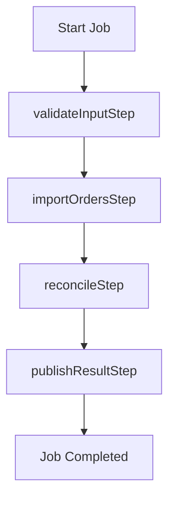

# A Job with one step and with multiple steps

In Spring Batch, a `Job` is the batch work unit at the overall level, while a `Step` is an execution phase inside the job. A job can have just one step or combine multiple steps into a process. Which structure to choose depends on the number of business phases, the transaction boundaries, the restart requirements, and how the results need to be tracked.

For example, a job that generates a report file from a single query may need only one step. A job that imports orders from a file may consist of the phases of checking the file, reading and writing the orders, reconciling the figures, and then publishing the results. Each phase can be modeled as a step so that it has its own status, logs, and recovery policy.

## 1. The relationship between Job and Step

A `Job` describes the processing flow at a high level. A job is built from one or more steps, or from flows that contain steps. A step performs a manageable unit of work, usually processing data in chunks or running a tasklet.

Related execution concepts:

| Concept | Role |
|---|---|
| `Job` | Defines the batch process and the order or conditions of transitions between steps |
| `Step` | Defines a processing phase, such as validating input or importing data |
| `JobInstance` | Represents one business run identified by the job name and the identifying `JobParameters` |
| `JobExecution` | One specific execution of a `JobInstance`; the same instance can have multiple executions on restart |
| `StepExecution` | The execution information of a step within a `JobExecution`, including the status and processing figures |

A `JobInstance` can have multiple `JobExecution`s over time, for example the first one fails and a later one is restarted. Each time the job runs, Spring Batch creates the `StepExecution`s corresponding to the steps that are actually executed in that run.

The `JobRepository` stores the metadata about the job and step executions. Thanks to this metadata, Spring Batch can determine the status of a run, support restart, and provide figures such as the number of items read, written, filtered, or skipped. In an application that needs to restart after the process stops, the metadata store must be durable.

## 2. A Job with only one step

A single-step job is appropriate when the whole business work can be regarded as one unified processing phase. For example:

- Read a file and write the valid lines into the database.
- Recalculate a data set that has been identified.
- Call a stored procedure to create aggregate data.
- Delete expired records according to a clear condition.
- Generate a report from existing data.

A single-step job has a simple structure: the job launches the step, the step performs the work and then ends. The following example uses Spring Batch 5+ with `JobBuilder` and `StepBuilder` that take a `JobRepository`:

```java
@Bean
Step generateReportStep(
        JobRepository jobRepository,
        PlatformTransactionManager transactionManager) {

    return new StepBuilder("generateReportStep", jobRepository)
            .tasklet((contribution, chunkContext) -> {
                // Perform a report generation task with a well-defined scope.
                generateReport();
                return RepeatStatus.FINISHED;
            }, transactionManager)
            .build();
}

@Bean
Job generateReportJob(
        JobRepository jobRepository,
        Step generateReportStep) {

    return new JobBuilder("generateReportJob", jobRepository)
            .start(generateReportStep)
            .build();
}
```

A `Tasklet` is suited to a finite task. When it returns `RepeatStatus.FINISHED`, the tasklet signals that the work has completed. If you need to ask the framework to call the tasklet again to continue part of the work, the tasklet can return `RepeatStatus.CONTINUABLE`; in that case there must be a clear stop condition to avoid an infinite loop.

A single step can also use chunk-oriented processing:

```java
@Bean
Step importOrdersStep(
        JobRepository jobRepository,
        PlatformTransactionManager transactionManager,
        ItemReader<OrderInput> reader,
        ItemProcessor<OrderInput, Order> processor,
        ItemWriter<Order> writer) {

    return new StepBuilder("importOrdersStep", jobRepository)
            .<OrderInput, Order>chunk(200, transactionManager)
            .reader(reader)
            .processor(processor)
            .writer(writer)
            .build();
}

@Bean
Job importOrdersJob(JobRepository jobRepository, Step importOrdersStep) {
    return new JobBuilder("importOrdersJob", jobRepository)
            .start(importOrdersStep)
            .build();
}
```

A point to distinguish: **one step does not mean processing only one item or having only one transaction**. With a chunk size of 200, the step can read and process millions of items across many chunks. Each chunk has its own transaction boundary according to the transaction manager configuration. The job still has only one step, but that step can produce many checkpoints while it runs.

A single-step job has the advantages of being easy to read, easy to configure, and having few state transition points. It is appropriate when there is no clear business reason to split the process into multiple phases. If a step has to do too many different things, making it hard to determine which part has completed or hard to recover after an error, that may be a sign it should be split into multiple steps.

## 3. A Job with multiple steps running sequentially

A multi-step job divides the process into ordered phases. Each step can have its own reader, processor, writer, or tasklet. The next step starts only after the previous step ends according to the defined flow.

An example order import job:

1. `validateInputStep`: checks the file, header, business date, and data structure.
2. `importOrdersStep`: reads the file, converts each order, and writes to the database in chunks.
3. `reconcileStep`: compares the record count and the total value between the source and the imported data.
4. `publishResultStep`: marks the batch as completed or publishes the result to the next system.

Sequential flow diagram:



In Spring Batch, use `start()` to declare the first step and `next()` to chain the subsequent steps:

```java
@Bean
Job importOrdersJob(
        JobRepository jobRepository,
        Step validateInputStep,
        Step importOrdersStep,
        Step reconcileStep,
        Step publishResultStep) {

    return new JobBuilder("importOrdersJob", jobRepository)
            .start(validateInputStep)
            .next(importOrdersStep)
            .next(reconcileStep)
            .next(publishResultStep)
            .build();
}
```

The step beans are configured separately. As a result, the job definition focuses on expressing the business sequence, while the processing details live in each step. This organization lets you change one phase without having to cram all the logic into one large tasklet.

### 3.1. Splitting steps along business boundaries

You should create a new step when a phase has its own goal, completion condition, or recovery approach. For example, file validation can fail before any order is written; the data import may need to restart from a checkpoint; reconciliation may need to be rerun after the source data is fixed.

Splitting steps brings a few benefits:

- Each phase has its own status and duration.
- You can pinpoint exactly which phase caused the error.
- You can set appropriate retry, skip, transaction, and start-limit policies for each step.
- A completed step can serve as a business checkpoint before moving on.
- A flow or step can be reused when several jobs perform the same sub-process.

However, you should not create a separate step for each item or for every very small operation without a reason. Too many steps make the metadata and control flow complex, increase operational cost, and make the job hard to understand. Step boundaries should reflect meaningful business phases.

### 3.2. Transaction boundaries between steps

Each chunk in a chunk-oriented step has its own transaction according to the configuration. A tasklet step also usually runs in a transaction managed by the transaction manager. When one step ends and the next step begins, the previous step's transaction has been completed by that step's own mechanism.

Therefore, a multi-step job is not one large transaction spanning all the steps. If `importOrdersStep` has committed data but `reconcileStep` fails, the committed data of the import step is not automatically rolled back. On restart, Spring Batch can skip the completed step and rerun the step that has not completed, depending on the state and the restart configuration.

The design needs to clearly define what state the data is in after each step. If reconciliation fails, is the imported data retained in a pending-review state? If publishing the result fails, can the publish step be retried separately? These questions determine how the steps are split and how recovery works.

## 4. Conditional flow between steps

Not every job runs all its steps along a straight line. You may need to branch based on the result of the previous step. For example, after validating a file:

- If the file is valid, continue importing the data.
- If the file is invalid, move to a step that records the error and ends with the business status that has been specified.

Spring Batch lets you define transitions based on a step's `ExitStatus`. The example below uses the custom exit codes `VALID` or `INVALID` set by the validation step:

```java
@Bean
Step validateInputStep(
        JobRepository jobRepository,
        PlatformTransactionManager transactionManager) {

    return new StepBuilder("validateInputStep", jobRepository)
            .tasklet((contribution, chunkContext) -> {
                boolean valid = validateInputFile();

                contribution.setExitStatus(
                        new ExitStatus(valid ? "VALID" : "INVALID"));

                return RepeatStatus.FINISHED;
            }, transactionManager)
            .build();
}

@Bean
Job conditionalImportJob(
        JobRepository jobRepository,
        Step validateInputStep,
        Step importOrdersStep,
        Step recordInvalidInputStep) {

    return new JobBuilder("conditionalImportJob", jobRepository)
            .start(validateInputStep)
                .on("VALID").to(importOrdersStep)
            .from(validateInputStep)
                .on("INVALID").to(recordInvalidInputStep)
            .end()
            .build();
}
```

In the example, `.on("VALID")` and `.on("INVALID")` match against the step's exit code. `.from(validateInputStep)` declares another branch originating from the same step. `.end()` completes the job's flow definition.

`BatchStatus` and `ExitStatus` are related but not synonymous:

- `BatchStatus` represents the execution status managed by the framework, such as `COMPLETED`, `FAILED`, `STOPPED`, or `STARTED`.
- `ExitStatus` represents the exit code used to describe the result and to match transitions. It can be the default codes or a custom code such as `VALID`.

When using an error-handling branch, you need to decide the final status of the job. Moving to a step that records the error and then having that step complete can cause the flow to end in a completed state, even though the input data is invalid. If the business requires the job to be considered failed, configure an appropriate transition or final exit status and test the actual status of the `JobExecution`.

For more complex conditions, you can use a `JobExecutionDecider`. The decider returns a `FlowExecutionStatus` to decide the next branch, for example based on the file type, a job parameter, or a stored validation result. You should keep the decision logic centralized and independently testable.

## 5. Sharing data between steps

Steps within the same job often need to share information. There are several ways to pass data, depending on the size and the lifecycle of the data.

**`JobParameters`** are suited to the run's input data, such as `businessDate`, `inputFile`, or `batchId`. These are the parameters that identify the job instance if they are marked identifying. Parameters should remain stable when restarting the same business run.

**`ExecutionContext`** is used to store state that needs to be restored. Each `StepExecution` has its own step execution context; the `JobExecution` has a job execution context shared within the scope of that run. Data stored in the context must be serializable by Spring Batch's mechanism and should be compact.

If the first step writes a value into the step execution context and a later step needs to read it, you can use `ExecutionContextPromotionListener` to promote the selected keys to the job execution context when the step completes:

```java
@Bean
ExecutionContextPromotionListener promoteImportSummary() {
    ExecutionContextPromotionListener listener =
            new ExecutionContextPromotionListener();
    listener.setKeys(new String[] {"importedCount", "batchReference"});
    return listener;
}
```

Register the listener with the step that produces those keys. A later step can read them from the job execution context through `chunkContext.getStepContext().getStepExecution().getJobExecution().getExecutionContext()` or through an appropriate listener/bean. You need to ensure the key has been written before the next step needs it.

For large amounts of data, you should store the intermediate data in a database or file and pass a reference key through the context. You should not put a list of thousands or millions of items into the `ExecutionContext`. The context is suited to checkpoints and small metadata, not to being a store for business data.

## 6. Restarting a multi-step job

Restart is an important reason to split a job into steps with clear boundaries. Suppose the job has three steps:

1. `validateInputStep` completes.
2. `importOrdersStep` fails midway through processing.
3. `reconcileStep` has not been run.

When restarting the same `JobInstance` with the same identifying `JobParameters`, Spring Batch can continue from the step that has not completed. Completed steps are usually skipped on restart. The failed step is executed again according to its state and restart configuration. For a chunk step, the checkpoint in the execution context can help the reader continue from the saved position.

There are a few configurations that affect rerunning a step:

```java
@Bean
Step prepareReferenceDataStep(
        JobRepository jobRepository,
        PlatformTransactionManager transactionManager) {

    return new StepBuilder("prepareReferenceDataStep", jobRepository)
            .tasklet((contribution, chunkContext) -> {
                prepareReferenceData();
                return RepeatStatus.FINISHED;
            }, transactionManager)
            .allowStartIfComplete(true)
            .startLimit(3)
            .build();
}
```

- `allowStartIfComplete(true)` allows a completed step to be run again when the job is restarted and the flow passes through that step.
- `startLimit(3)` limits the number of times the step is started according to the configuration. When the limit is exceeded, the step cannot be launched again in the normal way.

Only enable `allowStartIfComplete(true)` when the operation can be rerun safely or there is a mechanism to control the effects of repetition. For example, a step that creates a staging table can delete and recreate the staging data per batch; a step that submits payments should not be rerun arbitrarily without an idempotency key.

Job names, step names, and identifying parameters need to be managed stably. Changing a step name between releases can cause old metadata to no longer match the new job structure in the expected way. When changing the structure of a job that has executions needing restart, you must consider compatibility and have a plan for handling the instances that are in progress.

## 7. Multiple steps does not mean running in parallel

The declaration `.start(stepA).next(stepB)` creates a sequential flow: step B starts after step A completes. If a job has multiple independent steps that need to run concurrently, Spring Batch supports parallel flows through `split()` with a `TaskExecutor`.

An example of the idea of organizing two independent flows:

```java
@Bean
Job parallelReportJob(
        JobRepository jobRepository,
        Flow customerReportFlow,
        Flow inventoryReportFlow,
        TaskExecutor taskExecutor) {

    return new JobBuilder("parallelReportJob", jobRepository)
            .start(customerReportFlow)
            .split(taskExecutor)
            .add(inventoryReportFlow)
            .end()
            .build();
}
```

Flows that run in parallel must be truly independent or have an appropriate synchronization mechanism. You need to consider data contention, connection limits, database load, the order in which results are published, and how to handle one branch failing. If the steps depend on each other's data, keep them sequential or design a clear synchronization boundary. You should not add concurrency merely to shorten the run time without measuring and understanding the bottleneck.

## 8. Organizing a Flow to reuse a process

When a group of steps frequently appears together, you can group them into a named `Flow`. A job can combine a flow with other steps, making a large structure easier to read.

For example, several jobs can share a flow that validates and normalizes a file. A flow should represent a meaningful sub-process, with clear inputs/outputs and without depending on hidden in-memory state. Reusing a flow helps avoid copying the transition configuration across many jobs.

There is no need to create a Flow for every small job. For a job with just one or two simple steps, declaring directly with `start()` and `next()` is usually easier to understand.

## 9. How to choose between a one-step and a multi-step job

| Criterion | One step | Multiple steps |
|---|---|---|
| Process | One unified phase | Multiple phases with their own goals |
| Control flow | Simple, few transitions | Can be sequential, branching, or parallel |
| Tracking | Status at the level of one step | Has status, duration, and figures per phase |
| Restart | Recovery inside the step, for example by chunk | Can skip completed steps and continue at the failed phase |
| Transaction | Per tasklet or per chunk of the step | Each step/chunk has its own transaction boundary |
| Complexity | Fewer components | Need to manage order, transitions, and data between steps |

Choose one step if the work is one logical phase that can be tracked and recovered inside the step. Choose multiple steps when the process has separate business phases, needs its own transition conditions, needs status observation per phase, or has different restart policies.

You should not split steps just because a Java function is long. First, determine the business and transaction boundaries. Conversely, you also should not pile all phases into one single step if that makes the job hard to restart, hard to monitor, or hard to determine the partial result after an incident.

## 10. Common design mistakes

**Using one oversized step for multiple unrelated phases.** When a later part fails, it is hard to know which part has completed and how to continue. Consider splitting along business boundaries with clear checkpoints.

**Splitting into too many small steps.** Each step adds metadata, state, and configuration. Only split when there is a benefit in business, recovery, transaction, or operations.

**Believing that restarting a job rolls back the whole job.** Transactions usually end per chunk or per step. Committed steps retain their effects. Design compensating processes or intermediate states when the business requires them.

**Using `JobParameters` that change on every restart.** A new identifying parameter can create a new `JobInstance` instead of restarting the old instance. Keep the identifying parameters of the same batch unchanged.

**Passing large data through the `ExecutionContext`.** The context is for state and small metadata. Large business data should live in an appropriate store, while the context holds a reference key.

**Not defining the final status of an error branch.** A branch can log the error and then end technically successfully. Distinguish the business result from `BatchStatus` and `ExitStatus`, then configure an appropriate final status.

**Running steps with data dependencies in parallel.** Without synchronization, branches can read data that is not ready or overwrite each other's results. Only run in parallel when the data and resource boundaries have been clearly designed.

## 11. Testing one-step and multi-step jobs

Tests should reflect the actual flow of the job:

1. For a one-step job, test the cases of no data, valid data, erroneous data, and a writer error.
2. For a sequential multi-step job, confirm the execution order and that the later step does not run when the earlier step fails under the default flow.
3. For a conditional flow, test every branch and the final status of the job.
4. For restart, make one step fail after the previous step has completed, then rerun with the same identifying parameters and confirm that the completed step is handled according to its configuration.
5. For `allowStartIfComplete`, confirm that the rerun step does not create duplicate data or side effects.
6. For a parallel flow, test data contention, a failure in one branch, and how the status is aggregated.
7. Check that the data passed between steps is stored and restored correctly after a restart.

Spring Batch provides `JobLauncherTestUtils` to launch jobs in tests, and test repository utilities in the corresponding test module. You should check both the `JobExecution` and the actual data written. A job with the `COMPLETED` status but missing records, duplicate writes, or a wrongly published result is still a job that fails the business requirements.

## Conclusion

A one-step job suits a unified processing phase; a multi-step job suits a process with its own business phases, transactions, statuses, and recovery approaches. Spring Batch provides `start()` and `next()` for sequential flow, transitions and deciders for conditional flow, and flows and `split()` for more complex organization.

When designing, determine for each step what data it starts with, what result it produces, where it commits, what state is saved, and what happens if the step fails. A good job structure lets developers read the process, lets operators locate the failure, and lets the system restart or rerun with consistent results.
