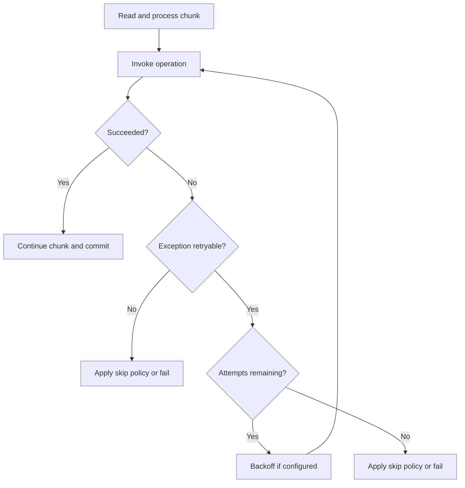

# Retrying items with transient errors

In a batch job, an item sometimes fails for a reason that lasts only briefly: the database is holding a lock, the network connection drops momentarily, an external service returns HTTP 503, or the system rate-limits requests. Stopping the entire job immediately on such errors can allow a brief glitch to interrupt an entire batch of data.

**Retry** allows Spring Batch to re-attempt a failing operation under a bounded policy. When an error is likely to resolve on its own, a subsequent attempt can succeed and the item continues through the pipeline. Retry fits recoverable transient errors; it cannot fix invalid data, misconfiguration, or programming bugs.

In chunk-oriented processing, retry must be considered alongside transactions, rollback, skip, and restart. A retry can cause the processor or writer to run multiple times. Therefore, components with side effects must be safe under re-execution, and retry limits must align with wait times and system load capacity.

## 1. What is retry?

Retry means re-invoking an operation after a previous call threw an exception belonging to a category permitted for retrying. Rather than ending the step immediately, the framework applies the retry policy to decide:

- Does the exception belong to the retryable group?
- Are any attempts remaining?
- Should it wait before trying again?
- If retries are exhausted and the operation still fails, should the step skip the item or end in failure?

For instance, a writer inserts an order into the database and hits a deadlock. The database may release the lock once another transaction finishes. Retrying after a short pause can complete the write without requiring an operator to restart the entire job.

Retry is not the same as ignoring errors. When retry succeeds, the item is processed normally. Only when processing fails across all attempts does the application decide to fail or skip per separate policy.

## 2. Distinguishing transient errors from errors unrecoverable by retry

Retry helps only when the error's root cause can disappear on a subsequent attempt. Classifying exceptions is the most important step when designing a policy.

| Error group | Examples | Is retry appropriate? |
|---|---|---|
| Database contention | Deadlock, lock timeout, temporary failure to acquire lock | Usually yes, with bounded attempts |
| Transient connectivity | Connection reset, network timeout, temporary database disconnect | Possibly, after confirming re-execution is safe |
| Overloaded external service | HTTP 503, 429, or transient gateway error | Usually yes; honor `Retry-After` if provided |
| Temporary resource limits | Brief connection exhaustion, rate limit | Possibly, with backoff to reduce pressure |
| Malformed data | Invalid date, missing required field, unparseable number | No; fix data or skip per business rules |
| Business rule violations | Disallowed negative balance, invalid order state | No; retrying will not make data valid |
| Wrong configuration or schema | Missing column, wrong permissions, wrong service URL | Usually no; fix configuration |
| Programming bugs | `NullPointerException`, mapping bug, violated invariant | Should not be retried by default |

A single exception type can have different meanings across systems. For example, a connection error might be transient or caused by invalid credentials. Classify by actual root cause, not merely by generic exception name.

## 3. Retry in a chunk-oriented step

A chunk-oriented step executes a read–process–write sequence within a transaction boundary. When an operation raises an exception, Spring Batch applies the configured fault-tolerant policies.



The retry policy determines which exceptions can be retried and caps attempt counts. The backoff policy controls wait times between attempts. If the operation succeeds, the chunk can proceed to commit. When retries are exhausted, the framework handles the exception under the skip policy or fails the step.

Exact rollback behavior and which operations re-run depend on the phase where the error happened (reader, processor, or writer), the resource type, and the transaction manager. Never assume every scenario simply re-invokes a single method with identical in-memory state.

## 4. Configuring retry in Java

In Spring Batch 5, retry can be configured on a step using `faultTolerant()`, `retry(...)`, and `retryLimit(...)`.

```java
@Bean
public Step importOrdersStep(
        JobRepository jobRepository,
        PlatformTransactionManager transactionManager,
        ItemReader<Order> reader,
        ItemProcessor<Order, OrderRecord> processor,
        ItemWriter<OrderRecord> writer) {

    return new StepBuilder("importOrdersStep", jobRepository)
            .<Order, OrderRecord>chunk(500, transactionManager)
            .reader(reader)
            .processor(processor)
            .writer(writer)
            .faultTolerant()
            .retry(TransientDataAccessException.class)
            .retryLimit(3)
            .build();
}
```

In this example:

- `faultTolerant()` enables fault-handling configuration on the step.
- `retry(TransientDataAccessException.class)` declares that transient data access errors may be retried.
- `retryLimit(3)` sets the attempt limit per the running version's retry policy.
- Exceptions not classified as retryable are not automatically retried.

Check the contract of your project's Spring Batch/Spring Retry versions when interpreting attempt limits. Retry policies typically express maximum attempts and may include the initial invocation, so do not assume `retryLimit(3)` always means three extra calls after the first one.

Older Spring Batch versions use `StepBuilderFactory` or different step configuration APIs. The retry concepts remain the same, while specific APIs must match the project version.

## 5. Retry only identified exceptions

Do not retry all exceptions. An overly broad policy can cause the job to repeat data errors or programming bugs for a long time, inflating runtimes and generating unnecessary load.

Example retrying only transient data access errors:

```java
.faultTolerant()
.retry(TransientDataAccessException.class)
.retryLimit(3)
```

You can explicitly exclude an exception from retry:

```java
.faultTolerant()
.retry(TransientDataAccessException.class)
.noRetry(InvalidDataAccessResourceUsageException.class)
.retryLimit(3)
```

In this example, exceptions indicating invalid SQL or resource usage are excluded from retry. Verify inheritance hierarchies among Spring exceptions and actual drivers; if an excluded exception is a subclass of a retryable type, policy ordering and classification rules can affect outcomes.

When finer-grained classification is needed, use an appropriate Spring Retry policy or a dedicated business exception layer that translates technical errors into distinct retryable groups. Never rely on catching a broad superclass like `Exception` or `RuntimeException` and retrying every case.

## 6. Backoff: waiting between retry attempts

Immediately retrying in a tight loop can send extra requests into an overloaded system. Backoff introduces a waiting interval before the next attempt so resources have time to recover.

Common backoff styles:

- **Fixed backoff:** wait a constant interval between attempts.
- **Exponential backoff:** wait time increases exponentially.
- **Bounded exponential backoff:** grows progressively without exceeding a maximum duration.
- **Backoff with jitter:** adds randomness so multiple workers do not retry at the exact same instant.

Exponential backoff example:

```java
ExponentialBackOffPolicy backOffPolicy = new ExponentialBackOffPolicy();
backOffPolicy.setInitialInterval(250L);
backOffPolicy.setMultiplier(2.0);
backOffPolicy.setMaxInterval(5000L);

return new StepBuilder("importOrdersStep", jobRepository)
        .<Order, OrderRecord>chunk(500, transactionManager)
        .reader(reader)
        .processor(processor)
        .writer(writer)
        .faultTolerant()
        .retry(TransientDataAccessException.class)
        .retryLimit(4)
        .backOffPolicy(backOffPolicy)
        .build();
```

This example uses Spring Retry's `ExponentialBackOffPolicy`. With the settings above, the wait interval starts at 250 ms, doubles on each retry, and caps at 5 seconds. Exact calculations and pause counts depend on actual attempt numbers.

### Estimating total wait time

If there are (N) maximum attempts, there are typically at most (N-1) wait intervals, since no wait occurs after the final attempt. With exponential backoff below the cap:

\[
T_{wait}=d_0 + d_0m + d_0m^2 + \cdots + d_0m^{N-2}
\]

Where:

- (d_0) is the initial wait interval.
- (m) is the multiplier.
- (N) is the maximum attempts under the policy.

Actual total runtime also includes the duration of each call, rollback time, resource reopening, and other overhead. Ensure total retry budget fits within the job's maximum allowed runtime.

### Jitter and retry storms

When hundreds of partitions fail together, if every worker waits exactly 1, 2, then 4 seconds, they can hit the service in synchronized waves. Jitter adds a random offset to spread out attempts. For external services, consider backoff with jitter and honor the `Retry-After` header when provided by the API.

## 7. Retry in the read phase (ItemReader)

The reader can hit transient errors while fetching data from a database, message broker, object storage, or API. For example, a database query briefly times out or a file-serving API is momentarily unresponsive.

When retrying reads, note that the reader might have mutated internal state before throwing an exception. For example, a reader consumes a message and then fails while committing offsets; re-reading might return a different message or duplicate item.

Guidelines:

- Use readers with transaction/acknowledgment mechanics suited to the data source.
- Ensure re-reading does not skip an item if the previous call failed mid-way.
- For cursor or paging readers, use deterministic ordering and clear checkpoints.
- For message brokers, understand when offsets are acknowledged/committed and how redelivery works.
- Do not retry data parsing errors if the same record will always fail to parse; classify them as data errors for separate handling.

Read retry does not replace checkpoints. The reader still needs `ItemStream` support if the job must restart from a saved position after process termination.

## 8. Retry in the processing phase (ItemProcessor)

The processor may call a database or external service for enrichment, computation, or validation. If the service is temporarily unavailable, retry allows reprocessing the same input item.

Example processor calling a pricing service:

```java
public class PriceProcessor
        implements ItemProcessor<Order, PricedOrder> {

    private final PricingClient pricingClient;

    public PriceProcessor(PricingClient pricingClient) {
        this.pricingClient = pricingClient;
    }

    @Override
    public PricedOrder process(Order order) {
        BigDecimal price = pricingClient.getPrice(order.getProductId());
        return new PricedOrder(order.getId(), price);
    }
}
```

If `PricingClient` throws a retryable exception such as a transient gateway error, the step can retry per policy. The processor should avoid side effects that cannot be repeated safely. If process runs again, the same input must not create multiple transactions or dispatch duplicate commands.

For pure in-memory data-transforming processors, retry usually brings no benefit because parsing or validation errors will recur. Let data errors flow through validation/skip policies instead of pointless retries.

## 9. Retry in the write phase (ItemWriter)

The writer can encounter transient errors when writing to a database or calling an external system. This phase demands special attention to transactions and idempotency because the writer may have executed part of its work before throwing an exception.

For a JDBC writer participating in the step's transaction, when a write fails, the chunk transaction can roll back before the framework retries per policy. Changes from the previous attempt inside that transaction are undone, so the retry can rewrite the chunk without leaving partially committed records.

For a writer calling an external API outside the transaction, the partner may have already processed the request even though the client timed out. If a retry resends the request, the action may execute twice. Use an idempotency key or reconciliation mechanism before retrying.

Example configuring retry for transient data access errors in the writer:

```java
return new StepBuilder("writeOrdersStep", jobRepository)
        .<Order, OrderRecord>chunk(200, transactionManager)
        .reader(reader)
        .processor(processor)
        .writer(writer)
        .faultTolerant()
        .retry(CannotAcquireLockException.class)
        .retryLimit(3)
        .build();
```

`CannotAcquireLockException` is an example of a potentially transient locking error. Verify which exceptions the database driver and Spring exception translation actually emit.

## 10. Item retry and chunk retry

In the chunk model, reader, processor, and writer interact differently with retry. Not every failure means the framework simply re-invokes one isolated item.

- Processor failures typically tie to the item currently being processed; the framework can retry the processor for that item per retry policy.
- Writer failures can affect the entire chunk because the writer receives a group of items; the chunk transaction may roll back and the group may be retried.
- Reader failures depend on reader state and the source's retry/transaction mechanics; ensure re-reading neither drops nor skips items.

In a fault-tolerant step, Spring Batch manages retries, rollbacks, and chunk recovery as configured. When it needs to isolate a failing item in the writer to skip it, the framework may re-invoke the writer with smaller subsets to pinpoint the offending item. Thus, a single `write()` does not necessarily correspond to a single attempt.

Do not rely on an assumption that the writer receives only the failing item. Design the writer to tolerate being called again with the same chunk or subsets of the chunk under retry/skip workflows.

## 11. Combining retry with skip

Retry and skip solve two different situations:

- **Retry:** the error is likely transient and the item still needs processing.
- **Skip:** the item has an error permitted to be bypassed under business rules.

Both can be configured:

```java
return new StepBuilder("importOrdersStep", jobRepository)
        .<Order, OrderRecord>chunk(500, transactionManager)
        .reader(reader)
        .processor(processor)
        .writer(writer)
        .faultTolerant()
        .retry(TransientDataAccessException.class)
        .retryLimit(3)
        .skip(InvalidOrderException.class)
        .skipLimit(100)
        .build();
```

In this example, transient data access errors are retried; `InvalidOrderException` business errors can be skipped within limits. The same exception can be configured for both retry and skip if application policy calls for retrying first and discarding once attempts run out. Verify classification ordering and exact behavior for your Spring Batch version.

Do not skip infrastructure errors like database connection loss just so the job keeps running. When the database cannot write, skipping items produces incomplete data and masks system outages.

## 12. What happens when retries are exhausted?

When the policy permits no further attempts, the exception proceeds through the step's fault-tolerant configuration:

- If the exception is skippable and skip limit is not exceeded, the item may be skipped.
- If the exception is not skippable or the skip limit is exceeded, the step normally fails.
- If the exception is classified as fatal or incompatible with retry/skip, the step can terminate immediately.

Therefore, clearly define the outcome after retry exhaustion. Never let the system skip every error by default or retry indefinitely.

Example:

```text
Item 501 encounters deadlock
  Attempt 1 -> error
  Attempt 2 -> error
  Attempt 3 -> success
  Item proceeds and is not skipped

Item 502 encounters connection error
  Attempt 1 -> error
  Attempt 2 -> error
  Attempt 3 -> error
  Retries exhausted
  If not skippable -> step FAILED
```

If the job fails, it can be restarted once the root cause is resolved. Restart is a new execution of the same `JobInstance` relying on saved checkpoints; it differs from retrying an operation while a step is running.

## 13. Idempotency: a critical requirement for retry

An idempotent operation can be executed multiple times while leaving the final state equivalent to executing it once. Safe retrying depends heavily on this property.

Examples:

- `UPDATE account SET status = 'ACTIVE' WHERE id = ?` can be idempotent if it always sets the same value.
- `balance = balance + 100` is not idempotent if running twice adds the amount twice.
- `POST /payments` may create two payments if the API does not support idempotency keys.
- Inserting a record with a unique business key can prevent duplicates, though the application must handle conflicts per business rules.

Safeguards:

- Use a stable idempotency key per item or business operation.
- Enforce unique constraints on business keys to prevent duplicate writes.
- Use upserts with explicit update rules.
- Persist processing status and outcomes per item to detect whether a request already ran.
- Use a transactional outbox when coordinating database writes and message publishing.

Especially for timeouts, the client may not know whether the server executed the action. This scenario cannot be solved merely by resending the request; idempotency or status lookup before retrying is required.

## 14. Backoff and overall time limits

Retry policies must be designed alongside operation timeouts and the job's maximum allowed duration.

Suppose each API call times out after 10 seconds, the policy allows 4 attempts, and total backoff is 7 seconds. One item alone can take around 47 seconds, excluding processing and overhead. With thousands of failing items, the job can run far too long.

Check:

- Is each call's timeout reasonable?
- Do maximum attempts align with the SLA?
- Does backoff have an upper bound?
- Is jitter present to avoid synchronized retries?
- Is there an overall retry budget or business deadline?
- Will retries add excessive load onto a struggling system?

Avoid combining long timeouts, high attempt counts, and steep backoff without computing total duration. When SLAs would be breached, failing early so a scheduler retries later or escalating to incident handling may be preferable.

## 15. Retry and circuit breakers

Retry fits short, recoverable failures. If an external service suffers a prolonged outage, having every worker retry constantly can overload the system further.

A circuit breaker adds a different mechanism:

- When failures exceed a threshold, the circuit opens and temporarily blocks requests.
- After a cooldown period, the circuit allows a few probe requests.
- If the service recovers, the circuit closes.

Retry and circuit breakers can work together, yet neither replaces the other. Retry handles an individual operation; a circuit breaker governs whether to keep calling an unhealthy dependency. For batch jobs, choose thresholds and open durations carefully so the step is not held waiting excessively.

If using an external resilience library, ensure retries do not accidentally nest across layers. For example, an HTTP client retrying 3 times and Spring Batch retrying 3 times can produce far more calls than expected. Designate one layer responsible for retries or calculate total attempts across all layers.

## 16. RetryListener and observing attempts

When you need to monitor retries, you can use Spring Retry's `RetryListener` or listeners matching your Spring Batch version. Listeners let you observe when retry begins, when an attempt fails, and when retry concludes.

Information worth recording:

- Job name, JobExecution ID, and StepExecution ID.
- Item business key or correlation ID, avoiding logging sensitive full payloads.
- Exception class and root cause.
- Attempt count or retry context if available.
- Backoff wait duration.
- Final outcome: succeeded after retry, skipped, or step failed.

Do not log every retry without item and execution context. When a job processes millions of items, retry logs can grow huge. Use metrics counting retries by exception type, step, and dependency; emit detailed logs only when needed for investigation.

## 17. Testing retry

Retry policies should be tested with a mock/fake component that fails a specific number of times before succeeding. Do not rely on random network glitches or real deadlocks in tests.

Cases to check:

1. Operation fails on first attempt and succeeds on next: step completes and item is not skipped.
2. Operation fails continuously: attempt count does not exceed configured limit.
3. Non-retryable exception: step does not wastefully repeat the operation.
4. Retries exhausted and exception skippable: item is skipped per policy.
5. Retries exhausted and exception non-skippable: step ends in failure.
6. Writer fails after partial writes inside transaction: rollback leaves no partial data.
7. Writer calls external service: idempotency key prevents duplicate side effects on resend.
8. Backoff does not drag out tests: use fast test policies or mock clocks where supported by the framework.

Example unit-testing a processor that fails twice and then succeeds:

```java
class PricingProcessor implements ItemProcessor<Order, PricedOrder> {

    private final PricingClient client;

    PricingProcessor(PricingClient client) {
        this.client = client;
    }

    @Override
    public PricedOrder process(Order order) {
        BigDecimal price = client.getPrice(order.getProductId());
        return new PricedOrder(order.getId(), price);
    }
}
```

In a unit test, configure a mock `PricingClient` to throw a retryable exception on the first two calls and return a price on the third. Direct processor unit tests verify only processor behavior; to verify Spring Batch actually retries, write an integration test launching a step with `.faultTolerant().retry(...).retryLimit(...)`.

### Integration testing via JobLauncherTestUtils

With `@SpringBatchTest`, `JobLauncherTestUtils` can run jobs or steps in a test configuration. Use a fake service with an invocation counter to verify the retry policy.

Tests should verify:

- `JobExecution` and `StepExecution` end in expected statuses.
- Service was invoked the expected number of times per policy.
- `writeCount`, `skipCount`, and database contents reflect the final outcome.
- Data from failed write attempts rolled back prior to retry.

Do not merely assert a mock was called multiple times; verify data state and transactions if required by the job.

## 18. Common retry design mistakes

| Mistake | Consequence | Remedy |
|---|---|---|
| Retrying all exceptions | Repeats data/config errors and prolongs job | Whitelist only transient errors |
| No retry limit | Job may hang or exceed SLA | Set retry limits and timeouts |
| No backoff | Hammers failing systems continuously | Use fixed/exponential backoff and jitter where fitting |
| Retrying non-idempotent operations | Creates duplicate transactions or records | Use idempotency keys, unique keys, or outboxes |
| Multi-layer retries | Actual call count grows multiplicatively | Assign clear retry ownership to one layer |
| Skipping infra errors after retry | Job may finish with missing data | Fail step if dependencies cannot write data |
| Overly long backoff | Job breaches allowed operational window | Compute retry budget and cap wait times |
| Retrying parse/validation errors | Same item keeps failing | Route errors to validation/skip policy |
| Not tracking retries | Hard to identify slow or failing dependencies | Add metrics, correlation IDs, and appropriate retry listeners |
| Using unsafe readers on re-read | Drops or duplicates items | Verify state, transactions, and source semantics |

## 19. Process for designing item retry

1. **Identify failable operations:** reader, processor, or writer; which dependencies are called.
2. **Classify root causes:** which errors are transient vs. permanent or business-data errors.
3. **Select retryable exceptions:** prefer specific exception types or well-understood transient families.
4. **Set attempt limits:** compute total time consumable per item and across the job.
5. **Choose backoff:** use fixed or exponential; add jitter when multiple workers may retry concurrently.
6. **Verify transactions:** confirm rollbacks and enlisted resources behave as intended.
7. **Protect idempotency:** ensure re-invocations do not produce duplicate side effects.
8. **Define post-exhaustion outcome:** fail or skip per business semantics.
9. **Monitor:** emit metrics and logs sufficient to identify dependency, item, and attempt counts.
10. **Test controlled failures:** simulate transient failures, retry success, exhausted retries, and restarts.

## 20. Principles to remember

- Retry re-attempts an operation on transient errors; it does not replace validation, skip, or restart.
- Retry only recoverable exceptions; data, configuration, and programming errors normally should not be retried.
- Use `.faultTolerant()`, `.retry(...)`, and `.retryLimit(...)` to configure retries in chunk steps per your Spring Batch version's API.
- Set backoff to avoid relentless retrying; bounded exponential backoff and jitter help when dependencies are overloaded.
- Errors in reader, processor, and writer carry different semantics; writers in particular can be re-invoked with entire chunks.
- Transaction rollback must be understood alongside actual resources; non-transactional operations are not automatically undone.
- Successful retries do not mark items skipped; once retries run out, the skip policy or failure state decides the outcome.
- Writers and side-effecting processors must be idempotent or use idempotency keys, unique constraints, upserts, or outboxes.
- Compute total retry budget alongside per-call timeouts to stay within SLA.
- Avoid nesting retries across multiple layers without calculating total invocation counts.
- Monitor retry counts, exception types, backoff durations, and final outcomes.
- Test invocation counts, transaction rollbacks, target data, skip/fail behavior, and restarts.

Retry helps batch jobs weather brief disruptions without halting the entire workflow. When exceptions are properly classified, attempts and backoff are bounded, transactions are properly managed, and operations are safe to re-run, Spring Batch handles items more reliably while preserving observability and recoverability.
# Retrying items with transient errors in Spring Batch

In a Spring Batch Job, an item can fail for a short-lived reason: the database is holding a lock, a connection drops, a remote service temporarily stops responding, or a request times out. When an error is likely to vanish on its own, stopping the entire Job on the first attempt can cause unnecessary disruption.

Spring Batch supports **retry** to re-attempt processing operations when encountering exceptions identified as recoverable. Retry is particularly useful in chunk-oriented Steps, where the reader, processor, and writer process items in groups. When configured properly, an item hitting a transient error can be retried within permitted bounds; if still failing, the Step proceeds per skip policy or ends in failure.

Retry is not a cure-all for every exception. Invalid business data rarely becomes valid after a few tries. Calling APIs or writing to databases repeatedly can also create duplicate side effects if operations are not idempotent. This lesson explains how to classify errors, configure retry limits and backoff, coordinate retry with transactions and skip, design operations safe for re-execution, monitor attempt counts, and test recovery behavior.

## 1. What problem does retry solve?

A transient error is one likely to disappear if attempted again after some time. Examples:

- Database reports a deadlock as two transactions contend for locks.
- Database connection drops temporarily.
- HTTP service returns 503 due to temporary overload.
- Request to another system times out.
- Message broker is momentarily unavailable.
- A shared resource is locked and will soon be released.

Suppose a Step processes 10,000 orders. While writing the 4,200th order, the database raises a deadlock. Without retry, the Step may fail even though a subsequent transaction would succeed immediately once the lock is released.

With retry, Spring Batch can re-attempt the failing operation within configured limits. If a later attempt succeeds, processing continues. If the failure persists or exceeds limits, the exception moves to the next error mechanism such as skip or fail.

~~~mermaid
flowchart TD
    A["Process item"] --> B{"Exception thrown?"}
    B -- "No" --> C["Continue chunk"]
    B -- "Yes" --> D{"Exception retryable?"}
    D -- "No" --> E["Skip or fail per policy"]
    D -- "Yes" --> F{"Attempts remaining?"}
    F -- "Yes" --> G["Backoff / wait"]
    G --> A
    F -- "No" --> H["Retry exhausted"]
    H --> I["Skip if allowed, otherwise fail"]
~~~

Retry helps when errors are temporary and repeating the operation stands a chance of succeeding. It does not fix bad data, stabilize an unavailable API overnight, or automatically undo side effects from an earlier attempt.

## 2. Retry in a chunk-oriented Step

A chunk-oriented Step reads items, processes each item, and passes results to the writer. When fault tolerance is configured, Spring Batch can retry certain exceptions occurring during reading, processing, or writing according to declared policies.

Example Step processing orders:

~~~java
@Bean
Step processOrdersStep(
        JobRepository jobRepository,
        PlatformTransactionManager transactionManager,
        ItemReader<OrderInput> reader,
        ItemProcessor<OrderInput, Order> processor,
        ItemWriter<Order> writer) {

    return new StepBuilder("processOrdersStep", jobRepository)
        .<OrderInput, Order>chunk(100, transactionManager)
        .reader(reader)
        .processor(processor)
        .writer(writer)
        .faultTolerant()
        .retry(TransientDataAccessException.class)
        .retryLimit(3)
        .build();
}
~~~

Key elements:

- **faultTolerant():** enables error-handling configuration such as retry and skip for the chunk Step.
- **retry(...):** declares exception types permitted to retry.
- **retryLimit(...):** sets the attempt limit under the retry policy.
- **reader, processor, writer:** still perform their core duties; retries are managed by the framework.

In the configuration above, errors under TransientDataAccessException can be retried within the configured limit. Exceptions outside the retryable group are not automatically retried merely because the Step called faultTolerant().

### Retry is a per-exception policy

Do not enable retry globally for every Exception. If the processor throws ValidationException due to a negative amount, calling the processor three times will not make the data valid. Retrying only inflates runtime and obscures data errors.

Select exceptions based on root cause:

| Cause | Example exception | Typically appropriate handling |
|---|---|---|
| Database deadlock | DeadlockLoserDataAccessException or driver equivalent | Retry with backoff |
| Temporary lock failure | CannotAcquireLockException | Bounded retry |
| Transient database resource error | TransientDataAccessException | Selective retry |
| HTTP 503 or 429 | Client exception classified by status | Retry per service policy |
| Connection timeout | SocketTimeoutException or client exception | Retry if operation is safe |
| Malformed data | FlatFileParseException | Usually fail or skip; do not retry |
| Business rule violation | ValidationException | Usually do not retry |
| Missing required parameter | JobParametersInvalidException | Do not retry |

Exact exception names depend on libraries, drivers, and integration layers. Classify exceptions at service call boundaries so the retry policy receives the right error types.

## 3. Retry limit and attempt counts

Retry needs a bound. If retrying endlessly, a broken service can tie up worker resources and prevent the Job from ever finishing.

Example:

~~~java
.faultTolerant()
.retry(TransientDataAccessException.class)
.retryLimit(3)
~~~

Retry limit bounds the number of calls permitted by the retry policy. For retry policies based on SimpleRetryPolicy, max attempts include the initial call; thus, understand how your API and version interpret the limit parameter. Test actual invocation counts rather than guessing from method names alone.

Example targeting at most three invocations:

~~~text
Attempt 1 -> transient exception
Attempt 2 -> transient exception
Attempt 3 -> success

Result: item processed successfully within policy limit.
~~~

If all three fail:

~~~text
Attempt 1 -> exception
Attempt 2 -> exception
Attempt 3 -> exception

Result: retry exhausted; exception passes to skip/fail policy.
~~~

The crucial point is that retrying has a deterministic stopping point. Once attempts run out, the application needs an explicit decision: discard the item if allowed, or fail the Step for operational intervention.

### Choosing retry limits based on failure characteristics

Too low a retry limit can fail a Job over a glitch lasting a few hundred milliseconds. Too high a limit can drag out runtimes, hold resources, and hammer a struggling service.

Consider:

- Typical recovery time of the service.
- Timeout of each request.
- Backoff wait between attempts.
- Total time the Job is permitted to run.
- Concurrent worker count.
- Load capacity of the database or API.
- Behavior once retries are exhausted.

Retry limits should be part of the operational contract, not an arbitrary number bumped every time a Job fails.

## 4. Which exceptions should be retried?

A Step can encounter both transient and permanent errors. Declare the retryable list and exclude errors that must not be retried.

Example:

~~~java
return new StepBuilder("importOrdersStep", jobRepository)
    .<OrderInput, Order>chunk(100, transactionManager)
    .reader(reader)
    .processor(processor)
    .writer(writer)
    .faultTolerant()
    .retry(TransientDataAccessException.class)
    .retry(CannotAcquireLockException.class)
    .noRetry(ValidationException.class)
    .retryLimit(3)
    .build();
~~~

This configuration illustrates permitting retries for transient database errors while excluding validation errors.

### Use specific exceptions whenever possible

A general exception can hide many causes. For instance, a database access error might come from a temporary deadlock or a misspelled table name. Only the deadlock stands a chance of resolving on retry.

If only a broad exception class is used, the application may retry permanent configuration errors too. Inspect the exception cause chain and translate errors into meaningful types at the integration boundary.

### What role does noRetry play?

noRetry excludes an exception from the retry policy when it falls under a broader group marked retryable. For example, an application may retry certain DataAccessExceptions while excluding constraint or validation errors.

Classification must stay consistent. A business error should never be disguised as a transient exception merely to keep a Job from failing.

### Do not retry data errors that time cannot fix

Cases normally not suited for retry:

- Malformed input data.
- Non-existent reference IDs.
- Business rule violations.
- Missing required configuration.
- Broken SQL or missing table names.
- Unauthorized user permissions.
- Requests rejected due to invalid content.

For these errors, fail or skip per business policy and record the root cause.

## 5. Retry with backoff

If a service is overloaded and multiple workers retry immediately, fresh requests can keep the system overloaded. **Backoff** inserts a wait interval between attempts so the service has time to recover.

Common strategies:

| Strategy | How it works | When appropriate |
|---|---|---|
| Fixed delay | Waits the same duration each time | Services with steady recovery times |
| Exponential backoff | Increases wait time after each failure | Overload or temporary lock errors |
| Exponential random backoff | Increases wait time and adds randomness | Multiple workers retrying concurrently |
| Custom backoff | Computes wait time from error type or response | Service integrations with custom rules |

Example configuring exponential backoff:

~~~java
@Bean
BackOffPolicy orderRetryBackOffPolicy() {
    ExponentialBackOffPolicy policy =
        new ExponentialBackOffPolicy();

    policy.setInitialInterval(500L);
    policy.setMultiplier(2.0);
    policy.setMaxInterval(5000L);

    return policy;
}
~~~

Attach to Step:

~~~java
return new StepBuilder("processOrdersStep", jobRepository)
    .<OrderInput, Order>chunk(100, transactionManager)
    .reader(reader)
    .processor(processor)
    .writer(writer)
    .faultTolerant()
    .retry(TransientDataAccessException.class)
    .retryLimit(3)
    .backOffPolicy(orderRetryBackOffPolicy)
    .build();
~~~

In this illustrative configuration, the wait interval grows exponentially from 500 ms and never exceeds 5 seconds. Exact wait durations depend on retry count and policy implementation.

### Exponential backoff and jitter

When hundreds of partitions fail together, if all wait exactly 1 second and retry simultaneously, the target system can get slammed by a wave of requests. This is synchronized retrying.

Jitter adds randomness to wait durations to spread out attempts. For multi-worker systems, use random/exponential backoff policies appropriate for your Spring Retry version.

### Total retry duration

Total wait time can become significant. If there are multiple attempts and each request also has its own timeout, processing time per item can multiply severalfold.

When designing, approximate:

- Total timeout durations across calls.
- Total backoff across attempts.
- Rollback and transaction-restart times.
- Connection pool or lock wait times.
- Remaining headroom within the Job's deadline.

Do not set the Job timeout lower than expected total retry time if you want retries to have a chance to finish.

## 6. Retry in the processor and writer

Retries can apply to errors across different phases, yet impacts on data and side effects differ.

### Processor retry

The processor normally validates, transforms, or calls services to enrich data. If a remote service temporarily fails to respond, the processor can throw an exception marked retryable.

~~~java
@Bean
ItemProcessor<OrderInput, EnrichedOrder> orderProcessor(
        CustomerProfileClient profileClient) {

    return input -> {
        CustomerProfile profile =
            profileClient.fetchProfile(input.customerId());

        return new EnrichedOrder(
            input.orderId(),
            profile,
            input.amount()
        );
    };
}
~~~

If the client throws a transient exception, Spring Batch can retry processing the item per policy.

The processor should avoid mutating input objects or writing irreversible side effects. An item may pass through the processor multiple times. If the processor mutates a shared mutable object directly, a retry might start from already-altered state.

### Writer retry

The writer can hit transient database errors or target system failures. Example:

~~~java
@Bean
JdbcBatchItemWriter<Order> orderWriter(DataSource dataSource) {
    return new JdbcBatchItemWriterBuilder<Order>()
        .dataSource(dataSource)
        .sql("""
            INSERT INTO processed_order
                (order_id, customer_id, amount)
            VALUES
                (:orderId, :customerId, :amount)
            """)
        .beanMapped()
        .build();
}
~~~

If the database transaction hits a deadlock, Spring Batch can roll back the chunk transaction and then retry per policy.

The writer must be designed to handle re-invocation. With database transactions enlisted in the right transaction manager, rolled-back writes can be re-executed. With APIs or message brokers, already-executed side effects may not be undone.

### Retrying does not mean re-running only a single SQL line

In chunk processing, a writer error can roll back the chunk transaction and force the framework to isolate the failing item or re-execute part of the chunk under fault-tolerance mechanics. Thus, the writer must be safe when re-invoked with the same item or group of items.

Do not assume the writer is always invoked strictly once per item.

## 7. Transaction rollback on retry

Retry inside a chunk Step usually ties into transactions. If a database write fails due to a deadlock, the current transaction must roll back before retrying under the retry mechanism.

Example:

~~~mermaid
sequenceDiagram
    participant S as Spring Batch
    participant TM as TransactionManager
    participant W as ItemWriter
    participant DB as Database

    S->>TM: Begin chunk transaction
    S->>W: write(chunk)
    W->>DB: Execute batch
    DB-->>W: Deadlock exception
    W-->>S: Throw exception
    S->>TM: Rollback
    Note over S,TM: Retry policy and backoff
    S->>TM: Begin next transaction
    S->>W: Retry write
    W->>DB: Execute batch
    DB-->>W: Success
    S->>TM: Commit
~~~

The diagram depicts a typical database retry flow. Exactly how the framework replays chunks or isolates failing items depends on the phase where the exception occurred and fault-tolerant configuration.

### Why does rollback matter?

If the prior attempt wrote partial data inside the transaction and the transaction did not roll back properly, the retry could write duplicates or leave inconsistent state.

Ensure:

- The writer uses the same DataSource managed by the Step's transaction manager.
- You never manually open and commit independent connections inside the writer.
- You do not use REQUIRES_NEW propagation for business writes that must roll back with the chunk.
- Exceptions propagate so the framework recognizes the failure.
- Non-database resources have idempotency or compensation mechanisms.

### Not every side effect rolls back

Database transactions manage only enlisted resources. If the processor sends emails, the writer calls APIs, or a listener publishes messages, database rollback cannot undo those actions.

A retry can resend the email or message. Therefore, decouple external side effects from the main processing transaction or make the operations idempotent.

## 8. Combining retry and skip

Retry and skip are two distinct policies:

- **Retry:** re-attempt the operation when the error is likely temporary.
- **Skip:** bypass a faulty item when business rules allow continuing without processing that item.
- **Fail:** stop the Step when the error is unrecoverable or cannot be bypassed.

Retry and skip can be combined:

~~~java
return new StepBuilder("importOrdersStep", jobRepository)
    .<OrderInput, Order>chunk(100, transactionManager)
    .reader(reader)
    .processor(processor)
    .writer(writer)
    .faultTolerant()
    .retry(TransientDataAccessException.class)
    .retryLimit(3)
    .skip(ValidationException.class)
    .skipLimit(20)
    .build();
~~~

In this example, transient data access errors are retried. ValidationException is not listed as retryable, yet can be skipped if the Step permits it and skip limit is not reached.

The same exception can be configured as both retryable and skippable if you want to retry first and discard once attempts run out. For instance, a transient service failure might be tried three times; if still failing and business rules allow dropping the item, the Step skips it. If not skippable, the Step fails.

### Business decision order

A helpful mental model:

1. Determine whether the exception is recoverable.
2. If yes, retry within limits and backoff.
3. If still failing, check whether the exception is allowed to be skipped.
4. If neither retryable nor skippable, the Step fails.

Exact classification executed by Spring Batch relies on the retry policy, skip policy, and rollback rules. Test real exception combinations, especially when an exception matches multiple categories.

### Skip limit does not replace retry limit

Retry limit bounds how many times an operation is tried. Skip limit bounds how many faulty items may be skipped in the Step. Both limits have different scopes and meanings.

For instance, an item may be tried multiple times and then skipped. Skip count increments per discarded item, whereas retry count measures operation attempts. Never use skip limit to cap API call attempts.

## 9. Retry only transient errors, not every error

A sound retry policy begins by classifying exceptions by root cause.

Example payment service response codes:

| Response | Meaning | Handling approach |
|---|---|---|
| HTTP 429 | Rate-limited | Retry per Retry-After if supported |
| HTTP 503 | Service temporarily unavailable | Retry with backoff |
| HTTP 504 | Gateway timeout | Retry if request is idempotent |
| HTTP 400 | Invalid request | Do not retry |
| HTTP 401 | Unauthenticated or expired token | Refresh credentials per design; do not retry endlessly |
| HTTP 403 | Forbidden | Do not auto-retry |
| HTTP 404 | Resource does not exist | Usually do not retry unless resource may appear later |
| HTTP 409 | State conflict | Analyze business meaning before retrying |

Do not inspect status codes in one generic layer and retry all 4xx or 5xx errors. Each service can have a different contract. Translate responses into semantically clear exceptions before they reach the retry policy.

### Honoring Retry-After

Some APIs return a Retry-After header asking clients to wait before calling again. If your client supports it, use this signal to determine backoff. Do not keep sending requests while the server tells you to slow down.

### Bounding total time

Retry policies must coordinate with request timeouts and the Job's deadline. If each request has a 30-second timeout and the policy permits multiple attempts, a single item can hold a worker for a long time.

Set request timeouts, attempt counts, and backoff based on the target system's SLO.

## 10. Retry and idempotency

**Idempotency** is the ability to execute the same operation repeatedly while leaving final state free of unintended changes. This is an essential requirement when retrying writers or calling external systems.

Suppose the writer calls a transaction-creation API:

1. API receives request and creates transaction.
2. Response is lost due to network timeout.
3. Spring Batch does not know whether the transaction was created.
4. Retry resends the request.
5. If the API lacks idempotency support, a second transaction may be created.

The issue here is that a timeout does not reveal whether the server-side operation failed or succeeded with a lost response.

### Using a stable idempotency key

A request can carry an idempotency key derived from a business identifier:

~~~java
public PaymentResult createPayment(Payment payment) {
    String idempotencyKey =
        "payment-" + payment.paymentId();

    return paymentClient.createPayment(
        payment,
        idempotencyKey
    );
}
~~~

The same logical payment must carry the same idempotency key across every retry. If every attempt generates a new key, the target system cannot recognize duplicate requests.

### Database unique constraints

For database writers, a unique constraint can prevent duplicate records:

~~~sql
CREATE UNIQUE INDEX uq_processed_order_id
ON processed_order(order_id);
~~~

Depending on business rules, the writer can use inserts, upserts, or processed-state checks. Never catch every DuplicateKeyException and blindly treat it as success. Verify whether the existing record matches intended contents or represents a data conflict.

### Avoid unnecessary side effects in processors

The processor may be called again on retry. If the processor both transforms data and sends emails, updates another system, or writes independent audits, retries can repeat side effects.

Keep the processor as pure as possible: take input, compute output, and return the result. Side effects belong in a properly transactional writer or coordinated via an outbox and separate publishing step.

## 11. Retry with APIs and message brokers

When integrating external services, understand request outcomes clearly.

### API timeouts

Timeouts can occur before the server receives a request or after the server processed it and the response was lost. Business state cannot be deduced from a timeout alone.

Safeguards:

- Use idempotency keys if supported by the API.
- Record request IDs and business identifiers.
- Provide a status-lookup API for reconciliation.
- Bound retries with backoff.
- Distinguish connection errors, timeouts, rate limits, and business errors.
- Do not retry unsafe requests without deduplication.

### Message brokers

Publishing a message can succeed on the broker while the client drops before receiving confirmation. Retrying can publish duplicate messages.

Use stable message IDs and consumer deduplication. When coordinating database writes and message publishing, consider the outbox pattern: persist events in the same transaction as business data, then have a publisher send events under its own retry mechanism.

### Retry is not a circuit breaker

Retry re-attempts an operation after failure. A circuit breaker temporarily halts service calls when error rates spike to protect the system. The two mechanisms solve different problems and can be combined, while avoiding dense retries when the circuit is open.

For a service experiencing prolonged downtime, short bounded retries plus a circuit breaker or Job pause mechanism fit better than continuously retrying millions of items.

## 12. Retry and the reader

Retry can also apply to read failures, such as a remote source temporarily becoming unavailable. However, readers have different state properties than processors.

A reader may have already consumed data from a file, cursor, or message queue before an error happens. On retry or rollback, the framework needs a way to recover or re-read the item cleanly.

Consider:

- Does the reader support ItemStream and persist checkpoints?
- Can the source re-read the exact same item?
- Does the cursor remain valid after a connection error?
- Was the message already acknowledged?
- Could the reader mistakenly return null on failure?
- Does retrying drop or duplicate items?

Never catch a read exception and return null. Null means EOF, whereas transient failures must be represented by exceptions so policies can handle them.

For streaming or queue sources, understand acknowledgment, visibility timeout, and redelivery mechanics. Retrying in Spring Batch does not guarantee the broker will redeliver a message if the reader acknowledged it before chunk commit.

## 13. Retry in parallel processing and partitioning

When a Job uses partitioning, each worker can hit transient errors and apply the worker Step's own retry policy.

For instance, a manager Step splits data into multiple partitions, each worker handling an ID range. If partition2's worker hits a deadlock, retry runs inside partition2's StepExecution per worker configuration.

Considerations:

- Retry limits usually apply to operations/items within each worker execution per policy.
- Multiple workers can retry concurrently, placing heavy load on target services.
- Backoff and jitter help mitigate synchronized retries.
- Connection pools must support concurrency and transactions.
- Writers must be safe when the same partition or item is reprocessed.
- Monitor failures and retry counts per partition to identify problematic data ranges.

Do not set excessive retry limits across all partitions when the database is overloaded. Doing so keeps all workers adding pressure while the system needs breathing room to recover.

## 14. How does retry differ from restart?

Both retry and restart can reprocess an item or Step, yet they operate at different scopes.

| Concept | Timing | Scope |
|---|---|---|
| Retry | While the Step is running | Re-attempts an operation that threw an exception |
| Skip | While the Step is running | Discards a faulty item per policy |
| Restart | After a JobExecution failed or stopped | Creates a new JobExecution for the same JobInstance per restart rules |
| Rerun with new JobInstance | When different identifying JobParameters are used | Starts a new logical instance |

Examples:

- A database call hits a deadlock and retries successfully inside the Step: the Job continues, no restart needed.
- An item fails past the retry limit and is not skippable: the Step fails. Operators can fix the cause and restart the JobInstance.
- Input data changes and must run as a new batch: new identifying parameters may be needed to create a new JobInstance.

Retry does not replace checkpoints. Restart does not automatically make writers idempotent. Both require appropriate state and side-effect design.

## 15. Custom retry policies

For simple cases, retry, noRetry, and retryLimit methods usually suffice. If you need complex exception classification or different limits per error type, you can use RetryPolicy.

SimpleRetryPolicy illustrative example:

~~~java
@Bean
RetryPolicy orderRetryPolicy() {
    Map<Class<? extends Throwable>, Boolean> retryable =
        new HashMap<>();

    retryable.put(CannotAcquireLockException.class, true);
    retryable.put(TransientDataAccessException.class, true);
    retryable.put(ValidationException.class, false);

    return new SimpleRetryPolicy(3, retryable, true);
}
~~~

Then attach the policy to the Step:

~~~java
return new StepBuilder("processOrdersStep", jobRepository)
    .<OrderInput, Order>chunk(100, transactionManager)
    .reader(reader)
    .processor(processor)
    .writer(writer)
    .faultTolerant()
    .retryPolicy(orderRetryPolicy)
    .build();
~~~

This configuration illustrates mapping exceptions to retry decisions. Note that exact constructors and APIs of SimpleRetryPolicy vary across Spring Retry versions. Check your dependency version and write tests for exception subclasses, cause chains, and attempt counts.

### Classifying by root cause

A wrapper exception may hold a transient error as its cause. If a policy inspects only the outermost exception class, the failure may not be retried even though the inner cause is retryable.

You can:

- Translate errors at the client layer into exceptions with stable semantics.
- Use a policy supporting cause-chain traversal where appropriate.
- Write a custom classifier when needed.
- Avoid classifying by matching message strings since messages can vary by locale or library version.

## 16. Monitoring and diagnosing retries

Retries can allow a Job to finish successfully while masking recurring infrastructure problems. Without monitoring, system performance can degrade silently.

Track:

- Retry counts by Job, Step, and exception type.
- Involved items or business keys, stripped of sensitive data.
- Successful retry counts.
- Items exhausting the retry limit.
- Backoff wait durations.
- Total item processing times.
- Failing partitions or workers.
- Failure rates by target service.
- Items ultimately skipped or failing the Step.

### Distinguishing retry attempts from skipped items

An item may fail twice and succeed on the third try. It had two failed retry attempts, yet was not skipped.

Another item may exhaust the retry limit and then get skipped. Both retry count and skip count can rise, yet they measure two distinct events.

Do not use skip count to infer retry counts. Nor should every exception be treated as a separate faulty item.

### Controlled logging

Example logging a failed service call:

~~~java
log.warn(
    "Temporary service failure for orderId={}, exceptionType={}",
    orderId,
    exception.getClass().getSimpleName()
);
~~~

Do not log full requests, tokens, payment details, or personal data. Use correlation IDs and business keys to look up details in systems with proper access controls.

### RetryListener

Spring Retry provides RetryListener to observe the retry lifecycle. You can use a listener to emit metrics or log attempts, depending on integration APIs in your Spring Batch/Spring Retry versions.

Listeners should solely observe. Never use a retry callback to manually re-invoke the processor or writer, because the retry policy and Step already govern attempts.

## 17. Testing retry

Retries should be tested using a mock/fake component that fails a fixed number of times and then succeeds. Never rely on random network glitches or real deadlocks in tests.

### Testing a processor that fails and then succeeds

Example test processor using an invocation counter:

~~~java
AtomicInteger attempts = new AtomicInteger();

ItemProcessor<OrderInput, Order> processor = item -> {
    int current = attempts.incrementAndGet();

    if (current < 3) {
        throw new TransientDataAccessException(
            "Temporary error in test"
        ) {};
    }

    return new Order(
        item.orderId(),
        item.customerId(),
        item.amount()
    );
};
~~~

Expectations:

- First two calls throw a retryable exception.
- Third call returns output.
- Item is written once if the writer and transaction are designed properly.
- Step completes.

In real tests, you can use a concrete exception or custom transient exception to avoid anonymous classes if unnecessary.

### Testing retry limit exhaustion

Configure the processor to always throw a retryable error. Confirm:

- Invocation count does not exceed policy limit.
- If the exception is not skipped, the Step fails.
- If the exception is skipped, skip count increases by the number of bypassed items.
- Previously committed chunks remain intact.
- No duplicate side effects occur from attempts.

### Testing non-retryable exceptions

Have the processor throw a ValidationException declared with noRetry. Confirm the processor is called strictly under non-retry policy and the Step enters skip or fail as configured.

### Testing backoff

Do not force tests to wait for many seconds. Use a mock backoff policy or very short intervals to confirm the policy is invoked. If real timing must be tested, use generous bounds and avoid depending precisely on OS thread scheduling.

### Testing writer and transaction rollback

Create a test writer that writes some items and then throws inside a database transaction. Confirm:

- Data from the failed write rolled back if the writer participates in the transaction.
- Retries execute per policy.
- Final data contains no duplicates.
- Commit and rollback counts match the actual flow.

### Testing API idempotency

Simulate an API that already processed a request while the client timed out. When Spring Batch retries, verify the same idempotency key is sent and the target system creates only one logical transaction.

### Testing restart after retry exhaustion

Let the Step fail after exhausting retries. Restart the same JobInstance after fixing the infrastructure fault and confirm:

- The Step is restartable per configuration.
- The reader restores checkpoints properly.
- The writer does not duplicate already-committed data.
- Identifying JobParameters remain unchanged.
- Final output reconciles against the source.

## 18. Common design mistakes

### Retrying all Exceptions

Data errors, configuration errors, and access errors rarely vanish on retry. Pick specific retryable exceptions.

### No retry limit

Infinite retries can hold workers and resources forever. Set limits alongside timeouts and backoff.

### Retrying too fast

Multiple workers calling again immediately can overload a service further. Use backoff and jitter where appropriate.

### Retrying non-idempotent operations

An API may already have performed the action despite a client timeout. Retrying without an idempotency key can create duplicate transactions.

### Swallowing exceptions and returning dummy results

If a processor or writer catches errors and returns fake output, Spring Batch does not know it needs to retry. Throw exceptions with clear semantics.

### Using skip to hide infrastructure errors

Skipping database connection failures can let a Job finish with missing data. Skip only when business rules allow dropping items.

### Treating successful retries as no incident

If thousands of items need retries before succeeding, the Job may still end COMPLETED while the target system is unstable. Track retry rates and alert on thresholds.

### Sending emails or messages inside the processor

The processor can be re-invoked. External side effects may repeat or fail to roll back. Separate publishing from primary processing or use an outbox.

### Raising retry limits instead of fixing root causes

If a service is frequently down for minutes, large retry limits only prolong the Job. Investigate capacity, timeouts, locks, connection pools, or service stability.

### Confusing retry with restart

Retry happens within the current Step run. Restart creates a new JobExecution for a JobInstance. Both mechanisms must be designed and monitored separately.

## 19. Process for designing retry for a Step

When adding retry, you can follow this sequence:

1. **Identify possible failure points:** reader, processor, writer, or external service client.
2. **Classify exceptions:** transient, permanent, data error, or infrastructure fault.
3. **Choose retryable exceptions:** permit only errors capable of recovering.
4. **Exclude permanent errors:** use noRetry or an appropriate classifier.
5. **Set limits:** choose attempt counts based on timeouts and recovery times.
6. **Configure backoff:** fixed, exponential, or random backoff per system load.
7. **Verify transactions:** ensure proper rollbacks for managed resources.
8. **Design idempotency:** handle re-invocations safely for the same item.
9. **Combine skip/fail:** define what happens once retries are exhausted.
10. **Monitor:** measure retry attempts, exhausted counts, wait durations, and error rates.
11. **Test:** success after retry, limit exhaustion, non-retryable errors, rollback, skip, and restart.

A retry policy table aligns development and operations teams:

| Exception or cause | Retry? | After retries exhausted |
|---|---|---|
| Transient deadlock | Yes | Fail or retry on next Job restart |
| Lock timeout | Yes, bounded | Fail or skip if permitted by business rules |
| HTTP 503 | Yes, backoff | Fail or route to recovery workflow |
| HTTP 429 | Yes, honor Retry-After | Pause/throttle load or fail |
| HTTP 400 | No | Skip or fail per data rules |
| ValidationException | No | Reject or fail |
| Malformed file | No | Reject or fail |
| Missing permissions | No | Fail and fix configuration |

This table is an illustrative guide. Each service must classify exceptions according to its actual contract.

## 20. Key points to remember

- Retry re-attempts operations on recoverable transient exceptions.
- Enable fault tolerance and declare exceptions explicitly via retry policies.
- Set a retry limit to ensure attempts have a stopping point.
- Pick specific exceptions; never retry all Exceptions.
- Use noRetry to exclude permanent errors from broader retry groups.
- Backoff gives services time to recover; exponential backoff and jitter help when multiple workers retry together.
- Retry can cause the processor or writer to run multiple times for the same item.
- Transaction rollback must work properly so retries do not leave partial data behind.
- Retry does not automatically recall sent emails, HTTP requests, or messages.
- Design writers and API calls with idempotency, unique keys, or deduplication mechanisms.
- Skip decides to drop an item; retry decides to try again; restart creates a new JobExecution.
- When retries run out, an item is skipped only if allowed by the exception and skip policy; otherwise the Step fails.
- Track retry attempts separately from skip counts and successful items.
- Test transient errors, permanent errors, backoff, rollbacks, idempotency, and restarts.

Properly configured retry helps Spring Batch recover from brief disruptions without forcing an entire Job to stop immediately. When retry limits, backoff, transactions, and idempotency are designed together, applications retry safely, report clear errors when recovery is impossible, and avoid duplicate side effects.

