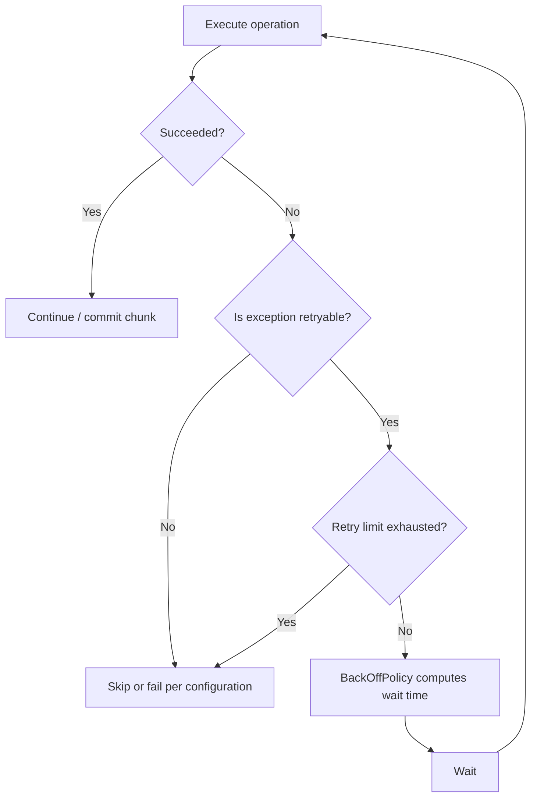

# BackoffPolicy

In Spring Batch, retry allows re-attempting an operation when encountering a recoverable error, such as a database deadlock or a transient connection failure. If retries happen immediately and continuously, the dependent system may still be overloaded or holding locks, causing the next attempt to fail right away. `BackOffPolicy` solves this problem by waiting for a period of time between attempts.

Backoff is the pause after a failed attempt and before the next retry. It reduces pressure on databases, APIs, or message brokers, gives services time to recover, and prevents multiple workers from retrying simultaneously. Backoff does not decide which exceptions are retried; the retry/classifier policy and retry limit still govern that.

In Spring Batch 5.x, a fault-tolerant chunk step configuration can accept an `org.springframework.retry.backoff.BackOffPolicy`. Common policies include `FixedBackOffPolicy`, `ExponentialBackOffPolicy`, `UniformRandomBackOffPolicy`, and `ExponentialRandomBackOffPolicy`. Choose a policy based on the error type, expected recovery time, and system concurrency.

## 1. Where does backoff sit in the retry cycle?

A chunk step can read and process items and then invoke the writer. If an operation throws an exception configured as retryable, Spring Batch performs retries according to the step's policy. When an attempt fails, the backoff policy determines the wait duration before the next attempt.



Backoff is applied only when the framework decides there will be a next retry attempt. It does not delay the first execution and does not create extra attempts after the retry limit is exhausted.

For example, if a write encounters a deadlock, the retry policy determines that deadlocks are retryable and attempts remain. `BackOffPolicy` might instruct waiting 500 ms before trying again. If the subsequent attempt fails again, the policy might raise the wait interval to 1 second, 2 seconds, up to a maximum of 8 seconds.

## 2. Why is backoff needed?

Without backoff, multiple workers can hit the same failure and immediately retry. When a service is overloaded, simultaneous retries generate extra requests, connections, and transactions, worsening the initial condition. This phenomenon is commonly known as a retry storm or thundering herd.

Backoff is useful in cases such as:

- **Deadlock or lock contention:** a transaction may need some time for another transaction to finish and release locks.
- **Temporarily overloaded database:** waiting before acquiring a connection or re-running a statement can relieve immediate pressure.
- **HTTP 429 / rate limit:** an external service instructs the client to slow down request rates.
- **Transient HTTP 5xx or timeouts:** the service may be restarting, failing over, or handling a burst.
- **Message broker temporarily unavailable:** retrying with pauses avoids tight send loops.

Backoff cannot fix data errors, programming bugs, or misconfiguration. If an item always fails validation, waiting longer will not make the data valid. Such errors should normally be rejected, skipped per business rules, or cause the step to fail.

## 3. FixedBackOffPolicy

`FixedBackOffPolicy` waits the same duration between retries. This is a straightforward choice when expected recovery time is fairly steady or the retry count is small.

Example configuring a 1-second wait policy:

```java
@Bean
BackOffPolicy fixedRetryBackOffPolicy() {
    FixedBackOffPolicy policy = new FixedBackOffPolicy();
    policy.setBackOffPeriod(1_000L);
    return policy;
}
```

Attaching the policy to a chunk step:

```java
@Bean
Step importOrdersStep(
        JobRepository jobRepository,
        PlatformTransactionManager transactionManager,
        ItemReader<Order> reader,
        ItemWriter<Order> writer,
        BackOffPolicy fixedRetryBackOffPolicy) {

    return new StepBuilder("importOrdersStep", jobRepository)
            .<Order, Order>chunk(100, transactionManager)
            .reader(reader)
            .writer(writer)
            .faultTolerant()
            .retry(TransientDataAccessException.class)
            .retryLimit(3)
            .backOffPolicy(fixedRetryBackOffPolicy)
            .build();
}
```

In this example, errors belonging to `TransientDataAccessException` are configured to retry up to `retryLimit`; the pause between retries is fixed at 1 second. `retryLimit` limits the retry count per Spring Batch's API, not the wait duration. Distinguish retry count from total executions including the initial attempt plus retries.

Fixed backoff is predictable, yet multiple workers may retry in lockstep. If 50 partitions hit a database error together, they might all wake up after exactly one second and create a new spike in load.

## 4. ExponentialBackOffPolicy

`ExponentialBackOffPolicy` progressively increases the wait duration after each failure. Instead of waiting a constant interval, the wait grows by a multiplier up to a maximum cap.

General formula:

\[
d_n = \min(d_0 \times m^{n-1}, d_{max})
\]

Where:

- `d_n`: wait time before the `n`-th retry.
- `d_0`: initial wait interval (`initialInterval`).
- `m`: multiplier (`multiplier`), typically greater than 1.
- `d_max`: maximum wait interval (`maxInterval`).

Example setting an initial wait of 500 ms, doubling after each failure, and capping at 8 seconds:

```java
@Bean
BackOffPolicy exponentialRetryBackOffPolicy() {
    ExponentialBackOffPolicy policy = new ExponentialBackOffPolicy();
    policy.setInitialInterval(500L);
    policy.setMultiplier(2.0);
    policy.setMaxInterval(8_000L);
    return policy;
}
```

Illustrative wait-time sequence:

| Retry attempt | Wait interval |
|---:|---:|
| 1 | 500 ms |
| 2 | 1,000 ms |
| 3 | 2,000 ms |
| 4 | 4,000 ms |
| 5 | 8,000 ms |
| 6 onward | 8,000 ms |

Exponential backoff fits well when a service may need progressively longer recovery time, or when you want to curb rapid bursts of calls. `maxInterval` is crucial: without a suitable cap, a single retry wait could exceed the job's allowed runtime.

## 5. Randomized backoff and jitter

When multiple workers encounter an outage together, pure exponential backoff can still cause them to retry at nearly the same instants. Jitter adds randomness to the wait duration to spread out retry attempts.

Spring Retry provides policies with randomization, such as:

- `UniformRandomBackOffPolicy`: picks a random wait time within a configured min/max range.
- `ExponentialRandomBackOffPolicy`: combines exponential growth with randomization.

Example using a random wait interval from 500 ms to 2 seconds:

```java
@Bean
BackOffPolicy randomRetryBackOffPolicy() {
    UniformRandomBackOffPolicy policy = new UniformRandomBackOffPolicy();
    policy.setMinBackOffPeriod(500L);
    policy.setMaxBackOffPeriod(2_000L);
    return policy;
}
```

With multiple partitions or multiple application instances, randomization reduces the likelihood of all workers resending requests at the exact same moment. When selecting a policy, understand how the implementation computes the random range and its bounds; do not assume every random policy uses the same jitter algorithm.

## 6. Comparing common BackOffPolicies

| Policy | Wait behavior | When appropriate |
|---|---|---|
| `NoBackOffPolicy` | No deliberate wait between retries | Testing or very fast operations; consider retry load |
| `FixedBackOffPolicy` | Waits the same fixed interval | Services that recover quickly and fairly consistently |
| `ExponentialBackOffPolicy` | Grows wait interval by a multiplier, bounded | Transient errors that may require longer recovery time |
| `UniformRandomBackOffPolicy` | Chooses randomly within a min/max range | Spreading retries when many workers hit failures together |
| `ExponentialRandomBackOffPolicy` | Exponential growth combined with randomization | Multiple workers or instances needing to avoid synchronized retries |

There is no single best policy for every job. Base your choice on dependent service characteristics, worker count, job SLA, and maximum execution time.

## 7. Combining retry classification, retry limit, and backoff

A retry configuration requires at least three independent decisions:

1. **Which exceptions are retried?** Use `.retry(...)` and exception classification rules.
2. **How many times at most?** Use `.retryLimit(...)`.
3. **How long to wait between retries?** Use `.backOffPolicy(...)`.

Example configuration retrying only transient data access errors, excluding validation errors:

```java
@Bean
Step writePaymentsStep(
        JobRepository jobRepository,
        PlatformTransactionManager transactionManager,
        ItemReader<Payment> reader,
        ItemWriter<Payment> writer,
        BackOffPolicy exponentialRetryBackOffPolicy) {

    return new StepBuilder("writePaymentsStep", jobRepository)
            .<Payment, Payment>chunk(50, transactionManager)
            .reader(reader)
            .writer(writer)
            .faultTolerant()
            .retry(TransientDataAccessException.class)
            .noRetry(InvalidPaymentException.class)
            .retryLimit(4)
            .backOffPolicy(exponentialRetryBackOffPolicy)
            .build();
}
```

In this configuration:

- Transient data access errors are considered for retry.
- The `InvalidPaymentException` validation error is excluded from retry.
- The retry count is bounded.
- Wait intervals grow progressively according to the injected policy.

Without configuring `.backOffPolicy(...)`, retries may run under a default policy with negligible wait. Do not confuse backoff with retry limit: increasing the wait time does not increase the number of retries, and increasing the retry limit does not introduce pauses automatically.

## 8. Backoff and skip are two distinct policies

Retry and skip address different situations:

- **Retry:** try again because the error may disappear temporarily.
- **Skip:** bypass an item that cannot or should not be processed in the current run, per business rules and skip limit.
- **Backoff:** determines the wait duration before the next retry attempt.

Examples:

| Error | Typically appropriate behavior |
|---|---|
| Database deadlock | Retry with short or exponential backoff |
| API returning HTTP 429 | Retry per rate-limit policy, honoring `Retry-After` if the integration supports it |
| Transient API timeout | Bounded retry with an idempotency key |
| Non-existent customer ID | Usually do not retry; reject/skip per business rules |
| Malformed monetary amount | Do not retry; record data error |
| Programming error such as `NullPointerException` | Usually fail and fix code; do not retry blindly |

An exception that exhausts retries can still be handled by the skip policy if that exception is also declared skippable and step rules allow it. Check the ordering and retry/skip semantics of the Spring Batch version in use; do not treat backoff as a way to turn errors into skips.

## 9. Backoff affects job execution time

Actual runtime is not just item processing time. On each retry, the job also waits through backoff. Total wait time is the sum of wait intervals for the retries that actually occur.

For example, with exponential backoff of 500 ms, multiplier 2, and max 8 seconds, the first four retries have a total wait time of approximately:

\[
0.5 + 1 + 2 + 4 = 7.5\text{ seconds}
\]

This excludes the execution time of the failed attempts themselves, transaction handling time, connection acquisition time, and external service call durations.

When choosing a policy, consider:

- The job's SLA or deadline.
- Database/API timeouts.
- Maximum retry count.
- Maximum wait time per attempt.
- How many items may fail concurrently in one chunk or across partitions.
- Shutdown wait windows and container/orchestrator runtime limits.

If a job has thousands of items failing and each item retries multiple times, total wait time can far exceed expectations. Compute the worst-case scenario, measure via metrics, and tune retry limit/backoff accordingly.

## 10. Backoff is not a scheduling or queueing mechanism

In typical Spring Retry usage, backoff waits on the thread executing the retry. It does not move the item onto a durable queue for later processing, nor does it release the worker thread while waiting.

This has implications when multiple partitions run in parallel:

- If many workers are retrying and sleeping in backoff, those threads remain occupied.
- If the thread pool is small, other tasks may have to wait.
- If backoff is long, the number of active-but-idle workers can climb.
- If the application stops, in-memory pending retry state is not an independent durable retry schedule.

For small retry counts and moderate wait times, in-thread backoff is usually simple enough. If you need long delays, retries spanning minutes or hours, freeing workers, or ensuring retry schedules survive restarts, consider a queue supporting delayed delivery, a scheduler, or persisting durable retry state. Do not write manual `Thread.sleep()` inside a processor/writer as a substitute for managed coordination.

## 11. Backoff, transactions, and side effects

In a chunk step, retrying can cause an operation to run again during transaction processing. How transactions roll back and reopen depends on the error type, failure point, and step retry mechanics. Do not assume every retry runs in an identical transaction or that all side effects are undone.

If the writer only writes to a database using the step's transaction manager, rollback can undo uncommitted changes in that resource. However, if the writer calls an HTTP API, sends emails, publishes messages, or writes files, a database transaction does not automatically undo those effects.

Before enabling retry, check:

- Is the writer idempotent when re-invoked for the same item/chunk?
- Does the external API support a stable idempotency key?
- Can messages be sent twice, and do consumers deduplicate?
- Does the database have unique constraints or a ledger to prevent duplicate writes?
- Could a timeout happen after the external system already applied the effect?

For side effects outside the database, transactional outbox and consumer inbox are common patterns. Backoff slows down retry rates, while idempotency protects outcomes when retries do happen; the two mechanisms complement each other.

## 12. Honoring Retry-After and external service policies

Some APIs return HTTP 429 or 503 with a `Retry-After` header suggesting when to retry. Standard `BackOffPolicy` implementations do not automatically understand every such HTTP header. If an integration must honor server-suggested intervals, the application adapter must read the header, classify the response, and apply the corresponding delay via an appropriate mechanism.

Do not retry immediately when an API has asked you to slow down. Nor should you wait beyond allowed limits without an explicit business decision. Combine:

- Retrying only for recoverable status codes.
- Bounded backoff, optionally with jitter.
- Idempotency keys for state-changing create/update operations.
- Circuit breakers to pause calls temporarily when consecutive errors cross a threshold.
- Metrics for retry counts, wait times, and error rates.

Backoff and circuit breakers serve different roles. Backoff adjusts timing between attempts of a single request/operation; a circuit breaker stops sending further requests for a period when a dependency is considered unhealthy. Both can be used together, while avoiding simultaneous retries across multiple layers that multiply call counts.

## 13. Avoiding nested retries across multiple layers

An application may have retries in the HTTP client, the service layer, and the Spring Batch step. If every layer retries multiple times, actual request counts can grow as the product of attempts across layers.

For example, if the HTTP client tries up to 3 times and the batch step also retries the operation up to 3 times, a single item can generate up to 9 HTTP calls in the worst case, not counting initial calls depending on how each library counts limits.

Decide which layer owns primary retries:

- Short retries for very local transport glitches can live in the HTTP client.
- Step-level retries fit when errors must tie into Spring Batch transactions/chunks and metadata.
- Long retries or time-deferred waits should be coordinated via a queue/scheduler.

Set overall timeouts so total retry duration never exceeds the job's deadline. Log/emit metrics at each layer so you know how many times an item was actually attempted.

## 14. Testing BackOffPolicy

Do not test backoff by forcing tests to wait for many real seconds when the goal is only to verify configuration. You can unit-test the policy separately and run step retry integration tests with short intervals or a mock sleeper when the implementation supports it.

Cases to check:

1. **No retry:** exception is not retryable; backoff is not applied.
2. **Successful retry:** first attempt fails, subsequent attempt succeeds; verify invocation counts and job completion.
3. **Retries exhausted:** all attempts fail; verify retry count does not exceed configuration and the step ends in the expected status.
4. **Fixed delay:** verify every retry uses the same wait interval.
5. **Exponential delay:** verify durations grow by the multiplier and never exceed max interval.
6. **Random delay:** verify values stay within min/max bounds; do not assert a single fixed random value.
7. **Non-retryable exception:** validation exceptions cause neither delays nor additional attempts.
8. **Idempotent side effects:** writer retries do not produce duplicate records or transactions.
9. **Multiple workers:** verify jitter spreads retries and the pool is not overly saturated.
10. **Deadline:** total runtime under failure scenarios stays within operational bounds.

An example step-level retry test can use a writer that counts invocations:

```java
class FailTwiceThenSucceedWriter implements ItemWriter<String> {

    private final AtomicInteger attempts = new AtomicInteger();

    @Override
    public void write(Chunk<? extends String> chunk) {
        int attempt = attempts.incrementAndGet();
        if (attempt <= 2) {
            throw new TransientDataAccessException("Temporary failure") {};
        }
    }

    int attempts() {
        return attempts.get();
    }
}
```

Test configuring this writer with a sufficient retry limit and a very short backoff. Once the job finishes, verify the writer was re-invoked and the final result is correct. If exact timing verification is needed, inject a test sleeper/clock supported by your Spring Retry version rather than relying on long `Thread.sleep()` calls and CI machine timing.

## 15. Observing and operating backoff

In production, monitor backoff to distinguish whether a job is slow because of data processing volume or because it is waiting on retries for a recovering dependency.

Useful metrics/logs:

- Retry counts by job, step, and exception type.
- Total backoff wait duration.
- Number of workers currently retrying or waiting.
- Ratio of succeeded retries to exhausted retries.
- Time elapsed from first failure until operation success.
- Number of items skipped after unsuccessful retries.
- Error counts by dependency such as database, API, or broker.

Logs should include `jobExecutionId`, `stepExecutionId`, batch ID, and business item identifier to correlate attempts. Do not log sensitive payloads or secrets. If multiple retry layers exist, log attempts at each layer to avoid misinterpreting invocation counts.

When seeing a sudden spike in retries, investigate root causes such as database locks, exhausted connection pools, API rate limits, or network faults. Raising the retry limit or lengthening backoff does not replace fixing an unhealthy dependency.

## 16. Common mistakes

**Assuming BackOffPolicy decides whether an exception is retried.** The policy only decides wait duration. Use `.retry(...)`, classifiers, and retry limits to determine which errors are retried.

**Using backoff for unrecoverable data errors.** Validation failures will still fail after waiting. Classify errors properly and use skip/fail per business rules.

**Not bounding retries.** Excessive retries can drag out jobs and increase dependency load. Set retry limits and deadlines.

**Using exponential backoff without a max interval.** Wait intervals can exceed SLAs. Choose an appropriate upper bound.

**Using fixed backoff when many workers fail together.** Workers may retry in lockstep. Consider jitter/randomized policies.

**Assuming backoff frees worker threads.** In standard usage, the executing thread still blocks while waiting. For long delays, consider queues or schedulers.

**Enabling retry without verifying idempotency.** Writers or APIs may apply duplicate side effects when an earlier attempt partially succeeded.

**Retrying across multiple layers without calculating total calls.** Client, service, and step can multiply retry attempts. Choose a primary retry layer and set an overall deadline.

**Using long waits in unit tests.** Tests become slow and flaky. Use fast test policies, mock sleepers, or configuration assertions instead of real waiting.

## 17. Process for choosing a BackOffPolicy

When configuring retry for a step, you can follow this sequence:

1. Identify dependencies that may raise transient errors and their representative exceptions/status codes.
2. Identify errors that must not be retried, such as validation or configuration errors.
3. Choose a retry limit based on recovery likelihood and the job's deadline.
4. Choose fixed backoff if recovery time is steady; choose exponential if wait intervals should grow progressively.
5. Add randomization/jitter if multiple workers may retry at the same time.
6. Set a max interval and calculate worst-case total wait time.
7. Verify writer idempotency and transaction boundaries.
8. Test success after retry, exhausted retries, skip/fail behavior, and concurrent load.
9. Monitor retry counts, wait durations, and dependency errors in production.

Example design decision:

| Dependency / error | Retry | Suggested backoff | Notes |
|---|---|---|---|
| Brief database deadlock | Bounded | Exponential with small max | Transaction must roll back cleanly; writer safe on retry |
| API 429 | Conditional | Randomized or delay per `Retry-After` | Honor rate limits and idempotency keys |
| Temporary API 503 | Bounded | Exponential + jitter | Monitor circuit breaker and timeouts |
| Malformed data | No | Not applicable | Record error/skip per business rules |
| Missing required configuration | No | Not applicable | Fail early and fix configuration |

## Conclusion

`BackOffPolicy` determines the wait interval between a failed execution and the next retry attempt in Spring Batch/Spring Retry. `FixedBackOffPolicy` uses a constant wait period; `ExponentialBackOffPolicy` grows progressively and caps at `maxInterval`; randomized policies add dispersion to prevent many workers from retrying simultaneously.

Backoff must work alongside exception classification, retry limits, and deadlines. It does not make data errors recoverable, does not automatically free worker threads, and does not guarantee side effects happen only once. Choose a policy suited to the dependency, bound wait durations, verify writer transactions and idempotency, and test retry success, exhausted retries, and multi-worker failure scenarios.
