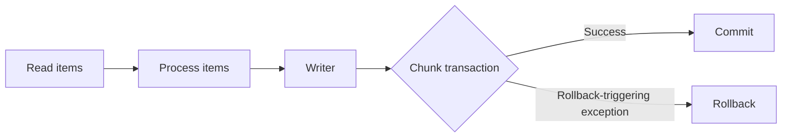
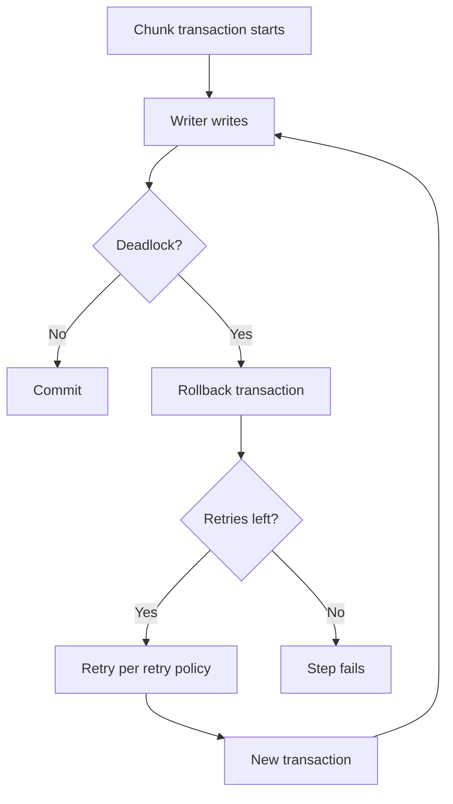

# Rollback classification for a fault-tolerant step

In Spring Batch, a fault-tolerant step can retry transient operations, skip invalid items, and continue processing remaining items. When configuring these policies, one more decision is needed: **which exceptions must roll back the chunk transaction and which exceptions can be handled without rolling back?**

This is the responsibility of rollback classification. It is related to, yet distinct from, skip classification and retry classification:

- **Rollback** decides whether the current transaction is rolled back when an exception occurs.
- **Retry** decides whether to re-attempt the failing operation.
- **Skip** decides whether to drop the failing item and continue.

Spring Batch rolls back by default when an exception from the writer fails a chunk. In a fault-tolerant step, **noRollback(...)** can be configured for exceptions identified as not needing rollback. This configuration must be used very carefully: not rolling back does not make the exception disappear, nor does it make partial side effects safe.

## 1. Transactions in a chunk step

A chunk-oriented step reads, processes, and writes items in groups. With a chunk size of 100, one chunk is normally processed inside a single transaction:



A simple cycle:

1. The Reader supplies items.
2. The Processor transforms or filters items.
3. The Writer writes the output items.
4. If the chunk completes, the transaction manager commits.
5. If an exception requires rolling back the transaction, transactional changes in the chunk are undone according to each resource's capabilities.

Rollback is critical because the writer may have already executed several statements before hitting an error on a subsequent item. If all writes participate in the same transaction, rollback prevents committing only part of a chunk.

However, a transaction only rolls back resources that actually participate in that transaction. Sending HTTP requests, writing files outside a transactional mechanism, sending emails, or publishing messages are not automatically undone merely because the database transaction rolled back.

## 2. What is rollback classification?

Rollback classification is the rule that determines whether an exception causes the current transaction to roll back. In a fault-tolerant step, the builder provides **noRollback(...)** to declare exception types that do not require rollback under the step's policy.

Example:

```java
return new StepBuilder("importOrdersStep", jobRepository)
        .<Order, Order>chunk(100, transactionManager)
        .reader(orderReader)
        .processor(orderProcessor)
        .writer(orderWriter)
        .faultTolerant()
        .noRollback(NonCriticalRecordException.class)
        .build();
```

In this example, `NonCriticalRecordException` is classified as a non-rollback exception under the fault-tolerant configuration. This is only a transaction decision; it does not turn the exception into a skip, does not retry it, and does not mark the step as successful.

### Defaults and exceptions

In chunk processing, an exception from `ItemWriter` rolls back the chunk transaction by default. This protects integrity when the writer writes partially and then fails. When adding `noRollback(...)`, the application is actively changing rollback behavior for a specific exception type.

The error-handling paths of the reader, processor, and writer differ because the framework can catch exceptions to apply skip/retry policies at each phase. Do not extrapolate that every exception in every component produces the exact same outcome from a single configuration example. Identify where the exception originates and verify the behavior of your Spring Batch version.

## 3. Distinguishing rollback, retry, and skip

The three policies answer three different questions:

| Policy | Question | Example |
|---|---|---|
| Rollback | Must the current transaction be undone? | Writer fails after already writing several items |
| Retry | Should the failing operation be attempted again? | Database deadlock or transient error |
| Skip | Can the failing item be bypassed so processing continues? | A record failing validation |

An exception can be:

- Retryable and requiring rollback before retrying.
- Skippable and requiring rollback to remove partial write effects of the failing item.
- Skippable yet configured as no-rollback if proven that no transaction undo is needed.
- Neither retryable nor skippable, thus causing the step to fail.

There is no rule stating "skip always means no rollback" or "retry always means just re-invoking the method". Transaction, retry, and skip must be configured together based on the characteristics of the operation.

## 4. Configuring skip and retry

Example fault-tolerant step with two error groups:

```java
return new StepBuilder("importOrdersStep", jobRepository)
        .<OrderInput, Order>chunk(100, transactionManager)
        .reader(orderReader)
        .processor(orderProcessor)
        .writer(orderWriter)
        .faultTolerant()
        .skip(InvalidOrderException.class)
        .skipLimit(50)
        .retry(DeadlockLoserDataAccessException.class)
        .retryLimit(3)
        .build();
```

Meaning:

- `InvalidOrderException` is allowed to be skipped, up to the configured skip limit.
- `DeadlockLoserDataAccessException` is retried within the limit.
- Exceptions not covered by the configured policies will cause the step to fail.

Retry is typically suitable for transient errors likely to clear after some time, such as deadlocks or fleeting connection errors. Skip suits per-item errors that business rules permit dropping, such as invalid input data recorded into a reject workflow.

Do not use retry for data errors that definitely cannot fix themselves. Likewise, do not use skip to mask infrastructure errors, configuration errors, or programming bugs.

## 5. What does noRollback(...) change?

`noRollback(ExceptionType.class)` declares that exceptions of that type do not require rolling back the transaction under the fault-tolerant step's policy.

Example:

```java
return new StepBuilder("processOrdersStep", jobRepository)
        .<OrderInput, Order>chunk(100, transactionManager)
        .reader(orderReader)
        .processor(orderProcessor)
        .writer(orderWriter)
        .faultTolerant()
        .skip(NonCriticalRecordException.class)
        .skipLimit(100)
        .noRollback(NonCriticalRecordException.class)
        .build();
```

This configuration snippet indicates:

- The exception is allowed to be skipped under the skip policy.
- That exception is marked as not requiring rollback under the rollback policy.
- The skip limit remains in effect.
- If the exception is not handled as a valid skip or exceeds the limit, the step can still fail.

`noRollback` is not a command to ignore the exception. It does not increment `skipCount` on its own, does not retry on its own, does not write reject records, and does not determine the final exit status.

### Be careful with the writer

Suppose the writer has already written 30 items in a transaction and then throws `NonCriticalRecordException` while processing the 31st item. If this exception is classified as no-rollback, changes already made in the transaction may not be undone under the step's policy. That can leave a chunk partially written.

Only use no-rollback if you know precisely what the writer did before throwing the exception and the resulting state remains valid. If the writer can perform partial writes, rollback is usually the safer choice.

## 6. Example: which exceptions should roll back?

Consider three hypothetical error types:

| Exception | Nature | Policy to consider |
|---|---|---|
| Deadlock on DB write | Transient; transaction may need a fresh start | Retry and rollback |
| Malformed record | Data error for a single item | Skip or reject per business rules |
| Programming error such as `NullPointerException` | Unexpected bug | Fail; do not hide with skip/noRollback |

### Deadlock

When the database reports a deadlock, the current transaction is usually no longer fit to continue. Rollback releases transaction resources; retry can re-execute the chunk in a new transaction.

```java
.faultTolerant()
.retry(DeadlockLoserDataAccessException.class)
.retryLimit(3)
```

Do not add deadlock to `noRollback` merely to avoid rollback. Retrying a database operation inside a transaction that already hit a deadlock is not a reliable recovery strategy.

### Invalid record

If the error is detected in the processor before the writer writes the item, the record can be skipped and the reject reason recorded. If the error occurs inside the writer after some statements have already executed, rollback is required to remove partial writes before the framework isolates the failing item, unless a design proves rollback is unnecessary.

### Programming errors

Do not declare `noRollback(Exception.class)` or skip every exception just so the job always finishes. A null pointer, bad mapping, or violated invariant can corrupt data consistency. Let unexpected errors fail the step, gather diagnostic details, and fix the root cause.

## 7. Classifying by where the exception originates

The location of the exception affects how Spring Batch handles it:

| Origin | Considerations |
|---|---|
| Reader | May fail opening source, reading a record, or restoring checkpoint; determine retry/skip and reader state |
| Processor | Error typically ties to a single item; decide whether skippable or fatal and whether processor has side effects |
| Writer | May have written part of the chunk; rollback is usually critical to avoid partial writes |
| Listener or callback | Can occur before/after chunk operations; clarify transaction lifecycle at callback time |
| External service called from writer | Database rollback does not revoke side effects already executed on the external service |

For example, a parse error in the reader and a deadlock in the writer should not be lumped into the same category merely because both are exceptions. A parse error may be a data issue; a deadlock is a transient infrastructure issue.

When designing policies, document the exception type, origin, whether it can be retried, whether it can be skipped, and whether the transaction must roll back.

## 8. Decision order: should an exception be retried, skipped, or fail?

You can use this decision table when classifying an error:

| Scenario | Retry? | Skip? | Rollback? | Desired outcome |
|---|---|---|---|---|
| DB deadlock | Bounded | Usually no | Yes | Retry in a new transaction |
| Temporary connection error | Bounded if operation is safe | Usually no | Yes if transaction failed | Retry or fail when limit exhausted |
| Malformed data | Usually no | Yes if business permits | Depends on phase; if writer wrote partially, rollback needed | Reject item and continue |
| Severe business rule violation | No | No | Usually yes if transaction is open | Fail step/job |
| Unexpected programming error | No | No | Yes | Fail and investigate |
| Exception proven not to corrupt transaction | Based on error nature | Possibly | Possibly no-rollback | Continue under clear policy |

This is a design matrix, not a fixed framework mapping table. The actual result also depends on the exception cause chain, skip/retry policies, transaction manager, and the component throwing the exception.

## 9. Exception hierarchy and overly broad classification

Policies are typically configured by exception class. Using an overly broad superclass can cause unrelated errors to receive the same policy.

Dangerous example:

```java
.faultTolerant()
.noRollback(Exception.class)
```

This configuration can prevent many exceptions from rolling back, including unexpected ones. Similarly, skipping every `Exception` can mask system or programming errors.

Choose specific exceptions instead:

```java
.faultTolerant()
.retry(DeadlockLoserDataAccessException.class)
.retryLimit(3)
.skip(InvalidOrderRecordException.class)
.skipLimit(100)
```

If a specific exception extends a configured superclass, check the classifier rules of the version in use and test both direct exceptions and exceptions wrapped in a cause. Never assume the outermost class name is always the exception type seen by the policy.

## 10. noRollback does not replace transaction manager rollback rules

There are several places where rollback is configured in Spring:

- The fault-tolerant step builder has `noRollback(...)` to adjust rollback classification in chunk processing.
- Spring transactions have rollback rules such as `@Transactional(rollbackFor = ...)` or `noRollbackFor = ...`.
- The transaction manager and resource may have their own rules about transaction state after an error.

These layers are related, but they are not a single unified setting. If a service called from the writer has its own transaction annotation, understand the propagation and rollback-only marker of the participating transaction.

For example, an inner service may mark the transaction rollback-only even if the outer layer did not intend a rollback. Conversely, an exception caught and swallowed internally may allow the transaction to continue while side effects already occurred.

Do not use `noRollback(...)` on the step to try overriding every rollback rule in nested transactions. Clarify the transaction manager, propagation, and where exceptions are caught/thrown.

## 11. Why does retry usually need rollback?

Retry aims to re-attempt an operation likely to succeed once transient conditions change. For database errors such as deadlocks, the transaction may already be marked rollback-only or no longer in a valid state to continue.

Typical flow:



Retry must not be used to re-run a non-idempotent operation if the first attempt could have caused external side effects. If an API is called and it is unknown whether the request was processed, a retry can create duplicate transactions. Use an idempotency key or outbox to make operations safe to retry.

## 12. Why does skip sometimes need rollback?

Skip means bypassing the failing item and continuing. However, if the writer already wrote part of the chunk, the transaction must be rolled back before the framework can isolate the failing item and proceed under the skip policy.

Consider a chunk with A, B, and C:

1. Writer writes A successfully in the transaction.
2. Writer processes B and encounters an exception.
3. Writer has not processed C yet.
4. The transaction rolls back to undo A's write from that attempt.
5. The framework can execute its isolation/scan mechanism to identify the failing item and apply the skip policy.
6. Valid items are written again under the fault-tolerant mechanism.

Exact invocation counts of the reader, processor, and writer depend on reader buffering, retry configuration, and processor transactional behavior. The core principle, however, is never allowing partial writes from a failed attempt to become an unintended committed result.

If no-rollback is used in a scenario where the writer can write partially, the framework may lose the ability to rely on rollback to isolate the failing item safely. Configure it that way only when the writer operation is designed accordingly.

## 13. Complete example: retry transient errors, skip bad records

An order import step can classify two exception types separately:

```java
@Bean
Step importOrdersStep(
        JobRepository jobRepository,
        PlatformTransactionManager transactionManager,
        ItemReader<OrderInput> orderReader,
        ItemProcessor<OrderInput, Order> orderProcessor,
        ItemWriter<Order> orderWriter) {

    return new StepBuilder("importOrdersStep", jobRepository)
            .<OrderInput, Order>chunk(100, transactionManager)
            .reader(orderReader)
            .processor(orderProcessor)
            .writer(orderWriter)
            .faultTolerant()
            .skip(InvalidOrderException.class)
            .skipLimit(100)
            .retry(DeadlockLoserDataAccessException.class)
            .retryLimit(3)
            .build();
}
```

In this example:

- `InvalidOrderException` represents a data error that can be rejected.
- `DeadlockLoserDataAccessException` represents a transient database error.
- Skip limit caps the total number of failing items allowed to be skipped under the step's policy.
- Retry limit caps the number of retries under the retry policy.
- `noRollback` is not configured because there is no proof either exception type is safe without rollback.

If reject records need to be written, design that operation to be transaction-safe and avoid letting reject writes mutate the original items. Use an appropriate listener/`SkipListener` or a separate reject flow with a stable identifier key.

## 14. Intentional noRollback example

Suppose a step has a business exception thrown by an operation that does not modify the chunk's transactional data. The application has proven that this exception only signals a rejected item before the writer executes any writes. If business rules allow skipping this item, you can configure:

```java
return new StepBuilder("validateAndImportStep", jobRepository)
        .<OrderInput, Order>chunk(100, transactionManager)
        .reader(orderReader)
        .processor(orderProcessor)
        .writer(orderWriter)
        .faultTolerant()
        .skip(RejectedOrderException.class)
        .skipLimit(100)
        .noRollback(RejectedOrderException.class)
        .build();
```

The critical condition in this example is that the exception is thrown before any write side effect requiring rollback occurs. If the exception is thrown after the writer has updated the database, written a file, or called an API, re-evaluate it. Specifically, not rolling back the database can leave a chunk in a partial state.

If the exception can only appear in the processor and has no side effects, changing the rollback policy may not be necessary; rely on your version's default behavior and real tests before adding `noRollback`.

## 15. Non-transactional writers and external side effects

Some writers write to resources that do not participate in the database transaction:

- Flat files or filesystems depending on buffering.
- HTTP APIs.
- Email.
- Message brokers not participating in the same transaction.
- Object storage.

If a writer sends a request and then throws an exception, a database rollback does not revoke the request already processed by the external system. Configuring `noRollback` does not solve that issue either; it only changes the rollback decision of the step transaction.

Example:

```java
public class PartnerWriter implements ItemWriter<Order> {

    private final PartnerClient client;

    @Override
    public void write(Chunk<? extends Order> chunk) {
        for (Order order : chunk) {
            client.publish(
                    order,
                    "order-" + order.id());
        }
    }
}
```

An idempotency key based on the order ID helps the partner recognize duplicate requests. When database and messaging must remain consistent, consider a transactional outbox: write business data and the outbox record in the same transaction, then let a separate publisher send messages.

For files, write to staging, close and verify the file, and only then publish the manifest/commit marker. Never use `noRollback` to hide file-writing errors or avoid handling partial files.

## 16. SkipListener, RetryListener, and recording results

Listeners help record exceptions and processing outcomes:

- `SkipListener` records skipped items and their causes.
- `RetryListener` observes retry attempts.
- `ChunkListener` tracks chunk lifecycle.
- `StepExecutionListener` records the final step outcome.

Listeners do not replace rollback classification. For example, `SkipListener` is called to notify that an item was skipped; whether the transaction rolls back still depends on the rollback policy and transaction lifecycle.

If a listener writes reject records to the database, determine which transaction it participates in. Do not assume listener side effects are always committed or rolled back together with the writer. For reject logs that require durability guarantees, use a design with explicit transaction/idempotency semantics.

## 17. Monitoring metrics to verify policies are working

When a fault-tolerant step runs, observe:

- Read count.
- Write count.
- Filter count.
- Read skip count.
- Process skip count.
- Write skip count.
- Retry count or equivalent metric.
- Rollback count.
- Commit count.
- Exit status and final exception.

Example operational log:

```text
step=importOrdersStep
readCount=1000
writeCount=985
processSkipCount=10
writeSkipCount=5
rollbackCount=3
retryAttempts=4
exitStatus=COMPLETED
```

These are illustrative numbers. The exact meaning and update rules of each counter depend on the execution path and framework version. Read both phase-specific skip counts and rollback count; a step with a low write count does not by itself tell you how many times it rolled back.

If rollbacks spike unusually, check deadlocks, writer errors, transaction timeouts, lock contention, and exception classification. If skips spike suddenly, inspect the data source or recent validation rule changes.

## 18. Testing rollback classification

Do not only test whether the job ends as `COMPLETED` or `FAILED`. Inspect the data after the transaction:

| Scenario | What to verify |
|---|---|
| Writer throws default exception | Transaction rolls back and leaves no partial writes |
| Exception is both noRollback and skippable | Skip policy handles the item; remaining data matches design |
| Retryable exception | Failing transaction is handled properly before retry |
| Retries exhausted | Step fails and data state is deterministic |
| Skip limit exceeded | Step fails per skip policy |
| Unclassified exception | Step does not silently ignore it |
| Writer writes partially then throws noRollback exception | Test catches partial write if configuration is unsafe |
| External API succeeds then DB fails | Retry does not create duplicate side effects thanks to idempotency |

A useful integration test:

1. Create a test database with order and audit tables.
2. Configure the writer to write orders and intentionally throw an exception on one item.
3. Run the step with the default rollback policy.
4. Verify that transactional changes from the failing chunk are absent from the database.
5. Re-run with an exception configured as noRollback in a separate test scenario.
6. Verify precisely which data was committed and which items were skipped.

Do not merely mock the transaction manager if your goal is to test real rollback. Use an appropriate transaction manager and test resources to verify actual data outcomes.

## 19. Common mistakes

**Using noRollback so the job does not roll back.** This configuration does not make exceptions disappear and can leave partial writes behind. Use only for evaluated exception types.

**Confusing noRollback with skip.** NoRollback controls the transaction; the skip policy decides whether the item is bypassed.

**Confusing noRollback with retry.** Retry decides whether to re-attempt; rollback policy decides how the transaction is handled. Deadlocks usually require rollback before retrying.

**Declaring noRollback(Exception.class).** Overly broad scope can include system errors and programming bugs. Choose specific exceptions.

**Treating all processor/reader/writer errors identically.** Each phase has its own handling mechanism. Identify where the exception is thrown and test that execution path.

**Skipping transient database errors.** You could drop an item merely because of a fleeting lock or connection blip. Use retry for appropriate transient errors.

**Retrying unfixable data errors.** Retrying does not make a malformed record valid. Use validation/reject/skip per business rules.

**Using noRollback with a writer calling APIs or writing files.** It does not create atomicity with external resources. Use idempotency, an outbox, or staging.

**Not inspecting data after rollback.** Job status alone does not prove the transaction protected data as expected. Inspect the database and real side effects.

## 20. Workflow for choosing a rollback policy

For every possible exception, document:

1. Does the exception originate in the reader, processor, writer, or listener?
2. Does it represent a data error, transient error, or programming bug?
3. Can it be safely retried?
4. Can the item be skipped per business rules?
5. What side effects did the writer already produce before the exception?
6. Do those side effects participate in the current transaction?
7. Is rollback required to remove partial writes or restore a checkpoint?
8. If using noRollback, does data remain consistent after the exception?
9. Is the exception wrapped inside another type?
10. Have integration tests confirmed results with a real transaction manager?

Only then configure skip, retry, and noRollback. Do not start with a broad policy and try to patch it after production produces corrupted data.

## 21. Practical conclusion

Rollback classification decides whether a chunk transaction must roll back when an exception occurs. In a fault-tolerant step, `noRollback(...)` lets you specify certain exceptions that do not require rollback under the step's policy. It does not skip, retry, or make exceptions disappear on its own.

Keep the three decisions separate: retry for transient errors that can be re-attempted; skip for failing items business rules permit dropping; rollback to protect the transaction from partial write states. Exceptions from the writer roll back the chunk by default because the writer may have executed partial work. Use `noRollback` only when proven that the exception does not compromise transactional data consistency.

In particular, a database rollback does not undo files, HTTP requests, or messages already sent. For external side effects, use idempotency keys, an outbox, staging, and reconciliation. A safe fault-tolerant step requires explicit policies for each exception type and integration tests verifying actual data after retry, skip, and rollback.
