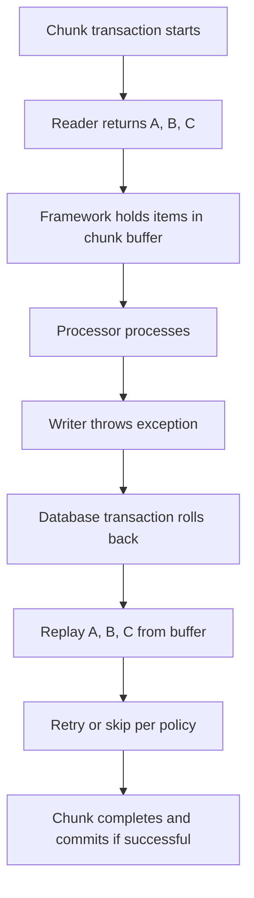

# Non-transactional reader

In Spring Batch, a chunk is typically processed inside a step transaction. However, calling `ItemReader.read()` while a transaction is open does not mean the data source accessed by the reader can roll back. Readers that read files, call REST APIs, fetch pages from an external source, or advance a cursor not participating in the database transaction are generally **non-transactional readers**.

This creates a problem when a chunk rolls back: the database transaction can undo uncommitted changes, yet the external source's read position has already moved forward. If the reader is called again from the new position, the recently read items could be missed. Spring Batch solves this common situation by holding already-read items in the chunk so they can be reprocessed after a rollback. For genuinely transactional read sources such as a message queue enlisted in the step's transaction, handling differs: rolling back the source returns items to the queue, so the framework can re-read from the source instead of keeping copies in memory.

Understanding the difference between non-transactional readers and transactional queue readers helps prevent lost or duplicated items during retry, skip, rollback, and restart.

## 1. A reader can be called inside a transaction and still be non-transactional

In chunk-oriented processing, Spring Batch normally opens a chunk transaction before reading and processing the group of items. The reader is called during that span, yet the transaction only controls resources that actually participate in it.

For example, a step reading CSV and writing to a database:

1. The chunk transaction starts.
2. `FlatFileItemReader` reads lines 1 through 100.
3. The processor transforms the lines.
4. The writer inserts data into the database.
5. If everything succeeds, the chunk commits.

If the writer throws an exception, the database can roll back the inserts. However, the filesystem has no corresponding rollback operation for the reader having read 100 lines. The file stream has already moved to the next position. Therefore, rolling back only the database transaction does not rewind the file reader back to the start of the chunk.

This is what non-transactional reader means: the read operation or source state is not automatically undone by the chunk transaction. It does not mean the reader always runs outside the transaction thread or is called after the transaction has closed.

## 2. Sources commonly read in a non-transactional manner

The following sources do not usually rewind to a prior position automatically when a database transaction rolls back:

| Source | Why typically non-transactional? | Common position recovery approach |
|---|---|---|
| CSV/text file | Reading lines advances the file pointer; the filesystem does not participate in JDBC transactions | Store line/item count or offset in `ExecutionContext` |
| REST API | Page-fetching requests are outside the step's database transaction | Store page token, offset, or last processed key |
| Object storage | Stream/object reads are not rolled back with the database | Re-read immutable objects by offset or key |
| Database paging query | Each page is a query; transaction rollback does not automatically reverse reader pagination logic | Store sort key/page state and use deterministic ordering |
| Database cursor | Cursor/`ResultSet` has its own read state; rollback does not implicitly rewind the cursor per reader logic | Use a checkpoint-capable reader and check driver/cursor behavior |
| Custom iterator/stream | Iterator has already advanced when returning items | Store position or provide re-read capability |
| Non-enlisted message sources | Messages were already acked/committed at the broker independently | Use post-processing acknowledgement or coordinated redelivery |

Not every reader for the same type of source has identical semantics. For example, one JMS reader may be transactional if it receives messages in a transacted session coordinated with the chunk; another reader reading messages via an API and acknowledging immediately may be non-transactional. Check how the reader performs I/O and handles specific resource transactions.

## 3. What happens when a chunk rolls back?

Suppose the chunk size is 3 and the reader returns A, B, and C in sequence. The writer fails before commit.

With a non-transactional reader, the source has already moved past C. If the framework calls the reader immediately to fetch the next three items, A, B, and C could be skipped. Therefore, in fault-tolerant chunk processing, Spring Batch buffers already-read items by default so they can be reprocessed after a rollback.



The buffer allows the framework to feed the exact same read items back into subsequent processing without asking the reader to seek backward in the source. The reader does not necessarily get called again to read A, B, and C while handling the rolled-back chunk.

Keep in mind: this buffer is an in-memory mechanism holding in-flight items within the process. It is not durable storage and does not replace `ExecutionContext` checkpoints for restarts after a JVM or server stop.

## 4. Why does Spring Batch buffer items from a non-transactional reader?

Buffering keeps the chunk's input data unchanged during retry/rollback. This lets the framework retry the processor or writer on the same set of items, rather than pulling a different set of items from a source that has moved ahead.

Benefits:

- Prevents dropping items merely because the read source cannot roll back.
- Writer retries can receive the exact same chunk after a transaction rollback.
- Skip logic can isolate the failing item without requiring the reader to rewind.
- Processing outcomes depend less on whether the reader supports seeking backward.

The buffer does not make the data source transactional. It simply retains copies of items already returned by the reader within the current processing scope.

With large chunks or items having large object graphs, the buffer can consume significant heap. Choose chunk size based on item footprint and memory limits, especially when the step uses retry/skip.

## 5. Non-transactional reader vs transactional queue reader

Spring Batch distinguishes ordinary readers from readers fetching data from a transactional queue. A classic example is a message received in a transaction where rollback returns the message to the queue so it can be received again.

| Characteristic | Non-transactional reader | Transactional queue reader |
|---|---|---|
| Reading items advances the source | Usually yes | Yes, but the receive operation belongs to a transaction |
| Does chunk rollback rewind the source? | Not automatically | Can redeliver items if the queue transaction rolls back |
| How items are handled after rollback | Framework buffers and replays read items | Queue source returns items; reader is called again to receive |
| Examples | Files, API paging, iterators, many cursor readers | JMS/message queues with coordinated receive transactions |
| Buffering configuration | Default behavior is appropriate | Buffering can be disabled via `readerIsTransactionalQueue()` |

Merely reading from a queue does not make a reader transactional. If code receives a message and immediately acknowledges it in a transaction independent of the step's transaction, rolling back the database does not necessarily return the message to the queue.

## 6. Configuring readerIsTransactionalQueue()

For genuinely transactional readers, `FaultTolerantStepBuilder` provides `readerIsTransactionalQueue()` to inform Spring Batch that items will be returned to the source when the transaction rolls back. The framework then does not need to buffer items the way it does for non-transactional readers.

Conceptual configuration example with a JMS-backed reader:

```java
@Bean
public Step consumeMessagesStep(
        JobRepository jobRepository,
        PlatformTransactionManager transactionManager,
        ItemReader<OrderMessage> messageReader,
        ItemProcessor<OrderMessage, OrderRecord> processor,
        ItemWriter<OrderRecord> writer) {

    return new StepBuilder("consumeMessagesStep", jobRepository)
            .<OrderMessage, OrderRecord>chunk(100, transactionManager)
            .reader(messageReader)
            .processor(processor)
            .writer(writer)
            .faultTolerant()
            .readerIsTransactionalQueue()
            .retry(TransientDataAccessException.class)
            .retryLimit(3)
            .build();
}
```

This is an illustrative configuration. Enable `readerIsTransactionalQueue()` only when the receive operation is genuinely managed inside a transaction that can roll back along with the chunk lifecycle. The method name reflects the transactional queue case; do not use it for file readers, REST readers, or database readers just because the data source can be re-read.

If you enable this flag for a non-transactional reader, Spring Batch may stop keeping read items in the buffer. When the chunk rolls back, the source does not redeliver items and data can be lost from the processing stream.

## 7. Conditions for a transactional queue to genuinely redeliver

For a queue reader to work properly with chunk rollback, ensure the message-receiving transaction is coordinated with the step transaction.

For example, with JMS, check:

- Is the message-receiving session configured as transacted?
- Does the step's transaction manager manage the JMS resource?
- If the writer writes to a database and the reader receives from JMS, are the two resources coordinated by an appropriate transaction manager (e.g., JTA/XA when needed)?
- Is the message only acknowledged/committed after the chunk succeeds, or is it acknowledged too early?
- When the transaction rolls back, does the broker redeliver the message per configured semantics?

A separate JMS local transaction and a separate JDBC transaction do not automatically form one atomic transaction. If JMS commits while JDBC rolls back, the message may be consumed without database data being written. Conversely, if the database commits while JMS rolls back, the message may be redelivered and processed twice.

Verify the actual transaction configuration rather than relying on broker names or reader types. If the two resources cannot be coordinated, you need idempotency, deduplication, or an appropriate outbox/inbox architecture.

## 8. Retry with a non-transactional reader

Suppose the reader reads items from a file, the processor transforms them, and the writer encounters a deadlock. The chunk rolls back. Because the file reader cannot return to the previous position via a database rollback, the framework uses buffered items to retry processing.

General flow:

1. Reader returns items A, B, C.
2. Spring Batch holds the items in the chunk buffer.
3. Processor produces outputs.
4. Writer encounters a transient error.
5. Transaction rolls back.
6. Retry policy decides to retry.
7. Already-read items are fed back into processing without re-reading the source.
8. Once the writer succeeds, the chunk commits.

For non-transactional readers, this prevents a writer retry from advancing the reader to items D, E, and F. The input set for the retry attempt remains A, B, and C.

Retry does not guarantee the reader can recover if `read()` itself already consumed data and then threw an exception before returning an item. In that case, the framework has no item to buffer. The reader must have atomic read-error handling, checkpoint persistence, or stable-key re-querying.

## 9. Skip with a non-transactional reader

Skip allows bypassing an item when an exception is classified as skippable and the skip limit is not exceeded. With non-transactional readers, buffering helps the framework retain chunk items on rollback and isolate the failing item, especially when errors occur in the writer.

For example, the writer receives 100 output items, yet one record violates a unique constraint. In a fault-tolerant step, Spring Batch can roll back the chunk and try writing smaller subsets to isolate the failing item. Already-read items can still come from the buffer without requiring the reader to re-read the source.

When an item is actually skipped:

- The corresponding `SkipListener` callback is invoked.
- The item is not written successfully like the remaining items.
- The skip count is updated in step metadata.
- The chunk can continue and commit if the remaining items succeed.

Do not use skip for prolonged infrastructure outages or source errors that prevent guaranteeing input integrity. Skipping an item merely because an API or database was temporarily unavailable can lose business data.

## 10. Checkpoints and restarts differ from the chunk buffer

This is a critical distinction:

- **Chunk buffer** holds already-read items in memory for reprocessing after a rollback within the same process.
- **ExecutionContext checkpoint** saves reader state at update boundaries to recover after the step/job stops and restarts.

The chunk buffer does not survive a JVM crash. If the process stops while processing an uncommitted chunk, items in the buffer are lost from the heap. On restart, Spring Batch relies on the checkpoint saved from the previously committed chunk so the reader re-reads the unfinished portion.

For example, the reader has read 1,000 lines, but only 800 lines have committed. If the process stops before the next chunk commits, the durable checkpoint may still be at line 800. On restart, the reader must be able to reopen the source and resume from the corresponding position, i.e., re-read from that checkpoint.

If the source cannot be re-read, an in-memory buffer is insufficient to guarantee restartability. The application needs a durable input-retention or cursor strategy.

## 11. ItemStream and saving checkpoints

Readers that need restart support typically implement `ItemStreamReader<T>` or are wrapped by a component managing `ItemStream`. Main lifecycle:

| Method | Role |
|---|---|
| `open(ExecutionContext)` | Restore saved state and open resources |
| `read()` | Return the next item |
| `update(ExecutionContext)` | Write current state to context so the framework saves a checkpoint |
| `close()` | Release resources |

Example custom reader reading from a stable source and saving an index:

```java
public class NonTransactionalOrderReader
        implements ItemStreamReader<Order> {

    private static final String INDEX_KEY =
            "nonTransactionalOrderReader.currentIndex";

    private final List<Order> source;
    private int currentIndex;

    public NonTransactionalOrderReader(List<Order> source) {
        this.source = List.copyOf(source);
    }

    @Override
    public void open(ExecutionContext context) {
        currentIndex = context.containsKey(INDEX_KEY)
                ? context.getInt(INDEX_KEY)
                : 0;
    }

    @Override
    public Order read() {
        if (currentIndex >= source.size()) {
            return null;
        }
        return source.get(currentIndex++);
    }

    @Override
    public void update(ExecutionContext context) {
        context.putInt(INDEX_KEY, currentIndex);
    }

    @Override
    public void close() {
        // Close file handles, cursors, or resources held by the reader.
    }
}
```

This example keeps an immutable list to illustrate checkpointing; do not load an entire large source onto the heap for a production reader. With real sources, store line numbers, byte offsets, page tokens, or the last read key.

Spring Batch invokes the `ItemStream` lifecycle during the step lifecycle. In a chunk-oriented step, state is updated and persisted at checkpoint points corresponding to chunk commits. If a reader is wrapped inside a delegate, ensure the stream delegate is also registered so `open`, `update`, and `close` are invoked.

## 12. FlatFileItemReader example

`FlatFileItemReader` is a familiar example of a non-transactional reader. Reading a line advances the file pointer; a database rollback does not move the file pointer back to before the chunk. The built-in reader supports state persistence for restarts.

```java
@Bean
@StepScope
public FlatFileItemReader<OrderInput> orderReader(
        @Value("#{jobParameters['inputFile']}") String inputFile) {

    FlatFileItemReader<OrderInput> reader = new FlatFileItemReader<>();
    reader.setName("orderFileReader");
    reader.setResource(new FileSystemResource(inputFile));
    reader.setLinesToSkip(1);
    reader.setSaveState(true);
    reader.setLineMapper(orderLineMapper());
    return reader;
}
```

Key points to watch:

- The reader name must be stable so checkpoint keys do not change across runs.
- `saveState=true` allows the reader to save its position for restarts.
- The input file must retain identical content and ordering between the initial run and restarts.
- If the file is modified or lines are prepended, the saved position may point to a different record.
- For large files, the reader should stream rather than loading the entire contents into memory.

For files that might change, copy them into an immutable input area per `JobInstance`, or store a checksum/version to verify the source before restarting.

## 13. REST API readers and page tokens

A REST reader typically fetches data in pages:

```text
GET /orders?pageToken=token-001
Response:
  items: [...]
  nextPageToken: token-002
```

API calls are not inside the step's database transaction. If the reader fetches a page and moves to the next token, rolling back the database does not automatically revert the API to the previous token.

One design stores the current token in reader state and only updates the checkpoint when the chunk commits. However, verify whether the token can be reused. If an API token is single-use or the server maintains non-durable cursor sessions, the reader may not recover after a crash.

Principles:

- Prefer API pagination with replayable tokens or stable-key queries.
- Save the token/last key in `ExecutionContext` via `ItemStream.update()`.
- Treat a checkpoint as durable only after both the chunk and metadata commit.
- If the API returns data that changes over time, define a snapshot or upper bound for the run.
- If a token is consumed before checkpoint commit, provide re-query capability or stage pages durably.
- Use business keys to prevent duplicates when a page is re-read after a restart.

Offset pagination can miss or duplicate items if source data is inserted or deleted while the job runs. Keyset pagination over a stable sort key is usually easier to control, though a snapshot/upper bound is still needed if the source mutates.

## 14. Database cursors and paging readers

Database readers are not automatically transactional in the sense that their read position rolls back with the writer. A cursor can hold its own `ResultSet`/driver state; rolling back a chunk transaction does not necessarily reset the cursor to the previous record with the semantics the application expects.

Spring Batch provides readers such as `JdbcCursorItemReader` and `JdbcPagingItemReader`, each with its own resource and checkpoint management. When choosing a reader, clarify:

- Which transaction opens the cursor, and is the connection held across chunks?
- Does the reader save state to `ExecutionContext`?
- Does the query have deterministic ordering and a unique sort key?
- Can source data change while the job is running?
- Does the driver/database impose cursor or isolation constraints?
- On restart, how does the reader reopen the query from the saved position?

With paging readers, always use a stable sort key. If you only sort by a non-unique column, records with the same value can swap order between pages. Add the primary key as a tie-breaker.

Do not assume database reads always roll back merely because the reader uses JDBC. Reading and writing data can participate in transactions differently; check the documentation for your reader, transaction manager, and driver.

## 15. When read() consumes data and then throws an exception

Buffering can only hold items that the reader has successfully returned. A dangerous case occurs when a reader consumes a record from the source and then fails before returning the item to Spring Batch.

For example:

1. Reader fetches a message from an API.
2. The API marks the message as consumed.
3. Reader parses the payload and fails before returning an object.
4. `read()` throws an exception.
5. Spring Batch has no complete item to buffer.

If the source already removed the message from the queue and cannot redeliver it, the item can be lost. A better design separates fetch from acknowledge, or uses a source with transactions/leases/visibility timeouts so acknowledgement occurs only after the chunk succeeds.

With custom readers, avoid irreversible side effects before returning the item. If unavoidable, persist the record to durable staging before marking the source as consumed.

## 16. Non-transactional readers with writer retry/skip

A common setup pairs a non-transactional reader reading a file with a writer writing to a database. If the writer fails, the chunk rolls back while the file pointer has already advanced.

In a fault-tolerant step, buffering lets the framework reuse the chunk's input. When the writer retries, the same group of items can be written again. When skip logic needs to isolate a failing record, the framework can test smaller subsets from the buffer to pinpoint the item.

This avoids requiring the reader to seek backward in the file every time the writer fails. However, the writer must still be safe to invoke multiple times and the database transaction must roll back uncommitted writes properly.

Configuration example:

```java
return new StepBuilder("importOrdersStep", jobRepository)
        .<OrderInput, OrderRecord>chunk(200, transactionManager)
        .reader(orderReader)
        .processor(orderProcessor)
        .writer(orderWriter)
        .faultTolerant()
        .retry(TransientDataAccessException.class)
        .retryLimit(3)
        .skip(InvalidOrderException.class)
        .skipLimit(50)
        .build();
```

This is an example of retry/skip for a step using a regular reader. Do not call `readerIsTransactionalQueue()` in this file-reader case because a file does not redeliver lines when a transaction rolls back.

## 17. Buffering has memory cost

With non-transactional readers, chunk items are held in memory for potential reprocessing. Required memory depends on:

- Chunk size.
- Input object size.
- Number of fields and nested objects.
- Temporary data created by the processor.
- How the writer buffers batch statements or payloads.
- Number of concurrent steps/flows.

If one item holds an average of 20 KB of object data and a chunk has 2,000 items, input alone can occupy around 40 MB before counting object overhead, outputs, and other buffers. If multiple flows run concurrently, heap usage can grow substantially.

Ways to control this:

- Choose chunk size based on actual memory footprint, not just item count.
- Avoid holding large payloads or unnecessary object graphs inside items.
- Use paging/streaming instead of loading the entire source.
- Limit the number of concurrent flows.
- Measure heap, allocation rate, and GC pauses under representative workloads.
- For very large items, consider storing payloads in staging and passing only IDs/references through the chunk.

Reducing chunk size lowers memory and rollback scope, but increases transaction/commit frequency. Balance heap usage, throughput, and recovery time.

## 18. Reader concurrency and thread safety

Non-transactional readers often maintain state such as current line, page token, cursor, or file pointer. If multiple threads call `read()` on the same reader instance, state can be updated out of order or items can be duplicated/missed.

In parallel flows, each flow/step should have its own reader instance and independent source if they process independent data. If multiple steps intentionally share one source, partition the data or use proper synchronization.

Key points to remember:

- `@StepScope` creates beans per step execution, suited for stateful readers.
- `SynchronizedItemStreamReader` can synchronize `read()` calls for non-thread-safe delegate readers in certain multi-threaded step models.
- Synchronizing `read()` does not by itself solve checkpointing, transactions, or output ordering.
- Partitioning is usually better when the source can be divided into independent ranges, such as ID ranges or tenants.
- Never share file handles or mutable page tokens across workers without an explicit design.

## 19. When a reader does not support restarts

A reader may work correctly within a single run yet be unable to resume after a process crash. If the reader does not implement `ItemStream` or does not save state, Spring Batch has no reader checkpoint to restore the position.

Depending on the reader, on restart it may:

- Restart reading from the beginning.
- Read from a default position.
- Be unable to recover already-consumed source items.
- Resume at the wrong position if an external source maintained an expired cursor/session.

If the source is small and the writer is idempotent, re-reading from the start may be acceptable. For large sources or one-shot streams, add checkpointing or staging.

Options:

- Use built-in readers supporting `ItemStream` and `saveState`.
- Implement `open/update/close` yourself to persist offset/page token/last key.
- Copy input to an immutable staging file or table before processing.
- Use a source capable of replaying from a business key or sequence.
- Persist consumption state durably and advance only after chunk commit.

Do not mark a job restartable if the data source cannot be safely recovered without an additional strategy.

## 20. Data sources must remain stable across restarts

A checkpoint is only meaningful if the same resumption position represents the same data.

For example, a file has 10,000 lines and the reader saved a line count of 5,000. If someone prepends 100 lines at the top of the file before restarting, line 5,001 is no longer the next record from the prior run.

With a database, if offset pagination is used and new records are inserted ahead of the current position, the offset can shift to different records. With an API, page tokens may expire or the data snapshot may change.

To reduce risk:

- Use immutable input files per job instance.
- Store checksums, versions, or source metadata to verify before restarting.
- Choose an upper bound/snapshot for database queries.
- Use keyset pagination on a unique, stable key.
- With APIs, use replayable tokens or provider-guaranteed snapshots/versions.
- Record the source identifier alongside the checkpoint to avoid restarting against the wrong source.

## 21. Non-transactional readers and exactly-once

Buffering prevents losing items during a chunk rollback while the process is alive. Checkpointing helps the reader resume from a committed boundary after a restart. Yet neither mechanism guarantees end-to-end exactly-once processing on its own.

For instance, the database commits successfully while the external source lacks coordinated acknowledgement; or an API executes a side effect and then the process crashes before the checkpoint is saved. On restart, the same item may be re-read and the side effect executed again.

In practice, many batch pipelines operate under at-least-once semantics at the source/target boundary. To achieve duplicate-free business outcomes, use:

- Unique business keys or unique constraints at the target.
- Idempotent writers or upserts.
- Idempotency keys for external APIs.
- Outbox/inbox when coordinating messaging and databases.
- Reconciliation to resolve uncertain states.

Exactly-once can only be claimed within a specific scope when transactions and coordinated resources guarantee it. Never infer exactly-once merely because a step uses chunk transactions.

## 22. Common mistakes

| Situation | Cause | Resolution |
|---|---|---|
| Items skipped after writer rollback | Reader advanced but items were not retained or buffering was mistakenly disabled | Use default buffering for non-transactional readers |
| Queue messages processed twice | Reader is transactional, yet framework still buffers while broker redelivers | Enable `readerIsTransactionalQueue()` only when receives genuinely roll back |
| Queue messages lost after rollback | Queue receive committed/acked separately before chunk commit | Coordinate transactions or acknowledge after processing |
| Restart reads from the beginning | Reader does not save state or `saveState=false` | Use `ItemStream` and stable checkpoints |
| Restart misses items | Source changed or cursor cannot seek to checkpoint | Use snapshots, source versions, and replayable readers |
| Read retry still loses items | Reader consumed record then threw exception before returning item | Design atomic read/ack or durable staging |
| High heap usage | Large chunks and heavy items buffered | Reduce chunk size, shrink payloads, and measure memory |
| Duplicate items at target | Chunk reprocessed while writer is not idempotent | Use unique keys, upserts, or idempotency keys |
| Reader fails under multithreading | Stateful instance shared | Use separate readers, step scope, or partitioning |
| Context not updated | `ItemStream` delegate not registered | Ensure `open/update/close` lifecycle is invoked |

## 23. Investigation workflow when rollback risks losing items

1. **Identify the source type:** file, database cursor/paging, API, message queue, or custom stream.
2. **Determine transaction semantics:** does reading actually participate in the chunk transaction, or is it merely called while the transaction is open?
3. **Check buffering:** is the reader a transactional queue; was `readerIsTransactionalQueue()` misconfigured?
4. **Check whether the item was returned:** if `read()` throws an exception after consuming but before returning, the framework could not buffer that item.
5. **Inspect checkpointing:** does the reader implement `ItemStream`, is state updated at chunk commit, and are keys stable?
6. **Verify source stability:** do files/APIs/queries preserve order and data across restarts?
7. **Reconcile target data:** identify which chunks committed, which rolled back, and whether duplicate records exist.
8. **Check replay capability:** is the writer idempotent; does the queue redeliver; does the API have replay tokens or idempotency?
9. **Choose recovery strategy:** retry, restart same job instance, source replay, staging, or reconciliation.

Never directly edit checkpoints in production metadata to force a reader to jump positions without verifying exactly which items committed. A wrong offset can lose or duplicate data.

## 24. Key principles to remember

- A reader called inside a chunk transaction can still be non-transactional if the read source does not participate in that transaction.
- For non-transactional readers, Spring Batch buffers chunk items by default for reprocessing after a rollback.
- The buffer exists only in process memory; it does not replace durable checkpoints on restart.
- `readerIsTransactionalQueue()` is for readers where rollback genuinely returns items to a queue; do not enable it for files, APIs, or non-redelivering readers.
- Message queue and database transactions must be coordinated for synchronized rollback; two separate local transactions do not create atomicity automatically.
- `ItemStream.open/update/close` is the critical lifecycle for saving and restoring reader state.
- Checkpoints are saved at update/commit boundaries; sources must support replay or seeking from checkpoints.
- If `read()` consumes an item and throws an exception before returning it, the framework has no item to buffer.
- Input sources must remain stable across restarts; use snapshots, checksums, page tokens, or stable sort keys.
- Large chunks can increase memory due to buffering; size chunks according to item footprint and concurrent flows.
- Stateful readers need separate instances or thread-safe mechanisms during parallel processing.
- Buffering and checkpoints do not guarantee exactly-once on their own; writers and side effects need proper idempotency/deduplication.

Non-transactional readers are the common case when batch jobs read files, APIs, or data sources that cannot roll back alongside a database. Buffering enables reprocessing items in rolled-back chunks, while `ExecutionContext` and `ItemStream` support recovery after restarts. Choosing the right reader semantics, keeping sources stable, and designing safe-to-rerun writers prevents losing or duplicating items when transient errors occur.
