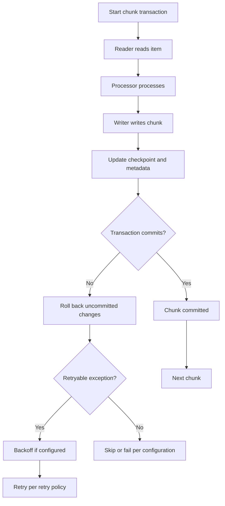

# Rollback and Retry

In Spring Batch, rollback and retry often appear together when a chunk encounters an error, yet they are two distinct mechanisms. **Rollback** undoes uncommitted changes in the current transaction. **Retry** requests re-attempting an operation or unit of work after encountering an exception classified as recoverable. In a chunk step, Spring Batch normally rolls back the failing transaction before continuing according to the retry policy.

For example, a writer inserts a group of orders into a database and hits a deadlock. The chunk's transaction can roll back to release uncommitted changes. If the deadlock belongs to the retryable exception group and attempts remain, Spring Batch retries according to configuration. If the subsequent attempt succeeds, the chunk can commit. If the retry limit is exhausted, the step may fail or handle the exception under a skip policy if that exception is skippable.

Clearly understanding the relationship among rollback, retry, skip, and restart prevents duplicate writes, data loss, and futile retries. In particular, database rollback does not automatically undo HTTP requests, messages, or files written outside the transaction.

## 1. Rollback and Retry Solve Two Different Problems

Rollback is behavior performed by the transaction manager. It returns resources participating in the transaction to their pre-uncommitted-transaction state. Retry is an operation-level error-handling policy: whether to try again, how many times, and how long to wait.

| Mechanism | Question Answered | Example |
|---|---|---|
| Commit | When do changes become confirmed data? | Chunk finishes writing and transaction commits |
| Rollback | If the transaction fails before commit, which changes are discarded? | Inserts in the failing chunk are undone |
| Retry | Which exceptions can be re-attempted? | Database deadlock is retried up to the configured limit |
| Backoff | How long to wait before the next attempt? | Wait 500 ms before retrying |
| Skip | Which failing items are discarded to continue? | Skip a line with an invalid format |
| Restart | If a job execution failed/stopped, how to resume? | Create a new execution for the same JobInstance using saved checkpoints |

Rollback does not mean the job will automatically retry. If an exception is neither retried nor skipped, the step can fail after rollback. Similarly, retry does not guarantee every side effect rolls back: only changes belonging to the rolled-back transaction are undone.

## 2. Transaction Boundaries in a Chunk Step

Chunk-oriented processing divides data into groups of items. With a commit interval of 100, Spring Batch typically processes a chunk of up to 100 items inside one transaction. The reader reads items, the processor transforms or filters them, the writer writes the chunk, streams update checkpoints, and the transaction commits.



When a writer writes data using `JdbcTemplate` with the same `DataSource` and the step's transaction manager, the write statements normally participate in the chunk transaction. If the writer throws an exception before commit, those changes are rolled back.

Previously committed chunks are preserved. For instance, chunks 1 and 2 committed, chunk 3 encounters an error and rolls back: data from chunks 1 and 2 remains intact. Spring Batch does not roll back the entire job as a single transaction.

## 3. What Happens When a Chunk Fails?

Suppose a step has a commit interval of 2 and input consists of items 1 through 6:

| Chunk | Items | Outcome |
|---|---|---|
| 1 | 1, 2 | Writer succeeds; transaction commits |
| 2 | 3, 4 | Writer throws exception; transaction rolls back |
| 3 | 5, 6 | Not yet run if step fails at chunk 2 |

After rollback, the database still contains items 1 and 2. Changes for items 3 and 4 belonging to the rolled-back transaction no longer exist in that database. Depending on retry/skip policies, Spring Batch may retry the chunk or terminate the step.

If chunk 2 is retried and the next attempt succeeds, data for items 3 and 4 is written and committed. If retries are exhausted and the exception is not skipped, the step fails; items 1 and 2 remain committed, while items 3 and 4 are not confirmed.

Point to remember: rollback applies only to the current transaction. Previously committed transactions and non-transactional side effects are not undone just because a later chunk fails.

## 4. Configuring Retry for a Chunk Step

In Spring Batch 5, a fault-tolerant chunk step can configure retryable exceptions, retry limit, and backoff policy via the builder:

```java
@Bean
Step importOrdersStep(
        JobRepository jobRepository,
        PlatformTransactionManager transactionManager,
        ItemReader<Order> reader,
        ItemProcessor<Order, ImportedOrder> processor,
        ItemWriter<ImportedOrder> writer,
        BackOffPolicy retryBackOffPolicy) {

    return new StepBuilder("importOrdersStep", jobRepository)
            .<Order, ImportedOrder>chunk(100, transactionManager)
            .reader(reader)
            .processor(processor)
            .writer(writer)
            .faultTolerant()
            .retry(TransientDataAccessException.class)
            .retryLimit(3)
            .backOffPolicy(retryBackOffPolicy)
            .build();
}
```

In this example:

- `.faultTolerant()` enables fault-tolerance configuration for the chunk step.
- `.retry(TransientDataAccessException.class)` marks this exception as retryable.
- `.retryLimit(3)` bounds attempt counts per the semantics of the Spring Batch/Spring Retry version in use.
- `.backOffPolicy(...)` defines the wait interval between retry attempts.

When designing operations, distinguish the initial attempt from retry attempts and verify retry-limit semantics for your project's dependency versions. When estimating maximum runtime, account for processing time across attempts plus total backoff duration.

Only retry exceptions likely to resolve on their own. Deadlocks, transient connection errors, or certain HTTP 429/5xx responses may qualify. Data errors such as malformed amounts or nonexistent customer IDs usually will not disappear on retry.

## 5. Classifying Exceptions: retry, noRetry, skip, and noSkip

Do not retry every exception. A step should specify which errors are retried and which are handled via skip or failure.

Example:

```java
@Bean
Step importPaymentsStep(
        JobRepository jobRepository,
        PlatformTransactionManager transactionManager,
        ItemReader<Payment> reader,
        ItemWriter<Payment> writer,
        BackOffPolicy retryBackOffPolicy) {

    return new StepBuilder("importPaymentsStep", jobRepository)
            .<Payment, Payment>chunk(50, transactionManager)
            .reader(reader)
            .writer(writer)
            .faultTolerant()
            .retry(TransientDataAccessException.class)
            .noRetry(InvalidPaymentException.class)
            .retryLimit(3)
            .backOffPolicy(retryBackOffPolicy)
            .skip(InvalidPaymentException.class)
            .skipLimit(100)
            .noSkip(FatalConfigurationException.class)
            .build();
}
```

Meaning:

- Transient data-access errors can be retried.
- `InvalidPaymentException` is not retried because invalid data will not fix itself; if within skip scope and skip limit remains, the item can be skipped per policy.
- Severe configuration errors must not be skipped; the step must fail so operators fix the configuration.

Retry and skip can be combined, but clearly define the desired precedence for each exception type. An exception may be retried first; if it still fails after the limit, a recovery/skip policy can decide whether to discard the item. Never use skip to mask infrastructure or programming errors.

## 6. Retry in Reader, Processor, and Writer

Where an exception arises affects which portion of work may have to re-execute. Reader, processor, and writer have distinct responsibilities:

| Component | Example Error | Considerations on Retry |
|---|---|---|
| Reader | Transient query error, source read failure | Source may have advanced position; requires recoverable reader or proper buffering |
| Processor | Service lookup or validation error | Processor may be re-invoked; should be stateless and avoid side effects |
| Writer | Deadlock, timeout, or write failure | Writer/chunk may be re-executed; requires proper transactions and idempotency |

For non-transactional readers like file readers, Spring Batch provides item buffering in certain fault-tolerant paths to avoid re-reading non-rollbackable sources. For readers backed by transactional queues—where messages return to the queue on transaction rollback—you can configure `readerIsTransactionalQueue()` so the framework follows queue semantics. Enable this option only when the reader truly uses a source capable of rolling back message reception.

If a processor is expensive yet side-effect-free and need not re-run after rollback, `processorNonTransactional()` can instruct Spring Batch to cache processor outputs across rollbacks where appropriate. Use this only when outputs remain valid across retries; if results depend on mutable external data, evaluate consistency carefully.

Do not rely on a component "usually being called only once." When a chunk retries or restarts, the same item may pass through the processor or writer multiple times depending on failure point and configuration. Design components to tolerate re-invocation.

## 7. noRollback: When Not to Roll Back?

`noRollback(...)` allows specifying exceptions that do not cause the chunk transaction to roll back under step policy. This is a specialized option; do not use it merely to make a job appear to continue when the writer has written partial data.

Example declaration:

```java
.faultTolerant()
.skip(InvalidOrderException.class)
.skipLimit(100)
.noRollback(InvalidOrderException.class)
```

Consider `noRollback` only when the exception represents a scenario where changes already executed in the transaction remain valid and safe to commit. For example, a processor detects an invalid item before the writer persists data for that item; if no partial business changes need undoing, skipping rollback may be considered to reduce transaction overhead.

Do not use `noRollback` for writer exceptions after the writer has partially written a chunk. If the transaction commits when only part of the business operations occurred, data may end up inconsistent. For writer errors, rollback is normally essential to preserve chunk atomicity.

If you have not proven the transaction can continue safely, keep default rollback behavior and handle exceptions via retry, skip, or fail per business requirements.

## 8. Retry and Backoff

The retry policy decides whether to retry; the backoff policy decides how long to wait. Example using exponential backoff:

```java
@Bean
BackOffPolicy retryBackOffPolicy() {
    ExponentialBackOffPolicy policy = new ExponentialBackOffPolicy();
    policy.setInitialInterval(500L);
    policy.setMultiplier(2.0);
    policy.setMaxInterval(5_000L);
    return policy;
}
```

The wait interval grows from 500 ms to 1 second, 2 seconds, up to a maximum of 5 seconds. With multiple workers or partitions, randomization/jitter can prevent all workers from retrying simultaneously.

Backoff does not free the worker thread in standard usage; the retrying thread blocks while waiting. If retries must happen after many minutes or hours without holding worker threads, consider queues or schedulers with durable state.

Set retry limits and max intervals according to SLAs. An overly broad retry policy can prolong jobs, hold connections, and increase load on failing dependencies.

## 9. The Transaction Manager Determines Rollback Scope

Rollback only undoes resources participating in the active transaction. Thus, confirm the writer uses the proper transaction manager.

For example, if the step uses `DataSourceTransactionManager` for datasource A while the writer opens an independent connection to datasource B and commits manually, step rollback will not undo data in B.

Points to confirm:

- `JdbcTemplate` uses the same `DataSource` managed by the step's transaction manager.
- JPA repositories and `EntityManager` participate in the corresponding transaction.
- JDBC `Connection` objects are not retained or shared across threads.
- `REQUIRES_NEW` is not used inadvertently to commit an independent sub-operation when full-chunk rollback is required.
- Asynchronous writes are not launched under the assumption that the step transaction will await or roll them back.

If a service uses `@Transactional(propagation = REQUIRES_NEW)`, the inner transaction can commit independently. When the outer chunk transaction rolls back, data committed in the inner transaction remains. That may suit independent audits or logs, but not data that must roll back with the chunk.

## 10. Rollback Does Not Undo External Side Effects

Database transactions do not normally cover HTTP APIs, emails, filesystems, or message brokers. Consider a writer performing two actions:

1. Sending a payment creation request to a partner API.
2. Writing payment status to the database.

If the API processed the request but the application timed out before receiving the response, the database transaction may roll back. On retry, the same item is sent again and the partner could create a second payment unless deduplication exists.

Common solutions:

- **Idempotency key:** derive a stable key from the business transaction ID and resend the same key across retries.
- **Unique constraint/ledger:** record transactions with unique business keys so the same effect is never applied twice.
- **Transactional outbox:** write business data and outbox events in the same transaction; a publisher sends events after commit.
- **Inbox/deduplication:** consumers persist processed event IDs so message redelivery does not reapply side effects.
- **Reconciliation:** when a timeout leaves an outcome ambiguous, query status from the external system before deciding to resend.

Retry improves recoverability; idempotency protects correctness when operations are re-invoked. Both mechanisms must be designed together.

## 11. Example Writer Persisting to Database and Failing

The following example illustrates a writer inserting rows via `JdbcTemplate` and then throwing an exception simulating a transient error. When `JdbcTemplate` participates in the step's transaction, the attempt's inserts roll back if the exception triggers transaction rollback.

```java
@Bean
ItemWriter<ImportedOrder> importedOrderWriter(
        JdbcTemplate jdbcTemplate,
        FailureSwitch failureSwitch) {

    return chunk -> {
        for (ImportedOrder order : chunk.getItems()) {
            jdbcTemplate.update(
                    "insert into imported_order(order_id, amount) values (?, ?)",
                    order.orderId(),
                    order.amount());
        }

        if (failureSwitch.shouldFail()) {
            throw new TransientDataAccessException("Temporary write failure") {};
        }
    };
}
```

`FailureSwitch` is an example/test component allowing controlled failures. When the exception occurs:

- The chunk transaction rolls back if the exception is configured to roll back.
- Inserts within the same transaction are not committed.
- If the exception is retryable and attempts remain, Spring Batch retries per the retry policy.
- When an attempt succeeds, the writer writes again and the chunk commits.
- If retries are exhausted, the step may fail or follow a skip policy.

For this example to work as intended in an application, `JdbcTemplate` must use a datasource managed by the same transaction manager passed to `.chunk(...)`. Using a different transaction manager or auto-commit connections alters rollback behavior.

## 12. Retry and Restart Occur at Different Times

Retry typically occurs within the same `JobExecution` when an operation fails and policy permits re-attempting. Restart occurs after a job execution has failed or stopped; Spring Batch creates a new execution for the same `JobInstance` when identifying `JobParameters` match and the state permits restarting.

| Criterion | Retry | Restart |
|---|---|---|
| Timing | During current step execution | After a prior execution failed/stopped |
| Execution | Usually within the same JobExecution/StepExecution | New JobExecution for the same JobInstance |
| Goal | Recover from transient operation failure | Resume job from saved state |
| State used | Retry context/policy and active chunk state | JobRepository, ExecutionContext, and committed checkpoints |
| Example | Retry writer after deadlock | Re-run job after application stopped |

If retries are exhausted and the step fails, operators can restart the job. On restart, a state-saving reader reopens from the latest committed checkpoint. Uncommitted chunks can be reprocessed.

Restart requires identical identifying `JobParameters` to resume the right `JobInstance`. Adding a new timestamp or UUID creates a new instance and starts from the beginning under a new scope.

## 13. Checkpoints and Rollback

In a chunk step, `ItemStream.update(ExecutionContext)` is typically called at checkpoint boundaries before the chunk transaction completes. Spring Batch persists execution context and metadata through `JobRepository` according to the configured transaction mechanism.

If the chunk commits successfully, the new checkpoint becomes durable state. If the chunk rolls back, the new checkpoint is not confirmed in that transaction; restart uses the previously committed checkpoint.

Example reader storing the last key:

```java
@Override
public void update(ExecutionContext context) {
    context.putLong("orderReader.lastId", lastCommittedId);
}
```

The reader must ensure `lastCommittedId` reflects confirmed progress, not merely the last item read in memory. If the cursor advances past uncommitted items and gets saved at the wrong moment, a restart may miss items.

For standard readers such as `FlatFileItemReader` or JDBC paging readers, enable state saving and keep input data stable. For custom readers, test both in-execution rollback and restart after JVM restart.

## 14. Transactional Readers and Buffering

Not all read sources can roll back. A file reader cannot ask the filesystem to "put back" a read line the way a transactional queue can. Therefore, fault-tolerant chunk processing must handle re-reading items after rollback.

For non-transactional readers, Spring Batch can buffer already-read items to reuse on chunk rollback instead of re-reading from the source. For transactional queue readers—such as a reader receiving messages in a transaction where messages return to the queue on rollback—you can configure `readerIsTransactionalQueue()` so the framework avoids buffering in a manner unsuitable for that source.

Use the transactional queue option only when the source genuinely supports rolling back message reception. Misconfiguration can cause items to be re-read or lost with unintended semantics.

## 15. Retry in the Processor and processorNonTransactional

Processors should generally be stateless and free of side effects. When a chunk rolls back, the processor may be called again for items in the chunk depending on failure location and retry setup.

If the processor is a deterministic transformation and re-invocation is inexpensive, letting the framework handle it by default is usually clearest. If the processor is non-transactional, has no side effects, and its output stays valid across rollbacks, `.processorNonTransactional()` can ask the framework to cache processor results instead of re-invoking in certain retry paths.

```java
return new StepBuilder("processOrdersStep", jobRepository)
        .<OrderInput, Order>chunk(100, transactionManager)
        .reader(reader)
        .processor(processor)
        .writer(writer)
        .faultTolerant()
        .processorNonTransactional()
        .retry(TransientDataAccessException.class)
        .retryLimit(3)
        .build();
```

Use this option only after confirming processor output remains valid across retries. If the processor looks up mutable data or performs side effects, caching output can yield stale results or cause business discrepancies.

## 16. Retry, Skip, and Recovery Callbacks

When a retryable exception keeps occurring until the limit is reached, the framework must decide the next outcome. If the exception is also declared skippable and skip limit has not been exceeded, the item can be skipped per policy. Otherwise, the step fails.

A `SkipListener` can record skipped items and causes:

```java
public class ImportSkipListener implements SkipListener<OrderInput, Order> {

    @Override
    public void onSkipInRead(Throwable throwable) {
        log.warn("Skipped item while reading", throwable);
    }

    @Override
    public void onSkipInProcess(OrderInput item, Throwable throwable) {
        log.warn("Skipped order {} during processing: {}",
                item.orderId(), throwable.toString());
    }

    @Override
    public void onSkipInWrite(Order item, Throwable throwable) {
        log.warn("Skipped order {} during writing: {}",
                item.orderId(), throwable.toString());
    }
}
```

In production applications, persist skip details to an error table or queryable store rather than logging alone. Ensure error recording aligns with transactions and does not produce duplicate side effects on retry.

Skip is not the default fix for infrastructure failures. If the database loses connectivity or a payment API is unavailable, skipping items can drop business records. Skip only when business requirements allow excluding those items from the current batch with an explicit reprocessing workflow.

## 17. Retry Policy and Retry State

Some errors can only be retried safely when the framework remembers item or operation state across attempts. For example, a database write error may roll back the transaction; the subsequent retry needs to know the same item/chunk is being processed to apply the right policy.

Spring Batch integrates Spring Retry in fault-tolerant steps. The retry policy classifies exceptions, bounds attempts, and can apply a `BackOffPolicy`. During design, check:

- Is the exception genuinely transient?
- Does retry apply at the reader, processor, or writer?
- Does the error roll back the transaction or is it marked `noRollback`?
- Does the operation have side effects before throwing?
- Can the item be stably identified across attempts?
- Does retry context need to preserve state across transaction boundaries?

Do not store retry counters manually in a singleton field. That field is not durable across restarts and can be shared incorrectly across threads. Use the framework's retry policy/context; if business history tracking is needed, persist data separately with stable keys.

## 18. Idempotency Is Essential When Retrying

An idempotent writer can be called repeatedly without creating additional business effects. This is especially crucial when the writer may have executed a side effect before failing.

Common techniques:

- Use unique constraints on business keys.
- Use deterministic upserts rather than blind increments.
- Insert ledger entries with unique transaction IDs rather than adding balances multiple times.
- Send stable idempotency keys to external APIs.
- Use an outbox to publish messages post-commit and an inbox to deduplicate at consumers.
- Reconcile state when timeouts leave external operation outcomes ambiguous.

For example, if a writer updates a balance via `balance = balance + amount`, retrying the same item could add money twice. Instead, record a transaction with a unique `transaction_id` and apply that transaction only once.

## 19. Testing Rollback and Retry

Tests must prove both transaction behavior and retry policies. Mocking the writer only verifies an exception is thrown; it does not prove the database rolled back. For transaction tests, use a test database with a real transaction manager and inspect data after running the job.

Important scenarios:

1. **Normal commit:** writer succeeds; data persists after the chunk commits.
2. **Rollback:** writer writes partially then throws; data from the chunk transaction is absent after rollback.
3. **Preserving prior chunks:** previously committed chunks remain when a later chunk fails.
4. **Successful retry:** writer fails transiently once or more then succeeds; final result has no duplicates.
5. **Retries exhausted:** all attempts fail; step ends in expected status and data contains only committed chunks.
6. **Skip after retry:** exception matches skip policy; item is skipped and recorded accurately.
7. **NoRollback:** test only when a specific business case proves the transaction can continue safely.
8. **Restart:** after step failure, rerun with the same identifying `JobParameters`; reader resumes from the committed checkpoint.
9. **Non-database side effects:** simulate API succeeding while client times out; retrying with the same idempotency key creates no second transaction.
10. **Multiple workers:** confirm retry/backoff does not cause retry storms or race conditions.

Example test writer using a switch to fail after the first write:

```java
class FailOnceWriter implements ItemWriter<ImportedOrder> {

    private final JdbcTemplate jdbcTemplate;
    private final AtomicBoolean failNext = new AtomicBoolean(true);

    FailOnceWriter(JdbcTemplate jdbcTemplate) {
        this.jdbcTemplate = jdbcTemplate;
    }

    @Override
    public void write(Chunk<? extends ImportedOrder> chunk) {
        for (ImportedOrder order : chunk.getItems()) {
            jdbcTemplate.update(
                    "insert into imported_order(order_id, amount) values (?, ?)",
                    order.orderId(), order.amount());
        }

        if (failNext.compareAndSet(true, false)) {
            throw new TransientDataAccessException("Fail once for test") {};
        }
    }
}
```

When attaching this writer to a fault-tolerant step configured to retry `TransientDataAccessException`, the first attempt throws after the inserts; the transaction rolls back. The next retry inserts again and completes. The test must verify the final row count is accurate with no duplicate records.

To test restart rather than in-execution retry, make the step fail after exhausting retries, then rerun with identical identifying parameters against a persistent `JobRepository`. Do not wipe metadata between the two runs. Use an `ItemStream`-capable reader to verify the checkpoint is restored.

## 20. Reading Metadata to Understand Rollback/Retry

`StepExecution` provides useful counters:

| Property | Meaning |
|---|---|
| `readCount` | Number of items read per step metadata |
| `writeCount` | Number of items written per step metadata |
| `filterCount` | Number of items filtered by processor |
| `readSkipCount` | Number of items skipped during read |
| `processSkipCount` | Number of items skipped during processing |
| `writeSkipCount` | Number of items skipped during write |
| `commitCount` | Number of recorded commits |
| `rollbackCount` | Number of recorded rollbacks |
| `BatchStatus` | Execution status of the step |
| `ExitStatus` | Exit code and outcome description |

Counters assist investigation, but do not substitute for checking business data. For instance, `writeCount` does not prove an external API succeeded or that no duplicate side effects occurred. When retry, skip, and rollback are involved, inspect logs/metrics alongside actual data to accurately explain outcomes.

## 21. Common Mistakes

**Assuming rollback automatically triggers retry.** Rollback only undoes the transaction. Re-attempting requires the exception to be classified retryable with remaining attempts.

**Retrying every exception.** Validation errors or programming bugs will not self-heal. Retry only justified transient failures.

**Assuming retry needs no rollback.** For database write errors, the transaction usually must roll back before retrying so partial changes are not retained.

**Using `noRollback` for writer errors after partial writes.** This can preserve incomplete data. Use noRollback only when the transaction remains safe to continue.

**Enabling retry without an idempotent writer.** The same item may create duplicate transactions or messages. Use business keys, idempotency keys, or outbox/inbox patterns.

**Confusing retry with restart.** Retry happens within a step execution; restart creates a new `JobExecution` for the same `JobInstance` using saved checkpoints.

**Assuming database rollback undoes files or APIs.** Side effects outside the transaction require separate recovery mechanisms.

**Not verifying the transaction manager.** A writer using a different datasource or transaction manager may commit independently and fail to roll back with the chunk.

**Not testing previously committed chunks.** When a later chunk fails, data already committed earlier must still remain.

**Checking only BatchStatus.** Verify actual data, checkpoints, retry/skip counters, and real side effects.

## 22. Workflow for Designing Rollback and Retry

When a step requires retry, define in order:

1. Identify transaction boundaries: chunk or single tasklet call.
2. Identify which resources truly participate in the transaction manager.
3. List potential exceptions and classify transient, data, and configuration errors.
4. Select retryable exceptions and set a bounded retry limit.
5. Choose appropriate backoff with max interval and jitter if multiple workers retry together.
6. Decide which exceptions are skippable and set a skip limit.
7. Use `noRollback` only with proof that the transaction remains safe to commit.
8. Verify whether the reader can replay items or restore checkpoints after rollback.
9. Verify whether processor/writer have side effects and are idempotent.
10. Test rollback, successful retry, exhausted retries, skip, and restart against a real database.
11. Monitor commit/rollback/retry counts, backoff durations, and dependency failures in production.

## Conclusion

Rollback and retry work together to help chunk steps recover from transient failures. Rollback undoes uncommitted changes in the current transaction; retry determines whether to re-attempt the operation with defined limits and wait intervals. If retry succeeds, the chunk can commit; if retries are exhausted, the step fails or handles the exception under the configured skip policy.

Classify exceptions accurately, use a transaction manager covering database operations that must be atomic, keep readers recoverable, and ensure writers are idempotent when items are re-invoked. `noRollback` fits only cases where the transaction stays safe to continue. For external APIs, files, and messages outside the transaction, rely on idempotency keys, outbox/inbox patterns, or reconciliation. Testing commit, rollback, retry, skip, and restart separately ensures batch jobs maintain consistent data when failures occur.
