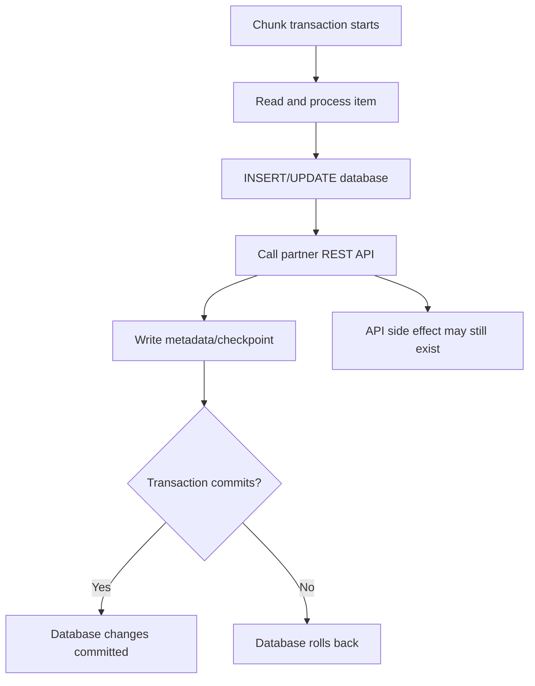
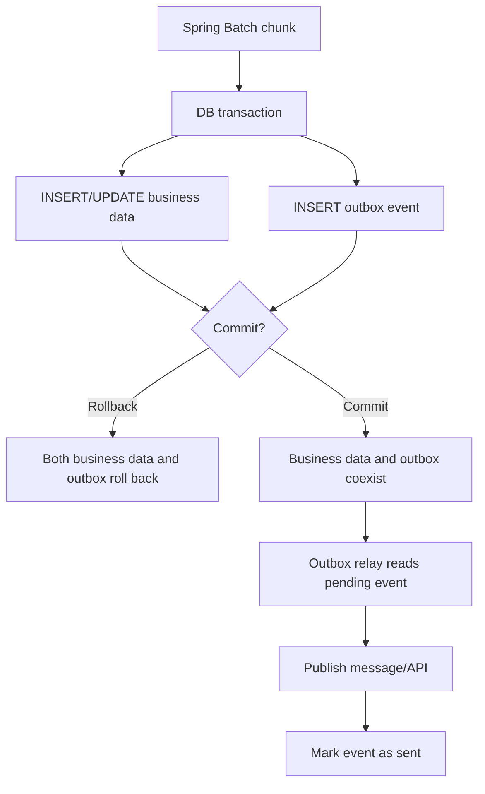
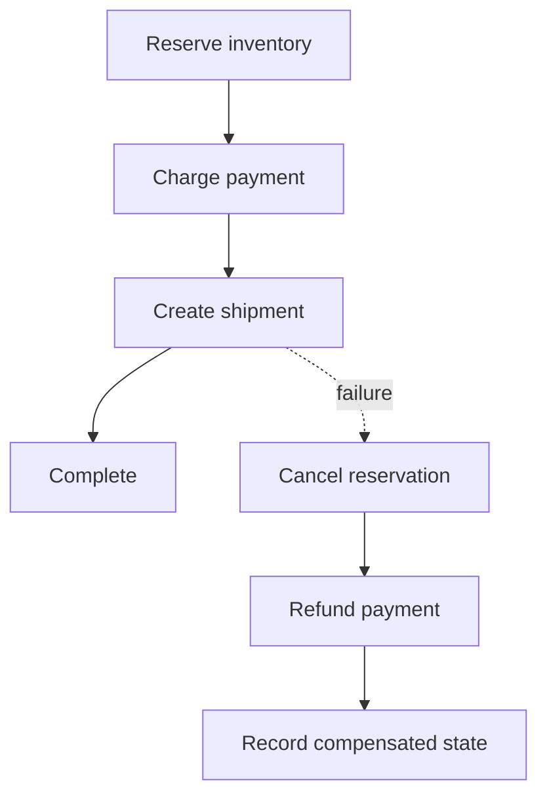

# Rolling Back Side Effects Outside the Database

In Spring Batch, a chunk's transaction normally protects operations on the database and metadata participating in the same transaction manager. However, a step may simultaneously call REST APIs, send messages, send emails, write files, or update another system. Those operations generally lie outside the chunk's database transaction.

Therefore, when a chunk rolls back, the database may return to its pre-transaction state while external side effects remain. For example, a writer sends an invoice-creation request to a partner, the partner creates the invoice, and then a database write in the chunk fails. Rollback only undoes database data participating in the transaction; it does not automatically retract the invoice the partner already created.

This is one of the key limitations of transactions in batch processing. To handle this safely, design side effects to be re-runnable, reconcilable, or compensable. For events that must be emitted alongside database changes, a transactional outbox is often an appropriate choice.

## 1. Why Does Database Rollback Not Undo Every Side Effect?

A database transaction managed by `PlatformTransactionManager` controls only resources enlisted in that transaction. With JDBC, SQL statements using connections managed by the transaction manager can commit or roll back together.

However, the following operations typically lie outside the database transaction:

- Calling a partner's HTTP API.
- Sending emails or SMS.
- Sending messages to a broker.
- Writing files to a filesystem or object storage.
- Calling payment, shipping, or resource-provisioning services.
- Writing data to another database with an independent transaction manager.

An HTTP request already processed by a server cannot be retracted by a database rollback. An email already accepted by a mail server cannot be deleted from the recipient's inbox by rolling back SQL. A file already written to a filesystem does not automatically vanish when a database transaction fails.

You can visualize the boundary like this:



If the API performed an operation before the chunk rolled back, the database and the external system may drift out of sync. The application must have a way to recover from that discrepancy.

## 2. Transaction Boundaries in Spring Batch

In a chunk-oriented step, Spring Batch normally manages one transaction per chunk. The reader reads items, the processor processes items, and the writer writes the chunk; when processing succeeds, the framework updates necessary state/metadata and commits the transaction as configured.

If the writer throws an exception before commit, the chunk transaction can roll back. Database changes participating in that transaction are undone. Previously committed chunks remain intact.

This does not create a single transaction spanning every system the job calls. If the writer performs both SQL and HTTP calls, SQL can roll back while the HTTP call has already taken effect.

Example:

1. A chunk of 100 orders starts a transaction.
2. The writer inserts 100 rows into the `orders` table.
3. The writer sends shipment-creation requests to the shipping system.
4. The shipping system creates shipments for the 100 orders.
5. A subsequent SQL statement or metadata update raises an error.
6. The database transaction rolls back.
7. Shipments in the shipping system still exist, while the chunk's `orders` rows may be gone.

When the chunk is retried or the job restarts, shipment-creation requests may be sent again. If the shipping system lacks idempotency support, a single order may end up with multiple shipments.

## 3. Common Side Effects Outside the Database

| Side Effect | Why It Does Not Roll Back with DB | Risk on Retry |
|---|---|---|
| Payment creation REST API | Partner server manages its own transaction | Double-charging or creating two transactions |
| Shipment creation API | Data is already persisted in the shipping system | Creating multiple shipments |
| Sending email/SMS | Message was already accepted by the mail/SMS provider | Users receive duplicate or inaccurate notifications |
| Publishing messages | Broker accepted the message in its own transaction | Consumers receive duplicate messages |
| Writing files | Filesystem does not participate in JDBC transactions | Orphaned files, duplicate files, or incomplete contents |
| Writing object storage | Object was uploaded independently | Unreferenced objects or repeated uploads |
| Calling another service | Target service commits independently | Two systems have mismatched states |

Not every side effect requires the same strategy. Sending email may tolerate at-least-once delivery with a reference ID in the message; payments generally require stricter idempotency and reconciliation. Report files can be written to a staging area and published later.

## 4. Dangerous Scenario: Request Succeeds While Client Times Out

A particularly tricky case occurs when the client cannot tell whether the external operation actually happened.

Example:

1. The writer sends `POST /payments`.
2. The payment service receives the request and creates the transaction successfully.
3. The response is lost due to a network timeout.
4. The writer receives an exception and Spring Batch rolls back the chunk.
5. A retry resends `POST /payments`.
6. If the payment service does not recognize duplicate requests, the customer may be charged twice.

A timeout does not prove the server failed to execute the operation. It only indicates the client did not receive a result within the allotted window.

In this situation, before retrying, you need a mechanism to determine whether resending the request is safe. Common approaches include idempotency keys, querying status by business reference, or reconciling against the target system.

## 5. Do Not Arbitrarily Call External Services Inside a Transaction

Calling slow APIs inside a database transaction keeps the transaction open longer. While waiting on the network, database connections and locks may remain held. This increases lock waits, deadlocks, connection pool pressure, and rollback duration.

Example of a writer executing sequentially:

```java
@Override
public void write(Chunk<? extends OrderRecord> items) {
    for (OrderRecord item : items) {
        jdbcTemplate.update(
                "insert into orders(order_id, amount) values (?, ?)",
                item.id(), item.amount());

        shippingClient.createShipment(item.id());
    }
}
```

This code carries risk: the database insert and HTTP call are not in the same transaction. If the API succeeds and a later insert fails, database rollback does not cancel the shipment. If the writer retries, the API may be called again.

Moreover, if the API is slow, the chunk transaction may hold a connection for the entire wait time. With high item volumes, the job can exhaust the connection pool.

Separate writing data from emitting side effects into recoverable steps, or use an outbox to persist event-emission intent in the same database transaction and handle dispatching separately.

## 6. TransactionSynchronization.afterCommit

Spring transaction synchronization allows registering a callback to run after the transaction commits successfully. This is useful for lightweight post-commit actions, such as waking up a process or recording a metric.

Example:

```java
if (TransactionSynchronizationManager.isSynchronizationActive()) {
    TransactionSynchronizationManager.registerSynchronization(
            new TransactionSynchronization() {
                @Override
                public void afterCommit() {
                    notificationPublisher.publish(orderId);
                }
            });
}
```

The `afterCommit()` callback runs only after the transaction has committed successfully. If the transaction rolls back, this callback is not invoked.

However, this is not a durable event-delivery guarantee:

- The process may crash after the database commits but before the callback runs.
- The callback may run while the request to the external system fails.
- If the callback fails, the already-committed transaction cannot be rolled back retroactively.
- If the application retries the callback manually, the side effect may execute multiple times.

Therefore, `afterCommit` suits best-effort actions or waking a relay that already has durable data. When events must never be lost on process crash, persist the event intent in the same transaction using an outbox.

## 7. Transactional Outbox Bridges the Gap Between DB and Messaging

The transactional outbox is a design pattern that writes business data and an event record in the same database transaction. A separate relay process reads unpublished outbox records and publishes them to the broker or target service.

Because the business record and outbox record commit in the same transaction, they succeed together or roll back together within that database.



An outbox does not turn the database and broker into a distributed transaction. It creates a durable source of truth in the database so the relay can retry delivery if errors occur.

### Example Outbox Table

```sql
create table outbox_event (
    event_id       varchar(100) primary key,
    aggregate_id   varchar(100) not null,
    event_type     varchar(100) not null,
    payload        text not null,
    created_at     timestamp not null,
    published_at   timestamp null,
    attempt_count  integer not null default 0
);
```

Data type names and syntax may require adjustment per database. `event_id` is the stable identifier of the event; `published_at` indicates the relay recorded delivery; `attempt_count` supports retry tracking.

### Writing the Outbox in the Writer

```java
public class OrderWriter implements ItemWriter<OrderRecord> {

    private final JdbcTemplate jdbcTemplate;

    public OrderWriter(JdbcTemplate jdbcTemplate) {
        this.jdbcTemplate = jdbcTemplate;
    }

    @Override
    public void write(Chunk<? extends OrderRecord> chunk) {
        for (OrderRecord order : chunk) {
            jdbcTemplate.update(
                    "insert into orders(order_id, amount) values (?, ?)",
                    order.id(), order.amount());

            jdbcTemplate.update(
                    "insert into outbox_event(event_id, aggregate_id, event_type, payload, created_at) " +
                    "values (?, ?, ?, ?, current_timestamp)",
                    "order-created:" + order.id(),
                    order.id(),
                    "ORDER_CREATED",
                    serialize(order));
        }
    }

    private String serialize(OrderRecord order) {
        // Serialize event to JSON using the application's serializer.
        return "{\"orderId\":\"" + order.id() + "\"}";
    }
}
```

The example assumes `JdbcTemplate` uses the chunk's datasource and transaction manager. If inserting either the business row or the outbox row fails, both can roll back in the same transaction.

In production code, use a proper JSON serializer instead of manual string concatenation, validate payload sizes, and ensure `event_id` is stable and unique.

### Relay Publishing the Outbox

A separate process can fetch unpublished events, send them to the broker, and then update `published_at`. The relay must handle cases where publishing succeeded yet the process stopped before updating the status.

In that case, the event may be sent again. Therefore, consumers must be idempotent or record processed `event_id` values to deduplicate messages. Outboxes typically provide at-least-once guarantees; consumer deduplication achieves effectively-once processing at the business layer.

## 8. Idempotency Keys for External APIs

An idempotency key is a stable token representing one business operation. The client sends the same key on every attempt of the same operation. The server stores the result tied to that key and does not re-execute the side effect when receiving a duplicate request.

Example:

```http
POST /payments
Idempotency-Key: payment-order-84721
Content-Type: application/json
```

If the server created the payment on the first attempt but the response was lost, the retry sends the same `Idempotency-Key`. The server can return the already-created payment's result instead of creating a new payment.

The key must be:

- Stable across retries and restarts.
- Representative of a specific business action, such as paying for a specific order version.
- Never randomly regenerated on each attempt.
- Uniquely scoped appropriately for the target API.
- Persisted or deterministically reconstructed from durable data so restarts reuse the exact same key.

Do not share one key across an entire chunk if the API processes each item independently, because distinct operations could be mistaken for the same request. Conversely, do not generate a fresh random UUID on every retry because the server will treat each attempt as a brand-new operation.

## 9. Idempotent Consumers and Preventing Duplicate Messages

Even when a publisher uses an outbox, the relay can still send the same event multiple times. Consumers need a way to detect already-processed messages.

A common pattern is an inbox/dedup table:

```sql
create table processed_message (
    consumer_name varchar(100) not null,
    event_id      varchar(100) not null,
    processed_at  timestamp not null,
    primary key (consumer_name, event_id)
);
```

The consumer processes inside one transaction:

1. Attempt to insert `(consumer_name, event_id)` into the processed-message table.
2. If the insert succeeds, apply the business changes.
3. Commit both the marker and the business changes in the same transaction.
4. If a unique constraint indicates the event was already processed, skip the business changes and acknowledge the message per broker mechanics.

If the marker and business changes do not share a transaction, the consumer can still drop or duplicate side effects. Ensure they commit atomically in the consumer's database.

## 10. Writing Files Outside the Database Transaction

File writing is a common side effect in batch jobs. A JDBC transaction cannot roll back bytes already written to a filesystem. If a step writes part of a file and then fails, the file may exist in an incomplete state.

A safer approach uses staging files:

1. Write output to a temporary file named specifically for the job instance or execution.
2. Close the stream and confirm writing finished.
3. Verify file size, checksum, or structure.
4. After related database data has committed and the process is verified, publish the file via an appropriate rename/move operation.
5. Record publish state so recovery processes know which files were already published.

Example filenames:

```text
reports/
  staging/
    daily-orders-2026-11-15-run-501.tmp
  published/
    daily-orders-2026-11-15.csv
```

If the filesystem supports atomic renames within the same filesystem, moving the temporary file to the final name makes readers see a complete file rather than in-progress writes. An atomic rename does not share a transaction with the database; crashes can still occur between the rename and metadata updates.

For recovery:

- Use unique staging names deterministically derivable from job parameters.
- Record checksum/size to verify generated files.
- If the destination file already exists, compare metadata before deciding to overwrite.
- Have a cleanup step for orphaned temporary files.
- Maintain durable publish status so move operations can be retried idempotently.

Do not write directly to the final destination file while chunks can still roll back. External readers may observe partial files or data from a failed run.

## 11. Sending Emails and SMS

Emails and SMS messages generally cannot be retracted once accepted by the provider. If sent directly inside `ItemProcessor`, `ItemWriter`, or a listener before commit, the job may send notifications about a database change that subsequently rolls back.

Unsafe example:

```java
public OrderRecord process(Order order) {
    OrderRecord record = map(order);
    emailClient.sendConfirmation(record.customerEmail());
    return record;
}
```

If the processor is retried, the email may be sent multiple times. If the chunk rolls back, the email may still reach the recipient even though the order never committed.

Write notification requests to an outbox within the same transaction as the business changes. A separate notification worker reads the outbox, sends emails/SMS, and updates status. Message content should carry a business reference or idempotency key if the provider supports it.

If post-commit best-effort delivery is acceptable, use an `afterCommit` callback to wake a worker or send non-critical notices. For notifications that must never be lost, persist a durable record so sending can resume after crashes.

## 12. Compensation: Business Actions Instead of Rollback

When an external side effect has occurred, sometimes operational history cannot be erased. The system must execute an inverse business action called **compensation**.

Examples:

| Side Effect Already Occurred | Possible Compensating Action |
|---|---|
| Inventory reserved | Cancel reservation |
| Payment captured | Issue refund transaction |
| Shipment created | Cancel shipment if not yet handed over |
| Access granted | Revoke access |
| Incorrect notification sent | Send corrective notification if appropriate |

Compensation is not a technical rollback. It is a new business action that can itself fail and require its own retries. For example, a refund may be rejected or the payment service may be temporarily unavailable.

In multi-step workflows, this can be modeled as a saga:



Spring Batch can orchestrate steps performing forward actions and compensation. The application must persist each action's state so compensation can resume after restarts without executing twice.

Not every side effect has a perfect compensating action. A sent email cannot be pulled out of an inbox; a delivered shipment may not be cancellable. Define business policies for irreversible cases.

## 13. Choosing a Strategy by Side-Effect Type

| Operation Type | Usually Suitable Strategy | Notes |
|---|---|---|
| Updating the step's same database | Same transaction manager | Rollback can undo changes |
| Sending durable messages | Transactional outbox | Relay and consumers must be idempotent |
| Calling an idempotent API | Stable idempotency key | Reuse the key across retries/restarts |
| Calling a non-idempotent API | Business reference, status query, reconciliation, or compensation | Timeouts produce ambiguous outcomes |
| Writing large files | Staging file, checksum, publish/rename, and cleanup | Filesystem does not share DB transaction |
| Sending emails/SMS | Notification outbox and separate worker | Do not send directly before commit |
| Multiple business systems | Saga/compensation and durable state | No global atomic rollback |

Choose strategies based on the criticality of the side effect. A metric or log may tolerate losing an event; payments, orders, or legal notices usually demand stronger durability and reconciliation.

## 14. Listeners Do Not Guarantee Side Effects Happen Only After Commit

Spring Batch provides listeners such as `ItemWriteListener`, `ChunkListener`, and `StepExecutionListener`. Understand callback timing before placing side effects inside them.

- `ItemWriteListener.afterWrite` is called after the writer method returns, yet the chunk transaction can still roll back at a later stage.
- `ChunkListener.afterChunk` is tied to a chunk completing successfully after commit under the standard chunk lifecycle.
- `afterStep` runs when the step ends; it is not a transaction callback guaranteeing all non-database side effects committed alongside data.
- `JobExecutionListener.afterJob` runs when the job ends, yet the process can still stop before or during the callback.

Even post-commit callbacks have a crash window: the database may have committed while the process terminates before the side effect is emitted. Therefore, listeners suit metrics, logging, or waking a relay; an outbox is better when events must not be dropped.

Do not send emails or invoke payment APIs inside `afterWrite` under the assumption that the transaction is guaranteed to commit. If the commit subsequently fails, the side effect remains.

## 15. Can XA or Distributed Transactions Be Used?

Some systems support XA/JTA to coordinate transactions across multiple resources capable of participating in distributed transactions. However, REST APIs, email providers, filesystems, and many message brokers do not support XA. Distributed transactions also increase operational complexity, hold resources longer, and introduce bottlenecks.

Do not assume that merely configuring another transaction manager will make every side effect roll back alongside the database. Verify whether each resource supports enlistment, protocols, and recovery under the transaction coordinator.

In many systems, outboxes, idempotency, and compensation are easier to operate than trying to build one atomic transaction spanning databases, brokers, and HTTP services.

## 16. Designing Writers So Side Effects Are Recoverable

A well-designed writer should focus on writing data to transaction-managed resources. When external side effects are required, persist the intent to perform them in a durable structure within the same transaction.

For example, a writer can:

1. Insert the order into the `orders` table.
2. Insert an `ORDER_CREATED` event into `outbox_event`.
3. Return so Spring Batch commits the chunk.
4. Have an independent relay send the event to the shipping system.

This way, if the chunk rolls back, both the order and outbox event roll back. If the chunk commits and the relay stops, the event stays in the outbox and can be delivered once the relay recovers.

If architectural constraints force the writer to call an external API directly, you must:

- Generate a stable idempotency key per item.
- Record request and response states in durable storage.
- Treat timeouts as uncertain outcomes, not guaranteed failures.
- Provide status lookup or reconciliation operations.
- Ensure retries do not create duplicate side effects.

## 17. Testing Rollback and Non-Database Side Effects

Unit tests that merely mock a service throwing an exception are not enough to prove rollback. Verify both database state and external systems or fake servers.

### Testing Database Rollback While API Side Effects Persist

An integration test can simulate:

1. A tasklet/writer inserts a record into the test database.
2. It calls a fake HTTP server, which records the incoming request.
3. It throws an exception before the chunk commits.
4. Assert the database contains no record due to transaction rollback.
5. Assert the fake server still shows the request was received.

This test demonstrates the transaction boundary: database rollback does not retract the HTTP request.

### Testing Outboxes

Verify these scenarios:

- Business row and outbox row commit together.
- When the writer throws an exception, both roll back together.
- The relay publishes an event successfully and crashes before marking published; the next run may send a duplicate.
- The consumer receives duplicate events yet applies business changes only once thanks to deduplication.
- Repeatedly failing events are recorded and have suitable retry/dead-letter policies.

### Testing File Staging

- Writer creates a temporary file and the step fails before publish.
- Final destination file does not appear yet.
- Restart can detect the temporary file or recreate it safely.
- If the move occurred before a crash, a rerun recognizes the destination file via checksum and avoids invalid duplicates.

### Testing Compensation

- Primary side effect succeeds.
- Downstream step fails.
- Compensation runs and compensating state is persisted.
- If compensation fails, the job can restart and retry without compensating twice.

Run these tests with transaction managers and resources matching the real environment. Mocks do not fully simulate database or broker commit/rollback semantics.

## 18. Monitoring and Reconciling When Rollbacks Occur

When a chunk rolls back while non-transactional side effects may have occurred, retain enough data to determine which operations executed.

Record or log:

- Job name, `JobExecution` ID, and `StepExecution` ID.
- Chunk/business keys and item IDs.
- Idempotency keys or event IDs.
- Target system names and operation types.
- Request timestamps, received responses, and exceptions.
- Outbox or compensation status.
- Database state after rollback/restart.

Do not log tokens, passwords, or sensitive payloads. Use correlation IDs to trace details in target systems.

A reconciliation workflow can compare:

- Business records committed in the database.
- Requests or events accepted by external systems.
- Outbox events unsent or not yet marked completed.
- Pending or failed compensations.

Reconciliation is especially vital when APIs time out because the client does not know whether the request executed.

## 19. Common Design Mistakes

| Mistake | Consequence | Fix |
|---|---|---|
| Calling API before DB commits | API takes effect even if DB rolls back | Use outbox or idempotency and reconciliation |
| Sending emails in processor | Retries can send duplicates; rollback cannot retract emails | Write notification intent to outbox |
| Writing directly to final file | Partial file may be read by others | Write staging file then publish after confirmation |
| Using `afterCommit` as durability | Crash after commit can lose events | Persist events in outbox in same transaction |
| Generating new idempotency key per retry | Target system treats each retry as a new operation | Use stable key tied to business operation |
| Assuming timeout means request did not run | Retries can create duplicate transactions | Query status or resend with same idempotency key |
| Relying on rollback to compensate external systems | External side effects persist | Design business compensation |
| Retrying non-idempotent side effects | Duplicate payments, shipments, or messages | Use dedup, unique keys, outbox, and idempotent consumers |
| Treating XA as a universal solution | Non-XA resources still do not roll back | Verify resource capabilities; prefer patterns like outbox |
| Lacking reconciliation | DB and external system state drift goes undetected | Build reconciliation and alerting |

## 20. Workflow When a Chunk Rolls Back After a Side Effect

When discovering a chunk rolled back while a side effect may have occurred, proceed in sequence:

1. **Identify the chunk and item:** gather job/step execution, business keys, and error timestamp.
2. **Identify the transaction:** verify which database operations belonged to the rolled-back transaction and which committed earlier.
3. **Query the external system:** use correlation IDs or idempotency keys to learn whether the request executed.
4. **Do not resend blindly:** if the request outcome is uncertain, query status or reuse the exact same idempotency key.
5. **Reconcile states:** decide whether to retry, mark completed, delete staging artifacts, or run compensation.
6. **Recover the job:** restart the same `JobInstance` and ensure readers/writers can rerun safely.
7. **Verify the outcome:** confirm database data and external side effects are ultimately consistent.

If a side effect is irreversible, record the incident and apply the corresponding business policy rather than trying to fake a rollback.

## 21. Principles to Remember

- Spring Batch rollback undoes only resources participating in the transaction; HTTP APIs, emails, filesystems, and brokers usually sit outside database transactions.
- External side effects can persist even when the database chunk rolls back.
- A timeout does not prove a request was not processed; the outcome may be ambiguous.
- Avoid calling slow services inside long transactions when work can be split into separate steps or workers.
- `afterCommit` runs post-commit but is not crash-durable; use it to wake relays or perform best-effort actions.
- Transactional outbox writes business data and events in the same transaction, then a relay publishes with retry capability.
- Outboxes are typically at-least-once; consumers require idempotency/deduplication.
- Idempotency keys must remain stable across retries and restarts and bind to one specific business operation.
- Files should be written to staging, verified, and published via recoverable move/rename operations.
- Emails/SMS should be sent from a notification outbox or separate worker if notifications must not be dropped.
- Compensation is an inverse business action, not a technical rollback; it also needs retries and durable state.
- Test both database rollback and external side effects; mocks alone do not prove transaction semantics.
- Use correlation IDs, event IDs, and reconciliation to detect and resolve out-of-sync states.

Rolling back side effects outside the database requires viewing transactions along each system's real boundaries. When business data and event-emission intent are stored in the same transaction, side effects execute through retryable relays, and external operations have proper idempotency or compensation, batch jobs can recover from failures without creating duplicate states or unmanageable drift.
