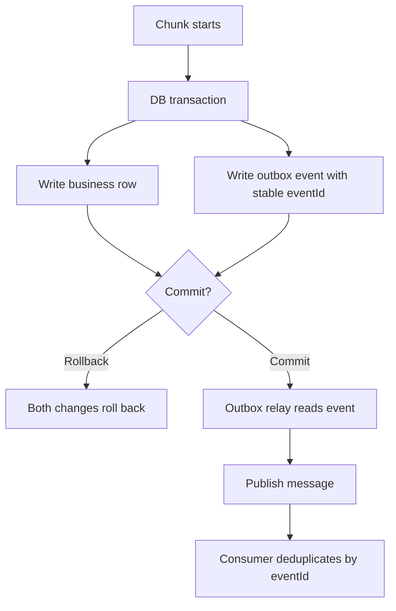

# Designing restarts without duplicate output

A batch job can process millions of records and take many minutes or hours to finish. If a job fails mid-run, Spring Batch allows restarting the same `JobInstance` using saved metadata and checkpoints. However, a restart is only safe when readers and writers restore their state accurately. If a writer rewrites already-committed data, opens a file in append mode at the wrong position, or creates fresh output on every attempt, the job can produce duplicate output.

Designing restarts without duplicate data requires coordinating three parts: **stable job identity, accurate checkpoints at commit boundaries, and safely re-executable output**. For databases, use unique keys and upserts or job-instance staging. For files, use a restart-capable writer and keep names/resources unchanged across runs. For APIs, messages, or non-transactional side effects, idempotency keys, outboxes, or reconciliation mechanisms are required.

## 1. How does duplicate output occur?

Duplicate output occurs when an item or side effect created earlier is produced again during a retry or restart. Common scenarios include:

- The reader restarts from the beginning while the writer keeps appending to a file that already has data.
- The writer does not save state, so when the step restarts it does not know how far it wrote.
- The job launches with new identifying parameters, creating a new `JobInstance` that still writes to the same output path or target table.
- A completed step is configured to re-run on restart and rewrites all data.
- A chunk committed in the database, or an API request/message was sent, and a crash causes the same operation to be sent again.
- The output file was published before step metadata recorded completion; re-running publishes a second copy or overwrites improperly.

Duplicates are not just two identical lines in a file. They can also be two payments, two shipments, two messages, two emails, or two history records for the same business event.

## 2. Distinguishing JobInstance and JobExecution

Spring Batch uses these two concepts to manage restarts:

- `JobInstance` represents a logical business job identified by the job name and identifying `JobParameters`.
- `JobExecution` represents a specific run attempt of that instance.

When a job fails and is restarted with the same identifying parameters, Spring Batch creates a new `JobExecution` belonging to the same `JobInstance`. Metadata and checkpoints from the previous execution are used to resume.

For example:

```text
Job: dailyOrderExport
Identifying parameter: businessDate=2026-11-15

JobInstance: dailyOrderExport / businessDate=2026-11-15
  JobExecution 1001 -> FAILED
  JobExecution 1008 -> COMPLETED (restart)
```

The `JobExecution` ID changes, while the `JobInstance` remains the same logical job. Therefore, output keys should tie to the instance's business identity or a stable output version rather than defaulting to `JobExecution` ID as a new output name on every restart.

If identifying parameters change—for instance, adding a timestamp or incrementing `run.id`—the launcher may create a new `JobInstance`. Spring Batch then treats it as a different job, not a restart of the prior instance. If the new instance still writes to the same file or target table, data can be duplicated even though the framework is following exact semantics.

## 3. Restarting vs. running a new job

| Action | JobInstance | Old checkpoint | Output risk |
|---|---|---|---|
| Restart `FAILED` execution with same identifying parameters | Unchanged | Restorable | Must restore reader/writer to the exact position |
| Restart `STOPPED` execution with same parameters | Unchanged | Restorable | Same as restart after failure |
| Launch with different identifying parameters | New | Ignores old instance's checkpoint | Can write duplicates if sharing the same target |
| Re-run completed step via `allowStartIfComplete(true)` | Same instance on restart | Step can run again | Requires idempotent output or full regeneration |
| Re-run `COMPLETED` instance with same parameters | Typically rejected | Not a valid restart | Needs a dedicated reprocessing workflow with distinct identity |

Decide explicitly whether operators intend to resume an unfinished job or create a new business processing run. Those two actions require different output policies.

## 4. Where and when are checkpoints saved?

Readers and writers can implement `ItemStream` to persist state in `ExecutionContext`. The primary lifecycle includes:

| Method | Role |
|---|---|
| `open(ExecutionContext)` | Restore state before the step resumes |
| `read()` / `write()` | Read and write data |
| `update(ExecutionContext)` | Write current state for the framework to save checkpoints |
| `close()` | Release resources |

In a chunk-oriented step, checkpoints are updated along the chunk lifecycle and saved with metadata at commit boundaries. If the current chunk rolls back, the durable checkpoint usually remains the checkpoint from the previously committed chunk. On restart, the reader can re-read the uncommitted chunk.

This means the writer must be able to resume output aligned with the checkpoint. Saving only reader state without writer state can allow input to resume properly while output is rewritten or misaligned.

For custom readers/writers, implement `ItemStream` completely or ensure delegate streams are registered with the step so the framework invokes `open`, `update`, and `close`. If a delegate is not registered, state may not be saved even if the inner class implements `ItemStream`.

## 5. Reader and writer must restore the same boundary

Suppose the chunk size is 100 and the job committed 10 chunks. The reader processed 1,000 items, and the writer wrote output for 1,000 items. Then chunk 11 fails.

On restart, the desired state is:

- The reader resumes from item 1,001 or the checkpoint-equivalent position.
- The writer resumes after the output of item 1,000.
- Items 1 through 1,000 are not written again.
- The uncommitted chunk is reprocessed safely.

If the reader resumes at 1,001 while the writer appends from the start, output can become corrupted or duplicated. If the writer resumes after item 1,000 while the reader starts from the beginning, output can have gaps or duplicates depending on writer behavior.

Therefore, reader and writer checkpoints must reflect the same committed progress. Do not keep a `lastProcessedId` variable inside a singleton bean and treat it as a durable checkpoint.

## 6. Using ItemStream and saveState for readers

Built-in readers such as `FlatFileItemReader`, `JdbcPagingItemReader`, and others support state saving. Keep the reader name stable and enable state saving when configurable.

Example:

```java
@Bean
@StepScope
public FlatFileItemReader<OrderInput> orderReader(
        @Value("#{jobParameters['inputFile']}") String inputFile) {

    FlatFileItemReader<OrderInput> reader = new FlatFileItemReader<>();
    reader.setName("dailyOrderReader");
    reader.setResource(new FileSystemResource(inputFile));
    reader.setLinesToSkip(1);
    reader.setSaveState(true);
    reader.setLineMapper(orderLineMapper());
    return reader;
}
```

Key points:

- `setName("dailyOrderReader")` establishes a stable namespace for the reader's state.
- `setSaveState(true)` enables persisting read positions in execution context.
- `inputFile` must point to the exact same source on restart.
- File content and line order must remain immutable between the first run and restart.

If the file is modified or reordered, the saved line count may point to a different record. Copy input into an immutable area per `JobInstance`, record a checksum/version, and verify the source before restarting.

## 7. Using FlatFileItemWriter to resume output files

`FlatFileItemWriter` supports saving state for restarts. When properly configured, the writer can restore the output position written at the checkpoint and continue writing the rest.

Example with builder:

```java
@Bean
@StepScope
public FlatFileItemWriter<OrderRecord> orderWriter(
        @Value("#{jobParameters['outputFile']}") String outputFile) {

    return new FlatFileItemWriterBuilder<OrderRecord>()
            .name("dailyOrderWriter")
            .resource(new FileSystemResource(outputFile))
            .delimited()
            .delimiter(",")
            .names("orderId", "customerId", "amount")
            .saveState(true)
            .build();
}
```

For safe restarts:

- Keep the writer name stable and unique within the step.
- Keep the same output resource for the same `JobInstance`.
- Let the writer save state and let Spring Batch restore position.
- Do not delete the file or reset writer position manually during restart.
- Do not merely enable append mode assuming the writer knows where it stopped.

`FlatFileItemWriter` manages state and writes within Spring Batch's transactional lifecycle. Use its restart lifecycle rather than opening a standalone `FileWriter` in append mode. If `saveState` is disabled, the writer lacks a checkpoint to restore position and step restarts may produce duplicate output.

## 8. Do not use append blindly

Appending can be appropriate in certain output designs, but simply turning on append is not a general way to support restarts.

Dangerous example:

1. The first run wrote 10,000 lines.
2. The job failed after output was written.
3. Restart begins the reader from the start because the reader did not save state.
4. The writer opens the file in append mode.
5. The original 10,000 lines remain and another 10,000 lines are appended.

The result is duplicate output. Conversely, if the writer truncates the file while the reader resumes from a checkpoint, output from previously committed items is lost.

Pick one of two clear strategies:

- **Resume at checkpoint:** both reader and writer restore state from the same execution context; committed output is preserved and only unfinished work is appended.
- **Regenerate all output:** delete/recreate an explicitly identified staging artifact and re-run all data from the start under a controlled procedure.

Never mix the two strategies by letting the reader resume while the writer truncates, or letting the reader restart from the beginning while the writer appends.

## 9. Output files stable per JobInstance

Output paths should be determined by business work, such as data date and tenant. When restarting the same instance, the path must resolve to the same artifact so the writer can recover.

For example:

```text
staging/orders/
  business-date=2026-11-15/
    tenant=42/
      orders-export.csv
```

Do not embed a new `JobExecution` ID in the output name on every restart if the goal is resuming the same file. `JobExecution` ID changes across runs; using it in the output path can cause the writer to create a new file and abandon the old one, or cause downstream systems to receive multiple exports for the same business period.

If separate per-attempt artifacts are needed for investigation, write attempt files separately alongside a manifest or publish state identifying which attempt is official. Creating new attempt files alone does not prevent downstream duplicates.

## 10. Database output: unique keys and upserts

For database writers, a common way to prevent duplicates is using a stable business key and a database unique constraint.

Example output table:

```sql
create table order_export (
    business_date date not null,
    tenant_id     bigint not null,
    order_id      bigint not null,
    amount        decimal(18, 2) not null,
    primary key (business_date, tenant_id, order_id)
);
```

The primary key prevents two rows for the same order on the same date and tenant. The writer can use upsert or equivalent SQL so the same item can be written again without inserting duplicate rows.

Conceptual SQL example:

```sql
insert into order_export(business_date, tenant_id, order_id, amount)
values (:businessDate, :tenantId, :orderId, :amount)
on conflict (business_date, tenant_id, order_id)
do update set amount = excluded.amount;
```

`ON CONFLICT` syntax is a PostgreSQL example; other databases can use `MERGE`, `ON DUPLICATE KEY UPDATE`, or an equivalent mechanism.

Unique constraints are the final guardrail against duplicates. Checking with `SELECT` before `INSERT` is not safe under concurrent threads or jobs, because two transactions can both see no existing row and then both insert.

## 11. Upserts must match business semantics

Upsert prevents the same business key from creating extra rows, but it is not always the right choice.

Determine:

- If an item is reprocessed, should old values be overwritten?
- Does history across multiple output versions need to be preserved?
- If source data changed after the first run, is the restart permitted to use new values?
- Should events fire when values change or only when a record is first created?
- Are any columns write-once and never to be overwritten?

For example, a current-state table can use upsert. However, a payment ledger needs each transaction recorded once under a unique transaction ID; an upsert updating an old transaction could erase history. For ledgers, use unique keys and handle duplicates per explicit rules.

## 12. Staging tables and publishing after job completion

For large outputs or when consumers must see only complete results, write into a staging table keyed by `JobInstance` and publish after all required chunks and steps finish.

Example schema:

```sql
create table order_export_stage (
    job_key       varchar(150) not null,
    order_id      bigint not null,
    amount        decimal(18, 2) not null,
    primary key (job_key, order_id)
);

create table order_export_manifest (
    job_key       varchar(150) primary key,
    status        varchar(30) not null,
    published_at  timestamp null
);
```

Each item is written to staging under a stable `job_key`. After the job finishes and data validation succeeds, the publish step updates the manifest or moves data into the main table.

Benefits:

- Restarts can resume staging under the same `job_key`.
- Unique keys prevent duplicate writes of the same item.
- Incomplete data never appears in official output areas.
- Counts, checksums, or invariants can be verified before publishing.

Publishing itself must be idempotent. If the publish transaction commits and the job is interrupted before metadata records step completion, the restart must recognize the manifest is already `PUBLISHED` and avoid publishing a second time.

## 13. File staging and idempotent publishing

For output files, a two-phase approach works well:

1. Write the file to a staging path stable for the `JobInstance`.
2. Close the file and verify size/checksum.
3. Once all required steps finish, rename or move the file to the publish path.
4. Write a manifest confirming the official output.

For example:

```text
exports/
  staging/
    orders-2026-11-15-tenant-42.csv
  published/
    orders-2026-11-15-tenant-42.csv
```

Moves/renames within the same filesystem are typically atomic for file readers, but they do not form a shared transaction with `JobRepository`. A crash can happen after the move yet before step metadata is saved. Therefore, the publish step must check the target file and checksum/manifest before repeating.

If the target file already exists with a checksum matching the artifact to publish, publishing can be treated as complete. If the checksum differs, handle it as a conflict or invalid data rather than silently overwriting.

## 14. Generating stable output keys

An output key must represent exactly one version of a business result. Construct it from:

- Job name.
- Identifying parameters such as `businessDate` and `tenantId`.
- An `outputVersion` or `reprocessId` explicitly specified by operators when intentionally producing a new version.

Do not use:

- A new timestamp generated on every restart.
- A new UUID on every writer call.
- `JobExecution` ID when aiming for one artifact across restarts.
- Thread IDs or local chunk sequence numbers.

Example key:

```java
String outputKey = jobName + ":" + businessDate + ":" + tenantId
        + ":" + outputVersion;
```

`outputVersion` should increment only when producing a new business result or an intentional reprocess. When restarting the same instance, keep identifying components unchanged so the key stays identical.

## 15. Do not enable allowStartIfComplete casually

By default, when restarting a job, already-completed steps do not run again. This avoids repeating side effects of steps that committed successfully.

`allowStartIfComplete(true)` lets a completed step run again on job restart as configured. This is useful for certain validation steps or steps meant to re-run by design, but it can create duplicate output if the step is not idempotent.

Example:

```java
return new StepBuilder("publishReportStep", jobRepository)
        .tasklet(publishReportTasklet, transactionManager)
        .allowStartIfComplete(true)
        .build();
```

Before enabling this flag, answer:

- Does the step insert new records on every run?
- Does the step send emails/messages/APIs?
- Is output replaced deterministically or appended?
- Can the step check previously published results?
- If the step re-runs, does it produce the exact same result or a new version?

If a step publishes output, make publishing idempotent—for example, by checking manifests and checksums. Do not enable `allowStartIfComplete` merely to force a step to run without understanding data impact.

## 16. Distinguishing restarts from startLimit

`startLimit` limits how many times a step can be launched. It is not a duplicate-output prevention mechanism. A step can run within its limit and still write duplicates if the writer is not idempotent; conversely, a step can be blocked from continuing due to exhausting the limit even though output is incomplete.

Preventing duplicates relies on checkpoints, output keys, unique constraints, idempotency, and publishing rules. Limiting start counts is merely an additional operational control.

## 17. Crash windows between output and checkpoints

One risk to consider is the process stopping at the exact moment output has been written while checkpoint metadata does not yet reflect that state, or vice versa. With files and non-database systems, outputs and `JobRepository` usually do not share an atomic transaction.

For example:

1. The writer writes output for a chunk.
2. The process stops during the transition between committing and saving metadata.
3. On restart, the checkpoint indicates the chunk must be reprocessed.
4. The writer writes the same output again.

If the writer is not idempotent, output can be duplicated. Another crash window occurs when metadata updates while external side effects have not finished; on restart, the step may appear committed even though the file/API lacks the corresponding output.

Ways to mitigate risk:

- Use transaction-aware writers where the framework provides them, while understanding boundaries between files and the repository.
- Write output under stable keys so the same item does not create extra entries.
- Use staging and manifests to determine whether output completed.
- For APIs/messages, use outboxes and idempotency keys.
- Build reconciliation to compare metadata with target data after a crash.

Do not claim exactly-once merely because a writer runs inside a chunk transaction. Identify precisely which resources participate in the transaction and where remaining crash windows lie.

## 18. Non-transactional side effects require idempotency

If a writer calls APIs, sends messages, or sends emails, retries/restarts may resend the operation. A request timeout does not prove the target system never processed it.

For example, a payment API should accept a stable idempotency key:

```http
POST /payments
Idempotency-Key: payment-order-84721
Content-Type: application/json
```

All attempts for that same payment reuse that key. The server stores the result keyed by the idempotency key and returns the prior result on duplicate requests.

If the external system does not support idempotency:

- Use a unique business reference to query status.
- Reconcile before resending requests with indeterminate outcomes.
- Store request intent and responses in a durable table.
- Use a transactional outbox for events emitted after commit.
- Use compensation if a side effect occurred and the later workflow failed.

Do not generate a new idempotency key on every retry; a new key makes the target system treat it as a separate operation.

## 19. Transactional outbox to prevent duplicate/lost events

When needing both database writes and message publishing, a transactional outbox records business data and event intent in the same transaction. A separate relay publishes events afterward.

Flow:



Outboxes usually provide at-least-once delivery. The relay can send a message and crash before marking the event published; on restart, the message may be sent again. Consumers must store processed `eventId`s and apply business changes in the same transaction as the deduplication marker.

An outbox does not eliminate all duplicates by itself; it establishes a durable source of truth and makes retries controllable.

## 20. Non-restartable readers can cause duplicate output

If a reader does not save state or cannot replay the source, restarting may start from the beginning or resume at the wrong position. If the writer keeps appending to old output, already-processed items can be written again.

For safe reader restarts:

- Implement `ItemStream` or use a built-in reader supporting checkpoints.
- Store offsets, line counts, page tokens, or last keys in `ExecutionContext`.
- Use stable reader names and `saveState=true` when appropriate.
- Keep input sources immutable or use snapshots/upper bounds.
- For APIs, use replayable tokens or stable keyset pagination.
- If replay is impossible, stage input durably before processing.

Reader checkpoints and writer checkpoints must represent the same committed progress. Do not verify only that the reader recovered properly while ignoring output position.

## 21. Designing output per JobInstance

A practical pattern is isolating staging output by a stable `jobKey`. Every chunk of the same instance writes to that exact area; restarts resume the same area; other jobs never overwrite it.

For example:

```text
jobKey = dailyOrderExport:2026-11-15:tenant-42:v1

staging/order-export/{jobKey}/part-0001.csv
staging/order-export/{jobKey}/part-0002.csv
manifest/{jobKey}.json
```

With partitioning, each partition can have its own file named deterministically from the partition key. Once all partitions complete, a merge step produces one final output.

Do not name files solely by date if multiple tenants or multiple export versions can run concurrently. Also do not append a new execution ID on every restart when the goal is continuing the old artifact.

## 22. Intentional reprocessing needs a new output version

Sometimes business rules call for re-running all data after fixing logic or source data. This is reprocessing, not restarting.

Create an explicit reprocess identifier, such as:

```text
businessDate=2026-11-15
tenantId=42
outputVersion=2
```

The new version creates separate output, allowing comparison against the old version and publishing the new version only once verified successful. Do not overwrite output currently used by downstream consumers before the new version finishes.

When reprocessing, decide whether to clean up old staging, retain audit history, or create versioned output tables. Establish a publish/activate workflow so downstream knows which version is official.

## 23. Testing restarts without duplicate output

A unit test calling a writer once is not enough to prove restart safety. Write integration tests simulating an execution failing after several chunks commit, then restarting the same `JobInstance`.

Basic test scenario:

1. Launch the job with fixed identifying parameters.
2. Let the writer succeed on the first few chunks.
3. Intentionally fail the writer on the next chunk.
4. Verify the job is `FAILED` and committed output from earlier chunks exists.
5. Relaunch the same job with the same identifying parameters.
6. Let the step resume and finish.
7. Read the final output and verify each business key appears exactly once.

Example database assertion:

```java
List<OrderExport> rows = exportRepository.findByJobKey(jobKey);

assertEquals(expectedOrderCount, rows.size());
assertEquals(
        expectedOrderCount,
        rows.stream().map(OrderExport::orderId).distinct().count());
```

Assertions should check both total count and distinctness by business key. Checking only that the job is `COMPLETED` can miss duplicate output.

### Testing file writers

For file output, after restart:

- Verify the file contains no repeated headers if headers should appear only once.
- Verify each business key appears exactly once.
- Verify line order and line count are exact.
- Verify the file contains no partial tail left over from a rolled-back chunk.
- Verify the writer reopened the exact resource and checkpoint.

### Testing re-run completed steps

If `allowStartIfComplete(true)` is used, explicitly test the case where the step completed but the job failed at a later step. On restart, verify the step runs again as configured while output remains idempotent or regenerates per the chosen strategy.

### Testing crash windows

For non-database outputs, simulate cases where the artifact was written/published before metadata recorded final status. The restart must recognize the existing artifact via manifest/checksum or idempotency key and avoid creating a second copy.

## 24. Monitoring and reconciling duplicates

In production, capture enough information to trace output back to its job instance and item.

Record:

- Job name, `JobInstance` identifying parameters, and `JobExecution` ID.
- Step name and `StepExecution` ID.
- Reader/writer names and relevant checkpoint keys.
- Output key, business key, or event ID.
- Read/write/skip counts and commit/rollback counts.
- File path, checksum, line count, or manifest status.
- API idempotency keys and response references if applicable.

When investigating duplicates:

1. Identify the output key and the job instance that produced it.
2. Compare the job executions belonging to that instance.
3. Identify the last committed chunk and corresponding checkpoint.
4. Check whether the writer restored state or appended from the beginning.
5. Locate business keys appearing multiple times.
6. Cross-check event/API references in external systems.
7. Determine whether duplicates came from a restart, a new instance, a step rerun, or retried side effects.

Do not manually delete duplicates before determining which record is accurate and whether downstream has already consumed them. For payments or shipments, reconcile by business reference and apply compensation if needed.

## 25. Common design mistakes

| Mistake | Consequence | Fix |
|---|---|---|
| Adding an identifying timestamp on restart | Creates a new JobInstance and reprocesses from scratch | Keep identifying parameters unchanged on restart |
| Reader restarts from the beginning | Already-processed items are re-read | Use `ItemStream`, `saveState`, and stable checkpoints |
| Writer does not save state | Output resumes at the wrong position or rewrites | Enable state and use a restartable writer |
| Enabling append while reader/writer are out of sync | Duplicate or missing output | Restore both from the same checkpoint |
| Truncating files when restarting mid-run | Loses output of already-committed chunks | Use a restart-aware writer or intentionally regenerate full staging |
| Using JobExecution ID as output identity | Every restart creates a different artifact | Use stable keys tied to JobInstance/business version |
| Unnecessary `allowStartIfComplete(true)` | Completed steps run again and create duplicates | Enable only when output is idempotent or regenerable |
| Database inserts without unique keys | Retries/restarts insert duplicate rows | Use unique constraints and domain-appropriate upserts |
| APIs without idempotency | Timed-out then retried requests can execute twice | Use idempotency keys and reconciliation |
| Publishing files without manifests | Crash after publish causes restart to publish again | Use manifests/checksums and idempotent publishing |
| Direct side effects in listeners | Repeated callbacks or crash windows duplicate side effects | Use outboxes or durably persisted post-commit mechanisms |

## 26. Safe restart design workflow

1. **Define JobInstance:** choose identifying parameters representing one logical business run.
2. **Keep parameters stable on restart:** do not add new timestamps/run IDs when resuming an old instance.
3. **Make reading restartable:** use `ItemStream`-capable readers, checkpoints, and stable data sources.
4. **Make writing restartable:** save state, keep writer names stable, and restore the exact output resource.
5. **Choose an output strategy:** resume at checkpoint or regenerate full staging; never mix both.
6. **Prevent duplicates at the sink:** unique keys/upserts for databases, idempotency keys for APIs/messages.
7. **Separate staging and publishing:** publish output only once data is complete and verified.
8. **Handle completed steps carefully:** avoid `allowStartIfComplete` unless re-running the step is safe.
9. **Protect crash windows:** use manifests, checksums, outboxes, and reconciliation for non-transactional resources.
10. **Test restarts:** intentionally fail mid-job, restart the same instance, and verify business keys/outputs appear the exact expected number of times.

## 27. Key principles to remember

- Restarts reuse the same `JobInstance` and identifying parameters; a new `JobExecution` is created for the next run.
- Changing identifying parameters can create a new instance and cause all data to be reprocessed.
- Readers and writers must restore state corresponding to the same commit boundary.
- `ItemStream.open/update/close` and `ExecutionContext` are the primary mechanisms for saving/restoring checkpoints.
- `FlatFileItemWriter` can restart when state is saved and writer name and resource remain stable.
- Do not append or truncate blindly; choose explicitly between resuming at checkpoint or regenerating full staging.
- Database outputs require unique business keys and domain-accurate upsert/insert semantics.
- Output keys should remain stable per JobInstance and output version, never shifting per JobExecution attempt.
- `allowStartIfComplete(true)` can make completed steps re-run; enable only when output is idempotent or regenerable.
- Files, APIs, and messages do not share the database transaction; staging, manifests, idempotency, outboxes, or reconciliation are needed.
- Restart tests must verify output counts and uniqueness, not just `COMPLETED` job status.
- Intentional reprocessing should use a new output version and an explicit publish workflow.

Designing restarts without duplicate output does not rely on a single configuration flag. It requires stable job identity, consistent reader/writer checkpoints, idempotent output, and a recoverable publish workflow. When these parts all reflect a single committed progress boundary, Spring Batch can resume a job after failure without duplicating already-completed results.
