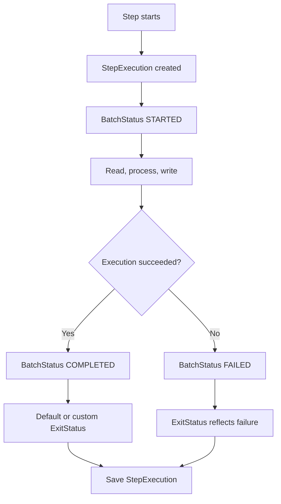
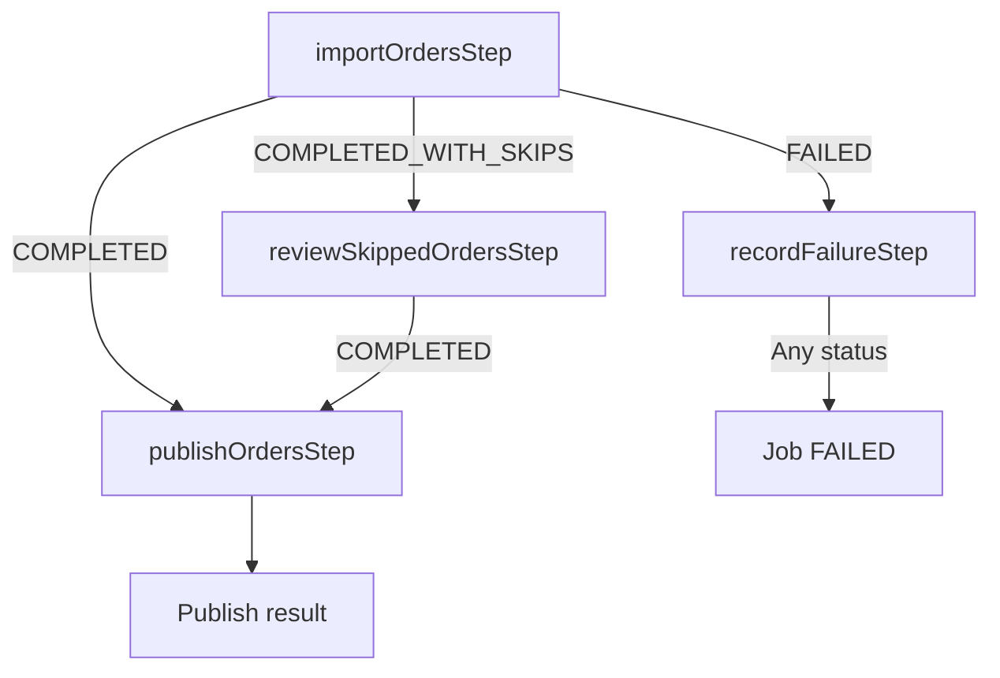

# ExitStatus of StepExecution

In Spring Batch, each time a step is executed, there is a StepExecution that records its status, start/end times, the number of items read/written, and the final result. One of the key pieces of information on StepExecution is **ExitStatus**.

ExitStatus describes the outcome that a step returns to the workflow. It has an exit code and an exit description. This code can be a default value such as COMPLETED or FAILED, or an application-defined business code such as COMPLETED_WITH_SKIPS, NO_INPUT, or NEEDS_REVIEW.

A common point of confusion is that ExitStatus differs from BatchStatus. BatchStatus describes the execution lifecycle of the step; ExitStatus describes the outcome used for orchestration and reporting. A step can have BatchStatus.COMPLETED while its ExitStatus is COMPLETED_WITH_WARNINGS. This distinction allows a job to branch based on business outcomes while still preserving accurate technical execution state.

## 1. What is StepExecution?

StepExecution represents a specific execution of a step within a JobExecution. It holds metadata about the run, such as:

- Step name and execution ID.
- Start and end timestamps.
- Current BatchStatus.
- The step's ExitStatus.
- Number of items read, written, filtered, and skipped.
- Commit and rollback counts.
- ExecutionContext for checkpoint/restart.
- Error information or exit description.

A JobInstance can have multiple JobExecutions across restarts. Each time a step executes within a JobExecution, there is a corresponding StepExecution. Therefore, ExitStatus belongs to a specific step execution, not a fixed property of the Step bean.

For example, an import step might finish the first time with code COMPLETED_WITH_SKIPS, and later run in another JobInstance with different input and finish with code COMPLETED. The two executions have two separate StepExecutions.

## 2. What Components Does ExitStatus Have?

ExitStatus is an object in Spring Batch used to describe the outcome of a step or job. Two main components:

| Component | Meaning | Example |
|---|---|---|
| exitCode | Short outcome code used by flow transitions | COMPLETED, FAILED, COMPLETED_WITH_SKIPS |
| exitDescription | Additional description for the outcome | Skipped 12 invalid records |

You can read them from StepExecution:

```java
ExitStatus exitStatus = stepExecution.getExitStatus();

String exitCode = exitStatus.getExitCode();
String description = exitStatus.getExitDescription();
```

Exit codes should be short, stable, and follow a naming convention. Exit descriptions can provide operational context, but should not contain credentials, personal data, or entire payloads.

### ExitStatus is immutable

ExitStatus is designed to be immutable. Methods such as addExitDescription(...) or replaceExitCode(...) return a new ExitStatus. Be sure to keep the returned value:

```java
ExitStatus status = ExitStatus.COMPLETED
        .addExitDescription("Imported 1250 records");

ExitStatus customStatus =
        status.replaceExitCode("COMPLETED_WITH_SUMMARY");
```

If you call addExitDescription(...) and ignore the return value, the original status variable is not modified.

## 3. Distinguishing ExitStatus and BatchStatus

This is the most important distinction when reading step status.

| Criterion | BatchStatus | ExitStatus |
|---|---|---|
| Purpose | Describe execution lifecycle | Describe outcome of a step/job |
| Data type | Enum | Object with exit code and exit description |
| Values | COMPLETED, FAILED, STOPPED, STARTED... | COMPLETED, FAILED, or custom code |
| Who uses it | Framework and lifecycle logic | Flow transitions, operations, reporting |
| Can codes be customized? | Cannot arbitrarily add new enum values | Can create business exit codes |

Example:

```java
BatchStatus batchStatus = stepExecution.getStatus();
ExitStatus exitStatus = stepExecution.getExitStatus();

System.out.println(batchStatus);              // COMPLETED
System.out.println(exitStatus.getExitCode()); // COMPLETED_WITH_SKIPS
```

In this case, the step finished technically. Some records were skipped, so the application returned a separate business code allowing the job to route data to a review branch.

### BatchStatus is not the place for business codes

You cannot add a new BatchStatus enum value such as COMPLETED_WITH_SKIPS. BatchStatus represents lifecycle states managed by Spring Batch. When you need to distinguish normal completion, completion with warnings, or no data, use ExitStatus.

Conversely, do not use a custom ExitStatus to pretend a step completed when the actual BatchStatus is FAILED. A nice exit code does not turn a failed transaction into a success.

## 4. Common ExitStatus Values

Spring Batch defines several standard ExitStatus values:

| ExitStatus | Common Meaning |
|---|---|
| EXECUTING | Step/job is executing |
| COMPLETED | Completed |
| FAILED | Execution failed |
| STOPPED | Execution was stopped |
| NOOP | No actual operation was performed in certain cases |
| UNKNOWN | Outcome could not be determined |

These codes are defaults or framework values used in specific situations. Applications can create other codes using the ExitStatus constructor.

Example:

```java
ExitStatus warningStatus =
        new ExitStatus("COMPLETED_WITH_WARNINGS");

ExitStatus noInputStatus =
        new ExitStatus("NO_INPUT");
```

Do not reuse a standard code name for a custom code with a different meaning. Choose names that clearly express the outcome and keep them consistent across listeners, flows, dashboards, and operations.

## 5. When is ExitStatus Created and Updated?

In a normal lifecycle, Spring Batch initializes the step status at the start, executes the tasklet or chunk, and then determines the terminal status.

Simplified flow:



When a step finishes normally, ExitStatus is usually COMPLETED. When an exception causes a step to fail, the framework typically sets BatchStatus and ExitStatus corresponding to FAILED, and adds error details to the exit description.

A step listener can supplement or change ExitStatus after the step runs. This is a common way to represent business outcomes such as completion with skips or no input data.

## 6. Reading ExitStatus from StepExecution

In a listener or job monitoring service, you can read ExitStatus with getExitStatus():

```java
public void logStepResult(StepExecution stepExecution) {
    ExitStatus exitStatus = stepExecution.getExitStatus();

    log.info(
            "step={}, batchStatus={}, exitCode={}, description={}",
            stepExecution.getStepName(),
            stepExecution.getStatus(),
            exitStatus.getExitCode(),
            exitStatus.getExitDescription());
}
```

When logging, write only sanitized descriptions. Do not dump the entire ExecutionContext or include access tokens, passwords, or customer data in the exit description.

If reading metadata after the job runs, you can obtain StepExecution from JobExecution:

```java
for (StepExecution stepExecution : jobExecution.getStepExecutions()) {
    String stepName = stepExecution.getStepName();
    String exitCode = stepExecution.getExitStatus().getExitCode();
    log.info("Step {} ended with {}", stepName, exitCode);
}
```

With complex flows or steps executed multiple times, select the right StepExecution by ID or execution attempt rather than assuming there is only one StepExecution per step name.

## 7. Creating a Custom ExitStatus with StepExecutionListener

A step may complete technically yet need to report a distinct business outcome. StepExecutionListener.afterStep(...) is the appropriate place to add this outcome.

Example: if a step had skipped items, return code COMPLETED_WITH_SKIPS:

```java
public class SkipStatusListener implements StepExecutionListener {

    @Override
    public ExitStatus afterStep(StepExecution stepExecution) {
        if (stepExecution.getStatus() != BatchStatus.COMPLETED) {
            return null;
        }

        if (stepExecution.getSkipCount() > 0) {
            return new ExitStatus("COMPLETED_WITH_SKIPS")
                    .addExitDescription(
                            "Skipped " + stepExecution.getSkipCount()
                                    + " records");
        }

        return null;
    }
}
```

The listener only returns a custom status when the step has COMPLETED. If the step FAILED or STOPPED, the listener does not replace the failure result with a completed-with-warnings code.

Attach the listener to the step:

```java
@Bean
Step importOrdersStep(
        JobRepository jobRepository,
        PlatformTransactionManager transactionManager,
        ItemReader<OrderInput> orderReader,
        ItemProcessor<OrderInput, Order> orderProcessor,
        ItemWriter<Order> orderWriter,
        SkipStatusListener skipStatusListener) {

    return new StepBuilder("importOrdersStep", jobRepository)
            .<OrderInput, Order>chunk(100, transactionManager)
            .reader(orderReader)
            .processor(orderProcessor)
            .writer(orderWriter)
            .faultTolerant()
            .skip(InvalidOrderException.class)
            .skipLimit(100)
            .listener(skipStatusListener)
            .build();
}
```

When the step has skips, StepExecution can retain BatchStatus.COMPLETED and ExitStatus.COMPLETED_WITH_SKIPS. The skip count is still stored separately in StepExecution.

### What does returning null from a listener mean?

If afterStep(...) returns null, the listener does not propose a new ExitStatus. The step's existing ExitStatus is preserved. This is the right choice when there is no additional outcome to report.

There is no need to return ExitStatus.COMPLETED in every case. Returning null prevents accidentally overwriting or altering the outcome already determined by the framework.

## 8. How ExitStatus is Combined Across Listeners

A step can have multiple listeners. Spring Batch combines the ExitStatus returned by a listener with the step's current ExitStatus using ExitStatus combination rules.

This means you should not assume a listener's return value always completely overwrites the previous outcome. The framework uses a combination operation to preserve the outcome with the appropriate precedence and concatenate descriptions.

For example, a listener returns a warning code after the step completes; if the step already failed, the listener logic should avoid proposing a success code. Always check BatchStatus before creating a custom status.

If multiple listeners modify ExitStatus, registration order and combination rules can affect the final description or code. Ideally, only one component should be responsible for setting the primary business code for a step; other listeners should only add necessary details.

## 9. Setting ExitStatus in a Tasklet or Step Logic

Besides listeners, some step types can adjust ExitStatus through StepContribution or StepExecution at the appropriate lifecycle point. This approach is useful when the outcome is known directly during execution.

Illustrative example in a tasklet:

```java
@Bean
Step checkInputStep(
        JobRepository jobRepository,
        PlatformTransactionManager transactionManager,
        InputRepository inputRepository) {

    return new StepBuilder("checkInputStep", jobRepository)
            .tasklet((contribution, chunkContext) -> {
                long count = inputRepository.countPending();

                if (count == 0) {
                    contribution.setExitStatus(
                            new ExitStatus("NO_INPUT"));
                }

                return RepeatStatus.FINISHED;
            }, transactionManager)
            .build();
}
```

Here, the tasklet sets a custom exit status when there is no data. BatchStatus is still managed by the framework according to the execution lifecycle. If the tasklet runs normally, the step can be COMPLETED with ExitStatus.NO_INPUT.

Do not set a completed status before the work has actually finished. If an error occurs in the tasklet, the exception must still be handled by the transaction and step lifecycle; custom ExitStatus must never be used to mask errors.

## 10. Using ExitStatus for Flow Routing

An important reason for creating a custom ExitStatus is flow routing. In Spring Batch's DSL, transition on(...) matches against the exit code of ExitStatus.

Example:

```java
@Bean
Job orderImportJob(
        JobRepository jobRepository,
        Step importOrdersStep,
        Step reviewSkippedOrdersStep,
        Step publishOrdersStep,
        Step recordFailureStep) {

    return new JobBuilder("orderImportJob", jobRepository)
            .start(importOrdersStep)
                .on("COMPLETED_WITH_SKIPS")
                .to(reviewSkippedOrdersStep)
            .from(importOrdersStep)
                .on("COMPLETED")
                .to(publishOrdersStep)
            .from(importOrdersStep)
                .on("FAILED")
                .to(recordFailureStep)
            .from(reviewSkippedOrdersStep)
                .on("COMPLETED")
                .to(publishOrdersStep)
            .from(recordFailureStep)
                .on("*")
                .fail()
            .end()
            .build();
}
```

The flow can be represented as:



When import has skips, the flow routes through the review step. When import completes normally, the flow proceeds directly to publish. If import fails, the flow records the failure.

### on() matches the exit code

Transition on("COMPLETED_WITH_SKIPS") matches the exit code. It does not read the exit description and does not directly inspect BatchStatus.

If a step has BatchStatus.COMPLETED but ExitStatus is COMPLETED_WITH_SKIPS, transition on("COMPLETED") will not match that custom code exactly. Declare a branch for the custom code.

You can use wildcards when appropriate:

```java
.from(importOrdersStep)
    .on("COMPLETED*")
    .to(publishOrdersStep)
```

Specific patterns make flows easier to read and prevent accidentally routing error codes into a success branch. Only use broad wildcards when every matched exit code genuinely requires the same business action.

## 11. ExitStatus and JobExecution

StepExecution has its own ExitStatus; JobExecution also has its own ExitStatus. These two values should not be treated as identical.

Example:

- Import step returns COMPLETED_WITH_SKIPS.
- Review step handles skipped records.
- Publish step completes.
- JobExecution can finish COMPLETED because the flow successfully handled the warnings.

If the flow stops or fails in another branch, JobExecution can have a different outcome. Job-level ExitStatus reflects the outcome of the job flow, while StepExecution.ExitStatus helps explain how each individual step ended.

When investigating, inspect both:

```java
jobExecution.getStatus();
jobExecution.getExitStatus().getExitCode();

stepExecution.getStatus();
stepExecution.getExitStatus().getExitCode();
```

Do not conclude a job succeeded just because one step has ExitStatus.COMPLETED. A job can have multiple steps and a later step may fail.

## 12. ExitStatus Stored in JobRepository

With a JDBC JobRepository, step metadata is typically stored in the BATCH_STEP_EXECUTION table. The standard schema has columns:

- EXIT_CODE: the ExitStatus code of StepExecution.
- EXIT_MESSAGE: the ExitStatus description.
- STATUS: the BatchStatus state.

Job execution also has corresponding status and exit status information in the job execution metadata.

Storing STATUS and EXIT_CODE separately highlights the two concepts:

| Metadata | Content |
|---|---|
| STATUS | Step's BatchStatus |
| EXIT_CODE | ExitStatus.getExitCode() |
| EXIT_MESSAGE | ExitStatus.getExitDescription() |

Exact column names and data types may vary across schemas/versions or repository configurations. Do not write directly to metadata columns via SQL to force the flow forward; let Spring Batch manage lifecycle and state.

Exit description can be stored with metadata and appear in dashboards or admin tools. Therefore, do not put secrets, tokens, raw requests, or personal data in the description.

## 13. Naming Conventions for Custom Exit Codes

Custom exit codes are part of the contract between steps, flows, and operations. They should be designed as stable status codes.

Some examples:

| Exit code | Meaning | Suggested Action |
|---|---|---|
| COMPLETED | Normal completion | Proceed |
| COMPLETED_WITH_SKIPS | Completed with skipped items | Review/reconcile |
| COMPLETED_WITH_WARNINGS | Completed with warnings | Log warning or inspect |
| NO_INPUT | No input data available | End per business policy |
| NEEDS_REVIEW | Manual inspection required | Route to review step |
| VALIDATION_FAILED | Data failed validation | Reject or fail |

Conventions to follow:

- Use uppercase and underscores for readability.
- One code should represent one clear business meaning.
- Do not embed customer IDs, tokens, or dynamic data into the exit code.
- Use exit description for controlled supplementary details.
- Define constants or enums in code to avoid typos.
- Update flow transitions and tests when adding new codes.

Example:

```java
public final class StepExitCodes {

    public static final String COMPLETED_WITH_SKIPS =
            "COMPLETED_WITH_SKIPS";
    public static final String NO_INPUT = "NO_INPUT";
    public static final String NEEDS_REVIEW = "NEEDS_REVIEW";

    private StepExitCodes() {
    }
}
```

Do not create too many fine-grained codes for situations that lead to the exact same next action. Status codes should help workflows and operations make decisions, not replace detailed logging.

## 14. What is ExitDescription Used For?

ExitDescription adds context to the exit code. For example, the exit code can be COMPLETED_WITH_SKIPS and the description indicates how many items were skipped.

Example:

```java
ExitStatus status = new ExitStatus("COMPLETED_WITH_SKIPS")
        .addExitDescription(
                "Skipped 12 records; 988 records written");
```

Exit description is useful for:

- Briefly explaining the step's outcome.
- Displaying the reason for failure or warning.
- Recording summary information for operational investigation.
- Supporting dashboards and job monitoring.

Do not use description as a routing condition. Descriptions can be long, change over time, or contain free-form text; flows should rely on stable exit codes.

Do not put full stack traces, request bodies, passwords, API tokens, or customer data into exit description. For technical errors, log stack traces in a controlled location and store a correlation ID or error code in the description.

## 15. Never Override FAILED with a Success Code

A common mistake is a listener that always returns COMPLETED or a custom completed status, regardless of whether the step actually succeeded or failed.

Unsafe example:

```java
public ExitStatus afterStep(StepExecution stepExecution) {
    return new ExitStatus("COMPLETED_WITH_WARNINGS");
}
```

If the step has already FAILED, the listener must not propose a success code that could mislead operators. Safer approach:

```java
public ExitStatus afterStep(StepExecution stepExecution) {
    if (stepExecution.getStatus() != BatchStatus.COMPLETED) {
        return null;
    }

    if (stepExecution.getSkipCount() > 0) {
        return new ExitStatus("COMPLETED_WITH_WARNINGS");
    }

    return null;
}
```

Keep BatchStatus and ExitStatus accurately reflecting events. If a step has status STOPPED or FAILED, let the framework keep the corresponding outcome and only add a description if needed.

## 16. ExitStatus During Restart

ExitStatus belongs to a specific StepExecution. When restarting a JobInstance, Spring Batch creates a new JobExecution and new StepExecutions for steps that execute again. Old StepExecutions remain as history of the previous run.

This has several implications:

- Do not treat an old ExitStatus as a global flag across all runs.
- When investigating a restart, read the StepExecution of the current JobExecution and compare with history if needed.
- Flow transitions during a restart are based on the current execution result according to flow/restart semantics.
- If a step already completed and is skipped on restart, the old metadata still shows the outcome of the previous run.

If business logic needs to preserve an outcome from a previous run for another step to use, store durable state with a batch ID or execution reference. Do not rely on mistakenly reading an old StepExecution by step name.

Custom exit codes also need to remain stable across deployments. If you rename COMPLETED_WITH_SKIPS to SKIPPED_SUCCESS, update transitions, dashboards, alerts, and related tests.

## 17. ExitStatus and Skip/Retry

Skip count and retry count are separate metrics on StepExecution. They do not automatically determine a custom ExitStatus across all applications.

Example:

- Step has 10 skipped items yet finishes: default ExitStatus may remain COMPLETED if no listener changes it.
- Application can use a listener to return COMPLETED_WITH_SKIPS.
- Step that retries successfully after a deadlock can still end with COMPLETED.
- Step that exhausts its retry limit and fails normally ends with ExitStatus.FAILED.

Do not infer ExitStatus solely from read count or write count. If you need a business code based on skip/retry, define clear rules in a listener and test every case.

## 18. Testing StepExecution ExitStatus

Tests should verify BatchStatus, exit code, and exit description:

```java
@Test
void stepReturnsCompletedWithSkips() throws Exception {
    JobExecution execution =
            jobLauncherTestUtils.launchJob(testParameters());

    StepExecution stepExecution = execution.getStepExecutions().stream()
            .filter(step -> step.getStepName().equals("importOrdersStep"))
            .findFirst()
            .orElseThrow();

    assertEquals(BatchStatus.COMPLETED, stepExecution.getStatus());
    assertEquals(
            "COMPLETED_WITH_SKIPS",
            stepExecution.getExitStatus().getExitCode());
    assertEquals(2, stepExecution.getSkipCount());
    assertTrue(
            stepExecution.getExitStatus()
                    .getExitDescription()
                    .contains("Skipped 2 records"));
}
```

The example assumes the fixture has exactly two skipped items and the listener sets the corresponding description. Real tests should use a test JobRepository and the real job configuration.

### Testing flow transitions

Beyond checking StepExecution, verify that the custom exit code leads to the right next step:

```java
assertTrue(execution.getStepExecutions().stream()
        .anyMatch(step ->
                step.getStepName().equals("reviewSkippedOrdersStep")));

assertFalse(execution.getStepExecutions().stream()
        .anyMatch(step ->
                step.getStepName().equals("publishOrdersStep")
                        && wasExecutedBeforeReview(step, execution)));
```

This assertion illustrates the idea. In real tests, determining step order should rely on execution metadata or durable markers, rather than the iteration order of a collection that does not guarantee ordering.

Scenarios to cover:

| Scenario | BatchStatus | Expected ExitStatus |
|---|---|---|
| No skips | COMPLETED | COMPLETED |
| With skipped items | COMPLETED | COMPLETED_WITH_SKIPS |
| Step failed | FAILED | FAILED or appropriate error code |
| Step had no input | COMPLETED | NO_INPUT if defined by application |
| Step stopped | STOPPED | STOPPED or configured exit code |

## 19. Debugging When Flow Takes the Wrong Branch

If the next step does not run as expected, check in this order:

1. Locate the exact JobExecution by job name and identifying parameters.
2. Locate the StepExecution of the step that just ran.
3. Read BatchStatus and ExitStatus.
4. Check the actual exit code, not just the exit description.
5. Compare the exit code against the pattern in on(...).
6. Check which listener returned or altered ExitStatus.
7. Check whether the custom exit code has a typo or case mismatch.
8. Check whether the transition points to the right step/flow.
9. Inspect the status of the next step and JobExecution.

For example, if BatchStatus is COMPLETED but ExitStatus is NO_INPUT, transition on("COMPLETED") will not match. If the flow only declares COMPLETED and FAILED, you must add a NO_INPUT branch.

When multiple listeners exist, log the exit code after the step finishes rather than only logging the value a single listener just produced. The final value may be the combined result from multiple listeners.

## 20. Common Pitfalls

**Confusing ExitStatus with BatchStatus.** BatchStatus is lifecycle state; ExitStatus is the outcome used for flows and reporting. You can have BatchStatus.COMPLETED alongside a custom ExitStatus.

**Thinking a custom ExitStatus automatically changes BatchStatus.** Returning code COMPLETED_WITH_SKIPS does not change BatchStatus into a new enum.

**Using exit description for routing.** Flow transitions match exit code. Description only provides supplemental information.

**Creating a custom exit code but forgetting the transition.** The step may finish, but the flow cannot find a matching branch. Add transitions and tests.

**Listener always returning a success code.** This can hide a FAILED step. Check BatchStatus before returning a custom completed code.

**Ignoring the return value from addExitDescription.** ExitStatus is immutable; you must assign or return the new object.

**Multiple listeners modifying the status code.** The final result can become unpredictable. Assign responsibility for the primary business code to a single listener.

**Putting dynamic data in exit codes.** Codes become hard to manage and flows unstable. Use fixed codes, controlled descriptions, and log correlation IDs.

**Treating a step's ExitStatus as the job's ExitStatus.** A job can have multiple steps and its own flow. Inspect both job-level and step-level status.

**Editing database metadata directly.** This can corrupt lifecycle/restart state. Use Spring Batch APIs and flow configuration.

## 21. ExitStatus Design Checklist

For each step, answer:

1. Is the default outcome COMPLETED or FAILED?
2. Are there business outcomes to distinguish, such as NO_INPUT or COMPLETED_WITH_SKIPS?
3. Which codes do flow transitions need to use?
4. Does BatchStatus preserve accurate lifecycle state?
5. Which listener is responsible for producing custom codes?
6. If the step is FAILED or STOPPED, does the listener preserve that outcome?
7. Is the exit description helpful without containing sensitive data?
8. Does the flow declare transitions for every possible emitted code?
9. Do dashboards and operations understand the new code?
10. Do tests check both StepExecution and flow routing?

Keep the number of exit codes just sufficient. If two situations lead to the same next action and do not need operational distinction, you can share one code and record details in logs/metrics.

## 22. Practical Conclusion

The ExitStatus of StepExecution describes the final outcome of a step execution. It consists of an exit code and an exit description. BatchStatus indicates whether the step is running, completed, failed, or stopped; ExitStatus lets the application add business outcomes and drive flow routing.

Use standard codes when normal outcomes suffice. When you need to distinguish completion with skips, no input, or needing review, create a custom ExitStatus via a listener or appropriate step logic. Transition on(...) matches exit codes, so every custom code used for routing must be declared in the flow.

Ensure listeners do not overwrite FAILED/STOPPED results, use exit descriptions for controlled operational info, and verify both BatchStatus and ExitStatus in integration tests. When every step has stable outcome codes and the flow handles all of them thoroughly, job status becomes far easier to observe, orchestrate, and recover.
