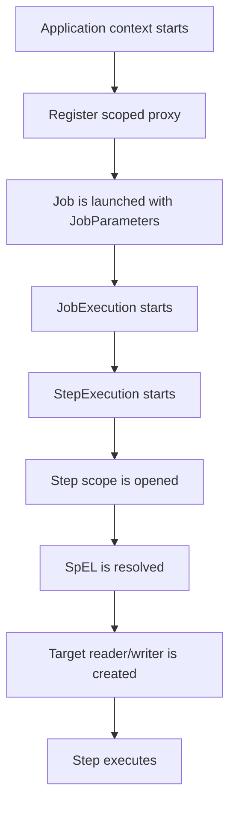

# Late binding expression

In Spring Batch, many values are only available when the job is actually launched: input file names, business dates, tenants, partition keys, or output paths created by an earlier step. If you read these values when Spring initializes the application context, they do not exist yet. **Late binding** allows a bean to receive those values at the exact moment its execution scope is opened.

Late binding typically uses Spring Expression Language (SpEL) alongside Spring Batch scopes:

- **JobParameters**: parameters passed when launching the job.
- **JobExecutionContext**: data scoped to a single JobExecution.
- **StepExecutionContext**: data scoped to a single StepExecution.

Common expressions:

| Data Source | Expression |
|---|---|
| Job parameter | #{jobParameters['input.file']} |
| Job execution context | #{jobExecutionContext['output.directory']} |
| Step execution context | #{stepExecutionContext['fileName']} |

For these expressions to be evaluated at the right time, components needing late binding are usually declared with **@StepScope** or **@JobScope**. A regular singleton bean created at application context startup has no current StepExecution/JobExecution to resolve runtime values.

## 1. Why is Late Binding Needed?

Spring creates application beans during context startup. However, Spring Batch only knows JobParameters when a JobExecution is launched; StepExecution and the corresponding ExecutionContexts also only exist during the execution lifecycle.

Suppose a job reads a file passed by a scheduler:

```java
JobParameters parameters = new JobParametersBuilder()
        .addString("input.file", "data/orders-2026-11-15.csv", true)
        .toJobParameters();
```

If a singleton reader needed to receive the file name when the bean is created, the application context would not yet have the JobParameters for this launch. The value also varies per run, so it cannot be fixed in a singleton configuration.

Late binding defers creating the target bean until the appropriate scope has an execution context. When the step starts, Spring Batch has the current StepExecution and can resolve job parameters, job context, or step context into the bean's constructor/method arguments.



Key point: the expression does not necessarily get resolved when the configuration class is read. A scoped proxy is created early, while the target bean is created when Spring Batch activates the corresponding scope.

## 2. Three Common Data Sources in Expressions

### JobParameters

JobParameters are the inputs of a single launch. They are typically used to identify the dataset to process or business parameters.

Example:

```java
@Bean
@StepScope
FlatFileItemReader<OrderInput> orderReader(
        @Value("#{jobParameters['input.file']}") String inputFile) {

    return new FlatFileItemReaderBuilder<OrderInput>()
            .name("orderReader")
            .resource(new FileSystemResource(inputFile))
            .delimited()
            .names("orderId", "customerId", "amount")
            .targetType(OrderInput.class)
            .build();
}
```

When the job is launched with the `input.file` parameter, the reader receives that exact run's path. Another launch can pass a different path without recreating the application context.

### JobExecutionContext

JobExecutionContext holds data scoped to a single job execution. It is commonly used to share a small value between steps within the same job execution.

For example, one step prepares the output directory and writes a key to the job context. A later step reads the value:

```java
@Bean
@StepScope
FlatFileItemWriter<Order> orderWriter(
        @Value("#{jobExecutionContext['output.file']}") String outputFile) {

    return new FlatFileItemWriterBuilder<Order>()
            .name("orderWriter")
            .resource(new FileSystemResource(outputFile))
            .delimited()
            .names("orderId", "customerId", "amount")
            .build();
}
```

The expression can only resolve the value if the `output.file` key has been written into JobExecutionContext before the target writer is created and used.

### StepExecutionContext

StepExecutionContext belongs to a single step execution. This is the right source for step-specific data, especially in partitioning.

For example, each partition is assigned its own file:

```java
@Bean
@StepScope
FlatFileItemReader<OrderInput> partitionReader(
        @Value("#{stepExecutionContext['fileName']}") String fileName) {

    return new FlatFileItemReaderBuilder<OrderInput>()
            .name("partitionReader")
            .resource(new FileSystemResource(fileName))
            .delimited()
            .names("orderId", "amount")
            .targetType(OrderInput.class)
            .build();
}
```

Each worker StepExecution has its own StepExecutionContext, so each reader instance receives the `fileName` corresponding to its partition.

## 3. What is @StepScope?

@StepScope is a Spring Batch annotation for declaring a bean whose lifecycle is bound to a StepExecution. It is equivalent to using step scope with a scoped proxy by default.

Example:

```java
@Bean
@StepScope
ItemReader<OrderInput> orderReader(
        @Value("#{jobParameters['input.file']}") String inputFile) {
    return createReader(inputFile);
}
```

The target bean is created once step scope is active. At that point, Spring can resolve:

- jobParameters.
- jobExecutionContext.
- stepExecutionContext.
- stepExecution.
- jobExecution.

A scoped proxy is injected into singleton beans such as Step definitions. When the step executes, the proxy routes calls to the target bean belonging to the current StepExecution.

### One Target Instance per StepExecution

Step scope is tied to a StepExecution, not just to the Step bean name. When the step runs in a new JobExecution, the target scoped bean is created for that execution. With partitioning, each worker StepExecution has its own scope, preventing reader state across partitions from mixing.

This is why @StepScope suits readers, writers, or processors whose configuration depends on JobParameters or ExecutionContext. It also keeps each component's mutable state tied to the right step execution.

## 4. What is @JobScope?

@JobScope declares a bean whose lifecycle is bound to a JobExecution. The target bean is created when job scope is active and retained for the duration of that job execution.

Example of a component configured by business date:

```java
public record ReportContext(LocalDate businessDate, String tenantId) {
}

@Bean
@JobScope
ReportContext reportContext(
        @Value("#{jobParameters['businessDate']}") LocalDate businessDate,
        @Value("#{jobParameters['tenantId']}") String tenantId) {

    return new ReportContext(businessDate, tenantId);
}
```

Steps within the same JobExecution can inject the `ReportContext` proxy and share the same target instance at the job level. This fits when a small object holds configuration shared across the entire job.

### Comparing @JobScope and @StepScope

| Aspect | @JobScope | @StepScope |
|---|---|---|
| Lifecycle | One JobExecution | One StepExecution |
| Can late-bind JobParameters | Yes | Yes |
| Can read JobExecutionContext | Yes | Yes |
| Can read current StepExecutionContext | Not suitable at job scope | Yes |
| Used for | Shared configuration/state of a job | Reader, writer, processor, or step-specific component |
| Partition workers | Should not be used for per-worker state | Each worker StepExecution has its own scope |

If data belongs specifically to one partition or step, use StepScope. JobScope does not have a single specific StepExecution to resolve `stepExecutionContext`.

## 5. Declaring Late Binding in Java Configuration

Complete example with Spring Batch 5:

```java
@Configuration
public class OrderJobConfiguration {

    @Bean
    @StepScope
    FlatFileItemReader<OrderInput> orderReader(
            @Value("#{jobParameters['input.file']}") String inputFile) {

        return new FlatFileItemReaderBuilder<OrderInput>()
                .name("orderReader")
                .resource(new FileSystemResource(inputFile))
                .delimited()
                .names("orderId", "customerId", "amount")
                .targetType(OrderInput.class)
                .build();
    }

    @Bean
    Step importOrdersStep(
            JobRepository jobRepository,
            PlatformTransactionManager transactionManager,
            ItemReader<OrderInput> orderReader,
            ItemWriter<Order> orderWriter) {

        return new StepBuilder("importOrdersStep", jobRepository)
                .<OrderInput, Order>chunk(100, transactionManager)
                .reader(orderReader)
                .processor(orderProcessor())
                .writer(orderWriter)
                .build();
    }
}
```

The Step bean can normally be a singleton. It receives the proxy of `orderReader`; the real target reader is only created when step scope has an execution context.

The example above assumes the other writer and processor beans are configured elsewhere. In real projects, declare the reader bean's return type as an interface or class compatible with how injection and proxying are used.

### Do Not Call @Bean Methods Directly to Get the Target

In Spring configurations with proxied bean methods, `@Bean` method calls are typically intercepted by the container. However, do not manually invoke a factory method or use `new` to create a reader in runtime code and expect late binding to work. Inject the bean from the Spring container and let the scope manage its lifecycle.

## 6. SpEL Syntax for JobParameters

Expressions accessing JobParameters use the `jobParameters` variable name and key access syntax:

```java
@Value("#{jobParameters['input.file']}")
String inputFile

@Value("#{jobParameters['businessDate']}")
LocalDate businessDate

@Value("#{jobParameters['tenantId']}")
String tenantId
```

Bracket notation is useful when keys contain dots, hyphens, or characters unsuitable for simple property syntax. Use the exact key name created when launching the job.

Example creating parameters:

```java
JobParameters parameters = new JobParametersBuilder()
        .addString("input.file", "/data/orders.csv", true)
        .addString("businessDate", "2026-11-15", true)
        .addString("tenantId", "tenant-42", true)
        .toJobParameters();
```

Values are converted to the bean parameter type via Spring's conversion mechanism. For complex types or custom date formats, configure an explicit converter or accept a String and parse and validate inside the factory method.

### Required Values and Optional Values

If a required parameter is missing, the bean may fail to instantiate or validation will fail when the step starts. This is usually a job configuration error that should be caught early.

You can provide a default in SpEL using the Elvis operator:

```java
@Value("#{jobParameters['delimiter'] ?: ','}")
String delimiter
```

Only use defaults when the business genuinely has a valid default value. For required input file, tenant, or business date, fail explicitly if missing rather than silently picking a default that might process the wrong data.

## 7. SpEL Syntax for JobExecutionContext

JobExecutionContext holds keys shared across a single JobExecution. Expression:

```java
@Value("#{jobExecutionContext['output.file']}")
String outputFile
```

An earlier step can generate the path and save it to the job context:

```java
public class PrepareOutputTasklet implements Tasklet {

    @Override
    public RepeatStatus execute(
            StepContribution contribution,
            ChunkContext chunkContext) {

        JobExecution jobExecution = chunkContext.getStepContext()
                .getStepExecution()
                .getJobExecution();

        String outputFile = "/data/output/report.csv";
        jobExecution.getExecutionContext()
                .putString("output.file", outputFile);

        return RepeatStatus.FINISHED;
    }
}
```

A subsequent step injects the value with `@StepScope`:

```java
@Bean
@StepScope
FlatFileItemWriter<ReportRow> reportWriter(
        @Value("#{jobExecutionContext['output.file']}") String outputFile) {

    return new FlatFileItemWriterBuilder<ReportRow>()
            .name("reportWriter")
            .resource(new FileSystemResource(outputFile))
            .delimited()
            .names("id", "total")
            .build();
}
```

The critical condition is that the output-preparing step must run first and the value must be saved in JobExecutionContext before the target writer is created and used.

Do not confuse JobExecutionContext with StepExecutionContext. A value placed in the preparing step's step context does not automatically appear in the next step's job context. To share it, promote the key or write directly to the job context following the proper lifecycle.

## 8. SpEL Syntax for StepExecutionContext

StepExecutionContext holds data specific to a single step. Expression:

```java
@Value("#{stepExecutionContext['partition.file']}")
String partitionFile
```

This is a common pattern when a partitioner creates contexts for each worker:

```java
public class OrderFilePartitioner implements Partitioner {

    @Override
    public Map<String, ExecutionContext> partition(int gridSize) {
        Map<String, ExecutionContext> partitions = new HashMap<>();

        partitions.put("partition0", contextFor("/data/orders-0.csv"));
        partitions.put("partition1", contextFor("/data/orders-1.csv"));

        return partitions;
    }

    private ExecutionContext contextFor(String fileName) {
        ExecutionContext context = new ExecutionContext();
        context.putString("partition.file", fileName);
        return context;
    }
}
```

The worker reader receives the current partition's file:

```java
@Bean
@StepScope
FlatFileItemReader<OrderInput> partitionReader(
        @Value("#{stepExecutionContext['partition.file']}") String partitionFile) {

    return new FlatFileItemReaderBuilder<OrderInput>()
            .name("partitionReader")
            .resource(new FileSystemResource(partitionFile))
            .delimited()
            .names("orderId", "amount")
            .targetType(OrderInput.class)
            .build();
}
```

Each worker has a StepExecutionContext created from its corresponding partition context. Because the reader is step-scoped, each worker receives a target bean with its own file.

## 9. Accessing Execution Information via SpEL

Beyond the three common maps, scopes also provide execution objects to read needed properties:

| Variable | Example | Scope |
|---|---|---|
| jobParameters | #{jobParameters['batchId']} | Current JobExecution |
| jobExecutionContext | #{jobExecutionContext['snapshotId']} | Current JobExecution |
| stepExecutionContext | #{stepExecutionContext['partitionId']} | Current StepExecution |
| jobExecution | #{jobExecution.id} | Current JobExecution |
| stepExecution | #{stepExecution.stepName} | Current StepExecution |

Example:

```java
@Bean
@StepScope
BranchAudit branchAudit(
        @Value("#{jobExecution.id}") Long jobExecutionId,
        @Value("#{stepExecution.stepName}") String stepName,
        @Value("#{jobParameters['batchId']}") String batchId) {

    return new BranchAudit(jobExecutionId, stepName, batchId);
}
```

Only inject values that the component actually needs. Just because an expression can access lots of metadata does not mean you should pass the entire JobExecution or StepExecution into every component.

## 10. When to Use @StepScope vs @JobScope?

Choose the scope based on lifecycle and data ownership:

| Need | Suitable Scope |
|---|---|
| Reader receiving input file path from JobParameters | @StepScope |
| Writer receiving output path from JobExecutionContext | @StepScope |
| Reader receiving per-partition fileName from StepExecutionContext | @StepScope |
| Component using shared configuration for one JobExecution | @JobScope |
| Component holding a step's cursor or buffer | @StepScope |
| Component depending only on static configuration at app startup | Regular singleton |

Do not use @JobScope merely because the value comes from JobParameters. StepScope can also access `jobParameters` and is usually a better fit for step readers/writers.

### JobScope in Parallel and Partitioned Processing

JobScope carries an important caveat: Spring Batch does not recommend using job-scoped beans in multi-threaded or partitioned steps. Threads spawned by the framework or an executor may not have the job scope context in the way the application expects across all configurations.

For components invoked concurrently by multiple workers, prefer StepScope and per-StepExecution data. If job-level shared state is needed, use a thread-safe service or a durable resource with clear locking/transactions.

## 11. Late Binding and ExecutionContextPromotionListener

A step can write checkpoints or results into StepExecutionContext. If a later step needs one of those values at the job level, you can use ExecutionContextPromotionListener to promote keys when the step ends with an allowed status.

Example:

```java
@Bean
ExecutionContextPromotionListener promoteOutputListener() {
    ExecutionContextPromotionListener listener =
            new ExecutionContextPromotionListener();
    listener.setKeys(new String[] { "output.file" });
    listener.setStatuses(new String[] { "COMPLETED" });
    return listener;
}
```

Attach the listener to the step creating the output:

```java
@Bean
Step prepareOutputStep(
        JobRepository jobRepository,
        PlatformTransactionManager transactionManager,
        ExecutionContextPromotionListener promoteOutputListener) {

    return new StepBuilder("prepareOutputStep", jobRepository)
            .tasklet((contribution, chunkContext) -> {
                chunkContext.getStepContext()
                        .getStepExecution()
                        .getExecutionContext()
                        .putString("output.file", "/data/report.csv");
                return RepeatStatus.FINISHED;
            }, transactionManager)
            .listener(promoteOutputListener)
            .build();
}
```

The next step can use:

```java
@Bean
@StepScope
ReportWriter reportWriter(
        @Value("#{jobExecutionContext['output.file']}") String outputFile) {
    return new ReportWriter(outputFile);
}
```

Promotion clarifies boundaries: the producing step owns the key in its step context; the listener moves the key to the job context when the step finishes with the right status; the consuming step late-binds from the job context.

Do not read a key from `jobExecutionContext` if it only exists in `stepExecutionContext` and has not been promoted or copied.

## 12. When Expressions Are Resolved

Late binding does not mean the expression is evaluated continuously on every method call. For scoped beans, the expression is normally resolved when the target bean is created in the corresponding scope.

Reader example:

1. Application context creates a scoped proxy for the reader.
2. Job is launched with `input.file`.
3. Step starts and StepScope is opened.
4. The first time the proxy needs the target, Spring creates the reader.
5. SpEL reads `input.file` from JobParameters.
6. The reader retains the injected value within that StepExecution's target instance.

If the job context changes after the target bean has been created, injected fields do not automatically update to the new value. Therefore, write the needed keys before the step uses the bean and do not use late binding as a mechanism for continuous dynamic configuration updates.

## 13. Late Binding in Restarts

When restarting a JobInstance, Spring Batch creates a new JobExecution. Identifying JobParameters of the same JobInstance are preserved by the instance definition, while JobExecutionContext and StepExecutionContext are restored according to the metadata/restart lifecycle.

Late binding during a restart reads data belonging to the active execution or the context restored for that step:

- JobParameters provide the identifying inputs of the JobInstance.
- JobExecutionContext provides saved job state for the current execution.
- StepExecutionContext provides checkpoints of the restarting step.

Do not assume a field in a singleton bean will automatically receive a new value on restart. A singleton bean may retain values from application context creation and is unsuitable for per-execution parameters.

For restartable readers, ensure input resources are stable. If the path is identical but the file content changed, the checkpoint may point to an offset that no longer matches. Store a source version, immutable object ID, or checksum to validate inputs.

## 14. Late Binding and Identifying JobParameters

Late binding only reads parameters; it does not decide whether a parameter is identifying. The identifying flag is set when creating JobParameters and affects how Spring Batch identifies a JobInstance.

Example:

```java
JobParameters parameters = new JobParametersBuilder()
        .addString("businessDate", "2026-11-15", true)
        .addString("input.file", "/data/orders.csv", true)
        .addString("requestedBy", "scheduler", false)
        .toJobParameters();
```

A reader can inject `input.file`, while another service injects `businessDate`. `requestedBy` being non-identifying does not prevent expressions from reading it; the identifying flag and late binding are two separate concerns.

Do not put passwords, access tokens, private keys, or signed URLs in JobParameters just because late binding makes them convenient to access. JobParameters are persisted in metadata and can appear in operational tools. Use a secret manager and store only secret references when needed.

## 15. Data Types and Conversion

Spring can convert expression values to the bean parameter type if the conversion service has a suitable converter.

Example:

```java
@Bean
@StepScope
ImportOptions importOptions(
        @Value("#{jobParameters['businessDate']}") LocalDate businessDate,
        @Value("#{jobParameters['maxErrors']}") Integer maxErrors,
        @Value("#{jobParameters['dryRun']}") Boolean dryRun) {

    return new ImportOptions(businessDate, maxErrors, dryRun);
}
```

If conversion fails, the error may surface when the scoped target bean is created—that is, when the step starts rather than when the application context starts up. This can sometimes make configuration errors harder to spot if you only test startup.

For non-standard date formats, enums, or complex objects:

- Use an appropriate JobParameter type if your version supports it.
- Register an explicit converter.
- Or accept a String and parse/validate in the factory method.
- Return error messages naming the key and expected format without logging sensitive data.

## 16. Validating Required Parameters Before Creating Components

A reader might not be created until the step begins. If `input.file` is missing, the error happens late. You can add a parameter validation step at the start of the job to catch it early:

```java
@Bean
Step validateParametersStep(
        JobRepository jobRepository,
        PlatformTransactionManager transactionManager) {

    return new StepBuilder("validateParametersStep", jobRepository)
            .tasklet((contribution, chunkContext) -> {
                JobParameters parameters = chunkContext.getStepContext()
                        .getStepExecution()
                        .getJobParameters();

                String inputFile = parameters.getString("input.file");
                if (inputFile == null || inputFile.isBlank()) {
                    throw new IllegalArgumentException(
                            "Required job parameter input.file is missing");
                }

                return RepeatStatus.FINISHED;
            }, transactionManager)
            .build();
}
```

A validation step helps fail fast with a clear message. The scoped bean's factory method should still check critical invariants because the component might be reused from another job configuration or a parameter might have the wrong type.

## 17. Common Errors When Using Late Binding

**Injecting jobParameters into a singleton bean.** Singletons are created before the job runs, so there is no execution context to resolve. Use @StepScope or @JobScope.

**Forgetting to declare scope.** Expressions may fail because `stepExecutionContext` or `jobParameters` does not exist in the bean creation context. Mark the bean with the right scope and ensure Spring Batch scopes are registered.

**Using stepExecutionContext in JobScope.** JobScope does not represent a single specific StepExecution. Move the component to StepScope if it needs step-specific data.

**Reading the previous step's step context in a later step.** Each step has its own StepExecutionContext. Promote keys to JobExecutionContext or store data in a shared resource.

**Reading job context before keys are written.** Ensure the key-producing step runs first and writes to the right JobExecutionContext.

**Assuming expressions are evaluated continuously.** Values are typically injected when the scoped target bean is created. Subsequent context changes do not auto-update injected fields.

**Using JobScope for partition worker state.** Multiple workers need separate state. Use StepScope and StepExecutionContext.

**Using wrong key name or casing.** SpEL looks up by key; verify exact spelling between producer and consumer.

**Not validating data types.** Conversion errors may only appear when the step starts. Validate parameters and converters.

**Creating scoped beans with new.** Beans outside the Spring container lack scoped proxies and late binding.

**Storing secrets in parameters/context.** Late binding does not encrypt data. Use a secret manager and safe references.

## 18. Testing Late Binding

Tests should launch the job with different sets of JobParameters and confirm each execution receives the right values:

```java
@SpringBatchTest
@SpringJUnitConfig(OrderJobTestConfiguration.class)
class OrderJobLateBindingTest {

    @Autowired
    private JobLauncherTestUtils jobLauncherTestUtils;

    @Test
    void readerUsesInputFileFromJobParameters() throws Exception {
        JobParameters parameters = new JobParametersBuilder()
                .addString("input.file", testFileOne.toString(), true)
                .toJobParameters();

        JobExecution execution =
                jobLauncherTestUtils.launchJob(parameters);

        assertEquals(BatchStatus.COMPLETED, execution.getStatus());
        assertEquals(
                expectedRowsFromFileOne,
                countImportedRows(execution));
    }
}
```

A second test can launch with a different file and verify the reader picks up the new file. Use distinct identifying parameters to create a new JobInstance; when testing restart, keep identifying parameters identical.

### Testing StepExecutionContext

For a partitioned step, create two partitions with different `fileName` values. Confirm each worker reads the right file and does not accidentally use the other worker's value. Verify output by partition ID or source record ID.

### Testing JobExecutionContext Promotion

Have the first step write a key into StepExecutionContext and use a promotion listener. Have the next step inject the key from `jobExecutionContext`. Verify:

- The key is promoted when the first step ends with the configured status.
- If the first step fails, the key is not promoted per policy.
- The next step does not read a stale leftover value from another JobExecution.
- Restart restores needed values according to metadata.

### Testing Missing Parameters

Launch the job without passing a required parameter. Verify the job/validation step fails with a clear message, without producing wrong output or using an unintended default.

## 19. Scope Configuration and Test Context

Late binding relies on scopes registered in the Spring container. When using Spring Batch annotation configuration, `@EnableBatchProcessing` registers the required scopes. Spring Boot auto-configuration normally sets up the corresponding infrastructure if the app uses the starter and does not override batch configuration.

If manually configuring batch infrastructure or if a test only imports partial configuration, verify that StepScope and JobScope are registered. A bean using a syntactically valid expression still fails if the scope does not exist.

Do not invent a fake scope in production to make expressions run. Use the scopes provided by Spring Batch so the framework binds target beans to the right JobExecution/StepExecution.

## 20. Choosing Scope and Expression by Scenario

| Scenario | Scope | Suggested Expression |
|---|---|---|
| Input file passed at launch | @StepScope | #{jobParameters['input.file']} |
| Business date of the job | @JobScope or @StepScope | #{jobParameters['businessDate']} |
| Output path created and promoted by earlier step | @StepScope | #{jobExecutionContext['output.file']} |
| File specific to a partition worker | @StepScope | #{stepExecutionContext['partition.file']} |
| Reader checkpoint cursor | @StepScope component | Framework stores in StepExecutionContext |
| Per-worker state | @StepScope | #{stepExecutionContext['partitionId']} |
| Fixed configuration at app startup | Singleton | No late binding needed |

If a value is only used by one step, prefer step scope. If an object genuinely represents shared configuration for one JobExecution, consider job scope, but avoid using it to hold mutable state updated by multiple threads.

## 21. Late Binding Implementation Workflow

When you need to inject a runtime value, follow these steps:

1. Identify the source of the value: JobParameters, JobExecutionContext, or StepExecutionContext.
2. Determine the component's lifecycle: one job execution or one step execution.
3. Choose @JobScope or @StepScope accordingly.
4. Declare the bean through the Spring container and inject the expression with `@Value`.
5. Ensure the key exists before the target bean is created.
6. Check data types and validate required values.
7. For data from an earlier step, promote or write to a shared resource properly.
8. For partitions, store per-worker values in each worker's context.
9. Test via JobLauncher with multiple parameter sets and restarts.
10. Do not place secrets or large payloads into metadata just because expressions can read them.

## 22. Practical Conclusion

Late binding expressions allow components to receive values available only when the job or step actually runs. SpEL accesses JobParameters, JobExecutionContext, and StepExecutionContext; @StepScope and @JobScope defer target bean creation to the right lifecycle so expressions can be resolved.

Use @StepScope for readers, writers, and processors needing configuration specific to a StepExecution, especially in partitioning. Use @JobScope for objects holding shared configuration across a JobExecution without depending on a specific step. If an earlier step produces data needed by a later step, promote keys from step context to job context or store data in a durable resource.

Late binding is not a mechanism for continuous value updates, does not replace joins/synchronization between flows, and does not encrypt data. When scope, context source, bean creation timing, and restart lifecycle are clearly defined, expressions make it easy to reuse one job for many inputs while keeping each execution's configuration independent.
