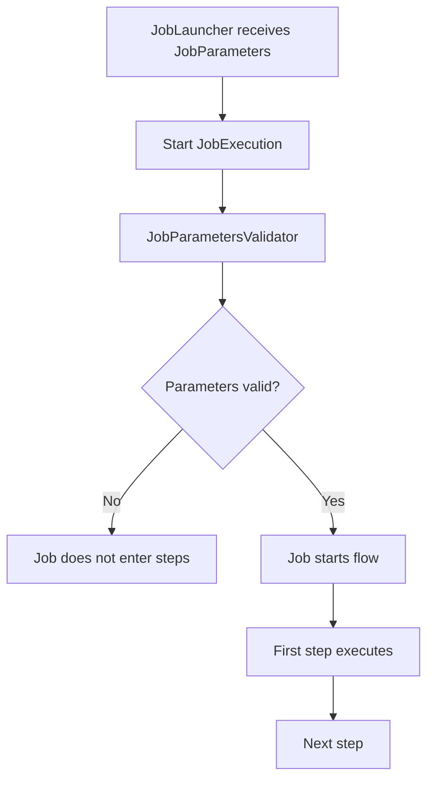

# Validation Before Step Creation

In Spring Batch, a job typically receives input parameters such as business date, tenant, file path, processing period code, or run mode. If a parameter is missing, malformed, or mutually incompatible, the job might fail late inside a reader, processor, or writer. By then, the step may already have opened resources, created temporary files, or executed part of the work before detecting the configuration error.

To catch input errors early, Spring Batch provides `JobParametersValidator`. The validator is attached at the job level and checks `JobParameters` before the job proceeds to execute steps. This enables the job to fail fast with a clear message, avoiding launching the pipeline when inputs are invalid.

There is a nuance to note about the phrase "before step creation": in standard Java configuration, `Step` beans are constructed by Spring when the application context initializes. `JobParametersValidator` runs at job launch time, before the job's steps begin executing; it does not defer instantiating `Step` beans until after validation. If runtime parameters must be checked before the first step executes, use a job-level validator.

## 1. Why Validate Before Steps Run?

Suppose an order import job receives the parameters:

- `businessDate`: date of data to import.
- `tenantId`: tenant owning the data.
- `inputFile`: input file path.
- `mode`: processing mode such as `FULL` or `DELTA`.

If `businessDate` cannot be parsed, `tenantId` is negative, or the file does not exist, the step should not start reading data. Leaving detection to the reader means the job might already have created metadata, opened streams, or prepared outputs before failing.

Early validation helps:

- Detect missing required parameters immediately when launching the job.
- Verify data types and formats before injecting into readers/writers.
- Check whether parameters conflict with one another.
- Return understandable error messages to the scheduler or operator.
- Avoid step execution and side effects when inputs are already invalid.
- Separate configuration/input errors from errors arising during data processing.

Validation does not replace per-record data checks. `JobParametersValidator` checks job-level inputs; processors or business validators still need to validate the content of each item.

## 2. Where Does JobParametersValidator Fit in the Lifecycle?

`JobParametersValidator` is configured on the job. When the launcher starts the job, Spring Batch checks the `JobParameters` set via the validator before executing the job's flow and steps.

Overview flow:



The validator runs before the first step's processing. The job repository still manages metadata and executions; do not assume zero metadata is ever created when validation fails. The guarantee to focus on is that business steps do not execute with parameters rejected by the validator.

### Validation Does Not Occur Before Spring Creates Step Beans

In standard configuration:

```java
@Bean
public Step importStep(...) {
    return new StepBuilder("importStep", jobRepository)
            // reader, processor, writer...
            .build();
}
```

Spring builds the `importStep` bean while constructing the application context. `JobParametersValidator` only receives the parameters of a specific launch at runtime. Thus, a validator is not a tool for preventing `Step` beans from being initialized at startup.

If creating a bean depends on runtime parameters, use late binding with `@StepScope` or `@JobScope` and ensure values are validated before the step uses that bean. Do not rebuild the entire `Step` graph on every launch just to check parameters.

## 3. The JobParametersValidator Interface

The core interface has a single method:

```java
public interface JobParametersValidator {
    void validate(JobParameters parameters)
            throws JobParametersInvalidException;
}
```

The validator receives the job's parameter set. If valid, the method returns normally. If invalid, it throws `JobParametersInvalidException` with a message explaining the problem.

Simple example:

```java
public class RequiredDateValidator implements JobParametersValidator {

    @Override
    public void validate(JobParameters parameters)
            throws JobParametersInvalidException {

        String businessDate = parameters.getString("businessDate");

        if (businessDate == null || businessDate.isBlank()) {
            throw new JobParametersInvalidException(
                    "Required parameter 'businessDate' is missing");
        }
    }
}
```

The validator should check inputs deterministically and return specific errors. Avoid letting `NullPointerException`, `DateTimeParseException`, or infrastructure exceptions leak directly without converting them into an appropriate validation message.

## 4. Configuring a Validator on JobBuilder

In Spring Batch 5 Java configuration, attach a validator using `.validator(...)`:

```java
@Bean
public Job importOrdersJob(
        JobRepository jobRepository,
        Step importOrdersStep,
        JobParametersValidator importJobParametersValidator) {

    return new JobBuilder("importOrdersJob", jobRepository)
            .validator(importJobParametersValidator)
            .start(importOrdersStep)
            .build();
}
```

When `JobLauncher` runs `importOrdersJob`, the validator is invoked for that execution's parameters before `importOrdersStep` executes.

A job has one primary validator configuration point. If multiple rule groups are needed, combine them in one custom validator or use `CompositeJobParametersValidator` if your Spring Batch version provides it.

Do not attach validators to individual readers or writers if the rule genuinely applies to the whole job. Checking at the job level ensures every step is protected by the same input contract.

## 5. Using DefaultJobParametersValidator

For simple requirements checking required parameter names and permitted parameter lists, Spring Batch provides `DefaultJobParametersValidator`.

Example:

```java
@Bean
public JobParametersValidator importJobParametersValidator() {
    return new DefaultJobParametersValidator(
            new String[] {"businessDate", "tenantId"},
            new String[] {"inputFile", "mode"});
}
```

In this configuration:

- `businessDate` and `tenantId` are required keys.
- `inputFile` and `mode` are accepted optional keys.
- Keys outside the valid lists may be rejected according to the default validator's rules.

`DefaultJobParametersValidator` suits basic structural checks. It does not check whether a date parses, whether a tenant exists, whether a file is readable, or whether two parameters are business-compatible. For those needs, use a custom validator.

If the application needs to accept extra parameters passed by a scheduler, explicitly declare them in the optional list or build a validator matching the application's parameter contract. Do not let unexpected parameters enter the job uncontrolled.

## 6. Writing a Custom Validator for Types and Formats

A practical validator typically checks both presence and value formatting.

Example validating an ISO date and positive tenant ID:

```java
public class ImportJobParametersValidator
        implements JobParametersValidator {

    @Override
    public void validate(JobParameters parameters)
            throws JobParametersInvalidException {

        String businessDate = parameters.getString("businessDate");
        Long tenantId = parameters.getLong("tenantId");

        if (businessDate == null || businessDate.isBlank()) {
            throw new JobParametersInvalidException(
                    "Parameter 'businessDate' is required");
        }

        try {
            LocalDate.parse(businessDate);
        } catch (DateTimeParseException ex) {
            throw new JobParametersInvalidException(
                    "Parameter 'businessDate' must use ISO format yyyy-MM-dd");
        }

        if (tenantId == null || tenantId <= 0) {
            throw new JobParametersInvalidException(
                    "Parameter 'tenantId' must be a positive number");
        }
    }
}
```

Here, `businessDate` is passed as a string and parsed with `LocalDate`. If parsing fails, the validator returns a clear formatting message. `tenantId` is retrieved as `Long`, so the launcher should create a matching typed job parameter.

Do not parse the same value across multiple steps using different rules. Define the canonical format in the validator and let downstream components use the validated value.

## 7. Validating Interdependent Parameters

Many errors lie not in an individual parameter, but in the combination of parameters.

Examples:

- `mode=FULL` requires `inputFile`.
- `mode=DELTA` requires `fromDate` and `toDate`.
- `toDate` must be greater than or equal to `fromDate`.
- `tenantId` must be supplied if the job runs in multi-tenant mode.
- `outputFile` must not match `inputFile`.
- `reprocess=true` and `dryRun=true` are disallowed together if unsupported by business rules.

Example validator checking mode:

```java
String mode = parameters.getString("mode", "FULL");
String inputFile = parameters.getString("inputFile");
String fromDate = parameters.getString("fromDate");
String toDate = parameters.getString("toDate");

if ("FULL".equals(mode)) {
    if (inputFile == null || inputFile.isBlank()) {
        throw new JobParametersInvalidException(
                "inputFile is required when mode is FULL");
    }
} else if ("DELTA".equals(mode)) {
    if (fromDate == null || toDate == null) {
        throw new JobParametersInvalidException(
                "fromDate and toDate are required when mode is DELTA");
    }
} else {
    throw new JobParametersInvalidException(
            "Unsupported mode: " + mode);
}
```

When validating a date range, parse both into `LocalDate` before comparing. Do not compare arbitrary strings if the format does not guarantee lexicographical order matches chronological order.

## 8. Checking Files and Resources Before Steps Run

Some conditions can be checked directly in the validator, such as whether an input file path exists and is readable.

```java
String inputFile = parameters.getString("inputFile");

if (inputFile == null || inputFile.isBlank()) {
    throw new JobParametersInvalidException(
            "Parameter 'inputFile' is required");
}

Path path = Path.of(inputFile);

if (!Files.isRegularFile(path)) {
    throw new JobParametersInvalidException(
            "Input file does not exist or is not a regular file: " + inputFile);
}

if (!Files.isReadable(path)) {
    throw new JobParametersInvalidException(
            "Input file is not readable: " + inputFile);
}
```

Checking files in the validator is helpful when the file is a prerequisite for the job to start. However, the validator only checks at a single point in time. The file could be deleted or modified after validation and before the reader opens it. The step still needs to handle real I/O errors.

For resources from S3, HTTP, or external systems, consider the cost and stability of preflight checks. A check request might time out or add load before the job starts. If a check depends on business operations or needs its own retries, place it in a validation/preparation step rather than `JobParametersValidator`.

## 9. Structural Validation vs Business Preflight

Not every check belongs in `JobParametersValidator`.

| Check Type | Appropriate Place | Example |
|---|---|---|
| Required parameters | `JobParametersValidator` | `businessDate`, `tenantId` present |
| Format and value range | `JobParametersValidator` | Parseable date, positive ID, valid mode |
| Parameter relationships | `JobParametersValidator` | `fromDate <= toDate`, mode requires input file |
| Quick local resource check | Validator or preflight step | File exists, valid path |
| Business state check from database | Usually preflight/validation step | Is data period locked, is tenant active |
| Per-record content check | Reader/processor/item validator | Valid order code, positive amount |
| Recoverable dependency check | Step with dedicated retry/timeout/metrics | Can partner API handle requests |

Validators should be fast, deterministic, and low on side effects. Calling multiple external systems can slow job launches or cause failures from transient dependencies before an execution step exists to retry and track them.

## 10. Separating JobParametersValidator and a Validation Step

`JobParametersValidator` fits simple input checks that do not involve heavy data processing. If complex business preflight checks are needed, create an initial step.

Example:

```text
JobLauncher
   |
   v
JobParametersValidator
   | valid
   v
validateBusinessStateStep
   | valid
   v
importDataStep
```

The validator can verify `businessDate` format and `tenantId` presence. `validateBusinessStateStep` can query the database to confirm the data period is not closed, processing permissions are active, or the input source is registered.

Advantages of a validation step:

- Has its own `StepExecution` to track status, duration, and exceptions.
- Can use appropriate transactions, retry, and skip policies.
- Can store preflight results in `ExecutionContext`.
- Can create audit records or validation reports.
- Can restart per metadata if the step is designed appropriately.

The drawback is that the job has already entered the flow and a step has started. If the requirement is solely rejecting bad parameter sets, `JobParametersValidator` is simpler and more suitable.

## 11. Do Not Use `@StepScope` Instead of a Validator

Late binding injects job parameters into step-scoped beans:

```java
@Bean
@StepScope
public FlatFileItemReader<OrderInput> orderReader(
        @Value("#{jobParameters['inputFile']}") String inputFile) {
    FlatFileItemReader<OrderInput> reader = new FlatFileItemReader<>();
    reader.setName("orderReader");
    reader.setResource(new FileSystemResource(inputFile));
    reader.setSaveState(true);
    reader.setLineMapper(orderLineMapper());
    return reader;
}
```

If `inputFile` is missing, the reader may fail when the step-scoped target is created or when the resource is opened. This error happens later than job-level validation.

Recommended combination:

1. `JobParametersValidator` checks required parameters and formats before steps run.
2. `@StepScope` late-binds validated values into readers/writers.
3. Readers still handle actual I/O errors when opening sources because resources can change after preflight.

Do not place all validation logic inside reader or writer constructors. Constructors should configure components; the job-level validator owns the input contract.

## 12. Creating Strongly Typed JobParameters

Job launchers should create parameters with accurate data types so validators and downstream components read them consistently.

Example:

```java
JobParameters parameters = new JobParametersBuilder()
        .addString("businessDate", "2026-11-15", true)
        .addLong("tenantId", 42L, true)
        .addString("inputFile", "data/orders.csv", false)
        .addString("mode", "FULL", false)
        .toJobParameters();
```

The third argument of the builder methods specifies identifying vs non-identifying:

- `businessDate=true`: business date helps identify `JobInstance`.
- `tenantId=true`: tenant helps identify `JobInstance`.
- `inputFile=false`: file path is input info but does not participate in identity in this example.
- `mode=false`: mode is passed but does not participate in identity.

The identifying decision must be based on business meaning. If changing `inputFile` actually represents a different business job, it should probably be identifying. Otherwise, the same date and tenant could be treated as the same instance even though the file changed.

The validator checks parameter values, whereas the identifying flag determines instance identity. These are two separate responsibilities.

## 13. A Complete Custom Validator

The following example combines required parameter, date, tenant, mode, and input file validation:

```java
public class ImportJobParametersValidator
        implements JobParametersValidator {

    @Override
    public void validate(JobParameters parameters)
            throws JobParametersInvalidException {

        String businessDate = parameters.getString("businessDate");
        Long tenantId = parameters.getLong("tenantId");
        String mode = parameters.getString("mode", "FULL");
        String inputFile = parameters.getString("inputFile");

        if (businessDate == null || businessDate.isBlank()) {
            throw invalid("businessDate is required");
        }

        try {
            LocalDate.parse(businessDate);
        } catch (DateTimeParseException ex) {
            throw invalid("businessDate must use yyyy-MM-dd format");
        }

        if (tenantId == null || tenantId <= 0) {
            throw invalid("tenantId must be a positive number");
        }

        if (!"FULL".equals(mode) && !"DELTA".equals(mode)) {
            throw invalid("mode must be FULL or DELTA");
        }

        if ("FULL".equals(mode)) {
            validateInputFile(inputFile);
        }
    }

    private void validateInputFile(String inputFile)
            throws JobParametersInvalidException {
        if (inputFile == null || inputFile.isBlank()) {
            throw invalid("inputFile is required in FULL mode");
        }

        Path path = Path.of(inputFile);
        if (!Files.isRegularFile(path) || !Files.isReadable(path)) {
            throw invalid("inputFile must be an existing readable file");
        }
    }

    private JobParametersInvalidException invalid(String message) {
        return new JobParametersInvalidException(message);
    }
}
```

This code assumes the application uses Java time and local files. Add the corresponding imports such as `java.time.LocalDate`, `java.time.format.DateTimeParseException`, `java.nio.file.Files`, and `java.nio.file.Path`.

In production, you can collect multiple errors into a list so callers can fix everything at once instead of throwing on the first error. If doing so, messages should name the key and violated condition without putting secrets or full sensitive payloads in exceptions.

## 14. Registering the Validator as a Spring Bean

You can declare the validator as a bean and inject it into the job:

```java
@Bean
public JobParametersValidator importJobParametersValidator() {
    return new ImportJobParametersValidator();
}

@Bean
public Job importOrdersJob(
        JobRepository jobRepository,
        Step importOrdersStep,
        JobParametersValidator importJobParametersValidator) {

    return new JobBuilder("importOrdersJob", jobRepository)
            .validator(importJobParametersValidator)
            .start(importOrdersStep)
            .build();
}
```

If the application has multiple jobs, use specific bean names or qualifiers to avoid injecting the wrong validator. Each job may have a different parameter contract.

Do not use one shared validator containing hardcoded conditions for all jobs if jobs accept different parameter sets. Small check helpers can be reused, but input contracts should be configured per job.

## 15. Validation and Identifying Parameters

A validator does not decide whether a parameter participates in identifying a `JobInstance`. That is governed by the identifying flag in `JobParameters`.

Example of two launches:

```text
Run A:
  businessDate=2026-11-15 (identifying)
  tenantId=42 (identifying)
  inputFile=orders-a.csv (non-identifying)

Run B:
  businessDate=2026-11-15 (identifying)
  tenantId=42 (identifying)
  inputFile=orders-b.csv (non-identifying)
```

Both runs may be considered the same `JobInstance` because the identifying parameters match. If the previous execution completed, the next launch may be rejected; if the previous execution failed, it may be treated as a restart of the same instance. Even if the validator accepts `orders-b.csv`, swapping inputs within the same instance can invalidate old checkpoints.

Therefore, if an input file determines the business dataset, consider placing file identity, checksum, or input version into identifying parameters. Do not just check that the file exists; ensure restarts use the exact source that produced the checkpoint.

## 16. Validators Should Be Pure and Side-Effect Free

`JobParametersValidator` is invoked at launch time. If a validator sends emails, creates files, writes business data, or calls resource-creating APIs, a failed validation can leave side effects even though the job never entered a step.

Keep validators:

- Fast with predictable execution time.
- Free of business data writes.
- Free of creating output files or messages.
- Without mutating `JobParameters`.
- Without storing mutable state shared across executions.
- Performing only the input checks needed to decide whether the job should run.

If creating an input snapshot or registering a batch with an external system is needed, consider doing it inside a step with clear metadata, transactions/retries, and recoverability.

## 17. Do Not Rely on Validators to Check Every Record

Job parameters are job-level metadata. A file can exist and be readable while still containing thousands of malformed records. `JobParametersValidator` should not open the entire file to validate every line, as that reads the source twice, slows down launches, and creates discrepancies between preflight and actual reading.

Separation of responsibilities:

- Job-level validator: validates file paths, parameter formats, modes, and data ranges.
- Reader: detects I/O, parsing, or encoding errors while reading.
- Processor: enforces per-item business rules.
- SkipListener/error writer: records skippable items.
- Final step: aggregates error metrics and decides on publishing.

If scanning a file before import is required, build a dedicated validation step that can store reports and be tracked as part of the job.

## 18. Handling Validation Errors in JobLauncher

When a validator throws `JobParametersInvalidException`, the launcher should prevent the job from entering business steps. Depending on how the launcher is invoked and the framework version, the validation error may propagate to the caller or be reflected in execution state per actual lifecycle.

At the job invocation layer, handle invalid parameter errors separately from other errors:

- `JobParametersInvalidException`: caller needs to fix inputs or scheduler configuration.
- `JobExecutionAlreadyRunningException`: instance currently has an active execution.
- `JobInstanceAlreadyCompleteException`: instance already completed and is not a valid restart.
- `JobRestartException`: instance cannot restart under current state/configuration.
- Technical errors creating execution or accessing repository: investigate infrastructure.

Do not catch all exceptions and merely log "job failed". Validation messages must be specific enough for the scheduler or operator to know which parameter is wrong.

## 19. Testing the Validator Directly

Custom validators should have standalone unit tests. This is a fast way to verify the input contract without running a database or the whole job.

Example:

```java
class ImportJobParametersValidatorTest {

    private final ImportJobParametersValidator validator =
            new ImportJobParametersValidator();

    @Test
    void acceptsValidParameters() {
        JobParameters parameters = new JobParametersBuilder()
                .addString("businessDate", "2026-11-15", true)
                .addLong("tenantId", 42L, true)
                .addString("mode", "DELTA", false)
                .addString("fromDate", "2026-11-01", false)
                .addString("toDate", "2026-11-15", false)
                .toJobParameters();

        assertDoesNotThrow(() -> validator.validate(parameters));
    }

    @Test
    void rejectsMissingBusinessDate() {
        JobParameters parameters = new JobParametersBuilder()
                .addLong("tenantId", 42L, true)
                .toJobParameters();

        assertThrows(
                JobParametersInvalidException.class,
                () -> validator.validate(parameters));
    }
}
```

The first test assumes the validator has a `DELTA` branch corresponding to date range rules. Construct test data matching the actual contract of your application's validator.

Include tests for:

- Missing each required parameter.
- Malformed or invalid dates.
- Zero or negative IDs.
- Unsupported enum/mode values.
- Missing dependent parameters.
- Inverted date ranges.
- Non-existent or unreadable files.
- Disallowed parameters if using strict key validation.
- Valid combinations for each run mode.

## 20. Testing Validators via JobLauncherTestUtils

Unit tests prove validator logic, while integration tests must confirm the validator is wired properly into the job and steps do not run when parameters are invalid.

You can use `@SpringBatchTest` and `JobLauncherTestUtils` to launch the job with invalid parameters. Depending on version and launcher, the test may catch `JobParametersInvalidException` from the launch call or inspect execution/metadata accordingly. The key assertion is that business steps do not execute.

Skeleton example:

```java
@SpringBatchTest
@SpringJUnitConfig(ImportJobTestConfiguration.class)
class ImportJobValidationIntegrationTest {

    @Autowired
    private JobLauncherTestUtils jobLauncherTestUtils;

    @Test
    void doesNotRunImportStepWhenParametersAreInvalid() {
        JobParameters invalidParameters = new JobParametersBuilder()
                .addLong("tenantId", -1L, true)
                .toJobParameters();

        assertThrows(
                JobParametersInvalidException.class,
                () -> jobLauncherTestUtils.launchJob(invalidParameters));

        // A test probe can be used to verify reader/writer were not called.
        // No business output is produced.
    }
}
```

This is an illustrative skeleton; the test configuration must supply the job, validator, repository, and probe. If your framework version or test utility surfaces errors differently, assert according to the launcher's actual contract while still confirming no business step ran.

## 21. Common Configuration Errors

| Situation | Cause | How to Fix |
|---|---|---|
| Validator does not run | `.validator(...)` not attached to job or wrong bean injected | Check JobBuilder and bean wiring |
| Error only appears when reader opens | Only validated inside reader/late binding | Add job-level `JobParametersValidator` |
| Step bean still initialized despite bad parameters | Confusing runtime validator with startup bean creation | Distinguish bean creation from step execution |
| Valid parameters yet wrong source on restart | Input not in identifying parameters or not versioned | Define input identity and keep source stable |
| Default validator rejects key sent by scheduler | Key missing from required/optional list | Update parameter contract or custom validator |
| Validator fails to check type | Job parameter created with a different type | Use typed JobParametersBuilder and read matching type |
| Preflight slows down launches | Validator calls multiple APIs/databases | Move complex checks to a validation step |
| Validation fails yet leaves side effects | Validator writes files/calls APIs/creates data | Keep validator pure; move side effects to a step |
| Confusing validation error | Exception only contains generic parse/null error | Throw `JobParametersInvalidException` with specific key and condition |
| Bad record data still enters job | Only validated job parameters | Validate content in reader/processor or validation step |

## 22. Pre-Step Validation Design Process

1. **Enumerate the input contract:** identify all job parameters, data types, and identifying flags.
2. **Mark required/optional parameters:** prevent schedulers from passing undefined values.
3. **Define per-key rules:** format, value range, enum, path, and limits.
4. **Define inter-key relationships:** which mode needs an input file, which date ranges are valid, which tenants are allowed.
5. **Choose the validator:** use `DefaultJobParametersValidator` for simple key checks; custom validator for type and input business rules.
6. **Attach validator to JobBuilder:** ensure all launches go through the same contract.
7. **Keep validation lightweight:** check structure and fast preconditions; move heavy data/system checks into a step.
8. **Late-bind after validation:** use `@StepScope` or `@JobScope` to inject validated runtime values into the right components.
9. **Test fail-fast:** bad parameters must stop business steps from running and return a clear message.
10. **Verify restart identity:** the same logical job uses the same identifying parameters and the same data source.

## 23. Key Principles to Remember

- `JobParametersValidator` validates inputs at the job level before business steps begin executing.
- Validators run at runtime when launching the job; regular `Step` beans are already built at application context startup.
- Use `DefaultJobParametersValidator` for required/optional parameter keys.
- Use custom validators to verify types, formats, value ranges, and relationships between parameters.
- Throw `JobParametersInvalidException` with a specific message when inputs are invalid.
- Attach validators to `JobBuilder` via `.validator(...)`.
- Distinguish parameter validation from business preflight and per-record validation.
- Keep validators fast, deterministic, and side-effect free.
- Use `@StepScope`/`@JobScope` to late-bind parameters after validation; scopes do not replace validators.
- Identifying parameters determine `JobInstance`; validators do not decide identifying flags.
- If inputs determine the dataset, ensure input identity/version stays stable across restarts.
- Test validators directly and write integration tests confirming steps do not run when parameters are invalid.

Pre-step validation lets Spring Batch reject invalid inputs right at the job boundary. When the `JobParameters` contract is clearly defined, validators are attached at the job level, and complex checks are placed in an appropriate step, the pipeline avoids configuration errors caught too late and becomes easier to operate, test, and restart.
