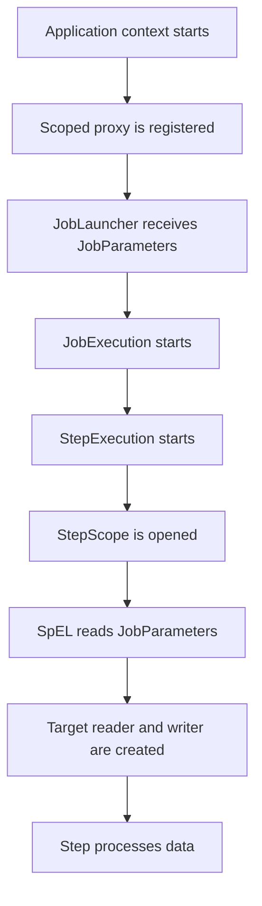

# Passing Parameters to Readers and Writers

In Spring Batch, readers and writers often need values known only when the job is launched: input file paths, business dates, tenant codes, batch IDs, output paths, or query limits. These values should not be hardcoded in singleton beans because a single application context can serve multiple runs with different inputs.

Spring Batch supports passing runtime values into readers and writers via **JobParameters**, Spring Expression Language (SpEL), and **@StepScope**. When the step starts, the scoped bean is created within the active execution context and expressions are resolved. This allows the same job configuration to read different files, query different datasets, or write outputs to different locations depending on each launch's parameters.

Common pattern:

```java
@Bean
@StepScope
FlatFileItemReader<OrderInput> orderReader(
        @Value("#{jobParameters['input.file']}") String inputFile) {
    // Create reader from the current run's inputFile.
}

@Bean
@StepScope
FlatFileItemWriter<Order> orderWriter(
        @Value("#{jobParameters['output.file']}") String outputFile) {
    // Create writer from the current run's outputFile.
}
```

Readers and writers are typically stateful components bound to a step, so StepScope is the right choice. This article covers passing parameters, validating values, using them in file/database readers and writers, handling restarts, and testing individual runs.

## 1. How Are JobParameters Passed Into a Job?

JobParameters are the set of input parameters for a job launch. They are constructed before calling `JobLauncher`:

```java
JobParameters parameters = new JobParametersBuilder()
        .addString("input.file", "/data/in/orders.csv", true)
        .addString("output.file", "/data/out/orders-result.csv", true)
        .addString("businessDate", "2026-11-15", true)
        .addString("tenantId", "tenant-42", true)
        .toJobParameters();

JobExecution execution = jobLauncher.run(orderImportJob, parameters);
```

Each parameter has a name, value, data type, and identifying flag. In the example, the values are marked identifying to participate in identifying the `JobInstance`. When restarting, reuse the same identifying parameters to resume the exact `JobInstance`.

JobParameters suit job input data:

- Dataset or file to process.
- Business date or time range.
- Tenant, business unit, or batch code.
- Processing modes such as dry-run if part of the run definition.
- Query parameters such as limits or watermarks.

Do not use JobParameters to pass large objects, full item lists, or secrets. JobParameters are persisted in metadata for Spring Batch to identify and recover executions.

## 2. Why Do Readers and Writers Need @StepScope?

Spring creates the application context before the job is launched. At that point, there is no specific `JobExecution` or `StepExecution` to resolve JobParameters for an upcoming run.

If the reader were created as a regular singleton:

```java
@Bean
FlatFileItemReader<OrderInput> orderReader(
        @Value("#{jobParameters['input.file']}") String inputFile) {
    // No active JobExecution when singleton is created.
}
```

Spring may fail with an error because there is no job scope context to read `jobParameters`. Even if configured differently, a singleton is still unsuitable for holding per-run paths.

Adding `@StepScope`:

```java
@Bean
@StepScope
FlatFileItemReader<OrderInput> orderReader(
        @Value("#{jobParameters['input.file']}") String inputFile) {
    return createOrderReader(inputFile);
}
```

Spring registers a scoped proxy in the application context. The real target reader is only created when StepScope is active, at which point Spring Batch has supplied the current `StepExecution` and related contexts.



A step-scoped bean gets a separate target instance for each `StepExecution`. When the same job launches with different parameters, the target reader/writer is created with the values for that execution.

## 3. Passing Parameters to FlatFileItemReader

Example of a reader receiving a file path from JobParameters:

```java
@Bean
@StepScope
FlatFileItemReader<OrderInput> orderReader(
        @Value("#{jobParameters['input.file']}") String inputFile) {

    return new FlatFileItemReaderBuilder<OrderInput>()
            .name("orderReader")
            .resource(new FileSystemResource(inputFile))
            .encoding("UTF-8")
            .linesToSkip(1)
            .delimited()
            .names("orderId", "customerId", "amount")
            .targetType(OrderInput.class)
            .saveState(true)
            .build();
}
```

Explanation:

- `@StepScope` defers target reader creation.
- `@Value` retrieves the `input.file` key from JobParameters.
- `FileSystemResource` represents the passed file.
- `name` is a stable name for the reader to save/restore state.
- `saveState(true)` lets the reader save checkpoints for restart.

The job can use this reader for multiple files:

```java
JobParameters firstRun = new JobParametersBuilder()
        .addString("input.file", "/data/in/orders-a.csv", true)
        .toJobParameters();

JobParameters secondRun = new JobParametersBuilder()
        .addString("input.file", "/data/in/orders-b.csv", true)
        .toJobParameters();
```

The two runs can create two different `JobInstances` because `input.file` is an identifying parameter. Each `StepExecution` receives a reader with its corresponding resource.

### Do Not Concatenate Paths Arbitrarily

If paths are built from multiple parameters, validate and normalize values before use. For example, if a scheduler passes a file name, the application should restrict files to an allowed input directory and prevent path traversal.

Do not concatenate externally supplied values directly into arbitrary paths without validation. For sensitive data, pass only a controlled ID or reference and let the application resolve it to a valid resource.

## 4. Passing Parameters to FlatFileItemWriter

Writers can also receive output paths from JobParameters:

```java
@Bean
@StepScope
FlatFileItemWriter<Order> orderWriter(
        @Value("#{jobParameters['output.file']}") String outputFile) {

    return new FlatFileItemWriterBuilder<Order>()
            .name("orderWriter")
            .resource(new FileSystemResource(outputFile))
            .encoding("UTF-8")
            .delimited()
            .delimiter(",")
            .names("orderId", "customerId", "amount")
            .saveState(true)
            .build();
}
```

Points to note:

- `output.file` specifies the target resource for the run.
- `name` must be stable so the writer recognizes its state on restart.
- `saveState(true)` allows saving information needed to resume writing.
- The parent directory must exist or be created by a prior preparation step.
- The output path must stay stable for the same `JobInstance` for safe restarts.

Do not generate a random output path on each restart. If the path changes across retries of the same `JobInstance`, the writer may resume on a different resource than the one used previously.

### Avoiding Overwriting Outputs of Other Runs

If two `JobInstances` write to the same file, data can be overwritten or interleaved. Build output paths using a batch ID, business date, or stable business identifier:

```java
String outputFile = outputDirectory
        + "/orders-" + batchId + ".csv";
```

Ensure each batch has its own resource or an appropriate locking/publishing mechanism. Do not share the same output path across two concurrent executions unless the writer is explicitly designed for such sharing.

## 5. Passing the Same Parameter to Both Reader and Writer

An import/export job often uses the same batch ID or business date in both reader and writer. You can inject the same `JobParameter` into two scoped beans:

```java
@Bean
@StepScope
FlatFileItemReader<OrderInput> orderReader(
        @Value("#{jobParameters['input.file']}") String inputFile,
        @Value("#{jobParameters['businessDate']}") String businessDate) {

    return new FlatFileItemReaderBuilder<OrderInput>()
            .name("orderReader")
            .resource(new FileSystemResource(inputFile))
            .delimited()
            .names("orderId", "customerId", "amount")
            .targetType(OrderInput.class)
            .saveState(true)
            .build();
}

@Bean
@StepScope
FlatFileItemWriter<Order> orderWriter(
        @Value("#{jobParameters['output.file']}") String outputFile,
        @Value("#{jobParameters['batchId']}") String batchId) {

    return new FlatFileItemWriterBuilder<Order>()
            .name("orderWriter")
            .resource(new FileSystemResource(outputFile))
            .delimited()
            .names("orderId", "customerId", "amount")
            .saveState(true)
            .build();
}
```

In this example, `businessDate` and `batchId` can be used to filter data, write headers, add metadata, or attach correlation to logs. If the writer needs `batchId` for database writes, it can be passed into a custom writer or a SQL statement with parameter binding.

Do not inject parameters just to hold an unused field. Every dependency should have a concrete purpose and be validated.

## 6. Configuring a Step Using the Reader and Writer

Readers and writers are injected into the step like regular beans. Scoped proxies ensure they receive their targets at the right moment:

```java
@Bean
Step importOrdersStep(
        JobRepository jobRepository,
        PlatformTransactionManager transactionManager,
        ItemReader<OrderInput> orderReader,
        ItemProcessor<OrderInput, Order> orderProcessor,
        ItemWriter<Order> orderWriter) {

    return new StepBuilder("importOrdersStep", jobRepository)
            .<OrderInput, Order>chunk(100, transactionManager)
            .reader(orderReader)
            .processor(orderProcessor)
            .writer(orderWriter)
            .build();
}
```

The step bean can be a singleton because it holds the workflow definition and proxies. Target readers/writers are only created when the step execution begins.

Job:

```java
@Bean
Job orderImportJob(
        JobRepository jobRepository,
        Step importOrdersStep) {

    return new JobBuilder("orderImportJob", jobRepository)
            .start(importOrdersStep)
            .build();
}
```

When `JobLauncher` runs the job with `input.file` and `output.file`, both scoped beans are created with values from the corresponding `JobExecution`/`StepExecution`.

## 7. Passing Parameters to JdbcCursorItemReader

For database readers, JobParameters can supply tenant, business date, or watermark to bound data. Use prepared statement parameter binding instead of concatenating into SQL strings.

Example:

```java
@Bean
@StepScope
JdbcCursorItemReader<OrderInput> orderDatabaseReader(
        DataSource dataSource,
        @Value("#{jobParameters['tenantId']}") String tenantId,
        @Value("#{jobParameters['businessDate']}") String businessDateText) {

    LocalDate businessDate =
            LocalDate.parse(businessDateText, DateTimeFormatter.ISO_LOCAL_DATE);

    return new JdbcCursorItemReaderBuilder<OrderInput>()
            .name("orderDatabaseReader")
            .dataSource(dataSource)
            .sql("""
                    select id, customer_id, amount
                    from orders
                    where tenant_id = ?
                      and business_date = ?
                    order by id
                    """)
            .preparedStatementSetter(statement -> {
                statement.setString(1, tenantId);
                statement.setDate(2, Date.valueOf(businessDate));
            })
            .rowMapper((resultSet, rowNum) ->
                    new OrderInput(
                            resultSet.getLong("id"),
                            resultSet.getString("customer_id"),
                            resultSet.getBigDecimal("amount")))
            .fetchSize(500)
            .saveState(true)
            .build();
}
```

Parameters `tenantId` and `businessDate` are bound to placeholders. This avoids SQL injection from string concatenation and lets the JDBC driver handle data types.

If using a paging reader, inject parameters into `parameterValues` of `JdbcPagingItemReaderBuilder` along with a `whereClause` and stable sort keys. Choose a unique sort order or include a tie-breaker so checkpoints neither skip nor duplicate records on restart.

### Do Not Use Parameters as Arbitrary Table Names

Prepared statement parameters are for values, not for substituting table or column names. If you must select a table by tenant or data kind, map the parameter through an allowed list of identifiers in code; never concatenate arbitrary input into SQL.

## 8. Passing Parameters to JdbcBatchItemWriter

A database writer may need a shared batch ID in addition to item fields. You can create a step-scoped writer and bind the batch ID into each insert statement:

```java
@Bean
@StepScope
JdbcBatchItemWriter<Order> orderDatabaseWriter(
        DataSource dataSource,
        @Value("#{jobParameters['batchId']}") String batchId) {

    return new JdbcBatchItemWriterBuilder<Order>()
            .dataSource(dataSource)
            .sql("""
                    insert into processed_order
                        (batch_id, order_id, customer_id, amount)
                    values (?, ?, ?, ?)
                    """)
            .itemPreparedStatementSetter((order, statement) -> {
                statement.setString(1, batchId);
                statement.setLong(2, order.id());
                statement.setString(3, order.customerId());
                statement.setBigDecimal(4, order.amount());
            })
            .assertUpdates(true)
            .build();
}
```

Each item is written with the `batchId` of the current `JobExecution`. The database can use `batch_id` to query, reconcile, and clean up per batch.

Configure an appropriate unique constraint, such as `batch_id` and `order_id`, if a record must not be written twice within the same batch. This supports idempotency when the job restarts or the writer is retried after an error.

Do not embed `batchId` into SQL via string concatenation. Use placeholders and `PreparedStatement` to bind values.

## 9. Passing Parameters to a Custom Reader

If a reader is custom-written by the application, it can receive values via its constructor:

```java
public class TenantOrderReader implements ItemReader<OrderInput> {

    private final OrderRepository repository;
    private final String tenantId;
    private final LocalDate businessDate;

    private Iterator<OrderInput> iterator;

    public TenantOrderReader(
            OrderRepository repository,
            String tenantId,
            LocalDate businessDate) {
        this.repository = repository;
        this.tenantId = tenantId;
        this.businessDate = businessDate;
    }

    @Override
    public OrderInput read() {
        if (iterator == null) {
            iterator = repository
                    .findOrders(tenantId, businessDate)
                    .iterator();
        }

        return iterator.hasNext() ? iterator.next() : null;
    }
}
```

Create the reader via a step-scoped factory:

```java
@Bean
@StepScope
TenantOrderReader tenantOrderReader(
        OrderRepository repository,
        @Value("#{jobParameters['tenantId']}") String tenantId,
        @Value("#{jobParameters['businessDate']}") String businessDateText) {

    LocalDate businessDate = LocalDate.parse(businessDateText);
    return new TenantOrderReader(repository, tenantId, businessDate);
}
```

This example illustrates constructor injection. Production readers must implement `ItemStream` if they need to save checkpoints and restore the iterator on restart; avoid loading the entire dataset into memory when data is large.

For custom readers, clearly separate:

- Immutable configuration parameters injected when the target bean is created.
- Runtime state such as cursors/offsets stored in `ExecutionContext`.
- Resources needing open/close in the `open`/`read`/`close` lifecycle if implementing `ItemStream`.

## 10. Passing Parameters to a Custom Writer

Custom writers can also receive batch ID, tenant, or output destination via constructor:

```java
public class BatchAuditWriter implements ItemWriter<Order> {

    private final AuditRepository auditRepository;
    private final String batchId;

    public BatchAuditWriter(
            AuditRepository auditRepository,
            String batchId) {
        this.auditRepository = auditRepository;
        this.batchId = batchId;
    }

    @Override
    public void write(Chunk<? extends Order> chunk) {
        for (Order order : chunk) {
            auditRepository.insert(
                    batchId,
                    order.id(),
                    order.amount());
        }
    }
}
```

Step-scoped factory method:

```java
@Bean
@StepScope
BatchAuditWriter batchAuditWriter(
        AuditRepository auditRepository,
        @Value("#{jobParameters['batchId']}") String batchId) {
    return new BatchAuditWriter(auditRepository, batchId);
}
```

Each `StepExecution` receives a target writer with the current run's `batchId`. If the writer is used in a chunk step, repository operations should participate in the appropriate transaction so chunk rollbacks take effect.

Do not use a singleton writer with a mutable `batchId` field changed on every launch. Two concurrent jobs could write the wrong batch ID if sharing mutable state.

## 11. Passing Numeric, Date, and Boolean Parameters

JobParameters support typed values. In configuration, SpEL and Spring's `ConversionService` can convert values to the factory method's parameter type if an appropriate converter exists.

Example:

```java
@Bean
@StepScope
ImportOptions importOptions(
        @Value("#{jobParameters['maxRows']}") Long maxRows,
        @Value("#{jobParameters['dryRun']}") Boolean dryRun) {

    return new ImportOptions(maxRows, dryRun);
}
```

For business dates, you can accept a `String` and parse it explicitly:

```java
@Bean
@StepScope
BusinessWindow businessWindow(
        @Value("#{jobParameters['businessDate']}") String dateText) {

    LocalDate businessDate =
            LocalDate.parse(dateText, DateTimeFormatter.ISO_LOCAL_DATE);

    return new BusinessWindow(businessDate);
}
```

Explicit parsing produces clear error messages if the parameter has the wrong format. Define a consistent format on the scheduler/API side calling the job.

If you want to inject `LocalDate` or another type directly, ensure the application's conversion service has a matching converter and test it on the Spring Batch/Spring Framework version in use.

## 12. Optional Parameters and Default Values

Some parameters may be optional, such as delimiter or max rows. SpEL supports the Elvis operator to select a default:

```java
@Bean
@StepScope
FlatFileItemReader<OrderInput> orderReader(
        @Value("#{jobParameters['input.file']}") String inputFile,
        @Value("#{jobParameters['delimiter'] ?: ','}") String delimiter) {

    return new FlatFileItemReaderBuilder<OrderInput>()
            .name("orderReader")
            .resource(new FileSystemResource(inputFile))
            .delimited()
            .delimiter(delimiter)
            .names("orderId", "customerId", "amount")
            .targetType(OrderInput.class)
            .build();
}
```

Only set defaults when the fallback value is business-meaningful. For required input file, tenant, or business date, fail fast when missing instead of picking a default value.

You can validate null/blank in the factory method:

```java
private static String requireText(String value, String parameterName) {
    if (value == null || value.isBlank()) {
        throw new IllegalArgumentException(
                "Required job parameter is missing: " + parameterName);
    }
    return value;
}
```

Then call `requireText(inputFile, "input.file")` before creating the resource.

## 13. Validating Parameters Before Readers/Writers Open Resources

Do not wait until the reader starts reading to discover an invalid parameter. A validation step at the start of the job can check:

- Whether required parameters exist.
- Whether the input file exists and is readable.
- Whether the output directory is writable.
- Whether the business date has the right format and allowed range.
- Whether the tenant ID is valid and the caller has permission to process that tenant.
- Whether the batch ID conforms to the expected format.

Example:

```java
@Bean
Step validateJobParametersStep(
        JobRepository jobRepository,
        PlatformTransactionManager transactionManager) {

    return new StepBuilder("validateJobParametersStep", jobRepository)
            .tasklet((contribution, chunkContext) -> {
                JobParameters parameters = chunkContext.getStepContext()
                        .getStepExecution()
                        .getJobParameters();

                String inputFile = parameters.getString("input.file");
                String outputFile = parameters.getString("output.file");

                if (inputFile == null || inputFile.isBlank()) {
                    throw new IllegalArgumentException(
                            "Required parameter input.file is missing");
                }
                if (outputFile == null || outputFile.isBlank()) {
                    throw new IllegalArgumentException(
                            "Required parameter output.file is missing");
                }

                Path inputPath = Path.of(inputFile);
                if (!Files.isRegularFile(inputPath)
                        || !Files.isReadable(inputPath)) {
                    throw new IllegalArgumentException(
                            "Input file is not readable");
                }

                return RepeatStatus.FINISHED;
            }, transactionManager)
            .build();
}
```

The example focuses on input validation. In production, verify the output directory and permissions according to the filesystem/environment, and avoid exposing sensitive paths in error messages if logs are broadly shared.

## 14. Distinguishing JobParameters from ExecutionContext

Readers and writers can receive values from multiple sources. Choose the source based on semantics and lifecycle:

| Source | When to Use | Example |
|---|---|---|
| JobParameters | Input values passed by caller at launch | input.file, businessDate, tenantId |
| JobExecutionContext | Values produced by a step and shared within the same job execution | output.file, snapshotId |
| StepExecutionContext | State specific to a step/partition | partition.file, lastReadId |

Example of a reader receiving a file directly from the caller:

```java
@Value("#{jobParameters['input.file']}")
String inputFile
```

If a previous step generates the output file name and writes it to `JobExecutionContext`, a later writer can receive:

```java
@Value("#{jobExecutionContext['output.file']}")
String outputFile
```

If a partitioner assigns each worker a separate file:

```java
@Value("#{stepExecutionContext['partition.file']}")
String partitionFile
```

Values from step context do not automatically appear in job context. If a subsequent step needs a key from an earlier step, use `ExecutionContextPromotionListener` or store the reference in a shared resource with a clear lifecycle.

## 15. Passing Parameters to Readers/Writers in Partitioning

In a partitioned step, each worker has its own `StepExecutionContext`. A partitioner can put file names, ID ranges, or tenant partitions into context; worker readers/writers receive values via `@StepScope`.

Example partitioner:

```java
public class OrderPartitioner implements Partitioner {

    @Override
    public Map<String, ExecutionContext> partition(int gridSize) {
        Map<String, ExecutionContext> partitions = new HashMap<>();

        ExecutionContext first = new ExecutionContext();
        first.putLong("minId", 1L);
        first.putLong("maxId", 1000L);
        partitions.put("partition0", first);

        ExecutionContext second = new ExecutionContext();
        second.putLong("minId", 1001L);
        second.putLong("maxId", 2000L);
        partitions.put("partition1", second);

        return partitions;
    }
}
```

Worker reader:

```java
@Bean
@StepScope
JdbcCursorItemReader<OrderInput> partitionOrderReader(
        DataSource dataSource,
        @Value("#{stepExecutionContext['minId']}") Long minId,
        @Value("#{stepExecutionContext['maxId']}") Long maxId) {

    return new JdbcCursorItemReaderBuilder<OrderInput>()
            .name("partitionOrderReader")
            .dataSource(dataSource)
            .sql("""
                    select id, customer_id, amount
                    from orders
                    where id between ? and ?
                    order by id
                    """)
            .preparedStatementSetter(statement -> {
                statement.setLong(1, minId);
                statement.setLong(2, maxId);
            })
            .rowMapper((rs, rowNum) ->
                    new OrderInput(
                            rs.getLong("id"),
                            rs.getString("customer_id"),
                            rs.getBigDecimal("amount")))
            .saveState(true)
            .build();
}
```

Each worker receives its own partition's `minId`/`maxId`. Do not use `JobExecutionContext` for values that differ between workers because they need independent state.

JobParameters can still supply shared values such as `businessDate` or `tenantId`; `StepExecutionContext` adds the partition range. A reader can receive both:

```java
@Bean
@StepScope
PartitionReader partitionReader(
        @Value("#{jobParameters['businessDate']}") String businessDate,
        @Value("#{stepExecutionContext['minId']}") Long minId,
        @Value("#{stepExecutionContext['maxId']}") Long maxId) {
    return new PartitionReader(businessDate, minId, maxId);
}
```

## 16. Writer Parameters and Restarts

Writers often hold state such as write position, line count, or resource info. With `FlatFileItemWriter`, restarts depend on a stable writer name, `saveState`, and the matching target resource.

Guidelines:

- The same `JobInstance` must use the same output resource when restarting the writer.
- Do not generate a random output path on each restart.
- Set a stable, unique writer name within the step.
- Enable `saveState` if writer restart state is needed.
- Clearly define when to create a new file, when to append/resume, and when to publish the completed file.
- Do not let two concurrent executions write to the same file.

Example where the output path is built from an identifying batch ID:

```java
@Bean
@StepScope
FlatFileItemWriter<Order> orderWriter(
        @Value("#{jobParameters['batchId']}") String batchId) {

    String outputFile = "/data/out/orders-" + batchId + ".csv";

    return new FlatFileItemWriterBuilder<Order>()
            .name("orderWriter")
            .resource(new FileSystemResource(outputFile))
            .delimited()
            .names("orderId", "amount")
            .saveState(true)
            .build();
}
```

This is an illustrative example. In production, `batchId` must be validated before building paths and the output directory must be controlled. If a batch needs to be rewritten from scratch after completion, create a reprocessing request with its own identifier/version and a clear publishing workflow.

Do not blindly enable options to delete existing files. Understand writer behavior on fresh runs vs restarts; deleting an existing file during a restart can corrupt output already written in earlier chunks.

## 17. Identifying and Non-Identifying Parameters

Late binding only reads values. The identifying flag determines whether a parameter participates in creating the `JobInstance`.

Example:

```java
JobParameters parameters = new JobParametersBuilder()
        .addString("businessDate", "2026-11-15", true)
        .addString("input.file", "/data/in/orders.csv", true)
        .addString("requestedBy", "scheduler", false)
        .toJobParameters();
```

A reader can inject all three values. However:

- `businessDate` and `input.file` identify the dataset and batch identity.
- `requestedBy` is supplemental metadata and does not create a new `JobInstance`.
- On restart, identifying parameters must be kept unchanged.
- Changing an identifying parameter creates a different `JobInstance`.

If a writer output path depends on a non-identifying parameter that can change across restarts, the same `JobInstance` could write to a different resource. Therefore, any value governing input/output that must remain stable should be aligned with identifying parameters or persisted reliably in metadata.

## 18. Do Not Pass Secrets via Reader/Writer Parameters

JobParameters and ExecutionContext are stored in `JobRepository`. They can appear in the metadata database, backups, dashboards, or operational logs.

Never pass directly:

- Database passwords.
- API keys or bearer tokens.
- OAuth refresh tokens.
- Private keys or signing secrets.
- Session cookies or signed URLs granting access.

If a reader/writer needs credentials to access a resource, inject a secret provider/service and retrieve credentials from a secret manager at runtime. Only store a non-sensitive reference if needed to identify the secret.

Similarly, avoid placing full payloads or personal data in JobParameters merely for reader/writer access. Store payloads in an appropriate system and pass an ID/version/reference.

## 19. Common Errors

**Forgetting @StepScope.** SpEL has no execution context when a singleton is created. Annotate readers/writers needing late binding with `@StepScope`.

**Using singleton readers/writers with mutable fields changed per job.** Two concurrent executions can use the wrong file path, tenant, or batch ID. Use separate scoped targets per `StepExecution`.

**Using the wrong parameter name.** Keys in `JobParameters` and expressions must match exactly. Standardize names and check in a validation step.

**Reading keys from the wrong context.** `JobParameters`, `JobExecutionContext`, and `StepExecutionContext` have different lifecycles. Choose the right source.

**Later step reading earlier step's step context.** Step contexts are not automatically shared. Promote keys or store data in a shared resource.

**Concatenating parameters directly into SQL.** Prone to SQL injection and escaping bugs. Use `PreparedStatement` placeholders.

**Using parameters to construct arbitrary table names.** Parameter binding does not apply to SQL identifiers. Use a whitelist if selecting identifiers.

**Not validating file paths.** Can read the wrong file, escape allowed directories, or overwrite outputs.

**Using an output path that changes between restarts.** The writer may resume into a different resource. Keep resources stable for the same `JobInstance`.

**Not enabling or misunderstanding saveState.** Readers/writers cannot restore the right position if checkpoints are not saved as required.

**Using a fresh timestamp as an identifying parameter on restart.** The job may create a new instance and reprocess data.

**Passing credentials via JobParameters.** Metadata can store sensitive values. Use a secret manager.

## 20. Testing Parameter Injection

Tests should launch the job with different sets of `JobParameters` and verify readers/writers receive the right values.

Example with Spring Batch test support:

```java
@SpringBatchTest
@SpringJUnitConfig(OrderJobTestConfiguration.class)
class OrderJobParameterTest {

    @Autowired
    private JobLauncherTestUtils jobLauncherTestUtils;

    @Test
    void readerAndWriterUsePathsFromJobParameters() throws Exception {
        Path input = createInputFile();
        Path output = temporaryDirectory.resolve("result.csv");

        JobParameters parameters = new JobParametersBuilder()
                .addString("input.file", input.toString(), true)
                .addString("output.file", output.toString(), true)
                .addString("batchId", "test-batch-01", true)
                .toJobParameters();

        JobExecution execution =
                jobLauncherTestUtils.launchJob(parameters);

        assertEquals(BatchStatus.COMPLETED, execution.getStatus());
        assertTrue(Files.exists(output));
        assertEquals(expectedRows, countDataRows(output));
    }
}
```

The example assumes the test context configures the job and `temporaryDirectory`. When the context has multiple `Job` beans, configure `JobLauncherTestUtils` to target the specific job under test according to the version in use.

Scenarios to include:

| Scenario | What to Verify |
|---|---|
| Two launches with different input files | Reader receives each execution's exact resource |
| Two launches with different output paths | Writer does not overwrite across files |
| Missing `input.file` | Validation fails clearly before processing |
| Malformed `businessDate` | Factory method/validation reports an error |
| Invalid tenant | Job does not query another tenant's data |
| Restart with same identifying parameters | Reader/writer restore state and resource accurately |
| Restart with changed output path | Test detects unstable configuration |
| Two jobs running concurrently | Scoped beans do not share mutable state |
| Partitions with different min/max | Each worker receives its own `StepExecutionContext` |

### Testing Restarts

To test restarts:

1. Launch the job with fixed identifying parameters.
2. Cause the step to fail after several chunks have committed.
3. Inspect persisted data and saved checkpoints.
4. Fix the failure condition in the fixture.
5. Relaunch the same `JobInstance` with the exact identifying parameters.
6. Verify the reader resumes from the checkpoint and the writer writes to the right output resource.
7. Verify there are no duplicate records or unintended output deletions.

Do not build new `JobParameters` with a different timestamp for the restart. Doing so tests creating a new `JobInstance` instead of testing a restart.

## 21. Workflow for Passing Parameters to Readers/Writers

When designing a step, follow this sequence:

1. Identify runtime values the reader needs: input path, filters, tenant, date, watermark.
2. Identify runtime values the writer needs: output path, batch ID, format, or write metadata.
3. Decide which values belong in `JobParameters`, and which are created in `JobExecutionContext` or `StepExecutionContext`.
4. Declare the reader/writer with `@StepScope`.
5. Inject expressions via `@Value` with clear keys.
6. Parse and validate data types before opening resources.
7. Use parameter binding for SQL; do not concatenate strings.
8. Ensure output resources and identifying parameters remain stable across restarts.
9. Enable `saveState` and give readers/writers stable names when checkpoints are needed.
10. Test multiple launches, concurrent runs, and restarts.

Each parameter should have a clear owner, data type, identifying rule, and validation. This prevents readers/writers from relying on implicit values or mutable singleton state.

## 22. Practical Conclusion

To pass parameters into readers and writers, create `JobParameters` when launching the job, declare components with `@StepScope`, and inject values via SpEL, typically `#{jobParameters['key']}`. Readers can receive input files, tenants, or query predicates; writers can receive output paths, batch IDs, or information needed to persist results.

For values produced by an earlier step, use `JobExecutionContext` or `StepExecutionContext` in the right scope and promote keys when needed. For SQL, bind values using `PreparedStatement`. For file writers, keep resources and writer names stable so restarts restore outputs cleanly. Validate parameters before processing, never pass secrets through metadata, and never share stateful singleton readers/writers across executions.

When readers/writers are created per `StepExecution` and all inputs/outputs are explicitly defined through parameters, one job can be reused across many files, tenants, and business dates while preserving isolation, restartability, and data consistency.
