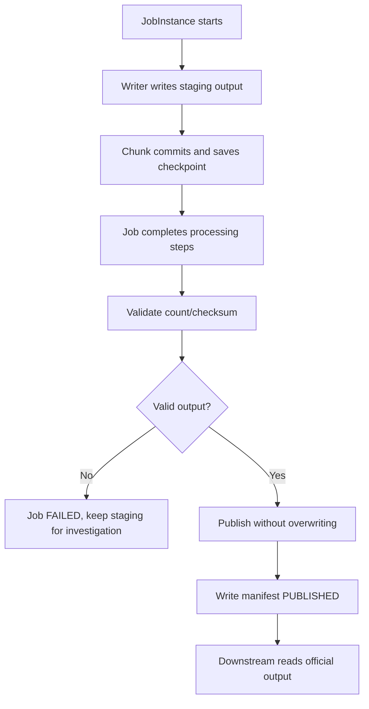

# Avoiding Overwriting Output from Previous Runs

In Spring Batch, a job may be re-run after failing, restarted from a checkpoint, or launched for a new business period. These runs may use the same reader and writer, yet they are not always permitted to write to the same output resource. If a writer opens the target file in delete-existing mode, appends without control, or uses unstable filenames, a new run can overwrite earlier results or produce duplicate data.

Safe output management requires clearly distinguishing **restarting the same unit of work** from **producing a new business result**. A restart must resume the exact artifact written at the checkpoint; a new business run must have its own output and preserve previously published outputs. For files, databases, object storage, and external systems, clear rules for identification, staging, publishing, and conflict handling are necessary.

## 1. Why can output from a previous run be overwritten?

Common causes:

- Two different runs share `reports/daily.csv`.
- `FlatFileItemWriter` is configured to delete existing files on open, when that file is a published output from the previous run.
- The writer uses append while the reader restarts from the beginning, causing old and new data to be appended twice.
- A restarted job uses a new output path keyed by `JobExecution` ID, causing old checkpoints to no longer match the resource.
- A new job uses the same output path without a distinguishing version or business key.
- The publish step re-runs after a crash and overwrites an already-published file before metadata was updated.
- Two concurrent jobs write to the same resource.

"Not overwriting" does not merely mean not deleting a file. It also means never mutating an already-published result and never letting two different runs write to the same output location without coordination rules.

## 2. Distinguishing a restart from a new business run

Spring Batch identifies a unit of work by `JobInstance`, determined by job name and identifying `JobParameters`. Each launch or restart creates a separate `JobExecution`.

| Case | JobInstance | Desired Output |
|---|---|---|
| Restarting a `FAILED` job with the same identifying parameters | Remains the same | Resume the same staging output from the committed checkpoint |
| Restarting a `STOPPED` job with the same identifying parameters | Remains the same | Resume the same staging output per saved state |
| Running a new business period | New, due to different identifying parameters | Create new output, preserve previous period's output |
| Intentional reprocess of the same data period | Should have a distinct version/reprocess identity | Create a new artifact version, do not silently replace published version |
| Attempting to re-run a `COMPLETED` instance | Not a standard valid restart | Use a new reprocess/versioning workflow |

Example:

```text
Job: dailyExportJob
Identifying parameters: businessDate=2026-11-15, tenantId=42

JobInstance A
  JobExecution 501 -> FAILED
  JobExecution 509 -> COMPLETED (restart)
  Output staging: dailyExport/2026-11-15/tenant-42/

JobInstance B
  businessDate=2026-11-16, tenantId=42
  Output staging: dailyExport/2026-11-16/tenant-42/
```

Execution ID changes on restart, whereas `JobInstance` remains the same. Therefore, do not use `JobExecution` ID as the sole component of an output path if restarts must resume the same resource. Conversely, do not use one fixed path across all instances if each run must preserve its own result.

## 3. Defining a stable output key per business unit of work

An output key must answer two questions:

1. Which business unit of work does this result belong to?
2. Which output version of that work is this?

Common components:

- Job name or report type.
- Business date / processing period.
- Tenant or data scope.
- Source version, input checksum, or batch identifier if the source determines content.
- `outputVersion` or `reprocessId` when intentionally creating a new version.

Example:

```text
daily-orders/
  business-date=2026-11-15/
    tenant=42/
      version=1/
        orders.csv
```

Restarting the same `JobInstance` must reproduce this exact key. An intentional reprocess can use `version=2`, preserving `version=1` for auditing or business rollback.

Do not generate a new output key with a random timestamp on every restart. That causes restarts to create new artifacts instead of resuming the old output. Also do not reuse an old key when input content or business rules have changed without incrementing the version.

## 4. Output identity must align with identifying JobParameters

If `businessDate` and `tenantId` identify a business unit of work, they should usually be identifying parameters. If `outputVersion` produces a new business result, it may also need to participate in instance identification.

Example:

```java
JobParameters parameters = new JobParametersBuilder()
        .addString("businessDate", "2026-11-15", true)
        .addLong("tenantId", 42L, true)
        .addString("outputVersion", "v1", true)
        .addString("outputDirectory", "exports/staging", false)
        .toJobParameters();
```

In this example, date, tenant, and version identify the `JobInstance`; output directory is only resource configuration. If `outputDirectory` changes while identifying parameters stay the same, Spring Batch still treats it as the same instance. This is dangerous if the previous checkpoint points to the old resource.

Ensure parameters governing source and output identity are designed consistently. If changing the input file or output version means a different job, include that input identity/version in identifying parameters or enforce it via an equivalent business manifest.

## 5. Separating staging output and published output

A safe approach is never letting the writer write directly to the file downstream systems consume. Instead, the job writes to a dedicated staging resource, verifies the result, and publishes it as official output.



Example directory layout:

```text
exports/
  staging/
    daily-orders-2026-11-15-tenant-42-v1.csv
  published/
    daily-orders-2026-11-15-tenant-42-v1.csv
  manifest/
    daily-orders-2026-11-15-tenant-42-v1.json
```

The staging path must stay stable across restarts of the same instance. The published path should be treated as immutable: once it exists, another job must not silently alter its contents. If a new result must be generated, use a new version.

## 6. Configuring FlatFileItemWriter with awareness of existing files

`FlatFileItemWriter` supports saving state for restarts. Options related to existing files must be understood accurately:

- `saveState(true)` allows the writer to save information needed to restore write position on restart.
- `name(...)` provides a stable name for storing state in the execution context.
- `shouldDeleteIfExists(...)` controls how an existing file is handled when opening the writer for a new execution.
- `append(...)` enables append mode in configured scenarios; append does not itself know which business data was already processed.

Example writer configuration for a dedicated staging path:

```java
@Bean
@StepScope
public FlatFileItemWriter<OrderRecord> orderWriter(
        @Value("#{jobParameters['stagingFile']}") String stagingFile) {

    return new FlatFileItemWriterBuilder<OrderRecord>()
            .name("dailyOrderStagingWriter")
            .resource(new FileSystemResource(stagingFile))
            .delimited()
            .delimiter(",")
            .names("orderId", "customerId", "amount")
            .saveState(true)
            .shouldDeleteIfExists(false)
            .build();
}
```

Here, the writer is given a dedicated staging path via job parameters. `shouldDeleteIfExists(false)` avoids automatically deleting an existing file when opening a new run. However, verify the exact open/restart behavior of your Spring Batch version: if the file already exists without a matching checkpoint, the writer may refuse to open rather than continuing. This is useful fail-fast behavior when paths collide, though it does not replace designing unique paths.

Do not set `shouldDeleteIfExists(true)` on a shared resource if that file holds published output from a previous run. Nor should you enable append merely to avoid file-exists errors: if the reader starts from the beginning, the output will have duplicate appended lines.

## 7. `saveState` and restart are not the same as protecting another run's output

`saveState(true)` helps a writer restore its own position within the same execution/restart. It does not automatically prevent another `JobInstance` from writing to the same file.

Example:

- Instance A writes `exports/daily.csv` and commits 10 chunks.
- Instance B is launched with different identifying parameters yet also receives `exports/daily.csv`.
- Instance B's writer has no checkpoint from A.
- If B is configured to delete the file, A's output is lost; if B appends, the two results may be mixed.

Therefore, two layers of protection are needed:

1. Writer checkpoints so restarting the same instance resumes at the right position.
2. Separate output identities so another instance never writes to a previous instance's resource.

Do not use `saveState` as a file-locking or cross-job overwrite prevention mechanism.

## 8. Do not use append as a substitute for checkpoints

Append only states that new data is written at the end of the resource. It does not know which items committed, which chunk rolled back, or where the reader is resuming from.

A failure scenario:

1. On the first run, the writer wrote 5,000 lines.
2. The job fails; the reader did not save a checkpoint, so on restart it reads from the beginning again.
3. The writer opens the file in append mode.
4. The original 5,000 lines remain and are written again.

The result can have 10,000 lines with every item appearing twice.

The reverse scenario is equally dangerous: the writer truncates the file when restarting midway. The reader resumes from item 5,001, yet the output for the first 5,000 items was wiped. The final result is missing data.

Choose a consistent strategy:

- Resume the same staging output from checkpoints of both reader and writer.
- Or delete the staging of a new run and regenerate the entire output from scratch in an intentional reprocess workflow.

Never mix reader restart-from-checkpoint with writer truncate, or reader restart-from-beginning with writer append.

## 9. Creating new files with CREATE_NEW when fail-fast is needed

For custom writers or resource creation steps, Java NIO supports `StandardOpenOption.CREATE_NEW`. This option creates a new file and fails if the path already exists.

Illustrative example for a step creating a new artifact:

```java
try (OutputStream output = Files.newOutputStream(
        stagingPath,
        StandardOpenOption.CREATE_NEW,
        StandardOpenOption.WRITE)) {
    // Write new content to the newly created file.
}
```

This is useful when starting a new output version: if the path already exists, the job receives a conflict error instead of silently deleting or overwriting the old file.

Do not use `CREATE_NEW` blindly for a restart that must reopen an existing file. Restarts must verify the file belongs to the right `JobInstance` and has a matching checkpoint before resuming. Separate the two paths clearly:

- New run: create staging file using `CREATE_NEW`.
- Restart: reopen the staging file verified by manifest/checkpoint, restoring the saved position.

If a custom writer implements `ItemStream`, state for the resource path and write position must be stored in `ExecutionContext`. Do not store only the path; ensure the file contents still match that checkpoint.

## 10. Publishing output without overwriting

After staging output completes, the job can publish the file by moving it to an official path. When replacing the target file is disallowed, do not use the `REPLACE_EXISTING` option.

Simple example:

```java
Files.move(stagingPath, publishedPath);
```

If `publishedPath` already exists, a regular move fails instead of actively replacing it. Treat this error as a conflict to investigate: the output may have already been published in a prior run, or another job may be using the same output identity.

`ATOMIC_MOVE` can be used if the filesystem supports atomic moves and atomic publishing is required. However, rules when the target already exists under `ATOMIC_MOVE` can depend on the provider/filesystem; do not rely on it as a universal no-overwrite mechanism. If strictly prohibiting target replacement, use reservations/manifests/locks or conditional-create primitives appropriate for the storage.

With object storage, use conditional PUT or an equivalent condition such as "create only if the object does not exist" if the provider supports it. Do not assume object storage rename behaves like local filesystem rename; many services implement it as copy then delete.

## 11. Manifest confirming published output

A manifest is a durable record describing the output and its publication status. It helps restarts distinguish staging files, published files, and conflicts.

Example manifest content:

```json
{
  "jobKey": "dailyExport:2026-11-15:tenant-42:v1",
  "stagingPath": "exports/staging/daily-orders-v1.csv",
  "publishedPath": "exports/published/daily-orders-v1.csv",
  "status": "PUBLISHED",
  "recordCount": 125000,
  "checksum": "sha256:..."
}
```

Manifests can be stored in a database or object storage supporting conditional writes. Common statuses:

| Status | Meaning |
|---|---|
| `WRITING` | Job is generating staging output |
| `READY` | Staging is closed and passed checks |
| `PUBLISHING` | Publishing is in progress |
| `PUBLISHED` | Official output has been confirmed |
| `FAILED` | Creation/publishing encountered an error requiring handling |

If the process crashes after moving the file but before updating the manifest to `PUBLISHED`, a restart can inspect the target file, checksum, and output key. If the contents match, it can record publishing as complete without creating a second file. If the target file has a different checksum, stop and report a conflict instead of overwriting.

## 12. Making publishing a separate step

Do not rely solely on `JobExecutionListener.afterJob` for mandatory output publishing. Listener callbacks may not run if the process stops abruptly, and publishing may need its own retries, metadata, and status.

A clearer design:

```text
prepareStep
   |
   v
writeStagingStep
   |
   v
validateOutputStep
   |
   v
publishOutputStep
   |
   v
Job completes
```

`publishOutputStep` can:

1. Inspect the manifest and staging artifact.
2. Compute or verify record count/checksum.
3. Verify the published target is not occupied by another output.
4. Execute the move/conditional create.
5. Record the `PUBLISHED` status.

The publish step must be idempotent because it may be restarted after a crash. If the target file already exists and its checksum matches the current staging/output key, publishing can be treated as already complete. If it does not match, treat it as a conflict requiring resolution.

## 13. Handling the crash window in the publish step

There is a gap between a filesystem/object storage operation and Spring Batch committing step metadata. These two systems generally do not participate in the same transaction.

Example:

1. `publishOutputStep` moves the staging file to the published path.
2. The target file now exists.
3. The process stops before the step metadata transaction commits.
4. On restart, the publish step runs again.

If code simply calls `Files.move` again, it may receive `FileAlreadyExistsException`. This is not necessarily a new business error; publishing may have succeeded on the previous attempt.

Verify:

- Does the published path exist?
- Does the manifest have the same `jobKey`?
- Do the checksum and record count match?
- Is the file complete and properly closed?

If everything matches, the publish step can complete idempotently by updating/reconciling the manifest. If not, stop to avoid replacing another run's output.

## 14. Database outputs also need overwrite protection

Not writing files does not mean you only need to worry about the filesystem. A database writer can overwrite prior period data if `UPDATE` or `MERGE` statements do not distinguish output versions.

Example versioned output schema:

```sql
create table daily_export_result (
    business_date date not null,
    tenant_id     bigint not null,
    output_version varchar(30) not null,
    order_id      bigint not null,
    amount        decimal(18, 2) not null,
    primary key (business_date, tenant_id, output_version, order_id)
);
```

The primary key includes `output_version`, so an intentional reprocess can create a new version while preserving the old one. If business rules allow only a single output per date and tenant, omit version from the key and let the unique constraint reject duplicate writes.

Do not use `DELETE FROM daily_export_result WHERE business_date = ?` as a default step before every run if that data is already published output. If replacement is required, use a versioned publish workflow or a transaction with an explicitly approved replacement policy.

## 15. Staging tables and publishing database data

A common pattern writes to staging keyed by `jobKey`, then publishes in a separate transaction once data is verified.

```sql
create table export_stage (
    job_key      varchar(160) not null,
    order_id     bigint not null,
    amount       decimal(18, 2) not null,
    primary key (job_key, order_id)
);

create table export_manifest (
    job_key       varchar(160) primary key,
    status        varchar(30) not null,
    record_count  bigint,
    published_at  timestamp null
);
```

Chunks write into `export_stage`. The unique key `(job_key, order_id)` guards against duplicate inserts within the same output. Once all steps complete, the publish step verifies count/checksum and updates the manifest or transfers data to downstream-serving tables.

If downstream reads staging directly, ensure it selects only `job_key` entries whose manifest is `PUBLISHED`. Never let consumers read `WRITING` or `FAILED` data.

## 16. Avoiding overwriting output during parallel runs

Two jobs may run concurrently for two tenants, two data periods, or two export types. If the path depends only on the report name, both may write to the same resource.

Example insufficiently distinct path:

```text
exports/daily.csv
```

More clearly identified paths:

```text
exports/staging/daily/2026-11-15/tenant-42/v1.csv
exports/staging/daily/2026-11-15/tenant-84/v1.csv
```

Beyond naming, control concurrency:

- Use `JobRepository` to prevent the same `JobInstance` from having multiple concurrent executions per Spring Batch rules.
- Use unique constraints/manifest reservations for output keys.
- If two different jobs could target the same output, use locks or conditional create in storage.
- Never share a single singleton writer or mutable file handle across multiple job executions.

Unique filenames reduce collisions, but do not replace concurrency control. Two processes can check "file does not exist" simultaneously and both attempt creation; an atomic create operation or durable reservation is required.

## 17. Do not use JobExecution ID as a business version

`JobExecution` ID changes on restart. If the output path contains the execution ID:

```text
exports/daily-orders/execution-501.csv
exports/daily-orders/execution-509.csv
```

then a restart may create a new file instead of resuming the old staging file. This fragments output into multiple artifacts and makes it hard to tell which file is the final result.

Execution IDs can be stored in metadata or manifests to audit each attempt, but output identity should rely on `JobInstance` or a stable business version. If per-attempt debug logs/artifacts must be kept separately, isolate them from official output and prevent downstream from consuming them automatically.

## 18. Intentional reprocesses must create a new version

Sometimes all data must be re-run because logic was fixed, input changed, or a new business requirement arrived. This is a reprocess, not a restart.

A safe reprocess workflow:

1. Preserve the already-published output of the current version.
2. Create a meaningful new `outputVersion` or `reprocessId`.
3. Use new identifying parameters to create a new `JobInstance`.
4. Write output to a separate staging path.
5. Verify counts, checksums, and business rules.
6. Publish the new version via a controlled manifest/active pointer.
7. Switch downstream to the new version only after confirming completion.

Example:

```text
published/
  daily-orders/2026-11-15/tenant-42/v1.csv
  daily-orders/2026-11-15/tenant-42/v2.csv
```

Version 1 remains intact for auditing or rolling back if version 2 has issues. Which version is current should be determined by a manifest or active version record, not by overwriting the same file.

## 19. Validating input and output paths before running

Pre-step validation should ensure the output resource is clearly defined:

- Output path does not collide with input path.
- Path resides within an allowed directory.
- Parent directory can be created or written to.
- Output key contains required business date/tenant/version.
- Resource does not belong to another job's already-published output.
- If the resource exists, determine whether it is staging for the same instance or an old artifact.

Existence checks in a validator are only a point-in-time preflight. Another process could still create the file afterward. When creating the resource, use atomic no-overwrite operations such as `CREATE_NEW`, unique constraints, or conditional create to resolve race conditions.

Do not automatically delete old resources inside a validator to "clear the way." Deletion can destroy published output and does not participate in the job transaction.

## 20. Retention and cleanup of old outputs

Not overwriting outputs does not mean keeping every staging artifact forever. Separate retention policies can apply to temporary files, published outputs, and manifests.

Example:

| Artifact Type | Typical Policy |
|---|---|
| Staging of a running job | Keep for restart; do not clean up while execution is active |
| Staging of a failed job | Keep during investigation/restart window; delete per policy afterward |
| Published output | Retain per audit/downstream requirements; do not delete like temp files |
| Manifest | Retain at least as long as the output exists and per operational history |
| Per-attempt temporary file | Can be cleaned up once certain it is no longer used |

Cleanup should be a separate conditional workflow, not run blindly at the start of every job. Before deleting, verify the corresponding job instance has terminated, no restart is needed, and the artifact is not an official output.

## 21. Testing avoiding overwriting output from previous runs

Tests should verify both restart behavior and new-output creation behavior.

### Testing two different JobInstances

1. Run the job for `businessDate=2026-11-15`, `tenantId=42`, `outputVersion=v1`.
2. Verify v1 output is published.
3. Run the job for a different date or version.
4. Verify the new output is created at a different path.
5. Re-read v1 output and verify its checksum/content did not change.

### Testing restarting the same JobInstance

1. Launch the job with fixed identifying parameters.
2. Let several chunks commit, then intentionally fail the step.
3. Record the staging file and checkpoint.
4. Restart with the same identifying parameters.
5. Verify the writer resumes from the checkpoint without deleting or duplicating appended data.
6. Verify each business key appears exactly once.

### Testing existing paths

- New run tries to create a path that already has output: must report a collision or select a new version.
- Restarting the same instance reopens the right staging resource: must restore state.
- Published path already exists with identical checksum: publish can recognize completion.
- Published path exists with different checksum: job must stop and report conflict without overwriting.

### Testing two concurrent jobs

Launch two instances with different tenants/versions and verify they do not write to the same path. If two instances attempt to use the same output key, one must be rejected by reservation/unique constraint or locking.

## 22. Example checking old output remains unchanged

In an integration test, save the checksum before running a new instance:

```java
byte[] previousOutput = Files.readAllBytes(previousPublishedPath);
String previousChecksum = sha256(previousOutput);

JobExecution newExecution = jobLauncherTestUtils.launchJob(newParameters);

assertEquals(BatchStatus.COMPLETED, newExecution.getStatus());
assertTrue(Files.exists(previousPublishedPath));
assertEquals(
        previousChecksum,
        sha256(Files.readAllBytes(previousPublishedPath)));
```

This is a test skeleton; `sha256` can use `MessageDigest`. Tests should also check the new output path and corresponding manifest. Checking only that the old file still exists is insufficient because its contents could have been altered.

## 23. Tracking output by job and version

For operations and investigation, manifests or output metadata should record:

- Job name and identifying parameters.
- `JobInstance` identity or `jobKey`.
- `JobExecution` ID that most recently created/updated the artifact.
- Output version/reprocess ID.
- Staging path and published path.
- Status `WRITING`, `READY`, `PUBLISHING`, `PUBLISHED`, or `FAILED`.
- Record count, byte size, and checksum.
- Start, completion, and publication timestamps.
- Source version/checksum if input must be immutable.

When output overwrite is detected, determine:

1. Do the two executions belong to the same `JobInstance` or two different instances?
2. Was the output path built from stable identifying parameters?
3. Does the writer have `saveState` and a stable name?
4. Did `shouldDeleteIfExists` or append mode delete or duplicate data?
5. Did the publish step re-run after a crash?
6. Is another process using the same output key?
7. Do the manifest/checksum indicate which output was published?

Do not delete or overwrite files to mitigate an incident before determining which file is the official artifact and whether downstream has already consumed it.

## 24. Common design mistakes

| Situation | Cause | Resolution |
|---|---|---|
| Previous run's file deleted when new job starts | Writer deletes existing resource or path is shared | Use dedicated staging paths and control `shouldDeleteIfExists` |
| Restart creates a new file | Output path contains new `JobExecution` ID | Use a stable output key by `JobInstance` |
| Output has duplicate lines | Reader restarts from beginning while writer appends | Restore reader/writer from matching checkpoints or regenerate full staging |
| Output is missing the beginning | Writer truncates while reader restarts from the middle | Use a restart-aware writer and instance-specific resource |
| Two jobs overwrite each other | Output path lacks tenant/version/job key | Use unique keys and reservation/conditional create |
| Reprocess replaces old version unintentionally | No output version | Create a new version and publish in a controlled manner |
| Duplicate publish after crash | File move succeeded but metadata had not committed | Check manifest/checksum for idempotent publishing |
| File exists yet writer cannot open | Not distinguishing valid restart from path collision | Verify checkpoint/resource identity before opening |
| Database rows overwritten | Update/merge does not distinguish output version | Use business/version keys and unique constraints |
| Cleanup deletes output needed for restart | Staging cleaned up too early | Base retention on execution status and manifest |

## 25. Process for designing non-overwriting resources

1. **Identify the run type:** restart, new business period, or reprocess.
2. **Design identifying parameters:** include values determining output content and version.
3. **Create a stable output key:** restarting the same instance must reuse the same staging resource.
4. **Separate staging and published:** never let writers write directly to outputs consumed downstream.
5. **Configure stateful writers:** stable name, `saveState(true)`, and clearly defined existing-file semantics.
6. **Fail-fast on collisions:** use `CREATE_NEW`, unique constraints, manifest reservations, or conditional creates.
7. **Verify before publishing:** record count, checksum, and status of all required steps.
8. **Publish idempotently without replacing:** existing target files must be reconciled, never silently overwritten.
9. **Version reprocesses:** preserve old output and switch active version only after the new one is valid.
10. **Design separate retention:** clean up artifacts only when certain restart, auditing, and downstream no longer need them.
11. **Test restarts and concurrency:** confirm old output is unchanged and instances do not share resources unintentionally.

## 26. Key takeaways

- Distinguish restarting the same `JobInstance` from a new business run or a reprocess.
- Restarts must reuse the same instance's staging resource and checkpoint; new runs need distinct output identities.
- Do not use `JobExecution` ID as the sole output key if restarts must resume the same artifact.
- Include business date, tenant, source identity, and output version appropriately in work identification.
- `FlatFileItemWriter.saveState(true)` supports position recovery but does not prevent another instance from writing to the same file.
- Understand `shouldDeleteIfExists` and append behavior per version; never delete or append to old files blindly.
- Use `CREATE_NEW`, unique constraints, reservations, or conditional creates to detect collisions.
- Write staging first, verify, then publish; published output should be immutable.
- Publishing must be idempotent to handle crashes after moving but before step metadata commits.
- Use manifests, record counts, and checksums to verify an artifact belongs to the right job/version.
- Database outputs also need unique keys/versions; never delete old data solely to clear the way for a new run.
- `allowStartIfComplete(true)` or step reruns can repeat side effects; use only when outputs can re-run safely.
- Retention/cleanup is a separate workflow; never delete staging or published outputs while needed for restart/auditing.
- Test old output contents and checksums after running new instances, restarts, and concurrent runs.

Avoiding overwriting output from previous runs is a requirement of resource identification and lifecycle management. When every `JobInstance` has a stable staging path, every new business run has its own version, writers restore checkpoints properly, and the publish step checks for conflicts before releasing, Spring Batch can restart safely while preserving all completed results.
