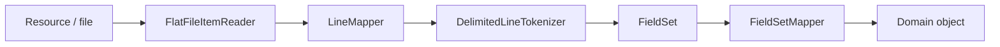

# DelimitedLineTokenizer

In Spring Batch, when reading a CSV file or a text file whose columns are separated by commas, tabs, pipes, or other characters, the application needs to split each line into data fields. **DelimitedLineTokenizer** is the component that performs that splitting.

The tokenizer takes a string representing a record and converts it into a **FieldSet**. The FieldSet holds values by position or by column name so the next step can map them into a business object.

A typical file-reading pipeline looks like this:



DelimitedLineTokenizer is only responsible for splitting records. It does not read files itself, manage checkpoints, validate all business rules, or write data. Those responsibilities belong to the reader, mapper, processor, and writer in the pipeline.

## 1. Where does DelimitedLineTokenizer fit?

In Spring Batch, FlatFileItemReader reads a resource record by record and then uses LineMapper to convert each record into an item. LineMapper usually combines two components:

- LineTokenizer: splits a string into fields.
- FieldSetMapper: converts a FieldSet into an object.

DelimitedLineTokenizer is a LineTokenizer implementation for records whose fields are separated by a delimiter.

Example orders.csv file:

```text
orderId,customerId,amount
1001,C001,250.00
1002,C002,175.50
1003,C003,99.99
```

For the line 1002,C002,175.50, the tokenizer produces three fields:

| Position | Value |
|---:|---|
| 0 | 1002 |
| 1 | C002 |
| 2 | 175.50 |

If the field names are configured as orderId, customerId, and amount, the FieldSet can be accessed by name rather than only by index.

## 2. Basic configuration

You can configure the tokenizer directly:

```java
DelimitedLineTokenizer tokenizer = new DelimitedLineTokenizer();
tokenizer.setDelimiter(",");
tokenizer.setNames("orderId", "customerId", "amount");
tokenizer.setStrict(true);
```

Main settings:

- **delimiter**: the separator string between fields.
- **names**: names corresponding to the fields returned by the tokenizer.
- **strict**: specifies whether the number of fields must match the number of configured names.
- **quoteCharacter**: character enclosing fields that contain delimiters or special content.
- **includedFields**: field positions to keep when only a subset of columns is needed.

The example above uses a comma and requires the field count to match the three declared names.

### Field names must match column order

Given the data:

```text
1001,C001,250.00
```

Names must be declared in the exact order:

```java
tokenizer.setNames("orderId", "customerId", "amount");
```

If declared in the wrong order:

```java
tokenizer.setNames("customerId", "orderId", "amount");
```

The tokenizer will still split it into three fields, but the mapper will misinterpret the meaning of the data. This is a dangerous mapping bug because it does not necessarily cause the job to fail.

## 3. Choosing the delimiter

DelimitedLineTokenizer supports configuring the delimiter to match the input file format.

Examples:

| Format | Delimiter |
|---|---|
| CSV | comma (,) |
| TSV | tab (\t) |
| Pipe-separated | pipe (\|) |
| Semicolon-separated data | semicolon (;) |

Example pipe-delimited file:

```text
1001|C001|250.00
1002|C002|175.50
```

Configuration:

```java
DelimitedLineTokenizer tokenizer = new DelimitedLineTokenizer();
tokenizer.setDelimiter("|");
tokenizer.setNames("orderId", "customerId", "amount");
```

For tab:

```java
tokenizer.setDelimiter("\t");
```

The delimiter is the literal separator in the data, not a regular expression. If a file uses a multi-character separator string, configure the exact string specified by the source format and test with actual data.

Do not choose a delimiter by guessing from a few sample lines. Obtain the format from the data source contract or file specification.

## 4. Splitting fields that contain the delimiter

A field may contain the same character used as the delimiter. In CSV, a customer name might contain a comma:

```text
1001,"Smith, Jane",250.00
1002,"Nguyen, An",175.50
```

If you simply split on every comma, the first line would be broken into the wrong number of fields. DelimitedLineTokenizer supports a quote character to mark content that must be treated as a single field.

By default, the tokenizer uses double quotes. You can configure it explicitly:

```java
DelimitedLineTokenizer tokenizer = new DelimitedLineTokenizer();
tokenizer.setDelimiter(",");
tokenizer.setQuoteCharacter('"');
tokenizer.setNames("orderId", "customerName", "amount");
```

When reading the line:

```text
1001,"Smith, Jane",250.00
```

The customerName field is preserved as a single value containing the comma rather than being split into two columns.

### Quotes do not replace delimiters

Quotes enclose a field; delimiters still define boundaries between fields outside quoted regions. Example:

```text
1001,"Smith, Jane",250.00
```

There are three fields: order ID, customer name, and amount. Do not arbitrarily add quotes around every value if the source format does not require them.

### Other quote characters

Some files use single quotes to enclose fields. You can configure the corresponding quote character via setQuoteCharacter(...) using the character specified by the source specification.

Only change the quote character when the file contract explicitly specifies it. If the data mixes multiple quoting styles, normalize it upstream or write a dedicated tokenizer with tests for each case.

## 5. Escaped quotes inside a field

CSV data may contain the quote character itself inside a value. Example:

```text
1001,"She said ""Approved""",250.00
```

This is a case that must be checked carefully against your Spring Batch version and the actual file dialect. The escape rules of the CSV source must match how the tokenizer interprets quotes. Do not assume all CSV variants, all escape rules, or all spreadsheet-exported files behave identically.

Write tests covering at least these cases:

- Quoted fields.
- Fields with delimiters inside quotes.
- Fields with escaped quotes.
- Empty fields.
- Fields with leading/trailing whitespace.
- Unbalanced quotes.

If the source file uses rules more complex than the configured tokenizer supports, use a parser suited to that dialect or create a custom LineTokenizer. Do not perform manual string replacements before tokenizing if those replacements could alter valid data.

## 6. Naming fields with setNames

When the record structure is known, configure field names so the mapper accesses values meaningfully:

```java
tokenizer.setNames(
        "orderId",
        "customerId",
        "customerName",
        "amount",
        "currency");
```

FieldSetMapper can read by name:

```java
public class OrderFieldSetMapper
        implements FieldSetMapper<OrderInput> {

    @Override
    public OrderInput mapFieldSet(FieldSet fieldSet) {
        return new OrderInput(
                fieldSet.readLong("orderId"),
                fieldSet.readString("customerId"),
                fieldSet.readString("customerName"),
                fieldSet.readBigDecimal("amount"),
                fieldSet.readString("currency"));
    }
}
```

Named access is easier to read and less coupled to index order in mapper code. However, the order in setNames must still match the column order in the file.

If names are not configured, FieldSet can still be accessed by position. For files with a fixed schema, named fields usually make code clearer and reduce mistakes.

## 7. Combining DelimitedLineTokenizer and FieldSetMapper

The tokenizer only produces a FieldSet. Turning the data into an object belongs to FieldSetMapper.

Example model:

```java
public record OrderInput(
        long orderId,
        String customerId,
        String customerName,
        BigDecimal amount) {
}
```

Mapper:

```java
public class OrderFieldSetMapper
        implements FieldSetMapper<OrderInput> {

    @Override
    public OrderInput mapFieldSet(FieldSet fieldSet) {
        return new OrderInput(
                fieldSet.readLong("orderId"),
                fieldSet.readString("customerId"),
                fieldSet.readString("customerName"),
                fieldSet.readBigDecimal("amount"));
    }
}
```

Combining them into a LineMapper:

```java
DelimitedLineTokenizer tokenizer = new DelimitedLineTokenizer();
tokenizer.setDelimiter(",");
tokenizer.setNames(
        "orderId",
        "customerId",
        "customerName",
        "amount");

DefaultLineMapper<OrderInput> lineMapper = new DefaultLineMapper<>();
lineMapper.setLineTokenizer(tokenizer);
lineMapper.setFieldSetMapper(new OrderFieldSetMapper());
lineMapper.afterPropertiesSet();
```

FlatFileItemReader uses lineMapper to turn each record into an OrderInput:

```java
@Bean
FlatFileItemReader<OrderInput> orderReader(
        Resource inputResource,
        LineMapper<OrderInput> orderLineMapper) {

    return new FlatFileItemReaderBuilder<OrderInput>()
            .name("orderReader")
            .resource(inputResource)
            .lineMapper(orderLineMapper)
            .linesToSkip(1)
            .saveState(true)
            .build();
}
```

Here, the first line is a header and is skipped. If you need to verify the header column names, use a skipped-lines callback or a dedicated validation step rather than skipping without verification.

## 8. Using the delimited builder on FlatFileItemReader

For standard configurations, there is no need to manually instantiate the tokenizer and LineMapper. FlatFileItemReaderBuilder provides a delimited DSL to configure common properties:

```java
@Bean
FlatFileItemReader<OrderInput> orderReader() {
    return new FlatFileItemReaderBuilder<OrderInput>()
            .name("orderReader")
            .resource(new ClassPathResource("orders.csv"))
            .delimited()
            .delimiter(",")
            .names(
                    "orderId",
                    "customerId",
                    "customerName",
                    "amount")
            .targetType(OrderInput.class)
            .linesToSkip(1)
            .saveState(true)
            .build();
}
```

The builder constructs the appropriate tokenizer and mapper from the declared properties. This approach is concise when mapping can be handled by the target type or a FieldSetMapper supported by the builder.

When special tokenization or mapping rules are needed, configuring LineMapper manually is more flexible. Choose one clear configuration approach; avoid creating a manual tokenizer while simultaneously configuring another tokenizer via the builder.

## 9. Strict mode and field count

Once field names are declared, the tokenizer needs to know whether every record must have the exact number of fields. Strict mode is controlled with setStrict(...).

Example:

```java
tokenizer.setNames("orderId", "customerId", "amount");
tokenizer.setStrict(true);
```

With strict=true, a record whose field count does not match the number of configured names is treated as a token count error. This is usually the safe default when a file has a fixed schema.

Example expecting three fields:

```text
1001,C001,250.00
```

Structurally invalid lines:

```text
1002,C002
1003,C003,99.00,EXTRA
```

When column counts change unexpectedly, failing explicitly is usually better than silently assigning data to the wrong fields.

### When to use strict=false?

Strict mode can be relaxed when the source format permits variable field counts and the mapper has rules to handle missing or extra values. However, do not set strict=false just to stop a job from failing when a file has the wrong schema.

When disabling strict mode:

- The mapper must handle missing values.
- You must explicitly decide whether extra fields are accepted.
- Do not assume missing fields will receive business-valid default values.
- Test the exact behavior of your Spring Batch version.

If files have versioned schemas, detect the version upfront and select the corresponding mapping rather than relaxing strict mode for every record.

## 10. Selecting a subset of columns with includedFields

Some files contain many columns while the step only needs a few. You can configure includedFields to retain only the required positions.

Example file:

```text
orderId,customerId,customerName,amount,currency,sourceSystem
1001,C001,Jane Smith,250.00,USD,ERP
```

If only orderId, customerId, and amount are needed:

```java
DelimitedLineTokenizer tokenizer = new DelimitedLineTokenizer();
tokenizer.setDelimiter(",");
tokenizer.setIncludedFields(0, 1, 3);
tokenizer.setNames("orderId", "customerId", "amount");
```

Positions in includedFields are 0-based:

| Index | Column | Included? |
|---:|---|---|
| 0 | orderId | Yes |
| 1 | customerId | Yes |
| 2 | customerName | No |
| 3 | amount | Yes |
| 4 | currency | No |
| 5 | sourceSystem | No |

Names must correspond to the selected fields in order. If you pick the wrong indices, the mapper may still read values successfully while assigning them the wrong meaning.

### includedFields is not schema validation

Selecting a subset of columns does not replace verifying that the file matches the expected schema. If the source changes column order, old indices can point to different data. Validate the header or schema version if column order can change.

## 11. Empty fields, whitespace, and missing values

Delimited files can have empty fields:

```text
1001,C001,,250.00
1002,,Jane Smith,175.50
1003,C003,Alex,
```

An empty field is different from a missing field. For example, a record with the right number of delimiter-separated fields where the third field is empty still has the expected column count. A record missing a delimiter may fail the token count check.

Define rules for each column:

- Is the field mandatory?
- Should an empty string be treated as null?
- Should whitespace be trimmed?
- Is a default value valid?
- If data is missing, should the item be rejected, skipped, or fail the job?

Do not assume the tokenizer understands the business meaning of empty strings. FieldSetMapper or ItemProcessor should parse and validate according to the schema.

Example validating mapper:

```java
public OrderInput mapFieldSet(FieldSet fieldSet) {
    String customerId = fieldSet.readString("customerId").trim();
    if (customerId.isEmpty()) {
        throw new InvalidOrderException(
                "customerId is required");
    }

    BigDecimal amount = fieldSet.readBigDecimal("amount");
    if (amount.signum() < 0) {
        throw new InvalidOrderException(
                "amount must not be negative");
    }

    return new OrderInput(
            fieldSet.readLong("orderId"),
            customerId,
            fieldSet.readString("customerName"),
            amount);
}
```

Only trim when source rules allow it. For fields where whitespace is significant, trimming can alter valid data.

## 12. Data type conversion via FieldSet

FieldSet provides methods to read common data types:

| Method | Result type |
|---|---|
| readString(...) | String |
| readInt(...) | int |
| readLong(...) | long |
| readBigDecimal(...) | BigDecimal |
| readDate(...) | Date |
| readBoolean(...) | boolean |

Example:

```java
public Payment mapFieldSet(FieldSet fieldSet) {
    return new Payment(
            fieldSet.readLong("paymentId"),
            fieldSet.readBigDecimal("amount"),
            fieldSet.readDate(
                    "paymentDate",
                    "yyyy-MM-dd"),
            fieldSet.readString("currency"));
}
```

Date formats must match the source data. Decimal amounts should use BigDecimal for currency rather than double to avoid binary floating-point rounding errors.

If a value cannot be converted, the mapper can throw an exception. Decide whether that is a skippable/rejectable data error or a critical schema error that must halt the job.

Do not place overly complex conversion logic inside the tokenizer. The tokenizer should split; the mapper is responsible for conversion and object creation.

## 13. Headers, skipped lines, and comments

Delimited files often have headers:

```text
orderId,customerId,amount
1001,C001,250.00
1002,C002,175.50
```

You can skip the header using:

```java
.linesToSkip(1)
```

If you need to validate the header, use a skipped-lines callback or a dedicated validation step. Header validation helps catch files with the wrong schema before data is mapped into the wrong columns. If headers can vary by version, parse the header and select the version-specific mapping explicitly.

The reader can also be configured with comment prefixes to ignore comment lines according to the file format. Comment handling belongs to the reader, not DelimitedLineTokenizer.

## 14. Multi-line records and tokenizer limits

DelimitedLineTokenizer processes a record string already supplied by the reader. It does not itself manage combining multiple physical lines belonging to a single logical record.

Example CSV with a field containing a newline:

```text
1001,"Customer note starts here
and continues on the next physical line",250.00
```

If the reader treats each physical line as an independent record, the tokenizer will receive a partial record and may fail with a quote or token count error.

When the source supports quoted multiline fields, configure an appropriate RecordSeparatorPolicy on FlatFileItemReader. That policy decides when physical lines are joined into a logical record before LineTokenizer runs.

Do not assume DelimitedLineTokenizer automatically joins lines with unclosed quotes. Check RecordSeparatorPolicy and test files containing multiline fields according to the exact dialect.

If the source file does not follow clear record boundary rules, normalize the file before batch ingestion or use a specialized parser that supports that format.

## 15. Keeping quote and record separator configuration consistent

If the tokenizer uses a non-default quote character, the record separator policy also needs to understand the same quoting rules to determine where a logical record ends.

General principles:

- The tokenizer uses double quotes to recognize quoted fields.
- The record separator policy must use the same quote character when deciding whether a record continues onto the next line.
- If the two configurations disagree, the reader can split records incorrectly before the tokenizer ever receives the data.

Test opening/closing quotes, delimiters inside quotes, and newlines inside quotes with the actual reader configuration, not only by calling the tokenizer directly.

## 16. Handling tokenization errors

A line can fail because:

- Field count does not match names when strict mode is enabled.
- Quotes are unbalanced.
- Data does not follow the configured delimiter.
- Header or schema is incorrect.
- A field value fails to parse during mapping.

Spring Batch may wrap line parse errors in an exception containing the line number and line content, depending on the execution path. This information helps locate the offending record in the file.

Do not catch all exceptions and return an empty object just to keep the job running. Doing so turns schema errors into fake data and can corrupt downstream reports.

Error classification:

| Error type | Typical action to consider |
|---|---|
| Isolated malformed record, safe to discard | Reject/skip with audit log |
| Missing mandatory column across entire file | Fail fast due to schema mismatch |
| Invalid type in a single value | Reject item if business rules permit |
| Wrong delimiter across entire file | Fail because reader config does not match source |
| Unclosed quote or broken record boundary | Fail or quarantine file for investigation |

The skip policy should be designed around specific exception types and error locations. Do not broadly skip all parse exceptions if an error could indicate that the entire file is corrupted.

## 17. Testing DelimitedLineTokenizer in isolation

The tokenizer can be tested directly without launching a job:

```java
class DelimitedLineTokenizerTest {

    @Test
    void tokenizesSimpleDelimitedLine() {
        DelimitedLineTokenizer tokenizer = new DelimitedLineTokenizer();
        tokenizer.setDelimiter(",");
        tokenizer.setNames("orderId", "customerId", "amount");

        FieldSet fields =
                tokenizer.tokenize("1001,C001,250.00");

        assertEquals("1001", fields.readString("orderId"));
        assertEquals("C001", fields.readString("customerId"));
        assertEquals(
                new BigDecimal("250.00"),
                fields.readBigDecimal("amount"));
    }
}
```

Testing a field with a delimiter inside quotes:

```java
@Test
void keepsDelimiterInsideQuotedField() {
    DelimitedLineTokenizer tokenizer = new DelimitedLineTokenizer();
    tokenizer.setDelimiter(",");
    tokenizer.setNames("orderId", "customerName", "amount");

    FieldSet fields =
            tokenizer.tokenize("1001,\"Smith, Jane\",250.00");

    assertEquals("Smith, Jane", fields.readString("customerName"));
}
```

Constructors and APIs may vary across versions. If you need to configure the quote character or strict mode, use the setters provided by your version and write tests matching the source dialect.

## 18. Testing token counts and included fields

Testing strict mode:

```java
@Test
void rejectsUnexpectedNumberOfFields() {
    DelimitedLineTokenizer tokenizer = new DelimitedLineTokenizer();
    tokenizer.setDelimiter(",");
    tokenizer.setNames("orderId", "customerId", "amount");
    tokenizer.setStrict(true);

    assertThrows(
            IncorrectTokenCountException.class,
            () -> tokenizer.tokenize("1001,C001"));
}
```

Testing included fields:

```java
@Test
void selectsOnlyConfiguredColumns() {
    DelimitedLineTokenizer tokenizer = new DelimitedLineTokenizer();
    tokenizer.setDelimiter(",");
    tokenizer.setIncludedFields(0, 2);
    tokenizer.setNames("orderId", "amount");

    FieldSet fields =
            tokenizer.tokenize("1001,C001,250.00");

    assertEquals("1001", fields.readString("orderId"));
    assertEquals("250.00", fields.readString("amount"));
}
```

Beyond these examples, also test:

- Records with an empty field in the middle.
- Records ending with a delimiter.
- Fields containing whitespace.
- Non-default quote characters.
- Missing or unbalanced quotes.
- Fields with escape characters.
- Multi-character delimiters if used by the source.
- Lines with Unicode encoding/characters.

## 19. Integration testing with FlatFileItemReader

Unit testing the tokenizer does not verify headers, encoding, record separators, line numbers, restart, or how the reader integrates with LineMapper. Write integration tests that read realistic sample files.

Example configuration:

```java
@Bean
FlatFileItemReader<OrderInput> orderReader(Resource inputResource) {
    return new FlatFileItemReaderBuilder<OrderInput>()
            .name("orderReader")
            .resource(inputResource)
            .encoding("UTF-8")
            .linesToSkip(1)
            .delimited()
            .delimiter(",")
            .names("orderId", "customerId", "customerName", "amount")
            .targetType(OrderInput.class)
            .saveState(true)
            .build();
}
```

Tests should verify:

1. Headers are handled properly.
2. Item count matches the number of valid records.
3. Fields containing delimiters inside quotes are preserved intact.
4. Values are mapped to the right types.
5. Lines with wrong token counts produce errors with the right line number.
6. Restart resumes from the proper checkpoint.

If the reader processes multiline records, tests must use the exact production RecordSeparatorPolicy and quote configuration.

## 20. Performance and large files

DelimitedLineTokenizer processes each record as the reader reads the file. For large files, the primary cost usually comes from I/O, parsing, mapping, database operations, and business processing; however, poor configuration can increase allocations or cause data errors.

Key principles:

- Use FlatFileItemReader to stream lines instead of loading the entire file into memory.
- Choose a chunk size suited to the writer and transaction manager.
- Avoid creating heavy regexes or new parser objects per item unnecessarily.
- Avoid repeated type conversions in the processor when the mapper can produce the right types upfront.
- Retain only needed columns if the schema is stable and includedFields is appropriate.
- Measure throughput using production-like data.

Do not sacrifice validation purely for speed. For financial or critical batch data, catching schema errors early is usually more important than a small throughput gain.

## 21. When do you need a custom tokenizer?

DelimitedLineTokenizer is a good fit when:

- Records use a defined delimiter.
- Quoting behavior is compatible with the tokenizer.
- Column structure can be described with names/includedFields.
- Mapping can be performed with FieldSetMapper.

Consider a custom tokenizer or a different parser when:

- The file uses multiple delimiters depending on state.
- Escape rules are complex or do not follow standard quote conventions.
- A field contains nested structure requiring a specialized parser.
- Record boundaries depend on special multi-line logic.
- The file schema changes in complex ways across versions.
- Full support for a CSV dialect is needed that the current tokenizer does not satisfy.

If implementing a custom LineTokenizer, keep the contract simple: accept a logical record and return a FieldSet; throw a clear exception when a record is invalid. Keep parsing separate from business validation so the code can be tested independently.

## 22. Common pitfalls

**Using the wrong delimiter.** The file uses semicolons while the tokenizer uses commas, causing each line to become a single field or split incorrectly. Read the source specification and inspect real samples.

**Not configuring names or getting the order wrong.** FieldSet values may map to the wrong properties. Name fields per the schema and test each column.

**Disabling strict mode to hide malformed files.** Records with missing/extra columns may be mapped improperly. Keep strict enabled for fixed schemas and handle schema versions explicitly.

**Failing to handle delimiters inside quoted fields.** Names or addresses containing commas get split into multiple columns. Configure the quote character and test quoted data.

**Assuming the tokenizer supports every CSV dialect.** Quote escaping, multiline fields, and record separators must be verified against the data source. Use an appropriate parser for complex dialects.

**Confusing the tokenizer with FieldSetMapper.** The tokenizer splits strings; the mapper converts FieldSet into objects. Keep responsibilities separated for testability.

**Using wrong indices in includedFields.** Indices are 0-based and the order of names must match the selected fields.

**Skipping headers without validating them.** Files with the wrong version can silently map data to the wrong columns. Check headers when the schema needs protection.

**Trimming every field.** This can strip meaningful whitespace. Normalize according to each column's rules.

**Catching all parse errors and returning a default object.** Bad data can continue downstream as if it were valid. Reject or fail intentionally.

## 23. Tokenizer configuration workflow

When onboarding a new delimited file, follow this sequence:

1. Confirm the delimiter and encoding from the source contract.
2. Identify column order, names, and data types.
3. Identify the quote character and escape rules.
4. Determine whether headers, comments, or multiline records exist.
5. Configure DelimitedLineTokenizer with delimiter, names, quote, and strict mode.
6. Use includedFields only after schema and indices are confirmed.
7. Write a FieldSetMapper to convert types and validate data.
8. Combine the tokenizer/mapper into LineMapper and FlatFileItemReader.
9. Write unit tests for the tokenizer and integration tests for the reader.
10. Define reject/skip/fail handling and checkpoint/restart behavior for large files.

Keep a test fixture containing edge cases from real source data. When the schema changes, update the fixture and tests alongside the tokenizer configuration.

## 24. Practical conclusion

DelimitedLineTokenizer is the Spring Batch component used to split a logical record into fields based on a delimiter. It supports configuring the delimiter, field names, quote character, strict mode, and included fields. The output is a FieldSet, which FieldSetMapper then converts into objects processed by the step.

For simple files, FlatFileItemReaderBuilder.delimited() provides concise configuration. When fine-grained control is needed, construct DelimitedLineTokenizer and DefaultLineMapper directly. Always verify column order, token count, quoting/escaping, empty fields, and record boundaries. A tokenizer does not replace business validation or specialized parsers for arbitrary CSV dialects.

A reliable setup rests on a clear file contract, appropriate strictness, controlled type conversion in the mapper, and tests covering normal data as well as edge cases. When reader, tokenizer, and mapper responsibilities are cleanly separated, schema changes and malformed files are much easier to observe and recover from.
