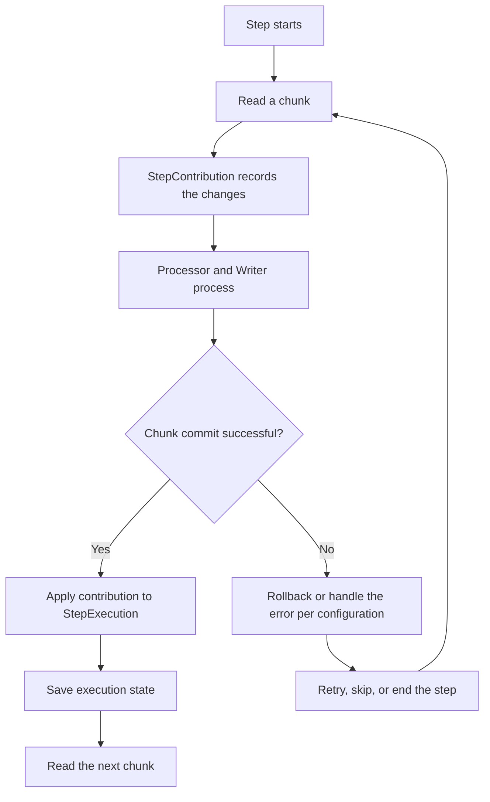

# Step Contribution and Read, Write, and Skip Counts

When a Spring Batch step processes data, the framework needs to know more than whether the step succeeded or failed. It must also record how many items were read, how many were written, how many were filtered, and how many were skipped because of errors. These numbers help the development team understand the processing results, monitor progress, investigate abnormal data, and decide whether the work needs to be re-run.

Two concepts are important for understanding these metrics: **`StepContribution`** and **`StepExecution`**. `StepContribution` records the changes that occur within one unit of execution, such as a chunk. `StepExecution` holds the aggregate information of one step run, including the counters that have been updated from the contributions that were applied.

## 1. StepExecution Stores the Result of One Step Run

A job usually consists of one or more steps. Each time a step is executed, Spring Batch creates a `StepExecution` object to store the state and metrics of that run.

`StepExecution` can store information such as:

- The step name and the ID of the execution.
- The start time, the end time, and the execution duration.
- `BatchStatus` and `ExitStatus`.
- The number of items read, written, and filtered.
- The number of items skipped in the read, process, or write phase.
- The number of commits and rollbacks.
- The `ExecutionContext` used to store the state needed to resume the step.

For example, the step `importCustomerStep` reads customer data from a CSV file, validates each record, and then writes the valid data to the database. When the step ends, the `StepExecution` provides metrics that show how many records were read, how many records were written, and how many records were filtered or skipped.

A `StepExecution` belongs to one step execution. It is not the step definition in the configuration, and it is also not an aggregate state of the entire history of all runs. When a step is re-run, you need to look at the correct corresponding execution to understand the counters.

## 2. StepContribution Records the Contribution of One Processing Unit

In the chunk-based processing model, Spring Batch divides the data into groups of items. Each chunk is read, processed, written, and committed as one transaction unit. While processing that unit, the framework records the changes to the metrics in a `StepContribution`.

The relationship between the two objects can be understood as follows:

- **`StepContribution`** holds the increments to the counters that occur within one unit of execution.
- **`StepExecution`** holds the accumulated metrics of the step run.
- When the processing unit completes and is committed according to the step's mechanism, the contribution is applied to the execution to update the aggregate metrics.

For example, a step processes a chunk of 100 items. In that chunk, the reader reads 100 items, the processor filters 4 items, 1 item is skipped because of a processing error, and the writer successfully writes 95 items. The chunk's contribution reflects the metrics produced by that processing. After the chunk is committed, the metrics are added to the `StepExecution`.



The diagram shows the general idea. How the framework handles the contribution in the retry, rollback, and skip branches depends in its details on the type of error and the fault-tolerant configuration. When looking at operational metrics, you should read the counters recorded in the `StepExecution` after the chunk has stabilized instead of adding up intermediate log events yourself.

## 3. The Read, Write, and Filter Counters

In a step that processes items, the common counters reflect different phases of the pipeline.

### readCount — Number of Items Read

`readCount` is the number of items that the `ItemReader` read successfully and returned to the step. Each time the reader returns a valid item, the read count is incremented accordingly.

When the reader returns `null` to signal that the data is exhausted, that is an end signal, not an item that was read. Therefore, the final `null` return does not increase `readCount`.

If the reader throws an exception and the exception is configured to be skipped, the item that could not be read is recorded in `readSkipCount` and is not counted as an item that was read successfully.

### writeCount — Number of Items Written

`writeCount` reflects the number of items successfully written by the `ItemWriter`. In chunk-oriented processing, the writer usually receives a list of items that have gone through the read and process steps.

`writeCount` can be smaller than `readCount` because:

- The processor filters some items by returning `null`.
- Some items are skipped because of exceptions that are allowed to be skipped.
- Some items do not reach the writer because the flow or processing logic excludes them from the output.

Do not treat `writeCount` as the number of times the writer was called. One writer call can write many items; this metric is about the number of items written, not the number of method invocations.

### filterCount — Number of Items Filtered

In an `ItemProcessor`, returning `null` means that the item is filtered out of the output flow. The item has been read by the reader but is not passed on to the writer.

For example, a file contains both active customers and customers who have closed their accounts. If you only need to import active customers, the processor can return `null` for the customers who have closed their accounts. These items are reflected in `filterCount`.

Filtering data is a normal processing decision, not necessarily an error. For this reason, `filterCount` is separate from the skip counters.

## 4. Skip Counters by Phase

Spring Batch distinguishes items that were skipped by where in the pipeline the error occurred. The three main counters are `readSkipCount`, `processSkipCount`, and `writeSkipCount`.

### readSkipCount — Errors During Reading

`readSkipCount` increases when the `ItemReader` encounters an exception and the skip policy allows that error to be skipped.

For example, a reader reads an input file and encounters a line with an incorrect format. If the corresponding exception is configured as skippable and the skip limit has not been exceeded, Spring Batch can skip the bad line and continue reading the following lines.

The item that caused the read error does not become a successfully read item, so it is not added to `readCount`. The number of skipped errors is reflected in `readSkipCount`.

### processSkipCount — Errors During Processing

`processSkipCount` increases when the `ItemProcessor` throws an exception and that exception is allowed to be skipped.

For example, a processor converts a date string to a `LocalDate`. A record with an invalid date causes the processor to throw an exception. If the policy allows skipping this kind of error, the record is skipped and the step continues.

That item was successfully read by the reader, so it is still included in `readCount`. However, it is not turned into output for the writer.

### writeSkipCount — Errors During Writing

`writeSkipCount` increases when the `ItemWriter` encounters an exception and the skip policy allows the item that caused the error to be skipped.

For example, a writer writes customers to the database but one record violates a data constraint. If the error is classified as skippable, Spring Batch can identify the item that caused the error and continue with the remaining items using the writer's skip-handling mechanism.

Handling write errors can be more complicated than read or process errors because the writer usually receives an entire chunk. Depending on the writer, the transaction, and the configuration, the framework may need to roll back the chunk and then retry or isolate the faulty item. For this reason, do not assume that every writer can skip one item without affecting the other items.

### skipCount — Total Number of Items Skipped

`skipCount` is the total number of skips across all three phases:

\[
\text{skipCount} = \text{readSkipCount} + \text{processSkipCount} + \text{writeSkipCount}
\]

For example, if a step has 2 read errors skipped, 3 processing errors skipped, and 1 write error skipped, the total `skipCount` is 6.

Breaking it down by phase helps find the cause. A total skip of 6 only tells you that 6 items were skipped; the detailed counters tell you whether the errors are concentrated in the data source, the processing logic, or the target system.

## 5. Distinguishing Filter from Skip

`filterCount` and `skipCount` are often confused because both cause items not to reach the writer. However, their meanings are different.

| Criterion | Filter | Skip |
|---|---|---|
| Cause | The processor deliberately returns `null` | An exception that the policy allows to be skipped |
| Is it an error? | Not necessarily; it is a business decision | An exception occurs, but the application chooses to continue |
| Counter | `filterCount` | `readSkipCount`, `processSkipCount`, or `writeSkipCount` |
| Example | Excluding customers outside the import scope | A malformed CSV line or a record that cannot be written |
| Does the item reach the writer? | No | No, if it has been skipped |

For example: the system imports only customers with the `ACTIVE` status. An `INACTIVE` customer has `null` returned by the processor, so it is counted as a filter. If an `ACTIVE` customer has a malformed date of birth that causes the processor to throw an exception and the error is skipped, that record is counted as a process skip.

Do not use skip to represent every decision to exclude data. If the data is valid but outside the business scope, filter usually describes the meaning more accurately.

## 6. Example of Computing the Counters in a Chunk

Suppose a chunk has 100 input records. During processing:

- The reader successfully reads 100 items.
- The processor filters 5 items because they are outside the business scope.
- The processor encounters errors on 2 items; both errors are allowed to be skipped.
- The writer encounters an error on 1 item; the error is allowed to be skipped.
- The writer successfully writes the remaining 92 items.

The chunk's metrics can be illustrated as follows:

| Counter | Value | Explanation |
|---|---:|---|
| `readCount` | 100 | 100 items were read successfully |
| `filterCount` | 5 | 5 items were filtered by the processor |
| `readSkipCount` | 0 | No read errors were skipped |
| `processSkipCount` | 2 | 2 items were skipped because of processor errors |
| `writeSkipCount` | 1 | 1 item was skipped because of a writer error |
| `skipCount` | 3 | Total 2 + 1 + 0 |
| `writeCount` | 92 | 92 items were written successfully |

In this simple example, you can reconcile:

\[
100 = 5 + 2 + 1 + 92
\]

That is, the 100 items read are divided into 5 filtered items, 3 skipped items, and 92 successfully written items. This is an illustrative reconciliation for a processing flow with no other variations. In a real job, you need to account for readers that fail before returning an item, retries, rollbacks, writers with special behavior, and many different chunks; do not apply a general equation to every type of step.

## 7. Skip Policy and Skip Limit

Spring Batch lets you configure which exception types are allowed to be skipped. This policy needs to be based on the business meaning of the error.

For example, a data import application can allow skipping `FlatFileParseException` because some file lines are malformed, but not allow skipping a database connection loss. Malformed data can be put into an error report for later handling; infrastructure errors may need a retry or make the step fail.

The skip limit defines the maximum number of errors that the step accepts skipping. This number is counted in total across read, process, and write errors; it is not an independent limit for each phase. When the number of skips exceeds the limit, the step fails.

For example, if the skip limit is configured as 10:

- Skips within the limit are accepted.
- When a skip occurs that exceeds the limit, the step does not continue skipping that error and ends in failure.

Not every exception is automatically skipped. You need to explicitly declare the error types that are allowed to be skipped; an error that is not in the policy or that exceeds the limit can make the step fail.

Retry and skip are also two different decisions:

- **Retry** attempts the operation again when the error is considered transient, such as a short timeout or a data lock error that may go away.
- **Skip** accepts skipping an item after the error has been classified as skippable.

If a retried operation succeeds, the item is not skipped just because an earlier attempt failed. The skip count reflects the items that were ultimately skipped under the policy, not the total number of times an exception appeared across all attempts.

## 8. Commit, Rollback, and the Meaning of the Metrics

In chunk-oriented processing, a transaction usually wraps the processing and writing of a chunk. When the chunk succeeds, the transaction commits and the contribution is applied to the `StepExecution`. When the chunk rolls back, the framework can retry, handle a skip, or end the step depending on the configuration.

The counters need to be understood in the context of transactions:

- **`commitCount`** gives the number of commits recorded in the step.
- **`rollbackCount`** gives the number of rollbacks recorded.
- **`readCount` and `writeCount`** reflect the item processing results written to the step metadata, not the number of log lines or the number of reader/writer calls.
- **The skip counters** reflect items that were skipped under the skip policy; a transient retry is not the same as a skip.

A chunk can be retried after a rollback. Therefore, the logs may show that the reader or writer was called multiple times while the step's final metrics reflect only the execution results the framework recorded. When analyzing, prefer the `StepExecution` and the execution history in the repository over adding up the number of calls from the logs yourself.

In addition, Spring Batch's transaction usually does not span every external system. If a writer sends an HTTP request, sends an email, or writes a file on another server, a database rollback does not necessarily undo that side effect. The step's counters also cannot prove that the external system performed the action exactly once. For these operations, you should design idempotency, business keys, or a reconciliation mechanism.

## 9. Reading the Counters from StepExecution

After you have retrieved the `StepExecution`, an application can read the metrics through the corresponding methods. The following example illustrates how to log them in a `StepExecutionListener`:

```java
import org.springframework.batch.core.ExitStatus;
import org.springframework.batch.core.StepExecution;
import org.springframework.batch.core.StepExecutionListener;

public class StepMetricsListener implements StepExecutionListener {

    @Override
    public ExitStatus afterStep(StepExecution stepExecution) {
        System.out.println("Step: " + stepExecution.getStepName());
        System.out.println("Status: " + stepExecution.getStatus());
        System.out.println("Read: " + stepExecution.getReadCount());
        System.out.println("Write: " + stepExecution.getWriteCount());
        System.out.println("Filter: " + stepExecution.getFilterCount());
        System.out.println("Read skip: " + stepExecution.getReadSkipCount());
        System.out.println("Process skip: " + stepExecution.getProcessSkipCount());
        System.out.println("Write skip: " + stepExecution.getWriteSkipCount());
        System.out.println("Total skip: " + stepExecution.getSkipCount());
        System.out.println("Commit: " + stepExecution.getCommitCount());
        System.out.println("Rollback: " + stepExecution.getRollbackCount());

        return stepExecution.getExitStatus();
    }
}
```

The listener above only reads and displays the metrics after the step. It returns the current `ExitStatus` so as not to accidentally change the step's result. In a real application, you can send these metrics to a metrics system or store a report per job execution.

To monitor a step that is running, you can read the `StepExecution` through an appropriate observation mechanism in the application or through `JobExplorer`. Do not just wait for `afterStep`, because that callback runs when the step ends; a progress dashboard needs to take a snapshot of the metadata while the execution is still active.

## 10. Using the Metrics to Investigate Data and Operations

The counters are most useful when they are read together and placed in the context of the data source, the step, and the specific run.

### When readCount Is Lower Than Expected

Check the data scope, the query conditions, the reader's starting position, the input file, and read errors. If `readSkipCount` increases, the data source may have records that cannot be read. If the reader ends early but the skip count is 0, the query or the data selection conditions may not include the expected records.

### When readCount Is High but writeCount Is Low

Check `filterCount`, the skip counters, and the processor logic. Many filtered items can be a correct result if the business deliberately excludes data. A high `processSkipCount` can indicate that the input data is unsuitable or that there is a problem with the conversion rules. A high `writeSkipCount` can point to constraints or data quality issues in the target system.

### When the Skip Count Spikes

Look at the detailed counters by phase and the corresponding exceptions. Do not look only at the total skip. An increase in `readSkipCount` may be related to a change in the file format; `processSkipCount` may be due to new business data; `writeSkipCount` may be due to a changed schema or database constraints.

### When the Rollback Count Increases

Check for transaction errors, deadlocks, timeouts, writer errors, and the retry policy. Multiple rollbacks can reduce throughput and lengthen the run time, even if the job ultimately ends `COMPLETED`.

### When writeCount Is 0

This does not necessarily mean the reader is not working. There may be no input data, all items may have been filtered, all items may have been skipped, or the writer may not have written any item. You need to look at `readCount`, `filterCount`, and the three skip counters together.

## 11. Example: Importing Customers from a CSV File

Suppose the file `customers.csv` has 10,000 data lines. The step `importCustomerStep` uses a reader to read lines, a processor to normalize and validate, and a writer to save customers.

After the step ends, the metrics are recorded as follows:

| Metric | Value |
|---|---:|
| `readCount` | 9,990 |
| `filterCount` | 1,200 |
| `readSkipCount` | 10 |
| `processSkipCount` | 25 |
| `writeSkipCount` | 5 |
| `skipCount` | 40 |
| `writeCount` | 8,760 |

Interpretation:

1. There are 10 lines that could not be read and were skipped, so 9,990 items were returned successfully by the reader.
2. The processor deliberately filtered 1,200 customers who are outside the import scope.
3. There are 25 items that caused processing errors and were skipped.
4. There are 5 items that caused write errors and were skipped.
5. The writer successfully wrote 8,760 items.

The metrics above help the operations team answer different questions: how many items could be read from the source, how many customers the business excluded, in which phase the bad data appeared, and how many items the target system received.

If `processSkipCount` rises sharply compared with previous days, the development team can check the normalization rules or the new data from the source system. If `writeSkipCount` increases, you need to look at the constraints in the target database and the writer's exceptions. This classification helps address the right cause instead of just raising the skip limit so the job keeps running.

## 12. Notes on Reading Metrics in Different Step Types

The item counters are especially meaningful in a chunk-oriented step that uses `ItemReader`, `ItemProcessor`, and `ItemWriter`. For a tasklet step that performs a task such as calling a stored procedure or cleaning up files, there is no standard item pipeline, so the read/write/filter counters may be 0. That does not mean the tasklet did no work; it just does not process items following the reader-processor-writer model.

If a tasklet manages reading or writing itself, the application can update the appropriate contribution when it needs to report metrics. However, you should only increment a counter according to its true meaning. For example, you should not increment `writeCount` just because a stored procedure was called if that number does not represent the number of items actually written.

With a partitioned step, each partition has its own execution and metrics. When building an aggregate report, you need to identify clearly whether you are looking at the metrics of a partition, of the coordinating step execution, or the aggregate of all partitions, to avoid double counting.

When restarting a job, you need to distinguish the metrics of the current execution from the history of previous executions. A re-run can have a new `StepExecution`. Do not add up the metrics of all attempts into a single total number of items if chunks or items may have been re-read during the restart.

## 13. Principles to Remember

- `StepContribution` records the changes of one processing unit; `StepExecution` stores the accumulated metrics of one step run.
- `readCount` is the number of items the reader returned successfully; the `null` end signal is not an item.
- `writeCount` is the number of items written successfully, not the number of writer calls.
- `filterCount` is the number of items the processor deliberately excluded by returning `null`.
- `readSkipCount`, `processSkipCount`, and `writeSkipCount` classify skipped items by the phase in which the error occurred.
- `skipCount` is the sum of the three skip counters.
- Filter and skip have different meanings: filter is a processing decision; skip is a way to continue after an allowed exception.
- The skip limit applies to the step's total number of skips; retry is trying again and does not automatically increase the skip count.
- Read the counters together with `BatchStatus`, `ExitStatus`, commit/rollback, and the exception logs to understand the result correctly.
- With a tasklet or partitions, you need to understand the execution structure before interpreting or aggregating the item metrics.

When you understand `StepContribution` and the counters in `StepExecution`, the development team can explain how the data went through the step, which parts were filtered, which parts were skipped because of errors, and the number of items actually written. This is the foundation for monitoring data quality and operating batch jobs in a controlled way.
