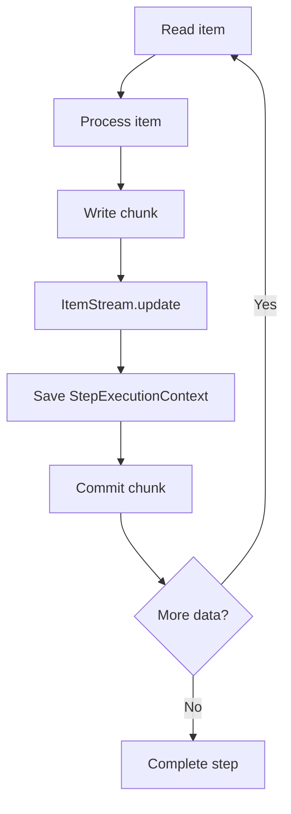

# What State Does the StepExecutionContext Store?

In Spring Batch, each `StepExecution` has its own `ExecutionContext` for storing state that the step needs to retain between commits and use on restart. This context is commonly called the **Step ExecutionContext** or `StepExecutionContext`, even though the data type in the API is `ExecutionContext` and it is accessed through `stepExecution.getExecutionContext()`.

It mainly stores checkpoints and small pieces of state data needed to continue the step, such as how far the reader has read, the next page of data to process, the last key that was completed, or intermediate information used only by that step. Spring Batch stores the context together with the execution metadata in the `JobRepository`, so the step can recover the saved state when it is restarted.

It is important to distinguish this context from the other information in a batch. `StepExecution` already has its own fields for execution status and counters such as `readCount`, `writeCount`, `commitCount`, `rollbackCount`, `filterCount`, the number of skipped items, `BatchStatus`, and `ExitStatus`. `ExecutionContext` is an additional key-value area where the application or a reader/writer stores state that needs to be recovered; it is not the place that holds all the processed data.

## 1. What Is the Step ExecutionContext?

`ExecutionContext` is a key-value structure that Spring Batch manages and persists through the `JobRepository`. In each step execution, the context is attached to the `StepExecution` object:

```java
ExecutionContext stepContext = stepExecution.getExecutionContext();
```

The application can write or read values by key:

```java
stepContext.putLong("orders.lastProcessedId", 8450L);

long lastProcessedId = stepContext.getLong(
        "orders.lastProcessedId", 0L);
```

In the example, `orders.lastProcessedId` stores the ID of the last order that the step had processed up to the checkpoint. When the step is recovered, the application can read this value to continue from the appropriate range.

The Step ExecutionContext has the following main characteristics:

- **Step-scoped:** the context belongs to one `StepExecution`, so the data in it is for that step.
- **Can be persisted:** Spring Batch stores the context in the metadata repository, not only in the memory of a Java object.
- **Recoverable:** when restarting a step that has not completed, the saved context from the previous execution can be used to recover state.
- **Saved at checkpoints:** in chunk-oriented processing, the context is updated at commit points following the lifecycle of the step and the `ItemStream`s.
- **Key-value data:** the application chooses the keys and values, and must ensure the values are compatible with the configured serialization mechanism.

There is no standalone Java class named `StepExecutionContext` that the application has to create. This name usually refers to the `ExecutionContext` obtained from a `StepExecution`.

## 2. Types of State That Are Commonly Stored

### 2.1. The Reader's Read Position or Checkpoint

This is the most common use case. A step may process millions of lines. If the process stops after some chunks have been committed, the restart needs to know where the reader should continue from.

For example, a file reader can store the line number or the read position that has been confirmed. A database reader can store the last key processed or paging information. A reader that processes data by date can store the time marker or the current partition.

Spring Batch's standard readers that support `ItemStream` usually save the state they need into the `ExecutionContext` themselves. For example, readers based on `AbstractItemCountingItemStreamItemReader` maintain the item position so they can reopen at the saved position. You need to check the specific reader and the `saveState` configuration; if state saving is turned off, that reader will not create a checkpoint for restart on its own.

An example `FlatFileItemReader` configuration:

```java
@Bean
@StepScope
FlatFileItemReader<OrderInput> orderReader(
        @Value("#{jobParameters['inputFile']}") Resource inputFile) {

    return new FlatFileItemReaderBuilder<OrderInput>()
            .name("orderReader")
            .resource(inputFile)
            .delimited()
            .names("orderId", "customerId", "amount")
            .targetType(OrderInput.class)
            .build();
}
```

The reader is given a stable name with `.name("orderReader")`. The reader can use this name to create the state keys in the context. When the step is configured with a reader that implements `ItemStream`, Spring Batch calls the `open`, `update`, and `close` lifecycle so the reader manages its checkpoint. On restart, the reader uses the saved state to continue reading.

### 2.2. The Internal State of a Reader or Writer

A custom reader may need to store the current page, the offset, the last record ID, or the segment state. A writer may need to store its own checkpoint information if the writer's design requires continuing after a restart.

For example, a reader that reads data page by page can store `nextPage` instead of storing the whole list of items. When the step is reopened, the reader gets the page number from the context and continues querying from the appropriate page.

Saving internal state should be done through the `ItemStream` interface, because this interface ties opening, updating, and closing resources to the step's lifecycle:

```java
public interface ItemStream {
    void open(ExecutionContext executionContext);
    void update(ExecutionContext executionContext);
    void close();
}
```

`ItemStreamReader` and `ItemStreamWriter` combine this contract with the function of reading or writing items. Spring Batch calls `open()` when the step starts, `update()` at the checkpoint, and `close()` when the step ends. As a result, the reader/writer does not need to manage direct access to Spring Batch's metadata tables itself.

### 2.3. Custom State Needed to Continue a Tasklet

Not every step uses a reader, processor, and writer. A tasklet can split its work into several iterations, for example processing one page of data, one sub-file, or one small partition at a time. The context can store the last unit of work that was completed so the tasklet continues on the next iteration.

An example of a tasklet that processes pages one after another:

```java
@Bean
Step processPagesStep(
        JobRepository jobRepository,
        PlatformTransactionManager transactionManager) {

    Tasklet processPages = (contribution, chunkContext) -> {
        ExecutionContext context =
                contribution.getStepExecution().getExecutionContext();

        int lastCompletedPage =
                context.getInt("pages.lastCompleted", 0);
        int pageToProcess = lastCompletedPage + 1;

        if (pageToProcess > totalPages()) {
            return RepeatStatus.FINISHED;
        }

        processPage(pageToProcess);
        context.putInt("pages.lastCompleted", pageToProcess);

        return pageToProcess == totalPages()
                ? RepeatStatus.FINISHED
                : RepeatStatus.CONTINUABLE;
    };

    return new StepBuilder("processPagesStep", jobRepository)
            .tasklet(processPages, transactionManager)
            .build();
}
```

Each tasklet iteration processes one page and then updates `pages.lastCompleted`. When it returns `RepeatStatus.CONTINUABLE`, the tasklet is called again; each iteration is managed within the tasklet step's transaction. When the process stops after an iteration that has been committed, the restart can read the saved checkpoint to continue at the next page.

The code is an example of how to save progress. In a real application, `totalPages()` needs to return a range that is stable throughout the run, `processPage()` needs to behave safely on retry, and the context update operation must be within the correct transaction boundary of the step.

### 2.4. Intermediate Information Needed Only by the Current Step

A step can store a few small values that serve its own continuation logic, such as:

- The ID of the partition or segment being processed.
- The last key completed in a paged query.
- The name or identifier of an intermediate file created in the step.
- The number of pages completed when a tasklet processes over multiple iterations.
- An aggregate value that needs to be restored to continue a calculation step.

Store only the data needed to recover or continue the step. If a value can be easily recomputed and does not affect correctness, it does not necessarily need to be stored in the context.

## 3. When Is the Context Updated and Saved?

To understand what a value in the context means, you need to understand the checkpoint lifecycle.

With a chunk-oriented step, Spring Batch typically performs the following operations:

1. Read an item from the reader.
2. Pass the item through the processor, if there is one.
3. Write the group of items in the writer.
4. Call `ItemStream.update()` so the stream components update the state that needs checkpointing into the `ExecutionContext`.
5. Save the execution metadata and the context following the step's transaction/checkpoint mechanism.
6. Commit the chunk.

General diagram:



The key point: the context reflects the state that was saved at the most recent checkpoint. If the step processes more items after the checkpoint but the process stops before the new checkpoint is committed, the restart may have to reprocess the portion of work after the previous checkpoint.

Therefore, do not understand a single call to `put()` as the state having been immediately written to the database. `put()` updates the context object in memory; Spring Batch is responsible for saving the context within the step's execution lifecycle and transaction. With external resources or multiple transaction managers, the atomicity between the metadata and the business effects depends on the transaction configuration. Do not assume that an HTTP call, sending an email, or writing to another system will automatically roll back along with the database transaction.

With a tasklet step, the tasklet is executed in a loop managed by Spring Batch. When the tasklet returns `CONTINUABLE`, the step can perform the next iteration; the context state is updated across the step's transactions. When the tasklet returns `FINISHED`, the step ends.

## 4. How Does Spring Batch Use ItemStream to Save Checkpoints?

`ItemStream` is the standard mechanism for readers and writers to take part in the checkpoint lifecycle. The three methods have different roles:

| Method | Timing and purpose |
|---|---|
| `open(ExecutionContext)` | When the step starts, read the saved state to recover or initialize the starting state |
| `update(ExecutionContext)` | At the checkpoint, write the current internal state into the context so Spring Batch can save it |
| `close()` | When the step ends, release resources such as streams or file handles |

A custom reader can implement `ItemStreamReader` as follows:

```java
public class PagedOrderReader implements ItemStreamReader<OrderInput> {

    private static final String NEXT_PAGE_KEY = "pagedOrderReader.nextPage";

    private int nextPage;

    @Override
    public void open(ExecutionContext executionContext) {
        nextPage = executionContext.getInt(NEXT_PAGE_KEY, 0);
    }

    @Override
    public OrderInput read() {
        // Read an item from page nextPage in a stable order.
        // When the page is exhausted, move to the next page according to the reader logic.
        return readNextOrder();
    }

    @Override
    public void update(ExecutionContext executionContext) {
        executionContext.putInt(NEXT_PAGE_KEY, nextPage);
    }

    @Override
    public void close() {
        // Release resources if the reader has opened any.
    }
}
```

This is a skeleton illustrating the `ItemStream` contract; the `readNextOrder()` part and how `nextPage` is incremented must be implemented so that the value saved is the next page to be read at the checkpoint. The reader also needs to handle rollback/retry correctly within the same run, keep the data order stable, and avoid skipping or re-reading data on restart.

If a reader or writer is nested inside another delegate, make sure the inner `ItemStream` component is registered with the step so Spring Batch calls `open`, `update`, and `close`. When you use a standard builder with a reader/writer that implements `ItemStream` attached directly to the step, the framework usually recognizes and manages that lifecycle automatically.

## 5. How Does the StepExecutionContext Differ from the JobExecutionContext?

Spring Batch has two commonly used `ExecutionContext`s:

- **Step ExecutionContext:** obtained from `StepExecution.getExecutionContext()`, intended for the state of a single step and updated at the step's checkpoints.
- **Job ExecutionContext:** obtained from `JobExecution.getExecutionContext()`, intended for data that needs to be shared between steps within the same `JobExecution`.

Comparison:

| Criterion | Step ExecutionContext | Job ExecutionContext |
|---|---|---|
| Scope | One `StepExecution` | One `JobExecution` |
| Purpose | A step's own checkpoint and state | Data that needs to be passed between steps |
| When saved | At the step's commit/checkpoint points | Usually updated when a step completes |
| Example | Next reader page, file offset, last key processed | Batch ID, artifact path needed in a later step, aggregate result |
| Access | `stepExecution.getExecutionContext()` | `jobExecution.getExecutionContext()` |

Suppose `validateInputStep` produces a normalized file path and `importOrdersStep` needs to use that path. If the value lives only in the first step's Step ExecutionContext, the later step does not automatically see it. You can promote the required key to the Job ExecutionContext using `ExecutionContextPromotionListener`.

An example of declaring the listener:

```java
@Bean
ExecutionContextPromotionListener promoteInputFile() {
    ExecutionContextPromotionListener listener =
            new ExecutionContextPromotionListener();
    listener.setKeys(new String[] {"validatedInputFile"});
    return listener;
}
```

Registering the listener with the step that creates the key:

```java
@Bean
Step validateInputStep(
        JobRepository jobRepository,
        PlatformTransactionManager transactionManager,
        ExecutionContextPromotionListener promoteInputFile) {

    return new StepBuilder("validateInputStep", jobRepository)
            .tasklet((contribution, chunkContext) -> {
                String path = validateAndResolveInputFile();

                contribution.getStepExecution()
                        .getExecutionContext()
                        .putString("validatedInputFile", path);

                return RepeatStatus.FINISHED;
            }, transactionManager)
            .listener(promoteInputFile)
            .build();
}
```

When the step completes, the listener moves the configured key from the step context to the job context. The later step can read the value from `JobExecution.getExecutionContext()` or reference it via `jobExecutionContext` in a bean annotated with `@StepScope`.

Do not use the Step ExecutionContext as an implicit shared area between multiple steps. If the data needs to exist throughout the job, consider the Job ExecutionContext or a business data store; if the data is needed only for one step, keep it in the Step ExecutionContext.

## 6. Distinguishing ExecutionContext from JobParameters and StepExecution Metadata

These three kinds of data serve different purposes:

| Component | What does it contain? | Example |
|---|---|---|
| `JobParameters` | Input parameters that identify a business run | `businessDate`, `inputFile`, `batchId` |
| `StepExecution` metadata | Status and metrics the framework tracks | `status`, `exitStatus`, `readCount`, `writeCount`, `commitCount`, `skipCount` |
| Step `ExecutionContext` | Key-value state that must be retained to recover the step | `reader.nextPage`, `file.currentOffset`, `orders.lastProcessedId` |

`JobParameters` are generally regarded as the job's input. Do not change the identifying parameters when restarting the same batch, because a different set of parameters may create a new `JobInstance`.

Counters such as `readCount` or `writeCount` are already managed by Spring Batch in the `StepExecution`. There is no need to copy them into the context unless there is a specific business reason. The context should store custom state that the framework cannot infer from the existing metadata fields.

In addition, `StepContext` is a different object used in Spring Batch's scope mechanism. `StepContext` provides information about the current step to step-scoped beans; it is not an alternative name for `ExecutionContext`.

## 7. Accessing the Step ExecutionContext in a StepScope Bean

A bean with `@StepScope` is created within the step's scope, so it can read values in the execution context using SpEL. For example:

```java
@Bean
@StepScope
FlatFileItemReader<OrderInput> orderReader(
        @Value("#{stepExecutionContext['validatedInputFile']}") String filePath) {

    return new FlatFileItemReaderBuilder<OrderInput>()
            .name("orderReader")
            .resource(new FileSystemResource(filePath))
            .delimited()
            .names("orderId", "customerId", "amount")
            .targetType(OrderInput.class)
            .build();
}
```

Here, `validatedInputFile` must be written into the Step ExecutionContext before the reader is created. If the value is promoted to the Job ExecutionContext, the corresponding expression is `#{jobExecutionContext['validatedInputFile']}`. To reference an input parameter, you can use `#{jobParameters['inputFile']}`.

Using `@StepScope` helps defer bean creation until the step starts, when runtime values are ready. If a singleton bean is initialized too early, an expression that needs step data may not be resolved at the right time.

## 8. Rules for Designing Data in the Context

The ExecutionContext is stored in the metadata repository, so it needs to be designed as part of the durable data.

**Choose serializable data types.** Values placed in the context must be compatible with the `ExecutionContextSerializer` configured for the application. Simple values such as strings, numbers, and booleans are usually suitable. If you store a custom object, that type must satisfy the serialization mechanism and remain compatible when the application restarts after a new version is deployed.

**Store small data that is meaningful as a checkpoint.** Do not put an entire list of items, the contents of a large file, or a huge object into the context. Store a key, offset, batch ID, or path that references data in a database or file.

**Use clear and stable keys.** Use namespaced names such as `orders.lastProcessedId` or `input.currentPage`, and avoid generic keys such as `index` that could collide with other components. Keep key names stable across restarts.

**Do not store runtime objects.** Avoid storing a `Connection`, `EntityManager`, `InputStream`, `File`, thread, Spring bean, or any object that holds open resources. These objects are not checkpoint state that can be recovered after the JVM process ends.

**Do not store sensitive data if it is not needed.** The metadata repository is a durable store. Do not put tokens, passwords, or personal data into the context just for convenience in passing them between components. If you must store sensitive business information, apply the corresponding data protection policies.

**Make sure values are updated at the right time.** If you store `lastProcessedId`, determine whether it is the ID that was read, processed, or committed. For restart, the value needs to represent progress that was confirmed at the checkpoint, not progress that exists only in memory.

**Keep the source data stable or use an appropriate continuation key.** Storing a line index or offset is reliable only when the data source and the read order do not change in a way that shifts the position. For database data, use a deterministic sort order and an appropriate continuation key, such as a primary key or a stable cursor.

## 9. What the Step ExecutionContext Does Not Guarantee by Itself

The context is part of the restart mechanism, but merely storing values is not enough to guarantee the job re-runs correctly.

- It does not make a writer idempotent by itself. If an API has received a request but the job has not saved the checkpoint, a restart may send the request again.
- It does not roll back side effects that have already happened outside the transaction.
- It does not guarantee that the reader can be recovered. The reader must support `ItemStream` or have its own checkpoint mechanism.
- It does not guarantee that the source data keeps the same order or content between runs.
- It does not share data with other steps by itself. You need to use the Job ExecutionContext or the promotion mechanism.
- It does not replace the `JobRepository`, the transaction manager, or the identifying `JobParameters`.
- It is not a thread-safe shared memory for concurrent coordination. With a multi-threaded step or partitioning, you need to understand the separate `StepExecution` scope of each worker and design appropriate synchronization.

A job can have its context saved very well and still create duplicate data if the writer performs non-idempotent operations. Therefore, checkpoints need to go together with transaction design, business keys, and how side effects are handled.

## 10. Testing the Step ExecutionContext and Restart

To verify the context, you should simulate an interrupted run and then restart the same `JobInstance` with the same identifying parameters. The test needs to confirm that the saved state is recovered and that the final business result is correct.

Some scenarios worth testing:

1. **First run:** the context has no checkpoint key yet; the reader or tasklet starts from the initial state.
2. **After a chunk commit:** the context contains the last position or key that was confirmed.
3. **Error before the next checkpoint:** the restart uses the checkpoint saved earlier, so part of the work may be performed again.
4. **Restart:** the reader continues from the appropriate position, without skipping data.
5. **Re-running side effects:** the writer or the external service does not produce duplicate results when an item is processed again.
6. **Promotion:** the key needed in a later step has been moved to the Job ExecutionContext.
7. **Upgrade compatibility:** a context written by a previous application version can still be read, or there is an appropriate migration plan.

Spring Batch provides job and repository testing utilities such as `JobLauncherTestUtils` and `JobRepositoryTestUtils` in the corresponding test module. Use a metadata repository whose behavior is close to the real environment when testing restart, and also verify the business data in the database or output files. Checking only that the job has the `COMPLETED` status is not enough to prove the checkpoint was correct.

## Conclusion

The Step ExecutionContext stores the key-value pairs needed for a step to continue correctly from a saved checkpoint, most commonly the reader position, the internal state of a reader/writer, and a tasklet's custom progress. Spring Batch manages updating and saving the context within the step's execution lifecycle through the `JobRepository` and the transaction/checkpoint mechanism.

Use the Step ExecutionContext for a step's own state; use the Job ExecutionContext for data that needs to be shared between steps; use JobParameters for the input of a run; and use the `StepExecution` fields for the counters and status that the framework already manages. When these boundaries are clear, a job can restart more predictably and avoid confusing in-memory progress with progress that has been committed.
