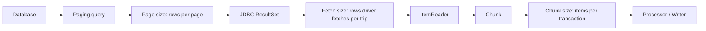
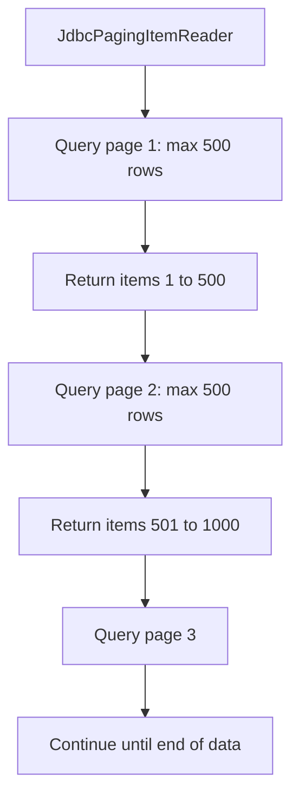
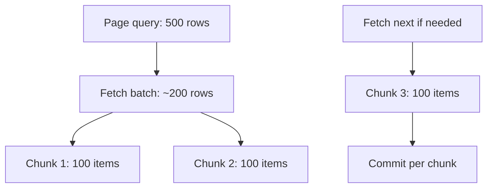

# Page Size and Fetch Size

When Spring Batch reads large volumes of data from a database, performance does not depend on SQL alone. How the reader splits the query into pages and how the JDBC driver retrieves rows from the ResultSet also affect network round trips, memory, processing time, and job stability.

Two commonly discussed settings are **page size** and **fetch size**:

- **Page size** determines the number of records a reader's paginated query requests at one time.
- **Fetch size** is a hint to the JDBC driver on how many records to retrieve from the database per ResultSet fetch.

Beyond these two values, chunk size is also critical: it determines how many items are processed in one chunk before the transaction commits. These three values are related to performance, yet control three different parts of the pipeline.



Understanding these three parameters prevents configurations that appear to speed things up while actually increasing memory, query count, or transaction duration.

## 1. What is page size?

Page size is typically used with **JdbcPagingItemReader**. The reader divides the result set into multiple pages. Whenever the next page is needed, the reader runs a paginated query and retrieves up to the configured number of rows.

For example, with a page size of 500:

1. The reader queries the first page for up to 500 rows.
2. Items in the page are returned incrementally to the step.
3. Once the current page is consumed, the reader queries the next page.
4. This continues until no rows remain.



Page size is not the number of items committed in a single transaction. It controls the page size of the paging query.

### Configuring page size

Spring Batch 5 example:

```java
@Bean
JdbcPagingItemReader<Customer> customerReader(
        DataSource dataSource,
        PagingQueryProvider customerQueryProvider) {

    return new JdbcPagingItemReaderBuilder<Customer>()
            .name("customerReader")
            .dataSource(dataSource)
            .queryProvider(customerQueryProvider)
            .pageSize(500)
            .rowMapper((rs, rowNum) -> new Customer(
                    rs.getLong("id"),
                    rs.getString("name"),
                    rs.getString("email")))
            .saveState(true)
            .build();
}
```

With this configuration, the reader requests at most 500 rows in each page query. Actual rows returned may be fewer if the final page has less data or query predicates only match a subset.

A larger page size generally reduces the number of paging queries executed, but increases the amount of single-page data held in memory. Do not choose page size based solely on the total row count of the table.

## 2. Paging mechanism of JdbcPagingItemReader

JdbcPagingItemReader uses a PagingQueryProvider to generate SQL suited to the database dialect. The provider generates the first-page query and subsequent page queries based on sort keys and the ending position of the previous page.

Example data:

```text
id | customer_name
---+--------------
1  | An
2  | Binh
3  | Chi
4  | Dung
5  | Giang
```

With a page size of 2, the reader fetches in turn:

| Page | IDs |
|---|---|
| 1 | 1, 2 |
| 2 | 3, 4 |
| 3 | 5 |

Subsequent page queries must know where to start after the previous page. Depending on the database, the SQL may use row numbers, offset/fetch, or keyset predicates. The Spring Batch QueryProvider is responsible for generating the appropriate query.

### Sort keys must be stable

Paging requires a deterministic order. Configure a unique sort key, or combine columns to create a unique ordering.

For example, sorting only by last_name can be unstable if multiple customers share the same last name. Add id as a tie-breaker:

```java
Map<String, Order> sortKeys = new LinkedHashMap<>();
sortKeys.put("last_name", Order.ASCENDING);
sortKeys.put("id", Order.ASCENDING);
```

If the ordering is unstable, records may be skipped or read twice across pages, especially if source data changes while the job runs.

## 3. What is fetch size?

Fetch size is a hint to the JDBC driver on how many rows to fetch from the database in each ResultSet fetch round trip. It is typically configured on a JDBC cursor reader or on a paging reader if the version/implementation exposes that property.

For example, with a fetch size of 200:

- The JDBC statement executes the query.
- The driver receives a hint to fetch 200 rows per trip.
- As the application reads the ResultSet, the driver can retrieve data in batches rather than transmitting each row individually.
- Exact execution depends on the JDBC driver, database, and connection configuration.

Fetch size is a **hint**, not an absolute guarantee. The driver may ignore it, interpret it differently, or require extra configuration to actually use batched cursors/fetches.

### Configuring fetch size with JdbcCursorItemReader

JdbcCursorItemReader reads through a ResultSet kept open for the duration of the step run. Example:

```java
@Bean
JdbcCursorItemReader<Customer> customerCursorReader(
        DataSource dataSource) {

    return new JdbcCursorItemReaderBuilder<Customer>()
            .name("customerCursorReader")
            .dataSource(dataSource)
            .sql("""
                    select id, name, email
                    from customer
                    order by id
                    """)
            .fetchSize(500)
            .rowMapper((rs, rowNum) -> new Customer(
                    rs.getLong("id"),
                    rs.getString("name"),
                    rs.getString("email")))
            .saveState(true)
            .build();
}
```

Here there is no page size because JdbcCursorItemReader does not split results into paginated queries like JdbcPagingItemReader. Fetch size hints to the driver how to fetch rows for the open ResultSet.

## 4. Distinguishing page size, fetch size, and chunk size

These are the three most frequently confused parameters:

| Parameter | Controls | Commonly found in | Example |
|---|---|---|---:|
| Page size | Maximum rows in a single paging query/page | JdbcPagingItemReader | 500 |
| Fetch size | Hint for rows the driver fetches per trip from ResultSet | JDBC cursor/paging statement | 200 |
| Chunk size | Items processed in one chunk before commit | Chunk-oriented step | 100 |

Suppose:

- Page size = 500.
- Fetch size = 200.
- Chunk size = 100.

Meaning:

1. The paging reader requests up to 500 rows for one page.
2. The JDBC driver may retrieve the ResultSet in trips of around 200 rows, if the driver honors the fetch hint that way.
3. Spring Batch feeds items for processing in chunks of 100 and commits per chunk transaction.

There is no rule requiring page size to equal chunk size or fetch size. They may happen to match in some setups, but that is not a technical requirement.



The diagram only illustrates the three sizing layers. Actual fetch sequencing is decided by the driver; with a paging reader, the reader can consume one page across multiple chunks.

## 5. What does page size affect?

### Small page size

For example, page size = 50:

- Each query returns at most 50 rows.
- The reader must execute more queries to read the same amount of data.
- Memory allocated for the page is typically lower.
- Round-trip, query parsing, and ResultSet initialization overhead may increase.

A small page size can fit when row objects are large, memory is constrained, or per-page query cost is minimal. However, too small a value can burden the database and application with coordination overhead.

### Large page size

For example, page size = 5,000:

- Each query retrieves more rows.
- The number of paging queries can decrease.
- The reader holds a larger page in memory.
- Single-query execution and page-mapping time can be longer.
- If a page query is slow, latency before the first item of the next page is processed can increase.

A large page size can improve throughput with compact rows and a capable database, though it is not always faster. If each item has many columns or a large object graph, large pages can strain heap and garbage collection.

## 6. What does fetch size affect?

Fetch size affects how the driver exchanges data between the database and the JVM:

- A low fetch size can increase network exchanges when reading a large ResultSet.
- A high fetch size can reduce fetch trips, but increases driver/client memory used to buffer rows.
- A fetch size of 0 typically means using the driver's default per JDBC API/implementation.
- The driver may ignore or apply a different behavior than the requested value.

Example query returning 100,000 rows:

| Fetch size | Expected behavior if driver supports | Trade-off |
|---:|---|---|
| 10 | Many small fetch trips | Fewer buffered rows, more round trips |
| 200 | Moderate batches | Potentially balanced |
| 2,000 | Fewer fetch trips | More rows buffered |
| 0 | Driver decides | Depends on driver default |

This is a directional description, not a guaranteed fetch count. Some drivers materialize the entire ResultSet or require a specific cursor mode.

## 7. Page size and fetch size in JdbcPagingItemReader

JdbcPagingItemReader executes multiple paginated queries. Page size defines the size of each page. Some configurations/versions of the reader also allow setting fetch size for the JDBC statement used to execute the page query.

Example builder configuration supporting both properties:

```java
@Bean
JdbcPagingItemReader<Customer> customerPagingReader(
        DataSource dataSource,
        PagingQueryProvider queryProvider) {

    return new JdbcPagingItemReaderBuilder<Customer>()
            .name("customerPagingReader")
            .dataSource(dataSource)
            .queryProvider(queryProvider)
            .pageSize(1000)
            .fetchSize(500)
            .rowMapper(customerRowMapper())
            .saveState(true)
            .build();
}
```

In this example:

- Each page requests up to 1,000 rows.
- Fetch size 500 is a hint to the JDBC driver when reading the page query's ResultSet.
- The reader delivers items to the step; chunk size still determines the commit interval.

Builder APIs and how fetch size is applied can vary across Spring Batch versions. If your project version's builder does not expose a fetchSize property, use the reader/statement API supported by that version; do not assume pageSize automatically sets JDBC fetch size.

If fetch size is larger than page size, a page query that only returns at most page-size rows usually sees no meaningful benefit from the larger fetch size. If fetch size is smaller than page size, the driver may take multiple fetch trips to complete one page's ResultSet.

## 8. JdbcCursorItemReader only has fetch size

JdbcCursorItemReader opens a cursor/ResultSet and reads sequentially through results. It does not execute repeated page queries by page size.

Example:

```java
@Bean
JdbcCursorItemReader<Order> orderCursorReader(DataSource dataSource) {
    return new JdbcCursorItemReaderBuilder<Order>()
            .name("orderCursorReader")
            .dataSource(dataSource)
            .sql("""
                    select id, customer_id, amount
                    from orders
                    where business_date = ?
                    order by id
                    """)
            .preparedStatementSetter(statement ->
                    statement.setDate(
                            1,
                            Date.valueOf(LocalDate.of(2026, 11, 15))))
            .fetchSize(500)
            .rowMapper((rs, rowNum) -> new Order(
                    rs.getLong("id"),
                    rs.getString("customer_id"),
                    rs.getBigDecimal("amount")))
            .saveState(true)
            .build();
}
```

Fetch size here is a hint to the driver for reading the ResultSet. If the database/driver does not support streaming as expected, adjusting fetch size may not reduce memory footprint as anticipated.

A cursor reader holds database resources while reading. Evaluate cursor open time, connection pool, transaction lifecycle, and restartability before choosing it for long-running jobs.

## 9. Choosing JdbcPagingItemReader vs. JdbcCursorItemReader

The two readers solve large-data reading differently:

| Criterion | JdbcPagingItemReader | JdbcCursorItemReader |
|---|---|---|
| Reading method | Multiple paginated queries | One query holding a ResultSet/cursor |
| Page size | Yes | No |
| Fetch size | Configurable depending on API/implementation | Critical setting for JDBC fetching |
| Connection/cursor | Queries page by page | Holds cursor/connection during reading |
| Restart | Based on paging state and sort keys | Based on reader state/row position |
| Changing source data | Requires stable ordering and paging predicates | Requires understanding snapshot/cursor semantics |
| Best suited for | Paging/keyset and query-based restarts | Sequential reading from cursor when connection lifecycle fits |

Neither reader is universally faster. Choose based on database, driver, data scale, sort key stability, restart requirements, and connection hold time.

## 10. Configuring query provider and sort keys

JdbcPagingItemReader needs a PagingQueryProvider or query clauses to build paginated queries. The query provider must know select, from, where, and sort keys.

Provider configuration example:

```java
@Bean
SqlPagingQueryProviderFactoryBean customerQueryProvider(
        DataSource dataSource) {

    SqlPagingQueryProviderFactoryBean provider =
            new SqlPagingQueryProviderFactoryBean();
    provider.setDataSource(dataSource);
    provider.setSelectClause("select id, name, email");
    provider.setFromClause("from customer");
    provider.setWhereClause("where active = :active");
    provider.setSortKey("id");
    return provider;
}
```

Reader:

```java
@Bean
JdbcPagingItemReader<Customer> customerReader(
        DataSource dataSource,
        PagingQueryProvider customerQueryProvider) {

    return new JdbcPagingItemReaderBuilder<Customer>()
            .name("customerReader")
            .dataSource(dataSource)
            .queryProvider(customerQueryProvider)
            .parameterValues(Map.of("active", true))
            .pageSize(500)
            .rowMapper(customerRowMapper())
            .saveState(true)
            .build();
}
```

Abbreviated example; bean declaration for the provider factory may require specifying the concrete return type or initializing a database-specific provider in application configuration.

Sort keys should be stable and preferably unique. If a sort key is not unique, configure an additional tie-breaker column. Do not use a continuously changing column as a paging key if doing so can move records across pages while the job runs.

## 11. Page size, fetch size, and chunk size can differ

Example of a step reading 10,000 customers:

```java
return new StepBuilder("importCustomersStep", jobRepository)
        .<Customer, Customer>chunk(100, transactionManager)
        .reader(customerPagingReader)
        .processor(customerProcessor)
        .writer(customerWriter)
        .build();
```

Suppose the reader has page size 500 and JDBC fetch size 250:

- One page query can return up to 500 rows.
- The driver can fetch the ResultSet in trips of around 250 rows.
- The step processes items in chunks of 100.
- Each chunk commits after the writer completes successfully.

A 500-row page can span multiple chunks. Conversely, if chunk size is larger than page size, a single chunk can consume the remainder of one page and continue into the next page.

There is no need to force all three parameters to be equal. Pick each parameter for its own goal:

- Page size: paging query cost and memory held for one page.
- Fetch size: JDBC fetch overhead and driver-side buffering.
- Chunk size: transaction duration, commit frequency, and volume rolled back on error.

## 12. Impact on memory

A large page size can make the reader hold more items per page load. A large fetch size can make the JDBC driver buffer more rows. A large chunk size keeps more items/outputs in one transaction.

A simple mental estimate for memory:

```text
Memory pressure
  ≈ page buffer
  + JDBC driver buffer
  + current chunk items
  + processor/writer working data
```

This is not an exact heap formula. Object overhead, column data, driver implementation, row mapper, and how the reader holds pages all matter.

If an item has many large text columns or contains collections/object graphs, a page size of 5,000 can consume significant memory. When running multiple steps/jobs concurrently, total memory pressure is the sum across executions, not just a single reader.

Measure heap, allocation rate, and garbage collection in a production-like environment. Do not infer memory solely from file size or row counts.

## 13. Impact on database and transactions

A large page size can make each paging query take longer and return more data. A large fetch size can reduce fetch trips while buffering more rows. A large chunk size lengthens transactions and may hold locks longer if the writer updates many rows.

These three settings have distinct impacts:

| Change | Potential impact |
|---|---|
| Increase page size | Fewer paging queries, each query is larger |
| Increase fetch size | Fewer JDBC fetch trips, larger buffer |
| Increase chunk size | Fewer commits, longer transactions and potentially larger rollbacks |

If the database is under heavy load, increasing page size or fetch size is unlikely to help. Query plans, indexes, lock contention, network latency, and connection pools may be the real bottleneck.

For paging readers, filter predicates and sort keys should be backed by appropriate indexes. Use EXPLAIN/EXPLAIN ANALYZE for your database to inspect whether per-page queries scan excessive rows.

## 14. Choosing initial values

There is no single optimal value for every application. Start with moderate values and measure:

| Scenario | Reference starting page size | Reference starting fetch size |
|---|---:|---:|
| Small rows, moderate data | 500 | 500 |
| Large rows, limited heap | 100 | 100 |
| Remote database, high latency | 500–1,000 | 500–1,000 |
| Heavy paging query | 100–500 | Per driver |
| Sequential cursor reader | Not applicable | 100–500 |

These numbers are only starting points for benchmarking, not fixed recommendations. Adjust based on row width, database, driver, connection pool, and concurrent load.

A testing workflow:

1. Run a baseline with the current configuration.
2. Record throughput, query time, query count, memory, and commit duration.
3. Change one parameter at a time.
4. Run against the same dataset and database conditions.
5. Compare throughput alongside memory, locks, and error rate.
6. Choose a balanced configuration rather than simply picking the single fastest run.

Do not change page size, fetch size, and chunk size simultaneously in one benchmark. If results improve or degrade, it will be hard to tell which change caused the difference.

## 15. Fetch size depends on the JDBC driver

JDBC defines fetch size as a hint to the driver. How that hint is implemented depends on the database and driver:

- Some drivers use fetch size to retrieve rows in batches over the network.
- Some drivers prefetch a number of rows by default and use fetch size to tune row prefetching.
- Some drivers may materialize results or ignore the hint in certain modes.
- Some databases require matching cursor or transaction settings for streaming to activate.

For instance, PostgreSQL JDBC has specific conditions around autocommit/cursors when fetching in batches; MySQL Connector/J has dedicated cursor fetch modes; Oracle JDBC has row prefetch mechanisms. Read documentation for your exact driver version and test on production-like settings.

Do not conclude fetch size reduced memory just because the setter threw no error. Measure actual behavior or check driver/network metrics.

### Fetch size of 0

In JDBC, a fetch size of 0 typically tells the driver to use its default value. That may be acceptable, but defaults differ across drivers. If you want to control performance, benchmark both the default and explicit values.

## 16. Paging and data changing while the job runs

Paging is most stable when the dataset is well defined for the entire run. If new records are inserted, sort keys change, or records are deleted between page queries, the reader may encounter unexpected results depending on the pagination strategy and isolation level.

For example, the reader reads the first page with IDs 1–500. While the job runs, a new record is inserted with an ID before the current position or a record's sort key is updated. The next page query may no longer reflect the same data snapshot.

Ways to mitigate risk:

- Filter by a finalized batch ID or business date.
- Use source snapshots/versions if supported by the database.
- Use unique and immutable sort keys.
- Define an appropriate transaction isolation level.
- Avoid updating sort keys of data being read mid-job if possible.

Page size does not automatically create a consistent snapshot. That is a matter of queries, isolation, and the source data contract.

## 17. Restart and checkpointing

JdbcPagingItemReader supports restart via reader state and tracked read position. The reader needs a stable name and saveState enabled when recovery is required.

Example:

```java
new JdbcPagingItemReaderBuilder<Customer>()
        .name("customerPagingReader")
        .dataSource(dataSource)
        .queryProvider(queryProvider)
        .pageSize(500)
        .rowMapper(customerRowMapper())
        .saveState(true)
        .build();
```

When a step fails and is restarted:

- Spring Batch restores the step's execution context.
- The reader uses saved state to determine where to continue.
- The query, sort keys, and dataset must be compatible with the previous run.
- The writer must safely handle already-committed chunks.

Changing page size between the initial run and restart can affect how the reader computes pages/offsets or performance. Do not arbitrarily change paging configuration while a JobInstance needs restarting; test the behavior of your specific reader version.

For a cursor reader, restart works differently than for a paging reader. Verify state/row position, driver behavior, and the ability to reopen the cursor after failure. Do not assume fetch size is a checkpoint.

## 18. Choosing sort keys and queries for safe restarts

For a paging reader, sort keys affect not only ordering but also how subsequent pages are queried and how position is restored.

A good query typically has:

- A unique sort key or unique composite key.
- A where condition stable across restarts.
- Indexes supporting filters and sorts.
- Sort key columns that do not change while the batch runs.
- Fixed parameters for the same JobInstance.

Example:

```sql
select id, customer_id, amount
from orders
where batch_id = :batchId
order by id
```

If batchId identifies a finalized input set and id is unique, the reader has a much more stable ordering. If the query uses order by created_at where multiple rows share the same timestamp, add id as a tie-breaker.

Do not use offset paging on a continuously mutating dataset without understanding the impact of inserts/deletes on page positions.

## 19. Combining with chunk size

Chunk size determines the transaction commit interval. When chunk size is small:

- Commits happen more frequently.
- Transactions are shorter.
- On error, fewer items in the chunk need rollback.
- Commit and metadata overhead can increase.

When chunk size is large:

- Commit count decreases.
- Transactions last longer.
- Writers can process large batches more efficiently.
- Memory per chunk increases.
- On error, the amount of work to redo can be larger.

Example:

```java
@Bean
Step importCustomersStep(
        JobRepository jobRepository,
        PlatformTransactionManager transactionManager,
        JdbcPagingItemReader<Customer> customerReader,
        ItemWriter<Customer> customerWriter) {

    return new StepBuilder("importCustomersStep", jobRepository)
            .<Customer, Customer>chunk(100, transactionManager)
            .reader(customerReader)
            .writer(customerWriter)
            .build();
}
```

A chunk size of 100 does not force page size to be 100. The reader can fetch a 500-row page and return items one by one; the step commits in groups of 100 items.

If the writer uses JDBC batch updates, chunk size can also affect write batch size. Benchmark reader and writer separately to locate bottlenecks.

## 20. Measuring performance properly

Do not evaluate page/fetch size solely by total job duration. Collect multiple metrics:

- Total rows read and written.
- Execution time per page query.
- Number of paging queries.
- ResultSet reading time.
- Throughput in items/second.
- Processor and writer processing time.
- Commit duration and rollback count.
- Heap usage, allocation, and garbage collection.
- Active connections and connection wait time.
- Database CPU, I/O, lock waits, and query plans.
- Network round trips if metrics are available.

Sample benchmark table:

| Page size | Fetch size | Chunk size | Rows/s | Heap peak | Query count |
|---:|---:|---:|---:|---:|---:|
| 100 | 100 | 100 | Measure | Measure | Measure |
| 500 | 250 | 100 | Measure | Measure | Measure |
| 1,000 | 500 | 100 | Measure | Measure | Measure |

Do not fill benchmark reports with fabricated numbers. Run on the same dataset, indexes, driver, connection pool, and background load for meaningful comparisons.

## 21. Common mistakes

**Confusing page size with chunk size.** Page size controls rows per query page; chunk size controls items per transaction. Choose them separately per goal.

**Confusing fetch size with maximum rows returned by a query.** Fetch size is a JDBC hint for reading a ResultSet. Page size or SQL limits control rows in a page.

**Assuming fetch size is always honored by the driver.** The driver may ignore it or require separate cursor settings. Measure on the real driver.

**Increasing all three parameters at once.** Makes it impossible to tell which factor improved or degraded performance. Vary one variable per benchmark.

**Page size too large.** Page buffers and query duration can grow, straining heap and latency.

**Page size too small.** Paging query count grows and round-trip overhead can consume substantial time.

**Fetch size too large.** The driver may buffer too many rows, increasing memory pressure without improving throughput.

**Fetch size too small.** Many network fetch trips can slow down the reader.

**Non-unique sort key.** Paging may skip or duplicate rows at page boundaries. Use a stable, unique key.

**Source changing between page queries.** Paging results may no longer reflect a consistent dataset. Fix the batch input or use an appropriate snapshot.

**Changing page size or query between restarts.** Old state may become incompatible. Keep configurations stable per JobInstance and test restarts.

**Ignoring the database query plan.** Increasing page size cannot fix queries missing indexes or having expensive sorts/filters.

## 22. Workflow for choosing page size and fetch size

When configuring a database reader, follow this order:

1. Choose the reader type: paging or cursor based on query requirements, restart, and connection lifecycle.
2. For a paging reader, pick an initial page size suited to row width and database capacity.
3. Choose fetch size according to the JDBC driver and how it handles ResultSets.
4. Choose chunk size based on transaction duration, writer behavior, and rollback requirements.
5. Set a stable, preferably unique sort key for the paging reader.
6. Ensure query filters/sorts have appropriate indexes.
7. Enable saveState and set a stable reader name if restart is needed.
8. Benchmark each parameter individually on production-like data.
9. Measure throughput alongside memory, query count, locks, and connection usage.
10. Test restarts and behavior when source data changes.

Do not optimize one parameter while ignoring the rest of the pipeline. The reader may read faster only for the writer or database commits to become the bottleneck.

## 23. Practical conclusion

Page size and fetch size both influence database reading, yet control two different layers. Page size specifies how many rows a paging query requests; fetch size is a hint to the JDBC driver on how many rows to retrieve from the ResultSet per trip. Chunk size specifies how many items are processed before a transaction commits.

With JdbcPagingItemReader, choose a suitable page size, use stable sort keys, and keep queries compatible across restarts. With JdbcCursorItemReader, fetch size influences how the driver retrieves rows inside the cursor; effectiveness depends on the driver and database configuration. Do not treat fetch size as a guarantee of streaming or a query row limit.

Start with moderate settings, benchmark one parameter at a time, and observe throughput, memory, query count, transaction duration, and database load together. A good configuration is one that balances performance, restartability, and resource limits under real workloads.
