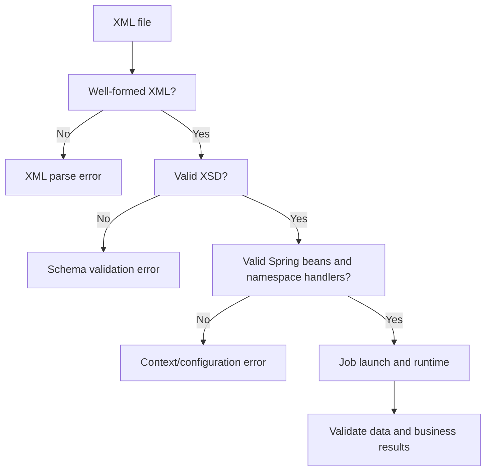

# XML schema validation

Spring Batch can declare jobs, steps, tasklets, and chunks using XML namespaces. For Spring to properly understand elements such as <batch:job> or <batch:chunk>, the XML file must declare the corresponding namespaces and schemas. **XML Schema (XSD) validation** checks whether the document structure conforms to the namespace contract before the configuration is used.

With Spring Batch, XSD helps catch errors early, such as:

- Using the wrong namespace or missing schema mappings.
- Placing an invalid element inside a job/step/tasklet.
- Missing a required attribute on an element.
- Using an attribute name or value not permitted by the schema.
- Ordering elements improperly relative to the XSD structure.

However, XSD only validates XML structure. It cannot guarantee that referenced beans exist, that SQL executes properly, that input files contain valid data, or that a job completes successfully. Distinguish between XML well-formedness, XSD validation, Spring bean validation, and runtime testing.

## 1. How do XML namespaces and XSD relate?

A Spring Batch XML file typically uses two namespaces:

- Spring Beans namespace for declaring standard beans.
- Spring Batch namespace for declaring jobs, steps, flows, chunks, and batch components.

A namespace identifies the vocabulary an XML element belongs to. An XSD describes the structure, attributes, data types, and validity constraints of that vocabulary.

Example file header declaration:

```xml
<?xml version="1.0" encoding="UTF-8"?>
<beans xmlns="http://www.springframework.org/schema/beans"
       xmlns:xsi="http://www.w3.org/2001/XMLSchema-instance"
       xmlns:batch="http://www.springframework.org/schema/batch"
       xsi:schemaLocation="
           http://www.springframework.org/schema/beans
           http://www.springframework.org/schema/beans/spring-beans.xsd
           http://www.springframework.org/schema/batch
           http://www.springframework.org/schema/batch/spring-batch.xsd">

    <!-- Bean definitions and batch jobs are declared here. -->

</beans>
```

In the example:

- xmlns declares the default namespace as Spring Beans.
- xmlns:xsi declares the XML Schema Instance namespace to use the xsi:schemaLocation attribute.
- xmlns:batch binds the batch prefix to the Spring Batch namespace.
- xsi:schemaLocation supplies pairs of namespace URIs and their corresponding schema locations.

The prefix batch is just an alias within the document. Another prefix can be used, but the namespace URI must be exact. Two documents using different prefixes still belong to the same namespace if the URI is identical.

## 2. Reading xsi:schemaLocation properly

The value of xsi:schemaLocation is a list of pairs:

1. Namespace URI.
2. Address or resource location of the XSD describing that namespace.

Example:

```xml
xsi:schemaLocation="
    http://www.springframework.org/schema/beans
    http://www.springframework.org/schema/beans/spring-beans.xsd
    http://www.springframework.org/schema/batch
    http://www.springframework.org/schema/batch/spring-batch.xsd"
```

Here there are two independent pairs. The first pair covers <beans>, <bean>, <property>, and Spring Beans elements. The second pair covers <batch:job>, <batch:step>, <batch:tasklet>, and Spring Batch elements.

A common mistake is declaring only the Spring Beans schema while using Spring Batch elements. The XML parser then lacks a matching schema mapping for the batch namespace.

### Namespace URI is not the XSD file

http://www.springframework.org/schema/batch is the namespace URI. http://www.springframework.org/schema/batch/spring-batch.xsd is the schema location. The two values are related but not interchangeable.

Do not put the XSD URL in xmlns:batch, and do not put a standalone namespace URI in xsi:schemaLocation without its corresponding location.

## 3. A structurally complete Spring Batch XML configuration

The following example illustrates declaring a job with a chunk step:

```xml
<?xml version="1.0" encoding="UTF-8"?>
<beans xmlns="http://www.springframework.org/schema/beans"
       xmlns:xsi="http://www.w3.org/2001/XMLSchema-instance"
       xmlns:batch="http://www.springframework.org/schema/batch"
       xsi:schemaLocation="
           http://www.springframework.org/schema/beans
           http://www.springframework.org/schema/beans/spring-beans.xsd
           http://www.springframework.org/schema/batch
           http://www.springframework.org/schema/batch/spring-batch.xsd">

    <batch:job id="importOrdersJob">
        <batch:step id="importOrdersStep">
            <batch:tasklet>
                <batch:chunk reader="orderReader"
                             processor="orderProcessor"
                             writer="orderWriter"
                             commit-interval="100"/>
            </batch:tasklet>
        </batch:step>
    </batch:job>

</beans>
```

Beans with IDs orderReader, orderProcessor, and orderWriter must be declared in the context or supplied from another configuration. XSD can confirm that reader, processor, and writer attributes are allowed in that position, but it does not prove these bean IDs actually exist.

This example focuses on namespace structure. In a real application, you need Spring Batch infrastructure appropriate for your version, including JobRepository and transaction manager per project configuration.

## 4. What does XSD validation check?

XSD describes the XML grammar. For the Spring Batch namespace, the schema can check:

- Which elements may appear under <batch:job>.
- Which tasklet or flow types a step may contain.
- Which attributes are allowed on <batch:chunk>.
- Attribute data types, such as integers for commit interval.
- Which child elements are required or optional.
- Child element ordering per the schema.
- Enum values or patterns defined by the schema.

For example, the chunk element requires reader, writer, and commit interval attributes per the corresponding schema structure. Misspelling an attribute name or placing chunk outside tasklet can trigger an XSD validation error immediately when parsing XML.

### XSD does not check business logic

Suppose the XML declares:

```xml
<batch:chunk reader="missingReader"
             writer="orderWriter"
             commit-interval="100"/>
```

If the schema permits these attributes, the XML is still XSD-valid. Whether missingReader is an existing bean ID is a Spring bean container concern when configuration is loaded and dependencies are resolved.

Similarly, XSD does not know whether /data/orders.csv exists, whether the database has an ORDERS table, or whether a JobParameter is passed at launch time.

## 5. Distinguishing four validation layers

When investigating XML configuration failures, identify which layer failed:

| Layer | Checks | Error examples |
|---|---|---|
| XML well-formedness | Basic XML syntax | Missing closing tag, mismatched attribute quotes |
| XSD validation | Namespace, elements, attributes, order, and types | Using non-existent <batch:chunks> |
| Spring context validation | Namespace handlers, bean definitions, and dependencies | Referenced bean ID does not exist |
| Batch/runtime/business validation | Infrastructure, data, and runtime behavior | Unable to open file, SQL error, invalid data |

A file can be well-formed yet fail XSD validation. A file that passes XSD can still fail when Spring instantiates beans or when the job executes.



Do not call every error when loading XML an XSD error. Read the root exception and line/column position to pinpoint the exact layer.

## 6. Where does Spring find XSDs?

Spring schemas are typically packaged inside the framework libraries. Spring uses namespace handlers and classpath schema mappings to resolve well-known schema URLs to resources inside JARs.

Therefore, a URL like:

```text
http://www.springframework.org/schema/batch/spring-batch.xsd
```

is usually mapped to the XSD inside the corresponding Spring Batch dependency via META-INF/spring.schemas metadata.

This allows the application to load schemas from the classpath without downloading XSDs from the Internet on every startup, provided the dependency and matching mapping are on the runtime classpath.

### Why might an IDE still report schema not found?

An IDE may use an XML catalog or download schemas separately from the Spring runtime. Consequently:

- A Spring application can load XML successfully while the IDE still shows red underlines if the IDE cannot resolve the schema.
- The IDE may cache an older schema after project dependencies changed versions.
- An offline environment may fail to fetch schema URLs if the IDE is not using a local catalog.
- Missing or mismatched Spring Batch dependencies may prevent runtime resolution of namespace handlers/schema mappings.

Distinguish editor display warnings from actual errors when Spring creates the application context.

## 7. Using a schema compatible with the Spring Batch version

Spring Batch XSD and namespace handlers must match the library version in the application. Key points to keep consistent:

- Spring Batch dependency version.
- Spring Framework version supported by that Spring Batch release.
- Namespace URI and schema location used in XML.
- Elements and attributes supported by that version's XSD.
- Batch infrastructure configuration appropriate for the major version.

Unversioned schema URLs in XML are usually mapped by Spring to schemas packaged in classpath dependencies. Thus, the actual XSD version used at runtime depends on the packaged dependency, not just the URL string written in XML.

When upgrading Spring Batch, check the migration guide and schemas shipped with the new version. Do not copy an element from another version's example assuming the current XSD supports it.

### Do not mix old and new configurations

Some attributes, namespace elements, or infrastructure declarations can change between major versions. XML valid under an old schema may no longer be valid under a new schema.

If upgrading:

1. Identify the running Spring Batch version.
2. Inspect the actual XSD and namespace handlers inside the dependency.
3. Compare changed elements/attributes.
4. Update the XML per the target version's migration documentation.
5. Load the application context and run integration tests.

## 8. Element ordering and attributes

XML Schema can enforce child element ordering using xs:sequence. When it does, elements must appear in the exact schema-defined order, even when all names are valid.

For example, a tasklet chunk structure typically places chunk inside tasklet:

```xml
<batch:step id="importStep">
    <batch:tasklet>
        <batch:chunk reader="reader"
                     writer="writer"
                     commit-interval="100"/>
    </batch:tasklet>
</batch:step>
```

Moving <batch:chunk> outside <batch:tasklet> can cause XSD rejection.

Attributes must also use exact names and types. For example, commit-interval is the attribute name in the XML namespace, not camelCase commitInterval from Java.

When encountering “Invalid content was found starting with element ...”, check:

- Does the element belong to the right namespace?
- Is it allowed as a child of the current element?
- Is there a required element that must precede it?
- Is structure copied from a different schema version?

## 9. Namespace prefixes and default namespace

The prefix does not determine the schema; the namespace URI does. For example:

```xml
<batch:job xmlns:batch="http://www.springframework.org/schema/batch"
           id="exampleJob">
</batch:job>
```

and:

```xml
<sb:job xmlns:sb="http://www.springframework.org/schema/batch"
        id="exampleJob">
</sb:job>
```

both use the same Spring Batch namespace. The prefixes batch and sb are just aliases.

However, an unprefixed element belongs to the active default namespace. In a file whose default namespace is Spring Beans, an unprefixed <job> element does not automatically belong to the Spring Batch namespace.

A confusing example:

```xml
<beans xmlns="http://www.springframework.org/schema/beans"
       xmlns:batch="http://www.springframework.org/schema/batch">
    <job id="importJob">
        ...
    </job>
</beans>
```

Here <job> belongs to the Spring Beans namespace, not Spring Batch. Write <batch:job> or change the default namespace intentionally.

## 10. Missing or incorrect schemaLocation errors

Common misconfigurations:

### Missing Batch schema pair

XML has xmlns:batch, but xsi:schemaLocation declares only Spring Beans. The IDE or XML parser may lack schema knowledge for the batch namespace.

### Reversed order in a pair

xsi:schemaLocation requires namespace URI first, schema location second. Reversing them causes the parser to attempt resolving the wrong namespace.

### Mismatched namespace URI

xmlns:batch and the namespace URI in the schemaLocation pair must match character for character. Even a single character difference breaks the mapping.

### Wrong XSD URL

A non-existent or unmapped URL can cause the IDE/runtime to attempt network access and fail offline.

### Using a prefix without declaring its namespace

If an element uses batch: without xmlns:batch declared, the XML is not well-formed and the parser fails before XSD validation.

## 11. Enabling XSD validation in Spring XML reader

Spring's XML bean definition reader supports validation modes. Auto mode normally detects validation type from XML content; if you need to force XSD validation, configure XmlBeanDefinitionReader.VALIDATION_XSD.

Example:

```java
DefaultListableBeanFactory beanFactory =
        new DefaultListableBeanFactory();

XmlBeanDefinitionReader xmlReader =
        new XmlBeanDefinitionReader(beanFactory);

xmlReader.setValidationMode(
        XmlBeanDefinitionReader.VALIDATION_XSD);

xmlReader.loadBeanDefinitions(
        new ClassPathResource("jobs/order-job.xml"));
```

This example demonstrates loading bean definitions and forcing XSD validation. In normal Spring applications, ApplicationContext manages XML loading and validation; you do not need to create XmlBeanDefinitionReader manually for every file.

To verify real configuration, use the application's actual ApplicationContext and namespace handlers rather than parsing XML solely with a generic XML parser.

## 12. Validation in IDEs

IDEs like IntelliJ IDEA or Eclipse can validate XML against schemas and provide:

- Autocomplete suggestions for valid elements as you type.
- Attribute suggestions for elements.
- Warnings for elements or attributes absent from the XSD.
- Structural and element-order validation.
- Navigation to schema definitions.

For the IDE to recognize schemas:

1. Declare xmlns and xsi:schemaLocation properly.
2. Ensure the project includes the matching Spring Batch dependency.
3. Enable XML schema validation in the IDE.
4. If the IDE cannot resolve URLs, check the IDE's XML catalog or schema mappings.
5. Refresh project/dependency caches after library versions change.

Do not disable all XML validation just to silence warnings. Fix the namespace or schema mapping if the file is genuinely unrecognized by the IDE.

## 13. Validation with standalone XML tools

You can use XML validator tools to check well-formedness and XSD when a local XSD path is available.

Example with xmllint when the schema has been extracted from dependencies to a local location:

```bash
xmllint --noout --schema /path/to/spring-batch.xsd jobs/order-job.xml
```

This command only illustrates tool usage. The schema path must be the right version XSD and its imported/included schemas must also resolve.

A generic XML validator may not understand Spring's META-INF/spring.schemas mechanism. If URLs in schemaLocation are used in an offline environment, the validator may attempt Internet access. You then need a catalog or corresponding local XSD copies.

Standalone validator results do not replace loading a Spring ApplicationContext, since generic parsers do not create bean definitions or execute Spring namespace handlers.

## 14. Testing ApplicationContext loading

An integration test can verify that the XML is both schema-valid and understood by Spring with required beans resolved.

Example using Spring Test:

```java
@SpringJUnitConfig
@ContextConfiguration(locations = "classpath:/jobs/order-job.xml")
class OrderJobXmlConfigurationTest {

    @Autowired
    private ApplicationContext applicationContext;

    @Test
    void loadsBatchXmlConfiguration() {
        assertNotNull(applicationContext);
        assertTrue(applicationContext.containsBean("importOrdersJob"));
    }
}
```

This is a test skeleton. The context needs dependent beans such as readers, writers, transaction manager, and JobRepository per application configuration. If those beans live in other XML files, import them or load the needed resources in the same context.

Context loading tests also catch errors such as:

- Missing namespace handler on the classpath.
- Referenced bean does not exist.
- Bean constructor/properties cannot be instantiated or injected.
- Incompatible infrastructure configuration.

## 15. Testing XSD and bean wiring separately

When debugging, separate two goals:

**Schema test** verifies the XML conforms to XSD. It focuses on structure, namespaces, elements, attributes, and types.

**Context test** verifies Spring loads bean definitions and resolves dependencies. It focuses on namespace handlers, bean IDs, constructors, properties, and infrastructure.

Both tests can live in the integration test suite, but when failures occur, proper classification shortens root-cause diagnosis.

Example:

| Result | Likely cause |
|---|---|
| XML parser reports mismatched tag | XML is not well-formed |
| cvc-complex-type or invalid content | XSD validation failure |
| No NamespaceHandler found | Missing namespace handler/dependency |
| Cannot resolve reference to bean | Bean ID or dependency does not exist |
| Job launch fails | Infrastructure or runtime error |

Exact messages depend on the parser and Spring version. Inspect root cause, resource name, line, and column instead of looking only at the outermost exception.

## 16. Common schema errors and handling

| Message/symptom | Common cause | How to check |
|---|---|---|
| cvc-elt.1.a: Cannot find the declaration of element | Namespace or XSD not resolved | Check xmlns and schemaLocation pairs |
| cvc-complex-type.2.4.a: Invalid content was found | Wrong child element or wrong order | Compare structure against XSD |
| Attribute is not allowed | Misspelled attribute or wrong position | Check schema version and containing element |
| Attribute is required | Missing required attribute | Add per schema |
| No NamespaceHandler found | Missing dependency/namespace handler | Check Spring Batch classpath |
| IDE shows schema unavailable but app runs | IDE fails to resolve local mapping or stale cache | Check XML catalog and dependencies |
| Bean reference cannot be resolved | XSD-valid but missing bean ID | Check bean definitions and imports |

When the parser indicates a line/column, start at the named element and inspect its immediate parent. Ordering errors typically appear at the first element that does not match what the parser expects at that position.

## 17. Invalid XML examples and fixes

### Wrong namespace on job element

Wrong:

```xml
<beans xmlns="http://www.springframework.org/schema/beans"
       xmlns:batch="http://www.springframework.org/schema/batch">
    <job id="importJob"/>
</beans>
```

job has no prefix so it belongs to the default Spring Beans namespace. Fix it to:

```xml
<batch:job id="importJob"/>
```

### Wrong chunk placement

Wrong:

```xml
<batch:step id="importStep">
    <batch:chunk reader="reader"
                 writer="writer"
                 commit-interval="100"/>
</batch:step>
```

For a chunk-oriented step structure, chunk must sit inside tasklet:

```xml
<batch:step id="importStep">
    <batch:tasklet>
        <batch:chunk reader="reader"
                     writer="writer"
                     commit-interval="100"/>
    </batch:tasklet>
</batch:step>
```

### Wrong attribute name

Wrong:

```xml
<batch:chunk reader="reader"
             writer="writer"
             commitInterval="100"/>
```

XML namespaces use attribute names defined by the schema, in this case commit-interval. Look up exact names in the XSD rather than automatically converting Java property names to camelCase.

## 18. Checking bean references after XSD validation

XSD only knows the schema-defined data types for reader, writer, or ref attributes. It does not query the bean registry to verify an ID exists.

Example:

```xml
<batch:chunk reader="orderReader"
             writer="missingWriter"
             commit-interval="100"/>
```

If structure and attribute types are valid, XSD can accept this snippet. Only when Spring builds the context is the missingWriter bean reference resolved and the missing-bean error surfaced.

Ensure:

- Bean IDs are spelled accurately.
- XML files containing bean definitions are imported.
- Required profiles/conditional configurations are active.
- Bean types are compatible with reader/writer/processor contracts.
- No two beans share the same ID causing unintended overrides.

This is why context tests are essential after schema validation.

## 19. Checking runtime resources and values

Even when XML and the Spring context are valid, a job can still fail at launch or execution time:

- File passed via JobParameters does not exist.
- Database is unreachable.
- SQL mismatches the current database schema.
- Transaction manager does not fit the resource.
- Required JobParameters are missing.
- Reader cannot open resource or checkpoint is incompatible.
- Input data violates business rules.

XSD cannot check these conditions because they depend on the environment and runtime data. Use validation steps, health checks, integration tests, and sample data testing to catch them.

## 20. Custom XML namespaces and custom schemas

Applications can define custom XML namespaces with their own XSDs. When doing so, provide:

- The vocabulary's namespace URI.
- An XSD describing elements/attributes.
- A namespace handler to turn elements into Spring bean definitions if integrating with Spring.
- Schema and handler mappings in the corresponding metadata so Spring resolves them from the classpath.

Do not create a custom namespace just to shorten a few beans if standard XML namespaces already meet requirements. If you do create a custom namespace, version the schema and test upgrade compatibility.

Custom XSDs also only check structure. The namespace handler still must validate bean wiring and convert configuration into valid objects.

## 21. Using XML validation in the development workflow

A sensible workflow for Spring Batch XML:

1. Author XML with proper namespaces and schemaLocation.
2. Use the IDE for autocomplete and immediate XSD error feedback while editing.
3. Verify XML well-formedness and XSD in the build environment if the project has a validator.
4. Load ApplicationContext in integration tests.
5. Verify the Job bean and steps are created.
6. Launch a test job with small inputs.
7. Inspect JobExecution, StepExecution, and output data.
8. When upgrading Spring Batch, re-verify schema versions and namespace handlers.

Do not rely solely on the IDE because its schema cache can differ from runtime. Nor rely solely on context startup because some errors only appear when a step opens a resource or when a job receives parameters.

## 22. Checklist for troubleshooting XML schema errors

When a Spring Batch XML file fails to load, check in order:

1. Is the XML well-formed: root element, closing tags, quotes, and encoding?
2. Does xmlns:batch have the right Spring Batch namespace URI?
3. Does xsi:schemaLocation have namespace/location pairs for both beans and batch?
4. Does each pair have the right order: namespace first, XSD location second?
5. Is the Spring Batch dependency on the runtime classpath?
6. Do XSD and namespace handler versions match the dependency version?
7. Do elements carry the right namespace prefix?
8. Are child elements and attributes in the right position, name, and type?
9. Are referenced bean IDs declared/imported?
10. Does ApplicationContext load cleanly?
11. Does the job launch cleanly with realistic parameters and resources?

Record the root cause, XML resource, line/column, and dependency version when reporting errors. That information helps distinguish schema issues from wiring or runtime issues.

## 23. Common mistakes

**Declaring only the Spring Beans schema.** batch:* elements lack a matching schema. Add the namespace/location pair for Spring Batch.

**Confusing namespace URI with XSD URL.** Namespace URI and schema location are two distinct values in each xsi:schemaLocation pair.

**Using the wrong prefix or forgetting the batch prefix.** Unprefixed elements can fall into the default beans namespace. Use the right prefix or an explicit default namespace.

**Assuming XSD validates bean IDs.** XSD does not resolve the Spring bean registry. Load ApplicationContext to catch missing references.

**Assuming valid XML means the job will run.** XSD does not check databases, files, parameters, or business data. Integration tests and runtime validation are required.

**Copying XML from another version.** Elements or attributes may not be supported by the current XSD. Cross-check schemas from the same dependency version.

**Disabling validation to silence warnings.** Can mask real structural errors. Fix schema mappings or the XML catalog.

**Pointing schemaLocation to an arbitrary XSD.** May clear IDE errors while runtime uses another schema. Use a schema compatible with the Spring Batch dependency.

**Ignoring element order.** XSD may use sequence, making properly named elements invalid if misordered.

**Editing XSD files inside dependencies directly.** Causes schema drift across environments and hurts reproducibility. Fix the XML or upgrade dependencies intentionally.

## 24. Practical conclusion

XML Schema validation checks whether Spring Batch XML conforms to the namespace structure defined by the framework. Properly declaring the Spring Beans and Spring Batch namespaces, providing namespace/XSD pairs in xsi:schemaLocation, and using schemas compatible with your dependencies form the foundation for both IDEs and Spring parsers to interpret configurations.

XSD catches element, attribute, type, and ordering errors, but does not verify bean references exist or that a job executes successfully. After XSD validation, load the ApplicationContext to verify namespace handlers and dependencies, then run integration tests to confirm JobRepository, transaction manager, readers, writers, JobParameters, and runtime data.

Clearly separating XML syntax, schema, bean wiring, and runtime behavior speeds up configuration troubleshooting and makes Spring Batch upgrades far less risky.
