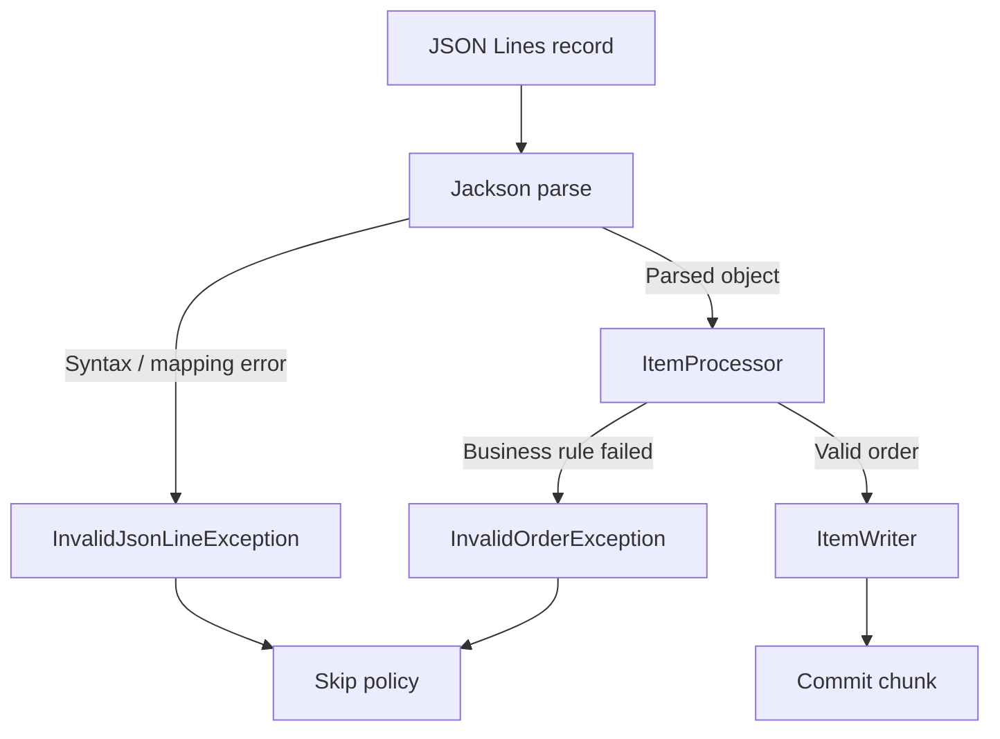

# JSON Parse Errors and Skip

In Spring Batch, when reading JSON data, a record may fail to parse into an object due to malformed JSON syntax, wrong data types, or data violating business rules. For a large batch, applications often want to quarantine a few bad records and continue processing valid ones. Spring Batch supports the skip mechanism to do this inside a chunk-oriented step.

However, **a skip policy only decides which exceptions may be skipped; it does not automatically recover a reader that has lost the ability to locate the next record**. This is especially critical when parsing JSON.

JSON can be stored as a single large document/array or as JSON Lines (where each line is an independent JSON object). With JSON Lines, the reader has already consumed one line when parsing fails, so it can cleanly move on to the next line. With a large JSON array, a syntax error can desynchronize the parser so it cannot safely determine the boundary of the next object. In that case, simply adding a skip policy is not enough to guarantee continued accurate reading.

This article distinguishes the types of JSON errors, how Spring Batch skips errors in read/process/write, how to build a reader for JSON Lines, how to record rejected records, and how to test recovery capability.

## 1. Types of Errors When Processing JSON

Not all JSON-related errors are alike. Identify which layer an error occurs in:

| Error type | Example | Where typically detected |
|---|---|---|
| JSON syntax error | Missing closing brace, misplaced comma, unclosed string quote | JSON parser/reader |
| Mapping/deserialization error | `amount` field is an object when model expects a number | Jackson mapper |
| Schema/contract error | Missing required `orderId`, disallowed field appears | Deserializer or validation |
| Business validation error | Negative amount, disallowed order status | ItemProcessor/domain validator |
| Writer/data constraint error | Unique key violation, data cannot be persisted | ItemWriter/database |

Example of syntactically valid JSON with the wrong data type:

```json
{
  "orderId": 1001,
  "amount": "not-a-number"
}
```

The parser can read the JSON structure, but Jackson cannot map the string `not-a-number` into the numeric type the model requires.

Example of syntactically invalid JSON:

```json
{
  "orderId": 1001,
  "amount": 250.00
```

The object is unclosed. This is a document syntax error, not a business-rule error on an order.

Example of valid JSON that violates business rules:

```json
{
  "orderId": 1002,
  "amount": -50.00,
  "currency": "USD"
}
```

If business rules disallow negative amounts, have the processor or validator throw a dedicated business exception. Separating error categories lets you skip the right records without masking infrastructure failures or whole-file structural errors.

## 2. How Does Skip Work in Spring Batch?

In chunk-oriented processing, Spring Batch can apply a skip policy to exceptions occurring in three phases:

- **Read skip**: the reader cannot produce an item from the input record.
- **Process skip**: the processor rejects an item that was read.
- **Write skip**: the writer cannot write an item.

Example configuration:

```java
return new StepBuilder("importOrdersStep", jobRepository)
        .<OrderInput, Order>chunk(100, transactionManager)
        .reader(orderReader)
        .processor(orderProcessor)
        .writer(orderWriter)
        .faultTolerant()
        .skip(InvalidJsonLineException.class)
        .skip(InvalidOrderException.class)
        .skipLimit(100)
        .build();
```

In this example:

- `InvalidJsonLineException` represents an independent JSON line that cannot be parsed.
- `InvalidOrderException` represents data that parsed cleanly yet violates business rules.
- Skip limit caps the total number of skipped items under the step's policy.
- Exceptions not permitted for skip, or exceeding the limit, cause the step to fail.

Skipping does not remove the record from the file or automatically write it to a reject file. If auditing is required, record the bad record, line number, batch ID, and cause using a listener or a dedicated reject mechanism.

## 3. Crucial Condition: The Reader Must Be Able to Continue

Spring Batch can only call the reader again after a read exception if the reader remains in a state where it can advance to the next record.

With a line-by-line reader:

1. Reader fetches one physical line from the file.
2. `LineMapper` parses that line into a JSON object.
3. If parsing fails, the line has already been consumed.
4. Skip policy allows bypassing the exception.
5. The next read fetches the following line.

With a streaming parser reading a JSON array:

1. Parser reads the document's tokens.
2. An object in the middle of the array has a syntax error.
3. The parser may no longer know where the next object begins.
4. Calling read again may keep throwing errors or misread boundaries.

Therefore, never assume configuring `.skip(JsonProcessingException.class)` will enable every JSON reader to skip over a broken object and find the next one.

Determine record boundaries before choosing a skip strategy. If each record is an independent JSON line, JSON Lines is generally much easier to recover per record. If the input is a single JSON document or an array with broken syntax, usually quarantine or reject the entire file for upstream reprocessing.

## 4. Two Common Input Formats

### JSON array

A file can contain a JSON array:

```json
[
  {"orderId": 1001, "amount": 250.00},
  {"orderId": 1002, "amount": 175.50},
  {"orderId": 1003, "amount": 99.99}
]
```

Spring Batch provides `JsonItemReader` along with `JsonObjectReader` to read each object in a JSON resource. With Jackson, use `JacksonJsonObjectReader`.

Example:

```java
@Bean
JsonItemReader<OrderInput> orderJsonReader(
        @Value("#{jobParameters['input.file']}") String inputFile) {

    return new JsonItemReaderBuilder<OrderInput>()
            .name("orderJsonReader")
            .resource(new FileSystemResource(inputFile))
            .jsonObjectReader(
                    new JacksonJsonObjectReader<>(OrderInput.class))
            .saveState(true)
            .build();
}
```

`JsonItemReader` fits when the input follows the JSON structure supported by `JsonObjectReader`. For a JSON array with mid-file syntax corruption, the ability to continue after a parse error depends on the parser and stream state. Do not treat a skip policy as a parser resynchronization mechanism.

### JSON Lines (NDJSON)

JSON Lines stores each JSON value/object on its own line:

```text
{"orderId":1001,"amount":250.00}
{"orderId":1002,"amount":175.50}
{"orderId":1003,"amount":99.99}
```

Each line is an independent JSON document. If the second line has a syntax error, the reader can still read the third line because the record boundary is the newline.

This format is convenient for streaming, logs, large imports, and per-record skipping. However, a JSON Lines record must not contain unescaped physical newlines inside a JSON string; newlines inside strings must be represented with valid escapes.

## 5. Using FlatFileItemReader to Read JSON Lines

You can use `FlatFileItemReader` to read line by line and a `LineMapper` to parse each line with Jackson.

Create an exception carrying the line number:

```java
public class InvalidJsonLineException extends RuntimeException {

    private final int lineNumber;

    public InvalidJsonLineException(int lineNumber, Throwable cause) {
        super("Invalid JSON at line " + lineNumber, cause);
        this.lineNumber = lineNumber;
    }

    public int getLineNumber() {
        return lineNumber;
    }
}
```

LineMapper:

```java
@Bean
LineMapper<OrderInput> orderJsonLineMapper(ObjectMapper objectMapper) {
    return (line, lineNumber) -> {
        try {
            if (line.isBlank()) {
                throw new InvalidJsonLineException(
                        lineNumber,
                        new IllegalArgumentException("Blank JSON line"));
            }

            return objectMapper.readValue(line, OrderInput.class);
        } catch (JsonProcessingException exception) {
            throw new InvalidJsonLineException(lineNumber, exception);
        }
    };
}
```

Reader:

```java
@Bean
@StepScope
FlatFileItemReader<OrderInput> orderJsonLinesReader(
        @Value("#{jobParameters['input.file']}") String inputFile,
        LineMapper<OrderInput> orderJsonLineMapper) {

    return new FlatFileItemReaderBuilder<OrderInput>()
            .name("orderJsonLinesReader")
            .resource(new FileSystemResource(inputFile))
            .lineMapper(orderJsonLineMapper)
            .strict(true)
            .saveState(true)
            .build();
}
```

Here `FlatFileItemReader` reads each physical line. When `LineMapper` throws `InvalidJsonLineException`, the bad line has already been consumed from the resource; if the exception is configured as skippable, the next read can proceed to the next line.

This example assumes every non-blank line corresponds to exactly one JSON object. If the file permits comments, headers, or blank lines, define explicit handling rules instead of treating all of them as parse errors by default.

## 6. Configuring Skip for Per-Line Parse Errors

Once the reader can advance past a bad line, configure a fault-tolerant step:

```java
@Bean
Step importOrdersStep(
        JobRepository jobRepository,
        PlatformTransactionManager transactionManager,
        ItemReader<OrderInput> orderJsonLinesReader,
        ItemProcessor<OrderInput, Order> orderProcessor,
        ItemWriter<Order> orderWriter,
        SkipListener<OrderInput, Order> orderSkipListener) {

    return new StepBuilder("importOrdersStep", jobRepository)
            .<OrderInput, Order>chunk(100, transactionManager)
            .reader(orderJsonLinesReader)
            .processor(orderProcessor)
            .writer(orderWriter)
            .faultTolerant()
            .skip(InvalidJsonLineException.class)
            .skip(InvalidOrderException.class)
            .skipLimit(100)
            .listener(orderSkipListener)
            .build();
}
```

If more than 100 skippable errors occur under this configuration, the step fails upon exceeding the limit. Choose the skip limit based on your data quality contract, rather than setting an arbitrarily huge number just so the job always runs to completion.

You can use `noSkip(...)` to exclude an exception type from the skip policy if needed. For example, file read errors or severe I/O errors should generally not be treated as a single bad JSON record.

## 7. Distinguishing JSON Parse Errors and Business Errors

A clean pipeline separates parsing, mapping, and business validation:



Examples:

- JSON missing a bracket or misplaced comma: parse error.
- `amount` is a string unconvertible to `BigDecimal`: deserialization error.
- Negative `amount`: JSON parsed cleanly, yet violates business rules.
- `orderId` already exists: write or constraint error, needing a separate policy.

Do not lump everything into a single generic exception when each error kind requires different handling. Categorizing enables tracking read skips, process skips, and write skips separately.

## 8. Validating Data After Parsing

JSON can be syntactically valid yet still miss fields or contain unacceptable values. Use a processor or validator to check business rules.

Example:

```java
public class OrderValidationProcessor
        implements ItemProcessor<OrderInput, Order> {

    @Override
    public Order process(OrderInput input) {
        if (input.orderId() <= 0) {
            throw new InvalidOrderException("orderId must be positive");
        }

        if (input.amount() == null || input.amount().signum() < 0) {
            throw new InvalidOrderException("amount is invalid");
        }

        if (input.currency() == null || input.currency().isBlank()) {
            throw new InvalidOrderException("currency is required");
        }

        return new Order(
                input.orderId(),
                input.amount(),
                input.currency());
    }
}
```

The processor receives an already-parsed object. If data violates a skippable rule, throw a specific business exception and include that type in the skip policy. If the error indicates misconfiguration or a severe invariant violation, let the step fail.

Do not put default values on required fields merely to prevent Jackson from throwing errors. A default such as `orderId = 0` can send corrupt data deep into the writer and cause hard-to-detect consequences.

## 9. Configuring Jackson for Deserialization

`ObjectMapper` governs how JSON converts into Java objects. Choices regarding unknown fields, nulls, coercion, and date formats affect where errors are detected.

Example configuration:

```java
@Bean
ObjectMapper batchObjectMapper() {
    return JsonMapper.builder()
            .enable(DeserializationFeature.FAIL_ON_UNKNOWN_PROPERTIES)
            .enable(DeserializationFeature.FAIL_ON_NULL_FOR_PRIMITIVES)
            .build();
}
```

Meaning:

- `FAIL_ON_UNKNOWN_PROPERTIES` causes fields absent from the model to raise an error instead of being silently ignored.
- `FAIL_ON_NULL_FOR_PRIMITIVES` detects nulls assigned to primitives when Jackson configuration supports that case.
- Other rules for missing creator properties, enums, dates/times, and coercion must be chosen per data contract.

Do not enable every strict mode mechanically. A JSON source might add new fields that consumers are allowed to ignore. Define a compatibility policy: whether unknown fields are accepted, warned, or cause the record to be rejected.

If using Spring Boot, generally configure a shared `ObjectMapper` via bean/customizer rather than creating inconsistent new mappers in each reader. Ensure readers and tests use the same configuration.

## 10. Recording Skipped Records with SkipListener

For errors in the read phase, there is no complete `OrderInput` object to pass to the listener. `SkipListener` provides the `onSkipInRead(Throwable)` callback, so the exception must carry the line number or an identifiable record locator.

Example:

```java
@Component
public class OrderSkipListener
        implements SkipListener<OrderInput, Order> {

    private final RejectRepository rejectRepository;

    public OrderSkipListener(RejectRepository rejectRepository) {
        this.rejectRepository = rejectRepository;
    }

    @Override
    public void onSkipInRead(Throwable throwable) {
        if (throwable instanceof InvalidJsonLineException invalid) {
            rejectRepository.recordReadFailure(
                    invalid.getLineNumber(),
                    "INVALID_JSON",
                    safeMessage(invalid));
        }
    }

    @Override
    public void onSkipInProcess(OrderInput item, Throwable throwable) {
        rejectRepository.recordProcessFailure(
                item.orderId(),
                "INVALID_ORDER",
                safeMessage(throwable));
    }

    @Override
    public void onSkipInWrite(Order item, Throwable throwable) {
        rejectRepository.recordWriteFailure(
                item.orderId(),
                "WRITE_FAILURE",
                safeMessage(throwable));
    }

    private String safeMessage(Throwable throwable) {
        return throwable.getClass().getSimpleName();
    }
}
```

The example illustrates the callbacks; the repository must be implemented with appropriate transaction and idempotency handling. For read skips, the listener receives no parsed item because no item exists. If storing the raw line is needed, the exception can retain a bounded preview stripped of sensitive data.

Never write full JSON records into logs or reject tables if records contain personal data, tokens, or secrets. Usually only batch ID, line number, error category, correlation ID, and permitted summary fields are needed.

## 11. Transactions and SkipListener

`SkipListener` is where a skipped item is recorded, yet you must understand callback transactions. For process/write skips, the listener is typically invoked near chunk commit time to avoid recording multiple rejects for the same item during chunk retries. Still, ultimate durability depends on the transaction manager and resources used by `rejectRepository`.

Determine:

- Does the reject record participate in the chunk's transaction?
- If the chunk rolls back, is the reject record rolled back too?
- If the listener is called again after retry/restart, does it create duplicates?
- Is a unique key like `batchId + lineNumber + errorType` needed?
- Should rejects be written to an outbox or separate resource?

If the reject log must persist even when the chunk transaction rolls back, design a separate storage mechanism intentionally. Do not assume a write inside the listener always executes outside the current transaction.

## 12. Distinguishing Skip and Retry

Skip and retry address two different kinds of problems:

| Mechanism | When to use | Example |
|---|---|---|
| Skip | A record cannot or should not be processed, and business rules allow dropping it | Malformed JSON line, order missing required field |
| Retry | Transient failure that may succeed on a subsequent attempt | Deadlock, temporary database timeout |
| Fail | Configuration, infrastructure, or input-structure error making continuation unsafe | Unreadable file, desynchronized JSON document |

Example configuring retry for database errors and skip for record errors:

```java
.faultTolerant()
.skip(InvalidJsonLineException.class)
.skip(InvalidOrderException.class)
.skipLimit(100)
.retry(DeadlockLoserDataAccessException.class)
.retryLimit(3)
```

Do not retry deterministic JSON syntax errors. The exact same broken line will keep failing when re-read unless the source data is fixed. Conversely, do not skip a deadlock error merely because it happened during a write; transient errors should be retried per policy.

## 13. Why Are Syntax-Broken JSON Arrays Hard to Skip?

A JSON array is a single document. The parser must track token states, brackets, commas, and position in the structure.

Example:

```json
[
  {"orderId": 1001, "amount": 250.00},
  {"orderId": 1002, "amount": 175.50
  {"orderId": 1003, "amount": 99.99}
]
```

The second object is missing its closing brace and separating comma. The parser may be unable to tell where the third object begins in valid structure. Searching for the next `"orderId"` substring via text scanning is also unsafe: that string can appear inside a value, a nested object, or escaped text.

If an array file has broken syntax:

- Quarantine the file and report the error with byte/line/column if provided by the parser.
- Request upstream to regenerate a valid document.
- Run a whole-file pre-validation step before import.
- If business requirements demand dropping individual bad records, consider switching the source format to JSON Lines.

Never configure a broad skip for `JsonParseException` and claim recovery is solved. Verify the reader can actually advance cleanly to the next object using an integration test with your exact Spring Batch/Jackson version and realistic data.

## 14. When Does JsonItemReader Still Fit?

`JsonItemReader` is a good fit when:

- The source provides a JSON document matching a structure supported by the reader, typically an array of objects.
- The document must be globally valid.
- On syntax errors, the application accepts failing/quarantining the entire file.
- Mapping each object to a domain type aligns with `JacksonJsonObjectReader`.
- State-based reader restarts are needed.

Example step reading a JSON array and letting parse errors fail the step:

```java
@Bean
Step importJsonDocumentStep(
        JobRepository jobRepository,
        PlatformTransactionManager transactionManager,
        JsonItemReader<OrderInput> orderJsonReader,
        ItemWriter<OrderInput> orderWriter) {

    return new StepBuilder("importJsonDocumentStep", jobRepository)
            .<OrderInput, OrderInput>chunk(100, transactionManager)
            .reader(orderJsonReader)
            .writer(orderWriter)
            .build();
}
```

If you want to skip mapping/business errors after an object has been created, handle them in the processor. Mid-document syntax errors must be evaluated separately because the reader may not continue safely.

## 15. Blank Lines and Comments in JSON Lines

JSON Lines typically specifies that every non-empty line is a JSON value. Some sources may emit blank lines or comments even though that is not standard JSON Lines convention.

Choose an explicit policy:

- Blank lines are skipped intentionally.
- Blank lines are treated as error records.
- Comments are supported only if the source contract defines a comment prefix.

Example intentionally skipping blank lines in `LineMapper`:

```java
@Bean
LineMapper<OrderInput> orderJsonLineMapper(ObjectMapper objectMapper) {
    return (line, lineNumber) -> {
        if (line.isBlank()) {
            return null;
        }

        try {
            return objectMapper.readValue(line, OrderInput.class);
        } catch (JsonProcessingException exception) {
            throw new InvalidJsonLineException(lineNumber, exception);
        }
    };
}
```

However, a standard `LineMapper` is expected to produce an item for a record. Returning `null` from a mapper is not a standard skip mechanism in all configurations and can be confused with end-of-input or filtered items. Clearer options are using a suitable reader callback/filter, a custom reader that skips blank lines while counting metrics, or treating blank lines as errors handled by the skip policy. Verify implementation semantics before returning `null`.

Do not invent comment prefixes if the file contract forbids comments. A line starting with `#` could be a valid JSON string in some structure, or simply invalid data.

## 16. Record Limits and Safety When Storing Raw JSON

A malformed JSON line can be very long. Putting the entire line into exception messages, logs, or reject tables can:

- Bloat logs and metadata.
- Expose personal data or secrets.
- Increase memory usage during error handling.
- Make searching difficult due to oversized messages.

Instead:

- Store the line number and batch ID.
- Store a stable error code.
- Store a bounded, redacted preview if permitted.
- Store a checksum or source reference to retrieve the original in controlled storage.
- Enforce record size limits and reject records exceeding the limit.

For JSON Lines files with huge records, evaluate the reader's line limits, memory allocation, and downstream limits. Do not assume a single JSON record can be arbitrarily large.

## 17. Skip Limit and Metrics

Skip limit caps the number of items allowed to be skipped under the step's policy. If exceeded, the step fails. Understand that skip counts can come from read, process, and write:

- Read skip count: records that could not be read/parsed into items.
- Process skip count: items read but rejected by the processor.
- Write skip count: items that could not be written.
- Total skip count: sum across phases.

Example log:

```text
step=importOrdersStep
readCount=10000
writeCount=9870
readSkipCount=80
processSkipCount=40
writeSkipCount=10
totalSkipCount=130
exitStatus=COMPLETED
```

These numbers are illustrative only. If the skip limit is 100, the step could not finish successfully with a total skip of 130 under that policy; treat the example as metrics observed in another run or with a higher configured limit. Ensure dashboards display both per-phase skip counts and the active skip limit.

Do not watch job status alone. A rising read skip rate may signal an upstream schema change or corrupted file. A rising process skip rate may signal incoming data failing business rules.

## 18. Testing Parse Errors and Skip with JSON Lines

An integration test must use a file containing both valid and invalid lines:

```text
{"orderId":1001,"amount":250.00,"currency":"USD"}
{"orderId":1002,"amount":"not-a-number","currency":"USD"}
{"orderId":1003,"amount":99.99,"currency":"USD"}
```

The test should verify:

1. The first line is parsed and written.
2. The second line throws `InvalidJsonLineException`.
3. `SkipListener` receives the read-phase error and records the right line number.
4. The reader continues to the third line.
5. Both valid records are written.
6. Read skip count is one.
7. Job/step finishes according to skip limit and flow policy.

Do not unit test `ObjectMapper` alone. Launch an actual step to confirm Spring Batch invokes the skip policy and the reader continues after exceptions.

## 19. Testing Corrupted JSON Arrays

If the application uses `JsonItemReader` for JSON arrays, add tests with:

- Valid document.
- JSON syntax error at the start of the file.
- JSON syntax error in the middle of the array.
- Object with a wrong-typed field.
- Truncated file at the end.
- Empty file or invalid root structure.

The goal is not necessarily skipping every error. Tests must verify the actual policy:

- Valid document: reads completely.
- Syntactically invalid document: fails/quarantines the file if resynchronization is impossible.
- Mapping error: skip only if the reader can truly continue and tests prove subsequent objects are intact.
- Truncated file: do not publish output as a complete batch.

If business rules strictly require skipping individual malformed objects, pick a record-isolated format like JSON Lines or implement a reader with a clear recovery contract. Never write tests that only assert job `COMPLETED` while ignoring the correctness of subsequent objects.

## 20. Testing Skip Limit

Test boundaries:

| Bad record count | Skip limit | Expected result |
|---:|---:|---|
| 0 | 10 | Completes if no other errors |
| 3 | 10 | Completes and records 3 skips |
| 10 | 10 | Can complete right at the limit |
| 11 | 10 | Step fails upon exceeding limit |

In real tests, verify exact semantics of your Spring Batch version, especially when read retry, process retry, or write rollback occurs. Use `StepExecution` counters and final status to verify.

## 21. Testing Reject Recording

`SkipListener` or the reject service should be tested to ensure:

- Read skips record the line number even without a domain item.
- Process skips record the business ID once the item is parsed.
- Write skips record the ID of the unpersistable item.
- Error codes are stable, independent of free-form messages.
- Raw payloads are redacted/bounded.
- Restarts do not create duplicate reject records.
- Transaction rollbacks do not leave reject state inconsistent.

A unique key such as `batch ID + line number + phase + error code` can help idempotency, depending on business rules. If the same line can trigger different errors across runs, keys must reflect exact semantics.

## 22. Common Pitfalls

**Adding skip(JsonProcessingException.class) alone and expecting the parser to continue.** A skip policy does not recover streaming parser state. Use clear record boundaries or fail/quarantine documents when the parser desynchronizes.

**Confusing JSON syntax errors with business validation errors.** JSON may be valid while the order is invalid in business terms. Separate parse exceptions from processor exceptions.

**Using a JSON array for per-record skip needs without testing recovery.** One syntax error can destroy the boundary of the next object. Consider JSON Lines.

**Catching all exceptions and returning an empty object.** Bogus data may get written to the database. Throw specific exceptions to skip/reject or fail.

**Skipping broad I/O or database errors.** Those errors generally need retry or failure, not dropping records.

**Failing to record read skips.** Read skips have no complete item. Exceptions must carry line numbers or source positions.

**Logging raw JSON.** Can leak sensitive data and bloat logs. Store references, line numbers, and redacted previews.

**Setting skip limit too high.** Jobs may complete even when most input data is dropped. Base limits on data quality SLAs.

**Not testing the record immediately after a bad line.** The job may catch the exception while the reader fails to continue properly. Check output from the next line.

**Using retry for deterministic bad JSON.** Retrying will not fix record contents. Retry only transient errors.

**Not testing restarts.** The reader may resume from a checkpoint while reject logs or outputs duplicate. Test with the same `JobInstance` and stable resources.

## 23. Workflow for Designing JSON Parsing and Skip

When asked to handle invalid JSON, follow this sequence:

1. Identify whether input is a JSON document, JSON array, or JSON Lines.
2. Determine whether record boundaries are recoverable after an error.
3. Separate syntax errors, deserialization errors, and business validation errors.
4. Pick the right reader: `JsonItemReader` for contract-compliant documents; `FlatFileItemReader` + Jackson for JSON Lines.
5. Create a specific exception carrying line number/source position when record parsing fails.
6. Configure skip policies strictly for skippable error types.
7. Keep I/O, configuration, and infrastructure errors under appropriate retry/fail policies.
8. Record read/process/write skips via listeners or a reject store.
9. Set skip limits per data quality standards.
10. Integration test records after errors, skip limits, restarts, and reject idempotency.

If the source sends a syntactically broken JSON array with no reliable way to locate record boundaries, quarantine the whole file or ask upstream to fix it. Never trade away data correctness just to get a `COMPLETED` job status.

## 24. Practical Conclusion

Spring Batch can skip errors arising in the reader, processor, or writer via fault-tolerant steps and skip policies. For JSON, the critical question is whether the reader can continue cleanly from the position after a bad record. JSON Lines establishes line-by-line boundaries, making `FlatFileItemReader` paired with a Jackson `LineMapper` a clear way to skip unparseable records and continue to the next line.

`JsonItemReader` suits structurally valid JSON documents/arrays, yet a syntax error mid-array can desynchronize the parser. Skip policies do not locate the next object boundary on their own. Separate syntax, mapping, and business validation; use specific exceptions, sensible skip limits, a `SkipListener` carrying source position, and idempotent reject storage.

Finally, test with files containing valid records right after bad ones, verify the reader genuinely continues accurately, check exact skip counts, and confirm restarts produce no duplicates. The goal is skipping only permitted bad records while preserving the integrity of the entire batch.
