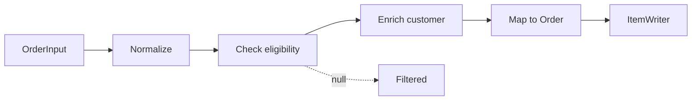
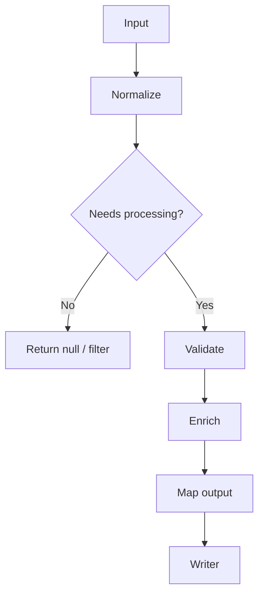

# Processor Returning null Mid-Chain

In Spring Batch, a step may use multiple processors to normalize data, validate conditions, enrich information, and transform into the model required by the writer. When processors are chained sequentially with **CompositeItemProcessor**, the output of the preceding processor becomes the input of the next processor.

An important rule of the chain is: **if any delegate returns null, CompositeItemProcessor stops the chain and returns null immediately**. Subsequent delegates are not invoked for that item.

At the chunk step level, an ItemProcessor returning null means the item is **filtered**: the item was read by the reader, but is not passed to the writer. This is intentional filtering behavior, not a skip due to an exception. Therefore, the item is counted in the filter count rather than the process skip count.

This article explains how null propagates through a processor chain, how to distinguish filtering from skipping and end-of-input, how to organize delegates, track filter counts, and write tests to ensure downstream processors do not run after a delegate filters an item.

## 1. How Does CompositeItemProcessor Work?

CompositeItemProcessor takes a list of ItemProcessors and invokes them in order. The output of the current delegate is passed as the input to the next delegate.

Example of an order processing chain:



Steps:

1. Normalize standardizes customer codes and input strings.
2. Check eligibility checks whether the order needs processing.
3. Enrich customer supplements customer information.
4. Map to Order builds the final object for the writer.
5. The writer receives the final item if the entire chain returns a non-null object.

If Check eligibility returns null, CompositeItemProcessor does not invoke Enrich customer or Map to Order. The composite returns null to the step, which treats the item as filtered and does not write it.

## 2. Meaning of null in ItemProcessor

The ItemProcessor contract allows returning either an output item or null:

- Return an object: the item continues to the writer after completing the processors.
- Return null: the item is filtered and does not proceed to the writer.
- Throw an exception: processing the item encountered an error; the step applies its configured retry/skip/fail policy.

Example processor filtering out cancelled orders:

```java
public class ActiveOrderProcessor
        implements ItemProcessor<OrderInput, Order> {

    @Override
    public Order process(OrderInput input) {
        if (input.status() == OrderStatus.CANCELLED) {
            return null;
        }

        return new Order(
                input.orderId(),
                input.customerId(),
                input.amount());
    }
}
```

CANCELLED orders are excluded from normal processing. No exception is thrown, so this is a filter rather than an error to skip.

Null here is an ItemProcessor control signal. If business data needs to store a null value in a field, return an object with that field set to null; do not return null for the whole item unless you want to exclude the item from the pipeline.

## 3. CompositeItemProcessor Stops the Chain on null

Suppose the chain has three delegates:

```java
ItemProcessor<OrderInput, NormalizedOrder> normalizeProcessor;
ItemProcessor<NormalizedOrder, EnrichedOrder> enrichProcessor;
ItemProcessor<EnrichedOrder, Order> mapProcessor;
```

CompositeItemProcessor performs logic equivalent to:

```java
Object current = input;

for (ItemProcessor delegate : delegates) {
    if (current == null) {
        return null;
    }

    current = delegate.process(current);
}

return current;
```

This is pseudocode illustrating behavior, not an internal implementation to copy into an application.

If normalizeProcessor returns null:

- enrichProcessor is not called.
- mapProcessor is not called.
- CompositeItemProcessor returns null.
- The step filters the item.

If enrichProcessor returns null:

- normalizeProcessor has run.
- enrichProcessor has run and decided to filter.
- mapProcessor is not called.
- The writer does not receive that item.

If mapProcessor returns null, there are no remaining delegates, yet the composite still returns null and the step still counts a filter.

## 4. Declaring the Chain with Java Configuration

Spring Batch 5 example using different data types between steps:

```java
@Bean
CompositeItemProcessor<OrderInput, Order> orderCompositeProcessor(
        ItemProcessor<OrderInput, NormalizedOrder> normalizeProcessor,
        ItemProcessor<NormalizedOrder, EnrichedOrder> enrichProcessor,
        ItemProcessor<EnrichedOrder, Order> mapProcessor)
        throws Exception {

    CompositeItemProcessor<OrderInput, Order> composite =
            new CompositeItemProcessor<>();

    composite.setDelegates(List.of(
            normalizeProcessor,
            enrichProcessor,
            mapProcessor));

    composite.afterPropertiesSet();
    return composite;
}
```

The generic types describe each step's contract:

| Delegate | Input | Output |
|---|---|---|
| normalizeProcessor | OrderInput | NormalizedOrder |
| enrichProcessor | NormalizedOrder | EnrichedOrder |
| mapProcessor | EnrichedOrder | Order |

The delegate list must be ordered according to the data type flow. The output of one processor must be compatible with the input of the next processor.

Attaching the composite to the step:

```java
@Bean
Step importOrdersStep(
        JobRepository jobRepository,
        PlatformTransactionManager transactionManager,
        ItemReader<OrderInput> orderReader,
        ItemProcessor<OrderInput, Order> orderCompositeProcessor,
        ItemWriter<Order> orderWriter) {

    return new StepBuilder("importOrdersStep", jobRepository)
            .<OrderInput, Order>chunk(100, transactionManager)
            .reader(orderReader)
            .processor(orderCompositeProcessor)
            .writer(orderWriter)
            .build();
}
```

The step only sees the input type and output type of the whole chain. Intermediate types are managed across the delegates.

## 5. Example of the First Delegate Returning null

Suppose the input data is:

```json
[
  {"orderId": 1001, "status": "ACTIVE", "amount": 250.00},
  {"orderId": 1002, "status": "CANCELLED", "amount": 175.50},
  {"orderId": 1003, "status": "ACTIVE", "amount": 99.99}
]
```

Normalization processor:

```java
public class NormalizeOrderProcessor
        implements ItemProcessor<OrderInput, NormalizedOrder> {

    @Override
    public NormalizedOrder process(OrderInput input) {
        return new NormalizedOrder(
                input.orderId(),
                input.status(),
                input.amount(),
                input.customerId().trim().toUpperCase(Locale.ROOT));
    }
}
```

Eligibility processor:

```java
public class EligibleOrderProcessor
        implements ItemProcessor<NormalizedOrder, EnrichedOrder> {

    @Override
    public EnrichedOrder process(NormalizedOrder input) {
        if (input.status() == OrderStatus.CANCELLED) {
            return null;
        }

        return new EnrichedOrder(
                input.orderId(),
                input.customerId(),
                input.amount(),
                "READY");
    }
}
```

Mapping processor:

```java
public class OrderMappingProcessor
        implements ItemProcessor<EnrichedOrder, Order> {

    @Override
    public Order process(EnrichedOrder input) {
        return new Order(
                input.orderId(),
                input.customerId(),
                input.amount(),
                input.processingStatus());
    }
}
```

For order 1002, EligibleOrderProcessor returns null. OrderMappingProcessor does not run. The writer receives only orders 1001 and 1003.

## 6. Null Is Not a Skip

This is a critical distinction when designing a fault-tolerant step:

| Situation | How It Is Expressed | Outcome |
|---|---|---|
| Do not want to process item per business condition | Processor returns null | Filter |
| Item is invalid and should count as a skippable error | Processor throws a skippable exception | Process skip |
| Transient error that can be retried | Processor throws a retryable exception | Retry per policy |
| Unhandleable error that cannot be safely processed | Throws an unclassified exception | Step fails |

Filter example:

```java
if (input.isDuplicate()) {
    return null;
}
```

Skip example:

```java
if (input.amount() == null) {
    throw new InvalidOrderException("amount is required");
}
```

If InvalidOrderException is configured as skippable, Spring Batch increments the process skip count and can invoke SkipListener.onSkipInProcess(...).

If the processor returns null, Spring Batch increments the filter count. SkipListener is not called simply because an item was filtered.

Do not use null to mask an invalid record that needs auditing. If business rules require rejecting and recording a reason, use a skippable exception or an explicit reject flow instead of silently filtering.

## 7. Null Is Not End-of-Input

Readers and processors use null with two different meanings:

| Component | Meaning of Null |
|---|---|
| ItemReader.read() | No more items; end of input |
| ItemProcessor.process(item) | Exclude current item from pipeline |

A reader returning null signals that the data is exhausted. A processor returning null does not end the step; it only excludes the current item, and the reader keeps supplying subsequent items.

Example:

```java
public OrderInput read() {
    // null from reader means end of input.
    return nextOrderOrNull();
}

public Order process(OrderInput input) {
    // null here means filter only the current input.
    if (shouldIgnore(input)) {
        return null;
    }
    return convert(input);
}
```

Do not confuse these two contracts when writing custom readers/processors. A reader accidentally returning null after a bad record can cause the step to think input has ended and omit all remaining data.

## 8. Subsequent Delegates Do Not Run

When a delegate returns null, the composite stops the chain. This avoids running expensive steps or steps with side effects after an item has been excluded.

Example:

```java
ItemProcessor<NormalizedOrder, EnrichedOrder> enrichProcessor =
        input -> {
            customerLookupCounter.increment();
            return enrich(input);
        };
```

If a preceding delegate returned null, customerLookupCounter does not increment for that item because enrichProcessor is not called.

Design the chain assuming downstream processors only run when prior output still exists. Do not write downstream code assuming it is always called for every record read by the reader.

If a later processor always needs to run to log audits or count filter reasons, do not place that responsibility after a delegate that can return null. Use a listener, metrics, or a separate observation component at the proper lifecycle point.

## 9. Ordering Processors

Delegate order affects both results and processing cost. A generally sensible order is:

1. Basic data normalization.
2. Cheap, deterministic early filter checks.
3. Required data validation.
4. Enrichment from database/services.
5. Mapping to the output model.

Example:



Placing filters early can avoid calling services or querying databases for items that do not need processing. However, the order must preserve business semantics. Do not move a filter earlier if it depends on data only available after enrichment or if normalization changes comparison conditions.

If a filter condition needs external data, weigh lookup cost and stability. Processors should not create side effects that cannot be safely repeated because an item may be reprocessed after retry or restart.

## 10. Tracking Filter Count

Spring Batch records the number of filtered items in StepExecution:

```java
long filterCount = stepExecution.getFilterCount();
long readCount = stepExecution.getReadCount();
long writeCount = stepExecution.getWriteCount();
long processSkipCount = stepExecution.getProcessSkipCount();
```

These metrics have distinct meanings:

- readCount: number of items returned by the reader.
- filterCount: number of items excluded by the processor returning null.
- writeCount: number of items written by the writer according to the step counter.
- processSkipCount: number of items skipped due to exceptions in the process phase.

Example run:

| Metric | Illustrative Value |
|---|---:|
| Read count | 1.000 |
| Filter count | 120 |
| Process skip count | 5 |
| Write count | 875 |

These numbers are illustrative to distinguish filtering from skipping. Actual counters depend on execution paths, retries, and write behavior.

If filter count spikes unexpectedly, business conditions may have changed, input data may contain a new status, or a processor may be returning null unexpectedly. Track filter rates alongside batch ID, step name, and rule version.

## 11. Filter Count Does Not Fail the Step

A filtered item is not treated as an exception. If all items are processed normally and some return null, the step can still finish with BatchStatus.COMPLETED.

Skip limits do not apply to filter count. For example, this configuration:

```java
.faultTolerant()
.skip(InvalidOrderException.class)
.skipLimit(20)
```

only sets a limit for skipped exceptions. It does not limit how many items a processor returns null for.

If business rules require capping the number of filtered items, check the filter count explicitly or use a dedicated metric/policy. For example, if the filter ratio exceeds 30%, you can fail the step or route to review under an explicit rule.

Do not set skipLimit thinking it controls filtering. The two counters and two semantics are separate.

## 12. Recording Filter Reasons

An ItemProcessor returning null only indicates that the item was excluded; null itself carries no reason. If you need to know why items were filtered, design an explicit observability mechanism.

A simple approach is a service that records metrics by reason:

```java
public class EligibilityProcessor
        implements ItemProcessor<NormalizedOrder, EnrichedOrder> {

    private final FilterMetrics filterMetrics;

    public EligibilityProcessor(FilterMetrics filterMetrics) {
        this.filterMetrics = filterMetrics;
    }

    @Override
    public EnrichedOrder process(NormalizedOrder input) {
        if (input.status() == OrderStatus.CANCELLED) {
            filterMetrics.increment("CANCELLED");
            return null;
        }

        if (input.amount().signum() == 0) {
            filterMetrics.increment("ZERO_AMOUNT");
            return null;
        }

        return enrich(input);
    }
}
```

The metric service must be thread-safe if the step runs multi-threaded. If durable auditing is needed, consider a reject/filter record with batch ID and business key, and design transactions and idempotency carefully.

Avoid writing directly to the database from a processor solely to store filter reasons if that creates side effects that are hard to roll back or repeat on retry. In-memory metrics, an appropriate listener, or an audit branch with its own consistency mechanism can be used instead.

### ItemProcessListener Observes the Final Chain Result

A step-level listener can observe the input and output of the processor configured on the step:

```java
public class ProcessorOutcomeListener
        implements ItemProcessListener<OrderInput, Order> {

    @Override
    public void beforeProcess(OrderInput item) {
        // Record start if needed.
    }

    @Override
    public void afterProcess(OrderInput item, Order result) {
        if (result == null) {
            // Composite filtered the item in some delegate.
        }
    }

    @Override
    public void onProcessError(OrderInput item, Exception exception) {
        // Handle process error observation.
    }
}
```

This listener sees the composite's final result and does not automatically know which specific delegate returned null. To identify the exact reason or delegate name, instrument the delegates or pass a purposeful context/metric service.

## 13. CompositeItemProcessor Is Not CompositeItemWriter

CompositeItemProcessor chains item transformations sequentially. CompositeItemWriter sends the same item to multiple writers per its configuration. The two composites have different semantics.

For processors:

- The previous delegate's output is the next delegate's input.
- Null stops the chain and filters the item.

For writers:

- The writer receives the chunk already produced by the processor.
- The writer can forward the same data to multiple destinations.
- There is no null-output filtering rule like ItemProcessor.

Do not use a composite processor to fan out one item into multiple outputs. If one item needs to produce multiple records, use a processor returning a collection paired with an appropriate writer, or design separate steps.

## 14. Distinguishing CompositeItemProcessor from ClassifierCompositeItemProcessor

CompositeItemProcessor runs all delegates in order until one returns null or the chain ends.

ClassifierCompositeItemProcessor selects one delegate based on a classifier rather than running all processors sequentially.

Classifier example:

```java
Classifier<OrderInput, ItemProcessor<?, ? extends Order>> classifier =
        input -> input.isPriority()
                ? priorityProcessor
                : standardProcessor;
```

If the selected processor returns null, the item is still filtered per the ItemProcessor contract. However, unselected processors never run in the first place.

Choose:

- CompositeItemProcessor when you need a sequential transformation pipeline.
- ClassifierCompositeItemProcessor when you need to select one processing strategy by item type.

Do not use a sequential chain just to mimic if/else when each item only needs one of several independent processors.

## 15. Avoiding Side Effects Before Filtering

A processor may perform a lookup or record metrics before returning null. Still, safe read operations must be distinguished from side effects.

Risky example:

```java
public Order process(OrderInput input) {
    paymentService.charge(input.paymentId());

    if (input.status() == OrderStatus.CANCELLED) {
        return null;
    }

    return map(input);
}
```

Here payment was charged before the item was filtered. This is the wrong business order, and the side effect will not be automatically undone by the chunk's writer/transaction if the payment service is an external system.

Check filter conditions before side effects:

```java
public Order process(OrderInput input) {
    if (input.status() == OrderStatus.CANCELLED) {
        return null;
    }

    return map(input);
}
```

Processors should be as pure as possible: take input, return output or null, and avoid non-repeatable side effects. If calling an external service is necessary, use idempotency keys and design retries appropriately.

## 16. Null Mid-Chain and Exceptions

If a delegate returns null, the composite stops normally. If a delegate throws an exception, the exception propagates out of the chain and the step applies its configured policy.

Example:

```java
public EnrichedOrder process(NormalizedOrder input) {
    if (input.isOutOfScope()) {
        return null; // Filter
    }

    if (input.customerId() == null) {
        throw new InvalidOrderException("customerId is required");
    }

    return enrich(input);
}
```

The two branches mean different things:

- Out of scope: item needs no processing, exclude from pipeline.
- Missing customer ID: item is invalid, may need to be rejected/skipped.

If the exception is configured as retryable, the framework can re-invoke the processor per the retry policy. If skippable, the process skip count increments. If unclassified, the step may fail.

Do not catch all exceptions and return null. That turns technical or data errors into silent filters, allowing the job to finish COMPLETED while many items were actually never processed.

## 17. Null and Intermediate Data Types

CompositeItemProcessor uses generic types to connect steps. When a delegate returns null, there is no output instance to pass to the next type.

Example:

```java
ItemProcessor<OrderInput, NormalizedOrder> normalize;
ItemProcessor<NormalizedOrder, EnrichedOrder> enrich;
ItemProcessor<EnrichedOrder, Order> map;
```

Normal flow:

```text
OrderInput
    -> NormalizedOrder
    -> EnrichedOrder
    -> Order
```

Flow filtered at the second delegate:

```text
OrderInput
    -> NormalizedOrder
    -> null
    -> stop
```

Do not construct a placeholder object just to keep the chain moving when business rules already decided the item does not exist in the output. A placeholder can mislead downstream stages into treating an empty item as valid.

If downstream needs to know an item was excluded to take a separate action, represent that decision with an explicit typed result such as ProcessingDecision or route to a separate branch instead of overloading null.

## 18. When You Need to Preserve Filter Reasons in the Type System

If the pipeline needs to distinguish multiple outcomes such as ACCEPT, IGNORE, and REJECT, a result type can be used instead of null:

```java
public sealed interface OrderDecision
        permits AcceptedOrder, IgnoredOrder, RejectedOrder {
}

public record AcceptedOrder(OrderInput input)
        implements OrderDecision {
}

public record IgnoredOrder(OrderInput input, String reason)
        implements OrderDecision {
}

public record RejectedOrder(OrderInput input, String reason)
        implements OrderDecision {
}
```

A processor can return a non-null OrderDecision for every input. A later processor then classifies it:

- AcceptedOrder: continue to enrich/map.
- IgnoredOrder: record metric/audit or route separately.
- RejectedOrder: write reject output or throw a skippable exception depending on policy.

This design is helpful when filter reasons must be persisted, displayed, or audited. In exchange, the chain becomes more complex and needs a result classification step.

Null fits when semantics are simple: the item does not need to proceed and does not need to carry extra outcome data. When multiple states are required, an explicit result type is usually easier to maintain.

## 19. Unit Test: If a Delegate Returns null, Downstream Does Not Run

This is the core behavior to test:

```java
@Test
void stopsChainWhenDelegateReturnsNull() throws Exception {
    ItemProcessor<OrderInput, NormalizedOrder> normalize =
            input -> new NormalizedOrder(
                    input.orderId(),
                    input.customerId());

    ItemProcessor<NormalizedOrder, EnrichedOrder> filter =
            input -> null;

    @SuppressWarnings("unchecked")
    ItemProcessor<EnrichedOrder, Order> map =
            mock(ItemProcessor.class);

    CompositeItemProcessor<OrderInput, Order> composite =
            new CompositeItemProcessor<>();
    composite.setDelegates(List.of(normalize, filter, map));
    composite.afterPropertiesSet();

    Order result = composite.process(
            new OrderInput(1001L, "C001"));

    assertNull(result);
    verifyNoInteractions(map);
}
```

The test verifies:

- Composite returns null.
- The delegate after the filter is not called.
- The item produces no Order output.

In real tests, you can also mock the first and middle delegates to verify call order, or use fakes with counters to check execution counts.

## 20. Unit Test: null at Different Positions

Test null at the start, middle, and end of the chain:

| Position Returning null | Expectation |
|---|---|
| First delegate | No subsequent delegates run |
| Middle delegate | Earlier delegates ran; later delegates do not run |
| Last delegate | Chain returns null; step filters the item |
| No delegate returns null | Final output is returned |

Example null at the first delegate:

```java
@Test
void firstDelegateCanFilterWithoutCallingOthers() throws Exception {
    ItemProcessor<OrderInput, NormalizedOrder> first = input -> null;

    @SuppressWarnings("unchecked")
    ItemProcessor<NormalizedOrder, Order> second =
            mock(ItemProcessor.class);

    CompositeItemProcessor<OrderInput, Order> composite =
            new CompositeItemProcessor<>();
    composite.setDelegates(List.of(first, second));
    composite.afterPropertiesSet();

    assertNull(composite.process(new OrderInput(1001L, "C001")));
    verifyNoInteractions(second);
}
```

Example successful chain:

```java
@Test
void passesOutputFromEachDelegateToNext() throws Exception {
    ItemProcessor<OrderInput, NormalizedOrder> first =
            input -> new NormalizedOrder(
                    input.orderId(),
                    input.customerId().trim());

    ItemProcessor<NormalizedOrder, Order> second =
            normalized -> new Order(
                    normalized.orderId(),
                    normalized.customerId());

    CompositeItemProcessor<OrderInput, Order> composite =
            new CompositeItemProcessor<>();
    composite.setDelegates(List.of(first, second));
    composite.afterPropertiesSet();

    Order result = composite.process(new OrderInput(1001L, " C001 "));

    assertEquals("C001", result.customerId());
}
```

The model constructors in the examples are illustrative; what matters is verifying that the output of the earlier delegate is passed accurately to the next delegate.

## 21. Integration Test: Filter Count and Writer Output

Unit testing the composite does not verify how a chunk step counts filtered items. Write an integration test that launches the job with a dataset containing both retained and filtered items.

Example fixture:

| Order ID | Status | Outcome |
|---:|---|---|
| 1001 | ACTIVE | Write |
| 1002 | CANCELLED | Filter |
| 1003 | ACTIVE | Write |
| 1004 | CANCELLED | Filter |

After the job:

- Read count is 4.
- Filter count is 2.
- Writer receives only 2 items.
- Process skip count does not increase if no exceptions occurred.
- Step can finish COMPLETED.

Example assertion:

```java
StepExecution stepExecution = execution.getStepExecutions().stream()
        .filter(step -> step.getStepName().equals("importOrdersStep"))
        .findFirst()
        .orElseThrow();

assertEquals(4, stepExecution.getReadCount());
assertEquals(2, stepExecution.getFilterCount());
assertEquals(0, stepExecution.getProcessSkipCount());
assertEquals(2, stepExecution.getWriteCount());
```

Exact numbers depend on fixtures and how the writer is configured. If the processor has retries or the writer has skips, check the corresponding counters separately.

## 22. Testing Side Effects of Downstream Delegates

If a downstream delegate calls a service or repository, tests must verify it is not invoked for a filtered item.

Example:

```java
@Test
void filteredOrderDoesNotTriggerCustomerLookup() throws Exception {
    CustomerLookup lookup = mock(CustomerLookup.class);

    ItemProcessor<OrderInput, NormalizedOrder> normalize =
            input -> new NormalizedOrder(
                    input.orderId(),
                    input.status());

    ItemProcessor<NormalizedOrder, EnrichedOrder> eligibility =
            input -> input.status() == OrderStatus.CANCELLED
                    ? null
                    : new EnrichedOrder(input.orderId());

    ItemProcessor<EnrichedOrder, Order> enrich =
            input -> {
                lookup.find(input.orderId());
                return new Order(input.orderId());
            };

    CompositeItemProcessor<OrderInput, Order> composite =
            new CompositeItemProcessor<>();
    composite.setDelegates(List.of(normalize, eligibility, enrich));
    composite.afterPropertiesSet();

    assertNull(composite.process(
            new OrderInput(1002L, OrderStatus.CANCELLED)));

    verifyNoInteractions(lookup);
}
```

This test protects a key benefit of short-circuiting: avoiding unnecessary lookups or side effects once an item has been excluded.

## 23. Common Mistakes

**Thinking null mid-chain only skips one delegate.** The composite stops the entire rest of the chain for that item. Later delegates do not run.

**Confusing null with skip.** Null is a filter; only skippable exceptions increment the skip count and go through the skip policy.

**Confusing null from a processor with end-of-input.** Only a reader returning null signals end-of-input. A processor returning null only excludes the current item.

**Returning null for a missing field.** If only one field lacks a value, return an object with that field null or use an appropriate Optional/result type; returning null for the whole item filters the entire record.

**Using null to hide parse errors or technical errors.** Items can vanish while the job finishes COMPLETED. Throw a specific exception if the error needs tracking.

**Placing a filter after expensive enrichment.** Unnecessary service/database calls may be made. Move cheap conditions earlier when semantics permit.

**Placing side effects before filter conditions.** Excluded items can still trigger side effects. Check conditions first and use idempotency when calling external systems.

**Expecting SkipListener to receive filtered items.** Filtering is not skipping; use filter metrics or ItemProcessListener to observe null results.

**Not knowing which delegate returned null.** The composite only returns the final result. Instrument individual delegates or record structured reasons.

**Not testing that downstream is not called.** A chain might return null properly while still causing side effects if code invokes a delegate outside the composite. Test with mocks/fakes and verify interactions.

## 24. Workflow for Designing a Processor Chain with Filtering

When building a CompositeItemProcessor, follow these steps:

1. Identify each transformation and each delegate's input/output types.
2. Define clearly which conditions represent intentional filters.
3. Choose filter placement to avoid unnecessary expensive processing.
4. Return null only when you want to exclude the entire item from the writer.
5. Use specific exceptions when faulty items need to be skipped/rejected or fail the step.
6. Ensure downstream delegates do not need to run for filtered items.
7. Keep processors pure or ensure side effects are idempotent.
8. Monitor filter count and filter reasons if needed for operations.
9. Unit test null at the start, middle, and end of the chain as well as normal output.
10. Integration test filter count, writer output, and listener behavior.

If multiple outcomes such as ACCEPT, IGNORE, and REJECT are required, consider a decision type instead of using null for everything. An explicit data type makes recording reasons and routing branches easier.

## 25. Practical Conclusion

In CompositeItemProcessor, delegates execute sequentially and the output of the preceding step becomes the input of the next step. When a delegate returns null, the composite stops immediately and returns null to the step; no subsequent delegates are called. Spring Batch treats that item as filtered, does not pass it to the writer, and increments the filter count.

Filtering via null differs from skipping due to exceptions and differs from a reader returning null to signal end-of-input. Use null when business logic intentionally excludes an item, use skippable exceptions when recording a faulty item per skip policy, and let severe errors fail the step. If you need to know filter reasons, use metrics, listeners, or explicit result types.

A maintainable chain defines clear data types between delegates, places filters sensibly, avoids side effects before exclusion decisions, and includes tests proving downstream stages do not run after null. Integration tests should check filter count, process skip count, and the actual data received by the writer to ensure chain semantics match business expectations.
