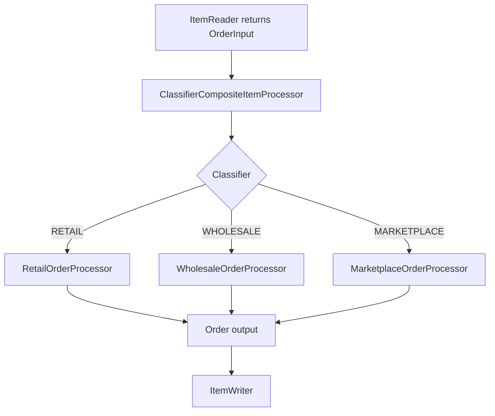
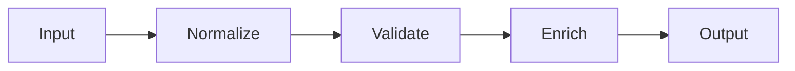
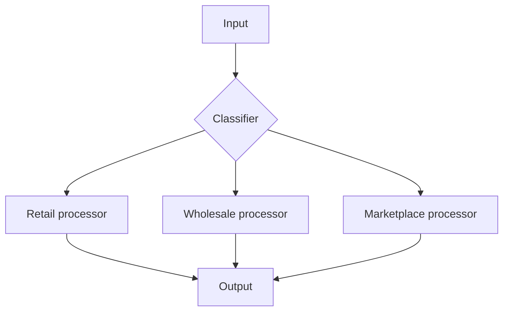

# ClassifierCompositeItemProcessor

In Spring Batch, a step can receive multiple input item types and need to apply different processing logic to each type. For example, retail orders need shipping fees calculated, wholesale orders need contract-based discounts applied, and marketplace orders need transaction codes verified. Writing all branches inside one large processor makes the logic hard to read and hard to test.

**ClassifierCompositeItemProcessor** solves this scenario by classifying each item, selecting an appropriate ItemProcessor, and passing that item to the selected processor. Each item follows a processing branch based on the classifier's result.

The key point is that this is a mechanism for **selecting one processor per item**, not running all processors sequentially. If the selected processor returns null, the item is filtered according to the ItemProcessor contract; the composite does not try another processor.

## 1. What Is ClassifierCompositeItemProcessor?

ClassifierCompositeItemProcessor is an implementation of ItemProcessor in Spring Batch. It holds a Classifier to decide which processor will handle the current item.

Processing flow:



For each call to process(item):

1. The classifier receives the input item.
2. The classifier returns a selected ItemProcessor.
3. ClassifierCompositeItemProcessor invokes that processor with the item.
4. The processor's result is returned to the step.
5. If the result is non-null, the item continues to the writer; if null, the item is filtered.

The classifier only decides **who processes the item**. Transforming, validating, or enriching data remains the responsibility of the selected processor.

## 2. When Should You Use It?

ClassifierCompositeItemProcessor fits when items share the step's input and output types but require different processing algorithms.

For example:

- Retail and wholesale orders have different pricing rules.
- Card, bank transfer, or e-wallet payments require separate processors.
- Individual and corporate customer profiles need different normalization steps.
- Events of type CREATED, UPDATED, or DELETED require different mappings.
- Records from multiple systems have different formats but must return the same domain model.

Signs that a processor should be split:

- A single processor has many large if/else branches.
- Each item type has its own business rules.
- Branches need to be unit tested independently.
- One branch changes frequently without wanting to affect other branches.
- You need to measure item counts processed per type.

There is no need to use a classifier for a simple condition with a single short action. An ordinary processor with one small if statement can be easier to read.

## 3. Distinguishing Classifier and Processor

The two components have different responsibilities:

| Component | Input | Output | Responsibility |
|---|---|---|---|
| Classifier | Input item | An ItemProcessor | Select processing branch |
| Selected ItemProcessor | Input item | Output item or null | Business processing |
| ClassifierCompositeItemProcessor | Input item | Output item or null | Combine selection and processor invocation |

A classifier should not transform the item into the final output itself. It returns the appropriate processor, and then that processor performs the processing.

Classifier example:

```java
Classifier<OrderInput, ItemProcessor<OrderInput, Order>> classifier =
        input -> input.channel() == OrderChannel.RETAIL
                ? retailProcessor
                : wholesaleProcessor;
```

Here the classifier only chooses retailProcessor or wholesaleProcessor. It does not calculate prices, query customers, or construct an Order.

## 4. Business Example: Routing Orders

Suppose the input has the structure:

```java
public record OrderInput(
        long orderId,
        OrderChannel channel,
        String customerId,
        BigDecimal amount) {
}

public enum OrderChannel {
    RETAIL,
    WHOLESALE,
    MARKETPLACE
}
```

The output of every branch is Order:

```java
public record Order(
        long orderId,
        String customerId,
        BigDecimal netAmount,
        String processingRoute) {
}
```

Three processors can implement their own rules:

```java
public class RetailOrderProcessor
        implements ItemProcessor<OrderInput, Order> {

    @Override
    public Order process(OrderInput input) {
        BigDecimal netAmount = input.amount();
        return new Order(
                input.orderId(),
                input.customerId(),
                netAmount,
                "RETAIL");
    }
}
```

```java
public class WholesaleOrderProcessor
        implements ItemProcessor<OrderInput, Order> {

    @Override
    public Order process(OrderInput input) {
        BigDecimal discount = input.amount()
                .multiply(new BigDecimal("0.10"));
        BigDecimal netAmount = input.amount().subtract(discount);

        return new Order(
                input.orderId(),
                input.customerId(),
                netAmount,
                "WHOLESALE");
    }
}
```

```java
public class MarketplaceOrderProcessor
        implements ItemProcessor<OrderInput, Order> {

    @Override
    public Order process(OrderInput input) {
        return new Order(
                input.orderId(),
                input.customerId(),
                input.amount(),
                "MARKETPLACE");
    }
}
```

These examples only illustrate separating responsibilities. In a real application, pricing formulas, discounts, and validation must come from verified business rules.

## 5. Java Configuration

Create the processor beans:

```java
@Bean
ItemProcessor<OrderInput, Order> retailOrderProcessor() {
    return new RetailOrderProcessor();
}

@Bean
ItemProcessor<OrderInput, Order> wholesaleOrderProcessor() {
    return new WholesaleOrderProcessor();
}

@Bean
ItemProcessor<OrderInput, Order> marketplaceOrderProcessor() {
    return new MarketplaceOrderProcessor();
}
```

Then configure the classifier and composite:

```java
@Bean
ClassifierCompositeItemProcessor<OrderInput, Order>
orderClassifierProcessor(
        @Qualifier("retailOrderProcessor")
        ItemProcessor<OrderInput, Order> retailProcessor,
        @Qualifier("wholesaleOrderProcessor")
        ItemProcessor<OrderInput, Order> wholesaleProcessor,
        @Qualifier("marketplaceOrderProcessor")
        ItemProcessor<OrderInput, Order> marketplaceProcessor) {

    Classifier<OrderInput, ItemProcessor<OrderInput, Order>> classifier =
            input -> switch (input.channel()) {
                case RETAIL -> retailProcessor;
                case WHOLESALE -> wholesaleProcessor;
                case MARKETPLACE -> marketplaceProcessor;
            };

    ClassifierCompositeItemProcessor<OrderInput, Order> composite =
            new ClassifierCompositeItemProcessor<>();
    composite.setClassifier(classifier);
    return composite;
}
```

The example uses a switch expression on an enum so each channel value has exactly one branch. When adding a new enum constant, the compiler can help detect switches that need updating.

If processor beans share the same generic types, injection and configuration are clearer. Use @Qualifier so Spring knows which bean belongs to which branch when the context contains multiple beans of type ItemProcessor.

## 6. Attaching to a Chunk-Oriented Step

ClassifierCompositeItemProcessor is declared like an ordinary ItemProcessor on the step:

```java
@Bean
Step importOrdersStep(
        JobRepository jobRepository,
        PlatformTransactionManager transactionManager,
        ItemReader<OrderInput> orderReader,
        ClassifierCompositeItemProcessor<OrderInput, Order>
                orderClassifierProcessor,
        ItemWriter<Order> orderWriter) {

    return new StepBuilder("importOrdersStep", jobRepository)
            .<OrderInput, Order>chunk(100, transactionManager)
            .reader(orderReader)
            .processor(orderClassifierProcessor)
            .writer(orderWriter)
            .build();
}
```

The reader returns OrderInput. The classifier selects a processor corresponding to the channel. All processors return Order, so the writer only needs to work with one unified output type.

From the step's perspective, it does not need to know how many internal branches exist. The step still has one reader, one processor, and one writer.

## 7. Classifier Selects One Branch, Not All of Them

The biggest difference from CompositeItemProcessor is how delegates are invoked.

With ClassifierCompositeItemProcessor:

- The classifier is called for the current item.
- One processor is selected.
- Only that processor is invoked.
- The remaining processors do not run for this item.

Example:

```text
Order 1001 / RETAIL       -> RetailOrderProcessor
Order 1002 / WHOLESALE    -> WholesaleOrderProcessor
Order 1003 / MARKETPLACE  -> MarketplaceOrderProcessor
```

If a batch has 1,000 items, 400 items might go through the retail processor, 350 through the wholesale processor, and 250 through the marketplace processor. It does not mean every item goes through all three branches.

This is item-level routing within a single step. It does not create additional StepExecutions or transition to a different step/job flow.

## 8. Distinguishing from CompositeItemProcessor

CompositeItemProcessor and ClassifierCompositeItemProcessor both combine multiple ItemProcessors, but they have different semantics:

| Criterion | CompositeItemProcessor | ClassifierCompositeItemProcessor |
|---|---|---|
| Purpose | Sequential transformation chain | Select processor per item |
| Delegates invoked | Multiple delegates in order | One selected delegate |
| Input to next delegate | Output of previous delegate | Original input item |
| Null from delegate | Stops chain and filters | Selected processor returning null filters |
| Use when | Complementary processing steps follow one another | Different item types need different strategies |

Chain example:



Classifier example:



Both mechanisms can be combined: a classifier selects a dedicated processor for an item type; inside that processor, CompositeItemProcessor can run a sub-pipeline. Keep the structure simple enough that readers can understand which branch an item takes.

## 9. Using a Map to Manage Routes

When the number of item types grows or routes are configured in one place, a Map can be used instead of a long switch:

```java
@Bean
ClassifierCompositeItemProcessor<OrderInput, Order>
orderClassifierProcessor(
        @Qualifier("retailOrderProcessor")
        ItemProcessor<OrderInput, Order> retail,
        @Qualifier("wholesaleOrderProcessor")
        ItemProcessor<OrderInput, Order> wholesale,
        @Qualifier("marketplaceOrderProcessor")
        ItemProcessor<OrderInput, Order> marketplace) {

    Map<OrderChannel, ItemProcessor<OrderInput, Order>> routes =
            Map.of(
                    OrderChannel.RETAIL, retail,
                    OrderChannel.WHOLESALE, wholesale,
                    OrderChannel.MARKETPLACE, marketplace);

    Classifier<OrderInput, ItemProcessor<OrderInput, Order>> classifier =
            input -> {
                ItemProcessor<OrderInput, Order> selected =
                        routes.get(input.channel());

                if (selected == null) {
                    throw new UnsupportedOrderChannelException(
                            "Unsupported channel: " + input.channel());
                }

                return selected;
            };

    ClassifierCompositeItemProcessor<OrderInput, Order> composite =
            new ClassifierCompositeItemProcessor<>();
    composite.setClassifier(classifier);
    return composite;
}
```

Map.of creates an immutable map, suitable for a routing table that stays fixed throughout the bean's lifecycle. If routes are loaded from dynamic configuration, validate the entire map before the job runs and never mutate the map while multiple threads are processing items.

## 10. Handling Unsupported Item Types

The classifier must have explicit behavior when encountering an item type with no route.

Three common policies exist:

1. **Fail**: throw a business/configuration exception so the step fails or passes through the defined skip policy.
2. **Default processor**: send the item to a default processor if business rules allow.
3. **Filter**: only when business requirements explicitly specify that the item type must be excluded from output.

Default route example:

```java
Classifier<OrderInput, ItemProcessor<OrderInput, Order>> classifier =
        input -> routes.getOrDefault(
                input.channel(),
                defaultOrderProcessor);
```

A default processor should not become a catch-all for ambiguous data. If an unknown channel can indicate upstream sent the wrong schema or an unsupported transaction type exists, failing explicitly is usually safer.

Explicit fail example:

```java
Classifier<OrderInput, ItemProcessor<OrderInput, Order>> classifier =
        input -> {
            ItemProcessor<OrderInput, Order> processor =
                    routes.get(input.channel());
            if (processor == null) {
                throw new UnsupportedOrderChannelException(
                        "No processor configured for channel "
                                + input.channel());
            }
            return processor;
        };
```

Do not return null from a classifier to represent filtering. A classifier is expected to return an ItemProcessor; null in this position is invalid configuration/routing logic and can lead to a NullPointerException when the composite invokes the processor. To filter an item, the selected processor must return null.

## 11. Null from the Selected Processor

ClassifierCompositeItemProcessor follows the ItemProcessor contract. If the selected processor returns null:

- The composite returns null to the step.
- The item is filtered.
- The writer does not receive the item.
- Filter count increments.
- The classifier does not try a second route.

Example:

```java
public class RetailOrderProcessor
        implements ItemProcessor<OrderInput, Order> {

    @Override
    public Order process(OrderInput input) {
        if (input.amount().signum() <= 0) {
            return null;
        }

        return createRetailOrder(input);
    }
}
```

If a retail order has a non-positive amount, the retail branch filters that item. The composite does not fall back to the wholesale processor automatically.

If you want to try another processor when the first processor rejects an item, that is a separate fallback rule. Implement it explicitly inside a processor or another routing component; do not rely on null to trigger the next branch.

## 12. Exceptions from Classifier and Processor

The classifier can throw a runtime exception if it cannot determine a route. The selected processor can also throw an exception while processing an item.

Spring Batch handles these exceptions according to the step's fault-tolerant policy:

- Exceptions configured as retryable can be retried.
- Exceptions configured as skippable can cause the item to be skipped.
- Exceptions not handled by policy will fail the step.

Example:

```java
return new StepBuilder("importOrdersStep", jobRepository)
        .<OrderInput, Order>chunk(100, transactionManager)
        .reader(orderReader)
        .processor(orderClassifierProcessor)
        .writer(orderWriter)
        .faultTolerant()
        .skip(InvalidOrderException.class)
        .skipLimit(50)
        .retry(DeadlockLoserDataAccessException.class)
        .retryLimit(3)
        .build();
```

If UnsupportedOrderChannelException is not in the skip policy, the step fails when the classifier cannot find a route. That is usually the right choice if a new item type indicates a data contract violation.

Do not catch all exceptions inside the classifier and pick a default processor. Doing so can turn configuration errors or code bugs into data processed down the wrong branch.

## 13. Shared Input/Output Types Preserve Type Safety

ClassifierCompositeItemProcessor is most convenient when all delegates accept the same input type and return the same output type:

```java
ItemProcessor<OrderInput, Order> retail;
ItemProcessor<OrderInput, Order> wholesale;
ItemProcessor<OrderInput, Order> marketplace;
```

The classifier selects one of those processors:

```java
Classifier<OrderInput, ItemProcessor<OrderInput, Order>> classifier;
```

This helps:

- The compiler verifies the input/output types of each bean.
- The step only needs to declare one output type.
- The writer does not need to know which branch processed the item.
- Unit testing each branch independently is straightforward.

If source types have different input classes, consider normalizing them into a sealed interface/base type before routing, or create adapters so processors share the same contract. Avoid raw ItemProcessors and unchecked casts because errors might only appear at runtime.

## 14. Routing by Class Type

Classifiers are not always enum-based. You can select a processor by item class:

```java
public sealed interface ImportRecord
        permits CustomerRecord, SupplierRecord {
}

public record CustomerRecord(long id, String name)
        implements ImportRecord {
}

public record SupplierRecord(long id, String companyName)
        implements ImportRecord {
}
```

If the common output is ImportResult, you can create adapters so both processors accept the same base type:

```java
ItemProcessor<ImportRecord, ImportResult> customerProcessor =
        record -> {
            CustomerRecord customer = (CustomerRecord) record;
            return mapCustomer(customer);
        };
```

This is an illustrative example; if you must cast inside each processor, ensure the classifier and adapters agree. A safer option is creating dedicated adapters that check the type and throw a clear error when receiving the wrong type.

With complex class hierarchies, you can classify by subclass or write an explicit classifier. Priority order must be defined when an object can match multiple superclasses/interfaces.

## 15. Routing by Multiple Properties

A classifier can inspect multiple fields of an item:

```java
Classifier<OrderInput, ItemProcessor<OrderInput, Order>> classifier =
        input -> {
            if (input.channel() == OrderChannel.WHOLESALE
                    && input.amount().compareTo(
                            new BigDecimal("10000")) >= 0) {
                return highValueWholesaleProcessor;
            }

            if (input.channel() == OrderChannel.WHOLESALE) {
                return wholesaleProcessor;
            }

            if (input.channel() == OrderChannel.RETAIL) {
                return retailProcessor;
            }

            return marketplaceProcessor;
        };
```

When there are multiple conditions, check order matters greatly. Specific conditions such as high-value wholesale must come before the general wholesale condition.

If rules are complex, do not let the classifier turn into a large block of business logic. Extract the route decision into a service or an enum/record representing the route:

```java
public enum OrderRoute {
    RETAIL,
    WHOLESALE_STANDARD,
    WHOLESALE_HIGH_VALUE,
    MARKETPLACE
}
```

Then the classifier simply maps OrderRoute to a processor. This makes decision rules easy to test independently of Spring Batch.

## 16. Classifier Is Not a Job Flow

ClassifierCompositeItemProcessor routes each item inside a single step. It does not change JobExecution or create separate StepExecutions.

Distinguish:

| Mechanism | Routing unit | Example |
|---|---|---|
| ClassifierCompositeItemProcessor | One item | Retail order to retail processor |
| Conditional flow transition | Step outcome | Step COMPLETED transitions to next step |
| Split flow | Flows within a job | Two independent flows run in parallel |
| Partitioning | Data slice/worker step | Each worker processes an ID range |

If each item type needs to be written to a separate database/table or file, a classifier processor can transform the data, yet the step's writer remains the writer configured for the step. To select a writer per item, look at ClassifierCompositeItemWriter or design an appropriate routing writer.

If branches need independent transactions, retries, checkpoints, or lifecycles, separate steps/flows may be more appropriate. Do not use a classifier to replace workflow orchestration when business rules need separate state per branch.

## 17. Combining with CompositeItemProcessor

A branch may need multiple sequential processing steps. You can use CompositeItemProcessor inside each route:

```java
@Bean
ItemProcessor<OrderInput, Order> retailPipeline(
        ItemProcessor<OrderInput, NormalizedOrder> normalizeRetail,
        ItemProcessor<NormalizedOrder, Order> calculateRetail) throws Exception {

    CompositeItemProcessor<OrderInput, Order> pipeline =
            new CompositeItemProcessor<>();
    pipeline.setDelegates(List.of(
            normalizeRetail,
            calculateRetail));
    pipeline.afterPropertiesSet();
    return pipeline;
}
```

The classifier then selects retailPipeline or another pipeline:

```java
Classifier<OrderInput, ItemProcessor<OrderInput, Order>> classifier =
        input -> switch (input.channel()) {
            case RETAIL -> retailPipeline;
            case WHOLESALE -> wholesalePipeline;
            case MARKETPLACE -> marketplacePipeline;
        };
```

This architecture has two layers:

1. The classifier selects a pipeline by item type.
2. CompositeItemProcessor inside the pipeline runs the sequential steps.

If a delegate in the pipeline returns null, that pipeline stops and the item is filtered. The classifier does not pick another pipeline after the selected pipeline returns null.

## 18. Measuring Item Counts per Route

When routing multiple item types, operations often need to know how many items each branch processed. You can use counters or Micrometer metrics.

Example:

```java
public class RetailOrderProcessor
        implements ItemProcessor<OrderInput, Order> {

    private final Counter processedCounter;

    public RetailOrderProcessor(MeterRegistry registry) {
        this.processedCounter = Counter.builder("batch.orders.processed")
                .tag("route", "retail")
                .register(registry);
    }

    @Override
    public Order process(OrderInput input) {
        processedCounter.increment();
        return createRetailOrder(input);
    }
}
```

Similar counters can be created for wholesale and marketplace. Metrics help observe route distribution and detect if a branch suddenly receives no items or too many items.

A counter inside a processor counts how many times process is invoked; if retries happen, the same item can increment the counter multiple times. If you need final committed item counts, distinguish processing attempts from committed output and use step metrics or durable data as appropriate.

Do not use metric counters as the source of truth for business data. Metrics serve observability; the writer/database stores business results.

## 19. Thread Safety and Parallel Execution

Classifiers and processor beans are usually long-lived Spring-managed beans. If a step runs multithreaded, the same processor instance can be invoked concurrently from multiple threads.

Therefore:

- Prefer stateless processors.
- Do not store the current item in a mutable field on the processor.
- Use an immutable route map if routes are fixed.
- If using counters or caches, choose thread-safe structures.
- Do not modify classifier routes while the job is running.
- Ensure services called from processors are concurrency-safe.

Unsafe example:

```java
public class RetailOrderProcessor
        implements ItemProcessor<OrderInput, Order> {

    private OrderInput currentItem;

    @Override
    public Order process(OrderInput input) {
        this.currentItem = input;
        return calculate(this.currentItem);
    }
}
```

Two threads can overwrite each other's currentItem. Use local variables instead:

```java
@Override
public Order process(OrderInput input) {
    return calculate(input);
}
```

@StepScope does not automatically make a processor thread-safe if multiple threads execute within one StepExecution. With partitioning, each worker has its own StepExecution and StepScope creates targets per worker; however, singleton dependencies injected into it still require thread safety if shared.

## 20. Handling Null Fields in a Classifier

If a classifier routes based on a field like channel, define behavior when that field is null:

```java
Classifier<OrderInput, ItemProcessor<OrderInput, Order>> classifier =
        input -> {
            if (input.channel() == null) {
                throw new InvalidOrderChannelException(
                        "Order channel is required");
            }

            return routes.get(input.channel());
        };
```

Do not let null accidentally fall into a switch and cause a confusing NullPointerException. Validate beforehand or throw a business exception with a clear message.

If null means a default route, express it explicitly:

```java
ItemProcessor<OrderInput, Order> selected =
        input.channel() == null
                ? legacyOrderProcessor
                : routes.get(input.channel());
```

Only use this fallback if the data contract specifies that a missing channel means legacy. Otherwise, failing explicitly is safer.

## 21. Testing the Classifier Independently

A classifier is routing logic, so it can be unit tested without launching a job:

```java
@Test
void routesRetailOrderToRetailProcessor() {
    ItemProcessor<OrderInput, Order> retail =
            input -> new Order(
                    input.orderId(),
                    input.customerId(),
                    input.amount(),
                    "RETAIL");
    ItemProcessor<OrderInput, Order> wholesale =
            input -> new Order(
                    input.orderId(),
                    input.customerId(),
                    input.amount(),
                    "WHOLESALE");

    Map<OrderChannel, ItemProcessor<OrderInput, Order>> routes =
            Map.of(
                    OrderChannel.RETAIL, retail,
                    OrderChannel.WHOLESALE, wholesale);

    Classifier<OrderInput, ItemProcessor<OrderInput, Order>> classifier =
            input -> routes.get(input.channel());

    assertSame(
            retail,
            classifier.classify(new OrderInput(
                    1001L,
                    OrderChannel.RETAIL,
                    "C001",
                    new BigDecimal("100.00"))));
}
```

This test only checks that the classifier returns the right delegate. It does not prove ClassifierCompositeItemProcessor invokes the right delegate; that requires testing the composite separately.

## 22. Unit Test: Only the Selected Processor Runs

Use mocks to verify unselected branches are not called:

```java
@Test
void invokesOnlySelectedProcessor() throws Exception {
    @SuppressWarnings("unchecked")
    ItemProcessor<OrderInput, Order> retail =
            mock(ItemProcessor.class);
    @SuppressWarnings("unchecked")
    ItemProcessor<OrderInput, Order> wholesale =
            mock(ItemProcessor.class);

    Order expected = new Order(
            1001L,
            "C001",
            new BigDecimal("100.00"),
            "RETAIL");
    when(retail.process(any())).thenReturn(expected);

    Classifier<OrderInput, ItemProcessor<OrderInput, Order>> classifier =
            input -> input.channel() == OrderChannel.RETAIL
                    ? retail
                    : wholesale;

    ClassifierCompositeItemProcessor<OrderInput, Order> composite =
            new ClassifierCompositeItemProcessor<>();
    composite.setClassifier(classifier);

    OrderInput input = new OrderInput(
            1001L,
            OrderChannel.RETAIL,
            "C001",
            new BigDecimal("100.00"));

    assertEquals(expected, composite.process(input));
    verify(retail).process(input);
    verifyNoInteractions(wholesale);
}
```

The test proves an item only calls the retail processor. In a real test suite, test every route as well as unsupported branches.

## 23. Testing When the Selected Processor Returns null

If the selected processor returns null, the composite returns null and does not try another processor:

```java
@Test
void selectedProcessorReturningNullFiltersItem() throws Exception {
    @SuppressWarnings("unchecked")
    ItemProcessor<OrderInput, Order> retail =
            mock(ItemProcessor.class);
    @SuppressWarnings("unchecked")
    ItemProcessor<OrderInput, Order> wholesale =
            mock(ItemProcessor.class);

    when(retail.process(any())).thenReturn(null);

    Classifier<OrderInput, ItemProcessor<OrderInput, Order>> classifier =
            input -> input.channel() == OrderChannel.RETAIL
                    ? retail
                    : wholesale;

    ClassifierCompositeItemProcessor<OrderInput, Order> composite =
            new ClassifierCompositeItemProcessor<>();
    composite.setClassifier(classifier);

    OrderInput input = new OrderInput(
            1002L,
            OrderChannel.RETAIL,
            "C002",
            new BigDecimal("0.00"));

    assertNull(composite.process(input));
    verify(retail).process(input);
    verifyNoInteractions(wholesale);
}
```

Null is the filter result of the selected processor. It is not a signal to try the wholesale processor.

## 24. Integration Testing the Chunk Step

Unit tests do not test the full reader-processor-writer flow. You should have integration tests that launch the job with different item types and verify the output of each route.

Illustrative fixture:

| Order ID | Channel | Expected processor | Route in output |
|---:|---|---|---|
| 1001 | RETAIL | RetailOrderProcessor | RETAIL |
| 1002 | WHOLESALE | WholesaleOrderProcessor | WHOLESALE |
| 1003 | MARKETPLACE | MarketplaceOrderProcessor | MARKETPLACE |
| 1004 | RETAIL | RetailOrderProcessor | RETAIL |

After the job completes, verify:

- Total number of items read.
- Number of times each processor was invoked.
- Output values calculated according to the right branch.
- The writer only receives one unified output type.
- No processor from another branch was called for that item.
- Filter count is accurate if a processor returns null.
- Skip count is accurate if a processor throws a skippable exception.

Example output-level assertion:

```java
assertEquals(
        new BigDecimal("90.00"),
        orderRepository.findById(1002L).orElseThrow().netAmount());
assertEquals(
        "WHOLESALE",
        orderRepository.findById(1002L).orElseThrow().processingRoute());
```

The value 90.00 only matches the 10% discount example on amount 100.00. In real tests, use your application's fixtures and business rules.

## 25. Testing Unsupported Item Types

If the classifier throws UnsupportedOrderChannelException, verify that the step reacts according to policy:

- No skip rule: step fails.
- Specific skip rule: item is skipped and SkipListener records it.
- Default route: default processor is invoked properly.

Do not write a test that only asserts the job FAILED without confirming the exception came from the classifier. You can inspect the exception or StepExecution failure exceptions to be certain the error was classified properly.

If channel is an enum and the input parser rejects invalid enum values before the processor, the classifier may never receive that item. In that case, test the mapping/deserialization layer separately.

## 26. Testing Filter, Skip, and Retry per Route

Each delegate can have different failure behavior. Verify:

| Branch | Behavior | Expected outcome |
|---|---|---|
| Retail | Returns null per rule | Filter count increments |
| Wholesale | Throws InvalidOrderException | Process skip if configured |
| Marketplace | Throws transient deadlock error | Retries per policy |
| Unknown channel | Throws UnsupportedOrderChannelException | Fails or skips per explicit policy |

Skip/retry policies are configured on the step, so they generally apply to exceptions from the classifier or delegates if the exception type matches the policy. If different policies are needed per route, use specific exception types or split into separate steps for independent policies.

Avoid having every processor throw the same generic exception if each branch requires different retry/skip behavior.

## 27. Performance and Routing Cost

A classifier usually only makes a simple decision based on item fields. Classification cost is small compared to operations like database queries or service calls, yet the classifier should still remain lean and deterministic.

Guidelines:

- Use enums, discriminators, or normalized keys for routing.
- Use immutable Maps for fixed mapping tables.
- Do not call external services just to determine a route if the discriminator can be included in the input.
- Do not recompute the same complex rule multiple times inside delegates.
- Measure metrics per route to spot abnormal distributions.

If a route decision requires a database lookup, evaluate caching, batching, or a separate enrichment step. Avoid letting the classifier issue a query per item if the route can be determined from data already read.

## 28. Common Pitfalls

**Confusing classifier with processor.** The classifier returns a delegate; the processor handles the item. Do not put all business transformations inside the classifier.

**Thinking all delegates execute.** ClassifierCompositeItemProcessor only calls one selected processor per item.

**Using mismatched input/output types.** The selected delegate must accept the item type passed by the composite and return a compatible output type. Avoid raw types and unchecked casts.

**Not handling missing routes.** If the classifier returns null, the composite has no valid processor to invoke. Fail, use a default, or filter per an explicit policy.

**Thinking null from a processor tries another route.** Null means filtering the item. The composite does not perform automatic fallback.

**Making fallback too broad.** New item types or data errors may be processed as the default type and produce wrong results. Only use a default when business rules allow it.

**Using a stateful processor across multiple threads.** Multiple items may call the same delegate concurrently. Keep processors stateless or protect state properly.

**Putting workflow orchestration into the classifier.** A classifier routes items within one step; it does not create StepExecutions or replace conditional flows.

**Not testing unselected branches.** Correct output does not prove other processors did not run. Use mocks and verify interactions.

**Not observing route distribution.** A branch might stop receiving items after a data change. Monitor counts per route and per batch.

## 29. Workflow for Designing ClassifierCompositeItemProcessor

When you need to route items to different processors, follow this sequence:

1. Identify the discriminator: enum, type, source system, or business attribute.
2. Define valid routes and behavior for unsupported routes.
3. Normalize inputs so delegates share the same input contract if possible.
4. Normalize outputs so delegates return the same output type for the writer.
5. Write and unit test the classifier independently.
6. Configure ClassifierCompositeItemProcessor with setClassifier(...).
7. Attach the composite to the step as an ordinary ItemProcessor.
8. Define null, exception, retry, and skip behavior for each branch.
9. Ensure processors are thread-safe if the step runs concurrently.
10. Integration test routes, outputs, filter counts, skip counts, and unknown types.

If each route requires independent transactions, checkpoints, listeners, or lifecycles, consider splitting into separate steps/flows. A classifier fits when branches remain alternative ways of processing items within the same step.

## 30. Practical Conclusion

ClassifierCompositeItemProcessor lets Spring Batch select one ItemProcessor per item based on a Classifier. The classifier receives the item and returns the matching delegate; the delegate processes the item and returns a unified output to the writer. This mechanism fits when multiple item types need distinct processing rules while still passing through the same chunk step.

Keep the classifier focused on routing, use delegates with compatible input/output types, define an explicit default or error for unsupported routes, and do not expect null to trigger a fallback. If the selected processor returns null, the item is filtered; if it throws an exception, the step applies its retry/skip/fail policy. Other processors do not run for that item.

Distinguish item routing from sequential CompositeItemProcessor and conditional job flows. Keep delegates stateless or thread-safe, measure counts per route, and test both selected branches and uninvoked branches. When every route has a clear contract, ClassifierCompositeItemProcessor separates business rules while preserving a unified reader-processor-writer pipeline.
